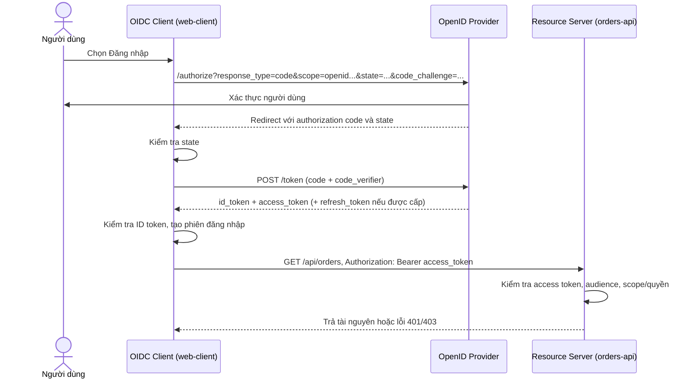

# ID token phục vụ OIDC Client và không thay access token để gọi API

## 1. Một lần đăng nhập, hai câu hỏi bảo mật khác nhau

Khi người dùng đăng nhập bằng OpenID Connect (OIDC), ứng dụng có thể nhận được cả **ID token** và **access token**. Hai token này có thể cùng được phát hành bởi một Identity Provider, cùng là chuỗi ký tự dài và thậm chí cùng có định dạng JWT. Tuy nhiên, chúng phục vụ **hai đối tượng nhận và hai mục đích khác nhau**:

- **ID token** trả lời cho **OIDC Client (Relying Party)**: “Người dùng nào vừa được xác thực và kết quả xác thực này thuộc về client nào?”
- **Access token** cho phép **OAuth 2.0 Resource Server (API)** đánh giá: “Yêu cầu mang token này có được phép truy cập tài nguyên/API này với quyền tương ứng hay không?”

Điểm cốt lõi: **ID token không phải giấy phép gọi API**. Một ứng dụng có ID token hợp lệ vẫn phải dùng access token phù hợp khi gọi API được bảo vệ bằng OAuth 2.0.

Ví dụ, sau khi đăng nhập vào ứng dụng quản lý đơn hàng:

1. Ứng dụng web nhận ID token để thiết lập phiên đăng nhập cho người dùng.
2. Ứng dụng nhận access token có quyền `orders:read` dành cho `orders-api`.
3. Khi gọi `GET /api/orders`, ứng dụng gửi access token trong header `Authorization: Bearer ...`.
4. Resource Server kiểm tra access token, đối tượng nhận (`aud`), thời hạn và quyền truy cập; API không dùng ID token để quyết định cấp quyền.

OIDC được xây dựng trên OAuth 2.0 nhưng bổ sung **lớp xác thực danh tính người dùng**. Vì vậy, cần phân biệt **authentication** (ai vừa đăng nhập) với **authorization** (được truy cập tài nguyên nào).

## 2. Các vai trò trong hệ thống

| Thành phần | Vai trò | Token liên quan |
| --- | --- | --- |
| End User | Người dùng thực hiện đăng nhập và sử dụng ứng dụng. | Không phải đối tượng thẩm định ID token hay access token theo vai trò máy chủ. |
| OpenID Provider (OP) / Authorization Server | Xác thực người dùng, cấp token và công bố metadata/JWKS hoặc introspection endpoint. | Phát hành ID token; cấp access token theo chính sách và phạm vi được cấp. |
| OIDC Client / Relying Party | Ứng dụng yêu cầu đăng nhập; kiểm tra ID token và tạo ngữ cảnh/phiên đăng nhập. | **Tiêu thụ ID token**; có thể sử dụng access token để gọi API. |
| Resource Server | API lưu giữ tài nguyên được bảo vệ; kiểm tra token mang theo yêu cầu và áp dụng quy tắc phân quyền. | **Tiêu thụ access token** có hiệu lực cho API của mình. |

Trong Spring Security, hai vai trò thường đi với hai cấu hình riêng: `oauth2Login()`/OAuth2 Client hỗ trợ đăng nhập OIDC, còn `oauth2ResourceServer()` bảo vệ endpoint bằng Bearer access token. Một hệ thống có thể vừa đóng vai client, vừa có các endpoint là resource server, nhưng quy tắc xác thực của từng endpoint vẫn phải rõ ràng.

## 3. ID token là gì và ai được phép sử dụng?

**ID token là token xác thực được chuẩn hóa bởi OpenID Connect**, thông thường là JWT có chữ ký số. Nó do OpenID Provider phát hành cho một client đã được đăng ký, để client nhận biết người dùng vừa đăng nhập và kiểm chứng kết quả xác thực.

Ví dụ **payload minh họa** của một ID token đã được giải mã (không phải JWT hoàn chỉnh):

```json
{
  "iss": "https://login.example.test/realms/demo",
  "sub": "user-123",
  "aud": "web-client",
  "exp": 1893456000,
  "iat": 1893452400,
  "auth_time": 1893452350,
  "nonce": "nonce-from-login-request",
  "email": "user@example.test"
}
```

Các claim cần hiểu đúng:

| Claim | Ý nghĩa đối với OIDC Client |
| --- | --- |
| `iss` | Định danh issuer của OpenID Provider. Client chỉ chấp nhận issuer đã tin cậy. |
| `sub` | Định danh ổn định của người dùng **trong phạm vi issuer**; nên kết hợp `iss` + `sub` khi định danh tài khoản liên kết. |
| `aud` | Đối tượng nhận ID token: thường chứa **`client_id` của OIDC Client**, ví dụ `web-client`, không phải tên API. |
| `exp`, `iat` | Thời điểm hết hạn và thời điểm phát hành; client phải xử lý thời gian hợp lệ. |
| `nonce` | Giá trị liên kết phản hồi đăng nhập với yêu cầu xác thực có gửi `nonce`, giúp chống replay/substitution trong những luồng có áp dụng. |
| `auth_time`, `acr`, `amr` | Thông tin về thời điểm, mức độ và phương thức xác thực, khi được OP cung cấp hoặc yêu cầu. |
| `name`, `email`, `picture`... | Claim hồ sơ có thể được cung cấp theo scope/chính sách; không bảo đảm luôn tồn tại và không mặc nhiên là quyền truy cập API. |

Một số ID token có thêm `azp` (authorized party), đặc biệt khi `aud` có nhiều giá trị. Việc xác nhận `azp` phải tuân theo quy tắc OIDC áp dụng cho luồng và token cụ thể.

**Client không được chỉ Base64-decode ID token rồi tin nội dung.** Nó phải dùng cấu hình OIDC đáng tin cậy, kiểm tra chữ ký/thuật toán được phép, issuer, audience, hạn dùng và các kiểm tra liên quan đến luồng (`nonce` nếu có, `azp`, yêu cầu `auth_time`/`acr` nếu được áp dụng). Giá trị `state` trong authorization request cũng phải được kiểm tra tại callback để chống nhầm lẫn phiên/CSRF; `state` không phải claim của ID token.

ID token chứng minh một sự kiện đăng nhập **cho client nhận token**. Chuyển nó sang API khác không làm API đó trở thành audience hợp lệ.

## 4. Access token là gì và vì sao API cần nó?

**Access token là thông tin ủy quyền để truy cập protected resource**. Nó được Authorization Server cấp theo chính sách, quyền đã được chấp thuận và đối tượng nhận tài nguyên. API xử lý token như một credential của yêu cầu, kiểm tra token còn hiệu lực và có đủ quyền trước khi trả dữ liệu.

Access token có thể ở một trong các dạng phổ biến:

- **JWT access token:** Resource Server thường xác minh chữ ký bằng JWKS, kiểm tra các claim tin cậy, thời gian, audience và quyền truy cập.
- **Opaque access token:** Resource Server không thể suy ra quyền bằng cách giải mã chuỗi; nó thường dùng token introspection hoặc cơ chế xác thực mà Authorization Server cung cấp.

Ví dụ **payload minh họa** của một JWT access token dành cho API đơn hàng:

```json
{
  "iss": "https://login.example.test/realms/demo",
  "sub": "user-123",
  "aud": ["orders-api"],
  "client_id": "web-client",
  "scope": "orders:read orders:write",
  "exp": 1893454200,
  "iat": 1893452400
}
```

Trường thực tế phụ thuộc nhà cung cấp và access-token profile: có nơi dùng `scope`, có nơi dùng `scp`, có nơi không cung cấp các claim trên vì token là opaque. Ví dụ này **không phải khẳng định mọi access token bắt buộc là JWT** hoặc issuer luôn tự phát hành audience `orders-api`: ứng dụng phải đăng ký và yêu cầu quyền/audience theo cơ chế được nhà cung cấp hỗ trợ.

Trong ví dụ, API chỉ nên chấp nhận token nếu đã xác minh được token hợp lệ, `aud` phù hợp với `orders-api` và endpoint có quyền cần thiết. Quyền `orders:read` có thể được dùng cho `GET /api/orders`; quyền `orders:write` có thể được yêu cầu cho thao tác ghi.

Một access token **không mặc nhiên xác thực danh tính người dùng cho OIDC Client**. Có access token cũng không bảo đảm tồn tại phiên đăng nhập của người dùng: OAuth 2.0 hỗ trợ cả các luồng không có người dùng tương tác, chẳng hạn `client_credentials`.

## 5. So sánh ID token, access token và refresh token

| Tiêu chí | ID token | Access token | Refresh token |
| --- | --- | --- | --- |
| Mục đích | Chuyển kết quả xác thực người dùng tới OIDC Client. | Cho phép truy cập resource/API được bảo vệ. | Xin access token mới khi token cũ hết hạn, theo chính sách cấp token. |
| Bên tiêu thụ | OIDC Client có `client_id` phù hợp. | Resource Server/ API được token hướng tới. | Authorization Server tại token endpoint. |
| Định dạng | Thường là JWT theo chuẩn ID Token của OIDC. | Có thể là JWT hoặc opaque. | Không có yêu cầu phải là JWT; thường opaque. |
| `aud` khi là JWT | Client nhận ID token (`client_id`). | API/resource nhận access token (theo issuer/profile). | Không áp dụng một cách tổng quát. |
| Dữ liệu thường gặp | `iss`, `sub`, `aud`, `exp`, `iat`, đôi khi `nonce`, `auth_time` và profile claims. | Issuer, subject/client, audience, expiration, scope/quyền (nếu JWT). | Giá trị bí mật dùng tại token endpoint. |
| Dùng làm `Authorization: Bearer` để gọi API? | **Không.** | **Có**, khi token có hiệu lực cho API đó. | **Không.** |
| Dùng để suy ra quyền truy cập API? | **Không.** | Chỉ sau khi API thẩm định và áp dụng chính sách quyền. | Không. |

ID token có thể chứa `email` hoặc nhóm người dùng để phục vụ hiển thị UI/thiết lập phiên, nhưng sự có mặt của các claim này không biến ID token thành access token và không thay bước phân quyền của API.

## 6. Luồng Authorization Code + PKCE với OIDC

Ví dụ ứng dụng `web-client` đăng nhập người dùng, rồi gọi `orders-api`:



Một yêu cầu authorization có thể có các tham số:

```http
GET /authorize?response_type=code
  &client_id=web-client
  &redirect_uri=https%3A%2F%2Fapp.example.test%2Flogin%2Foauth2%2Fcode%2Fdemo
  &scope=openid%20profile
  &state=client-generated-state
  &code_challenge=...
  &code_challenge_method=S256
  &nonce=client-generated-nonce
```

Đây là ví dụ trình bày nhiều dòng cho dễ đọc; trên mạng tham số sẽ được URL-encode trong một URL hợp lệ. `openid` yêu cầu xử lý theo OIDC; `state` bảo vệ tương quan yêu cầu/callback; PKCE ràng buộc authorization code với client bắt đầu luồng. `nonce` có thể được dùng để ràng buộc ID token với yêu cầu đăng nhập, và nếu đã gửi thì client phải kiểm tra giá trị trong ID token theo quy tắc OIDC.

Phản hồi token endpoint có thể trông như sau (giá trị đã rút gọn để minh họa):

```json
{
  "access_token": "eyJ...access...",
  "id_token": "eyJ...id...",
  "token_type": "Bearer",
  "expires_in": 1800,
  "scope": "openid profile orders:read"
}
```

Các token không phải lúc nào cũng được cấp đủ mọi scope được yêu cầu. Scope truy cập đơn hàng trong ví dụ chỉ xuất hiện nếu được cấu hình, yêu cầu và chấp thuận theo chính sách của Authorization Server. Phản hồi cũng có thể có `refresh_token`, tùy client, grant và chính sách.

**Hai cách sử dụng sau khi nhận phản hồi là hoàn toàn khác nhau:**

```http
GET /api/orders HTTP/1.1
Host: api.example.test
Authorization: Bearer <access_token>
```

```http
GET /api/orders HTTP/1.1
Host: api.example.test
Authorization: Bearer <id_token>
```

Yêu cầu đầu tiên đúng về **loại token** (API vẫn cần thẩm định token và quyền). Yêu cầu thứ hai sai về **ngữ nghĩa và audience**: ID token hướng tới `web-client` và phải được API từ chối. Không thể thay thế đơn giản vì cả hai cùng là JWT, cùng có `sub`, hoặc cùng được ký bởi một issuer.

## 7. Mối liên hệ với Spring Security OAuth2 Client và Resource Server

### 7.1. OIDC Client xử lý ID token tại chỗ đăng nhập

Ví dụ cấu hình một ứng dụng Spring Boot làm OIDC Client với một OpenID Provider hỗ trợ discovery:

```yaml
spring:
  security:
    oauth2:
      client:
        registration:
          demo:
            provider: demo
            client-id: web-client
            client-secret: ${OIDC_CLIENT_SECRET}
            authorization-grant-type: authorization_code
            scope:
              - openid
              - profile
        provider:
          demo:
            issuer-uri: https://login.example.test/realms/demo
```

```java
@Configuration
class WebLoginSecurityConfig {

    @Bean
    SecurityFilterChain webSecurity(HttpSecurity http) throws Exception {
        return http
                .authorizeHttpRequests(auth -> auth
                        .requestMatchers("/").permitAll()
                        .anyRequest().authenticated())
                .oauth2Login(Customizer.withDefaults())
                .build();
    }
}
```

Khi đăng nhập OIDC thành công, Spring Security có thể biểu diễn principal bằng `OidcUser`; thông tin ID token được truy cập qua `OidcUser#getIdToken()`. Trong luồng đăng nhập thông thường, framework hỗ trợ kiểm tra token dựa trên cấu hình client/provider. Ứng dụng vẫn cần cấu hình issuer, redirect URI, HTTPS và chính sách phiên đúng cách.

Ví dụ đọc danh tính **phía server** sau đăng nhập:

```java
@GetMapping("/me")
Map<String, String> me(@AuthenticationPrincipal OidcUser user) {
    return Map.of(
            "subject", user.getSubject(),
            "issuer", user.getIdToken().getIssuer().toString());
}
```

Đây là ví dụ cho **ứng dụng đăng nhập dùng session và OIDC principal**; không phải controller của API chỉ xác thực bằng Bearer token. Client thường không cần gửi nguyên ID token vào API, không nên tự tạo Bearer credential từ giá trị `getIdToken().getTokenValue()`.

### 7.2. Resource Server chỉ nhận access token có hiệu lực cho API

Ở phía API `orders-api`, Spring Security có thể dùng JWT Resource Server:

```yaml
spring:
  security:
    oauth2:
      resourceserver:
        jwt:
          issuer-uri: https://login.example.test/realms/demo
```

```java
@Configuration
class ApiSecurityConfig {

    @Bean
    SecurityFilterChain apiSecurity(HttpSecurity http) throws Exception {
        return http
                .authorizeHttpRequests(auth -> auth
                        .requestMatchers(HttpMethod.GET, "/api/orders/**")
                        .hasAuthority("SCOPE_orders:read")
                        .anyRequest().authenticated())
                .oauth2ResourceServer(oauth2 -> oauth2.jwt(Customizer.withDefaults()))
                .build();
    }
}
```

Ví dụ này minh họa **ứng dụng API riêng** với ứng dụng OIDC Client ở mục 7.1; nếu cả hai vai trò nằm chung một ứng dụng, phải tổ chức `SecurityFilterChain` theo đường dẫn và thứ tự phù hợp. Cấu hình trên giả định issuer phát hành JWT access token và scope phù hợp. Spring Security mặc định thường ánh xạ `scope`/`scp` thành authority có tiền tố `SCOPE_`, nhưng cấu trúc claims và mapping thực tế phải khớp provider.

**Cấu hình `issuer-uri` và xác minh chữ ký chưa đủ để chứng minh token được phát hành cho chính API.** Nếu resource server chỉ kiểm tra chữ ký, issuer và thời hạn nhưng **không kiểm tra audience**, một ID token cùng issuer có thể bị nhận nhầm là JWT Bearer hợp lệ ở endpoint chỉ yêu cầu `.authenticated()`. Không được dựa vào giả định framework sẽ tự phân biệt ID token với access token trong mọi trường hợp.

Với JWT Resource Server, hãy bổ sung chính sách audience mà API mong đợi, ví dụ `orders-api`:

```java
@Configuration
class JwtValidationConfig {

    private static final String ISSUER =
            "https://login.example.test/realms/demo";
    private static final String API_AUDIENCE = "orders-api";

    @Bean
    JwtDecoder jwtDecoder() {
        NimbusJwtDecoder decoder = NimbusJwtDecoder
                .withIssuerLocation(ISSUER)
                .build();

        OAuth2TokenValidator<Jwt> standard =
                JwtValidators.createDefaultWithIssuer(ISSUER);

        OAuth2TokenValidator<Jwt> audience = jwt -> {
            if (jwt.getAudience().contains(API_AUDIENCE)) {
                return OAuth2TokenValidatorResult.success();
            }
            return OAuth2TokenValidatorResult.failure(
                    new OAuth2Error(
                            "invalid_token",
                            "JWT audience does not include this API",
                            null));
        };

        decoder.setJwtValidator(
                new DelegatingOAuth2TokenValidator<>(standard, audience));
        return decoder;
    }
}
```

Các lớp chính được dùng gồm `NimbusJwtDecoder`, `JwtDecoder`, `JwtValidators`, `Jwt`, `OAuth2TokenValidator`, `OAuth2TokenValidatorResult`, `DelegatingOAuth2TokenValidator` và `OAuth2Error`. Mẫu này minh họa cơ chế thêm validator; cần đối chiếu phiên bản Spring Security đang dùng và quy tắc audience/token-type của provider. Với hệ thống yêu cầu chặt chẽ, hãy thẩm định đúng **loại access token**, algorithm/issuer được tin cậy, quy tắc `aud`, thời hạn và những claim bổ sung mà API yêu cầu; không coi việc `aud` trùng là toàn bộ chính sách phân quyền.

Nếu Authorization Server cấp **opaque access token**, resource server cần cấu hình introspection thay cho JWT decoder, ví dụ các thuộc tính `spring.security.oauth2.resourceserver.opaquetoken.introspection-uri`, `client-id`, `client-secret`. Không được cố giải mã opaque token thành JWT chỉ vì hệ thống dùng OIDC.

### 7.3. Client sử dụng access token khi gọi API

Ứng dụng đã đăng nhập có thể lấy access token từ `OAuth2AuthorizedClient`, rồi gắn vào request HTTP gửi tới Resource Server. Ví dụ minh họa ý tưởng:

```java
@GetMapping("/call-orders")
String callOrders(
        @RegisteredOAuth2AuthorizedClient("demo")
        OAuth2AuthorizedClient authorizedClient) {

    String accessToken = authorizedClient
            .getAccessToken()
            .getTokenValue();

    // HTTP client gửi đến orders-api:
    // Authorization: Bearer <accessToken>
    return "Use this access token in the outgoing API request";
}
```

Đoạn này chỉ chỉ ra **nguồn lấy access token**, chưa phải ví dụ HTTP client hoàn chỉnh. Trong ứng dụng thật, hãy dùng HTTP client được cấu hình để đính kèm access token vào outgoing request, xử lý hết hạn/làm mới theo chính sách và tránh trả token về giao diện hay ghi token vào log.

### 7.4. UserInfo endpoint dùng token nào?

Khi OIDC Client gọi **UserInfo endpoint** của OpenID Provider để lấy thêm claim người dùng, nó gửi **access token** có quyền truy cập UserInfo theo quy tắc OIDC/provider. ID token vẫn phục vụ việc xác nhận đăng nhập tại client; không thay cho access token khi gọi UserInfo.

## 8. Vì sao API không được nhận ID token dù chữ ký hợp lệ?

Giả sử API nhìn thấy một ID token có chữ ký hợp lệ từ issuer tin cậy, có `sub=user-123` và còn hạn. Điều đó vẫn chưa cho phép API cung cấp đơn hàng vì:

1. **Sai audience:** ID token có `aud=web-client`; API thực tế là `orders-api`. Token chỉ được phát hành để client được chỉ định xử lý.
2. **Sai mục đích:** ID token chứng minh kết quả xác thực cho client, không mang hợp đồng ủy quyền truy cập tài nguyên của OAuth 2.0.
3. **Thiếu ngữ cảnh quyền:** Những claim danh tính (`email`, `name`, `sub`) không cho biết người dùng có được đọc/sửa đơn hàng nào. Ngay cả nếu token có custom claim `roles`, API cũng không thể bỏ qua quy tắc token/audience của mình.
4. **Tăng rủi ro token substitution:** Chấp nhận nhầm token phát hành cho đối tượng khác khiến hệ thống mất ranh giới giữa xác thực đăng nhập và phân quyền tài nguyên.

Thực tế, một JWT parser có thể đọc được cả hai và cùng xác minh được chữ ký. **Đọc được và chữ ký hợp lệ không đồng nghĩa token phù hợp với endpoint.** Resource Server phải xác minh đúng issuer, đối tượng nhận, thời hạn, loại token theo profile áp dụng và quyền cần thiết.

Ví dụ bộ lọc phân quyền theo endpoint:

| Yêu cầu | Cách xử lý phù hợp |
| --- | --- |
| JWT hợp lệ nhưng `aud=web-client`, API yêu cầu `orders-api` | **401 Unauthorized** vì Bearer token không hợp lệ đối với API. |
| Access token hợp lệ cho `orders-api` nhưng chỉ có `orders:read`, gọi thao tác cần `orders:write` | **403 Forbidden** vì đã xác thực token nhưng thiếu quyền. |
| Access token hết hạn, sai chữ ký hoặc issuer không tin cậy | **401 Unauthorized**. |
| Access token hợp lệ, đúng audience và đủ quyền | Tiếp tục kiểm tra các điều kiện nghiệp vụ/đối tượng dữ liệu rồi mới xử lý request. |

Không nên suy ra `sub=user-123` là người dùng đó có thể đọc mọi đơn hàng: kiểm soát sở hữu bản ghi, tenant và quyền nghiệp vụ vẫn cần thiết sau bước xác thực token.

## 9. Những sai lầm thường gặp

### Sai lầm 1: “ID token và access token đều là JWT nên hoán đổi được”

JWT chỉ là **định dạng**. Ý nghĩa bảo mật do giao thức, issuer, audience, claims và chính sách thẩm định quyết định. Access token thậm chí có thể là opaque; việc so sánh hai chuỗi JWT bằng hình thức không giúp kết luận quyền truy cập.

### Sai lầm 2: “ID token có email hoặc roles thì API có thể dùng để phân quyền”

Email, display name, avatar là thông tin danh tính/hồ sơ. Role tùy biến trong ID token cũng không thay thế access token được phát hành cho API. Nếu API cần role/permission, hãy định nghĩa mô hình quyền trong access token hoặc một nguồn phân quyền nội bộ đáng tin cậy, gắn với token được API xác thực.

### Sai lầm 3: “Đã bật `oauth2ResourceServer().jwt()` thì tự động từ chối mọi ID token”

Không nên mặc định như vậy. Token mang chữ ký và issuer hợp lệ có thể qua được những bước kiểm tra JWT cơ bản; nếu thiếu audience và token-type validation, API có nguy cơ chấp nhận nhầm JWT của client. Phải cấu hình chính sách xác nhận access token thuộc về resource server.

### Sai lầm 4: “Đăng nhập OIDC thành công nghĩa là API phải trả dữ liệu”

Đăng nhập thành công chỉ xác định phiên đăng nhập tại client. API còn phải kiểm tra access token, quyền truy cập, tenant và điều kiện nghiệp vụ. Nếu chưa có access token đúng audience/scope, client cần yêu cầu quyền phù hợp theo luồng OAuth 2.0, không lấy ID token thế chỗ.

### Sai lầm 5: “Lấy access token rồi hiển thị trực tiếp cho trình duyệt để tiện debug”

Access token và ID token đều có thể mang thông tin nhạy cảm hoặc được dùng trong ngữ cảnh bảo mật. Tránh log nguyên token, truyền qua URL hay lưu không cần thiết. Với server-side web app/BFF, nên giữ token ở phía server và chỉ gửi dữ liệu nghiệp vụ cần thiết cho trình duyệt.

## 10. Tình huống chẩn đoán lỗi nhanh

| Hiện tượng | Cần kiểm tra |
| --- | --- |
| Người dùng đã đăng nhập nhưng gọi API nhận `401` | Request đang gửi token nào? Có nhầm `id_token` với `access_token` không? Access token còn hạn, đúng issuer và audience của API không? |
| API trả `403` dù access token hợp lệ | Scope/authority có đúng giá trị endpoint yêu cầu không? Spring mapping `SCOPE_` có khớp claim của issuer không? Có quy tắc quyền khác không? |
| JWT decode thất bại dù token do OP cấp | Access token có thật sự là JWT không, hay là opaque? JWKS/issuer/algorithm có được cấu hình đúng không? |
| Đăng nhập OIDC không tạo `OidcUser` | Authorization request có `openid` scope và client đăng ký OIDC đúng cách không? Kiểm tra cấu hình provider/discovery và phản hồi đăng nhập. |
| API bất ngờ nhận ID token ở endpoint `.authenticated()` | Kiểm tra audience validator và token profile; xác nhận API chỉ chấp nhận access token hướng tới chính nó. |
| API đúng người dùng nhưng sai dữ liệu tenant | Kiểm tra phân quyền theo tenant/ownership ở lớp nghiệp vụ ngoài kiểm tra JWT. |

## 11. Nguyên tắc thiết kế cần ghi nhớ

Luồng OIDC/OAuth 2.0 an toàn nên xác định rõ **ai phát hành**, **ai là người nhận** và **điều gì được cấp phép** cho từng token:

1. **Ở OIDC Client:** yêu cầu `openid` khi cần đăng nhập; xử lý callback an toàn; kiểm tra ID token rồi tạo phiên/principal phù hợp.
2. **Khi gọi API:** lấy access token được cấp cho resource và quyền cần dùng; gửi bằng `Authorization: Bearer <access_token>` trên HTTPS.
3. **Ở Resource Server:** thẩm định access token theo cơ chế JWT hoặc introspection; kiểm tra issuer, thời hạn, audience/token profile và scope/quyền, sau đó tiếp tục phân quyền dữ liệu.
4. **Khi cần làm mới quyền truy cập:** dùng refresh-token flow được cấp phép hoặc thực hiện lại authorization flow; không dùng ID token làm access token dự phòng.

**Quy tắc một câu:** **ID token dành cho OIDC Client biết ai vừa đăng nhập; access token dành cho Resource Server đánh giá quyền gọi API.** Hai token có thể xuất hiện trong cùng một lần đăng nhập nhưng không thể hoán đổi vai trò cho nhau.
