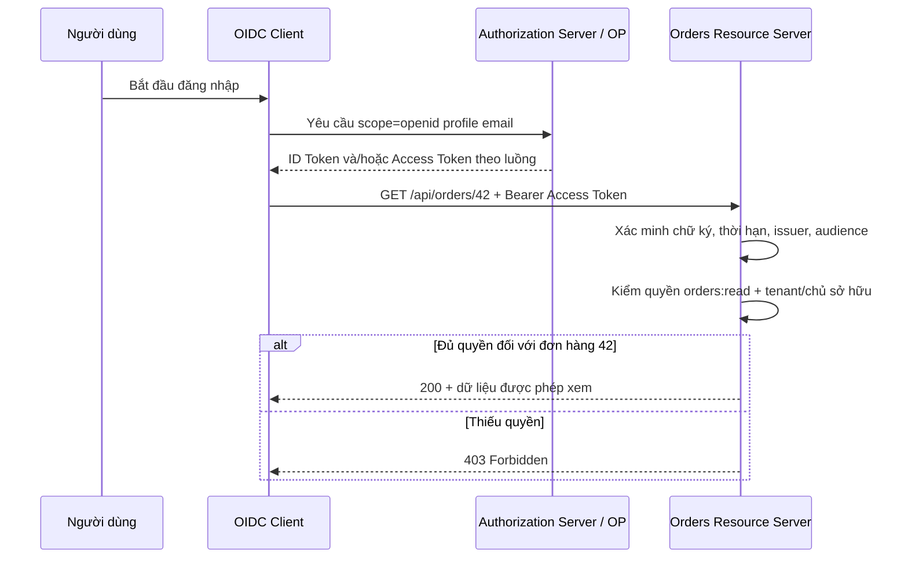

# Scope `openid`, `profile`, `email` không tự trở thành quyền nghiệp vụ

Trong hệ thống dùng **Spring Security OAuth 2.0/OIDC Resource Server**, đăng nhập thành công và nhận được token chỉ là điểm bắt đầu. Một nhầm lẫn nguy hiểm là thấy token có `openid profile email` rồi kết luận người dùng được đọc đơn hàng, sửa hồ sơ khách hàng, duyệt thanh toán hoặc truy cập API quản trị. Ba scope này chủ yếu phục vụ **đăng nhập OIDC và yêu cầu thông tin định danh**; chúng không định nghĩa những quyền nghiệp vụ đó.

Ví dụ: người dùng đăng nhập qua một OpenID Provider (OP), đồng ý chia sẻ tên và email với ứng dụng. Điều này không có nghĩa họ được gọi `GET /api/orders/42`, càng không có nghĩa họ được đọc đơn hàng của người khác. Resource Server phải có chính sách cấp quyền rõ ràng cho thao tác và tài nguyên cụ thể.

## 1. Tách ba khái niệm dễ bị trộn lẫn

| Khái niệm | Câu hỏi cần trả lời | Ví dụ | Giới hạn |
|---|---|---|---|
| **Authentication (xác thực)** | Ai đang thực hiện yêu cầu? | Người dùng có định danh `iss` + `sub`; token hợp lệ | Không tự cho phép đọc hoặc sửa dữ liệu |
| **OIDC identity scopes và claims** | Client được yêu cầu những thông tin nào về người dùng? | `openid`, `profile`, `email`; claim `name`, `email` | Không phải danh sách thao tác nghiệp vụ |
| **Authorization (phân quyền)** | Chủ thể này có được thực hiện hành động này trên tài nguyên này hay không? | `orders:read`, `orders:create`, chính sách chủ sở hữu, tenant | Cần quy tắc do hệ thống nghiệp vụ định nghĩa và thực thi |

`scope` là khái niệm chung của OAuth 2.0; **một scope do Authorization Server định nghĩa *có thể* biểu thị quyền truy cập API**. Tuy nhiên, các scope chuẩn `openid`, `profile`, `email` của OIDC có mục đích khác. Vì vậy, không thể áp dụng quy tắc “cứ có scope là có quyền nghiệp vụ” cho mọi giá trị scope.

## 2. `openid`, `profile`, `email` thực sự có nghĩa gì?

### `openid`: yêu cầu sử dụng OpenID Connect

Trong OIDC, sự hiện diện của `openid` trong yêu cầu xác thực báo cho Authorization Server rằng client muốn thực hiện quy trình OpenID Connect. Với luồng OIDC phù hợp, client nhận **ID Token** để xác minh sự kiện đăng nhập và danh tính người dùng.

`openid` **không có nghĩa**:

- Người dùng đã có một tài khoản được cấp quyền trong mọi ứng dụng cùng dùng OP.
- Token được phép gọi bất kỳ API nào của tổ chức.
- Người dùng có quyền mặc định `ROLE_USER`, `ROLE_ADMIN` hoặc `orders:read`.

Kể cả khi một access token có chuỗi `scope` chứa `openid`, Resource Server vẫn phải xác định token có được cấp **cho API này** và có quyền cần thiết hay không.

### `profile`: yêu cầu các thông tin hồ sơ cơ bản

Scope `profile` yêu cầu những claim định danh như `name`, `given_name`, `family_name`, `preferred_username`, `picture`, `locale`... theo quy tắc OIDC và khả năng của OP.

Tên scope dễ gây hiểu nhầm: `profile` **không phải** “được sửa profile của người khác” hoặc “được truy cập toàn bộ hồ sơ khách hàng”. Nó chỉ liên quan đến yêu cầu cung cấp **dữ liệu hồ sơ của người dùng đang đăng nhập**.

### `email`: yêu cầu địa chỉ email và trạng thái xác minh

Scope `email` yêu cầu các claim `email` và `email_verified`. `email_verified = true` chỉ phản ánh việc OP đã thực hiện bước xác minh quyền kiểm soát địa chỉ email theo cơ chế của OP; đó **không phải** xác nhận người dùng là nhân viên, quản trị viên, người duyệt đơn hoặc có quyền gửi email thay tổ chức.

Đặc biệt, địa chỉ email có thể thay đổi, và OIDC không bảo đảm nó duy nhất trên mọi chủ thể. Không nên dùng email đơn lẻ làm khóa định danh người dùng dài hạn; trong phạm vi một issuer, cặp **`iss` + `sub`** là điểm xuất phát ổn định hơn cho liên kết tài khoản.

> **Lưu ý về claims:** `profile` và `email` là các scope dùng để *yêu cầu* thông tin. Chúng không bảo đảm mọi claim sẽ luôn xuất hiện: OP có thể không hỗ trợ, không có dữ liệu hoặc không cung cấp một số claim tùy tình huống. Những claim này thường được trả về qua UserInfo Endpoint hoặc ID Token theo luồng OIDC; đừng mặc định chúng nằm trong access token gửi đến API.

## 3. Phân biệt ID Token và Access Token trước khi kiểm quyền

| Token | Đối tượng sử dụng | Nội dung và mục đích chính | Resource Server nên làm gì? |
|---|---|---|---|
| **ID Token** | OIDC client / Relying Party | Xác nhận sự kiện đăng nhập; chứa các claim OIDC như `sub`, `iss`, `aud`, có thể có `name`, `email` | **Không** chấp nhận thay access token để gọi API |
| **Access Token** | Resource Server được chỉ định | Chứng minh client có một ủy quyền truy cập được cấp cho tài nguyên, với scope/claims tùy Authorization Server | Kiểm tra token hợp lệ, đúng `iss`, đúng `aud`, còn hạn và đủ quyền nghiệp vụ |

Ví dụ một yêu cầu đăng nhập OIDC (giá trị đã rút gọn):

```text
scope=openid profile email
```

Đây là **các scope client yêu cầu**. Nó không nói rằng access token trả về sẽ có đúng các scope này, và cũng không nói rằng `orders-api` được ủy quyền. Cần xem **access token thực sự được cấp**, audience của nó và chính sách tài nguyên. Với access token dạng opaque, Resource Server cần introspection thay vì tự giải mã JWT.

Luồng xử lý đúng có thể hình dung như sau:



Việc đăng nhập qua OP và việc cấp quyền truy cập `orders-api` là **hai quyết định khác nhau**. ID Token chứng minh thông tin đăng nhập cho client; không dùng nó như giấy phép truy cập API.

## 4. Spring Security biến các scope trong JWT thành `GrantedAuthority` như thế nào?

Với cấu hình JWT Resource Server mặc định, Spring Security đọc các scope từ claim phổ biến như `scope` hoặc `scp` của **access token đã xác thực** rồi thêm tiền tố `SCOPE_` để tạo `GrantedAuthority`.

Ví dụ payload access token giả định:

```json
{
  "iss": "https://login.example.com/realms/shop",
  "sub": "user-123",
  "aud": ["orders-api"],
  "scope": "openid profile email",
  "exp": 1893456000
}
```

Trong trường hợp này, một `JwtAuthenticationToken` có thể có các authority:

```text
SCOPE_openid
SCOPE_profile
SCOPE_email
```

Điều này **chỉ là phép chuyển đổi kỹ thuật tên scope sang authority**. Spring Security không tự hiểu `SCOPE_email` là “được xem danh sách khách hàng”, hoặc `SCOPE_profile` là “được sửa thông tin cá nhân”. Lập trình viên phải quy định authority nào bảo vệ endpoint nào.

Ví dụ cấu hình **sai về mặt nghiệp vụ**:

```java
// SAI: Cho phép xuất toàn bộ khách hàng chỉ vì người dùng đồng ý
// chia sẻ email khi đăng nhập OIDC.
.requestMatchers(HttpMethod.GET, "/api/customers/export")
    .hasAuthority("SCOPE_email")
```

Nếu access token có `email`, điều kiện trên có thể cho phép truy cập dữ liệu nhạy cảm mà không kiểm tra quyền `customers:export` thực sự. Tương tự, `authenticated()` chỉ chứng minh đã xác thực; dùng nó cho endpoint nhạy cảm vẫn là chính sách quá rộng.

> **Nuance:** Không phải access token nào cũng chứa `openid`, `profile` hay `email` trong claim `scope`. Spring Security chỉ ánh xạ các giá trị thực sự có trong token; nó không tự suy ra scope từ màn hình đăng nhập hoặc từ ID Token.

## 5. Thiết kế quyền nghiệp vụ một cách tường minh

Giả sử ứng dụng có các yêu cầu sau:

| Chức năng | Điều kiện cần ở API | Điều kiện ngữ cảnh bổ sung |
|---|---|---|
| Xem đơn hàng | `orders:read` | Chỉ xem đơn trong tenant và phạm vi sở hữu được cấp |
| Tạo đơn hàng | `orders:create` | Chỉ tạo cho tenant được phép |
| Hủy đơn hàng | `orders:cancel` | Đơn chưa chốt và chủ thể có quyền hủy |
| Xuất dữ liệu khách hàng | `customers:export` | Vai trò/chính sách xuất dữ liệu, phạm vi khách hàng hợp lệ |

Các quyền này có thể đến từ một trong những mô hình sau, tùy kiến trúc:

1. **OAuth API scopes** do Authorization Server đăng ký và cấp, ví dụ `orders:read` hoặc `orders.read`, được Resource Server kiểm bằng `SCOPE_orders:read` / `SCOPE_orders.read` tương ứng.
2. **Claim quyền tùy biến** trong access token, ví dụ `permissions: ["orders:read", "orders:create"]`, do hệ thống phát hành token đáng tin cậy cấp sau khi xác định quyền. Resource Server ánh xạ thành `PERM_orders:read`, `PERM_orders:create`.
3. **Quyền lưu trong hệ thống nghiệp vụ**: API liên kết `iss` + `sub` tới tài khoản nội bộ rồi truy vấn vai trò, chính sách, quan hệ chủ sở hữu hoặc tenant. Cách này hữu ích khi quyền đổi thường xuyên hoặc phụ thuộc trạng thái dữ liệu.

Ba cách có thể phối hợp. Điều cốt lõi là **mối quan hệ giữa quyền và hành động phải được định nghĩa rõ ràng**, không sinh quyền `orders:read` từ `openid`, `profile`, `email` hay từ việc email thuộc một tên miền nào đó. Quyền có trong token cũng không thay thế kiểm tra quyền trên từng bản ghi.

## 6. Ví dụ cấu hình Spring Boot Resource Server với quyền nghiệp vụ

Ví dụ sau dùng Spring Security cho **Servlet/MVC**, access token dạng JWT, và giả sử Authorization Server phát hành một claim `permissions` **được hệ thống tin cậy cấp**. Đây là claim do ứng dụng/Authorization Server quy ước, không phải claim bắt buộc của OIDC.

### 6.1. Access token đúng mục đích

Payload minh họa (đã bỏ chữ ký và một số claim thời gian):

```json
{
  "iss": "https://login.example.com/realms/shop",
  "sub": "user-123",
  "aud": ["orders-api"],
  "scope": "openid profile email",
  "tenant_id": "tenant-a",
  "permissions": ["orders:read", "orders:create"],
  "exp": 1893456000
}
```

- `iss`: token do Authorization Server dự kiến phát hành.
- `aud`: token hướng tới `orders-api`, tránh dùng token cấp cho ứng dụng/API khác.
- `scope`: các giá trị OAuth/OIDC được cấp; ở đây có cả các identity scope.
- `permissions`: quyền nghiệp vụ được cấp theo quy ước riêng.
- `tenant_id`: thuộc tính ngữ cảnh do Authorization Server tin cậy phát hành; bản thân claim này vẫn chưa đủ để được xem một đơn hàng cụ thể.

Đối với token JWT, Resource Server phải xác minh chữ ký và các ràng buộc cần thiết **trước khi** dùng claim để ra quyết định. Không lấy claim từ JWT chưa xác minh, từ request body hoặc header do client tự đặt để cấp quyền.

### 6.2. Cấu hình issuer và audience

Thêm starter `spring-boot-starter-oauth2-resource-server` cùng các dependency Web/Security cần thiết cho ứng dụng. Trong `application.yml`:

```yaml
spring:
  security:
    oauth2:
      resourceserver:
        jwt:
          issuer-uri: https://login.example.com/realms/shop
          audiences:
            - orders-api
```

`issuer-uri` giúp Spring Security thiết lập kiểm tra issuer của JWT; `audiences` yêu cầu token được phát hành cho API này. Giá trị phải khớp cấu hình thật của OP/Authorization Server. Spring Security còn xác minh chữ ký và các claim thời gian như `exp`, `nbf` theo cấu hình JWT Resource Server. Nếu nhà cung cấp dùng định dạng token hoặc quy tắc kiểm tra riêng, cần cấu hình tương ứng; chỉ kiểm được chữ ký **chưa đủ** để phân quyền.

### 6.3. Ánh xạ `permissions` riêng với OIDC scopes

```java
import java.util.Collection;
import java.util.LinkedHashSet;
import java.util.Set;

import org.springframework.context.annotation.Bean;
import org.springframework.context.annotation.Configuration;
import org.springframework.http.HttpMethod;
import org.springframework.security.config.annotation.method.configuration.EnableMethodSecurity;
import org.springframework.security.config.annotation.web.builders.HttpSecurity;
import org.springframework.security.core.GrantedAuthority;
import org.springframework.security.oauth2.server.resource.authentication.JwtAuthenticationConverter;
import org.springframework.security.oauth2.server.resource.authentication.JwtGrantedAuthoritiesConverter;
import org.springframework.security.web.SecurityFilterChain;

@Configuration
@EnableMethodSecurity
public class SecurityConfig {

    @Bean
    SecurityFilterChain securityFilterChain(
            HttpSecurity http,
            JwtAuthenticationConverter jwtConverter) throws Exception {

        http
            .authorizeHttpRequests(auth -> auth
                .requestMatchers(HttpMethod.GET, "/api/public/**").permitAll()
                .requestMatchers(HttpMethod.GET, "/api/orders/**")
                    .hasAuthority("PERM_orders:read")
                .requestMatchers(HttpMethod.POST, "/api/orders")
                    .hasAuthority("PERM_orders:create")
                .anyRequest().authenticated()
            )
            .oauth2ResourceServer(oauth2 -> oauth2
                .jwt(jwt -> jwt.jwtAuthenticationConverter(jwtConverter))
            );

        return http.build();
    }

    @Bean
    JwtAuthenticationConverter jwtConverter() {
        // Vẫn giữ phép ánh xạ OAuth scopes -> SCOPE_*.
        JwtGrantedAuthoritiesConverter scopes =
            new JwtGrantedAuthoritiesConverter();

        // Quyền nghiệp vụ độc lập -> PERM_*.
        JwtGrantedAuthoritiesConverter permissions =
            new JwtGrantedAuthoritiesConverter();
        permissions.setAuthoritiesClaimName("permissions");
        permissions.setAuthorityPrefix("PERM_");

        JwtAuthenticationConverter converter = new JwtAuthenticationConverter();
        converter.setJwtGrantedAuthoritiesConverter(jwt -> {
            Set<GrantedAuthority> result = new LinkedHashSet<>();

            Collection<GrantedAuthority> grantedScopes = scopes.convert(jwt);
            Collection<GrantedAuthority> grantedPermissions = permissions.convert(jwt);

            if (grantedScopes != null) {
                result.addAll(grantedScopes);
            }
            if (grantedPermissions != null) {
                result.addAll(grantedPermissions);
            }
            return result;
        });
        return converter;
    }
}
```

Với access token mẫu ở trên, Resource Server có thể tạo các authority:

```text
SCOPE_openid
SCOPE_profile
SCOPE_email
PERM_orders:read
PERM_orders:create
```

Endpoint `GET /api/orders/**` **chỉ** kiểm `PERM_orders:read`. Sự có mặt của `SCOPE_openid`, `SCOPE_profile`, `SCOPE_email` không giúp vượt điều kiện này.

> **Quan trọng:** Configuration trên minh họa cách đọc claim `permissions`; nó **không** tự cấp quyền đó. Authorization Server hoặc thành phần quản trị quyền phải phát hành claim đáng tin cậy. Nếu quyền nằm ở database riêng và thay đổi thường xuyên, kiểm quyền ngay ở phía API có thể phù hợp hơn việc chờ token hết hạn.

### 6.4. Kiểm quyền trên bản ghi và tenant

`PERM_orders:read` thường chỉ là **quyền thực hiện loại thao tác**, chưa chứng minh một người được đọc **đơn hàng số 42**. Cần kết hợp kiểm tra quan hệ với dữ liệu nghiệp vụ.

Ví dụ service dùng method security:

```java
@Service
public class OrderService {
    private final OrderRepository orders;

    public OrderService(OrderRepository orders) {
        this.orders = orders;
    }

    @PreAuthorize("hasAuthority('PERM_orders:read') " +
                  "and @orderPolicy.canRead(authentication, #orderId)")
    public OrderDto getOrder(UUID orderId) {
        return orders.findDtoById(orderId)
                .orElseThrow(OrderNotFoundException::new);
    }
}
```

Một policy tương ứng (các phương thức repository/domain type là ví dụ, cần hiện thực theo ứng dụng):

```java
@Component("orderPolicy")
public class OrderPolicy {
    private final OrderRepository orders;

    public OrderPolicy(OrderRepository orders) {
        this.orders = orders;
    }

    public boolean canRead(Authentication authentication, UUID orderId) {
        if (!(authentication instanceof JwtAuthenticationToken bearer)) {
            return false;
        }

        Jwt jwt = bearer.getToken();
        String tenantId = jwt.getClaimAsString("tenant_id");
        if (tenantId == null) {
            return false;
        }

        return orders.existsByIdAndTenantIdAndOwnerSubject(
                orderId, tenantId, jwt.getSubject());
    }
}
```

Ở đây giả sử `OrderRepository` có phương thức `existsByIdAndTenantIdAndOwnerSubject(UUID id, String tenantId, String ownerSubject)`. Trong hệ thống thật, nên liên kết người dùng bằng định danh nội bộ dựa trên `iss` + `sub` và xác thực `tenant_id` thuộc phạm vi được cấp, thay vì tin tên tenant do client gửi. Với tài khoản quản trị có quyền đọc xuyên phạm vi, hãy viết nhánh chính sách riêng và kiểm toán truy cập. Cũng cần bảo đảm tất cả đường gọi dữ liệu nhạy cảm áp dụng cùng chính sách, tránh chỉ bảo vệ một controller rồi để lộ qua endpoint khác.

Nếu muốn lấy quyền từ database thay vì claim `permissions`, service/policy có thể kiểm tra vai trò, membership, trạng thái đơn, hạn mức giao dịch và quyền sở hữu ngay tại thời điểm gọi. Cơ chế đó đặc biệt hữu ích khi quyền có thể bị thu hồi trước khi JWT hết hạn.

## 7. Nếu Authorization Server cấp scope API thật thì sao?

Scope OAuth không nhất thiết chỉ phục vụ thông tin định danh. Nếu hệ thống **đã định nghĩa** `orders.read` là phạm vi ủy quyền cho Orders API, Authorization Server có thể cấp access token:

```json
{
  "aud": ["orders-api"],
  "scope": "orders.read",
  "sub": "user-123"
}
```

Khi đó Resource Server có thể kiểm:

```java
.requestMatchers(HttpMethod.GET, "/api/orders/**")
    .hasAuthority("SCOPE_orders.read")
```

Đây là trường hợp **scope API có nghĩa nghiệp vụ vì hợp đồng bảo mật của hệ thống định nghĩa như vậy**. Nó khác với việc tự gán quyền cho `openid`, `profile`, `email`. Ngay cả `orders.read` cũng có thể chỉ là quyền ở mức thao tác; kiểm tra tenant, chủ sở hữu và trạng thái bản ghi vẫn cần được thực hiện nếu quy tắc nghiệp vụ yêu cầu.

Trong luồng **client credentials** (machine-to-machine), thường không có người dùng đăng nhập để yêu cầu thông tin `profile` hay `email`; API cần scope/quyền dành cho service principal và chính sách riêng cho ứng dụng gọi.

## 8. Các tình huống nên xử lý thế nào?

| Tình huống | Kết quả mong đợi | Lý do |
|---|---|---|
| Access token hợp lệ, đúng `aud`, chỉ có `openid profile email`; gọi `GET /api/orders/42` | **403** | Đã xác thực nhưng thiếu `orders:read` |
| Access token hợp lệ, đúng `aud`, có `permissions: ["orders:read"]`, đơn 42 thuộc tenant/người dùng | **200** (nếu dữ liệu tồn tại và các quy tắc khác đạt) | Đủ quyền thao tác và quyền trên bản ghi |
| Access token hợp lệ, có `orders:read`, nhưng đơn 42 thuộc người khác | **403**, hoặc **404** nếu chính sách che sự tồn tại tài nguyên | Không được đọc bản ghi này |
| Token hết hạn, chữ ký không hợp lệ, issuer không tin cậy hoặc `aud` không có `orders-api` | **401** | Token không hợp lệ đối với API |
| Client gửi ID Token vào header `Authorization: Bearer ...` để gọi Orders API | **Từ chối** | ID Token dành cho OIDC client, không phải giấy phép dùng API |
| Người dùng có `email_verified = true` và email thuộc miền công ty | **Không tự thành admin** | Claim định danh không thay thế vai trò/quyền do nghiệp vụ cấp |

Các mã HTTP ở bảng giả định API áp dụng chính sách Bearer token thông thường và chưa có các ngoại lệ riêng. Đặc biệt, 401 thường biểu thị xác thực Bearer token thiếu/không hợp lệ; 403 biểu thị đã xác thực nhưng thiếu quyền.

## 9. Những sai lầm thường gặp và cách tránh

**1. Dùng `hasAuthority("SCOPE_email")` để bảo vệ API xem dữ liệu khách hàng.**

`email` được yêu cầu nhằm lấy claim email của người dùng OIDC, không phải quyền xem dữ liệu khách hàng. Hãy định nghĩa `customers:read`/`customers:export` rồi thực thi theo chính sách thực tế.

**2. Quy đổi mọi người đăng nhập thành `ROLE_ADMIN` hoặc `ROLE_EMPLOYEE` chỉ từ claim `profile`, `email` hay hậu tố địa chỉ email.**

Vai trò ứng dụng phải do nguồn quản lý quyền đáng tin cậy cấp và chịu sự ràng buộc tenant/tổ chức. Với ứng dụng nhiều tenant, cùng một người có thể có vai trò khác nhau ở từng tenant.

**3. Nhìn thấy claim `email` trong ID Token rồi mặc nhiên coi nó đã có trong access token.**

Hai token có đối tượng nhận, cấu trúc và mục đích khác nhau. Resource Server phải làm việc với access token được cấp cho chính nó và có hợp đồng claim riêng.

**4. Chỉ kiểm chữ ký mà bỏ qua audience.**

JWT được ký hợp lệ có thể vẫn dành cho một ứng dụng khác. Kiểm `aud` tránh nhầm lẫn token giữa các API và giảm nguy cơ chấp nhận nhầm ID Token được ký bởi cùng OP.

**5. Chỉ kiểm quyền ở đường dẫn mà bỏ qua quyền trên bản ghi.**

Quyền `orders:read` không có nghĩa được xem mọi đơn hàng. Tài nguyên thuộc người dùng nào, tenant nào, trạng thái nào vẫn là quyết định nghiệp vụ tại Resource Server.

**6. Coi mọi claim nằm trong access token đều là quyền cấp vĩnh viễn.**

Claim thể hiện trạng thái được cấp lúc token phát hành. Khi cần thu hồi quyền tức thời, cân nhắc thời hạn token ngắn, introspection, policy/authorization service hoặc kiểm tra quyền động tại API.

**7. Dùng `hasRole` và `hasAuthority` lẫn lộn.**

Theo quy ước Spring Security, `hasRole("ADMIN")` tìm authority `ROLE_ADMIN`; `hasAuthority("PERM_orders:read")` kiểm chuỗi đúng như được cấp. Đừng vô tình thêm tiền tố `ROLE_` cho authority có tiền tố `SCOPE_` hay `PERM_`.

## 10. Cách tự kiểm tra thiết kế phân quyền

Trước khi xuất bản một endpoint nhạy cảm, hãy trả lời được các câu hỏi sau:

1. **API nhận token nào?** Access token JWT/opaque, issuer nào, audience nào, thời hạn và cơ chế xác minh nào?
2. **Quyền từ đâu ra?** OAuth API scope, claim `permissions` do issuer tin cậy cấp, hay database/policy service nội bộ?
3. **Quyền gắn với hành động gì?** Ví dụ `orders:read` cho đọc đơn, `customers:export` cho xuất dữ liệu, được tài liệu hóa và cấp theo nguyên tắc tối thiểu.
4. **Có giới hạn trên tài nguyên cụ thể không?** Chủ sở hữu, tenant, đơn vị công tác, trạng thái chứng từ, mức phê duyệt...
5. **Thiếu quyền thì sao?** Access token thiếu/không hợp lệ bị từ chối; người dùng đã xác thực nhưng thiếu quyền bị 403 hoặc phản hồi che giấu tài nguyên theo chính sách.
6. **Quyền bị thu hồi thì sao?** Cơ chế token lifetime, introspection hoặc kiểm quyền động có đáp ứng yêu cầu của hệ thống không?

Một kiểm thử bảo mật có giá trị là tạo hai token **cùng danh tính**: token A chỉ có các OIDC identity scope, token B có quyền nghiệp vụ tương ứng. API nhạy cảm phải từ chối A và chỉ xử lý B nếu mọi điều kiện trên tài nguyên đều đạt. Sau đó thử B với đơn hàng khác tenant để xác nhận API vẫn chặn truy cập ngang hàng (IDOR/BOLA).

## Kết luận

`openid` cho biết client yêu cầu quy trình OIDC; `profile` và `email` yêu cầu cung cấp các thông tin định danh. Chúng **không tự sinh ra quyền xem, sửa, xóa hay duyệt dữ liệu nghiệp vụ**. Spring Security có thể ánh xạ scope trong access token thành `SCOPE_*`, nhưng cơ chế ánh xạ không làm thay đổi ý nghĩa của scope. Resource Server cần kiểm token đúng đối tượng nhận, ánh xạ quyền được cấp theo hợp đồng bảo mật của ứng dụng và tiếp tục kiểm tra quyền trên từng tài nguyên.

### Tài liệu tham khảo

- [OpenID Connect Core 1.0 — Standard Claims và Requesting Claims using Scope Values](https://openid.net/specs/openid-connect-core-1_0.html#ScopeClaims)
- [RFC 6749, §3.3 — Access Token Scope](https://www.rfc-editor.org/rfc/rfc6749#section-3.3)
- [Spring Security — OAuth 2.0 Resource Server JWT](https://docs.spring.io/spring-security/reference/servlet/oauth2/resource-server/jwt.html)
- [Spring Boot — OAuth2 Resource Server configuration](https://docs.spring.io/spring-boot/reference/security/oauth2.html)
