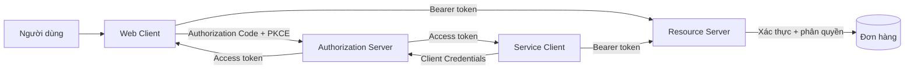
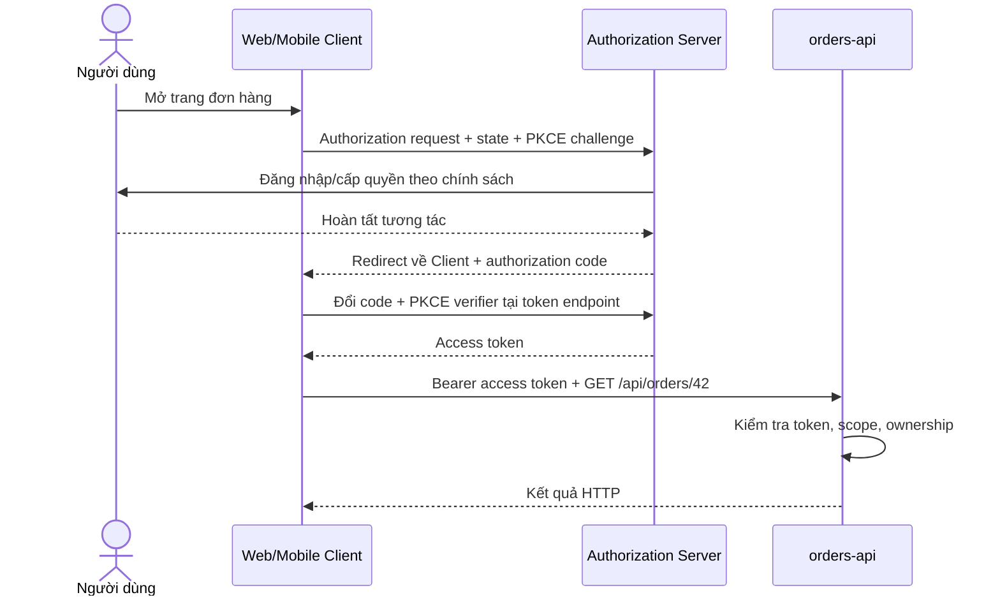
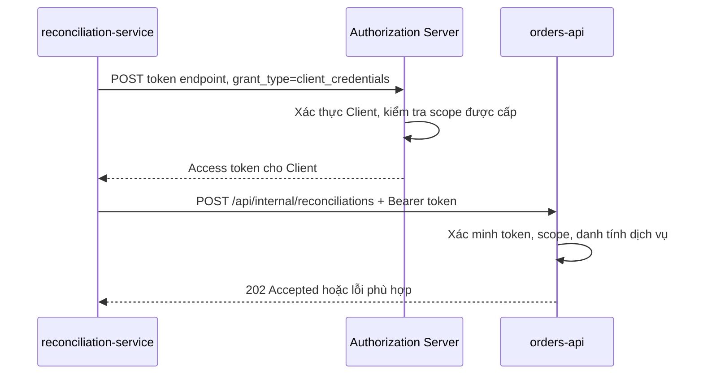
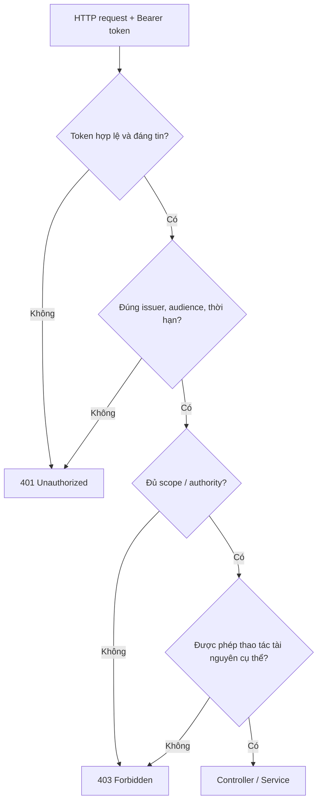

# Luồng Authorization Code và Client Credentials nhìn từ API nhận token

## 1. Bài toán: cùng một API, hai ngữ cảnh cấp token

Giả sử hệ thống có API `orders-api` với hai nhu cầu truy cập:

- **Người dùng:** Đăng nhập ứng dụng web, xem đơn hàng của chính mình.
- **Dịch vụ tự động:** Một job đối soát định kỳ gọi API để cập nhật trạng thái thanh toán hoặc xuất báo cáo.

Cả hai Client cuối cùng có thể gửi cùng dạng request:

```http
GET /api/orders/42 HTTP/1.1
Host: orders.example.com
Authorization: Bearer <access-token>
```

Nhưng ngữ cảnh cấp quyền khác nhau. Với người dùng, token thường biểu diễn quyền truy cập được cấp trong ngữ cảnh chủ thể đã đăng nhập; với dịch vụ tự động, token thường biểu diễn quyền của chính Client/dịch vụ.

**Authorization Code** và **Client Credentials** là hai grant type của OAuth 2.0, tức hai cách **Client nhận access token** từ Authorization Server. Đối với Resource Server, điều cốt lõi là **access token có đáng tin, dành cho API này và cho phép thao tác đang yêu cầu hay không**. API không nên suy diễn mọi token hợp lệ đều đại diện cho người dùng cuối.

Bài học tập trung vào những gì máy chủ API nhận token cần hiểu: đường đi của token, claim liên quan, sự khác biệt danh tính, cách Spring Security xác thực và cách áp dụng phân quyền theo tài nguyên.

## 2. Vai trò trong hệ thống OAuth 2.0/OIDC

| Vai trò | Công việc chính | Ví dụ |
|---|---|---|
| **Resource Owner** | Chủ thể có quyền với tài nguyên; thường là người dùng trong các kịch bản Authorization Code | Khách hàng sở hữu đơn hàng |
| **Client** | Ứng dụng xin quyền và gọi API | Web application, mobile app, `reconciliation-service` |
| **Authorization Server (AS)** | Xử lý cấp quyền, xác thực Client khi cần và phát hành access token | Máy chủ OAuth 2.0/OIDC |
| **Resource Server (RS)** | Cung cấp tài nguyên và kiểm tra access token/quyền trước khi cho phép thao tác | `orders-api` |



Mỗi grant type xử lý **phần cấp token trước khi gọi API**. Ở bước nhận HTTP request, Resource Server không thấy quá trình redirect, đăng nhập hay xác thực Client đã diễn ra như thế nào, trừ khi Authorization Server chủ động đưa thông tin đáng tin cậy vào token/introspection và hệ thống đã thống nhất cách diễn giải thông tin đó.

## 3. Authorization Code: người dùng tham gia cấp quyền

### 3.1. Trình tự luồng

Authorization Code thường được dùng khi Client có người dùng tương tác. Client đưa trình duyệt tới Authorization Server để xác thực và cấp quyền, nhận một **authorization code** qua redirect, rồi đổi code thành token tại token endpoint.

Với ứng dụng hiện đại, cần dùng **Authorization Code + PKCE**. Client tạo `code_verifier` và `code_challenge` để ràng buộc lần đổi authorization code, giảm nguy cơ kẻ khác đánh cắp code rồi sử dụng. Confidential client còn phải xác thực Client theo yêu cầu của Authorization Server.



Từng bước quan trọng:

1. Client yêu cầu quyền truy cập, chẳng hạn scope `orders.read`.
2. Authorization Server xử lý xác thực người dùng và bước chấp thuận nếu chính sách đòi hỏi.
3. Authorization Server trả code ngắn hạn về `redirect_uri` hợp lệ của Client.
4. Client gọi token endpoint để đổi code và gửi `code_verifier` của PKCE.
5. Client gửi **access token** trong header `Authorization` khi gọi `orders-api`.
6. API xác thực token và kiểm tra người dùng có được phép xem đơn hàng cụ thể không.

**Resource Server không nhận authorization code để đổi token**, không xử lý `redirect_uri` và không kiểm tra `code_verifier`. Các điều kiện như chống giả mạo yêu cầu qua `state` và xác minh PKCE nằm ở Client/Authorization Server.

### 3.2. Phân biệt token endpoint và API endpoint

Yêu cầu đổi code gửi đến Authorization Server có thể có dạng:

```http
POST /oauth2/token HTTP/1.1
Host: id.example.com
Content-Type: application/x-www-form-urlencoded

grant_type=authorization_code&code=<code>&redirect_uri=https%3A%2F%2Fapp.example.com%2Fcallback&client_id=web-client&code_verifier=<verifier>
```

Đoạn trên minh họa các tham số thường gặp. Nếu Client thuộc loại confidential, nó phải dùng Client authentication theo yêu cầu của AS; việc gửi `client_id` riêng lẻ không thay thế xác thực Client.

Một phản hồi token có thể như sau:

```json
{
  "access_token": "<user-access-token>",
  "token_type": "Bearer",
  "expires_in": 900,
  "scope": "orders.read"
}
```

Sau đó, Client gửi token đến Resource Server:

```http
GET /api/orders/42 HTTP/1.1
Host: orders.example.com
Authorization: Bearer <user-access-token>
```

Hai request đi đến **hai máy chủ với hai nhiệm vụ khác nhau**. API chỉ quan tâm access token đã phát hành có thỏa chính sách hay không.

### 3.3. OIDC liên quan thế nào?

OpenID Connect (OIDC) bổ sung lớp xác thực danh tính trên OAuth 2.0. Trong một luồng OIDC phù hợp, chẳng hạn Authorization Code có yêu cầu scope `openid`, Client có thể nhận thêm **ID token**.

| Token | Công dụng chính | Bên sử dụng |
|---|---|---|
| **Access token** | Quyền truy cập tài nguyên được bảo vệ | Resource Server |
| **ID token** | Thông tin về sự kiện xác thực/danh tính người dùng | OIDC Client |

**Không sử dụng ID token thay access token để gọi API.** ID token thường có `aud` là Client ID của ứng dụng OIDC. Việc ID token có chữ ký hợp lệ không chứng minh nó được cấp cho `orders-api` hoặc cho phép thao tác `orders.read`.

Authorization Code của OAuth 2.0 thuần không bắt buộc có ID token. Sự có mặt của OIDC không làm thay đổi trách nhiệm xác minh access token của Resource Server.

### 3.4. Access token từ ngữ cảnh người dùng

Ví dụ payload JWT access token minh họa:

```json
{
  "iss": "https://id.example.com",
  "sub": "user-417",
  "aud": ["orders-api"],
  "iat": 1893455100,
  "exp": 1893456000,
  "client_id": "web-client",
  "scope": "orders.read",
  "tenant_id": "tenant-east"
}
```

Trong ví dụ này:

- `iss` là nhà phát hành token mà API tin cậy.
- `sub` là chủ thể token đại diện; theo hợp đồng ví dụ này, `user-417` là ID người dùng.
- `aud` chỉ Resource Server được phép nhận token; `orders-api` cần kiểm tra audience của mình.
- `iat` và `exp` biểu diễn thời điểm phát hành/hết hạn.
- `client_id` có thể cho biết Client được cấp token, nếu profile token cung cấp claim đó.
- `scope` cho biết quyền OAuth đã cấp, ở đây là `orders.read`.
- `tenant_id` là claim tùy biến, chỉ nên dựa vào nó khi Authorization Server bảo đảm ngữ nghĩa và giá trị.

Đây là payload **minh họa**, không phải mọi access token đều là JWT hay có đầy đủ claim giống nhau. Resource Server phải thống nhất cách giải nghĩa claim với nhà phát hành.

Với `GET /api/orders/42`, scope `orders.read` chỉ cho biết yêu cầu có quyền đọc ở mức chức năng. API còn phải kiểm tra đơn hàng `42` thuộc `user-417` hoặc người dùng có quyền nghiệp vụ đặc biệt được phép đọc. Đây là ranh giới chống truy cập dữ liệu của người khác.

## 4. Client Credentials: Client tự xin quyền của mình

### 4.1. Trình tự luồng

Client Credentials dùng cho giao tiếp **máy với máy**, khi một dịch vụ cần gọi API mà không có bước người dùng cuối đăng nhập tương tác. Client xác thực chính mình với Authorization Server và xin access token trong những phạm vi được AS cho phép.



Ở đây không có redirect, authorization code hay PKCE. Token đại diện cho **Client/dịch vụ theo quy ước của nhà phát hành**, không mặc nhiên đại diện cho một khách hàng đăng nhập.

### 4.2. Ví dụ lấy token

Ví dụ dùng HTTP Basic để xác thực confidential client tại token endpoint qua HTTPS:

```bash
curl --request POST 'https://id.example.com/oauth2/token' \
  --user "$CLIENT_ID:$CLIENT_SECRET" \
  --header 'Content-Type: application/x-www-form-urlencoded' \
  --data-urlencode 'grant_type=client_credentials' \
  --data-urlencode 'scope=orders.reconcile'
```

Biến `CLIENT_ID` và `CLIENT_SECRET` chỉ là placeholder cho credential được bảo vệ. Tùy máy chủ, Client authentication cũng có thể dùng private-key JWT, mTLS hoặc phương thức được hỗ trợ khác. **Không lưu client secret trong JavaScript frontend hoặc ứng dụng public client.**

Ví dụ phản hồi:

```json
{
  "access_token": "<service-access-token>",
  "token_type": "Bearer",
  "expires_in": 600,
  "scope": "orders.reconcile"
}
```

Sau đó Client gọi API:

```http
POST /api/internal/reconciliations HTTP/1.1
Host: orders.example.com
Authorization: Bearer <service-access-token>
Content-Type: application/json

{"batchId":"batch-202","processedCount":100}
```

Resource Server kiểm tra token và quyền của dịch vụ trên API đối soát. Token Client Credentials **không phải quyền quản trị vô hạn** và chỉ được dùng với những tài nguyên/endpoint đã được cấp quyền.

### 4.3. Access token trong ngữ cảnh dịch vụ

Ví dụ JWT minh họa:

```json
{
  "iss": "https://id.example.com",
  "sub": "reconciliation-service",
  "aud": ["orders-api"],
  "iat": 1893455400,
  "exp": 1893456000,
  "client_id": "reconciliation-service",
  "scope": "orders.reconcile",
  "principal_type": "service"
}
```

`principal_type` ở đây là **claim tùy biến**, không phải claim chuẩn bắt buộc của OAuth 2.0. Không phải mọi Authorization Server đều đặt `sub` bằng Client ID hay phát hành `client_id` dưới cùng một dạng.

Nếu API có yêu cầu riêng “chỉ dịch vụ được phép gọi endpoint đối soát”, hãy dùng **hợp đồng đã xác thực giữa AS và API**, ví dụ claim `principal_type` do AS quản lý cùng allowlist Client ID, thay vì đoán từ hình thức chuỗi `sub`. API không được tin header tự khai của Client như `X-Principal-Type: service` để nâng quyền.

### 4.4. Có ID token OIDC trong Client Credentials không?

Client Credentials là một grant type của OAuth 2.0 và không có sự kiện đăng nhập người dùng cuối. Nó thường dùng **access token** để truy cập API, không tạo ra ID token OIDC cho người dùng.

Nếu một backend phải hành động **thay mặt người dùng**, cần thiết kế cơ chế ủy quyền/delegation thích hợp, chẳng hạn sử dụng luồng có người dùng hoặc token exchange theo khả năng hệ thống. Không nên tự chèn user ID vào một token Client Credentials rồi coi đó là quyền được người dùng ủy quyền.

## 5. So sánh từ góc nhìn API nhận token

| Khía cạnh | Authorization Code | Client Credentials |
|---|---|---|
| Cách Client lấy token | Redirect và đổi authorization code, nên có PKCE | Tự xác thực tại token endpoint |
| Người dùng tham gia | Thường có tương tác người dùng | Không có người dùng cuối trong flow |
| Chủ thể token thường đại diện | Người dùng/phiên ủy quyền ở Client | Client hoặc dịch vụ |
| Scope ví dụ | `orders.read` | `orders.reconcile` |
| Resource Server nhận | Bearer access token | Bearer access token |
| API có nhận authorization code không? | Không | Không có authorization code |
| API có tự biết grant type từ Bearer header không? | Không | Không |
| Kiểm tra nghiệp vụ điển hình | Scope + ownership/tenant của người dùng | Scope + danh tính/quyền của dịch vụ |
| Liên hệ OIDC | Có thể phát sinh ID token dành cho Client | Không xác thực người dùng cuối |

**Grant type mô tả cách token được phát hành**, không bắt buộc được ghi thành claim `grant_type` trong access token. Không thể phân biệt chắc chắn hai flow chỉ vì token có `sub`, `client_id`, một scope tên riêng, hoặc trông giống JWT.

Nếu chính sách API phải phân biệt loại chủ thể, Authorization Server và Resource Server phải thống nhất một cơ chế đáng tin: claim đã ký có ngữ nghĩa rõ ràng, phản hồi introspection đã xác thực, bộ scope/client được cấp riêng biệt hoặc kết hợp các yếu tố đó. Một Client Credentials token cũng có thể bị cấp nhầm scope dành cho người dùng nếu AS cấu hình sai, nên ranh giới cấp quyền cần được thiết kế ở cả AS và API.

## 6. Resource Server kiểm tra access token như thế nào?

### 6.1. Các bước chung cho cả hai luồng

1. **Trích xuất access token** từ request, thông thường bằng header `Authorization: Bearer ...`.
2. **Xác thực token:** chữ ký và các claim cần thiết với JWT, hoặc trạng thái token từ introspection đối với opaque token.
3. **Kiểm tra issuer và audience:** token đến từ AS tin cậy và được phát hành cho API này.
4. **Kiểm tra thời hạn:** token chưa hết hạn và đáp ứng `nbf`/các ràng buộc thời gian nếu có.
5. **Xác định chủ thể và scope/authority đáng tin:** chỉ dùng dữ liệu do AS bảo đảm.
6. **Phân quyền endpoint:** HTTP method, đường dẫn, scope/role, loại chủ thể khi cần.
7. **Phân quyền nghiệp vụ:** chủ sở hữu dữ liệu, tenant, trạng thái bản ghi và các quy tắc nội bộ.



Một `401 Unauthorized` thường có nghĩa API chưa chấp nhận thông tin xác thực (thiếu token, hết hạn, sai chữ ký, sai audience). Một `403 Forbidden` thường có nghĩa API đã xác thực nhưng từ chối vì thiếu quyền. Đối với bản ghi không thuộc người dùng, hệ thống có thể dùng `403` hoặc `404` tùy chính sách tránh lộ sự tồn tại của tài nguyên.

### 6.2. JWT hay opaque token không phụ thuộc grant type

**JWT access token:** API có thể xác minh chữ ký số bằng public key đáng tin (thường lấy từ JWKS) rồi kiểm tra `iss`, `aud`, `exp`, `nbf` và các claim cần thiết. Chỉ Base64URL-decode payload **không chứng minh token hợp lệ**. JWT ký số không nhất thiết mã hóa payload.

**Opaque access token:** API không tự giải mã chuỗi token để biết quyền; nó dùng introspection endpoint của AS hoặc cơ chế được nhà phát hành cung cấp. Phản hồi `active` và các thuộc tính như `scope`, `sub`, `client_id` cần được diễn giải theo hợp đồng hệ thống.

Cả Authorization Code và Client Credentials đều **có thể sử dụng JWT hoặc opaque token**, tùy AS.

### 6.3. Bảng phản hồi khi API nhận token

| Tình huống | Phản hồi điển hình | Cách hiểu |
|---|---|---|
| Không gửi token tới endpoint được bảo vệ | `401 Unauthorized` | Thiếu thông tin xác thực |
| Token sai chữ ký hoặc hết hạn | `401 Unauthorized` | Token không được chấp nhận |
| Token ký đúng nhưng `aud` thuộc API khác | `401 Unauthorized` | Không phải token cấp cho Resource Server này |
| Token hợp lệ nhưng thiếu scope | `403 Forbidden` | Không đủ quyền chức năng |
| Token người dùng đọc đơn của người khác | `403 Forbidden` hoặc `404 Not Found` | Phân quyền theo tài nguyên từ chối |
| Token dịch vụ có scope nhưng Client không nằm trong danh sách cho phép | `403 Forbidden` | Chính sách định danh dịch vụ từ chối |
| Token và các quyền đều đạt | `2xx` thích hợp | Request được xử lý |

API có thể dùng header `WWW-Authenticate: Bearer` để báo lỗi Bearer token theo chuẩn. Không đưa access token hoặc bí mật nội bộ vào thông báo lỗi/log.

## 7. Triển khai với Spring Security OAuth2 Resource Server

### 7.1. Dependency và issuer

Ví dụ Spring Boot với Gradle:

```groovy
dependencies {
    implementation 'org.springframework.boot:spring-boot-starter-web'
    implementation 'org.springframework.boot:spring-boot-starter-security'
    implementation 'org.springframework.boot:spring-boot-starter-oauth2-resource-server'
}
```

Ví dụ cấu hình Resource Server nhận JWT:

```yaml
spring:
  security:
    oauth2:
      resourceserver:
        jwt:
          issuer-uri: https://id.example.com
```

Spring Security có thể tìm metadata/JWKS từ issuer và xác minh JWT. API phải cấu hình đúng issuer thật và **thêm kiểm tra audience nếu yêu cầu ranh giới riêng cho `orders-api`**. Cấu hình issuer đơn lẻ không thay thế chính sách phân quyền nghiệp vụ.

### 7.2. Phân quyền endpoint theo scope

```java
import org.springframework.context.annotation.Bean;
import org.springframework.context.annotation.Configuration;
import org.springframework.http.HttpMethod;
import org.springframework.security.config.Customizer;
import org.springframework.security.config.annotation.web.builders.HttpSecurity;
import org.springframework.security.config.http.SessionCreationPolicy;
import org.springframework.security.web.SecurityFilterChain;

@Configuration
public class ApiSecurityConfig {

    @Bean
    SecurityFilterChain filterChain(HttpSecurity http) throws Exception {
        return http
            .csrf(csrf -> csrf.disable())
            .sessionManagement(s -> s
                .sessionCreationPolicy(SessionCreationPolicy.STATELESS))
            .authorizeHttpRequests(auth -> auth
                .requestMatchers("/api/public/**").permitAll()
                .requestMatchers(HttpMethod.GET, "/api/orders/**")
                    .hasAuthority("SCOPE_orders.read")
                .requestMatchers(HttpMethod.POST,
                    "/api/internal/reconciliations")
                    .hasAuthority("SCOPE_orders.reconcile")
                .anyRequest().denyAll())
            .oauth2ResourceServer(oauth2 ->
                oauth2.jwt(Customizer.withDefaults()))
            .build();
    }
}
```

Ý nghĩa:

- `oauth2ResourceServer(...jwt(...))` nhận và xác minh JWT Bearer token. API không cần tự chạy Authorization Code hoặc Client Credentials flow.
- Spring Security mặc định thường chuyển `scope`/`scp` thành authority có tiền tố `SCOPE_`. Scope `orders.read` trở thành `SCOPE_orders.read`; có thể tùy chỉnh converter theo token profile.
- `GET /api/orders/**` chỉ nhận chủ thể có scope đọc đơn; `POST /api/internal/reconciliations` yêu cầu quyền đối soát.
- `anyRequest().denyAll()` từ chối các endpoint không được thiết kế chính sách.
- Ví dụ stateless API chỉ dùng Bearer token trong Authorization header nên tắt CSRF. **Không sao chép việc tắt CSRF** sang ứng dụng dùng cookie xác thực mà không đánh giá nguy cơ CSRF.

Chỉ scope không tự bảo đảm “endpoint này chỉ dành cho service” nếu AS có thể cấp cùng scope cho user Client. Khi cần, phải thêm chính sách về loại principal/danh tính Client và cấu hình AS cấp scope chính xác.

### 7.3. Kiểm tra audience riêng

Một JWT chỉ được chấp nhận nếu `aud` chứa `orders-api`. Ví dụ cấu hình `JwtDecoder` thêm validator audience và giữ validator mặc định về issuer/thời gian:

```java
import org.springframework.context.annotation.Bean;
import org.springframework.security.oauth2.core.DelegatingOAuth2TokenValidator;
import org.springframework.security.oauth2.core.OAuth2Error;
import org.springframework.security.oauth2.core.OAuth2TokenValidator;
import org.springframework.security.oauth2.core.OAuth2TokenValidatorResult;
import org.springframework.security.oauth2.jwt.Jwt;
import org.springframework.security.oauth2.jwt.JwtDecoder;
import org.springframework.security.oauth2.jwt.JwtDecoders;
import org.springframework.security.oauth2.jwt.JwtValidators;
import org.springframework.security.oauth2.jwt.NimbusJwtDecoder;

@Bean
JwtDecoder jwtDecoder() {
    String issuer = "https://id.example.com";

    NimbusJwtDecoder decoder =
        (NimbusJwtDecoder) JwtDecoders.fromIssuerLocation(issuer);

    OAuth2TokenValidator<Jwt> audience = jwt ->
        jwt.getAudience().contains("orders-api")
            ? OAuth2TokenValidatorResult.success()
            : OAuth2TokenValidatorResult.failure(
                new OAuth2Error("invalid_token", "Invalid audience", null));

    decoder.setJwtValidator(new DelegatingOAuth2TokenValidator<>(
        JwtValidators.createDefaultWithIssuer(issuer), audience));
    return decoder;
}
```

Đây là ví dụ Java cho một Resource Server dùng JWT và issuer cố định; dự án thực tế nên đưa issuer vào cấu hình môi trường và bảo đảm nguồn khóa/thuật toán được thiết lập đúng. Tùy phiên bản Spring Boot, có thể sử dụng cấu hình audience tương đương bằng property thay cho bean.

Token có `iss=https://id.example.com`, `scope=orders.read` nhưng `aud=inventory-api` vẫn phải bị `orders-api` từ chối.

### 7.4. Kiểm tra ownership sau khi xác thực

Với JWT access token, Controller có thể lấy `sub` thông qua principal:

```java
import java.util.UUID;
import org.springframework.security.core.annotation.AuthenticationPrincipal;
import org.springframework.security.oauth2.jwt.Jwt;
import org.springframework.web.bind.annotation.GetMapping;
import org.springframework.web.bind.annotation.PathVariable;
import org.springframework.web.bind.annotation.RequestMapping;
import org.springframework.web.bind.annotation.RestController;

@RestController
@RequestMapping("/api/orders")
public class OrderController {
    private final OrderService orderService;

    public OrderController(OrderService orderService) {
        this.orderService = orderService;
    }

    @GetMapping("/{orderId}")
    public OrderDto getOrder(
            @PathVariable UUID orderId,
            @AuthenticationPrincipal Jwt jwt) {
        return orderService.findVisibleOrder(orderId, jwt.getSubject());
    }
}
```

`findVisibleOrder` là phương thức nghiệp vụ minh họa, phải kiểm tra đơn hàng có thuộc chủ thể đã xác thực hoặc được phép xem theo vai trò/tenant không. Ví dụ logic tại Service:

```java
Order order = orderRepository.findById(orderId)
    .orElseThrow(OrderNotFoundException::new);

if (!order.getOwnerSubject().equals(authenticatedSubject)) {
    throw new AccessDeniedException("Order access denied");
}

return orderMapper.toDto(order);
```

Ví dụ giả định AS bảo đảm `sub` là user ID ở endpoint dành cho người dùng. Khi dùng Client Credentials, không nên lấy `sub` rồi áp quy tắc “người dùng sở hữu đơn” nếu AS biểu diễn `sub` là Client ID. API nội bộ phải có chính sách riêng cho dịch vụ.

### 7.5. Nếu access token là opaque

Cấu hình introspection thay cho JWT:

```yaml
spring:
  security:
    oauth2:
      resourceserver:
        opaque-token:
          introspection-uri: https://id.example.com/oauth2/introspect
          client-id: MY_INTROSPECTION_CLIENT_ID
          client-secret: MY_INTROSPECTION_CLIENT_SECRET
```

Các giá trị `MY_INTROSPECTION_CLIENT_ID` và `MY_INTROSPECTION_CLIENT_SECRET` ở đây chỉ là tên đại diện; khi triển khai thật phải lấy credential an toàn từ biến môi trường hoặc secret manager và không commit bí mật vào repository.

```java
// Trong SecurityFilterChain, dùng opaque token thay cho jwt:
.oauth2ResourceServer(oauth2 ->
    oauth2.opaqueToken(Customizer.withDefaults()))
```

API dùng introspection để xác minh token và lấy các thuộc tính tin cậy theo hợp đồng AS. Cấu hình JWT và opaque ở đây là **hai lựa chọn triển khai khác nhau**, không ghép cả hai đoạn vào cùng một cấu hình ví dụ.

## 8. Bốn kịch bản API cần xử lý đúng

### Kịch bản 1: Người dùng xem đơn hàng của mình

Token người dùng đã được xác thực có:
 
```text
iss       = https://id.example.com
aud       = orders-api
sub       = user-417
client_id = web-client
scope     = orders.read
```

Request:

```http
GET /api/orders/42 HTTP/1.1
Host: orders.example.com
Authorization: Bearer <user-access-token>
```

API kiểm tra issuer/audience/thời hạn, `SCOPE_orders.read` và `ownerSubject` của đơn hàng `42` là `user-417`. Nếu người dùng đổi đường dẫn thành `/api/orders/43` mà đơn `43` thuộc người khác, API phải từ chối dù scope không đổi. Đây là lớp phòng tránh lỗi **Broken Object Level Authorization (BOLA)**.

### Kịch bản 2: Dịch vụ gửi kết quả đối soát

Token dịch vụ có:

```text
iss            = https://id.example.com
aud            = orders-api
sub            = reconciliation-service
client_id      = reconciliation-service
scope          = orders.reconcile
principal_type = service  (claim tùy biến của AS)
```

Request:

```http
POST /api/internal/reconciliations HTTP/1.1
Host: orders.example.com
Authorization: Bearer <service-access-token>
Content-Type: application/json

{"batchId":"batch-202"}
```

API xác minh token, kiểm tra scope đối soát, danh tính Client/`principal_type` nếu hợp đồng quy định, rồi kiểm tra batch có hợp lệ và thuộc phạm vi được xử lý. Dịch vụ chỉ có `orders.reconcile` không tự động được xem toàn bộ đơn hàng người dùng.

### Kịch bản 3: Token hợp lệ nhưng sai audience

Một token có chữ ký đúng và scope `orders.read` nhưng `aud=billing-api`. API `orders-api` vẫn từ chối: token được cấp cho tài nguyên khác. Kiểm tra chữ ký và scope **không thay thế kiểm tra audience**.

### Kịch bản 4: Resource Server gọi một Resource Server khác

Client gọi `orders-api` với token có `aud=orders-api`. Nếu `orders-api` phải gọi `billing-api`, không nên mặc nhiên chuyển tiếp nguyên token đó. API thứ hai có thể từ chối vì audience không phù hợp. Nếu dịch vụ gọi downstream bằng quyền của chính mình, có thể dùng Client Credentials cho audience của `billing-api`. Nếu cần chuyển quyền thay mặt người dùng, cần cơ chế delegation/token exchange thích hợp theo thiết kế của hệ thống.

## 9. Sai lầm thường gặp

| Sai lầm | Hệ quả | Cách xử lý |
|---|---|---|
| Gửi ID token OIDC đến API | API nhận sai loại token, có thể sai audience/mục đích | Gửi access token dành cho API |
| Coi mọi `sub` là user ID | Token Client Credentials bị xử lý như token của người dùng | Thống nhất ngữ nghĩa `sub`, Client ID và principal type với AS |
| Suy luận grant type chỉ từ payload | Cấp nhầm quyền do claim không bảo đảm ngữ nghĩa | Dùng hợp đồng token/introspection đã xác thực |
| Chỉ decode JWT mà không xác minh chữ ký | Chấp nhận dữ liệu do bên gọi tự tạo | Dùng `JwtDecoder` tin cậy, xác thực chữ ký và claim |
| Không kiểm tra `aud` | API chấp nhận token của dịch vụ khác | Ràng buộc audience của từng Resource Server |
| Scope `orders.read` được coi là quyền xem mọi đơn | Lộ dữ liệu của người khác | Kiểm tra ownership và tenant ở tầng nghiệp vụ |
| Dùng Client Credentials trong public frontend và nhúng secret | Lộ Client credential | Dùng flow phù hợp với loại Client; giữ bí mật trên backend |
| Chuyển tiếp nguyên token sang API downstream | Token sai audience, không đúng quyền | Lấy token riêng hoặc dùng delegation đúng cách |
| Tắt CSRF cho ứng dụng cookie-based mà không xem xét | Dễ tạo điểm yếu CSRF | Đánh giá cơ chế xác thực và bật bảo vệ cần thiết |
| Ghi access token/client secret vào log | Lộ Bearer token và bí mật Client | HTTPS, che token, không log bí mật |

## 10. Quan sát hành vi Resource Server qua HTTP

Đoạn sau giả định có `orders-api` và Authorization Server thật. Hai biến `USER_ACCESS_TOKEN` và `SERVICE_ACCESS_TOKEN` phải chứa access token **đã được cấp bằng flow tương ứng**, đúng audience.

```bash
# Endpoint được bảo vệ, không cung cấp token: thường nhận 401
curl -i 'https://orders.example.com/api/orders/42'

# Token người dùng: vẫn phải vượt qua kiểm tra sở hữu đơn hàng
curl -i -H "Authorization: Bearer $USER_ACCESS_TOKEN" \
  'https://orders.example.com/api/orders/42'

# Token dịch vụ: gọi endpoint đối soát với scope tương ứng
curl -i -X POST \
  -H "Authorization: Bearer $SERVICE_ACCESS_TOKEN" \
  -H 'Content-Type: application/json' \
  --data '{"batchId":"batch-202"}' \
  'https://orders.example.com/api/internal/reconciliations'
```

Nếu bị trả `401`, kiểm tra issuer, audience, chữ ký/JWKS hoặc introspection, `exp` và cách gửi Bearer token. Nếu bị `403`, kiểm tra scope được map thành `SCOPE_...`, danh tính được phép và quyền trên tài nguyên. Không xử lý lỗi `403` bằng cách chuyển endpoint nhạy cảm sang `permitAll()`.

## 11. Câu hỏi củng cố

**Câu 1.** Client dùng Authorization Code + PKCE. Resource Server có phải kiểm tra `code_verifier` cho mỗi request API?

**Trả lời:** Không. Authorization Server kiểm tra PKCE khi Client đổi authorization code lấy token; Resource Server xác thực access token đã phát hành.

**Câu 2.** API nhận `Authorization: Bearer ...` thì có biết chắc token được lấy bằng grant type nào không?

**Trả lời:** Không. Grant type không bắt buộc được nhúng trong token. API phải dựa vào thuộc tính token/introspection có ngữ nghĩa đáng tin và chính sách đã thống nhất.

**Câu 3.** Access token Client Credentials có `sub` không?

**Trả lời:** Có thể có. Ý nghĩa `sub` phụ thuộc Authorization Server và token profile; không mặc nhiên là người dùng cuối.

**Câu 4.** JWT đúng chữ ký, có `orders.read` nhưng `aud=inventory-api` có được `orders-api` chấp nhận không?

**Trả lời:** Không. Audience phải đúng tài nguyên mà token được cấp để truy cập.

**Câu 5.** User có `orders.read` nhưng cố đọc đơn hàng của người khác, API cần xử lý thế nào?

**Trả lời:** Từ chối theo chính sách (thường `403` hoặc `404`). Scope OAuth không thay thế kiểm tra quyền trên đối tượng.

## 12. Ghi nhớ

Authorization Code và Client Credentials khác nhau ở **cách Client được cấp access token** và **ngữ cảnh chủ thể**. Nhưng ở Resource Server, chuỗi xử lý cơ bản giống nhau: **nhận Bearer token → xác minh token và issuer/audience/thời hạn → xác định scope/danh tính đáng tin → phân quyền endpoint → kiểm tra quyền trên dữ liệu thực tế**.

Authorization Code thường phục vụ truy cập trong ngữ cảnh người dùng; Client Credentials thường phục vụ giao tiếp dịch vụ với dịch vụ. Spring Security đảm nhiệm lớp xác thực token và kiểm tra authority; ứng dụng phải hoàn thiện các quy tắc ownership, tenant và danh tính dịch vụ. Chính sự kết hợp đó giúp Resource Server bảo vệ API trong cả hai trường hợp.
