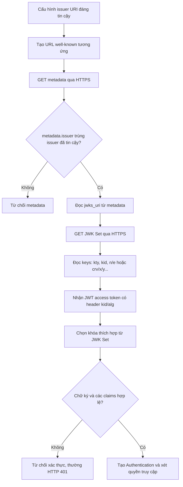

# OIDC Discovery, OAuth metadata và thông tin khóa của nhà phát hành

Khi tích hợp một **Spring Security OAuth 2.0 Resource Server**, chúng ta thường biết một thông tin ban đầu: **issuer URI** của Authorization Server/OpenID Provider (OP). Từ URI này, ứng dụng có thể khám phá nơi lấy bộ khóa công khai để xác thực chữ ký JWT và một số endpoint khác do nhà phát hành công bố. Cơ chế này được gọi là *discovery* hoặc *metadata discovery*.

Ba câu hỏi quan trọng nhất của bài học:

1. **Tin ai?** Issuer nào được cấu hình là đáng tin cậy và tài liệu metadata nào thực sự thuộc issuer đó?
2. **Lấy cấu hình ở đâu?** OIDC Discovery và OAuth 2.0 Authorization Server Metadata công bố các endpoint qua những URL nào?
3. **Xác minh token bằng khóa nào?** Trường `jwks_uri` dẫn đến bộ khóa công khai nào, và Resource Server chọn khóa để kiểm tra chữ ký JWT ra sao?

Discovery giúp ứng dụng tìm cấu hình, nhưng **không tự bảo đảm rằng mọi access token hợp lệ, dành cho API hoặc có đủ quyền**. Sau khi tìm được khóa, Resource Server vẫn phải xác minh chữ ký, thời gian hiệu lực, `iss`, `aud` và chính sách truy cập phù hợp.

## 1. Phân biệt các vai trò và tài liệu

| Khái niệm | Vai trò | Ví dụ |
|---|---|---|
| **Authorization Server (AS)** | Cấp OAuth 2.0 access token và có thể phát hành refresh token; sở hữu các OAuth endpoint | `https://login.example.test/realms/shop` |
| **OpenID Provider (OP)** | Authorization Server hỗ trợ OpenID Connect, có thể phát hành ID token và cung cấp thông tin xác thực người dùng | Cùng hệ thống đăng nhập của doanh nghiệp |
| **Issuer identifier** | Định danh URL của bên phát hành, được coi là ranh giới tin cậy | `https://login.example.test/realms/shop` |
| **OIDC Provider Configuration** | Tài liệu JSON mô tả một OP: `issuer`, `jwks_uri`, OAuth/OIDC endpoints và khả năng hỗ trợ | `.../.well-known/openid-configuration` |
| **OAuth Authorization Server Metadata** | Tài liệu JSON theo RFC 8414 mô tả một AS, có thể dùng khi không triển khai OIDC | `.../.well-known/oauth-authorization-server/...` |
| **JWK Set (JWKS)** | Tài liệu JSON chứa nhiều JSON Web Key, thường là các khóa công khai để xác minh chữ ký | URL do `jwks_uri` trong metadata chỉ ra |
| **Resource Server** | API tiếp nhận access token, xác thực token, rồi phân quyền truy cập | `https://api.example.test` |

**Issuer URI là một định danh tin cậy, không phải bản thân URL của JWKS.** Ứng dụng dùng issuer để lấy metadata; metadata chỉ ra `jwks_uri`; JWKS chứa khóa; khóa hỗ trợ xác minh chữ ký token.

Trong OIDC, discovery còn có thể bao gồm bước *issuer discovery* nhằm tìm OP từ định danh người dùng bằng WebFinger. Đối với Resource Server đã biết và được cấu hình issuer URI, trọng tâm là **lấy provider configuration từ issuer đó**, không phải tìm issuer bất kỳ từ username hoặc từ dữ liệu do người gọi API gửi lên.

## 2. Sơ đồ hành trình: issuer → metadata → JWKS → xác thực JWT



Sơ đồ mô tả nhánh **JWT có chữ ký**. Nếu API xác thực **opaque access token**, nó thường gọi **introspection endpoint** thay vì giải mã JWT bằng JWKS; metadata có thể công bố endpoint introspection nhưng cơ chế cấu hình và thực thi khác.

Hai loại kiểm tra phải tách bạch:

- **Kiểm tra metadata:** Có đúng nhà phát hành mà hệ thống dự định tin cậy không?
- **Kiểm tra token:** Token có được ký bằng khóa hợp lệ của nhà phát hành, còn hiệu lực và đáp ứng các điều kiện của Resource Server không?

Một file JSON công khai, kể cả metadata hoặc JWKS truy cập được qua HTTPS, **không tự nhiên trở thành nguồn tin cậy cho bất kỳ API nào**. Quan hệ tin cậy phải bắt đầu từ issuer đã được cấu hình/cho phép.

## 3. URL Discovery của OIDC và OAuth 2.0: giống dữ liệu, khác quy tắc tạo đường dẫn

### 3.1. OIDC Discovery: `openid-configuration`

OpenID Connect Discovery 1.0 xác định tài liệu cấu hình tại URL bằng cách **nối** `/.well-known/openid-configuration` vào issuer đã được chuẩn hóa theo quy tắc của đặc tả.

Ví dụ issuer không có path:

```text
Issuer:
  https://login.example.test

OIDC Provider Configuration:
  https://login.example.test/.well-known/openid-configuration
```

Ví dụ issuer **có path**:

```text
Issuer:
  https://login.example.test/realms/shop

OIDC Provider Configuration:
  https://login.example.test/realms/shop/.well-known/openid-configuration
```

Request minh họa:

```http
GET /realms/shop/.well-known/openid-configuration HTTP/1.1
Host: login.example.test
Accept: application/json
```

Endpoint thành công trả tài liệu JSON. Trường `issuer` bên trong tài liệu phải đúng bằng issuer dự kiến; URL của tài liệu và `issuer` **không phải cùng một chuỗi**.

### 3.2. OAuth 2.0 Authorization Server Metadata: RFC 8414

RFC 8414 định nghĩa cách công bố metadata OAuth tại hậu tố chuẩn `/.well-known/oauth-authorization-server`. Khi issuer có path, quy tắc của RFC 8414 là **chèn** đoạn `/.well-known/oauth-authorization-server` giữa phần host và path của issuer.

```text
Issuer:
  https://login.example.test

OAuth AS Metadata:
  https://login.example.test/.well-known/oauth-authorization-server

Issuer có path:
  https://login.example.test/realms/shop

OAuth AS Metadata:
  https://login.example.test/.well-known/oauth-authorization-server/realms/shop
```

Sự khác biệt đáng nhớ:

| Issuer | OIDC Discovery 1.0 | OAuth Metadata RFC 8414 |
|---|---|---|
| `https://login.example.test` | `https://login.example.test/.well-known/openid-configuration` | `https://login.example.test/.well-known/oauth-authorization-server` |
| `https://login.example.test/realms/shop` | `https://login.example.test/realms/shop/.well-known/openid-configuration` | `https://login.example.test/.well-known/oauth-authorization-server/realms/shop` |

RFC 8414 cũng cho phép một hồ sơ ứng dụng dùng hậu tố `openid-configuration` theo **cách chèn của RFC 8414**. Với issuer có path, địa chỉ này có dạng:

```text
https://login.example.test/.well-known/openid-configuration/realms/shop
```

Nghĩa là trong môi trường tích hợp, bạn có thể gặp **hai vị trí `openid-configuration` khác nhau** cho cùng một issuer có path: cách nối của OIDC Discovery và cách chèn của RFC 8414. Phía Authorization Server có thể công bố nhiều vị trí vì mục đích tương thích; phía client/library chỉ truy vấn các biến thể mà nó hỗ trợ.

**Không tự suy đoán rằng tất cả các endpoint trên đều tồn tại.** Hãy đối chiếu tài liệu nhà cung cấp và cơ chế discovery của thư viện được dùng.

### 3.3. Còn metadata của chính Resource Server?

Đừng nhầm tài liệu metadata của **nhà phát hành** với tài liệu metadata của **tài nguyên/API**:

- **Authorization Server Metadata (RFC 8414):** mô tả nơi cấp token, khóa và các khả năng của Authorization Server.
- **Protected Resource Metadata (RFC 9728):** mô tả API được bảo vệ, ví dụ định danh `resource` và danh sách `authorization_servers` được API chấp nhận, được công bố tại hậu tố mặc định `/.well-known/oauth-protected-resource`.

Ví dụ Protected Resource Metadata:

```json
{
  "resource": "https://api.example.test",
  "authorization_servers": [
    "https://login.example.test/realms/shop"
  ],
  "scopes_supported": ["orders.read", "orders.write"]
}
```

Tài liệu theo RFC 9728 giúp client tìm Authorization Server phù hợp với API trong những hệ thống hỗ trợ cơ chế đó. Nó **không thay thế** `openid-configuration`, `oauth-authorization-server` hoặc JWKS của nhà phát hành.

## 4. Đọc một tài liệu OIDC Provider Configuration

Giả sử endpoint OIDC của issuer trên trả về dữ liệu sau. Đây là **ví dụ minh họa**; domain và endpoint không dùng để kết nối thật:

```json
{
  "issuer": "https://login.example.test/realms/shop",
  "authorization_endpoint": "https://login.example.test/realms/shop/protocol/openid-connect/auth",
  "token_endpoint": "https://login.example.test/realms/shop/protocol/openid-connect/token",
  "userinfo_endpoint": "https://login.example.test/realms/shop/protocol/openid-connect/userinfo",
  "jwks_uri": "https://login.example.test/realms/shop/protocol/openid-connect/certs",
  "response_types_supported": ["code"],
  "subject_types_supported": ["public"],
  "id_token_signing_alg_values_supported": ["RS256"],
  "scopes_supported": ["openid", "profile", "email", "orders.read"],
  "grant_types_supported": ["authorization_code", "refresh_token", "client_credentials"],
  "token_endpoint_auth_methods_supported": ["client_secret_basic", "private_key_jwt"]
}
```

Ý nghĩa các trường:

| Trường metadata | Dùng để làm gì? | Resource Server quan tâm thế nào? |
|---|---|---|
| `issuer` | Định danh chính xác OP/AS | **Rất quan trọng**: đối chiếu với issuer đã cấu hình và kiểm tra claim `iss` của JWT. |
| `jwks_uri` | URL để lấy bộ JSON Web Keys | **Rất quan trọng khi xác thực JWT** bằng khóa công khai. |
| `authorization_endpoint` | Nơi client điều hướng người dùng để xin ủy quyền | Chủ yếu dành cho OAuth/OIDC client; API thuần Resource Server thường không gọi trực tiếp. |
| `token_endpoint` | Nơi client đổi code/credential lấy token | Không phải nơi Resource Server xác thực JWT mỗi request. |
| `userinfo_endpoint` | Nơi OIDC client lấy claim người dùng trong ngữ cảnh giao thức | Không phải điểm bắt buộc để API phân quyền access token. |
| `response_types_supported` | Các response type OP hỗ trợ | Phục vụ cấu hình OIDC client. |
| `subject_types_supported` | Cách biểu diễn định danh subject của OP | Phục vụ OIDC client; chẳng hạn `public`/`pairwise`. |
| `id_token_signing_alg_values_supported` | Thuật toán ký **ID token** OP hỗ trợ | Không nên đồng nhất máy móc với thuật toán ký **access token** của API. |
| `scopes_supported` | Các scope server hỗ trợ hoặc quảng bá | Chỉ là khả năng; không chứng minh caller đã được cấp scope nào. |
| `grant_types_supported` | Các grant type AS hỗ trợ | Hữu ích cho OAuth client khi chọn flow. |
| `token_endpoint_auth_methods_supported` | Phương thức client xác thực tại token endpoint | Phục vụ OAuth client; không phải cơ chế xác thực bearer token tại API. |

Về yêu cầu trường, cần đọc theo **từng đặc tả**. Ví dụ OIDC Discovery yêu cầu `issuer`, `authorization_endpoint`, `jwks_uri`, `response_types_supported`, `subject_types_supported` và `id_token_signing_alg_values_supported`; một số endpoint khác có điều kiện hoặc được khuyến nghị. Trong OAuth AS Metadata RFC 8414, `issuer` là trường bắt buộc; sự bắt buộc của các endpoint phụ thuộc loại grant type mà AS hỗ trợ, còn `jwks_uri` là metadata có thể được công bố. Đừng áp danh sách field bắt buộc của OIDC lên một AS OAuth không triển khai OIDC.

Các URL trong metadata **không nhất thiết** có chung đường dẫn với issuer. Chỉ định danh `issuer` cần được khớp đúng theo quy tắc tin cậy; endpoint thực tế được lấy từ metadata đã xác minh hoặc tài liệu cấu hình đáng tin cậy. Không dựng token endpoint hay JWKS URI bằng cách nối chuỗi tùy tiện như `issuer + "/certs"`.

## 5. JSON Web Key và JSON Web Key Set là gì?

### 5.1. JWK: biểu diễn một khóa mật mã bằng JSON

**JWK** (JSON Web Key, RFC 7517) mô tả một khóa với những thuộc tính như loại khóa, mục đích sử dụng, thuật toán và định danh. Một JWK RSA công khai có thể mang các trường:

```json
{
  "kty": "RSA",
  "kid": "rsa-signing-2026-11",
  "use": "sig",
  "alg": "RS256",
  "n": "<base64url-public-modulus>",
  "e": "AQAB"
}
```

Giá trị `n` trong ví dụ là placeholder, không phải khóa thật.

| Thuộc tính | Ý nghĩa |
|---|---|
| `kty` | Kiểu khóa: ví dụ `RSA`, `EC` hoặc `OKP` tùy thuật toán được hỗ trợ. |
| `kid` | *Key ID*, nhãn giúp tìm khóa tương ứng trong một tập nhiều khóa. |
| `use` | Mục đích tổng quát, thường `sig` (chữ ký) hoặc `enc` (mã hóa). |
| `key_ops` | Các thao tác được phép cho khóa, ví dụ `verify`; ý nghĩa cần nhất quán với `use` khi có cả hai. |
| `alg` | Thuật toán gắn với khóa, ví dụ `RS256`; không tự thay thế cấu hình thuật toán tin cậy của verifier. |
| `n` và `e` | Modulus và public exponent đối với khóa RSA. |
| `crv`, `x`, `y` | Tham số thường gặp với khóa elliptic curve phù hợp. |
| `x5c`/`x5t` | Thông tin chứng chỉ X.509 hoặc dấu vân tay, nếu được nhà phát hành công bố. |

`kid` **không phải mật khẩu, không phải bằng chứng khóa đáng tin, và không phải chữ ký**. Token có thể tự khai báo `kid`; verifier chỉ dùng nó như *gợi ý chọn khóa* trong **tập khóa đã lấy từ issuer đáng tin cậy**, sau đó vẫn phải xác minh chữ ký bằng mật mã.

### 5.2. JWKS: một danh sách JWK

JWKS thường có cấu trúc:

```json
{
  "keys": [
    {
      "kty": "RSA",
      "kid": "rsa-signing-2026-10",
      "use": "sig",
      "alg": "RS256",
      "n": "<old-public-modulus>",
      "e": "AQAB"
    },
    {
      "kty": "RSA",
      "kid": "rsa-signing-2026-11",
      "use": "sig",
      "alg": "RS256",
      "n": "<new-public-modulus>",
      "e": "AQAB"
    }
  ]
}
```

Tập có nhiều khóa là điều bình thường khi nhà phát hành thay khóa ký (*key rotation*). JSON được công bố tại URL `jwks_uri`, ví dụ:

```http
GET /realms/shop/protocol/openid-connect/certs HTTP/1.1
Host: login.example.test
Accept: application/json
```

Với chữ ký **bất đối xứng** như RSA hoặc ECDSA:

- Authorization Server giữ **private key** để ký token.
- Resource Server dùng **public key** tương ứng để kiểm tra chữ ký.
- Public key có thể công bố qua HTTPS trong JWKS; private key không được công bố tại đó.

Một JWKS công khai dành cho xác minh chữ ký **không nên chứa khóa bí mật** như tham số private RSA `d` hoặc khóa đối xứng `k`. Tài liệu OIDC Discovery yêu cầu JWKS công bố không chứa giá trị khóa private hoặc symmetric. Kiểm tra khóa như vậy là trách nhiệm của nhà phát hành; Resource Server vẫn phải giới hạn nguồn khóa mà mình tin cậy.

### 5.3. JWT dùng JWKS như thế nào?

Một JWT ký bằng JWS thường có dạng:

```text
base64url(header).base64url(payload).base64url(signature)
```

Ví dụ header:

```json
{
  "alg": "RS256",
  "typ": "JWT",
  "kid": "rsa-signing-2026-11"
}
```

Payload minh họa:

```json
{
  "iss": "https://login.example.test/realms/shop",
  "sub": "customer-123",
  "aud": ["orders-api"],
  "exp": 1900000000,
  "scope": "orders.read"
}
```

Quy trình xác minh được mô tả ở mức logic:

1. Decoder đọc `alg` và `kid` để xác định phép kiểm tra thích hợp, **chỉ trong tập thuật toán đã cho phép**.
2. Decoder tìm khóa có `kid` phù hợp trong JWKS của issuer tin cậy, đồng thời xét loại khóa, mục đích và các điều kiện thuật toán.
3. Decoder dùng public key kiểm tra chữ ký trên header và payload đã mã hóa theo chuẩn JWS.
4. Khi chữ ký hợp lệ, decoder còn phải kiểm tra thời gian, issuer và các điều kiện riêng của API như audience, loại token, tenant hoặc các claim bắt buộc.
5. Sau khi xác thực thành công, Spring Security mới chuyển claims/scopes thành `Authentication` và authorities để phân quyền.

**Không có bước nào được phép thay bằng “giải Base64URL rồi tin nội dung payload”.** Base64URL chỉ là mã hóa biểu diễn, không xác minh nguồn phát hành.

Cũng không được tự động tải khóa từ URL tùy ý do token header cung cấp, chẳng hạn `jku` hay `x5u`. Nếu cho một token chưa xác thực quyết định địa chỉ JWKS, hệ thống có nguy cơ chấp nhận khóa của kẻ tấn công hoặc tạo request mạng ra ngoài ngoài ý muốn. URL khóa phải được giới hạn bởi nguồn cấu hình/metadata đã tin cậy.

## 6. Chuỗi tin cậy trong OIDC/OAuth Metadata

Hãy coi issuer URI được quản trị viên cấu hình là **điểm bắt đầu**:

```text
Issuer được phép
    │ (được cấu hình trước hoặc qua quy trình đăng ký đáng tin)
    ▼
Discovery metadata lấy qua HTTPS
    │ xác minh metadata.issuer khớp issuer mong đợi
    ▼
jwks_uri trong metadata tin cậy
    │ tải JWKS qua kết nối đáng tin cậy
    ▼
Public key phù hợp với token
    │ kiểm tra chữ ký bằng thuật toán được chấp nhận
    ▼
Claim JWT: iss / exp / nbf / aud / ...
    │ kiểm tra các ràng buộc theo hợp đồng với API
    ▼
Authentication → Authorization
```

Những điều cần chú ý:

**Khớp issuer thật chính xác.** Nếu cấu hình issuer là `https://login.example.test/realms/shop` nhưng metadata trả `https://login.example.test/realms/admin`, tài liệu đó không được tin. Thay đổi path, realm hoặc slash có thể mang ý nghĩa khác. Với OIDC Discovery và RFC 8414, việc xác minh chuỗi `issuer` là một yêu cầu bảo mật, không phải tùy chọn trang trí.

**HTTPS phải được kiểm tra đúng.** Một endpoint công bố public key không nhất thiết cần đăng nhập, nhưng tính toàn vẹn của metadata và JWKS phụ thuộc kết nối TLS đáng tin cậy và cách quản lý cấu hình. Không tắt xác thực chứng chỉ HTTPS để “chạy được” trong môi trường thực tế.

**Không nhập nhằng ID token và access token.** OIDC metadata có thông tin phục vụ kiểm tra **ID token** cho OIDC client. Resource Server cần kiểm tra **access token** theo hợp đồng của Authorization Server. Việc chung issuer và chung JWKS không có nghĩa ID token được phép dùng làm bearer access token.

**Không coi JWKS là danh sách mọi token đang hoạt động.** JWKS chỉ cho biết các khóa mà verifier có thể dùng; nó không xác nhận riêng từng JWT đã bị thu hồi hay chưa. JWT có chữ ký hợp lệ vẫn có thể hết hạn, sai audience hoặc không đạt chính sách truy cập.

**Không suy diễn quyền từ metadata.** `scopes_supported` liệt kê khả năng server hỗ trợ. Quyền thật được cấp cho một request phải đến từ access token đã xác thực và chính sách của Resource Server.

## 7. Khóa thay đổi thế nào: JWKS cache và key rotation

Authorization Server cần luân phiên khóa ký để hạn chế rủi ro và vận hành dài hạn. Một chiến lược phổ biến là:

1. **Trước khi đổi khóa:** JWKS có khóa cũ `K1`, token mới đang được ký bằng private key tương ứng.
2. **Công bố khóa mới:** AS thêm public key `K2` vào JWKS trong khi vẫn giữ `K1`.
3. **Chuyển sang ký bằng K2:** Token mới mang `kid=K2`; token cũ `kid=K1` vẫn có thể chưa hết hạn.
4. **Giai đoạn chồng lấn:** Resource Server phải xác minh được cả token dùng `K1` và token dùng `K2`.
5. **Thu hồi khóa cũ khỏi JWKS:** Chỉ thực hiện khi đã tính đến thời hạn token, thời gian cache và chính sách bảo mật; có thể cần loại bỏ sớm khi khóa bị lộ.

```text
Thời gian ──────────────────────────────────────────────────────►

JWKS:
    [K1] ───► [K1, K2] ───────────────► [K2]

AS ký JWT mới:
     K1 ─────────► K2 ─────────────────► K2

Resource Server:
    lưu/cache K1, làm mới JWKS khi cần, nhận K2, tiếp tục
    kiểm tra token cũ theo chính sách cho đến khi hết hiệu lực
```

Một số hậu quả thực tế:

- Nếu Resource Server cache JWKS quá lâu, có thể tạm thời **không tìm được `kid` mới** và từ chối token vừa được ký bằng `K2`.
- Nếu AS xóa `K1` trước khi các token cũ hết hạn, các token đó có thể bị từ chối dù `exp` còn tương lai.
- Nếu khóa ký bị lộ, việc xoay khóa khẩn cấp có thể khiến token cũ mất hiệu lực ngoài kế hoạch; đây có thể là quyết định an toàn có chủ đích.
- Cache và cơ chế tự làm mới phụ thuộc thư viện, HTTP response headers và cấu hình; không được giả định mỗi API request đều gọi JWKS endpoint.

Spring Security khi dùng cơ chế JWT decoder thông thường có thể theo dõi các public key mới do issuer công bố. Tuy nhiên khả năng phục hồi khi mạng lỗi, thời điểm refresh và độ trễ nhận khóa mới vẫn cần được đánh giá trong môi trường triển khai thực tế.

## 8. Cấu hình Spring Boot Resource Server bằng `issuer-uri`

### 8.1. Dependencies cơ bản

Ví dụ Maven với Spring Boot:

```xml
<dependencies>
    <dependency>
        <groupId>org.springframework.boot</groupId>
        <artifactId>spring-boot-starter-security</artifactId>
    </dependency>
    <dependency>
        <groupId>org.springframework.boot</groupId>
        <artifactId>spring-boot-starter-oauth2-resource-server</artifactId>
    </dependency>
</dependencies>
```

Starter Resource Server của Spring Boot cung cấp hạ tầng cần thiết cho kịch bản phổ biến. Ở cấp Spring Security module, việc xử lý JWT/JWS còn sử dụng hỗ trợ từ thành phần JOSE.

### 8.2. Cấu hình sử dụng discovery

```yaml
spring:
  security:
    oauth2:
      resourceserver:
        jwt:
          issuer-uri: https://login.example.test/realms/shop
          audiences:
            - orders-api
```

Với cấu hình này, Spring Security dùng issuer để tự khám phá cấu hình nhà phát hành và JWKS theo cơ chế được hỗ trợ. Việc kiểm tra `aud=orders-api` thông qua thuộc tính `audiences` được Spring Boot hỗ trợ trong các phiên bản hiện hành; khi dùng phiên bản khác hoặc tạo `JwtDecoder` tùy biến, cần chắc chắn audience validator thực sự được đăng ký.

Spring Security có thể thử các kiểu URL discovery được hỗ trợ, trong đó có các dạng OIDC và RFC 8414 đã nêu. Với issuer `https://login.example.test/realms/shop`, những vị trí đáng kiểm tra khi tích hợp là:

```text
https://login.example.test/realms/shop/.well-known/openid-configuration
https://login.example.test/.well-known/openid-configuration/realms/shop
https://login.example.test/.well-known/oauth-authorization-server/realms/shop
```

**Không nên giả định trình tự thử endpoint hoặc thời điểm tải metadata là cố định với mọi phiên bản/cách cấu hình.** Trong một số phiên bản Spring Security, discovery được thực hiện khi JWT đầu tiên cần giải mã; trong cách cấu hình khác, việc khởi tạo decoder có thể liên hệ Authorization Server sớm hơn. Nếu tính sẵn sàng của AS khi startup là yếu tố quan trọng, hãy quyết định rõ chiến lược cấu hình bên dưới.

Một cấu hình bảo vệ endpoint cơ bản:

```java
@Configuration
public class SecurityConfiguration {

    @Bean
    SecurityFilterChain apiFilterChain(HttpSecurity http) throws Exception {
        return http
            .authorizeHttpRequests(auth -> auth
                .requestMatchers("/public/**").permitAll()
                .requestMatchers("/api/orders/**")
                    .hasAuthority("SCOPE_orders.read")
                .anyRequest().authenticated()
            )
            .oauth2ResourceServer(oauth2 ->
                oauth2.jwt(Customizer.withDefaults())
            )
            .build();
    }
}
```

Đoạn Java là ví dụ về phần chính của cấu hình; các import và chính sách bổ sung như CORS, CSRF, session, HTTP methods cần phù hợp ứng dụng thực tế. Discovery và JWKS giúp kiểm tra token; đoạn `authorizeHttpRequests` mới quyết định yêu cầu có đủ quyền tới tài nguyên.

### 8.3. Chỉ định JWKS URI trực tiếp

Nếu AS không hỗ trợ metadata endpoint mà Spring Security có thể dùng, hoặc ứng dụng muốn biết trước địa chỉ khóa mà không cần discovery trong quá trình khởi tạo decoder, có thể khai báo:

```yaml
spring:
  security:
    oauth2:
      resourceserver:
        jwt:
          issuer-uri: https://login.example.test/realms/shop
          jwk-set-uri: https://login.example.test/realms/shop/protocol/openid-connect/certs
          audiences:
            - orders-api
```

Ý nghĩa:

- `issuer-uri` vẫn xác định issuer được phép và giúp kiểm tra claim `iss`.
- `jwk-set-uri` xác định chính xác endpoint JWKS, nên decoder không cần discovery để tìm nó.
- `audiences` đặt kỳ vọng token phải hướng đến `orders-api`; giá trị thực tế phải theo quy ước phát hành token.

**Nếu chỉ cấu hình `jwk-set-uri` mà không thiết lập validator issuer, không nên mặc nhiên cho rằng `iss` được kiểm tra.** Nguồn khóa và xác minh issuer là hai ràng buộc độc lập. Cấu hình cả hai giúp tránh sai sót khi bỏ qua discovery.

Không tự thay `issuer-uri` bằng URL `openid-configuration`. Spring cần **issuer identifier**, ví dụ `https://login.example.test/realms/shop`, không phải `https://login.example.test/realms/shop/.well-known/openid-configuration`.

### 8.4. Khi nào chọn cấu hình nào?

| Nhu cầu | Cách làm thường phù hợp | Lưu ý |
|---|---|---|
| AS có OIDC/OAuth metadata chuẩn | Cấu hình `issuer-uri` | Giảm hard-code endpoint và xác nhận issuer từ metadata. |
| AS có JWKS nhưng không công bố discovery tương thích | Cấu hình `issuer-uri` + `jwk-set-uri` | Tự quản lý tính đúng đắn của địa chỉ JWKS. |
| Cần giảm phụ thuộc discovery vào thời điểm khởi tạo | Có thể chỉ định `jwk-set-uri` đồng thời giữ `issuer-uri` | Lúc xác minh token vẫn có thể cần kết nối lấy/cập nhật JWKS. |
| AS cấp opaque token thay vì JWT có chữ ký | Cấu hình introspection / `OpaqueTokenIntrospector` | Không lấy JWKS để “giải mã” opaque token. |
| Nhiều issuer/tenant | Quản lý danh sách issuer đáng tin và decoder/resolver tương ứng | Không tùy tiện tin issuer lấy từ token chưa xác thực. |

## 9. Kiểm tra thủ công metadata và JWKS

Dù Spring Security có khả năng tự cấu hình, việc tự đọc metadata bằng công cụ HTTP rất hữu ích khi tích hợp và chẩn đoán môi trường.

### 9.1. Xem tài liệu OIDC

```bash
curl --fail --show-error --silent \
  "https://login.example.test/realms/shop/.well-known/openid-configuration"
```

Xem những trường liên quan:

```json
{
  "issuer": "https://login.example.test/realms/shop",
  "jwks_uri": "https://login.example.test/realms/shop/protocol/openid-connect/certs"
}
```

Đây chỉ là phần rút gọn minh họa; tài liệu OIDC đầy đủ thường có nhiều trường khác.

Nếu có `jq`, có thể lọc nhanh:

```bash
curl --fail --silent --show-error \
  "https://login.example.test/realms/shop/.well-known/openid-configuration" \
  | jq '{issuer, jwks_uri, authorization_endpoint, token_endpoint}'
```

### 9.2. Xem JWKS

Lấy đúng URL do `jwks_uri` trả về:

```bash
curl --fail --show-error --silent \
  "https://login.example.test/realms/shop/protocol/openid-connect/certs"
```

Có thể chỉ xem danh sách key id và thuật toán, không cần ghi toàn bộ modulus công khai vào log:

```bash
curl --fail --show-error --silent \
  "https://login.example.test/realms/shop/protocol/openid-connect/certs" \
  | jq '.keys[] | {kid, kty, use, alg}'
```

Những lệnh này kiểm tra khả năng tiếp cận endpoint và cấu trúc JSON. **Chúng không chứng minh một access token bất kỳ hợp lệ**. Việc xác minh token phải do thư viện mật mã và JWT validator đã cấu hình thực hiện.

### 9.3. Khi request trả 401, chẩn đoán ở đâu?

| Hiện tượng | Nguyên nhân có thể | Việc cần xem |
|---|---|---|
| Discovery trả 404 | Nhầm quy tắc URL OIDC/RFC 8414, sai realm hoặc AS không công bố endpoint đó | Kiểm tra chính xác issuer, endpoint thực tế và loại metadata server hỗ trợ. |
| Discovery trả JSON nhưng issuer không khớp | Nhầm tenant/realm, reverse proxy sửa đường dẫn hoặc cấu hình issuer sai | So sánh `issuer-uri` với trường `issuer`, không tự sửa string cho “gần giống”. |
| JWKS endpoint trả 404/403 | `jwks_uri` không hợp lệ, gateway chặn hoặc cấu hình mạng sai | Đọc lại URL trả từ metadata và đường đi mạng của Resource Server. |
| JWT có `kid` mới nhưng decoder không tìm được khóa | JWKS cache cũ, đổi khóa chưa đồng bộ hoặc endpoint chưa công bố khóa mới | Kiểm tra thông tin rotation, JWKS đang công bố, cache và refresh. |
| Chữ ký không hợp lệ dù tìm được `kid` | Khóa không khớp, thuật toán không được chấp nhận, JWT đã bị sửa | Kiểm tra issuer, thuật toán, chữ ký và khóa phát hành thực. |
| JWT xác thực chữ ký được nhưng vẫn 401 | Sai `iss`, `aud`, `exp`, `nbf` hoặc validator khác | Kiểm tra claim cùng các yêu cầu API. |
| JWT hợp lệ nhưng API trả 403 | Thiếu authority/scope, không có quyền trên tài nguyên | Kiểm tra ánh xạ `SCOPE_`, quy tắc URL và method security. |
| Mạng đến issuer hoạt động lúc đầu, sau đó gián đoạn | Cache còn dữ liệu hoặc cần refresh khóa đúng lúc mạng lỗi | Giám sát kết nối, độ trễ, timeout và chính sách cache/resilience. |

Chỉ bật logging bảo mật phù hợp với môi trường. **Không ghi raw bearer token hay dữ liệu nhạy cảm vào log** để tìm nguyên nhân lỗi.

## 10. Metadata công bố không đồng nghĩa với ứng dụng được quyền dùng mọi tính năng

Một số hiểu lầm phổ biến phát sinh khi thấy metadata có nhiều endpoint:

- Metadata công bố `authorization_endpoint` và `token_endpoint` không biến Resource Server thành OAuth client thực hiện login. Resource Server nhận và xác minh access token trong request.
- Metadata có `userinfo_endpoint` không buộc Resource Server phải gọi UserInfo mỗi khi nhận token; UserInfo chủ yếu thuộc OIDC client flow.
- Metadata có `introspection_endpoint` không buộc Resource Server xác thực JWT qua introspection; chỉ dùng introspection khi hợp đồng token/cấu hình chọn cơ chế đó.
- `scopes_supported` không có nghĩa access token của người dùng sở hữu tất cả scope trong danh sách.
- `id_token_signing_alg_values_supported` nói về ID token, không chứng minh mọi JWT access token đều ký bằng cùng thuật toán.
- `jwks_uri` không cho biết token đã bị thu hồi và không thay thế kiểm tra thời gian, audience hay quyền dữ liệu.

Với bearer access token, API cần áp dụng các điều kiện độc lập: **issuer đáng tin → chữ ký/trạng thái hợp lệ → audience/mục đích đúng → scope/authority phù hợp → quyền truy cập tài nguyên cụ thể**.

## 11. Nhiều issuer, realm và tenant: Discovery phải có danh sách tin cậy

Một ứng dụng có thể nhận JWT từ nhiều issuer, ví dụ:

```text
https://login.example.test/realms/merchant
https://login.example.test/realms/customer
```

Mỗi issuer có thể có:

- Metadata riêng.
- `jwks_uri` riêng.
- Khóa ký và vòng đời thay khóa khác nhau.
- Ý nghĩa scope, claim và principal khác nhau.

**Không nên** đọc chuỗi `iss` từ JWT chưa xác thực rồi tải metadata/JWKS của địa chỉ đó mà không kiểm tra danh sách được phép. Người gửi request có khả năng tự tạo nội dung JWT chưa xác thực. Nếu tin URL do token tự chỉ định, ứng dụng có thể bị dẫn đến issuer do kẻ tấn công quản lý hoặc bị lợi dụng để tạo request nội bộ.

Giải pháp là quản trị **allowlist issuer** hoặc quy trình onboarding tenant có xác thực đáng tin cậy; mỗi issuer cần bộ decoder/chính sách xác minh tương ứng. Spring Security hỗ trợ kiến trúc phân giải `AuthenticationManager` theo issuer/tenant, nhưng việc chọn resolver phải gắn với ranh giới tin cậy được kiểm soát.

Cũng không nên dùng một khóa public bất kỳ trong một JWKS “tổng hợp” để xác minh token có `iss` khác mà không kiểm tra mối quan hệ giữa issuer và khóa ký. **Tin khóa** và **tin nhà phát hành** là hai mặt của cùng quyết định.

## 12. Bài thực hành tư duy: nhìn dữ liệu và quyết định

Giả sử cấu hình Resource Server:

```yaml
spring:
  security:
    oauth2:
      resourceserver:
        jwt:
          issuer-uri: https://login.example.test/realms/shop
          audiences: [orders-api]
```

Và metadata trả về:

```json
{
  "issuer": "https://login.example.test/realms/shop",
  "jwks_uri": "https://login.example.test/realms/shop/keys"
}
```

Hãy xét từng trường hợp:

**Trường hợp A — Issuer đúng, khóa mới xuất hiện.** JWT mang `kid=new-key` nhưng JWKS đang cache chỉ có `old-key`. Resource Server cần có cơ chế làm mới JWKS theo thư viện/cấu hình; nếu chưa tìm được khóa mới phù hợp thì **không chấp nhận token chỉ vì `kid` có vẻ hợp lý**.

**Trường hợp B — Khóa hợp lệ, audience sai.** JWT ký đúng bằng khóa của issuer và còn hiệu lực nhưng `aud=["billing-api"]`. Resource Server `orders-api` phải **từ chối** nếu cấu hình audience validator đúng. Khóa đúng không đủ để xác định token dành cho API nào.

**Trường hợp C — Metadata của realm khác.** Discovery endpoint trả `issuer=https://login.example.test/realms/admin` dù app cấu hình realm `shop`. Không sử dụng metadata đó; cần tìm lỗi endpoint/proxy/configuration.

**Trường hợp D — Token có scope phù hợp nhưng thiếu quyền dữ liệu.** JWT hợp lệ, `aud=["orders-api"]`, `scope="orders.read"` nhưng người gọi yêu cầu đơn hàng thuộc tài khoản khác. Xác thực token và phân quyền scope thành công vẫn phải kết hợp kiểm tra quyền sở hữu/tenant của bản ghi.

**Trường hợp E — Opaque token.** Token không có header JWS, không có `kid`. Không tự “giải JWT” bằng JWKS; phải dùng introspection hoặc cơ chế xác thực opaque token theo thiết kế Authorization Server.

## 13. Mẫu kiểm tra khi tích hợp với một issuer mới

Khi nhận một URL issuer từ đội quản trị danh tính hoặc nhà cung cấp, hãy thu thập và xác nhận các thông tin sau:

1. **Định danh chuẩn:** Giá trị issuer chính xác mà token khai báo ở claim `iss`.
2. **Discovery URL thực tế:** Hệ thống dùng OIDC Discovery, OAuth AS Metadata hay hỗ trợ nhiều vị trí?
3. **Metadata issuer:** Trường `issuer` trong JSON có khớp tuyệt đối với định danh đã biết không?
4. **JWKS URL:** Trường `jwks_uri` trỏ đến đâu; endpoint có thể được Resource Server kết nối bằng HTTPS không?
5. **Loại token:** JWT access token có chữ ký hay opaque token cần introspection?
6. **Thuật toán ký:** Những thuật toán nào được API tin cậy và có phù hợp loại khóa trong JWKS không?
7. **Audience:** Resource Server phải yêu cầu giá trị `aud` nào?
8. **Quyền truy cập:** Claim `scope`/`scp` hoặc quyền tùy chỉnh được ánh xạ thành Spring Security authorities như thế nào?
9. **Rotation/caching:** Khi đổi khóa ký, JWKS được công bố trước bao lâu, khi nào xóa khóa cũ và cơ chế làm mới key của Resource Server hoạt động ra sao?
10. **Vận hành:** Kết nối mạng, TLS, proxy, timeout và cách xử lý khi discovery/JWKS tạm thời không truy cập được.

Mẫu trên giúp giải quyết đúng chuỗi phụ thuộc: **issuer → metadata → JWKS → token validation → authorization**. Khi một yêu cầu bị từ chối, xác định phần nào của chuỗi không đáp ứng điều kiện sẽ giúp tìm đúng nguyên nhân, thay vì bỏ qua xác thực chữ ký hoặc nới lỏng quy tắc phân quyền.

## 14. Tài liệu chuẩn để đào sâu

- [OpenID Connect Discovery 1.0, Errata Set 2](https://openid.net/specs/openid-connect-discovery-1_0.html): định nghĩa OP metadata, `openid-configuration`, kiểm tra issuer và `jwks_uri`.
- [RFC 8414 — OAuth 2.0 Authorization Server Metadata](https://www.rfc-editor.org/rfc/rfc8414): metadata OAuth 2.0, quy tắc URL well-known và kiểm tra issuer.
- [RFC 7517 — JSON Web Key (JWK)](https://www.rfc-editor.org/rfc/rfc7517): cấu trúc JWK/JWKS và các thuộc tính `kty`, `kid`, `alg`, `use`.
- [RFC 7515 — JSON Web Signature (JWS)](https://www.rfc-editor.org/rfc/rfc7515): chữ ký và cấu trúc dữ liệu được ký, là nền tảng của JWT có chữ ký.
- [RFC 9728 — OAuth 2.0 Protected Resource Metadata](https://www.rfc-editor.org/rfc/rfc9728): tài liệu metadata của API/resource, khác với metadata nhà phát hành.
- [Spring Security — OAuth 2.0 Resource Server JWT](https://docs.spring.io/spring-security/reference/servlet/oauth2/resource-server/jwt.html): cách cấu hình `issuer-uri`, `jwk-set-uri`, xác thực JWT và vòng đời khóa.
