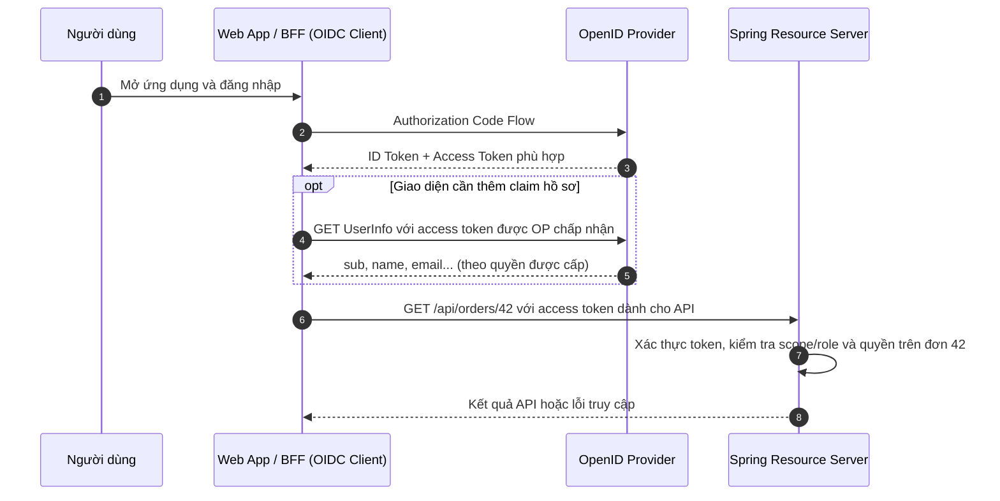
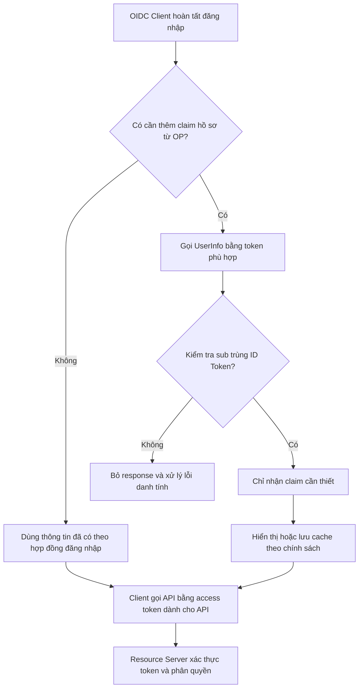

# UserInfo endpoint và lý do không mặc định cần gọi cho mỗi yêu cầu API

Trong OpenID Connect (OIDC), **UserInfo endpoint** là một endpoint được bảo vệ bằng OAuth 2.0, cho phép ứng dụng Client lấy các *claim* về người dùng đã đăng nhập từ OpenID Provider (OP). Nó hữu ích khi ứng dụng cần tên hiển thị, email, ảnh đại diện hoặc một số thuộc tính hồ sơ mà Client được phép nhận.

Tuy nhiên, khi xây dựng **Spring Security OAuth 2.0 Resource Server**, một câu hỏi thường xuất hiện là: *“API đã nhận access token rồi, có cần gọi UserInfo để biết người dùng là ai và kiểm tra họ có được truy cập API hay không?”* Câu trả lời mặc định là **không**. Resource Server phải xác thực access token và kiểm tra quyền truy cập theo chính sách của API. UserInfo giải quyết một bài toán khác: cung cấp thông tin hồ sơ người dùng cho Client khi cần.

Điều quan trọng là phân biệt bốn việc:

1. **Đăng nhập bằng OIDC:** Client xác lập danh tính người dùng qua OpenID Provider.
2. **Đọc hồ sơ:** Client có thể gọi UserInfo bằng access token phù hợp để lấy thêm claim.
3. **Bảo vệ API:** Resource Server xác thực access token dành cho API, bằng cách xác minh JWT hoặc introspection cho opaque token.
4. **Phân quyền API:** Resource Server quyết định người gọi có được thao tác với endpoint và đối tượng dữ liệu cụ thể không.

UserInfo có thể tham gia vào bước thứ hai. Nó **không thay thế** bước thứ ba hoặc thứ tư.

## 1. UserInfo endpoint nằm ở đâu trong OIDC?

OIDC bổ sung lớp xác thực danh tính lên OAuth 2.0. Các thành phần thường xuất hiện gồm:

| Thành phần | Nhiệm vụ |
| --- | --- |
| **OpenID Provider (OP) / Authorization Server** | Xác thực người dùng, cấp token và có thể công bố UserInfo endpoint. |
| **OIDC Client / Relying Party (RP)** | Thực hiện luồng đăng nhập, xử lý ID Token và tùy nhu cầu lấy thêm claim qua UserInfo. |
| **Resource Server** | Bảo vệ API bằng access token đã được xác thực và các luật phân quyền. |
| **UserInfo endpoint** | Một protected resource của OP, nhận access token phù hợp và trả về các claim của End-User. |

Trong một hệ thống thực tế, ứng dụng Spring Boot có thể vừa là OIDC Client (dùng `oauth2Login()`) vừa là Resource Server (dùng `oauth2ResourceServer()`). Tuy vậy, **hai vai trò và hai luồng xử lý vẫn khác nhau**.

Ví dụ luồng phổ biến:



Điểm đáng chú ý: **Client có thể gọi UserInfo ở thời điểm đăng nhập hoặc khi cần làm mới dữ liệu hồ sơ; API không phải gọi lại UserInfo trong mỗi lần nhận request**. Ngoài ra, trong một kiến trúc có nhiều Resource Server, token dành cho UserInfo và token dành cho một API có thể có audience/phạm vi sử dụng khác nhau; không được mặc nhiên chuyển tiếp bất cứ Bearer token nào sang UserInfo.

## 2. UserInfo thực sự cung cấp dữ liệu gì?

Thông thường, OP công bố metadata OIDC tại đường dẫn discovery:

```http
GET /.well-known/openid-configuration HTTP/1.1
Host: login.example.com
```

Ví dụ phần metadata liên quan:

```json
{
  "issuer": "https://login.example.com",
  "authorization_endpoint": "https://login.example.com/oauth2/authorize",
  "token_endpoint": "https://login.example.com/oauth2/token",
  "userinfo_endpoint": "https://login.example.com/oidc/userinfo",
  "jwks_uri": "https://login.example.com/oauth2/jwks"
}
```

Địa chỉ ở đây chỉ để minh họa: endpoint chính xác phụ thuộc nhà cung cấp và cấu hình tenant/realm. Client sử dụng giá trị `userinfo_endpoint` được công bố bởi **OP đã tin cậy**, thay vì tự ghép một URL tùy ý.

Để gọi UserInfo, Client gửi **access token** được OP cấp và chấp nhận cho UserInfo:

```http
GET /oidc/userinfo HTTP/1.1
Host: login.example.com
Authorization: Bearer <oidc-access-token>
Accept: application/json
```

Một response JSON minh họa:

```json
{
  "sub": "user-123",
  "name": "Nguyen Van A",
  "preferred_username": "nguyenvana",
  "email": "a@example.com",
  "email_verified": true,
  "picture": "https://cdn.example.com/avatar/user-123.png"
}
```

**Claim `sub` là cốt lõi.** Nó định danh End-User theo issuer; Client OIDC phải kiểm tra `sub` từ UserInfo **khớp chính xác** với `sub` trong ID Token tương ứng trước khi sử dụng các claim từ UserInfo. Nếu không khớp, Client phải bỏ qua dữ liệu UserInfo vì có nguy cơ gắn dữ liệu của người dùng này cho phiên của người dùng khác.

Không nên rút ra các giả định sau từ JSON minh họa:

- `name`, `email`, `picture`, `preferred_username` **không được đảm bảo luôn có**; OP quyết định claim được trả theo scope, consent, chính sách và dữ liệu thực tế.
- Request có các scope OIDC như `openid profile email` chỉ là cơ sở xin các claim liên quan, **không bảo đảm** API nhận được mọi thuộc tính mong muốn.
- `email_verified: true` mang ý nghĩa theo quy trình xác minh của nhà cung cấp; không tự cấp quyền quản trị hoặc quyền truy cập một đơn hàng.
- `email` và `preferred_username` có thể thay đổi. Khi ánh xạ người dùng, hãy ưu tiên cặp **`iss` + `sub`**, hoặc khóa định danh được thỏa thuận rõ ràng với OP; trong hệ thống nhiều tenant còn phải tính đến ranh giới tenant.
- UserInfo **không có hợp đồng mặc định** phải chứa `roles`, `permissions`, `tenant_id` hay ACL của API. Một OP cụ thể có thể bổ sung custom claim, nhưng cần thiết kế và kiểm chứng riêng.

OIDC cũng hỗ trợ các cách biểu diễn UserInfo response khác JSON thông thường trong những cấu hình cụ thể, ví dụ JWT có ký. Nếu sử dụng response dạng đó, Client phải xác minh theo chính sách bảo mật tương ứng. Các ví dụ bên dưới giả định response JSON được truyền qua HTTPS.

## 3. Đừng nhầm UserInfo với ID Token, access token và introspection

Bốn thứ này thường cùng xuất hiện trong một hệ thống nhưng có chức năng khác nhau:

| Thành phần | Mục đích chính | Bên sử dụng điển hình | Có dùng trực tiếp để bảo vệ API? |
| --- | --- | --- | --- |
| **ID Token** | Xác nhận sự kiện đăng nhập và cung cấp claim danh tính cho OIDC Client. | OIDC Client. | **Không**. API cần access token hợp lệ theo hợp đồng của API. |
| **Access Token** | Cho phép truy cập protected resource trong phạm vi được cấp; có thể là JWT hoặc opaque. | Client gửi cho Resource Server. | **Có**: Resource Server xác thực rồi phân quyền. |
| **UserInfo endpoint** | Trả về claim về End-User cho Client có access token phù hợp. | OIDC Client. | **Không mặc định**. Nó không phải bước kiểm tra bắt buộc cho mỗi request API. |
| **Token introspection endpoint** | Trả metadata/trạng thái của token, đặc biệt hữu ích với opaque token. | Resource Server đã được cấp quyền introspect. | **Có thể** là cơ chế xác thực token, nhưng vẫn cần authorization. |

### ID Token không phải access token của API

Một ID Token có thể là JWT đã ký, chứa `iss`, `sub`, `aud`, `exp` và các claim khác. Chữ ký đúng **không có nghĩa** API được phép chấp nhận token này thay access token: audience của ID Token thường là OIDC Client, trong khi Resource Server phải chấp nhận token được phát hành cho API của mình.

### UserInfo không phải introspection

Hai request dưới đây dùng cho hai mục tiêu khác nhau:

```text
OIDC Client  --(OIDC access token)-->  /userinfo
               mục tiêu: lấy claim hồ sơ người dùng

Resource Server --(token + thông tin xác thực của RS)--> /introspect
               mục tiêu: hỏi trạng thái và metadata của token
```

UserInfo trả các thuộc tính người dùng; introspection có thể trả `active`, `scope`, `client_id`, `sub`, `exp` và dữ liệu liên quan theo hợp đồng của Authorization Server. **Không nên dùng việc UserInfo trả HTTP 200 làm phương pháp chung để xác thực token của API.** UserInfo chỉ kiểm tra token theo điều kiện sử dụng của chính UserInfo, không bảo đảm token đúng audience/scope cho API đang xử lý.

### JWT local validation không phải gọi UserInfo

Với JWT, Resource Server thường xác minh chữ ký qua JWK Set tin cậy, kiểm tra thời gian (`exp`, `nbf`), issuer (`iss`) và audience (`aud`) theo cấu hình, sau đó ánh xạ scope/claim thành authority. Quá trình này có thể cần lấy hoặc làm mới public key theo chu kỳ, **nhưng không phát sinh nhu cầu gọi UserInfo cho từng request**.

Với opaque token, Resource Server có thể phải liên hệ introspection endpoint cho mỗi lần cần xác thực token, tùy chính sách cache/triển khai. Đó là **lựa chọn của cơ chế xác thực token**, không có nghĩa UserInfo trở thành bắt buộc.

## 4. Resource Server thực sự cần biết gì để xử lý một API request?

Giả sử ứng dụng có endpoint:

```http
GET /api/orders/42
Authorization: Bearer <api-access-token>
```

API cần trả lời các câu hỏi sau:

1. Token có được phát hành bởi issuer tin cậy, còn hạn, có chữ ký hợp lệ hoặc trạng thái introspection hợp lệ không?
2. Token có dành cho API này không? API có chấp nhận audience và loại token này không?
3. Token có quyền gọi chức năng đọc đơn hàng, chẳng hạn authority `SCOPE_orders.read` không?
4. Chủ thể đang gọi có quyền đọc **đơn hàng 42** không? Đơn hàng thuộc owner/tenant nào? Có quy tắc nghiệp vụ đặc biệt không?

Những điều này đến từ **token đã xác thực + chính sách bảo mật + dữ liệu nghiệp vụ**. Một tên hiển thị hay email từ UserInfo thường không giúp trả lời câu hỏi “có được đọc đơn hàng 42 không”.

Ví dụ access token JWT của API có thể chứa:

```json
{
  "iss": "https://login.example.com",
  "sub": "user-123",
  "aud": ["orders-api"],
  "exp": 1790000000,
  "scope": "orders.read",
  "tenant_id": "tenant-a"
}
```

Giả sử JWT đã được xác thực đúng cách, API có thể dùng `sub` để định vị người gọi, `scope` để xét quyền thao tác và `tenant_id` (nếu token profile của hệ thống tin cậy claim này) làm điều kiện phân vùng dữ liệu. Sau đó API kiểm tra ownership trong database. Không cần một request phụ đến `/userinfo` để đọc `name` hay `email`.

> **Xác thực danh tính và phân quyền tài nguyên là hai bước khác nhau.** UserInfo không được dùng thay kiểm tra ownership/tenant, kể cả khi UserInfo có trả một claim role tùy biến.

## 5. Vì sao gọi UserInfo cho mọi request API thường là thiết kế không phù hợp?

### 5.1. Dữ liệu trả về thường không phục vụ quyết định API

Các claim chuẩn như `name`, `picture`, `locale` phục vụ trải nghiệm người dùng. Endpoint cập nhật đơn hàng cần thông tin scope, tenant, ownership và trạng thái đơn hàng. Lấy UserInfo trước mỗi thao tác nhưng không sử dụng dữ liệu của nó chỉ làm luồng xử lý phức tạp hơn.

### 5.2. Tăng độ trễ và phụ thuộc mạng

Nếu mỗi API request phải gọi thêm UserInfo, response của API phụ thuộc thời gian phản hồi của OP:

```text
Không gọi UserInfo:
Client --> API: validate token --> authorize --> database --> response

Gọi UserInfo mỗi lần:
Client --> API --> OP /userinfo --> API --> authorize --> database --> response
```

Mỗi network round trip làm tăng độ trễ và ảnh hưởng đến tail latency. Khi OP chậm hoặc gián đoạn, một API lẽ ra vẫn có thể xử lý token JWT hợp lệ cũng trở nên chậm hoặc thất bại vì phụ thuộc không cần thiết.

Ví dụ giả định: hệ thống có 500 API request/giây. Nếu mỗi request đều gọi UserInfo, ứng dụng tạo thêm khoảng **500 request/giây** đến OP, trước khi xét retry hoặc request song song. Con số chỉ minh họa hệ quả nhân tải, không phải giới hạn hiệu năng của một nhà cung cấp cụ thể.

### 5.3. Tăng áp lực lên OP và nguy cơ bị rate limit

OP thường phục vụ nhiều Client, luồng login, token, discovery, keys và những API khác. Đưa UserInfo vào đường xử lý nóng của mỗi request làm tăng lưu lượng, chi phí và khả năng gặp timeout, throttling hoặc quota. Kết quả là một dependency cấp phát danh tính vô tình trở thành nút thắt của mọi API nghiệp vụ.

### 5.4. Gửi token sang một endpoint ngoài mà không cần thiết

Bearer token là credential: bên nắm token có thể sử dụng nó trong các điều kiện token cho phép. Mỗi lần chuyển tiếp access token qua mạng tạo thêm một điểm phải bảo vệ TLS, logging, proxy, telemetry và xử lý lỗi.

Nếu API có token dành riêng cho `orders-api`, **không được mặc định gửi token ấy đến UserInfo**. Audience và chính sách chấp nhận token của UserInfo có thể khác; việc chuyển tiếp không đúng nơi nhận cũng làm sai trust boundary. Chỉ một thành phần thực sự đóng vai trò Client và được OP cấp token phù hợp mới nên thực hiện lời gọi này.

### 5.5. Tăng việc xử lý và lưu trữ dữ liệu cá nhân

Email, ngày sinh, địa chỉ, ảnh đại diện… có thể không cần thiết cho nghiệp vụ API đang chạy. Gọi và log thêm các claim này làm tăng phạm vi dữ liệu nhạy cảm ứng dụng phải bảo vệ, trong khi API có thể chỉ cần subject và quyền liên quan.

### 5.6. UserInfo không đảm bảo claim “mới tuyệt đối” hoặc quyền “đúng tức thì”

Ngay cả khi gọi UserInfo cho mỗi request, OP có thể trả dữ liệu từ cache hoặc một nguồn đồng bộ chưa cập nhật. Claim về role hoặc phòng ban (nếu có) cũng chưa chắc là nguồn phân quyền có thẩm quyền của chính Resource Server.

Nếu bài toán cần thu hồi quyền gần thời gian thực, phải thiết kế cơ chế phù hợp như token lifetime ngắn, introspection khi đáp ứng yêu cầu, denylist/revocation, hoặc authorization service/DB có chính sách nhất quán. **Gọi UserInfo liên tục không tự giải quyết được bài toán revoke token hoặc đồng bộ quyền.**

## 6. Spring Security Resource Server xử lý request mà không dùng UserInfo

Với Spring Boot 3 và Spring Security 6, phụ thuộc cơ bản:

```gradle
dependencies {
    implementation 'org.springframework.boot:spring-boot-starter-security'
    implementation 'org.springframework.boot:spring-boot-starter-oauth2-resource-server'
}
```

Cấu hình issuer JWT:

```yaml
spring:
  security:
    oauth2:
      resourceserver:
        jwt:
          issuer-uri: https://login.example.com
```

Issuer trong ví dụ là giá trị minh họa, phải khớp issuer thực của token. Spring Security thiết lập `JwtDecoder` để xác minh JWT theo issuer và metadata/JWK Set tương ứng. Khi API yêu cầu ràng buộc audience, cần cấu hình audience validator phù hợp; chỉ có `issuer-uri` không nên được hiểu là đã áp dụng mọi quy tắc audience của ứng dụng.

Ví dụ filter chain chỉ áp dụng cho `/api/**`:

```java
import org.springframework.context.annotation.Bean;
import org.springframework.context.annotation.Configuration;
import org.springframework.http.HttpMethod;
import org.springframework.security.config.Customizer;
import org.springframework.security.config.annotation.web.builders.HttpSecurity;
import org.springframework.security.config.http.SessionCreationPolicy;
import org.springframework.security.web.SecurityFilterChain;

@Configuration
public class ApiSecurityConfig {

    @Bean
    SecurityFilterChain apiSecurity(HttpSecurity http) throws Exception {
        return http
            .securityMatcher("/api/**")
            .csrf(csrf -> csrf.disable())
            .sessionManagement(session -> session
                .sessionCreationPolicy(SessionCreationPolicy.STATELESS))
            .authorizeHttpRequests(auth -> auth
                .requestMatchers(HttpMethod.GET, "/api/me")
                    .hasAuthority("SCOPE_account.read")
                .requestMatchers(HttpMethod.GET, "/api/orders/**")
                    .hasAuthority("SCOPE_orders.read")
                .anyRequest().denyAll())
            .oauth2ResourceServer(oauth2 -> oauth2
                .jwt(Customizer.withDefaults()))
            .build();
    }
}
```

Trong cấu hình này:

- `oauth2ResourceServer().jwt()` xác thực access token kiểu JWT.
- `hasAuthority("SCOPE_account.read")` và `hasAuthority("SCOPE_orders.read")` là luật phân quyền, dựa trên cách Spring Security mặc định ánh xạ claim `scope`/`scp` thành authority `SCOPE_*`.
- `anyRequest().denyAll()` từ chối các API chưa có luật cho phép.
- `STATELESS` minh họa API Bearer token. Việc tắt CSRF chỉ phù hợp khi API **thực sự không dựa vào cookie tự động gửi kèm** để xác thực request; ứng dụng phục vụ browser bằng session/cookie cần chính sách CSRF riêng.

Các filter này **không tự gọi UserInfo**. JWT được xác thực bằng decoder; authorization đánh giá các authority trong `Authentication`.

### Endpoint `/api/me` không cần gọi UserInfo để biết `sub`

Nếu cần trả thông tin định danh cơ bản từ JWT đã xác thực:

```java
import java.util.Map;
import org.springframework.security.core.annotation.AuthenticationPrincipal;
import org.springframework.security.oauth2.jwt.Jwt;
import org.springframework.web.bind.annotation.GetMapping;
import org.springframework.web.bind.annotation.RestController;

@RestController
public class MeController {

    @GetMapping("/api/me")
    public Map<String, String> me(@AuthenticationPrincipal Jwt jwt) {
        return Map.of(
            "subject", jwt.getSubject(),
            "issuer", jwt.getIssuer().toString()
        );
    }
}
```

Ví dụ này trả các claim đã được decoder xác thực, không truy vấn OP. Nếu API cần tên hiển thị trong hệ thống hoặc thông tin hồ sơ nội bộ, có thể sử dụng `iss` + `sub` để tra dữ liệu của **chính ứng dụng**:

```java
@GetMapping("/api/me/profile")
public ProfileDto myProfile(@AuthenticationPrincipal Jwt jwt) {
    return profileService.findByIdentity(
        jwt.getIssuer().toString(),
        jwt.getSubject()
    );
}
```

`ProfileDto` và `profileService` là thành phần nghiệp vụ minh họa cần tự hiện thực; endpoint `/api/me/profile` cũng cần khai báo luật cho phép tương ứng trong `SecurityFilterChain` (ví dụ cùng scope `account.read`). Tra cứu hồ sơ nội bộ có thể dùng cache và quy tắc cập nhật riêng, không buộc mọi request đi qua OP.

Nếu endpoint cần kiểm tra quyền trên một đối tượng, ví dụ `/api/orders/{id}`, phải bổ sung kiểm tra owner/tenant ở tầng service hoặc policy layer. Sở hữu scope `orders.read` chỉ là điều kiện gọi chức năng; nó không cho phép đọc mọi đơn hàng.

### Với opaque token thì sao?

Nếu access token là opaque, Resource Server có thể dùng Spring Security opaque-token support và introspection endpoint, ví dụ:

```yaml
spring:
  security:
    oauth2:
      resourceserver:
        opaquetoken:
          introspection-uri: https://login.example.com/oauth2/introspect
          client-id: ${INTROSPECTION_CLIENT_ID}
          client-secret: ${INTROSPECTION_CLIENT_SECRET}
```

Đây là cấu hình minh họa; endpoint và credential phải đến từ Authorization Server thật, và phần SecurityFilterChain cần chọn `.opaqueToken(...)` thay cho `.jwt(...)`. Việc gọi introspection liên quan đến **xác thực access token**. Nó không đồng nghĩa phải gọi `/userinfo`.

## 7. Phân biệt ứng dụng dùng `oauth2Login()` và API dùng `oauth2ResourceServer()`

Đây là điểm rất dễ nhầm trong các dự án Spring:

| Tình huống Spring Security | Dữ liệu và hành vi chính |
| --- | --- |
| **`oauth2Login()` với OIDC** | Ứng dụng đóng vai trò OIDC Client. Spring Security có thể sử dụng `OidcUserService` và gọi UserInfo trong quá trình xây dựng principal đăng nhập khi điều kiện/cấu hình thích hợp. |
| **`oauth2ResourceServer().jwt()`** | Ứng dụng đóng vai trò Resource Server, lấy `JwtAuthenticationToken` từ JWT đã xác thực. Không tự gọi UserInfo mỗi API request. |
| **`oauth2ResourceServer().opaqueToken()`** | Ứng dụng lấy trạng thái/metadata token bằng introspection, rồi phân quyền. Introspection khác UserInfo. |
| **Ứng dụng vừa Client vừa Resource Server** | Cần tách rõ các security chain/luồng đăng nhập và API, xác định token được nhận ở đâu và ai có quyền gọi UserInfo. |

Ví dụ, nếu Spring Web App sử dụng OIDC login, ứng dụng có thể lấy `OidcUser` cùng các claim để dựng giao diện tài khoản sau đăng nhập. Khi Client gọi API bảo vệ bằng JWT, `BearerTokenAuthenticationFilter` cùng decoder của Resource Server sẽ xử lý token theo cấu hình API. Việc đã từng gọi UserInfo trong lúc đăng nhập không tạo thành yêu cầu phải gọi UserInfo cho mọi endpoint tiếp theo.

**Lưu ý về principal:** `OidcUser` thường là principal phía OIDC Client/login, còn `JwtAuthenticationToken`/`Jwt` thường xuất hiện ở phía Resource Server JWT. Không nên viết API controller luôn kỳ vọng `OidcUser` nếu endpoint thực tế được xác thực bằng Bearer JWT.

## 8. Khi nào nên gọi UserInfo?

UserInfo vẫn có giá trị khi bài toán thực sự cần các claim hồ sơ của OP:

| Nhu cầu | Có nên gọi UserInfo? | Cách tiếp cận |
| --- | --- | --- |
| Hiển thị tên, ảnh, email của người dùng sau khi đăng nhập | **Có thể**, khi ID Token chưa cung cấp claim cần dùng và OP cho phép truy cập. | OIDC Client lấy claim trong luồng login hoặc khi mở trang hồ sơ; dùng cache phù hợp. |
| Làm mới thông tin hồ sơ do OP quản lý | **Có thể** tại thời điểm cần đồng bộ. | Xác định TTL, chính sách làm mới và trường dữ liệu được phép lấy. |
| API kiểm tra chữ ký và hạn JWT | **Không**. | Dùng JWT decoder/validators. |
| API kiểm tra opaque access token còn active | **Không dùng UserInfo**. | Dùng introspection hoặc cơ chế theo token profile. |
| API kiểm tra `orders.read` | **Không**. | Kiểm tra authority đã ánh xạ từ token hợp lệ. |
| API kiểm tra đơn hàng thuộc người gọi hay tenant | **Thông thường không**. | Kiểm tra dữ liệu nghiệp vụ/authorization service. |
| Job backend dùng `client_credentials` không có End-User | **Thông thường không thích hợp**. | Token đại diện client/service, không phải phiên người dùng để hỏi UserInfo. |
| API muốn lấy thuộc tính người dùng OP không phát hành trong token | **Cân nhắc riêng**. | Cần hợp đồng dữ liệu, quyền truy cập, độ tươi, kiểm soát lỗi và cache; không tự biến thành bước mặc định của mọi request. |

Một ứng dụng có thể chủ động gọi UserInfo khi người dùng mở trang hồ sơ, sau login hoặc theo tác vụ đồng bộ đã thiết kế. Nếu cần dữ liệu ngay ở mọi request vì một quy tắc nghiệp vụ quan trọng, phải đánh giá liệu **UserInfo có thực sự là nguồn dữ liệu có thẩm quyền** và liệu giới hạn thời gian, quyền token, SLA, privacy, cache có đáp ứng yêu cầu không.

## 9. Ví dụ Client gọi UserInfo đúng mục đích

Giả sử BFF đã hoàn thành OIDC Authorization Code Flow, nhận ID Token và access token mà OP chấp nhận ở UserInfo. Khi giao diện cần cập nhật tên hiển thị, BFF thực hiện:

```bash
curl -i \
  -H "Authorization: Bearer ${OIDC_ACCESS_TOKEN}" \
  -H "Accept: application/json" \
  https://login.example.com/oidc/userinfo
```

Client cần thực hiện các bước sau:

1. Lấy `userinfo_endpoint` từ cấu hình/discovery của **đúng issuer** đã tin cậy; dùng HTTPS.
2. Chỉ dùng access token đúng loại và được OP cho phép truy cập UserInfo. Không gửi ID Token, access token của API khác hoặc token lấy từ nguồn không đáng tin.
3. Đọc claim `sub` và đối chiếu **bằng so sánh chuỗi chính xác** với `sub` trong ID Token của phiên OIDC tương ứng. Nếu không khớp, bỏ toàn bộ response.
4. Chỉ sử dụng các claim được ứng dụng thực sự cần và được cấp quyền; xử lý claim vắng mặt, định dạng không hợp lệ hoặc response lỗi.
5. Quyết định thời điểm làm mới/caching dựa trên nhu cầu UI và chính sách OP, tránh biến việc đọc hồ sơ thành dependency của mọi API request.

Có thể hình dung luồng thực hiện theo thời điểm:



**Tại sao bắt buộc so `sub`?** Nếu response UserInfo không cùng chủ thể với ID Token trong phiên, việc lấy `email`/`name` đó để liên kết tài khoản có thể dẫn đến sai danh tính. Quy tắc so sánh `sub` là một yêu cầu an toàn của luồng OIDC Client; phía Resource Server thuần Bearer token thông thường **không có ID Token của Client** để thực hiện thao tác tương tự.

## 10. Thiết kế dữ liệu và cache khi cần thông tin người dùng

Một hệ thống có thể cần ba nhóm dữ liệu:

| Nhóm dữ liệu | Ví dụ | Nguồn và thời điểm đọc thích hợp |
| --- | --- | --- |
| **Định danh và quyền truy cập token** | `iss`, `sub`, `aud`, `scope`, `exp` | Token đã được xác thực hoặc introspection; dùng khi xử lý API request. |
| **Hồ sơ người dùng từ OP** | `name`, `picture`, `email`, `locale` | UserInfo hoặc claim OIDC được cấp; đọc khi UI hoặc quy trình đồng bộ cần. |
| **Dữ liệu nghiệp vụ và quyền theo đối tượng** | Owner đơn hàng, tenant, trạng thái tài khoản nội bộ, membership | Database/policy service của ứng dụng; kiểm tra tại nơi cần quyết định nghiệp vụ. |

Khi cache UserInfo, phải cân nhắc:

- **Khóa cache:** Phân biệt issuer + subject và bối cảnh Client/tenant/scope khi claim có thể khác nhau theo token hoặc ứng dụng; không trộn profile giữa người dùng/tenant.
- **TTL và invalidation:** Phù hợp độ tươi mong muốn, quyền truy cập và hợp đồng OP; không giữ claim nhạy cảm quá lâu.
- **Dữ liệu tùy chọn:** Không giả định mọi lần trả về đều có email, avatar hoặc custom claim giống nhau.
- **Lỗi tạm thời:** Nếu mục đích chỉ là hiển thị avatar, có thể dùng dữ liệu cache hợp lệ hoặc placeholder. Nếu thuộc tính quyết định quyền nghiệp vụ, phải có chính sách fail-safe rõ ràng từ nguồn có thẩm quyền, không âm thầm cho phép truy cập.
- **Vòng đời token:** Không tái sử dụng access token đã hết hạn và không log token thô hoặc response chứa thông tin cá nhân không cần thiết.

Không có TTL chung tối ưu cho mọi hệ thống. Ví dụ tên hiển thị có thể chấp nhận độ trễ cập nhật lớn hơn quyền khóa tài khoản hoặc quyền quản lý dữ liệu nhạy cảm. Chúng là những hợp đồng dữ liệu khác nhau, cần thiết kế riêng.

## 11. Tình huống sai và cách chỉnh

### Tình huống A: API nào cũng gọi UserInfo trước khi chạy

```text
GET /api/orders/42
  -> gọi /userinfo để lấy sub/email
  -> kiểm tra orders.read
  -> tải đơn hàng
```

**Vấn đề:** API tăng một network dependency, có nguy cơ truyền token sai audience và vẫn phải kiểm tra scope/ownership. Nếu token là JWT có `sub` được xác thực, có thể lấy chủ thể từ `JwtAuthenticationToken` mà không gọi UserInfo.

**Thiết kế phù hợp hơn:**

```text
GET /api/orders/42
  -> Spring Resource Server xác thực access token
  -> kiểm tra SCOPE_orders.read
  -> dùng iss + sub + tenant đã được xác thực
  -> truy vấn và kiểm tra ownership trong dữ liệu nghiệp vụ
```

### Tình huống B: UserInfo trả email nên lấy email làm khóa phân quyền

```java
// Không nên lấy email làm khóa định danh bất biến:
boolean allowed = order.getOwnerEmail().equals(userInfo.getEmail());
```

Email có thể được đổi, chưa tồn tại, chưa được xác minh hoặc chịu những chính sách khác nhau giữa các OP. Nên có cơ chế liên kết danh tính bằng `iss` + `sub` và định danh nội bộ ổn định. Trường hợp yêu cầu ràng buộc email phải có hợp đồng xác minh và cập nhật rõ ràng.

### Tình huống C: UserInfo HTTP 200 tức token được phép gọi API

Không đúng. Thành công ở UserInfo chỉ cho thấy token được **UserInfo** chấp nhận theo các điều kiện của endpoint đó. API của bạn còn cần xác minh token dành cho chính nó và kiểm tra quyền truy cập. Một token đúng cho dịch vụ X không mặc nhiên đúng cho dịch vụ Y.

### Tình huống D: Cần phát hiện token đã bị thu hồi, nên gọi UserInfo mọi request

Không phù hợp. Nếu chính sách cần trạng thái token tức thời, hãy thiết kế **token introspection/revocation hoặc chiến lược token lifetime và caching** phù hợp với Authorization Server. UserInfo không phải giao thức tổng quát để truy vấn tính `active` của token.

### Tình huống E: `oauth2Login()` đã có `OidcUser`, vậy REST API cũng luôn nhận `OidcUser`

Không đúng với API thuần JWT Resource Server. `oauth2Login()` tạo ngữ cảnh login phía OIDC Client; còn `oauth2ResourceServer().jwt()` tạo ngữ cảnh Bearer token phía API. Với endpoint thuần Resource Server, thường sử dụng `Jwt`, `JwtAuthenticationToken` hoặc `Authentication`. Khi hai kiểu đăng nhập tồn tại trong một ứng dụng, phải phân định security chain và yêu cầu của từng endpoint.

### Tình huống F: UserInfo có role `ADMIN`, nên dùng trực tiếp thay mọi chính sách

Chỉ có thể dùng custom claim trong authorization nếu OP là nguồn claim có thẩm quyền theo một hợp đồng cụ thể, token/response được tin cậy, có kiểm soát cập nhật và ngữ nghĩa quyền được xác định rõ. Kể cả vậy, role thường **không thay thế** kiểm tra quyền với đối tượng (owner/tenant/data sharing).

## 12. Hướng dẫn quyết định cho một endpoint mới

Giả sử bạn đang viết `GET /api/invoices/{invoiceId}`. Thay vì luôn gọi UserInfo, hãy trả lời lần lượt:

1. **API nhận token gì?** JWT hay opaque, issuer nào, audience nào? Cơ chế xác thực token đã đúng chưa?
2. **Đòi quyền chức năng nào?** `invoices.read` hay một authority chuyên biệt?
3. **Cần ràng buộc dữ liệu nào?** Owner, tenant, role nội bộ, trạng thái hóa đơn hay quan hệ ủy quyền?
4. **Nguồn dữ liệu cho từng điều kiện ở đâu?** Claim đáng tin trong token, database hay authorization service?
5. **Có thật sự cần thêm thông tin hồ sơ OIDC không?** Nếu có, Client nào được phép gọi UserInfo, lúc nào gọi, có cần cache và đối chiếu `sub` không?

Nếu câu trả lời cho bước 5 là “không”, **không thêm lời gọi UserInfo**. Nếu cần hiển thị tên/ảnh cho một trang riêng, hãy thiết kế lấy profile tại luồng UI hoặc đồng bộ theo nhu cầu. Nếu cần trạng thái token hoặc quyền tức thời, dùng cơ chế đúng của authentication và authorization.

Ví dụ bảng quyết định rút gọn:

| Endpoint/chức năng | Điều kiện chính | UserInfo mỗi request? |
| --- | --- | --- |
| `GET /api/orders/{id}` | JWT/introspection hợp lệ, `orders.read`, đúng owner/tenant | **Không** |
| `POST /api/orders` | Token hợp lệ, `orders.write`, luật nghiệp vụ | **Không** |
| `GET /api/me` | Token hợp lệ, thông tin account nội bộ hoặc claim được phép | **Không mặc định** |
| Trang hồ sơ sau OIDC login | Hiển thị claim hồ sơ từ OP khi chưa có hoặc cần cập nhật | **Có thể gọi lúc cần** |
| API machine-to-machine | Client/service identity, scope và policy cho dịch vụ | **Không mặc định** |
| Xác thực opaque token | Introspection/validator của token | **Không; dùng introspection khi cần** |

## 13. Những nguyên tắc nên giữ khi triển khai

**UserInfo là nguồn claim hồ sơ theo OIDC.** Nó không phải hệ thống phân quyền chung và không phải bằng chứng một access token có quyền sử dụng mọi API.

**JWT Resource Server có thể xác thực token mà không gọi UserInfo mỗi lần.** Decoder kiểm tra chữ ký, issuer, thời gian và các ràng buộc khác theo cấu hình; API quyết định quyền từ token đáng tin và dữ liệu nghiệp vụ.

**Opaque token có thể cần introspection, vẫn không phải UserInfo.** Hai endpoint có ngữ nghĩa, credential và hợp đồng bảo mật khác nhau.

**OIDC Client chỉ gọi UserInfo khi có nhu cầu và access token phù hợp.** Cần xác minh `sub` trùng ID Token tương ứng, xử lý claim không có và bảo vệ dữ liệu cá nhân.

**API phải phân quyền theo tài nguyên.** `name`, `email` hay một lệnh gọi UserInfo thành công không thay thế kiểm tra scope, role, owner, tenant và quy tắc miền.

Từ đó, một kiến trúc rõ ràng thường là: **OIDC Client phụ trách trải nghiệm đăng nhập và hồ sơ; Spring Security Resource Server phụ trách xác thực access token và bảo vệ tài nguyên; hệ thống nghiệp vụ phụ trách các quyết định quyền cụ thể.** Ba trách nhiệm có thể được triển khai trong cùng ứng dụng hoặc các dịch vụ riêng, nhưng không cần ghép một lời gọi UserInfo vào mọi request API.
