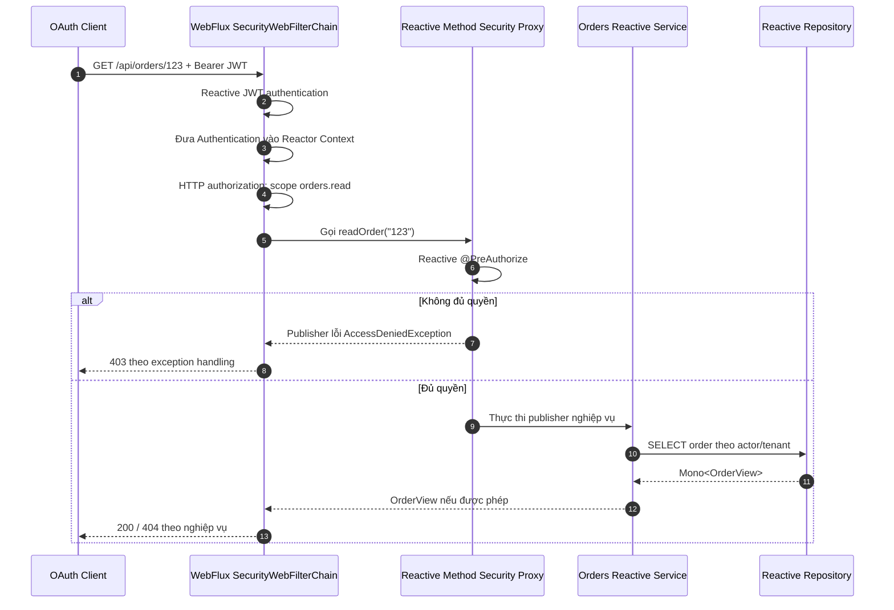
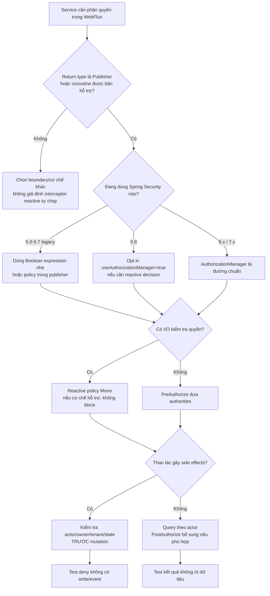

# Phân quyền phương thức phản ứng theo cơ chế phiên bản hỗ trợ

Trong **Spring Security OAuth 2.0/OIDC Resource Server** sử dụng **Spring WebFlux**, ứng dụng cần bảo vệ không chỉ URL HTTP mà cả các phương thức xử lý nghiệp vụ trả về `Mono`, `Flux` hoặc kiểu phản ứng được phiên bản framework hỗ trợ. Cùng một access token có scope `orders.read` có thể được phép truy vấn đơn hàng, nhưng không được cập nhật hay hủy đơn. Bên cạnh scope, service còn phải kiểm tra ai sở hữu tài nguyên, người gọi thuộc tenant nào và trạng thái của tài nguyên có cho phép thao tác hay không.

Spring Security cung cấp **reactive method security** cho mục tiêu đó. Điểm khó không nằm ở việc viết `@PreAuthorize`, mà nằm ở **cơ chế hỗ trợ theo phiên bản**: Spring Security đời cũ dùng hạ tầng method security legacy; từ **5.8** có thể chọn cơ chế `AuthorizationManager`, và từ **6.0** cơ chế này đã là mặc định của `@EnableReactiveMethodSecurity`. Các kiểu kết quả mà biểu thức có thể trả, interceptor được dùng, cách viết custom manager và một số annotation/filtering phụ thuộc cơ chế cùng phiên bản cụ thể.

Bài học giải thích những ranh giới cần nắm vững:

- **Reactive web authorization** bảo vệ HTTP exchange bằng `SecurityWebFilterChain` và `ServerHttpSecurity`.
- **Reactive method authorization** bảo vệ lời gọi đến Spring-managed service bằng `@EnableReactiveMethodSecurity` và các interceptors.
- **Reactor Context** mang `SecurityContext`/`Authentication` qua một chuỗi publisher; không thể mặc định dựa vào Servlet `ThreadLocal`.
- **`Mono`/`Flux` và thời điểm subscription** ảnh hưởng lúc chính sách được đánh giá và lúc side effects diễn ra.
- **Khả năng của từng phiên bản Spring Security** quyết định có dùng được biểu thức trả `Mono<Boolean>`, Kotlin coroutine, custom `ReactiveAuthorizationManager` hoặc các phương thức API mới hay không.

Mục tiêu là thiết kế method security **đúng cơ chế, không chặn event-loop, kiểm tra quyền trước thao tác nhạy cảm và có kiểm thử phù hợp**, thay vì sao chép cấu hình của Servlet hoặc một phiên bản khác.

## 1. Vì sao WebFlux cần reactive method security riêng?

Ở Spring MVC/Servlet, mỗi request thường có một thread xử lý, và code có thể đọc Authentication từ `SecurityContextHolder` theo chiến lược `ThreadLocal`. WebFlux lại dựa trên **Reactive Streams**: một request có thể chạy qua nhiều operators, scheduler và thread khác nhau.

Ví dụ một service trả publisher:

```java
public Mono<OrderView> findOrder(String orderId) {
    return repository.findById(orderId)
        .map(OrderView::from);
}
```

Method trả về `Mono<OrderView>` ngay, còn việc đọc database thường diễn ra khi có **subscription**. Nếu authorization chỉ đọc một ThreadLocal cố định tại thời điểm method được gọi, nó có thể không trùng với ngữ cảnh xác thực lúc publisher được subscribe hoặc khi operator chuyển thread.

Spring Security giải quyết bằng **`ReactiveSecurityContextHolder`**, lưu/truy xuất `SecurityContext` qua **Reactor Context**. Các reactive security interceptors dùng thông tin này để ra quyết định trong chuỗi xử lý.

### 1.1. Sơ đồ luồng phản ứng



Trong luồng này, một request chỉ nên tiếp tục khi **cả HTTP authorization và method/domain authorization** cho phép. `@PreAuthorize` bổ sung bảo vệ ở service boundary, không thay thế việc JWT decoder kiểm tra chữ ký, issuer, audience, thời hạn.

### 1.2. Reactive method security không phải một WebFilter khác

| Tầng | Thành phần | Loại đối tượng bảo vệ |
|---|---|---|
| Bearer authentication | `AuthenticationWebFilter` và cơ chế resource server tương ứng | Token/credential của request |
| HTTP authorization | `SecurityWebFilterChain` + `authorizeExchange` | HTTP method/path/exchange |
| Method security | `@EnableReactiveMethodSecurity` + reactive method interceptors | Phương thức Spring bean |
| Domain authorization | Business service/policy/repository | Chủ sở hữu, tenant, trạng thái, quyền trên bản ghi |

Nếu application chỉ cấu hình `authorizeExchange`, một method service được gọi từ job, message consumer hoặc service khác có thể không đi qua HTTP rule. Khi cần bảo vệ ngay tại service, hãy bật method security và thiết kế actor/policy cho cả các luồng không bắt nguồn từ HTTP.

## 2. Bản đồ phiên bản: legacy, AuthorizationManager và API hiện đại

**Đề mục “theo cơ chế phiên bản hỗ trợ”** yêu cầu phân biệt hai điều: phiên bản đã cung cấp tính năng nào, và **cơ chế nào thực sự được bật** trong application.

| Nhóm phiên bản | Reactive method security | Hướng áp dụng |
|---|---|---|
| **Spring Security 5.0–5.7** | Có `@EnableReactiveMethodSecurity` theo cơ chế legacy. Tài liệu các phiên bản này tập trung vào phương thức trả `Publisher` và expression đồng bộ kiểu `boolean/Boolean`. | Viết `@PreAuthorize` đơn giản, tránh đưa `Mono<Boolean>` vào expression khi cơ chế không hỗ trợ; kiểm tra đúng reference theo bản sử dụng |
| **Spring Security 5.8** | Giới thiệu đường `@EnableReactiveMethodSecurity(useAuthorizationManager = true)` để chọn cơ chế **`ReactiveAuthorizationManager`** mới. | Khi cần reactive authorization expression, opt in một cách tường minh và kiểm thử đường mới |
| **Spring Security 6.0–6.3** | `@EnableReactiveMethodSecurity` mặc định sử dụng `AuthorizationManager` (`useAuthorizationManager=true`). | Thường chỉ cần `@EnableReactiveMethodSecurity`; không viết code theo legacy do thói quen cũ |
| **Spring Security 6.4–6.5** | Tiếp tục AuthorizationManager; API `ReactiveAuthorizationManager.authorize(...)` và `AuthorizationResult` xuất hiện, trong khi `check(...)`/`AuthorizationDecision` có đường tương thích hoặc được đánh dấu deprecated theo bản. | Tùy biến manager theo Javadoc của đúng version; ưu tiên API mới nếu build đã hỗ trợ |
| **Spring Security 7.x** | Tiếp tục reactive method security dựa trên AuthorizationManager; các chữ ký API cũ có thể đã bị bỏ hoặc thay đổi. | Dùng Javadoc/điểm mở rộng của dòng 7.x, không copy nguyên interface implementation 5.8/6.x |

Nguồn xác định mốc quan trọng: tài liệu **Spring Security Reactive Method Security** và **Reactive Migration Guide** nêu 5.8 có `useAuthorizationManager=true`, và **6.0 chuyển mặc định thành true**. Điều này cũng được thể hiện trong Javadoc `@EnableReactiveMethodSecurity` của dòng 6.5 với default `true`.

### 2.1. Cấu hình cho Spring Security 5.8 khi muốn dùng cơ chế mới

```java
import org.springframework.context.annotation.Configuration;
import org.springframework.security.config.annotation.method.configuration
    .EnableReactiveMethodSecurity;

@Configuration
@EnableReactiveMethodSecurity(useAuthorizationManager = true)
public class ReactiveMethodSecurityConfiguration {
}
```

Trong 5.8, cờ này **chọn cơ chế mới một cách rõ ràng**. Nếu duy trì ứng dụng 5.8 nhưng dùng `@EnableReactiveMethodSecurity` mặc định, đừng tự giả định toàn bộ behavior của `AuthorizationManager` đã được bật.

### 2.2. Cấu hình cho Spring Security 6.x và 7.x

```java
import org.springframework.context.annotation.Configuration;
import org.springframework.security.config.annotation.method.configuration
    .EnableReactiveMethodSecurity;

@Configuration
@EnableReactiveMethodSecurity
public class ReactiveMethodSecurityConfiguration {
}
```

Ở 6.0+ đường mặc định là `AuthorizationManager`. Vì vậy, không phải lúc nào cũng cần lặp `useAuthorizationManager = true`. Việc viết cờ tường minh ở một version hỗ trợ cũng có thể chạy, nhưng không cần thiết và có thể làm tăng chi phí migration khi API thay đổi.

### 2.3. Đừng suy đoán phiên bản Spring Security chỉ từ cách gọi “Spring Boot”

Một dự án dùng Spring Boot 2.x có thể chạy Spring Security 5.x với một số dependency được override; dự án Boot 3.x thường đi cùng Spring Security 6.x, và thế hệ mới có thể dùng 7.x. Nhưng **phiên bản thực tế của dependency mới là căn cứ**.

Khi chọn code:

1. Xem version của `spring-security-config`, `spring-security-core` và các modules liên quan trong dependency resolution.
2. Mở tài liệu **cùng số major/minor** của Spring Security, không chỉ trang “latest”.
3. Xác nhận annotation `@EnableReactiveMethodSecurity` đang dùng cơ chế nào.
4. Xác nhận return type của biểu thức và method có được interceptor hỗ trợ.
5. Xác nhận chữ ký custom `ReactiveAuthorizationManager`/interceptor đúng Javadoc.
6. Kiểm thử allow/deny qua Spring-managed proxy, không chỉ gọi một method Java trực tiếp.

**Không cần nâng cấp thư viện chỉ để viết một biểu thức đơn giản**, nhưng cũng không nên cố gắn một snippet `Mono<Boolean>` mới vào cơ chế legacy rồi “sửa” bằng `block()`.

## 3. `@EnableReactiveMethodSecurity` khác `@EnableMethodSecurity`

Ứng dụng WebFlux dùng:

```java
@EnableReactiveMethodSecurity
```

Trong khi nhiều tài liệu Servlet dùng:

```java
@EnableMethodSecurity
```

Hai annotation có mục đích tương tự ở tầng method, nhưng cách tích hợp Authentication khác nhau. **Không sao chép cấu hình Servlet vào ứng dụng WebFlux rồi nghĩ rằng nó tự hiểu Reactor Context**. Với một ứng dụng có cả Servlet và reactive modules hoặc những đường thực thi pha trộn, cần xác định hạ tầng method-security nào chặn đúng bean.

### 3.1. Những phương thức nào phù hợp?

Reactive method security truyền thống yêu cầu phương thức Java được bảo vệ trả một **`org.reactivestreams.Publisher`**:

```java
Mono<OrderView> getOrder(String orderId);
Flux<OrderView> findOrders(String tenantId);
Mono<Void> deleteOrder(String orderId);
```

Các phiên bản dùng cơ chế AuthorizationManager hỗ trợ thêm các tình huống reactive return types, gồm **Kotlin coroutine/suspend** theo tài liệu tương ứng. Đây là tính năng theo cơ chế/phiên bản, không có nghĩa mọi custom type hoặc Java method trả `OrderView` đồng bộ đều tự trở thành reactive.

Không mặc định những method sau được chặn theo cùng cách:

```java
OrderView getOrder(String id);     // Java return type đồng bộ
void deleteOrder(String id);      // Không phải Publisher
CompletableFuture<OrderView> getAsync(String id);
```

Nếu business service bắt buộc phải dùng synchronous/imperative method security, hãy chọn một boundary phù hợp hoặc cơ chế method security khác được framework hỗ trợ; không dùng một return type bất kỳ với hy vọng reactive annotation tự bao phủ.

### 3.2. Vì sao method nên xây Publisher “lạnh”?

Một publisher **cold** thường chỉ bắt đầu thao tác dữ liệu khi subscriber đăng ký:

```java
@PreAuthorize("hasAuthority('SCOPE_orders.update')")
public Mono<OrderView> updateOrder(String id, UpdateOrderCommand command) {
    return Mono.defer(() ->
        repository.findById(id)
            .flatMap(order -> updateAuthorizedOrder(order, command))
    );
}
```

`Mono.defer` giúp tránh thực hiện một công việc có side effects khi chỉ mới xây publisher. Đối với những thao tác nhạy cảm, cần bảo đảm phép xác thực/quyền được đánh giá **trước khi chuỗi mutation được subscribe** và mọi bước cập nhật nằm sau business checks.

Một anti-pattern:

```java
@PreAuthorize("hasAuthority('SCOPE_orders.update')")
public Mono<OrderView> unsafeUpdate(String id) {
    legacyBlockingRepository.updateImmediately(id); // Side effect đồng bộ
    return Mono.just(new OrderView(id));
}
```

Nếu có bất kỳ đường gọi nào bypass interceptor, method có thể mutate ngay. Hơn nữa, blocking JDBC trong event loop không phù hợp với kiến trúc WebFlux. Ưu tiên một reactive data driver và đưa mutation vào publisher sau khi xác thực, đồng thời kiểm tra quyền đối tượng trước ghi dữ liệu.

## 4. WebFlux Resource Server: ví dụ cấu hình nền

Với Spring Boot 3.x/Spring Security 6.x, một WebFlux Resource Server JWT thường dùng:

```groovy
// build.gradle
dependencies {
    implementation 'org.springframework.boot:spring-boot-starter-webflux'
    implementation 'org.springframework.boot:spring-boot-starter-oauth2-resource-server'
    testImplementation 'org.springframework.boot:spring-boot-starter-test'
    testImplementation 'org.springframework.security:spring-security-test'
    testImplementation 'io.projectreactor:reactor-test'
}
```

Các phiên bản dependency nên do Spring Boot BOM hoặc cơ chế quản lý dependency của dự án quyết định; không gắn tùy ý các Spring Security modules khác major.

Ví dụ `application.yml`:

```yaml
spring:
  security:
    oauth2:
      resourceserver:
        jwt:
          issuer-uri: https://idp.example.com/realms/shop
          audiences:
            - orders-api
```

`issuer-uri` xác định issuer đáng tin; `audiences` là property được những dòng Boot hỗ trợ để ràng buộc token phải dành cho API. Khi tự khai báo `ReactiveJwtDecoder`, hãy cấu hình các validator tương ứng, không tự giả định Boot còn gắn mọi yêu cầu từ property vào decoder tùy biến.

### 4.1. Cấu hình HTTP authorization của WebFlux

```java
import org.springframework.context.annotation.Bean;
import org.springframework.context.annotation.Configuration;
import org.springframework.http.HttpMethod;
import org.springframework.security.config.Customizer;
import org.springframework.security.config.annotation.method.configuration
    .EnableReactiveMethodSecurity;
import org.springframework.security.config.annotation.web.reactive
    .EnableWebFluxSecurity;
import org.springframework.security.config.web.server.ServerHttpSecurity;
import org.springframework.security.web.server.SecurityWebFilterChain;

@Configuration
@EnableWebFluxSecurity
@EnableReactiveMethodSecurity
public class ReactiveOrdersSecurityConfiguration {

    @Bean
    SecurityWebFilterChain securityWebFilterChain(
            ServerHttpSecurity http) {
        return http
            // Chỉ minh họa API thuần Bearer header, không dùng cookie
            // hay session làm credential cho các thao tác ghi.
            .csrf(ServerHttpSecurity.CsrfSpec::disable)
            .authorizeExchange(exchanges -> exchanges
                .pathMatchers(HttpMethod.GET, "/api/orders/**")
                    .hasAuthority("SCOPE_orders.read")
                .pathMatchers(HttpMethod.POST, "/api/orders/**")
                    .hasAuthority("SCOPE_orders.create")
                .pathMatchers(HttpMethod.PUT, "/api/orders/**")
                    .hasAuthority("SCOPE_orders.update")
                .pathMatchers(HttpMethod.DELETE, "/api/orders/**")
                    .hasAuthority("SCOPE_orders.delete")
                .anyExchange().denyAll())
            .oauth2ResourceServer(oauth2 ->
                oauth2.jwt(Customizer.withDefaults()))
            .build();
    }
}
```

Chú ý:

- WebFlux dùng **`SecurityWebFilterChain`** và **`ServerHttpSecurity`**, không dùng `SecurityFilterChain`/`HttpSecurity` của Servlet.
- WebFlux dùng **`authorizeExchange`** và `pathMatchers`, không dùng Servlet `authorizeHttpRequests`/`requestMatchers` trong ví dụ này.
- Scope JWT như `orders.read` thường được Spring Security chuyển thành `SCOPE_orders.read` authority; `hasAuthority` kiểm tra chuỗi chính xác.
- `anyExchange().denyAll()` là fallback đóng cho route chưa định nghĩa, không tự giải quyết CORS preflight, actuator và các path khác; cần chính sách bổ sung khi application có nhu cầu.
- Bật reactive method security không tự chứng minh JWT hợp lệ; decoder vẫn phải kiểm tra chữ ký, issuer, audience, time và token profile.

Ví dụ tắt CSRF chỉ phù hợp khi API thực sự xác thực qua Bearer header mà browser không tự gửi như cookie. Nếu ứng dụng còn dùng cookie/browser session hoặc credential tự đính kèm, phải đánh giá CSRF theo mô hình đó.

### 4.2. Vai trò của HTTP và method security

```text
GET /api/orders/123
   |
   +-- JWT authentication: token có hợp lệ?
   |
   +-- HTTP rule: có SCOPE_orders.read?
   |
   +-- @PreAuthorize: service có được gọi?
   |
   +-- Business policy: order 123 thuộc actor/tenant nào?
   |
   +-- Reactive repository: đọc dữ liệu được phép
```

Không nên chỉ giữ một rule `.anyExchange().authenticated()` mà bỏ method scope, trừ khi policy nghiệp vụ được bảo vệ đầy đủ ở service cho **mọi** đường đi. Phương án phòng vệ nhiều lớp thường giúp tránh bỏ sót một endpoint mới hoặc một method được gọi ngoài HTTP.

## 5. Dùng `@PreAuthorize` với `Mono` và `Flux`

Giả sử DTO và command:

```java
public record OrderView(
    String id,
    String ownerIssuer,
    String ownerSubject,
    String tenantId,
    String status
) {}

public record UpdateOrderCommand(String deliveryAddress) {}
```

Reactive service có các method:

```java
import org.springframework.security.access.prepost.PreAuthorize;
import org.springframework.stereotype.Service;
import reactor.core.publisher.Flux;
import reactor.core.publisher.Mono;

@Service
public class OrderQueryService {

    private final ReactiveOrderRepository orders;

    public OrderQueryService(ReactiveOrderRepository orders) {
        this.orders = orders;
    }

    @PreAuthorize("hasAuthority('SCOPE_orders.read')")
    public Mono<OrderView> findOne(String orderId) {
        return orders.findById(orderId).map(OrderView::from);
    }

    @PreAuthorize("hasAuthority('SCOPE_orders.read')")
    public Flux<OrderView> listVisible(String tenantId) {
        return orders.findByTenantId(tenantId)
            .map(OrderView::from);
    }
}
```

`ReactiveOrderRepository`, mapping `OrderView.from` và backend là thành phần minh họa; mã chưa kết hợp đầy đủ owner/tenant checks. `findByTenantId(tenantId)` không an toàn nếu `tenantId` được lấy trực tiếp từ query parameter mà không kiểm tra caller có thuộc tenant đó hay không. Một service production phải lấy actor từ authentication đáng tin, rồi lọc tại repository theo quyền dữ liệu.

### 5.1. Chạy kiểm tra khi nào?

Với `@PreAuthorize` và cơ chế reactive interceptor được hỗ trợ, Spring Security đánh giá authorization trong đường publisher được intercept, **trước khi cho phép thực hiện logic được bảo vệ**. Nếu bị từ chối, subscriber nhận error signal như `AccessDeniedException` thay vì nhận dữ liệu thành công.

Việc `Mono` là lazy giúp bảo vệ các thao tác được xây đúng kiểu reactive, nhưng đừng mặc định **mọi dòng Java trước `return Mono...` đều tự trì hoãn**. Tác dụng phụ đồng bộ nằm trong method có thể diễn ra khi method được thực thi. Thiết kế không side effect ở giai đoạn assembly và kiểm tra quyền trước mutation vẫn là nguyên tắc chính.

### 5.2. Không dùng `hasRole` nhầm với scope

```java
@PreAuthorize("hasAuthority('SCOPE_orders.read')")
public Mono<OrderView> read(String id) { ... }
```

khác với:

```java
@PreAuthorize("hasRole('orders.read')")
public Mono<OrderView> read(String id) { ... }
```

`hasRole("orders.read")` theo mặc định tìm `ROLE_orders.read`, không phải `SCOPE_orders.read`. Trong JWT/opaque Resource Server, OAuth scope được map sang authorities thường mang tiền tố `SCOPE_`, nên dùng `hasAuthority` rõ ràng. Khi custom mapper đổi prefix, phải đồng bộ rule.

### 5.3. Phạm vi quyền theo HTTP method không tự di chuyển vào method

`@PreAuthorize("hasAuthority('SCOPE_orders.read')")` không biết request gốc dùng GET hay POST nếu không đưa thông tin đó vào policy. Nó kiểm tra quyền của **service method** với Authentication hiện hành. Đây là ưu điểm: cùng method được gọi từ WebFlux controller, message listener hoặc một service khác vẫn mang yêu cầu quyền như nhau khi được intercept đúng.

Tuy nhiên, application cần có actor/security context cho các luồng ngoài HTTP. Không mặc định một scheduled job có Authentication của người dùng vừa gọi API trước đó.

## 6. Reactor Context: nguồn Authentication cho reactive method security

`ReactiveSecurityContextHolder` cung cấp các API quan trọng:

```java
import org.springframework.security.core.Authentication;
import org.springframework.security.core.context.SecurityContext;
import org.springframework.security.core.context.ReactiveSecurityContextHolder;
import reactor.core.publisher.Mono;

Mono<Authentication> authentication =
    ReactiveSecurityContextHolder.getContext()
        .map(SecurityContext::getAuthentication);
```

Trong WebFlux Security, filter chain thiết lập context theo publisher/subscriber của request. Một service có thể đọc Authentication **bên trong pipeline**, ví dụ:

```java
public Mono<String> currentUsername() {
    return ReactiveSecurityContextHolder.getContext()
        .map(SecurityContext::getAuthentication)
        .map(Authentication::getName);
}
```

Không cần gọi `SecurityContextHolder.getContext()` rồi hy vọng ThreadLocal ở bất kỳ scheduler nào cũng là user của HTTP request hiện tại.

### 6.1. Test Reactor Context bằng `contextWrite`

Một test độc lập HTTP có thể tạo Authentication giả lập:

```java
import org.springframework.security.authentication.TestingAuthenticationToken;
import org.springframework.security.core.Authentication;
import org.springframework.security.core.context.ReactiveSecurityContextHolder;
import reactor.test.StepVerifier;

Authentication auth =
    new TestingAuthenticationToken(
        "user-842", "unused", "SCOPE_orders.read");

StepVerifier.create(
    currentUsername()
        .contextWrite(
            ReactiveSecurityContextHolder.withAuthentication(auth)))
    .expectNext("user-842")
    .verifyComplete();
```

`contextWrite(ReactiveSecurityContextHolder.withAuthentication(auth))` tạo context cho **subscription trong test**, không phải login session cho production. Trong một request WebFlux thực được security filters xử lý, context thường được thiết lập bởi framework.

### 6.2. Reactor Context khác ThreadLocal

```text
Servlet đồng bộ:
  ThreadLocal SecurityContextHolder
      -> đọc Authentication trên thread request

WebFlux / Reactor:
  Subscriber Context
      -> ReactiveSecurityContextHolder
      -> Authentication theo reactive chain
```

Không bao giờ dùng `MODE_GLOBAL` hoặc giữ Authentication trong singleton field để “chữa” việc mất context. Điều đó có thể khiến danh tính giữa các user bị chia sẻ và tạo lỗi bảo mật nghiêm trọng.

### 6.3. Context được truyền qua scheduler như thế nào?

Các Reactor operators tiêu chuẩn như `publishOn`/`subscribeOn` vẫn có cơ chế chuyển **Reactor Context** theo subscriber khi sử dụng đúng trong cùng chuỗi. Nhưng nếu code tự tạo subscription mới bằng `subscribe()`, khởi chạy một future/executor ngoài chuỗi hoặc dùng API không tích hợp Reactor, context có thể không được truyền đúng.

Ví dụ dễ sai:

```java
public Mono<Void> schedule(String orderId) {
    // Detached subscription: không thể dựa vào security context
    // và error handling của chuỗi HTTP gốc.
    publisherForSensitiveAction(orderId).subscribe();
    return Mono.empty();
}
```

Với tác vụ nền, hãy truyền **actor/authorization intent tối thiểu** và tái kiểm tra quyền khi cần, hoặc dùng cơ chế context propagation có chủ đích. Không giữ raw bearer token vô hạn để job dùng lại sau khi token đã hết hạn.

## 7. Cơ chế legacy: expression Boolean đồng bộ

Trong các phiên bản trước cơ chế AuthorizationManager, tài liệu reactive method security mô tả expression dạng Boolean:

```java
@PreAuthorize("hasRole('ADMIN')")
public Mono<String> adminMessage() {
    return Mono.just("Hello");
}
```

Điều kiện `hasRole('ADMIN')` trả kết quả logic đồng bộ từ các authorities có sẵn trong Authentication, nên phù hợp với cơ chế legacy.

Ngược lại:

```java
@PreAuthorize("@policy.canRead(#orderId)")
public Mono<OrderView> read(String orderId) { ... }
```

nếu `policy.canRead(...)` trả về `Mono<Boolean>`, **không thể mặc định cơ chế legacy sẽ subscribe và hiểu Mono đó thành kết quả cho phép/từ chối**. Một biểu thức trả Publisher trong nhánh không hỗ trợ có thể tạo lỗi runtime, bị coi là kiểu không phù hợp hoặc không có behavior bạn kỳ vọng.

### 7.1. Vì sao không “sửa” bằng `block()`?

Anti-pattern:

```java
@PreAuthorize("@policy.canRead(#orderId).block()")
public Mono<OrderView> read(String orderId) { ... }
```

Trong WebFlux, SpEL chạy trong đường xử lý reactive. Gọi `block()` có thể:

- Chặn event-loop thread.
- Gây lỗi kiểu `block()/blockFirst()/blockLast() are blocking` trên scheduler non-blocking.
- Làm giảm throughput, tăng latency.
- Tạo deadlock hoặc mất ngữ cảnh nếu pipeline bị tổ chức sai.

Không dùng `block()` để ép một API reactive vào cơ chế không hỗ trợ. Giải pháp đúng là **nâng lên cơ chế AuthorizationManager được version hỗ trợ** hoặc chuyển quyết định bất đồng bộ vào service pipeline đúng cách.

### 7.2. Nếu chưa thể nâng cấp

Với dự án legacy:

1. Dùng `@PreAuthorize` với điều kiện **đồng bộ nhẹ**, như authority đã có sẵn.
2. Đặt policy cần I/O trong `Mono.defer(...).flatMap(...)` của service, trước truy vấn/ghi dữ liệu nhạy cảm.
3. Bảo đảm publisher fail closed nếu policy deny hoặc lỗi.
4. Không dùng blocking network/database calls trên event loop.
5. Giữ HTTP authorization bảo vệ route và kiểm thử các luồng không đi qua HTTP.

Ví dụ policy trong pipeline:

```java
@PreAuthorize("hasAuthority('SCOPE_orders.read')")
public Mono<OrderView> readWithReactivePolicy(String orderId) {
    return ReactiveSecurityContextHolder.getContext()
        .map(SecurityContext::getAuthentication)
        .flatMap(auth -> orderPolicy.canRead(auth, orderId))
        .filter(Boolean::booleanValue)
        .switchIfEmpty(Mono.error(
            new AccessDeniedException("Order access denied")))
        .then(repository.findById(orderId))
        .map(OrderView::from);
}
```

`orderPolicy.canRead` là một component trả `Mono<Boolean>`; code minh họa policy đọc quyền từ dữ liệu tin cậy. Cần đảm bảo policy không có tác dụng phụ ngoài ý muốn và không truy vấn order trước khi điều kiện cho phép. Nếu việc xác định chủ sở hữu cần đọc order, nên đưa bước lấy object và kiểm tra ownership vào một domain policy có transaction/consistency phù hợp.

Đừng xem mẫu trên là bắt buộc thay mọi `@PreAuthorize`. Nó chỉ minh họa cách thực hiện **quyết định bất đồng bộ trong publisher** khi bản framework không hỗ trợ Mono-returning SpEL expression.

## 8. Cơ chế AuthorizationManager: expression có thể trả kết quả phản ứng

Từ Spring Security **5.8 với `useAuthorizationManager=true`**, reactive method security có đường xử lý cho những expression bean trả kết quả **`Boolean` hoặc `Mono<Boolean>`** theo tài liệu. Từ 6.0, cơ chế này là mặc định.

Ví dụ policy cần truy vấn quyền từ database/service phản ứng:

```java
import org.springframework.security.access.expression.method
    .MethodSecurityExpressionOperations;
import org.springframework.stereotype.Component;
import reactor.core.publisher.Mono;

@Component("orderAccess")
public class ReactiveOrderAccessPolicy {

    private final ReactiveOrderAclRepository acl;

    public ReactiveOrderAccessPolicy(ReactiveOrderAclRepository acl) {
        this.acl = acl;
    }

    public Mono<Boolean> canRead(
            MethodSecurityExpressionOperations root,
            String orderId) {
        String principalName = root.getAuthentication().getName();
        return acl.existsReadableBy(orderId, principalName);
    }
}
```

`ReactiveOrderAclRepository` và `existsReadableBy` là những abstraction domain do ứng dụng định nghĩa. Method này trả `Mono<Boolean>`, không gọi `block()`.

Service:

```java
import org.springframework.security.access.prepost.PreAuthorize;
import org.springframework.stereotype.Service;
import reactor.core.publisher.Mono;

@Service
public class ProtectedOrderQuery {

    private final ReactiveOrderRepository orders;

    public ProtectedOrderQuery(ReactiveOrderRepository orders) {
        this.orders = orders;
    }

    @PreAuthorize(
        "hasAuthority('SCOPE_orders.read') " +
        "and @orderAccess.canRead(#root, #orderId)")
    public Mono<OrderView> readOrder(String orderId) {
        return orders.findById(orderId).map(OrderView::from);
    }
}
```

Trong production, tham số `#orderId` cần được Spring SpEL nhận diện qua metadata tham số (build với `-parameters`, hoặc annotation `@P("orderId")` trong trường hợp cần). Nếu không, biểu thức có thể không tìm thấy tên tham số. Khi nghi ngờ, viết unit/integration test qua Spring-managed proxy cho annotation thực tế.

**Ý nghĩa security:** biểu thức yêu cầu **đồng thời** scope `SCOPE_orders.read` và ACL query cho phép. Tuy nhiên, một số phiên bản/cấu hình expression evaluator có thể có giới hạn khi trộn phép logic SpEL đồng bộ với giá trị `Mono<Boolean>` trong cùng một biểu thức. Để tránh sự nhập nhằng này, phương án vững chắc là:

```java
@PreAuthorize("@orderAccess.canReadWithScope(#root, #orderId)")
public Mono<OrderView> readOrder(String orderId) { ... }
```

và để bean `canReadWithScope` tự kiểm tra scope **trong Java**, sau đó thực hiện ACL query phản ứng:

```java
public Mono<Boolean> canReadWithScope(
        MethodSecurityExpressionOperations root,
        String orderId) {
    boolean hasReadScope = root.getAuthentication()
        .getAuthorities().stream()
        .anyMatch(a -> "SCOPE_orders.read".equals(a.getAuthority()));

    if (!hasReadScope) {
        return Mono.just(false);
    }

    return acl.existsReadableBy(orderId,
        root.getAuthentication().getName())
        .defaultIfEmpty(false);
}
```

Một **expression trả `Mono<Boolean>` trực tiếp từ bean** có hợp đồng rõ hơn; test cần xác nhận kết quả cả khi scope thiếu, ACL không tồn tại, Mono empty hoặc lỗi I/O. Trong những policy nhạy cảm, nên chọn hành vi **fail closed** thay vì coi `Mono.empty()` là cho phép.

### 8.1. Vì sao `#root` hữu ích?

Trong reactive SpEL method security, một bean có thể nhận `MethodSecurityExpressionOperations` từ `#root` để lấy Authentication và context biểu thức theo API được hỗ trợ. Spring Security docs minh họa pattern:

```java
@PreAuthorize("@authz.decide(#root)")
public Mono<String> endpoint() {
    return Mono.just("ok");
}
```

`@authz.decide(...)` có thể trả `Mono<Boolean>` theo cơ chế AuthorizationManager mới. Không cần đọc `SecurityContextHolder` bằng ThreadLocal trong bean policy.

### 8.2. Không làm blocking I/O trong biểu thức reactive

Ngay cả khi biểu thức có thể trả Mono, body vẫn phải **không block**:

```java
// Không nên:
public Mono<Boolean> canRead(...) {
    boolean allowed = jdbcTemplate.queryForObject(...);
    return Mono.just(allowed);
}
```

Đoạn trên gọi JDBC đồng bộ **trước khi tạo Mono**, có thể chặn event loop. Ưu tiên repository/WebClient phản ứng:

```java
public Mono<Boolean> canRead(...) {
    return r2dbcRepository.existsByOrderAndActor(...);
}
```

Nếu chưa thể loại bỏ thư viện blocking, cần tách boundary blocking, dùng scheduler như `Schedulers.boundedElastic()` theo kiến trúc và đánh giá trade-off; không coi `Mono.just(blockingCall())` là non-blocking.

## 9. Tự viết `ReactiveAuthorizationManager`: lưu ý API thay đổi theo phiên bản

Khi SpEL quá khó bảo trì, Spring Security hỗ trợ **`ReactiveAuthorizationManager<T>`** để đưa quyết định về Java. Đây cũng là nơi rất dễ mắc lỗi nếu copy ví dụ từ một version khác.

### 9.1. Contract cơ bản không giống Servlet AuthorizationManager

Reactive authorization manager thường nhận:

```java
Mono<Authentication> authentication
```

trong khi authorization manager của Servlet thường nhận:

```java
Supplier<Authentication> authentication
```

Hai kiểu không thể tráo đổi. Với reactive method security, generic object có thể là `MethodInvocation` hoặc `MethodInvocationResult` tùy trước/sau method. Với WebFlux HTTP authorization, generic object thường là `AuthorizationContext`/`ServerWebExchange` theo API tương ứng.

### 9.2. Đường API cũ `check(...)`

Trong nhiều bản 5.8/6.x, giao diện có:

```java
Mono<AuthorizationDecision> check(
    Mono<Authentication> authentication,
    T object);
```

Một số bản 6.x vẫn dùng `check` làm phương thức implement và đã **deprecated** nó trong quá trình chuyển sang API `authorize`. Ví dụ tài liệu cũ có thể dùng `check` nhưng compiler của Spring Security 7.x không còn coi đây là phương thức override hợp lệ.

### 9.3. API `authorize(...)` và `AuthorizationResult`

Từ Spring Security 6.4 có đường:

```java
Mono<AuthorizationResult> authorize(
    Mono<Authentication> authentication,
    T object);
```

Trong Spring Security 7.1, Javadoc `ReactiveAuthorizationManager` liệt kê `authorize(Mono<Authentication>, T)` là phương thức chính. Ví dụ minh họa **cho một dòng API hỗ trợ phương thức đó**:

```java
import org.aopalliance.intercept.MethodInvocation;
import org.springframework.security.authorization.AuthorizationDecision;
import org.springframework.security.authorization.AuthorizationResult;
import org.springframework.security.authorization.ReactiveAuthorizationManager;
import org.springframework.security.core.Authentication;
import reactor.core.publisher.Mono;

public final class ReadOrdersMethodManager
        implements ReactiveAuthorizationManager<MethodInvocation> {

    @Override
    public Mono<AuthorizationResult> authorize(
            Mono<Authentication> authentication,
            MethodInvocation invocation) {

        return authentication
            .map(auth -> {
                boolean allowed = auth.getAuthorities().stream()
                    .anyMatch(grant ->
                        "SCOPE_orders.read".equals(grant.getAuthority()));
                return (AuthorizationResult)
                    new AuthorizationDecision(allowed);
            })
            .defaultIfEmpty(new AuthorizationDecision(false));
    }
}
```

Đây là **mẫu class của đường API hiện đại**, không phải đoạn bạn nên dán vào ứng dụng Spring Security 5.8 mà chưa kiểm tra interface. Trong 6.4/6.5, `authorize` có thể là phương thức mặc định gọi `check`; cách override để tương thích cần theo Javadoc thực tế. Trong 7.x, `check` có thể không còn ở interface.

### 9.4. Không tự đăng ký interceptor nếu annotation mặc định đã đủ

Phần lớn use case chỉ cần:

```java
@EnableReactiveMethodSecurity
@PreAuthorize("hasAuthority('SCOPE_orders.read')")
```

Tự xuất bản `AuthorizationManagerBeforeReactiveMethodInterceptor`, thay pointcut hay thay bean interceptors có thể khiến:

- Hai interceptors cùng bảo vệ một annotation.
- Annotation bị kích hoạt hai lần hoặc được đánh giá sai thứ tự.
- Các annotation mặc định khác vô tình bị tắt.
- Advisor order không đúng với transactions/tracing.
- Cấu hình từ Servlet được copy nhầm sang WebFlux.

Chỉ custom interceptors khi yêu cầu thật sự vượt quá SpEL/custom policy bean và đã đối chiếu **cơ chế theo phiên bản**. Nếu phải thay, theo hướng dẫn bản tương ứng để **tắt phần preconfiguration cần thay**, không giữ mọi mặc định rồi thêm một interceptor thứ hai lên cùng pointcut.

## 10. `@PostAuthorize` trong reactive flow: đọc giá trị trả về và giới hạn

`@PostAuthorize` cho phép kiểm tra điều kiện trên **kết quả của method**. Nó hữu ích khi quyền phụ thuộc vào object vừa được lấy từ database:

```java
import org.springframework.security.access.prepost.PostAuthorize;
import org.springframework.security.access.prepost.PreAuthorize;
import reactor.core.publisher.Mono;

@PreAuthorize("hasAuthority('SCOPE_orders.read')")
@PostAuthorize(
    "returnObject != null && " +
    "returnObject.ownerSubject == authentication.name")
public Mono<OrderView> readOrder(String id) {
    return orderRepository.findById(id)
        .map(OrderView::from);
}
```

Ở cơ chế và phiên bản hỗ trợ kiểm tra post-authorization cho giá trị phát ra từ publisher, khi kết quả không thuộc principal, subscriber không được nhận object như một response thành công. **Tuy vậy, phải xác nhận behavior trên `Mono`/`Flux` và object wrapper với version thực tế**, đặc biệt nếu return type là collection, `Flux` nhiều phần tử, `Mono.empty()` hoặc coroutine.

### 10.1. `@PostAuthorize` không khôi phục tác dụng phụ

Đừng dùng:

```java
@PostAuthorize("returnObject.ownerSubject == authentication.name")
public Mono<OrderView> unsafeUpdate(String id, UpdateCommand cmd) {
    return repository.findById(id)
        .flatMap(order -> repository.save(order.apply(cmd)))
        .map(OrderView::from);
}
```

Nếu publisher đã chạy update rồi hậu kiểm phát hiện owner không khớp, việc subscriber nhận lỗi **không đảm bảo rollback** của DB hoặc thu hồi email/Kafka/HTTP call đã gửi. Transaction boundary, propagation và driver có thể thay đổi hiệu lực rollback.

Với command, nên:

1. Yêu cầu scope update ở `@PreAuthorize` hoặc HTTP security.
2. Xác định principal/tenant đáng tin.
3. Đọc dữ liệu có thẩm quyền và xác minh owner/trạng thái **trước mutation**.
4. Thực hiện update theo transaction/concurrency control thích hợp.
5. Chỉ phát event/external action sau khi các điều kiện đã được xác nhận; cân nhắc outbox.

### 10.2. `@PostFilter`/`@PreFilter` không thay thế query có lọc

Trong cơ chế AuthorizationManager ở các phiên bản mới, reactive method security có hỗ trợ các interceptor cho `@PreFilter` và `@PostFilter` theo tài liệu. Nhưng **kiểu input/return và cách filter `Flux`/collection có thể thay đổi theo phiên bản**, không nên giả định mọi hình dạng publisher đều được lọc giống nhau.

Với danh sách đơn hàng nhiều tenant, đây là thiết kế nguy hiểm:

```java
@PostFilter("filterObject.tenantId == authentication.name")
public Flux<OrderView> listEveryOrder() {
    return repository.findAll().map(OrderView::from);
}
```

Ngoài rủi ro shape không được hỗ trợ ở một version, query `findAll()` đã tải dữ liệu của mọi tenant trước khi lọc ở tầng ứng dụng. Tốt hơn:

```java
public Flux<OrderView> listVisible(CurrentActor actor) {
    return repository
        .findByTenantAndOwner(
            actor.tenantId(),
            actor.issuer(),
            actor.subject())
        .map(OrderView::from);
}
```

Phân quyền đối tượng ở query còn phù hợp với pagination, backpressure và isolation của multi-tenant. Chỉ dùng post-filter như lớp phụ khi version hỗ trợ đúng loại publisher và không làm lộ dữ liệu qua side effects, cache hoặc logging.

## 11. Ownership/tenant authorization không được thay bằng scope

Access token của OAuth 2.0 có thể mang:

```json
{
  "iss": "https://idp.example.com/realms/shop",
  "sub": "user-842",
  "aud": ["orders-api"],
  "scope": "orders.read orders.update",
  "tenant_id": "tenant-a"
}
```

Đây là **payload minh họa**, không phải token đã được ký. Sau khi Resource Server xác minh đúng token, có thể tạo actor:

```java
public record CurrentActor(
    String issuer,
    String subject,
    String tenantId
) {}
```

Trong WebFlux, có thể lấy actor từ Reactor Context:

```java
import org.springframework.security.core.Authentication;
import org.springframework.security.core.context.ReactiveSecurityContextHolder;
import org.springframework.security.oauth2.server.resource.authentication
    .JwtAuthenticationToken;
import reactor.core.publisher.Mono;

@Component
public class ReactiveCurrentActor {

    public Mono<CurrentActor> current() {
        return ReactiveSecurityContextHolder.getContext()
            .map(context -> context.getAuthentication())
            .switchIfEmpty(Mono.error(
                new AccessDeniedException("Authentication required")))
            .map(this::resolve);
    }

    private CurrentActor resolve(Authentication authentication) {
        if (!(authentication instanceof JwtAuthenticationToken token)) {
            throw new AccessDeniedException("JWT principal required");
        }

        var jwt = token.getToken();
        if (jwt.getIssuer() == null ||
            jwt.getSubject() == null ||
            jwt.getClaimAsString("tenant_id") == null) {
            throw new AccessDeniedException("Actor claims missing");
        }
        return new CurrentActor(
            jwt.getIssuer().toString(),
            jwt.getSubject(),
            jwt.getClaimAsString("tenant_id"));
    }
}
```

Các imports còn lại gồm `@Component` và `AccessDeniedException`. Mẫu này giả định hệ thống chỉ dùng JWT resource-server principal; với opaque token, loại Authentication khác, phải viết adapter tương ứng. **Không lấy claims từ JWT trước khi ReactiveJwtDecoder đã xác thực token**.

### 11.1. Reactive query kiểm tra actor trước khi đọc

```java
@Service
public class AuthorizedOrderQueries {

    private final ReactiveCurrentActor actors;
    private final ReactiveOrderRepository repository;

    public AuthorizedOrderQueries(
            ReactiveCurrentActor actors,
            ReactiveOrderRepository repository) {
        this.actors = actors;
        this.repository = repository;
    }

    @PreAuthorize("hasAuthority('SCOPE_orders.read')")
    public Mono<OrderView> read(String orderId) {
        return actors.current()
            .flatMap(actor -> repository
                .findVisibleById(
                    orderId,
                    actor.issuer(),
                    actor.subject(),
                    actor.tenantId()))
            .switchIfEmpty(Mono.error(
                new OrderNotFoundException(orderId)))
            .map(OrderView::from);
    }
}
```

`findVisibleById` là query được thiết kế để **chỉ tìm order thuộc actor/tenant phù hợp**. Nếu caller đoán ID order của người khác, repository không trả row đó. Tùy chính sách API, từ chối có thể biểu diễn bằng 403 hoặc 404 để tránh tiết lộ sự tồn tại tài nguyên.

### 11.2. Update cũng phải kiểm tra trạng thái hiện tại

`SCOPE_orders.update` là quyền loại thao tác, không cho sửa mọi order. Với write:

```text
Token hợp lệ, có SCOPE_orders.update
             |
             v
Lấy actor trong Reactor Context
             |
             v
Tìm order theo id + owner + tenant
             |
             v
Kiểm tra state hiện tại: DRAFT/SHIPPED/LOCKED
             |
             v
Update với transaction/optimistic locking
```

Có thể dùng conditional update theo `id`, `tenant_id`, `owner`, `status` và `version` để ngăn TOCTOU. Đối với reactive database, dùng `TransactionalOperator` hoặc reactive transaction infrastructure phù hợp; không trộn `@Transactional` imperative với publisher rồi mặc định transaction bao toàn bộ subscription.

## 12. Kotlin coroutine và tính năng theo phiên bản

Khi service viết bằng Kotlin:

```kotlin
import org.springframework.security.access.prepost.PreAuthorize
import org.springframework.stereotype.Service

@Service
class OrderCoroutineService(
    private val repository: CoroutineOrderRepository
) {
    @PreAuthorize("hasAuthority('SCOPE_orders.read')")
    suspend fun findOrder(id: String): OrderView {
        return repository.findById(id)
            ?: throw OrderNotFoundException(id)
    }
}
```

Ở các phiên bản hỗ trợ theo cơ chế AuthorizationManager, Spring Security có thể áp reactive method security lên **Kotlin suspending functions**. Tài liệu ghi nhận hỗ trợ này như lợi ích của đường AuthorizationManager được giới thiệu ở 5.8.

Những lưu ý:

- Kiểm tra đúng Spring Security/Kotlin/Coroutines version cùng bộ dependencies.
- Đảm bảo method có thể được AOP intercept. Kotlin class/method `final` theo mặc định; có thể cần plugin `kotlin-spring`/all-open hoặc cấu hình proxy phù hợp.
- Không thực hiện blocking I/O trong coroutine chỉ vì có từ khóa `suspend`. Repository phải có semantics phù hợp.
- Kiểm thử cả trường hợp được phép/bị từ chối trên **coroutine method thực sự qua Spring bean**, không chỉ unit test implementation thuần Kotlin.
- Không áp luận điểm “Java method trả synchronous DTO được bảo vệ reactive giống suspend method” — đây là hai kiểu khác nhau.

## 13. AOP proxy và self-invocation: annotation phải được intercept

Reactive method security thường dùng Spring AOP. Điều này có nghĩa annotation trên Spring bean chỉ có tác dụng khi lời gọi **đi qua proxy**.

Anti-pattern:

```java
@Service
public class OrderFacade {

    public Mono<OrderView> readViaFacade(String id) {
        return this.protectedRead(id); // self-invocation
    }

    @PreAuthorize("hasAuthority('SCOPE_orders.read')")
    public Mono<OrderView> protectedRead(String id) {
        return repository.findById(id).map(OrderView::from);
    }
}
```

Lời gọi `this.protectedRead(id)` trong cùng bean thường **bypass Spring proxy**, có thể bỏ qua method-security interceptor. Nếu HTTP route gọi `readViaFacade` mà method đó không được bảo vệ riêng, API có thể mở một đường đi không kiểm tra scope.

Giải pháp:

- Đặt method được bảo vệ tại bean riêng, được caller gọi qua Spring proxy.
- Đặt business authorization tại một boundary service nhất quán, không chỉ một annotation trên method được gọi bằng `this`.
- Tránh tạo Spring bean bằng `new` rồi kỳ vọng AOP tự hoạt động.
- Không mặc định private/final methods được proxy như public service methods.
- Nếu dùng AspectJ weaving, kiểm tra semantics và điểm mở rộng thực tế thay vì áp mọi giới hạn proxy một cách máy móc.

### 13.1. Test phải gọi Spring bean, không chỉ implementation

Test thuần:

```java
var service = new OrderQueryService(fakeRepository);
StepVerifier.create(service.findOne("1")) ...
```

không chứng minh `@PreAuthorize` chạy, vì đối tượng được tạo bằng `new` không phải proxy. Unit test như vậy phù hợp để kiểm tra business pipeline, còn method-security test cần một application context đã bật `@EnableReactiveMethodSecurity` và inject **proxied bean**.

## 14. Reactive test: StepVerifier cho method authorization

Một test method security nên quan sát **Reactor error signal**, không chỉ assert Java method call ném exception đồng bộ.

Giả sử:

```java
@Service
public class SecureMessageService {

    @PreAuthorize("hasAuthority('SCOPE_messages.read')")
    public Mono<String> readMessage() {
        return Mono.just("restricted-message");
    }
}
```

Test với Spring context:

```java
import org.junit.jupiter.api.Test;
import org.springframework.beans.factory.annotation.Autowired;
import org.springframework.boot.test.context.SpringBootTest;
import org.springframework.security.access.AccessDeniedException;
import org.springframework.security.test.context.support.WithMockUser;
import reactor.test.StepVerifier;

@SpringBootTest
class SecureMessageServiceTest {

    @Autowired
    SecureMessageService messages;

    @Test
    @WithMockUser(authorities = "SCOPE_messages.read")
    void userWithScopeCanRead() {
        StepVerifier.create(messages.readMessage())
            .expectNext("restricted-message")
            .verifyComplete();
    }

    @Test
    @WithMockUser(authorities = "SCOPE_other.read")
    void userWithoutScopeIsDenied() {
        StepVerifier.create(messages.readMessage())
            .expectError(AccessDeniedException.class)
            .verify();
    }
}
```

Ví dụ giả định test context bật reactive method security và method được gọi qua Spring-managed proxy. `@WithMockUser` tạo Authentication giả lập; test này chứng minh **authorization behavior**, không chứng minh JWT decoder đã xác minh chữ ký/audience token thật.

### 14.1. Test không cần `@WithMockUser`

Nếu muốn kiểm soát context ngay trên publisher:

```java
Authentication auth = new TestingAuthenticationToken(
    "user-842",
    "unused",
    "SCOPE_messages.read");

StepVerifier.create(
        messages.readMessage()
            .contextWrite(
                ReactiveSecurityContextHolder.withAuthentication(auth)))
    .expectNext("restricted-message")
    .verifyComplete();
```

Đây là test Reactor Context, không cần tạo bearer JWT. Cần đảm bảo `messages` là bean proxy; một direct instance không chạy method-security AOP dù có `contextWrite`.

### 14.2. Kiểm tra thiếu authentication

Một method yêu cầu scope mà subscription không có Authentication phải bị từ chối. Có thể dùng:

```java
StepVerifier.create(messages.readMessage())
    .expectError(AccessDeniedException.class)
    .verify();
```

Trong các test context có setup `@WithMockUser` ở class hoặc SecurityContext từ test khác, phải dọn/khống chế context để tránh test “anonymous” vô tình nhận Authentication. Tùy version, exception cụ thể có thể được ném ở pipeline khi thiếu authentication; không mặc định mọi nhánh trả đúng cùng subclass.

## 15. WebTestClient và mock JWT: test HTTP + method rules

Trong WebFlux, dùng **`WebTestClient`**, không dùng Servlet `MockMvc` như test harness chính.

Ví dụ:

```java
import org.junit.jupiter.api.Test;
import org.springframework.beans.factory.annotation.Autowired;
import org.springframework.boot.test.autoconfigure.web.reactive
    .AutoConfigureWebTestClient;
import org.springframework.boot.test.context.SpringBootTest;
import org.springframework.test.web.reactive.server.WebTestClient;

import static org.springframework.security.test.web.reactive.server
    .SecurityMockServerConfigurers.mockJwt;

@SpringBootTest
@AutoConfigureWebTestClient
class OrdersWebFluxAuthorizationTest {

    @Autowired
    WebTestClient client;

    @Test
    void readScopeCanAccessOrderEndpoint() {
        client.mutateWith(mockJwt().authorities(
                new SimpleGrantedAuthority("SCOPE_orders.read")))
            .get().uri("/api/orders/ORD-123")
            .exchange()
            .expectStatus().isOk();
    }

    @Test
    void wrongScopeIsForbidden() {
        client.mutateWith(mockJwt().authorities(
                new SimpleGrantedAuthority("SCOPE_other.read")))
            .get().uri("/api/orders/ORD-123")
            .exchange()
            .expectStatus().isForbidden();
    }
}
```

Các import `SimpleGrantedAuthority` và fixture controller/service phải được thêm theo project. Ví dụ giả định endpoint `ORD-123` tồn tại và caller được domain policy cho phép ở test đầu; nếu dữ liệu không tồn tại, response có thể là 404 dù scope đúng. Không dùng `@AutoConfigureMockMvc` cho WebFlux test này.

**Giới hạn quan trọng:** `mockJwt()` tạo một Authentication/JWT giả lập để kiểm tra authorization. Nó có thể **bỏ qua decoder thực và kiểm tra chữ ký, issuer, audience, expiration**. Vì vậy test xanh không chứng minh một JWT bearer thật được Resource Server chấp nhận an toàn.

Để kiểm chứng authentication end-to-end, gửi Bearer JWT được ký bằng test key với một `ReactiveJwtDecoder`/JWKS test được cấu hình phù hợp, rồi thử token sai issuer/audience/chữ ký/hết hạn.

### 15.1. Test JWT claims mapping khác test method authorization

Nếu mục tiêu kiểm tra rằng claim:

```json
{"scope":"orders.read"}
```

được chuyển thành `SCOPE_orders.read`, hãy test converter `ReactiveJwtAuthenticationConverter` hoặc đường authentication thực tế. Nếu test gọi:

```java
mockJwt().authorities(
    new SimpleGrantedAuthority("SCOPE_orders.read"))
```

thì test **đã tự cấp authority**, không chứng minh converter đã xử lý claim raw đúng.

### 15.2. Ma trận quyền nên test

| Principal/Token | Method | Kỳ vọng ở tầng authorization |
|---|---|---|
| Có `SCOPE_orders.read` | `Mono<OrderView> read` | Cho phép đến domain policy |
| Chỉ có `SCOPE_orders.write` | `read` yêu cầu `orders.read` | Từ chối nếu không có rule thay thế |
| Có `SCOPE_orders.update` | `Mono<Void> update` | Cho phép đến domain policy |
| Chỉ có `SCOPE_orders.read` | `update` | Từ chối trước mutation |
| Không có Authentication | Method protected | Từ chối |
| JWT sai audience dù có scope | HTTP protected | Authentication từ chối |
| Có scope read nhưng order khác tenant | `read` | Domain policy từ chối/404 theo hợp đồng |
| Policy bean trả `Mono.just(false)` | `read` | Từ chối |
| Policy bean trả `Mono.empty()` | `read` | Xác nhận hành vi abstain/fail-closed mong muốn |
| Policy bean lỗi khi gọi DB | `read` | Không cấp quyền dự phòng |
| Publisher không được subscribe | Method reactive | Không giả định side effect đã chạy |

## 16. Reactive policy test độc lập với Spring AOP

Một cách giảm chi phí kiểm thử là **tách quyết định nghiệp vụ ra bean** và unit test bean bằng `StepVerifier`. Ví dụ:

```java
public final class TenantReadPolicy {

    private final ReactiveOrderAclRepository acl;

    public TenantReadPolicy(ReactiveOrderAclRepository acl) {
        this.acl = acl;
    }

    public Mono<Boolean> allowed(CurrentActor actor, String orderId) {
        if (actor.tenantId() == null) {
            return Mono.just(false);
        }
        return acl.existsByOrderAndTenantAndSubject(
                orderId, actor.tenantId(), actor.subject())
            .defaultIfEmpty(false);
    }
}
```

Unit test:

```java
@Test
void wrongTenantIsRejected() {
    CurrentActor actor = new CurrentActor(
        "https://idp.example.com/realms/shop",
        "user-842",
        "tenant-a");

    when(acl.existsByOrderAndTenantAndSubject(
        "ORD-999", "tenant-a", "user-842"))
        .thenReturn(Mono.just(false));

    StepVerifier.create(policy.allowed(actor, "ORD-999"))
        .expectNext(false)
        .verifyComplete();
}
```

Test này chứng minh **logic của policy**, không chứng minh Spring Security đã thực sự gọi `@PreAuthorize` khi service method được subscribe. Cần test qua proxied bean cho wiring/annotation; cần integration test bearer thật cho decoder.

### 16.1. Test “deny không được ghi DB”

Với reactive mutation:

```java
@PreAuthorize("hasAuthority('SCOPE_orders.update')")
public Mono<Void> update(String orderId, UpdateOrderCommand command) {
    return actors.current()
        .flatMap(actor -> repository
            .findWritableById(orderId, actor)
            .switchIfEmpty(Mono.error(
                new AccessDeniedException("Order is not writable"))))
        .flatMap(order -> repository.save(order.apply(command)))
        .then();
}
```

Test không nên chỉ `expectError(AccessDeniedException.class)`, mà còn cần xác nhận **không có save/update hay outbox/event** khi caller thiếu scope hoặc ownership không khớp. Với R2DBC/dirty tracking, integration test DB có thể cần kiểm tra state đã commit, không chỉ Mockito `verify(repository, never()).save(...)`.

## 17. Các lỗi dễ gặp do trộn cơ chế theo phiên bản

| Triệu chứng | Khả năng nguyên nhân | Cách xử lý |
|---|---|---|
| `@PreAuthorize` không chạy | Chưa bật `@EnableReactiveMethodSecurity`, method không qua proxy | Bật annotation đúng và test proxied bean |
| Biểu thức `@bean.check(...)` trả Mono không hoạt động | Đang chạy legacy method security | Với 5.8 opt in `useAuthorizationManager=true`, với 6+ xác định default và version |
| Code custom manager không compile sau upgrade | `check`/`authorize` và return type thay đổi | Đọc Javadoc `ReactiveAuthorizationManager` đúng phiên bản |
| `@EnableMethodSecurity` không thấy Reactor Context | Dùng cơ chế Servlet không phù hợp đường WebFlux | Dùng `@EnableReactiveMethodSecurity` |
| `SecurityContextHolder.getContext()` rỗng ở operator | Dựa vào ThreadLocal trong reactive code | Dùng `ReactiveSecurityContextHolder` |
| Authorization lúc nào cũng 403 | Scope prefix không khớp, matcher sai, Authentication context mất | Kiểm tra mapping `SCOPE_`, test context và Spring proxy |
| Bị 401 ở HTTP nhưng StepVerifier policy test xanh | JWT decoder/issuer/audience lỗi | Test riêng authentication với Bearer token thật |
| `Mono.just(blockingCall())` làm event loop chậm | Call đồng bộ thực hiện trước khi tạo Mono | Dùng reactive repository, `Mono.defer` và scheduler thích hợp nếu bắt buộc |
| Service trả `OrderView` thay vì Publisher | Return type không tương thích reactive interception | Dùng `Mono<OrderView>` hoặc cơ chế được version hỗ trợ |
| Kotlin `suspend fun` không được intercept | Version/cơ chế/Proxy/All-open không khớp | Kiểm tra coroutine support và Kotlin Spring plugin |
| `@PostAuthorize` trả 403 nhưng DB đã đổi | Kiểm tra sau side effect | Chuyển quyền sang trước mutation, kiểm soát transaction/outbox |
| `Flux` trả dữ liệu tenant khác | Chỉ kiểm tra scope, không scope query theo actor | Filter tại reactive repository/domain policy |
| Method security hoạt động qua controller nhưng self-call bypass | Self-invocation | Tách beans/đưa policy vào boundary nhất quán |
| Test dùng `mockJwt()` luôn 200 | Fixture đã gán đủ authorities | Test negative scopes và converter/decoder riêng |
| Scheduler mới mất principal | Detached subscription/Executor không truyền Context | Context propagation có chủ đích, không dùng global context |
| Đọc `sub` không phân biệt issuer | Multi-issuer collision | Dùng `iss + sub`, tenant và policy |

### 17.1. Phân biệt HTTP 401, 403 và reactive error

Trong một request WebFlux:

- **401 Unauthorized** thường xuất hiện khi không có authentication hợp lệ, ví dụ Bearer token thiếu, sai chữ ký, hết hạn hoặc sai issuer/audience.
- **403 Forbidden** thường xuất hiện khi Authentication hợp lệ nhưng thiếu authority hoặc method/domain policy từ chối.
- **StepVerifier** chạy service ngoài HTTP thường nhìn thấy `AccessDeniedException` hoặc error signal khác, không có HTTP status tự động.
- Nếu API gateway/custom exception handler thay đổi response, status/body có thể khác; bảo mật vẫn phải fail closed.

Không gán quyền mặc định chỉ để loại bỏ lỗi 403. Trước tiên xác định lỗi ở token authentication, HTTP matching, reactive method interceptor hay business policy.

## 18. Migration theo từng giai đoạn

### 18.1. Từ Spring Security 5.7 trở xuống lên 5.8

Nếu muốn tận dụng reactive expression `Mono<Boolean>`:

1. Xác định các method đã dùng `@EnableReactiveMethodSecurity` legacy.
2. Xác định custom expression handlers/voters/metadata sources cũ.
3. Bật `@EnableReactiveMethodSecurity(useAuthorizationManager=true)` ở configuration phù hợp.
4. Kiểm thử `@PreAuthorize`/`@PostAuthorize`, các role expressions, result filtering mà ứng dụng đang dùng.
5. Chuyển custom policies sang bean reactive/AuthorizationManager khi hợp đồng cho phép.
6. Kiểm tra AOP proxy và thứ tự advices/transactions.

Không giả định cờ mới sẽ giữ nguyên mọi behavior nội bộ của legacy customizations. Migration cần đánh giá những extension points đã được ứng dụng ghi đè.

### 18.2. Từ 5.8 lên Spring Security 6.x

Từ 6.0, tài liệu migration xác nhận `@EnableReactiveMethodSecurity` mặc định chọn AuthorizationManager, nên có thể:

```java
// 5.8: dùng tường minh khi muốn cơ chế mới
@EnableReactiveMethodSecurity(useAuthorizationManager = true)

// 6.0+: mặc định tương ứng
@EnableReactiveMethodSecurity
```

Ngoài ra, dự án còn cần migrate Spring Framework 6, Jakarta namespace cho phần API liên quan và dependency tương thích. Nhưng riêng bài này tập trung vào **cơ chế reactive method authorization**; không cần sửa cả web security architecture nếu không có lý do.

### 18.3. Từ 6.3 lên 6.4/6.5 hoặc 7.x

Khi có custom `ReactiveAuthorizationManager`:

- Xem đường `check(Mono<Authentication>, T)` và `authorize(Mono<Authentication>, T)`.
- Xem `AuthorizationDecision`/`AuthorizationResult`; tránh ép kiểu tùy tiện.
- Trong 6.4+, `authorize` được đưa vào interface và `check` có cảnh báo deprecated ở những bản tương ứng.
- Trong 7.x, ưu tiên chữ ký `authorize` vì `check` có thể đã bị loại bỏ.
- Không copy biến thể **Servlet** `Supplier<Authentication>` vào reactive manager.
- Kiểm tra hướng dẫn version về custom advisor/pointcut/annotation preconfiguration.

Chuyển đổi API ở đây là một ví dụ điển hình của **“theo cơ chế phiên bản hỗ trợ”**: code logic giống nhau về nghiệp vụ nhưng chữ ký và behavior integration có thể khác.

### 18.4. Không quên regression test tại boundary

Sau nâng cấp, nên có ít nhất:

```text
Method Mono read:
  scope read -> allow
  scope write only -> deny
  missing authentication -> deny

Reactive policy:
  Mono<Boolean> true -> allow
  Mono<Boolean> false -> deny
  Mono.empty/error -> xử lý theo policy, không cấp quyền ngoài ý định

Flux / Kotlin suspend:
  thử shape ứng dụng thật dùng, không chỉ compile

JWT/opaque authentication:
  issuer/audience/expiry đúng -> pass
  token sai -> reject

Domain:
  owner/tenant đúng -> allow
  khác tenant -> reject
  side effect khi deny -> không được xảy ra
```

## 19. Nguyên tắc vận hành WebFlux method security

### 19.1. Tránh blocking trong authorization pipeline

Một quy tắc:

```text
Authentication/authorization:
  Không dùng JDBC blocking trực tiếp trên Netty event loop.
  Không gọi RestTemplate và block().
  Ưu tiên ReactiveJwtDecoder/WebClient/R2DBC.
  Khi cần phối hợp thư viện blocking, tách boundary rõ.
```

Blocking trong authorization có thể gây latency cao trên **mọi request**, vì ngay cả request bị từ chối cũng phải đợi policy xử lý. Với API nhạy cảm, cần timeout, cancellation, retry policy và quan sát upstream phù hợp.

### 19.2. Policy thất bại không được biến thành allow

Anti-pattern:

```java
return acl.existsReadableBy(orderId, actor)
    .onErrorReturn(true); // KHÔNG dùng: lỗi AS/DB => cấp quyền
```

Nếu quyền không được xác nhận, nên từ chối hoặc trả lỗi theo hợp đồng. Tự cấp quyền khi policy service timeout làm tăng nguy cơ privilege escalation.

### 19.3. Không tách một subscription riêng để “kiểm tra trước”

```java
policy.allowed(actor, id).subscribe(allowed -> {
    // race: request chính vẫn chạy song song
});
return repository.deleteById(id);
```

Đây là thiết kế sai: subscription policy chạy độc lập, còn method trả publisher xóa có thể được subscribe mà không chờ quyền. Hãy đưa policy vào **cùng reactive chain**:

```java
return policy.allowed(actor, id)
    .flatMap(allowed -> {
        if (!allowed) {
            return Mono.error(
                new AccessDeniedException("Denied"));
        }
        return repository.deleteById(id);
    });
```

Với actor cần truy xuất từ Reactor Context, bọc toàn bộ trong `actors.current().flatMap(...)`. Đối với writes nhạy cảm, vẫn phải cân nhắc transaction/TOCTOU.

### 19.4. Authorization context có thể hết hiệu lực

JWT là self-contained credential, quyền trong claim có thể stale trong thời gian token còn hiệu lực. Opaque introspection có thể phản ánh revocation nhanh hơn nhưng có latency/cache. Cả hai không tự thay thế kiểm tra quyền nghiệp vụ hiện tại khi ownership/tenant/status thay đổi.

Không dựa vào JWT scope để cho phép mọi record. Cần kiểm soát `iss`, `sub`, `aud` và tenant theo policy, đặc biệt khi service được gọi từ nhiều APIs khác nhau.

## 20. Hướng dẫn chọn cơ chế cho yêu cầu thực tế

| Nhu cầu | Cơ chế nên cân nhắc | Lưu ý |
|---|---|---|
| Chỉ kiểm tra scope trước Mono/Flux | `@PreAuthorize("hasAuthority('SCOPE_...')")` | Dùng reactive method security đúng bản |
| Cần gọi ACL service non-blocking | `@PreAuthorize("@policy.decide(#root, #id)")` trả `Mono<Boolean>` | Yêu cầu cơ chế AuthorizationManager theo version |
| Chưa nâng cấp khỏi legacy | Expression Boolean đồng bộ hoặc policy trong publisher | Không `block()` trong SpEL |
| Cần kiểm tra kết quả đọc | `@PostAuthorize` trên return type được hỗ trợ | Không áp làm chốt chính cho mutation; test shape |
| Cần lọc nhiều order theo tenant | Query reactive repository có predicate actor | Không lấy `findAll()` rồi hy vọng hậu lọc đủ |
| Cần hỗ trợ Kotlin `suspend` | Cơ chế hỗ trợ coroutine theo version | Kiểm tra proxy/open classes và coroutine libs |
| Nhiều điều kiện Java phức tạp | Custom policy bean hoặc `ReactiveAuthorizationManager` | Chữ ký `check`/`authorize` khác phiên bản |
| API chỉ cần bảo vệ HTTP route | `SecurityWebFilterChain.authorizeExchange` | Không bao phủ lời gọi service ngoài HTTP |
| Cần chứng minh scope/authentication thực | JWT/opaque integration test với test AS/keys | `mockJwt()` chỉ xác lập fixture |
| Có thao tác xóa/hoàn tiền | Authorization trước mutation + domain policy | Không dùng `@PostAuthorize` làm chốt cuối |

### 20.1. Cây quyết định



## 21. Tổng kết

```text
WEBFLUX / REACTIVE RESOURCE SERVER

Bearer access token
    |
    v
Reactive authentication
    |  JWT decode hoặc opaque introspection
    |  kiểm tra issuer, audience, signature/time hoặc active
    v
Authentication trong Reactor Context
    |
    +---- SecurityWebFilterChain / authorizeExchange
    |       HTTP method + path + authority
    |
    v
Spring-managed reactive service (proxy)
    |
    +---- @PreAuthorize trước xử lý được bảo vệ
    |       Boolean / Mono<Boolean> tùy cơ chế version
    |
    +---- Domain authorization
    |       owner + tenant + ACL + trạng thái dữ liệu
    |
    +---- Reactive repository / Mono / Flux
    |
    +---- @PostAuthorize nếu cần kiểm tra read result
    |       không đảo ngược side effects
    |
    v
Publisher result hoặc AccessDeniedException error signal

VERSION:
  <= 5.7: legacy reactive method security
  5.8: AuthorizationManager được opt in
  >= 6.0: AuthorizationManager mặc định
  6.4+: authorize()/AuthorizationResult API xuất hiện
  7.x: dùng contract API hiện đại, tránh check() cũ
```

**Reactive method authorization phải dựa trên cơ chế thực sự được Spring Security phiên bản đó hỗ trợ.** Đối với WebFlux, hãy dùng `@EnableReactiveMethodSecurity`, `ReactiveSecurityContextHolder` và publisher/coroutine phù hợp, không bê `HttpSecurity` hay ThreadLocal của Servlet vào pipeline. Khi cần điều kiện bất đồng bộ, chọn đường **`AuthorizationManager`** được giới thiệu ở 5.8 và mặc định từ 6.0; tránh `block()` để ép Mono thành Boolean.

Ở mọi phiên bản, giữ ba ranh giới: **token đáng tin**, **scope/authority cho phép loại thao tác**, và **quyền trên object thật**. Kiểm tra trước mutation, không dùng `@PostAuthorize` để hy vọng hoàn tác side effects. Cuối cùng, tách unit test policy, StepVerifier qua proxy, WebTestClient authorization và integration test JWT/opaque thật để chắc chắn hệ thống không có đường đi nào mặc định cấp quyền.

## Tài liệu tham khảo

- [Spring Security 6.5 Reference — EnableReactiveMethodSecurity](https://docs.spring.io/spring-security/reference/6.5/reactive/authorization/method.html): `ReactiveSecurityContextHolder`, `@EnableReactiveMethodSecurity`, `AuthorizationManager` và expression reactive.
- [Spring Security 6.5 Migration Guide — Reactive](https://docs.spring.io/spring-security/reference/6.5/migration/reactive.html): mốc **6.0 mặc định `useAuthorizationManager=true`**.
- [Spring Security 7.x Reference — Reactive Method Security](https://docs.spring.io/spring-security/reference/reactive/authorization/method.html): hướng dẫn phiên bản mới cho reactive method annotations, custom policy và interceptors.
- [Spring Security 6.5 API — EnableReactiveMethodSecurity](https://docs.spring.io/spring-security/reference/6.5/api/java/org/springframework/security/config/annotation/method/configuration/EnableReactiveMethodSecurity.html): Javadoc `useAuthorizationManager`, proxy mode, mặc định.
- [Spring Security 7.x API — ReactiveAuthorizationManager](https://docs.spring.io/spring-security/reference/api/java/org/springframework/security/authorization/ReactiveAuthorizationManager.html): `authorize(Mono<Authentication>, T)` và `AuthorizationResult`.
- [Spring Security 6.5 Reference — Testing Reactive Method Security](https://docs.spring.io/spring-security/reference/6.5/reactive/test/method.html): `@WithMockUser` và `StepVerifier`.
- [Spring Security Reference — Testing OAuth 2.0 in Reactive Applications](https://docs.spring.io/spring-security/reference/reactive/test/web/oauth2.html): `mockJwt()`, `mockOpaqueToken()` và WebTestClient.
- [Spring Security Reference — WebFlux Security](https://docs.spring.io/spring-security/reference/reactive/configuration/webflux.html): `@EnableWebFluxSecurity` và `SecurityWebFilterChain`.
- [Spring Security Reference — Reactive JWT Resource Server](https://docs.spring.io/spring-security/reference/reactive/oauth2/resource-server/jwt.html): `ReactiveJwtDecoder`, authorities và JWT authentication.
- [Spring Security Reference — Reactive Opaque Token Resource Server](https://docs.spring.io/spring-security/reference/reactive/oauth2/resource-server/opaque-token.html): opaque introspection trong WebFlux.
- [Project Reactor Reference — Context](https://projectreactor.io/docs/core/release/reference/advancedFeatures/context.html): Reactor Context và `contextWrite`.
- [Project Reactor Reference — Testing](https://projectreactor.io/docs/core/release/reference/testing.html): `StepVerifier`.
- [Spring Framework Reference — AOP Proxies](https://docs.spring.io/spring-framework/reference/core/aop/proxying.html): proxy, self-invocation và method interception.
- [OWASP API Security 2023 — Broken Object Level Authorization](https://owasp.org/API-Security/editions/2023/en/0xa1-broken-object-level-authorization/): owner/tenant policy ngoài OAuth scope.
