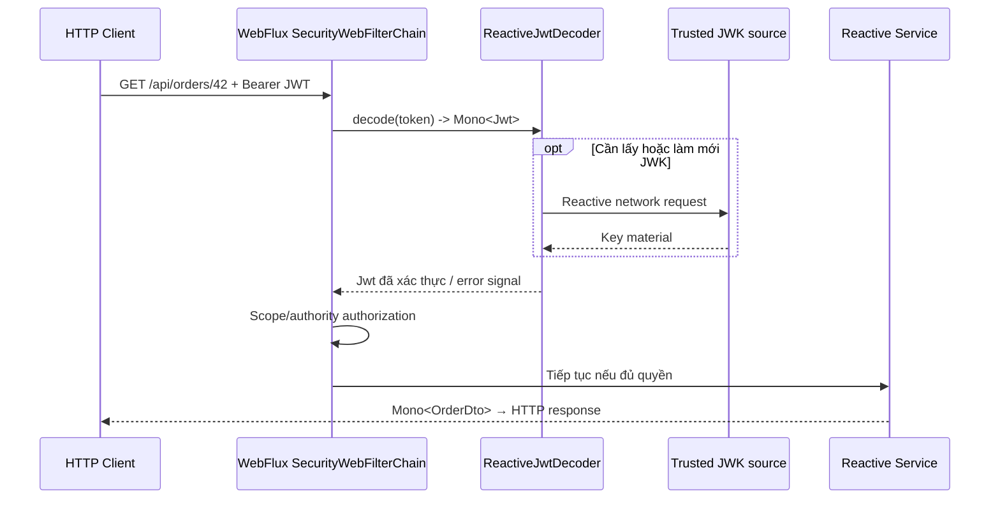
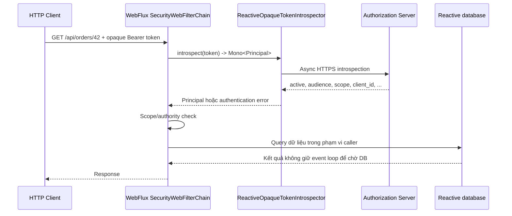

# Không đưa decoder, introspector hoặc tra cứu người dùng có chặn vào luồng sự kiện

## 1. Vấn đề thực tế: API WebFlux “reactive” nhưng một request làm nghẽn nhiều request khác

Một ứng dụng Spring Boot sử dụng **Spring WebFlux** để cung cấp OAuth 2.0 Resource Server:

```http
GET /api/orders/42 HTTP/1.1
Host: orders.example.com
Authorization: Bearer <access-token>
```

Kiến trúc mong muốn là xử lý nhiều request đồng thời với số lượng nhỏ luồng I/O, thay vì giữ một luồng riêng cho mỗi request trong lúc chờ cơ sở dữ liệu hoặc Authorization Server.

Tuy nhiên, developer có thể vô tình viết:

```java
// Ví dụ KHÔNG AN TOÀN cho luồng sự kiện WebFlux:
public Mono<UserProfile> lookup(String subject) {
    UserProfile profile = jdbcUserRepository.findBySubject(subject);
    return Mono.just(profile);
}
```

Lời gọi `jdbcUserRepository.findBySubject(...)` đã chạy **ngay khi tạo Mono**, trước khi Reactor nhận publisher. Nếu method được gọi trong quá trình xử lý request trên event loop, truy vấn JDBC có thể chặn luồng sự kiện.

Một ví dụ khác:

```java
// KHÔNG NÊN đặt block() trong luồng xác thực reactive.
OAuth2AuthenticatedPrincipal principal =
    reactiveIntrospector.introspect(token).block();
```

Lúc này request đang chờ kết quả mạng theo cơ chế blocking, trong khi event loop lẽ ra phải tiếp tục phục vụ các kết nối khác.

**Ý chính của bài:** Với Spring Security WebFlux, các thành phần xác thực và bổ sung thông tin người gọi — **JWT decoder, opaque-token introspector, tra cứu user/tenant/quyền** — phải tuân thủ mô hình thực thi reactive. Một method trả `Mono` chưa chắc là non-blocking; thứ quyết định là **những thao tác thật bên trong có chặn thread hay không, và chạy trên scheduler nào**.

### Mục tiêu học tập

Sau bài, bạn có thể:

1. Giải thích event loop của Reactor Netty và vì sao blocking I/O làm tăng latency của các request khác.
2. Phân biệt **ReactiveJwtDecoder** với **JwtDecoder**, và **ReactiveOpaqueTokenIntrospector** với **OpaqueTokenIntrospector**.
3. Biết cách cấu hình `SecurityWebFilterChain` thay vì sử dụng nhầm `SecurityFilterChain` Servlet.
4. Nhận diện `block()`, `join()`, JDBC, JPA, `RestTemplate`, SDK đồng bộ và các validator tra cứu DB có chặn.
5. Chuyển I/O sang R2DBC/`WebClient` hoặc bọc thư viện đồng bộ bằng `Mono.fromCallable(...).subscribeOn(Schedulers.boundedElastic())` khi không thể thay.
6. Không dùng `Mono.just(blockingCall())`, `map(blockingCall)` hoặc `publishOn(...)` sai chỗ.
7. Thiết kế phân quyền dựa trên user/tenant theo một chuỗi reactive không đánh mất kiểm tra issuer, audience và scope.
8. Quan sát lỗi trong load test, phát hiện thao tác blocking và phân biệt HTTP 401/403 với timeout hệ thống.
9. Hiểu giới hạn của boundedElastic, timeout, cache, thread pool và các hoạt động CPU-bound như xác minh chữ ký JWT.

---

## 2. Event loop trong WebFlux hoạt động như thế nào?

### 2.1. Mô hình xử lý nhiều kết nối

Một stack Spring WebFlux thường chạy trên Reactor Netty. Reactor Netty sử dụng số lượng luồng I/O tương đối nhỏ để xử lý socket, nhận dữ liệu, phát sự kiện và tiếp tục các bước ứng dụng khi kết quả bất đồng bộ đã sẵn sàng.

Ví dụ:

```text
Client A ──┐
Client B ──┼──> Reactor Netty event-loop threads
Client C ──┘          |
                     ├── request decode
                     ├── WebFilter / authentication
                     ├── authorization
                     ├── controller
                     └── response write
```

Các callback/operator chạy khi có tín hiệu và có thể được thực thi trên thread gắn với nguồn tín hiệu. **Không có cam kết rằng mọi operator tự động chuyển sang thread chuyên dụng**.

Nếu một callback giữ event-loop thread trong 500 ms để gọi JDBC hoặc đợi introspection bằng HTTP client blocking, những socket/request khác phụ thuộc cùng thread có thể phải đợi.

### 2.2. “Non-blocking” có nghĩa gì?

Với I/O non-blocking, ứng dụng gửi yêu cầu và nhận `Mono`/`Flux` đại diện cho kết quả sẽ đến; thread hiện tại không phải nằm yên chờ I/O.

Ví dụ:

```java
Mono<UserProfile> user =
    webClient.get()
        .uri("/users/{id}", userId)
        .retrieve()
        .bodyToMono(UserProfile.class);
```

Nếu `WebClient` được cấu hình trên connector reactive phù hợp, quá trình chờ phản hồi HTTP không giữ một event-loop thread bằng `Thread.sleep` hoặc `block`.

Ngược lại:

```java
UserProfile user =
    restTemplate.getForObject(url, UserProfile.class);
```

là lời gọi đồng bộ; thread gọi nó bị giữ cho đến khi HTTP response hoặc lỗi xảy ra.

### 2.3. Reactor publisher không phải máy tự biến code đồng bộ thành bất đồng bộ

Các đoạn sau **vẫn có thể chặn**:

```java
Mono<User> one = Mono.just(userDao.findUser(id));

Mono<User> two = Mono.defer(() ->
    Mono.just(userDao.findUser(id)));

Mono<User> three = Mono.just(id)
    .map(userDao::findUser);
```

- `one` gọi DAO **ngay lập tức** khi tạo `Mono`.
- `two` hoãn việc gọi DAO tới thời điểm có subscriber, nhưng vẫn chạy trên thread thực thi subscription nếu không đổi scheduler.
- `three` chạy DAO trong operator `map` trên thread nhận tín hiệu upstream; rất có thể là event loop.

Chỉ đổi return type từ `User` thành `Mono<User>` **không bảo đảm non-blocking**.

### 2.4. Vì sao ảnh hưởng lan rộng hơn một request?

Giả sử event loop phục vụ 200 kết nối. Một callback xác thực chặn 300 ms để gọi directory service:

```text
Event-loop-1:

T0        nhận request A
T0+5ms    xác thực A → gọi API đồng bộ và chờ 300 ms
T0+305ms  mới xử lý tiếp các event B, C, D, ...
```

Độ trễ của B/C/D có thể tăng dù chúng không cần tra cứu user. Nếu nhiều request đồng loạt gọi introspection đồng bộ, áp lực dồn lên event loops và hệ thống dễ mất khả năng phục vụ ở tải cao.

Đây là **vấn đề thread starvation và tail latency**, không chỉ là một request “chạy hơi chậm”.

---

## 3. Những thành phần của Spring Security WebFlux cần dùng đúng kiểu reactive

Spring Security có hai hệ sinh thái chính theo stack HTTP.

| Chức năng | Servlet/MVC | WebFlux/reactive |
|---|---|---|
| HTTP security configuration | `HttpSecurity` | `ServerHttpSecurity` |
| Security filter chain | `SecurityFilterChain` | `SecurityWebFilterChain` |
| JWT decoder | `JwtDecoder` | `ReactiveJwtDecoder` |
| Opaque token introspector | `OpaqueTokenIntrospector` | `ReactiveOpaqueTokenIntrospector` |
| Authorization request | Servlet request manager | Reactive authorization manager |
| Web client HTTP | Có thể dùng nhiều lựa chọn | `WebClient` là lựa chọn non-blocking phổ biến |
| Database integration | JDBC/JPA | R2DBC hoặc client DB reactive tương đương |
| Controller kết quả | Có thể trả object trực tiếp | `Mono<T>` / `Flux<T>` là kiểu phổ biến |
| Integration test HTTP | `MockMvc` | `WebTestClient` |

**Không dùng interface Servlet chỉ vì tên giống nhau.** Ví dụ không nên inject một `JwtDecoder` đồng bộ làm giải pháp chính cho Reactive JWT authentication nếu có `ReactiveJwtDecoder` phù hợp.

### 3.1. Luồng xác thực JWT trên WebFlux



`Mono<Jwt>` là hợp đồng reactive, nhưng không có nghĩa **tất cả** công việc xác minh chữ ký không tốn CPU. Phần lấy khóa qua mạng cần không chặn; phần mã hóa/giải mã và xác minh chữ ký vẫn phải tiêu thụ CPU, cần đo lường theo profile JWT và tải thực tế.

### 3.2. Luồng opaque token



Trường hợp AS không khả dụng là lỗi xác thực upstream; không được biến thành “cho phép tạm thời”.

### 3.3. Không chạy authentication logic bằng `subscribe()` thủ công

Trong reactive pipeline, framework là bên subscribe để lấy kết quả. Nếu converter/introspector/authorization code tự gọi:

```java
directory.findUser(subject)
    .subscribe(user -> updateSecurityContext(user));

return Mono.just(unauthenticatedPrincipal);
```

thì kết quả tra cứu user xảy ra ngoài pipeline chính, có thể đến **sau** khi authorization đã chạy, lỗi không được truyền về caller, và thông tin bảo mật có thể bị gắn sai context.

**Hãy trả về Mono chứa toàn bộ quá trình xác thực/phân quyền**, để Spring Security phối hợp completion, cancellation và error signal.

---

## 4. Bảng nhận diện blocking trong đường xác thực

| Thao tác | Vì sao có thể chặn? | Hướng xử lý |
|---|---|---|
| `Mono.block()` hoặc `Flux.blockFirst()` | Giữ thread đợi kết quả | Dùng `flatMap`, `map`, `zip`, `then` |
| `CompletableFuture.join()` / `Future.get()` | Giữ thread đợi future | Dùng adapter async/reactive thực sự |
| `Thread.sleep(...)` | Chặn thread trong khoảng thời gian | Dùng `Mono.delay` hoặc scheduler phù hợp cho timer |
| `RestTemplate.getForObject(...)` | HTTP đồng bộ | Dùng `WebClient` |
| JDBC `DataSource`/`PreparedStatement.executeQuery` | DB driver đồng bộ | R2DBC hoặc cô lập trên boundedElastic |
| Spring Data JPA/Hibernate | Persistence API thường dựa JDBC | Repository reactive/R2DBC hoặc worker scheduler có giới hạn |
| LDAP/JDBC user directory đồng bộ | Chờ network/DB | Driver reactive, client async hoặc adapter |
| `Files.readAllBytes(...)` | File I/O đồng bộ | API async khi phù hợp hoặc offload |
| DNS/SDK nội bộ chỉ có API sync | Có thể chờ I/O | Client async hoặc offload |
| Khởi tạo decoder gọi metadata qua HTTP sync | Có thể chặn startup/request | Dùng reactive decoder và metadata/JWKS trust config |
| JWT signature verification | CPU work, không nhất thiết blocking I/O | Giới hạn/đo tải, không mặc định offload mọi JWT |
| BCrypt/Argon2 password hash | CPU/memory-intensive | Đánh giá scheduler/CPU và giới hạn đồng thời |
| JSON decode lớn hoặc crypto nặng | Có thể chiếm event loop lâu | Giới hạn payload/CPU; cân nhắc compute scheduler phù hợp |

**Không phải một lời gọi Java “đồng bộ” ngắn là vấn đề blocking I/O.** Việc đọc một giá trị từ map, kiểm tra `aud` bằng `contains` hoặc tạo một `GrantedAuthority` không cần chuyển sang thread pool. Điều cần tránh là **chờ I/O** hoặc **giữ event-loop thread quá lâu**.

---

## 5. Cấu hình Resource Server WebFlux JWT đúng tầng

### 5.1. Dependency Gradle

Ví dụ Spring Boot WebFlux REST API:

```groovy
dependencies {
    implementation 'org.springframework.boot:spring-boot-starter-webflux'
    implementation 'org.springframework.boot:spring-boot-starter-security'
    implementation 'org.springframework.boot:spring-boot-starter-oauth2-resource-server'

    testImplementation 'org.springframework.boot:spring-boot-starter-test'
    testImplementation 'org.springframework.security:spring-security-test'
    testImplementation 'io.projectreactor:reactor-test'
}
```

Nếu thêm đồng thời `spring-boot-starter-web` và `spring-boot-starter-webflux`, Spring Boot có thể chọn Servlet MVC làm web application type theo cấu hình mặc định. Vì vậy, **thêm dependency WebFlux chưa chắc ứng dụng thật đang chạy reactive HTTP stack**. Khi xây Resource Server WebFlux, cần xác định ứng dụng đúng WebFlux và dùng `SecurityWebFilterChain`.

### 5.2. Issuer tin cậy

```yaml
spring:
  security:
    oauth2:
      resourceserver:
        jwt:
          issuer-uri: https://id.example.com/realms/shop
```

Đây là issuer ví dụ. Thay bằng issuer/metadata/JWKS được AS công bố và Resource Server phê duyệt.

Trong WebFlux, Spring Security có thể tạo `ReactiveJwtDecoder` phù hợp từ cấu hình. **Không tự lấy `iss` từ JWT chưa xác thực để quyết định có tin nhà phát hành hay không**.

### 5.3. `SecurityWebFilterChain`

```java
package com.example.orders;

import org.springframework.context.annotation.Bean;
import org.springframework.context.annotation.Configuration;
import org.springframework.http.HttpMethod;
import org.springframework.security.config.Customizer;
import org.springframework.security.config.annotation.web.reactive.EnableWebFluxSecurity;
import org.springframework.security.config.web.server.ServerHttpSecurity;
import org.springframework.security.web.server.SecurityWebFilterChain;

@Configuration
@EnableWebFluxSecurity
public class ReactiveSecurityConfig {

    @Bean
    SecurityWebFilterChain apiSecurity(ServerHttpSecurity http) {
        return http
            .csrf(ServerHttpSecurity.CsrfSpec::disable)
            .authorizeExchange(exchanges -> exchanges
                .pathMatchers("/api/public/**").permitAll()
                .pathMatchers(HttpMethod.GET, "/api/orders/**")
                    .hasAuthority("SCOPE_orders.read")
                .pathMatchers(HttpMethod.POST, "/api/orders")
                    .hasAuthority("SCOPE_orders.write")
                .anyExchange().denyAll()
            )
            .oauth2ResourceServer(oauth2 ->
                oauth2.jwt(Customizer.withDefaults()))
            .build();
    }
}
```

Những điểm quan trọng:

- Đây là **`SecurityWebFilterChain`** dùng **`ServerHttpSecurity`**.
- API xác thực access token dưới dạng JWT.
- `authorizeExchange` dùng authorities từ token đã xác thực.
- Endpoint công khai dùng `permitAll`, endpoint chưa định nghĩa dùng `denyAll`.
- `csrf(...disable)` ở ví dụ này dành cho API **thuần Bearer token được gửi bằng Authorization header**, không phải web session/cookie. Nếu API dùng browser cookie hoặc các credential tự được gửi, cần đánh giá CSRF lại.
- Chỉ cấu hình issuer không có nghĩa audience đã được ràng buộc cho mọi API; phải thêm validator audience phù hợp với hợp đồng.

Với ứng dụng WebFlux không dùng session cho API authentication, Resource Server Bearer request được xác thực theo token ở mỗi request. Không nên đọc web login session như một đường bypass.

### 5.4. Vì sao cấu hình này chưa cần tự tạo thread?

Khi dùng `oauth2ResourceServer(...jwt(...))` với reactive decoder phù hợp, Spring Security kết hợp Publisher để xác thực. Application code không cần tự tạo `Thread` hoặc gọi `subscribeOn` cho mọi request.

Chỉ khi **đưa một dependency thật sự blocking** vào pipeline mới cần thay thế hoặc cách ly nó đúng kỹ thuật.

---

## 6. ReactiveJwtDecoder: không bọc JwtDecoder blocking một cách tùy tiện

### 6.1. Hai interface có hợp đồng khác nhau

Đối với Servlet:

```java
Jwt jwt = jwtDecoder.decode(token); // JwtDecoder
```

Đối với WebFlux:

```java
Mono<Jwt> jwt = reactiveJwtDecoder.decode(token);
```

Tên giống nhau không có nghĩa bạn có thể lấy decoder đồng bộ, gọi `decode` trực tiếp từ event loop rồi bọc `Mono.just(...)`.

Ví dụ lỗi:

```java
// KHÔNG NÊN:
ReactiveJwtDecoder badAdapter = token -> {
    Jwt jwt = blockingDecoder.decode(token);
    return Mono.just(jwt);
};
```

Lời gọi `blockingDecoder.decode(token)` chạy trên thread hiện tại. Nếu nó làm network I/O đồng bộ để tải JWKS hoặc metadata, event loop bị chặn. Ngay cả nếu khóa đã cache, việc chuyển nhầm giữa hai contract làm mất chủ đích kiến trúc.

### 6.2. Sử dụng decoder reactive thật

Khi ứng dụng dùng Spring Boot auto-configuration như mục 5, thường không cần khai báo decoder bean thủ công.

Nếu có cấu hình custom, ví dụ khi cần cấu hình JWKS endpoint và audience tường minh:

```java
package com.example.orders;

import org.springframework.context.annotation.Bean;
import org.springframework.context.annotation.Configuration;
import org.springframework.security.oauth2.core.DelegatingOAuth2TokenValidator;
import org.springframework.security.oauth2.core.OAuth2Error;
import org.springframework.security.oauth2.core.OAuth2TokenValidator;
import org.springframework.security.oauth2.core.OAuth2TokenValidatorResult;
import org.springframework.security.oauth2.jwt.Jwt;
import org.springframework.security.oauth2.jwt.JwtValidators;
import org.springframework.security.oauth2.jwt.NimbusReactiveJwtDecoder;
import org.springframework.security.oauth2.jwt.ReactiveJwtDecoder;

@Configuration
public class ReactiveJwtValidationConfig {

    @Bean
    ReactiveJwtDecoder reactiveJwtDecoder() {
        String issuer = "https://id.example.com/realms/shop";

        // URL tin cậy do hệ thống cấu hình, không lấy từ JWT header.
        String jwksUri =
            "https://id.example.com/realms/shop/protocol/openid-connect/certs";

        NimbusReactiveJwtDecoder decoder =
            NimbusReactiveJwtDecoder
                .withJwkSetUri(jwksUri)
                .build();

        OAuth2TokenValidator<Jwt> audience = jwt ->
            jwt.getAudience().contains("orders-api")
                ? OAuth2TokenValidatorResult.success()
                : OAuth2TokenValidatorResult.failure(
                    new OAuth2Error(
                        "invalid_token", "Invalid audience", null));

        decoder.setJwtValidator(
            new DelegatingOAuth2TokenValidator<>(
                JwtValidators.createDefaultWithIssuer(issuer),
                audience));

        return decoder;
    }
}
```

**Đây là một cách cấu hình decoder thay thế auto-config khi cần chủ động chọn JWKS và validator.** Cần thay placeholder bằng issuer/JWKS thật, kiểm tra API builder tương thích phiên bản Spring Security và đảm bảo tập thuật toán được chấp nhận đúng hợp đồng.

Không đặt JWT decoder trước một truy vấn DB đồng bộ chỉ để “kiểm tra user còn tồn tại” nếu truy vấn đó có thể chặn event loop.

### 6.3. Validator token-level nên nhẹ và đồng bộ về mặt CPU

`OAuth2TokenValidator<Jwt>` là interface trả kết quả **đồng bộ**, phù hợp với các phép kiểm tra claim không chờ I/O:

```java
OAuth2TokenValidator<Jwt> audience = jwt ->
    jwt.getAudience().contains("orders-api")
        ? OAuth2TokenValidatorResult.success()
        : OAuth2TokenValidatorResult.failure(
            new OAuth2Error("invalid_token", "Wrong audience", null));
```

Không nên viết:

```java
// KHÔNG NÊN: validator synchronous gọi DB blocking.
OAuth2TokenValidator<Jwt> membership = jwt -> {
    boolean active = jdbcMembershipDao.isActive(
        jwt.getSubject(),
        jwt.getClaimAsString("tenant_id"));

    return active
        ? OAuth2TokenValidatorResult.success()
        : OAuth2TokenValidatorResult.failure(
            new OAuth2Error("invalid_token", "Inactive membership", null));
};
```

Vì validator không trả `Mono`, không có cách biểu đạt chờ DB bất đồng bộ trong chính interface đó.

**Tách trách nhiệm:**

- Issuer, thời hạn, audience, định dạng claim: validator token-level.
- Membership/tenant đang hoạt động phải hỏi DB: reactive authentication converter, reactive authorization manager hoặc Service policy.
- Nếu membership là điều kiện bắt buộc của việc tạo Authentication, đặt lookup trong pipeline xác thực reactive trước khi trả Authentication thành công.
- Nếu membership chỉ cần cho một endpoint, đặt trong authorization/service của endpoint đó.

### 6.4. JWKS và mạng

Decoder JWT có thể phải tải hoặc làm mới JWKS khi gặp khóa mới/chu kỳ cache. Đây là **network I/O** cần đường xử lý không chặn. Với decoder reactive, hãy dùng implementation được thiết kế cho môi trường đó và trust configuration cố định.

Không dùng JOSE header `jku`, `x5u` hay URL từ claim chưa xác thực để quyết định tải khóa ở host bất kỳ. Ngoài nguy cơ blocking, việc đó còn tạo SSRF/trust bypass.

Khi AS/JWKS endpoint chậm, phải có timeout, cách quản lý refresh/caching và giám sát phù hợp. Không tự coi token hợp lệ khi không thể xác minh chữ ký.

---

## 7. ReactiveOpaqueTokenIntrospector: tránh RestTemplate/block trong mỗi request

### 7.1. Vì sao introspection đặc biệt nhạy với event loop?

Với opaque token, Resource Server có thể gửi **một HTTP request tới Authorization Server cho mỗi request API** hoặc dùng cache theo chính sách.

Nếu dùng HTTP client blocking ngay trên event loop:

```java
// KHÔNG AN TOÀN:
public Mono<OAuth2AuthenticatedPrincipal> introspect(String token) {
    OAuth2AuthenticatedPrincipal result =
        blockingIntrospector.introspect(token);
    return Mono.just(result);
}
```

thì độ trễ AS trở thành thời gian giữ event-loop thread. Khi AS tăng latency, API có thể nghẽn nhiều kết nối ngoài ý muốn.

### 7.2. Cấu hình opaque token trong WebFlux

Ví dụ `application.yml`:

```yaml
spring:
  security:
    oauth2:
      resourceserver:
        opaquetoken:
          introspection-uri: https://id.example.com/oauth2/introspect
          client-id: ${INTROSPECTION_CLIENT_ID}
          client-secret: ${INTROSPECTION_CLIENT_SECRET}
```

Các biến môi trường là placeholder. Không commit Client secret thật hoặc log HTTP Basic credential của Resource Server.

Cấu hình WebFlux:

```java
@Bean
SecurityWebFilterChain apiSecurity(ServerHttpSecurity http) {
    return http
        .authorizeExchange(exchanges -> exchanges
            .pathMatchers("/api/public/**").permitAll()
            .pathMatchers("/api/orders/**")
                .hasAuthority("SCOPE_orders.read")
            .anyExchange().denyAll())
        .oauth2ResourceServer(oauth2 ->
            oauth2.opaqueToken(Customizer.withDefaults()))
        .build();
}
```

`opaqueToken(...)` là lựa chọn **thay** `jwt(...)` khi token contract của API sử dụng opaque access token. Đừng bật hai cấu hình mà không có thiết kế rõ ràng cho việc chọn và xác thực nhiều loại token.

### 7.3. Delegate tới reactive introspector

Khi cần kiểm tra audience token-level bên cạnh `active`:

```java
package com.example.orders;

import java.util.Collection;
import org.springframework.beans.factory.annotation.Value;
import org.springframework.context.annotation.Bean;
import org.springframework.context.annotation.Configuration;
import org.springframework.security.oauth2.core.OAuth2AuthenticatedPrincipal;
import org.springframework.security.oauth2.server.resource.introspection.BadOpaqueTokenException;
import org.springframework.security.oauth2.server.resource.introspection.ReactiveOpaqueTokenIntrospector;
import org.springframework.security.oauth2.server.resource.introspection.SpringReactiveOpaqueTokenIntrospector;
import reactor.core.publisher.Mono;

@Configuration
public class OpaqueIntrospectionConfig {

    @Bean
    ReactiveOpaqueTokenIntrospector reactiveOpaqueTokenIntrospector(
            @Value("${spring.security.oauth2.resourceserver.opaquetoken.introspection-uri}")
            String uri,
            @Value("${spring.security.oauth2.resourceserver.opaquetoken.client-id}")
            String clientId,
            @Value("${spring.security.oauth2.resourceserver.opaquetoken.client-secret}")
            String clientSecret) {

        ReactiveOpaqueTokenIntrospector delegate =
            new SpringReactiveOpaqueTokenIntrospector(
                uri, clientId, clientSecret);

        return token -> delegate.introspect(token)
            .flatMap(principal -> {
                Object aud = principal.getAttribute("aud");

                boolean matches =
                    "orders-api".equals(aud)
                    || (aud instanceof Collection<?> values
                        && values.contains("orders-api"));

                if (!matches) {
                    return Mono.error(
                        new BadOpaqueTokenException(
                            "Token is not intended for orders-api"));
                }

                return Mono.just(principal);
            });
    }
}
```

Ý nghĩa:

1. Delegate xử lý introspection với AS qua contract reactive.
2. Logic audience xử lý sau khi AS trả principal đã được chấp nhận.
3. `flatMap` trả signal `Mono.error(...)` khi audience không đúng.
4. Không có `block()`, `RestTemplate` hay JDBC trong introspector wrapper.

**Lưu ý phiên bản:** Constructor/builder của `SpringReactiveOpaqueTokenIntrospector` phụ thuộc Spring Security version. Sử dụng API tương ứng của bản dự án; điều quan trọng là chọn **implementation reactive thật** và không chạy thư viện HTTP blocking trên event loop.

Nếu AS không trả `aud` nhưng hợp đồng bảo đảm token audience bằng introspection gắn với danh tính Resource Server, phải xác minh đảm bảo đó bằng integration tests. Nếu hợp đồng yêu cầu `aud`, thiếu trường phải bị từ chối. `active=true` tự nó không thay audience hoặc scope.

### 7.4. Đừng tự subscribe để “gọi AS sớm”

Sai:

```java
// KHÔNG NÊN:
public Mono<OAuth2AuthenticatedPrincipal> introspect(String token) {
    delegate.introspect(token)
        .subscribe(principal -> audit(principal));

    return Mono.empty();
}
```

`subscribe()` tạo một tác vụ độc lập và method trả về trước khi kết quả xác thực được kiểm soát. Lỗi introspection có thể bị bỏ sót hoặc bị ghi nhận ngoài luồng authorization.

Đúng hơn:

```java
return delegate.introspect(token)
    .doOnNext(principal ->
        auditNonBlockingMetadataOnly(principal));
```

`doOnNext` chỉ phù hợp nếu `auditNonBlockingMetadataOnly` là công việc **nhanh, không blocking và không đổi quyền**. Nếu ghi audit phải gọi DB/network, hãy dùng một API reactive và phối hợp bằng `flatMap/thenReturn` hoặc đưa event vào pipeline bất đồng bộ với chính sách delivery rõ ràng.

### 7.5. Phản hồi và lỗi upstream

Phân biệt:

- Introspection `active=false`: token không được chấp nhận.
- Introspection `active=true` nhưng `aud` không phù hợp: token không được API chấp nhận theo contract.
- `active=true` đúng audience nhưng thiếu scope: authentication có thể thành công, authorization từ chối.
- AS timeout hoặc TLS lỗi: **không xác minh được**; không tự kết luận token giả và không cho phép request.

Không viết `onErrorResume(error -> Mono.just(allowAllPrincipal))` để “giữ API chạy” khi AS mất kết nối. Đó là **fail-open vulnerability**.

---

## 8. Tra cứu user, tenant và quyền: lúc nào cần và đặt ở đâu?

Một ứng dụng có thể cần biết:

- `sub` trong token có tương ứng user nội bộ đang hoạt động không?
- User còn thuộc tenant được yêu cầu không?
- Role kế toán/quản trị có còn hiệu lực không?
- Client `billing-worker` có được gọi endpoint nội bộ không?
- Subject có quyền với order `42` không?

Không phải mọi câu hỏi đều cần tra DB trong quá trình xác thực token.

### 8.1. Phân biệt token validation và business authorization

| Kiểm tra | Vị trí thường phù hợp |
|---|---|
| JWT signature, issuer, `exp`, `nbf`, audience | `ReactiveJwtDecoder` + validators |
| Opaque token `active`, audience theo hợp đồng | `ReactiveOpaqueTokenIntrospector` |
| Scope/authority của URL | `SecurityWebFilterChain` |
| User bắt buộc có hồ sơ nội bộ để được xác thực | Reactive authentication converter/manager |
| User còn thuộc tenant khi gọi endpoint | Reactive authorization manager hoặc Service |
| Bản ghi thuộc tenant/owner nào | Reactive Service/Repository query |
| Vai trò riêng cho từng order | Service/permission lookup có phạm vi |

Nếu thay đổi membership cần có hiệu lực tức thời, tra cứu DB/entitlement có thể cần thiết. Nếu claim token đủ cho một policy với thời hạn token ngắn, không nhất thiết request nào cũng cần query user.

**Đừng đưa tất cả logic business vào JWT decoder chỉ vì decoder là nơi đầu tiên nhận token.**

### 8.2. R2DBC thay vì JDBC/JPA khi xây đường dữ liệu reactive

Ví dụ dependency:

```groovy
dependencies {
    implementation 'org.springframework.boot:spring-boot-starter-data-r2dbc'
    // Khai báo R2DBC driver tương ứng với DB thực tế.
}
```

Repository reactive:

```java
package com.example.orders;

import org.springframework.data.repository.reactive.ReactiveCrudRepository;
import reactor.core.publisher.Mono;

public interface UserRepository
        extends ReactiveCrudRepository<UserEntity, Long> {

    Mono<UserEntity> findByIssuerAndSubject(
        String issuer,
        String subject);
}
```

`UserEntity` là domain class cần được định nghĩa theo schema thật. Điều quan trọng: các method trả `Mono` vì backend/driver được thiết kế theo mô hình reactive, không chỉ là interface “bọc” JDBC thủ công.

### 8.3. Dùng `flatMap` để chờ user lookup reactive

Sai:

```java
// KHÔNG NÊN:
Mono<UserEntity> userMono =
    userRepository.findByIssuerAndSubject(issuer, subject);

UserEntity user = userMono.block();
return Mono.just(user);
```

Đúng:

```java
public Mono<UserEntity> loadUser(
        String issuer,
        String subject) {

    return userRepository
        .findByIssuerAndSubject(issuer, subject)
        .switchIfEmpty(Mono.error(
            new UserNotFoundException("User not active")));
}
```

`UserNotFoundException` là exception domain minh họa. Tùy đặt ở authentication hay authorization, ứng dụng cần chuyển nó thành kết quả 401/403/404 thích hợp, không để lộ user có tồn tại hay không và không mặc định trả 500.

### 8.4. Tra cứu user trong converter reactive sau JWT decode

Trong Spring Security WebFlux, JWT được decoder xác thực trước khi chuyển thành `Authentication`. Khi toàn bộ API yêu cầu user nội bộ phải đang hoạt động, có thể dùng một converter trả `Mono<AbstractAuthenticationToken>`.

Ví dụ:

```java
package com.example.orders;

import java.util.ArrayList;
import java.util.Collection;
import org.springframework.core.convert.converter.Converter;
import org.springframework.security.authentication.BadCredentialsException;
import org.springframework.security.core.GrantedAuthority;
import org.springframework.security.core.authority.SimpleGrantedAuthority;
import org.springframework.security.authentication.AbstractAuthenticationToken;
import org.springframework.security.oauth2.jwt.Jwt;
import org.springframework.security.oauth2.server.resource.authentication.JwtAuthenticationToken;
import org.springframework.security.oauth2.server.resource.authentication.JwtGrantedAuthoritiesConverter;
import reactor.core.publisher.Mono;

public final class UserAwareJwtAuthenticationConverter
        implements Converter<Jwt, Mono<AbstractAuthenticationToken>> {

    private final UserRepository users;

    private final JwtGrantedAuthoritiesConverter scopes =
        new JwtGrantedAuthoritiesConverter();

    public UserAwareJwtAuthenticationConverter(
            UserRepository users) {
        this.users = users;
    }

    @Override
    public Mono<AbstractAuthenticationToken> convert(Jwt jwt) {
        String issuer = jwt.getIssuer().toString();
        String subject = jwt.getSubject();

        return users.findByIssuerAndSubject(issuer, subject)
            .filter(UserEntity::isActive)
            .switchIfEmpty(Mono.error(
                new BadCredentialsException(
                    "Authenticated user is not active")))
            .map(user -> {
                Collection<GrantedAuthority> result =
                    new ArrayList<>(scopes.convert(jwt));

                if (user.isTenantAdmin()) {
                    result.add(new SimpleGrantedAuthority(
                        "ROLE_TENANT_ADMIN"));
                }

                return (AbstractAuthenticationToken)
                    new JwtAuthenticationToken(jwt, result);
            });
    }
}
```

Lắp vào `SecurityWebFilterChain`:

```java
@Bean
SecurityWebFilterChain apiSecurity(
        ServerHttpSecurity http,
        UserRepository userRepository) {

    return http
        .authorizeExchange(auth -> auth
            .pathMatchers("/api/orders/**")
                .hasAuthority("SCOPE_orders.read")
            .anyExchange().denyAll())
        .oauth2ResourceServer(oauth2 -> oauth2
            .jwt(jwt -> jwt.jwtAuthenticationConverter(
                new UserAwareJwtAuthenticationConverter(
                    userRepository))))
        .build();
}
```

Đây là **phương án tùy biến thay thế cấu hình JWT converter đơn giản**, không phải bean thứ hai phải đăng ký đồng thời. Cần bảo đảm decoder/issuer/audience đã được cấu hình và user model có `isActive()`, `isTenantAdmin()` tương ứng.

Khi định nghĩa `ROLE_TENANT_ADMIN`, cần hiểu quyền này có hiệu lực ở tenant nào. Nếu role chỉ có quyền trong một tenant, không nên biến nó thành global authority rồi bỏ qua tenant check ở Service.

### 8.5. Lookup user nên xảy ra trong Authentication hay Authorization?

Cân nhắc hai hợp đồng:

**Hợp đồng A: “Mọi request có token này chỉ được xác thực nếu user còn active trong local directory.”** Khi đó user lookup là một điều kiện bắt buộc để tạo Authentication; reactive JWT converter có thể hợp lý.

**Hợp đồng B: “Chỉ endpoint `/api/tenants/{tenant}/admin/**` cần kiểm tra membership admin.”** Không nên query DB user/tenant cho mọi request public/protected. Đặt lookup ở authorization/service của endpoint đó.

Không nên đặt business membership DB call trong `OAuth2TokenValidator<Jwt>` đồng bộ, vì interface đó không phải API reactive và không thể chờ I/O đúng cách.

---

## 9. Phân quyền dữ liệu với Reactive Repository: không chỉ có scope

Sau khi token hợp lệ và có `SCOPE_orders.read`, Service vẫn phải xác định user được xem order nào.

### 9.1. JWT đúng scope chưa đủ

Ví dụ:

```json
{
  "iss": "https://id.example.com/realms/shop",
  "sub": "user-417",
  "aud": ["orders-api"],
  "scope": "orders.read",
  "tenant_id": "tenant-alpha"
}
```

Request:

```http
GET /api/tenants/tenant-beta/orders/order-42 HTTP/1.1
Authorization: Bearer <token-of-tenant-alpha>
```

Token có thể xác thực thành công, nhưng không được đọc order Beta nếu caller chỉ có quyền Alpha.

### 9.2. Reactive repository với predicate quyền

Ví dụ Spring Data R2DBC:

```java
package com.example.orders;

import org.springframework.data.repository.reactive.ReactiveCrudRepository;
import reactor.core.publisher.Mono;

public interface OrderRepository
        extends ReactiveCrudRepository<OrderEntity, String> {

    Mono<OrderEntity> findByIdAndTenantIdAndOwnerSubject(
        String id,
        String tenantId,
        String ownerSubject);
}
```

`OrderEntity` là domain class rút gọn có `id`, `tenantId`, `ownerSubject`, `amount` và `status`. Repository trả `Mono` dựa trên một driver reactive đúng nghĩa.

Service:

```java
package com.example.orders;

import org.springframework.http.HttpStatus;
import org.springframework.security.access.AccessDeniedException;
import org.springframework.stereotype.Service;
import org.springframework.web.server.ResponseStatusException;
import reactor.core.publisher.Mono;

@Service
public class OrderService {

    private final OrderRepository orders;

    public OrderService(OrderRepository orders) {
        this.orders = orders;
    }

    public Mono<OrderDto> findVisible(
            String orderId,
            String requestedTenant,
            String verifiedTenant,
            String verifiedSubject) {

        if (!verifiedTenant.equals(requestedTenant)) {
            return Mono.error(new AccessDeniedException(
                "Tenant access denied"));
        }

        return orders.findByIdAndTenantIdAndOwnerSubject(
                orderId, verifiedTenant, verifiedSubject)
            .switchIfEmpty(Mono.error(
                new ResponseStatusException(
                    HttpStatus.NOT_FOUND)))
            .map(order -> new OrderDto(
                order.getId(),
                order.getAmount(),
                order.getStatus()));
    }
}
```

Các class `OrderEntity` và `OrderDto` là thành phần domain minh họa. `verifiedTenant` và `verifiedSubject` phải được lấy từ nguồn Authentication/entitlement **đã xác minh**, không tin header/path/body tự khai.

Đoạn code không gọi `block()`, không lấy toàn bộ dữ liệu rồi filter trong memory và không trả Entity chứa mọi field. Query đã giới hạn tenant/owner ngay từ database.

### 9.3. Reactive Controller

```java
package com.example.orders;

import org.springframework.security.core.annotation.AuthenticationPrincipal;
import org.springframework.security.oauth2.jwt.Jwt;
import org.springframework.web.bind.annotation.GetMapping;
import org.springframework.web.bind.annotation.PathVariable;
import org.springframework.web.bind.annotation.RestController;
import reactor.core.publisher.Mono;

@RestController
public class OrderController {

    private final OrderService service;

    public OrderController(OrderService service) {
        this.service = service;
    }

    @GetMapping("/api/tenants/{tenantId}/orders/{orderId}")
    public Mono<OrderDto> detail(
            @PathVariable String tenantId,
            @PathVariable String orderId,
            @AuthenticationPrincipal Jwt jwt) {

        String verifiedTenant =
            jwt.getClaimAsString("tenant_id");

        return service.findVisible(
            orderId,
            tenantId,
            verifiedTenant,
            jwt.getSubject());
    }
}
```

Trong app thật, `tenant_id` là claim bắt buộc cần kiểm tra kiểu/giá trị trước khi dùng. Ví dụ này giả định validator đã đảm bảo claim đó là chuỗi hợp lệ. Nếu không, cần fail closed thay vì để `NullPointerException` gây 500.

### 9.4. Không dùng JDBC trong reactive Service

Sai:

```java
public Mono<OrderDto> detail(String id) {
    OrderEntity entity = jpaRepository.findById(id)
        .orElseThrow();

    return Mono.just(mapToDto(entity));
}
```

Đúng hơn khi có thể:

```java
public Mono<OrderDto> detail(String id) {
    return reactiveOrderRepository.findById(id)
        .map(this::mapToDto);
}
```

Nếu chưa thể thay JPA/JDBC, phải cô lập I/O blocking khỏi event loop, sẽ trình bày ở mục 10.

---

## 10. Khi bắt buộc dùng thư viện đồng bộ: bọc đúng `boundedElastic`

Không phải hệ thống nào cũng có thể đổi toàn bộ JDBC/JPA hoặc SDK bên thứ ba sang reactive ngay. Reactor cung cấp `Schedulers.boundedElastic()` để chạy các tác vụ chặn trên pool có giới hạn, tránh giữ event loop.

### 10.1. Mẫu adapter tối thiểu

Giả sử `LegacyUserDirectory` chỉ có hàm đồng bộ:

```java
public interface LegacyUserDirectory {
    UserProfile loadBySubject(String subject);
}
```

Bọc:

```java
package com.example.orders;

import reactor.core.publisher.Mono;
import reactor.core.scheduler.Schedulers;

public final class LegacyUserAdapter {

    private final LegacyUserDirectory directory;

    public LegacyUserAdapter(
            LegacyUserDirectory directory) {
        this.directory = directory;
    }

    public Mono<UserProfile> load(String subject) {
        return Mono.fromCallable(
                () -> directory.loadBySubject(subject))
            .subscribeOn(Schedulers.boundedElastic());
    }
}
```

Điểm quan trọng:

- `Mono.fromCallable` **trì hoãn** lời gọi đồng bộ đến khi có subscription.
- `subscribeOn(Schedulers.boundedElastic())` đưa phần upstream của publisher lên scheduler có khả năng dành thread cho blocking call.
- Event loop không phải chờ trực tiếp lời gọi `loadBySubject`.
- Kết quả/lỗi của directory vẫn được truyền trong pipeline dưới dạng signal.

Đây là **chiến lược chuyển tiếp**, không phải phương án tốt nhất bằng I/O reactive thật. BoundedElastic có giới hạn threads và hàng đợi; nếu gọi đồng bộ quá chậm hoặc quá nhiều, vẫn có thể nghẽn pool/DB và tăng latency.

### 10.2. Đừng dùng `Mono.just(...)` cho blocking call

Sai:

```java
return Mono.just(
    legacyDirectory.loadBySubject(subject))
    .subscribeOn(Schedulers.boundedElastic());
```

Lệnh `legacyDirectory.loadBySubject(subject)` đã chạy **trước** khi tạo publisher, nên `subscribeOn` đặt sau không giúp cách ly thao tác.

Đúng:

```java
return Mono.fromCallable(
        () -> legacyDirectory.loadBySubject(subject))
    .subscribeOn(Schedulers.boundedElastic());
```

### 10.3. `Mono.defer` chưa đủ nếu không có scheduler

```java
return Mono.defer(() -> Mono.just(
    legacyDirectory.loadBySubject(subject)));
```

Đoạn này trì hoãn lời gọi cho đến khi subscribe, nhưng có thể vẫn chạy trên event loop. Thêm offload:

```java
return Mono.fromCallable(
        () -> legacyDirectory.loadBySubject(subject))
    .subscribeOn(Schedulers.boundedElastic());
```

### 10.4. `publishOn` không sửa được blocking ở phía trước

Sai:

```java
return Mono.just(subject)
    .map(legacyDirectory::loadBySubject)
    .publishOn(Schedulers.boundedElastic());
```

`publishOn` chỉ đổi scheduler cho các operator **đi sau** nó; `map` đã có thể chạy trên event loop.

Có thể viết:

```java
return Mono.just(subject)
    .publishOn(Schedulers.boundedElastic())
    .map(legacyDirectory::loadBySubject);
```

nhưng adapter `Mono.fromCallable(...).subscribeOn(...)` thường rõ ràng và ít lỗi hơn khi cô lập đúng một blocking API.

### 10.5. Adapter cho introspector đồng bộ cũ

Nếu đang có một `OpaqueTokenIntrospector` đồng bộ mà chưa thể thay bằng implementation reactive:

```java
package com.example.orders;

import org.springframework.security.oauth2.core.OAuth2AuthenticatedPrincipal;
import org.springframework.security.oauth2.server.resource.introspection.OpaqueTokenIntrospector;
import org.springframework.security.oauth2.server.resource.introspection.ReactiveOpaqueTokenIntrospector;
import reactor.core.publisher.Mono;
import reactor.core.scheduler.Schedulers;

public final class LegacyIntrospectionAdapter
        implements ReactiveOpaqueTokenIntrospector {

    private final OpaqueTokenIntrospector legacy;

    public LegacyIntrospectionAdapter(
            OpaqueTokenIntrospector legacy) {
        this.legacy = legacy;
    }

    @Override
    public Mono<OAuth2AuthenticatedPrincipal> introspect(
            String token) {

        return Mono.fromCallable(
                () -> legacy.introspect(token))
            .subscribeOn(Schedulers.boundedElastic());
    }
}
```

Adapter tránh chặn event loop nhưng vẫn có những giới hạn:

- Một thread boundedElastic bị giữ trong lúc chờ HTTP response.
- Cần timeout ở **HTTP client đồng bộ**; Reactor `timeout(...)` không luôn làm socket/JDBC call bên dưới dừng ngay.
- Cần giới hạn đồng thời, pool size và giới hạn hàng đợi.
- Token/Client secret không được ghi log hoặc chuyển tới endpoint chưa phê duyệt.
- Về lâu dài, nên thay bằng `ReactiveOpaqueTokenIntrospector` sử dụng I/O non-blocking.

**Không tự bọc một introspector bằng `new Thread(...)` mỗi request**. Việc tạo unbounded threads có thể gây kiệt tài nguyên khi AS chậm.

### 10.6. Adapter JDBC user lookup

Ví dụ:

```java
public Mono<UserProfile> findUser(String subject) {
    return Mono.fromCallable(() ->
            jdbcUserRepository.findUserBySubject(subject))
        .subscribeOn(Schedulers.boundedElastic())
        .switchIfEmpty(Mono.error(
            new UserNotFoundException("Not found")));
}
```

Phép xử lý `switchIfEmpty` ở đây giả định `findUserBySubject` có thể trả null và `Mono.fromCallable` sẽ hoàn tất rỗng. Tùy DAO thực tế, có thể cần xử lý `Optional` hoặc exception riêng.

Đừng bỏ giới hạn kết nối JDBC chỉ vì công việc đã được chuyển sang boundedElastic. Thread pool offload không tăng số kết nối hoặc thông lượng tối đa của DB.

---

## 11. `block()`, `toFuture().join()` và `subscribe()` trong đường xác thực

### 11.1. `block()` trên event loop

Ví dụ:

```java
public Mono<OrderDto> getOrder(String id) {
    UserProfile profile =
        reactiveUserClient.findCurrentUser().block();

    return reactiveOrders.findByIdAndOwner(id, profile.id())
        .map(OrderDto::from);
}
```

`block()` đợi đồng bộ. Trên những thread Reactor được đánh dấu non-blocking, có trường hợp Reactor ném lỗi như “block()/blockFirst()/blockLast() are blocking, which is not supported in thread ...”. Nhưng **không phải mọi blocking call đều tự bị Reactor phát hiện và ném lỗi**.

Đúng:

```java
public Mono<OrderDto> getOrder(String id) {
    return reactiveUserClient.findCurrentUser()
        .flatMap(profile ->
            reactiveOrders.findByIdAndOwner(
                id, profile.id()))
        .map(OrderDto::from);
}
```

### 11.2. `CompletableFuture.join()` cũng là blocking

Sai:

```java
return Mono.just(
    asyncDirectory.findUser(subject).join());
```

Dù tên API có chữ “async”, `join()` vẫn chặn thread gọi đến khi future hoàn thành.

Nếu API trả `CompletionStage<UserProfile>` thật sự bất đồng bộ:

```java
return Mono.fromCompletionStage(
    () -> asyncDirectory.findUser(subject));
```

Cần xác nhận implementation của `findUser` thực sự async, không làm blocking work **trước khi trả CompletionStage**.

### 11.3. Không gọi `subscribe()` trong controller để lấy dữ liệu

Sai:

```java
@GetMapping("/api/users/me")
public Mono<UserProfile> me() {
    userService.me().subscribe(user ->
        this.lastUser = user);

    return Mono.just(this.lastUser);
}
```

Đoạn này có race condition, shared mutable state và không truyền lỗi về response. Nó còn có thể trộn thông tin user giữa nhiều request.

Đúng:

```java
@GetMapping("/api/users/me")
public Mono<UserProfile> me() {
    return userService.me();
}
```

Spring WebFlux sẽ subscribe và phối hợp HTTP response theo Publisher đã trả về.

### 11.4. Đừng chuyển lỗi xác thực thành giá trị cho phép

Sai:

```java
return introspector.introspect(token)
    .onErrorResume(error ->
        Mono.just(createAnonymousAdminPrincipal()));
```

Nếu AS timeout hoặc token bị từ chối, việc cấp một principal quyền cao làm hệ thống **fail open**.

Có thể dùng error mapping/challenge thích hợp, nhưng **không cấp quyền khi authentication chưa được chứng minh**.

---

## 12. Scheduler: dùng đúng công cụ, không “phủ subscribeOn” khắp nơi

Reactor có các scheduler khác nhau. Chọn scheduler là một quyết định về tài nguyên và semantics.

| Scheduler | Đặc điểm khái quát | Dùng cho |
|---|---|---|
| Event loop của Reactor Netty | Xử lý I/O events, số thread nhỏ | HTTP network pipeline và callbacks ngắn |
| `Schedulers.boundedElastic()` | Thread pool có giới hạn, phù hợp cô lập blocking work | Adapter cho JDBC/SDK/HTTP sync khi chưa thay được |
| `Schedulers.parallel()` | Pool ưu tiên xử lý CPU, không dành cho blocking I/O dài | Công việc CPU-bound có kiểm soát |
| Scheduler chuyên biệt | Có thể cấu hình thread/queue/concurrency riêng | Dependency đặc thù, giới hạn và đo lường rõ |
| `Schedulers.immediate()` | Chạy ngay trên thread hiện tại | Không giúp offload blocking |

### 12.1. BoundedElastic không vô hạn

Giả sử 2.000 request đồng thời đều gọi directory service đồng bộ mất 400 ms. Nếu có ít thread/connection khả dụng hơn nhiều request, các request còn lại phải xếp hàng.

Ngay cả khi event loop không bị chặn, hệ thống vẫn có thể chịu:

- Queue latency cao.
- Số request đang chờ nhiều.
- Pool connection quá tải.
- Timeout lan truyền.
- Memory pressure do nhiều Publisher/request còn sống.
- Độ trễ p95/p99 tăng mạnh.

Vì vậy, cần **bulkhead, timeout và giới hạn concurrency**, cùng kế hoạch thay thư viện sync bằng reactive nếu workload đáng kể.

### 12.2. Tạo scheduler riêng cho dependency có rủi ro

Một SDK blocking đặc biệt có thể cần tách khỏi boundedElastic dùng chung:

```java
Scheduler directoryScheduler =
    Schedulers.newBoundedElastic(
        16,    // max threads
        200,   // queued tasks per thread
        "legacy-directory");
```

Sau đó:

```java
return Mono.fromCallable(
        () -> legacyDirectory.load(subject))
    .subscribeOn(directoryScheduler);
```

Các con số chỉ minh họa, **không phải cấu hình tối ưu mặc định**. Scheduler tự tạo cần được quản lý vòng đời (`dispose()` khi application shutdown), và phải phù hợp connection pool, SLA, load.

Đừng dùng một scheduler riêng cho **mỗi request**. Điều đó dễ dẫn đến thread leaks/kiệt tài nguyên.

### 12.3. CPU-bound khác blocking I/O

Chữ ký JWT dùng mật mã bất đối xứng đòi CPU. Với token thông thường và cấu hình chuẩn, chi phí có thể đủ nhỏ để xử lý trong pipeline. Nhưng xác minh nhiều token lớn, crypto provider chậm hoặc xử lý claim phức tạp có thể làm event-loop callbacks dài.

Nếu thực tế có vấn đề:

1. Đo thời gian xử lý decode/verify, CPU profile và độ trễ event loop.
2. Giới hạn kích thước JWT/header/claims và thuật toán/khóa được chấp nhận.
3. Cân nhắc một compute scheduler có giới hạn hoặc giải pháp offload được kiểm soát.
4. Không tự động chuyển mọi đoạn CPU vào boundedElastic với suy nghĩ “reactive nghĩa là không được tính toán gì”.
5. Không tắt signature validation hoặc nới thuật toán để tăng hiệu năng.

Công việc CPU-bound quá nặng cần **giới hạn và quản lý CPU**, không chỉ nhiều thread hơn.

---

## 13. Timeout không thay thế việc giải phóng thread bị chặn

### 13.1. Timeout cho reactive network call

Ví dụ:

```java
return reactiveDirectory.findUser(subject)
    .timeout(Duration.ofSeconds(2))
    .onErrorMap(
        java.util.concurrent.TimeoutException.class,
        error -> new DirectoryUnavailableException(
            "Directory lookup timed out", error));
```

Các exception domain là lớp minh họa. Trong đường authentication, cần ánh xạ thành kết quả lỗi thích hợp; **không cho phép user đi qua** khi directory không xác minh được.

Với WebClient, cần xem thêm connect timeout/response timeout ở HTTP connector và cơ chế pool/network tương ứng, không chỉ đặt Reactor timeout bên ngoài.

### 13.2. Timeout adapter JDBC không phải interrupt hoàn hảo

```java
Mono.fromCallable(() -> legacyJdbc.lookup(subject))
    .subscribeOn(Schedulers.boundedElastic())
    .timeout(Duration.ofSeconds(2));
```

Sau hai giây, subscriber có thể nhận timeout và cancellation. Tuy nhiên, lời gọi JDBC đồng bộ nằm trên worker thread **không chắc dừng ngay**; tùy driver và API cancellation, nó có thể tiếp tục chờ DB.

Vì vậy còn cần:

- JDBC socket/query timeout.
- DB statement timeout.
- Connection pool limit.
- Giới hạn số lookup đang chạy.
- Cơ chế circuit breaker/bulkhead nếu workload cần.

**Đừng dùng timeout của Reactor như giấy bảo đảm rằng blocking dependency đã được giải phóng tài nguyên.**

### 13.3. Tránh retry vô hạn trong authentication

Nếu AS introspection bị 503 và mỗi request retry nhiều lần, hệ thống có thể tạo traffic nhân lên và làm sự cố nặng hơn.

Retry nếu được áp dụng phải có:

- Chỉ áp dụng cho lỗi có thể retry theo policy.
- Giới hạn attempts và thời gian tổng.
- Backoff/jitter phù hợp.
- Giới hạn concurrency.
- Bảo đảm không khiến token/secret bị gửi sang endpoint khác.
- Không retry `active=false` như một lỗi mạng.

Có thể cần rate limit ở API/gateway để bảo vệ AS khi burst authentication cao.

---

## 14. Caching: giảm số call nhưng không làm mất ràng buộc quyền

### 14.1. JWKS cache

JWT decoder thường dùng cached JWK material theo implementation. Caching giúp tránh gọi AS trong mỗi request, nhưng cần hỗ trợ key rotation và không dùng khóa không còn đáng tin vượt quá policy.

Tránh tình huống:

```text
JwtDecoder:
  mỗi request → HTTP đồng bộ tới JWKS
```

Nếu mỗi token làm một network round-trip đồng bộ, hiệu năng WebFlux bị suy giảm nặng.

### 14.2. Introspection cache

Opaque token có thể cần introspection nhiều lần. Cache giảm network calls nhưng tạo trade-off với khả năng thu hồi token.

Một entry:

```text
token T:
  active=true
  scope=orders.read
  aud=orders-api
  exp=...
  cached_at=...
```

không nên được sử dụng mãi mãi. Cần thiết kế:

- TTL phù hợp mức chấp nhận stale authorization.
- Không cache vượt `exp` nếu AS công bố.
- Định danh cache key an toàn, không log raw Bearer token.
- Cơ chế invalidate/revoke nếu cần thu hồi nhanh.
- Hạn chế cache negative result/AS error không đúng ngữ nghĩa.
- Không dùng kết quả `active=true` của một Resource Server cho API khác khi audience binding khác.

Không coi cache là một cách “bỏ qua introspection cho nhanh” nếu hợp đồng yêu cầu trạng thái gần thời gian thực.

### 14.3. User lookup cache

Một user có thể bị khóa, thu hồi tenant membership hoặc thay đổi role sau khi token được cấp. Nếu cache thông tin user/tenant:

- Phải có chính sách TTL/invalidation.
- Phân biệt user theo issuer + subject khi multi-issuer.
- Không dùng một role global thay cho tenant role.
- Không chia sẻ cache DTO hoặc authorization result giữa các user/tenant.
- Không cho phép cache-hit bypass kiểm tra quyền trên dữ liệu.

**Lợi ích cache phải được cân với độ mới của chính sách phân quyền.**

---

## 15. Reactor Context và SecurityContext reactive

### 15.1. SecurityContext không nên được lấy bằng ThreadLocal theo cách Servlet

Trong Servlet stack, developer thường dùng:

```java
SecurityContextHolder.getContext().getAuthentication();
```

Trong WebFlux, request có thể đổi thread khi chờ I/O. Security context reactive được gắn với **Reactor Context** và được Spring Security quản lý theo chuỗi Publisher.

Do đó, đừng viết code phụ thuộc vào một `ThreadLocal` chứa Authentication đang đúng trên mọi thread.

### 15.2. Dùng ReactiveSecurityContextHolder

Nếu Service cần Authentication từ reactive context:

```java
package com.example.orders;

import org.springframework.security.core.Authentication;
import org.springframework.security.core.context.ReactiveSecurityContextHolder;
import reactor.core.publisher.Mono;

public class CurrentCallerService {

    public Mono<String> currentSubject() {
        return ReactiveSecurityContextHolder.getContext()
            .map(securityContext ->
                securityContext.getAuthentication())
            .map(Authentication::getName);
    }
}
```

Trong Controller, có thể nhận `Principal` hoặc `@AuthenticationPrincipal Jwt` theo khả năng của Spring WebFlux. Nếu một Service cần subject/tenant, việc **truyền ngữ cảnh đã xác thực rõ ràng** dưới dạng tham số thường giúp logic dễ kiểm thử hơn.

### 15.3. Vì sao tự subscribe có thể làm mất ngữ cảnh?

Nếu bạn tách một tác vụ ra khỏi pipeline bằng `subscribe()` không được quản lý, Reactor Context và lỗi/cancellation của request gốc có thể không được truyền như mong muốn. Đặc biệt nguy hiểm khi tác vụ đó cần principal để xác thực/ủy quyền.

Không tạo authentication/authorization bất đồng bộ kiểu fire-and-forget rồi để request tiếp tục. **Quyết định bảo mật phải hoàn thành trong pipeline đang xử lý request**.

---

## 16. Ranh giới lỗi: 401, 403, 404 và lỗi upstream

Một ứng dụng reactive vẫn phải tuân thủ HTTP Bearer error model.

| Điều kiện | Tầng phát hiện | Kết quả thường gặp |
|---|---|---|
| Endpoint protected, không token | Authentication entry point | `401` + Bearer challenge |
| JWT sai chữ ký, hết hạn, issuer | Reactive decoder | `401 invalid_token` |
| JWT không đúng audience | Token validator | `401` |
| Opaque token `active=false` | Reactive introspector | `401` |
| Token hợp lệ nhưng thiếu scope | Reactive authorization | `403` |
| Token đủ scope nhưng sai tenant/owner | Domain authorization | `403` hoặc `404` |
| AS introspection timeout/TLS fail | Upstream authentication dependency | Từ chối an toàn; status tùy handler |
| User directory không truy cập được | Upstream dependency | Không tự coi user hợp lệ |
| Order không tồn tại trong phạm vi quyền | Reactive Repository | `404` theo policy |

### 16.1. Đừng chuyển lỗi network thành `permitAll`

Sai:

```java
return reactiveIntrospector.introspect(token)
    .onErrorResume(error ->
        Mono.just(fakeAuthenticatedPrincipal()));
```

Khi AS lỗi, code lại tạo Authentication hợp lệ — đây là **fail open**.

Đúng hơn: giữ error signal, phân biệt lỗi token không hợp lệ với lỗi hạ tầng để phản hồi/giám sát phù hợp. Một số lỗi upstream cần trả 5xx hoặc một phản hồi service unavailable, nhưng **không được trả tài nguyên**.

### 16.2. Đừng cho việc timeout tạo race condition

Nếu request đã timeout nhưng blocking directory call vẫn đang chạy ở worker thread, không được để callback muộn cập nhật một biến global như `currentUser` hoặc `currentAuthorities` dùng cho request khác.

Một cách đúng là giữ dữ liệu theo Publisher/request context và hạn chế side effects, không dùng mutable static state làm nơi lưu principal.

---

## 17. Quan sát và đo lường: phát hiện event loop bị chặn

Một ứng dụng có thể không ném exception dù đang dùng blocking library. Vì vậy cần có quan sát thực tế.

### 17.1. Dấu hiệu thường gặp

- `reactor-http-nio-*` có latency bất thường.
- API p95/p99 tăng mạnh khi AS hoặc DB chậm.
- Một ít request user lookup làm chậm cả public endpoint.
- CPU chưa cao nhưng throughput giảm khi chờ JDBC/HTTP sync.
- BoundedElastic queue tăng và một phần request timeout.
- Connection pool của HTTP client/DB cạn.
- Introspection backend có nhiều request cùng lúc và response time tăng.
- Khi cấu hình cache giảm call AS, latency thay đổi rõ rệt.

### 17.2. Metrics hữu ích

| Metrics/quan sát | Ý nghĩa |
|---|---|
| HTTP response latency p50/p95/p99 | Độ trễ tổng và tail latency |
| Event-loop pending tasks/lag | Khả năng event loop bị giữ lâu |
| Thread dumps / async-profiler | Phát hiện JDBC, socket read, `Thread.sleep`, `Future.get` |
| Reactor scheduler active/queued tasks | Phát hiện boundedElastic saturation |
| JDBC connection pool usage | Phân biệt thiếu thread và thiếu kết nối DB |
| WebClient connection pool pending/acquired | Tắc nghẽn outbound HTTP |
| AS introspection latency/error rate | Chậm hoặc lỗi từ IdP |
| JWT decode/validation duration | Tải CPU/JWK refresh |
| User directory lookup duration | Chậm tra cứu entitlement |
| HTTP 401/403/5xx theo nhóm nguyên nhân | Tách auth failure, permission failure, outage |

Không nên ghi raw Bearer token, Client secret hoặc thông tin user nhạy cảm vào traces.

### 17.3. Thread dump cho thấy blocking

Nếu thấy stack trace của `reactor-http-nio-3` nằm trong:

```text
java.net.SocketInputStream.socketRead(...)
org.postgresql.jdbc.PgPreparedStatement.executeQuery(...)
java.util.concurrent.CompletableFuture.join(...)
java.lang.Thread.sleep(...)
```

đây là tín hiệu mạnh cần xem request path nào đưa blocking operation lên event loop.

Một thread dump đơn lẻ chưa chứng minh toàn bộ root cause; cần đối chiếu với latency, workload và call graph.

### 17.4. BlockHound trong môi trường kiểm thử

**BlockHound** là công cụ có thể phát hiện một số blocking calls được instrument trên thread Reactor non-blocking. Trong một số môi trường, nó giúp phát hiện việc dùng `Thread.sleep` hoặc một số API chặn ngoài ý muốn.

Lưu ý:

- Đây là thư viện test/diagnostic bổ sung, không phải thành phần bắt buộc của Spring Security.
- Phải chọn phiên bản tương thích Reactor/JDK và yêu cầu Java agent/JVM flags nếu có.
- Không phải mọi blocking operation đều được instrument.
- Không thay thế load test, thread dump và code review.
- Không nên kết luận ứng dụng chắc chắn non-blocking chỉ vì BlockHound không báo lỗi.

Ví dụ ý tưởng:

```java
// Trong test setup tương thích với JVM và dependency:
BlockHound.install();
```

Sau đó chạy test kích hoạt một blocking call trên Reactor non-blocking scheduler để xác nhận công cụ có thể phát hiện nó. Đây là **gợi ý thực hành**, không khẳng định mọi dự án có thể copy và chạy ngay trên mọi môi trường.

---

## 18. Kiểm thử behavior bằng WebTestClient và StepVerifier

### 18.1. Test web reactive khác MockMvc

Spring WebFlux thường dùng `WebTestClient` cho integration test HTTP. Khi muốn kiểm tra `Mono`/`Flux` độc lập, dùng `StepVerifier`.

Ví dụ dependency:

```groovy
dependencies {
    testImplementation 'org.springframework.boot:spring-boot-starter-test'
    testImplementation 'org.springframework.security:spring-security-test'
    testImplementation 'io.projectreactor:reactor-test'
}
```

### 18.2. WebTestClient: thiếu token và thiếu scope

Giả sử ứng dụng có endpoint `GET /api/orders/{id}` và đã cấu hình `SecurityWebFilterChain`.

```java
package com.example.orders;

import org.junit.jupiter.api.Test;
import org.springframework.beans.factory.annotation.Autowired;
import org.springframework.boot.test.autoconfigure.web.reactive.AutoConfigureWebTestClient;
import org.springframework.boot.test.context.SpringBootTest;
import org.springframework.test.web.reactive.server.WebTestClient;

@SpringBootTest(webEnvironment = SpringBootTest.WebEnvironment.RANDOM_PORT)
@AutoConfigureWebTestClient
class ReactiveResourceServerTest {

    @Autowired
    WebTestClient client;

    @Test
    void protectedApiWithoutTokenReturns401() {
        client.get()
            .uri("/api/orders/42")
            .exchange()
            .expectStatus().isUnauthorized();
    }

    @Test
    void malformedBearerTokenIsRejected() {
        client.get()
            .uri("/api/orders/42")
            .header("Authorization", "Bearer bad.token.value")
            .exchange()
            .expectStatus().isUnauthorized();
    }
}
```

Nếu sử dụng issuer/JWKS URL ví dụ, test context cần một decoder/test JWKS phù hợp để tránh lệ thuộc AS thật. Kết quả của `Bearer bad.token.value` cũng phụ thuộc decoder/filter config. Test ví dụ chỉ xác nhận HTTP behavior, chưa kiểm tra event loop có bị blocking ở mọi path không.

### 18.3. Mock JWT authentication trong WebFlux test

Spring Security Test có các cơ chế `mockJwt()` để giả lập JWT Authentication cho WebFlux:

```java
import static org.springframework.security.test.web.reactive.server
    .SecurityMockServerConfigurers.mockJwt;

client.mutateWith(mockJwt().authorities(
        new SimpleGrantedAuthority("SCOPE_orders.read")))
    .get()
    .uri("/api/orders/42")
    .exchange()
    .expectStatus().isOk();
```

Đoạn này cần import `SimpleGrantedAuthority` và ứng dụng test có Controller trả thành công khi đủ quyền. **`mockJwt()` không xác minh chữ ký JWT thật hoặc kiểm tra đường tải JWKS**. Muốn test decoder/validator, dùng một `ReactiveJwtDecoder` thật với JWK test và JWT đã ký phù hợp.

### 18.4. StepVerifier cho lookup reactive

Ví dụ với directory reactive:

```java
@Test
void userLookupReturnsExpectedUser() {
    Mono<UserEntity> result =
        userRepository.findByIssuerAndSubject(
            "https://id.example.com/realms/shop",
            "user-417");

    StepVerifier.create(result)
        .assertNext(user ->
            assertEquals("user-417", user.getSubject()))
        .verifyComplete();
}
```

`assertEquals` là assertion JUnit; cần repository fixture/test database phù hợp. Đây là kiểm thử kết quả Reactive Publisher, **không tự chứng minh driver DB không chặn**. Để xác nhận tính non-blocking, cần kiểm thử integration/observation trên đúng driver và event loop.

### 18.5. Test adapter blocking có scheduler phù hợp

Một test kỹ thuật có thể ghi nhận thread name mà legacy directory chạy trên:

```java
Mono<String> workerName = Mono.fromCallable(() -> {
        legacyDirectory.loadBySubject("user-417");
        return Thread.currentThread().getName();
    })
    .subscribeOn(Schedulers.boundedElastic());

StepVerifier.create(workerName)
    .assertNext(name ->
        assertTrue(name.contains("boundedElastic")))
    .verifyComplete();
```

Test này minh họa việc offload thực thi. Nó không kiểm tra timeout, connection pool, cancellation hoặc tính đúng đắn của authentication. Tên thread cụ thể có thể khác theo cấu hình scheduler/Reactor version, nên kiểm thử production nên dùng các dấu hiệu/scheduler instrumentation đáng tin hơn thay vì phụ thuộc cứng vào chuỗi tên thread.

### 18.6. Không làm test treo bằng `block()` trên event loop

Trong test code ngoài request/event loop, việc dùng `block()` đôi khi được dùng để kiểm tra giá trị cuối cùng. Tuy nhiên, đừng mang thói quen đó vào Controller, Filter, Converter hoặc Service reactive. Ưu tiên `StepVerifier` để thể hiện completion/error chính xác và tránh test treo vô hạn.

---

## 19. Ma trận lỗi triển khai và cách khắc phục

| Sai lầm | Hệ quả | Hướng xử lý |
|---|---|---|
| Dùng `JwtDecoder` sync trong pipeline WebFlux | Có thể chặn khi giải mã/tải khóa | Dùng `ReactiveJwtDecoder` |
| Dùng introspector HTTP sync mỗi request | Event loop chờ AS | Dùng `ReactiveOpaqueTokenIntrospector` |
| `Mono.just(jdbcDao.findUser())` | JDBC chạy trước Mono | `fromCallable` + boundedElastic hoặc R2DBC |
| `Mono.defer` nhưng không offload | Blocking vẫn chạy trên thread hiện tại | Offload rõ bằng `subscribeOn` |
| `map(legacyCall)` rồi `publishOn` | Offload quá muộn | Đổi vị trí hoặc dùng `fromCallable` |
| Gọi `block()` trong WebFilter/Controller | Thread starvation hoặc Reactor error | Dùng `flatMap` |
| Gọi `CompletableFuture.join()` | Chờ đồng bộ | `Mono.fromCompletionStage` |
| `subscribe()` riêng để lấy user | Race, mất error/cancellation/context | Trả Mono về framework |
| DB lookup trong `OAuth2TokenValidator<Jwt>` | Validator sync chặn | Tách reactive converter/authorization |
| Dùng `Schedulers.parallel()` cho HTTP/JDBC sync | Chặn CPU scheduler | BoundedElastic giới hạn hoặc reactive client |
| Tạo thread mới mỗi token | Kiệt thread/memory | Scheduler dùng chung và giới hạn |
| Offload nhưng không timeout JDBC | Thread worker bị giữ lâu | Driver timeout + pool limit |
| `timeout` nhưng coi blocking đã bị hủy | Tác vụ sync có thể còn chạy | Timeout ở dependency thật |
| Cache `active=true` vô thời hạn | Token thu hồi vẫn có hiệu lực | TTL/invalidation theo contract |
| Introspection lỗi rồi cấp quyền mặc định | Fail-open authentication | Giữ error signal, từ chối an toàn |
| Đọc `SecurityContextHolder` ThreadLocal | Sai context khi đổi thread | ReactiveSecurityContextHolder/explicit caller |
| Tự đổi `iss` thành URL fetch JWK | SSRF/trust bypass | Issuer/JWK allowlist |
| Chỉ kiểm tra scope, không kiểm tra audience | Cross-resource token replay | Audience validation |
| Chỉ kiểm tra scope, không giới hạn tenant/owner | BOLA/IDOR | Reactive repository có predicate quyền |
| Test `mockJwt()` rồi kết luận decoder non-blocking | Test bypass decoder | Integration test với decoder/JWKS thật |
| Chỉ xem throughput, bỏ p99 | Không thấy tail latency | Đo latency/event loop/pools theo tải |

---

## 20. Một chiến lược triển khai và chuyển đổi từ blocking sang reactive

Giả sử hiện tại ứng dụng đã chạy WebFlux nhưng dùng:

```text
JWT decoding:       decoder đồng bộ tùy biến
Opaque introspection: RestTemplate
User lookup:        Spring Data JPA
Business query:     JDBC
Cache:              Redis client đồng bộ
```

Không cần “đổi tất cả trong một commit” để hiểu nguyên tắc, nhưng cần giới hạn rủi ro ở từng bước.

### Bước 1: Xác định đường request và các lời gọi có chặn

Vẽ luồng:

```text
Bearer request
  → token resolver
  → JWT decode / introspection
  → user lookup
  → tenant membership
  → endpoint permission
  → order DB query
  → response
```

Đánh dấu thư viện và phương thức thực tế ở mỗi bước. Không coi tên “async” hoặc return type `Mono` là bằng chứng.

### Bước 2: Dùng đúng Spring Security reactive APIs

- `SecurityWebFilterChain` + `ServerHttpSecurity`.
- `ReactiveJwtDecoder` cho JWT.
- `ReactiveOpaqueTokenIntrospector` cho opaque.
- Authority/authorization theo `authorizeExchange` hoặc manager reactive.
- Không dùng Servlet `SecurityFilterChain` trong cấu hình WebFlux.

### Bước 3: Thay các client I/O có chặn

- `RestTemplate` → `WebClient` khi có thể.
- JPA/JDBC trong đường request nóng → R2DBC/driver reactive phù hợp.
- User directory đồng bộ → API async/reactive hoặc adapter boundedElastic.

### Bước 4: Offload những legacy calls chưa thay được

```java
Mono.fromCallable(() -> legacyCall())
    .subscribeOn(Schedulers.boundedElastic());
```

Đặt giới hạn concurrency/timeout và đo pool. Không tạo thread riêng mỗi request.

### Bước 5: Giữ nguyên các điều kiện bảo mật

Đổi sang reactive **không có nghĩa giảm kiểm tra**:

- Chữ ký, issuer, thời hạn, audience và token profile.
- Scope/authority.
- Tenant/user/client binding.
- Quyền trên từng bản ghi/field.
- Không chấp nhận token khi introspection không xác minh được.
- Không trả dữ liệu trước khi các kiểm tra quyền hoàn thành.

### Bước 6: Kiểm thử ở tải thực và khi downstream chậm

Mô phỏng:

- AS introspection bình thường và chậm.
- JWKS cache hit/miss.
- User lookup 10 ms, 200 ms và timeout.
- DB chậm hoặc pool hết connection.
- Nhiều request đồng thời trên ít event-loop threads.
- Token sai/hết hạn/sai audience; thiếu scope/tenant.
- Client hủy request trước khi downstream trả lời.

Quan sát throughput, p95/p99, event-loop lag, scheduler queue và HTTP statuses. Mục tiêu không chỉ “không ném IllegalStateException” mà là **đảm bảo hệ thống không giữ event loop vì những I/O chặn**.

---

## 21. Các câu hỏi tự kiểm tra

**Câu 1.** Vì sao `Mono.just(jdbcDao.findById(id))` không phải non-blocking?

**Trả lời:** JDBC được gọi khi biểu thức tạo `Mono` được đánh giá; nó có thể chặn ngay trên thread request/event loop. `Mono.just` chỉ bọc kết quả đã có.

**Câu 2.** `Mono.defer(() -> Mono.just(legacyCall()))` đã đủ an toàn chưa?

**Trả lời:** Chưa. Nó trì hoãn thực thi đến subscription nhưng không chuyển thread; blocking call vẫn có thể chạy trên event loop.

**Câu 3.** Khi chưa thể bỏ SDK đồng bộ, mẫu Reactor nào phù hợp?

**Trả lời:** `Mono.fromCallable(() -> sdk.call()).subscribeOn(Schedulers.boundedElastic())`, kết hợp timeout ở SDK, giới hạn pool và concurrency. Đây là giải pháp chuyển tiếp, không phải non-blocking I/O thực sự.

**Câu 4.** Khác biệt giữa `publishOn` và `subscribeOn` trong một adapter blocking?

**Trả lời:** `publishOn` chuyển scheduler cho operator phía sau nó; nếu blocking `map` đã chạy trước `publishOn` thì quá muộn. `subscribeOn` đặt trên `Mono.fromCallable` giúp nguồn thực thi ở scheduler được chọn.

**Câu 5.** Có thể dùng `RestTemplate` để introspect opaque token ngay trong `ReactiveOpaqueTokenIntrospector` không?

**Trả lời:** Không nên chạy trực tiếp trên event loop. Dùng introspector reactive và client non-blocking; nếu bắt buộc giữ implementation sync, phải offload có giới hạn.

**Câu 6.** Audience check `jwt.getAudience().contains("orders-api")` có cần boundedElastic không?

**Trả lời:** Không. Đây là thao tác CPU nhỏ trên dữ liệu in-memory, không chờ network/DB. Chỉ cần token đã được xác thực và validator đặt đúng tầng.

**Câu 7.** Vì sao không gọi JDBC để kiểm tra membership trong `OAuth2TokenValidator<Jwt>`?

**Trả lời:** Validator này có API đồng bộ; JDBC sẽ chặn thread chạy validator. Nếu cần membership hiện hành, dùng reactive converter/authorization/service với repository/client phù hợp.

**Câu 8.** `Mono.fromCallable(...).timeout(Duration.ofSeconds(2))` có đảm bảo câu query JDBC bị dừng sau hai giây không?

**Trả lời:** Không. Reactive timeout có thể kết thúc subscriber, nhưng lời gọi blocking có thể tiếp tục; cần timeout/cancellation tại driver/DB và giới hạn worker pool.

**Câu 9.** Nếu introspection service timeout, có thể tạm cho token qua để API không gián đoạn không?

**Trả lời:** Không. Không xác minh được token phải dẫn đến từ chối an toàn hoặc phản hồi lỗi hạ tầng, không được cấp quyền mặc định.

**Câu 10.** Test `mockJwt()` của WebFlux đã xác nhận JWT decode không chặn chưa?

**Trả lời:** Chưa. Nó giả lập Authentication và bỏ qua decoder thật. Cần test decoder/JWKS tương ứng, quan sát thread và đo độ trễ ở tải thực.

**Câu 11.** Vì sao không dùng `SecurityContextHolder` ThreadLocal làm nguồn user trong mọi reactive operator?

**Trả lời:** Reactive pipeline có thể chuyển thread; Spring Security WebFlux quản lý context theo Reactor Context. Hãy dùng `ReactiveSecurityContextHolder` hoặc truyền principal đã xác thực.

**Câu 12.** Có `SCOPE_orders.read` thì user có quyền xem order của tenant khác không?

**Trả lời:** Không. Resource Server còn phải kiểm tra tenant/owner và truy vấn DB trong phạm vi quyền, dù pipeline là reactive hay Servlet.

**Câu 13.** Nếu JWT decoder dùng reactive WebClient để lấy JWK, có cần quan tâm CPU xác minh chữ ký không?

**Trả lời:** Có. Non-blocking network không làm crypto trở thành miễn phí CPU. Cần theo dõi decode latency, giới hạn token, algorithm và cân nhắc compute scheduling có kiểm soát khi tải thực chứng minh cần thiết.

**Câu 14.** BoundedElastic có giải quyết mọi vấn đề khi 10.000 request đồng loạt gọi directory đồng bộ không?

**Trả lời:** Không. Pool và queue có giới hạn, directory/DB vẫn có capacity hữu hạn. Cần backpressure/giới hạn đồng thời, timeout, cache phù hợp và ưu tiên client reactive.

---

## 22. Ghi nhớ

Trong **Spring Security WebFlux Resource Server**, không đưa những thao tác **JWT/JWKS lookup đồng bộ, opaque-token introspection đồng bộ hoặc tra cứu user/tenant bằng JDBC/HTTP sync** trực tiếp lên event-loop thread. Một Publisher `Mono` chỉ mô tả quá trình tính toán; nó **không tự biến lời gọi có chặn thành non-blocking**.

Lựa chọn chính nên là:

1. **Reactive native:** `ReactiveJwtDecoder`, `ReactiveOpaqueTokenIntrospector`, `WebClient`, R2DBC và các Publisher được phối hợp bằng `flatMap`/`map`, không `block()`.
2. **Adapter khi chưa thay được legacy:** `Mono.fromCallable(...).subscribeOn(Schedulers.boundedElastic())`, kết hợp driver timeout, pool/concurrency limits và giám sát scheduler.
3. **Quyền độc lập với threading:** Giữ nguyên issuer, signature, audience, `active`, scope, tenant, chủ sở hữu và đối tượng được phép. Không fail open khi downstream chậm hoặc lỗi.

Mục tiêu cuối cùng là **event loop tiếp tục phục vụ các kết nối**, còn những thao tác chờ I/O được xử lý bất đồng bộ hoặc cách ly có kiểm soát, đồng thời mọi quyết định xác thực/phân quyền vẫn hoàn thành **trước khi trả dữ liệu cho Client**.
