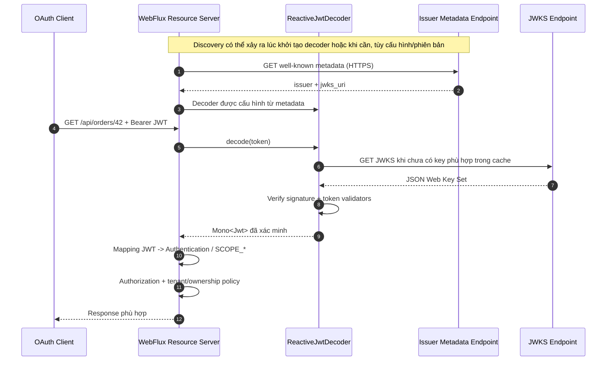

# Khám phá metadata, tải JWKS và yêu cầu kết nối ngoài

Trong **Spring Security OAuth 2.0 / OIDC Resource Server** dùng **WebFlux**, xác minh JWT access token không chỉ là tách ba đoạn của một chuỗi. Resource Server phải biết **issuer nào đáng tin**, **khóa công khai nào được phép dùng để kiểm tra chữ ký**, **access token dành cho API nào**, và **cách tải cũng như cập nhật khóa** khi Authorization Server thay đổi cấu hình hoặc xoay vòng khóa ký.

Khi cấu hình `issuer-uri`, Spring Security có thể khám phá **metadata của issuer** để lấy địa chỉ **JWKS (JSON Web Key Set)**. Sau đó `ReactiveJwtDecoder` sử dụng JWKS để kiểm tra chữ ký JWT. Đây là một luồng có **yêu cầu kết nối ngoài**: DNS, HTTPS, truststore, proxy, egress firewall, độ trễ, timeout, cache và khả năng sẵn sàng của Authorization Server đều có thể ảnh hưởng đến việc API chấp nhận token.

Ví dụ cơ bản:

```yaml
spring:
  security:
    oauth2:
      resourceserver:
        jwt:
          issuer-uri: https://login.example.com/realms/orders
```

Cấu hình trông ngắn, nhưng bên dưới có nhiều trách nhiệm:

1. Xác định issuer chính xác và một metadata endpoint hợp lệ theo OIDC Discovery hoặc OAuth Authorization Server Metadata.
2. Đọc `issuer` và `jwks_uri` do metadata đáng tin công bố.
3. Tải tập public keys từ `jwks_uri` qua HTTPS.
4. Xác minh JWS signature bằng key có `kid`/`kty`/`alg` phù hợp và chính sách thuật toán của Resource Server.
5. Kiểm tra `iss`, `exp`, `nbf`, `aud`, token type và các claim bắt buộc khác theo hợp đồng.
6. Chuyển JWT đã xác minh thành `Authentication` và các authorities như `SCOPE_orders.read`.
7. Định kỳ hoặc khi cần, lấy khóa mới theo cơ chế cache/refresh của implementation để hỗ trợ key rotation.
8. Khi metadata hoặc JWKS không truy cập được, xử lý theo **fail-closed**, không bỏ xác minh chữ ký để giữ API hoạt động.

**Thông điệp chính:** metadata discovery và JWKS là **chuỗi cung cấp thông tin tin cậy cho xác minh JWT**, không phải hình thức đăng nhập người dùng, cũng không phải token introspection trên mỗi request. Tối ưu mạng/khóa cache là quan trọng, nhưng không được làm giảm độ tin cậy của issuer và chữ ký.

> **Ngữ cảnh bài học:** Orders API chạy Spring Boot 3.x, Spring Security 6.x, **Spring WebFlux** và Reactor Netty; Authorization Server có issuer `https://login.example.com/realms/orders`, Resource Server yêu cầu audience `orders-api`. Ví dụ tập trung vào JWT access token được ký bằng RSA. Tên host, claim và thời hạn minh họa không đại diện cho hệ thống thật. Hành vi khởi tạo decoder, caching và API builder có thể khác theo phiên bản Spring Security; khi áp dụng cần kiểm tra phiên bản hiện dùng.

## 1. Ba URL dễ nhầm: issuer, metadata và JWKS

Ba khái niệm này liên quan nhưng **không thay thế nhau**.

| Khái niệm | Ví dụ | Trách nhiệm |
|---|---|---|
| **Issuer URI** (`issuer-uri`) | `https://login.example.com/realms/orders` | Danh tính của Authorization Server được Resource Server tin cậy; token phải có `iss` phù hợp |
| **Metadata endpoint** | `https://login.example.com/realms/orders/.well-known/openid-configuration` | Công bố tài liệu JSON mô tả issuer, `jwks_uri` và các khả năng khác |
| **JWKS URI** (`jwk-set-uri`) | `https://login.example.com/realms/orders/protocol/openid-connect/certs` | Trả về các public keys dùng để xác minh chữ ký |

Nếu issuer nằm ở một đường dẫn, việc xây metadata URL có **quy tắc khác nhau giữa các chuẩn và implementation**. Không tự nối `/.well-known/...` vào một URL bất kỳ mà chưa kiểm tra nhà cung cấp.

### 1.1. Issuer là danh tính tin cậy, không chỉ base URL

Trong JWT:

```json
{
  "iss": "https://login.example.com/realms/orders",
  "sub": "customer-42",
  "aud": ["orders-api"],
  "scope": "orders.read"
}
```

`iss` cho biết thực thể đã phát hành token theo hợp đồng. Resource Server phải chấp nhận **đúng issuer đã cấu hình**, không tự nới lỏng so khớp để tin mọi URL có cùng domain.

Ví dụ:

```text
Configured issuer:
https://login.example.com/realms/orders

JWT issuer:
https://login.example.com/realms/payments
```

Hai issuer khác nhau, dù cùng một host. Một token được ký bởi bộ khóa nào đó **chưa đủ để được Orders API chấp nhận** nếu issuer sai.

### 1.2. Metadata cho biết gì?

Tài liệu metadata kiểu OIDC có thể chứa:

```json
{
  "issuer": "https://login.example.com/realms/orders",
  "authorization_endpoint":
    "https://login.example.com/realms/orders/protocol/openid-connect/auth",
  "token_endpoint":
    "https://login.example.com/realms/orders/protocol/openid-connect/token",
  "jwks_uri":
    "https://login.example.com/realms/orders/protocol/openid-connect/certs",
  "response_types_supported": ["code"],
  "subject_types_supported": ["public"],
  "id_token_signing_alg_values_supported": ["RS256"]
}
```

**Các trường liên quan trực tiếp tới Resource Server** là:

- `issuer`: dùng để xác nhận metadata thuộc issuer được cấu hình.
- `jwks_uri`: nơi lấy public keys đáng tin cho quá trình xác minh JWS.

Những trường như `authorization_endpoint` hoặc `token_endpoint` phục vụ OAuth/OIDC client flow, **không có nghĩa Resource Server phải gọi chúng để xác minh mỗi JWT access token**.

Một chi tiết dễ nhầm: `id_token_signing_alg_values_supported` thuộc metadata OpenID Connect nói về ID token; **không tự tạo chính sách chấp nhận mọi thuật toán JWT access token** tại Resource Server. API cần có allowlist thuật toán và token profile riêng.

### 1.3. OIDC Discovery và OAuth AS Metadata

Các tài liệu chuẩn liên quan:

- **OpenID Connect Discovery** công bố thông tin OpenID Provider qua endpoint well-known `openid-configuration`.
- **RFC 8414** định nghĩa metadata của OAuth 2.0 Authorization Server, thường qua `.well-known/oauth-authorization-server`.
- **RFC 7517** định nghĩa JWK và JWKS; `RFC 7515` mô tả JSON Web Signature.

Ví dụ issuer có path:

```text
Issuer:
https://login.example.com/realms/orders

OIDC metadata thường:
https://login.example.com/realms/orders/.well-known/openid-configuration

OAuth AS metadata theo quy tắc RFC 8414:
https://login.example.com/.well-known/oauth-authorization-server/realms/orders
```

Spring Security hỗ trợ cơ chế discovery theo cấu hình/phiên bản và có thể thử những endpoint phù hợp. **Không tuyên bố tất cả provider hỗ trợ cùng một well-known URL**. Nếu provider không triển khai discovery, có thể cấu hình JWKS URI được cấp phát chính thức.

## 2. Tại sao JWT phải tải JWKS?

JWT access token thường là **JWS ký bằng khóa bất đối xứng**. Authorization Server giữ private key, còn Resource Server cần public key để xác minh signature.

Ví dụ compact JWT:

```text
BASE64URL(header).BASE64URL(payload).BASE64URL(signature)
```

Header có thể chứa:

```json
{
  "alg": "RS256",
  "typ": "at+jwt",
  "kid": "signing-key-2026-11"
}
```

Payload:

```json
{
  "iss": "https://login.example.com/realms/orders",
  "sub": "customer-42",
  "aud": ["orders-api"],
  "scope": "orders.read",
  "exp": 2000000000
}
```

Từ header có `kid`, decoder có thể **chọn** public key trong JWKS; nhưng `kid` là **thông tin chưa được tin trước khi xác minh chữ ký**, không phải bằng chứng rằng một khóa hay issuer nào là hợp lệ.

### 2.1. JWKS là gì?

Một JWKS đơn giản:

```json
{
  "keys": [
    {
      "kty": "RSA",
      "kid": "signing-key-2026-11",
      "use": "sig",
      "alg": "RS256",
      "n": "BASE64URL_MODULUS_TRUNCATED_FOR_EXAMPLE",
      "e": "AQAB"
    },
    {
      "kty": "RSA",
      "kid": "signing-key-2026-12",
      "use": "sig",
      "alg": "RS256",
      "n": "ANOTHER_BASE64URL_MODULUS_EXAMPLE",
      "e": "AQAB"
    }
  ]
}
```

Các giá trị `n` là placeholders không phải khóa RSA hợp lệ. JWKS thực chứa các giá trị JWK hợp lệ.

Các trường quan trọng:

| Trường | Vai trò |
|---|---|
| `keys` | Danh sách JWK |
| `kty` | Loại khóa: `RSA`, `EC`... |
| `kid` | Key identifier giúp decoder chọn khóa |
| `use` | Mục đích, ví dụ `sig` cho chữ ký |
| `key_ops` | Các thao tác khóa được cho phép nếu được công bố |
| `alg` | Thuật toán mà key metadata gợi ý/hạn chế theo chính sách |
| `n`/`e` | Thành phần public RSA key |
| `crv`/`x`/`y` | Thành phần public EC key, khi sử dụng EC |

JWKS phục vụ **phân phối public keys**. Private key phải ở Authorization Server/HSM/KMS hoặc nơi ký được kiểm soát, **không được công bố** trong public JWKS.

### 2.2. Có `kid` đúng chưa đủ để tin token

Một request có header:

```json
{
  "alg": "RS256",
  "kid": "signing-key-2026-11"
}
```

không được tự chấp nhận vì tìm thấy `kid` trong JWKS. Decoder phải dùng public key tương ứng để **xác minh chữ ký trên exact signing input**. Nếu payload bị thay một byte mà không có private key hợp lệ, signature validation thất bại.

`kid` là **chỉ dẫn chọn khóa**, không phải bằng chứng tính toàn vẹn hoặc quyền truy cập.

### 2.3. Vì sao phải giới hạn thuật toán?

Nếu chỉ tin giá trị `alg` do token tự khai, một decoder cấu hình sai có thể gặp các vấn đề algorithm confusion. Chính sách Resource Server phải chấp nhận **những JWS algorithms đã thống nhất với issuer**, ví dụ RS256 hoặc ES256, theo API và key type tương ứng.

Không tự “nâng tính tương thích” bằng cách chấp nhận `alg=none` hoặc mọi thuật toán trong token header. Không dùng public RSA key như HMAC secret trong logic tự xây.

## 3. Sơ đồ toàn bộ metadata → JWKS → JWT Authentication



**Sơ đồ chỉ mô tả các bước logic.** Thời điểm fetch metadata và JWKS chính xác phụ thuộc version, initialization strategy, HTTP cache và trạng thái keys. Không phải mọi JWT request đều có `GET JWKS` hay `GET metadata` đi kèm.

### 3.1. Những lúc có thể cần kết nối ngoài

| Thời điểm | Kết nối có thể xảy ra | Vì sao |
|---|---|---|
| Decoder được tạo từ `issuer-uri` | GET issuer metadata | Tìm `jwks_uri` và xác nhận issuer metadata |
| Request JWT đầu tiên / cache chưa có keys | GET JWKS | Lấy public key cho signature |
| AS xoay vòng ký bằng `kid` mới | Refresh JWKS | Tìm key mới chưa có trong cache |
| Cache key hết hạn theo implementation | GET JWKS | Làm mới public keys |
| Issuer/JWKS host đổi IP | DNS/TCP/TLS mới khi cần | Thiết lập connection tới endpoint |
| JWKS endpoint unavailable nhưng key cũ còn cache | Có thể không cần network với token dùng key cũ | Phụ thuộc cache và validator |
| Mỗi request bình thường khi key đã cache | Thường **không** có JWKS HTTP call | Signature verification là local operation |

Điểm khác với opaque token introspection: opaque token thường cần hỏi AS về trạng thái token ở mỗi lần xác thực nếu không dùng cache; JWT ký bằng khóa công khai cho phép **verify local** sau khi có key.

## 4. Config WebFlux: chỉ dùng issuer-uri

### 4.1. Dependencies

Gradle Groovy DSL:

```groovy
dependencies {
    implementation 'org.springframework.boot:spring-boot-starter-webflux'
    implementation 'org.springframework.boot:spring-boot-starter-security'
    implementation 'org.springframework.boot:spring-boot-starter-oauth2-resource-server'
}
```

Nếu ứng dụng chủ yếu chạy WebFlux, không tùy tiện thêm `spring-boot-starter-web` và kỳ vọng auto-configuration vẫn chọn reactive web application; khi cả MVC và WebFlux cùng trên classpath, Spring Boot có quy tắc chọn web application type cần xem rõ.

### 4.2. application.yml

```yaml
spring:
  security:
    oauth2:
      resourceserver:
        jwt:
          issuer-uri: https://login.example.com/realms/orders
          audiences:
            - orders-api
```

**`issuer-uri`** phục vụ issuer trust và metadata discovery. **`audiences`** được hỗ trợ trong những phiên bản Spring Boot tương ứng; với custom decoder hoặc phiên bản khác, cần audience validator tự viết.

Spring Security thường có thể dùng issuer metadata/JWKS và xây decoder phù hợp. Các validator đối với `iss`, thời hạn và điều kiện đã được cấu hình phải được giữ nguyên. Nếu resource yêu cầu JWT access token theo **RFC 9068**, còn cần kiểm tra token type `at+jwt` và các required claims theo hồ sơ.

### 4.3. SecurityWebFilterChain

```java
package com.example.orders.security;

import org.springframework.context.annotation.Bean;
import org.springframework.context.annotation.Configuration;
import org.springframework.http.HttpMethod;
import org.springframework.security.config.Customizer;
import org.springframework.security.config.web.server.ServerHttpSecurity;
import org.springframework.security.web.server.SecurityWebFilterChain;

@Configuration
public class OrdersResourceServerSecurity {

    @Bean
    SecurityWebFilterChain apiSecurity(ServerHttpSecurity http) {
        return http
            .authorizeExchange(auth -> auth
                .pathMatchers(HttpMethod.GET, "/api/orders/**")
                    .hasAuthority("SCOPE_orders.read")
                .pathMatchers(HttpMethod.POST, "/api/orders/**")
                    .hasAuthority("SCOPE_orders.write")
                .anyExchange().authenticated()
            )
            .oauth2ResourceServer(oauth2 ->
                oauth2.jwt(Customizer.withDefaults())
            )
            .build();
    }
}
```

Khi `oauth2ResourceServer().jwt()` được kích hoạt:

1. Spring Security WebFlux chèn cơ chế authentication Bearer reactive thích hợp.
2. `ServerBearerTokenAuthenticationConverter` lấy Bearer credential.
3. `ReactiveJwtDecoder` xác minh token.
4. JWT được chuyển thành `Authentication` và các authorities `SCOPE_*`.
5. `authorizeExchange` kiểm tra quyền chức năng.
6. Service vẫn phải xét resource-level access.

Ví dụ chain bao phủ toàn request theo policy `anyExchange().authenticated()`. Nếu có web login hoặc admin/actuator routes, thiết kế security matchers và chains riêng phù hợp.

### 4.4. Đừng nhầm issuer metadata với OAuth2 Login

Resource Server **không cần khởi động OIDC browser login** chỉ để lấy public keys. `issuer-uri` được dùng trong quá trình xác minh access token. Nó khác cấu hình `spring.security.oauth2.client.registration.*` dành cho OAuth2 Client/OIDC login.

Nếu JWT thiếu hoặc sai, API thường trả **401 Bearer challenge**, không redirect HTML tới `/login` hay trang OpenID Provider.

## 5. Điều gì xảy ra lúc khởi động?

Một câu hỏi vận hành quan trọng: **Resource Server có phải kết nối đến Authorization Server mới khởi động được không?**

Câu trả lời phụ thuộc cấu hình và phiên bản Spring Security/Spring Boot:

- Khi tạo decoder từ `issuer-uri`, một số cơ chế discovery có thể truy vấn issuer metadata ngay trong quá trình tạo/khởi tạo decoder.
- Một số chiến lược cấu hình hoãn (defer/lazy) discovery đến lúc decoder được dùng.
- JWKS public keys cũng có thể chỉ được fetch khi JWT cần xác minh hoặc cache cần refresh.
- Nếu khởi tạo decoder thực sự cần metadata và AS không sẵn sàng, application có thể **startup fail**.
- Nếu discovery được defer, application có thể lên trạng thái sẵn sàng, nhưng request cần JWT vẫn thất bại khi chưa lấy được metadata/JWKS.

**Không tuyên bố** toàn bộ các bản Spring Security luôn GET metadata đúng lúc startup, hoặc luôn đợi request đầu tiên. Kiểm tra hành vi của **version và kiểu decoder** trong dự án.

### 5.1. Vì sao phụ thuộc khởi động lại quan trọng?

Giả sử một deployment gồm 20 pods. Tất cả pods restart trong lúc issuer metadata endpoint bị outage. Nếu mỗi pod cần discovery để khởi tạo decoder, rollout có thể mắc lỗi startup hàng loạt.

Các biện pháp vận hành:

- Đặt issuer URI và JWKS URI cố định theo môi trường, không lấy từ input chưa xác minh.
- Chạy smoke tests với metadata/JWKS trước rollout.
- Tách failure of discovery khỏi lỗi business database để chẩn đoán.
- Xác định readiness có cần xác minh khả năng lấy JWKS hay không.
- Cân nhắc cấu hình **`issuer-uri` + `jwk-set-uri`** khi muốn biết trước endpoint khóa và giảm phụ thuộc metadata discovery.
- Theo dõi AS availability, DNS, TLS và key rotation.
- Đừng khắc phục bằng cách tắt signature validation.

### 5.2. Startup thành công không bảo đảm request sau sẽ xác minh được token

Nếu decoder được tạo nhưng chưa fetch JWKS, request đầu tiên dùng JWT có thể là lúc lần đầu gặp:

- DNS lookup.
- HTTPS certificate validation.
- Proxy/network egress.
- JWKS JSON parsing.
- HTTP timeout hoặc 404.
- Không có `kid` tương ứng.

Vì vậy kiểm thử **khả năng khởi động** và kiểm thử **request xác thực JWT** là hai mục tiêu khác nhau. Một `/actuator/health` trả 200 không tự chứng minh JWKS endpoint đang truy cập được.

## 6. Cấu hình issuer-uri + jwk-set-uri để tránh discovery tại runtime

Nếu nhà cung cấp đưa JWKS URI rõ ràng, có thể cấu hình cả hai:

```yaml
spring:
  security:
    oauth2:
      resourceserver:
        jwt:
          issuer-uri: https://login.example.com/realms/orders
          jwk-set-uri: https://login.example.com/realms/orders/protocol/openid-connect/certs
          audiences:
            - orders-api
```

Cách này có lợi:

1. Resource Server **đã biết URL lấy key**, không phải khám phá `jwks_uri` qua metadata trong luồng cấu hình.
2. Vẫn giữ issuer identity để **validate JWT `iss`** theo cơ chế auto-config tương ứng.
3. Có thể giảm một phụ thuộc network ở giai đoạn khởi tạo/first use.
4. Dễ kiểm soát egress allowlist và URL endpoint đúng môi trường.

**Nhưng không loại bỏ kết nối ngoài hoàn toàn:** JWT decoder vẫn cần lấy JWKS public keys khi chưa có trong cache hoặc khi cần refresh. Nếu keys chưa cache và JWKS endpoint lỗi, verification không có key đáng tin để tiếp tục.

### 6.1. Chỉ cấu hình jwk-set-uri có đủ không?

Ví dụ:

```yaml
spring:
  security:
    oauth2:
      resourceserver:
        jwt:
          jwk-set-uri: https://login.example.com/realms/orders/protocol/openid-connect/certs
```

Khi chỉ biết JWKS URI, decoder có thể dùng public keys để xác minh chữ ký, nhưng **không tự suy ra issuer cần chấp nhận** nếu không có cấu hình/validator `iss` riêng.

Một token được ký bằng key trong JWKS nhưng có `iss` không khớp hợp đồng cần bị từ chối. Vì vậy nên:

- Giữ `issuer-uri` cùng `jwk-set-uri` nếu framework/config hỗ trợ.
- Hoặc tạo custom decoder và gắn `JwtValidators.createDefaultWithIssuer(issuer)`/validator tương ứng.
- Kiểm tra audience, thời gian và các claim bắt buộc khác.

**Public key match không đồng nghĩa đủ điều kiện tin access token.** Issuer và audience phải được xác minh độc lập.

### 6.2. Có nên hardcode metadata/JWKS vào mọi ứng dụng?

Hardcode **URI được phê duyệt** trong cấu hình môi trường khác với hardcode key data. Cố định JWKS URI theo environment thường hợp lý khi muốn kiểm soát network. Tuy nhiên:

- Khi AS thay đổi endpoint, cần triển khai cấu hình mới.
- Phải bảo đảm host, path và tenant/realm chính xác.
- Không trỏ API production tới staging issuer/JWKS.
- Cần tài liệu vận hành về ownership và chính sách thay đổi endpoint.

Không dùng `jwk-set-uri` trỏ tới URL do HTTP caller tự gửi. Metadata/JWKS là **trust anchor configuration**, không phải tham số nghiệp vụ.

## 7. Tự tạo ReactiveJwtDecoder từ JWKS URI

Khi muốn điều khiển chính xác HTTP client và validators, WebFlux có thể cung cấp bean `ReactiveJwtDecoder`.

Ví dụ sau **không gọi discovery** vì đã có JWKS URI được phê duyệt. Nó minh họa issuer validator, audience validator và thuật toán ký được cho phép.

```java
package com.example.orders.security;

import java.util.List;

import org.springframework.context.annotation.Bean;
import org.springframework.context.annotation.Configuration;
import org.springframework.security.oauth2.core.OAuth2Error;
import org.springframework.security.oauth2.core.OAuth2TokenValidator;
import org.springframework.security.oauth2.core.OAuth2TokenValidatorResult;
import org.springframework.security.oauth2.jwt.Jwt;
import org.springframework.security.oauth2.jwt.JwtValidators;
import org.springframework.security.oauth2.jwt.NimbusReactiveJwtDecoder;
import org.springframework.security.oauth2.jwt.ReactiveJwtDecoder;
import org.springframework.security.oauth2.jose.jws.SignatureAlgorithm;
import org.springframework.security.oauth2.core.DelegatingOAuth2TokenValidator;

@Configuration
public class OrdersJwtDecoderConfiguration {

    private static final String ISSUER =
        "https://login.example.com/realms/orders";

    private static final String JWKS_URI =
        "https://login.example.com/realms/orders/protocol/openid-connect/certs";

    @Bean
    ReactiveJwtDecoder reactiveJwtDecoder() {
        NimbusReactiveJwtDecoder decoder =
            NimbusReactiveJwtDecoder.withJwkSetUri(JWKS_URI)
                .jwsAlgorithm(SignatureAlgorithm.RS256)
                .build();

        OAuth2TokenValidator<Jwt> issuerAndTimestamps =
            JwtValidators.createDefaultWithIssuer(ISSUER);

        OAuth2TokenValidator<Jwt> audience = jwt -> {
            if (jwt.getAudience() != null
                    && jwt.getAudience().contains("orders-api")) {
                return OAuth2TokenValidatorResult.success();
            }

            return OAuth2TokenValidatorResult.failure(
                new OAuth2Error(
                    "invalid_token",
                    "Required audience orders-api is missing",
                    null
                )
            );
        };

        decoder.setJwtValidator(
            new DelegatingOAuth2TokenValidator<>(
                List.of(issuerAndTimestamps, audience)
            )
        );

        return decoder;
    }
}
```

Mã minh họa **Java 17+ / Spring Security 6.x**; các overload và builder API có thể khác ở version cụ thể.

Giải thích:

- `withJwkSetUri(JWKS_URI)` dùng endpoint khóa được cấu hình, không bắt buộc discovery qua metadata.
- `jwsAlgorithm(SignatureAlgorithm.RS256)` giới hạn thuật toán JWS theo thỏa thuận với AS (nếu AS dùng ES256, phải thay theo hợp đồng; không tự chấp nhận mọi thuật toán).
- `JwtValidators.createDefaultWithIssuer(ISSUER)` kết hợp các checks chuẩn, bao gồm issuer và timestamps theo implementation.
- Audience validator yêu cầu JWT được cấp cho `orders-api`.
- `DelegatingOAuth2TokenValidator` kết hợp các điều kiện.
- `setJwtValidator` thay các validators trước đó, vì vậy phải **giữ** default/issuer validators cần thiết khi thêm điều kiện mới.

### 7.1. Custom decoder có thể thay auto-configuration của Boot

Khi ứng dụng đăng ký bean `ReactiveJwtDecoder`, Spring Boot thường sử dụng bean đó thay vì decoder tự tạo từ `spring.security.oauth2.resourceserver.jwt.issuer-uri`.

Hậu quả quan trọng:

- Nếu custom decoder **không** gắn issuer validator, `issuer-uri` trong YAML không tự bảo đảm `iss` vẫn được kiểm tra.
- Nếu custom decoder không gắn audience validator, property `audiences` có thể không áp dụng như bạn tưởng.
- Nếu custom decoder chấp nhận algorithm ngoài hợp đồng, việc có JWKS URI đúng cũng chưa đủ bảo vệ.

**Không viết custom decoder chỉ để “làm cho token chạy được” mà vô tình bỏ điều kiện validation mặc định.** Chỉ tùy chỉnh khi có yêu cầu cụ thể và kiểm tra lại hợp đồng chính sách.

### 7.2. Không tải JWKS từ header jku hoặc x5u tùy ý

JWS header có thể có thông tin như `jku` hoặc `x5u` liên quan tới khóa/chứng chỉ. **Không tự lấy URL trong JWT chưa được xác minh làm nơi tải key tin cậy**.

Nếu một API chấp nhận URL tùy ý từ token header, attacker có thể chỉ định JWKS do họ kiểm soát rồi ký token bằng private key của họ. Hành vi này vừa tạo nguy cơ SSRF vừa phá mô hình issuer trust.

Key source phải tới từ:

1. Cấu hình Resource Server được kiểm soát, **hoặc**
2. Metadata từ issuer đã được cấu hình/được phép và được tải qua kênh tin cậy.

## 8. WebClient trong ReactiveJwtDecoder: cấu hình kết nối ngoài

Với WebFlux, HTTP calls tới JWKS nên sử dụng **HTTP client reactive** thay vì bắt event-loop chờ một client blocking. Spring Security có thể dùng `WebClient` làm transport của `NimbusReactiveJwtDecoder` trong các phiên bản hỗ trợ builder tương ứng.

Một ví dụ tạo WebClient với **Reactor Netty HttpClient** và timeout:

```java
package com.example.orders.security;

import java.time.Duration;

import io.netty.channel.ChannelOption;
import reactor.netty.http.client.HttpClient;

import org.springframework.context.annotation.Bean;
import org.springframework.context.annotation.Configuration;
import org.springframework.http.client.reactive.ReactorClientHttpConnector;
import org.springframework.web.reactive.function.client.WebClient;

@Configuration
public class JwksHttpClientConfiguration {

    @Bean("jwksWebClient")
    WebClient jwksWebClient() {
        HttpClient httpClient = HttpClient.create()
            .option(
                ChannelOption.CONNECT_TIMEOUT_MILLIS,
                500
            )
            .responseTimeout(Duration.ofSeconds(2))
            .followRedirect(false);

        return WebClient.builder()
            .clientConnector(
                new ReactorClientHttpConnector(httpClient)
            )
            .build();
    }
}
```

Đây là **các timeout minh họa**, không phải giá trị tối ưu mặc định. Nếu metadata và JWKS endpoints có latency cao hoặc triển khai qua proxy/region khác, cần điều chỉnh theo SLA và số đo.

### 8.1. Dùng WebClient đó trong decoder

```java
package com.example.orders.security;

import org.springframework.beans.factory.annotation.Qualifier;
import org.springframework.context.annotation.Bean;
import org.springframework.context.annotation.Configuration;
import org.springframework.security.oauth2.jwt.NimbusReactiveJwtDecoder;
import org.springframework.security.oauth2.jwt.ReactiveJwtDecoder;
import org.springframework.security.oauth2.jwt.JwtValidators;
import org.springframework.security.oauth2.jose.jws.SignatureAlgorithm;
import org.springframework.web.reactive.function.client.WebClient;

@Configuration
public class OrdersJwksDecoderConfiguration {

    @Bean
    ReactiveJwtDecoder reactiveJwtDecoder(
        @Qualifier("jwksWebClient") WebClient jwksClient
    ) {
        NimbusReactiveJwtDecoder decoder =
            NimbusReactiveJwtDecoder
                .withJwkSetUri(
                    "https://login.example.com/realms/orders/protocol/openid-connect/certs"
                )
                .webClient(jwksClient)
                .jwsAlgorithm(SignatureAlgorithm.RS256)
                .build();

        decoder.setJwtValidator(
            JwtValidators.createDefaultWithIssuer(
                "https://login.example.com/realms/orders"
            )
        );

        return decoder;
    }
}
```

**Đây là một biến thể cấu hình**: nếu ứng dụng cần audience `orders-api`, phải bổ sung validator audience như phần trước thay vì chỉ gọi `createDefaultWithIssuer`. Hai đoạn ví dụ decoder trong bài không được đồng thời đăng ký thành **hai bean `ReactiveJwtDecoder`** không có cơ chế lựa chọn rõ ràng.

Builder `webClient(...)` được hỗ trợ trên các phiên bản Spring Security phù hợp; hãy đối chiếu Javadoc phiên bản dùng trong dự án. Nếu môi trường dùng builder/transport API khác, giữ nguyên yêu cầu: **decoder đáng tin + HTTP client có timeout/TLS + đúng validators**.

### 8.2. Các timeout cần phân biệt

| Loại timeout | Ý nghĩa | Nếu quá dài/thiếu |
|---|---|---|
| **Connect** | Chờ thiết lập TCP connection | Request treo khi host/network không truy cập |
| **Response/read** | Chờ bytes/response từ endpoint | JWKS chậm làm JWT request chậm |
| **Pending acquire** | Chờ lấy connection từ pool | Request dồn hàng chờ khi pool cạn |
| **Overall deadline** | Tổng thời gian request gồm nhiều pha | Không bảo đảm SLA dù có connect/read timeout |
| **DNS lookup** | Chờ phân giải hostname | Có thể không bị bao bởi connect timeout |
| **TLS handshake** | Chờ xác thực/thiết lập TLS | Cần xem timeout riêng theo client implementation |

`responseTimeout(Duration.ofSeconds(2))` không nhất thiết là **end-to-end deadline** cho mọi bước DNS/TLS, queue và retry. Muốn bảo đảm latency tổng, cần thiết kế timeout/deadline ở tầng phù hợp và kiểm tra hủy kết nối khi hết thời gian.

### 8.3. Có phải mỗi request đều dùng WebClient gọi JWKS?

Không. HTTP transport được decoder dùng **khi cần tải/refresh keys**. Với khóa phù hợp đã cache, phần lớn xác minh JWT là thao tác local và không cần outbound request.

Điểm cần kiểm chứng khi vận hành là chính sách cache, key rotation và tình huống cache cold. Không dùng metric “API request RPS” để suy trực tiếp JWKS RPS; hai loại lưu lượng có quan hệ rất khác với opaque token introspection.

## 9. Metadata discovery cũng là một kết nối ngoài riêng

Khi tạo decoder từ issuer, quá trình discovery có thể dùng **một HTTP client khác hoặc một giai đoạn khác** so với HTTP client dùng fetch JWKS.

Điều này ảnh hưởng tới thiết kế custom:

- Chỉ gọi `NimbusReactiveJwtDecoder.withJwkSetUri(...).webClient(...)` **không có nghĩa** bạn đang cấu hình timeout cho bước **issuer metadata discovery**, vì ví dụ đó **bỏ discovery**.
- Nếu muốn discovery tự động với HTTP client cấu hình riêng, cần dùng cơ chế hỗ trợ từ API/phiên bản đang triển khai hoặc tự quản lý bước discovery theo chuẩn đáng tin trước khi tạo decoder.
- Không tự viết metadata downloader lấy bất cứ `jwks_uri` nào rồi tin mọi host trong JSON không kiểm tra.
- Metadata response cần có `issuer` đúng và `jwks_uri` hợp lệ theo contract.
- Nếu metadata do AS công bố được thay đổi, decoder có thể không tự phát hiện URL mới trong mọi runtime; việc sử dụng URI/cache và vòng đời decoder phụ thuộc implementation.

### 9.1. Khi nào tránh discovery trong ứng dụng?

Nếu Authorization Server có JWKS endpoint cố định theo môi trường và bạn muốn API không cần metadata call, cấu hình **issuer URI + JWKS URI** là lựa chọn rõ ràng.

Ví dụ:

```text
issuer (validation):
  https://login.example.com/realms/orders

jwks_uri (transport):
  https://login.example.com/realms/orders/protocol/openid-connect/certs
```

Nhưng **đừng xóa issuer validator chỉ để bỏ discovery**. Hai quyết định khác nhau: *không cần truy vấn metadata* và *không cần kiểm tra issuer*. Điều thứ hai có thể phá ranh giới tin cậy.

### 9.2. Metadata endpoint không được tạo từ token chưa xác minh

Không làm:

```text
Unverified JWT payload iss
       |
       v
Build https://{iss}/.well-known/openid-configuration
       |
       v
Fetch metadata / JWKS
       |
       v
Trust whatever keys are returned
```

Nếu làm vậy, attacker có thể phát hành một JWT với `iss` do họ kiểm soát, cung cấp JWKS của họ và làm token “verify thành công”.

Đúng hơn:

```text
Token issuer hint
      |
      v
Match against configured, bounded issuer allowlist
      |
      v
Use decoder belonging to that trusted issuer
      |
      v
Verify signature + exact issuer + API audience
```

Trong multi-issuer, hint từ token chưa verify **có thể phục vụ routing** vào một tập decoder đã tin, nhưng không phải **cơ sở mở rộng tập issuer được chấp nhận**.

## 10. Phân biệt ba lớp bảo vệ của JWT

Khi token đến WebFlux API:

```text
1. Chọn trust configuration
   issuer-uri / jwk-set-uri / allowed algorithms
            |
            v
2. Cryptographic + claim validation
   signature, exp, nbf, iss, aud, typ/profile ...
            |
            v
3. Authorization
   SCOPE_*, role, subject/client, tenant, owner,
   resource state, business policy
```

### 10.1. Chữ ký đúng chưa đủ

Một JWT do issuer đáng tin ký có thể dùng cho `billing-api` chứ không phải `orders-api`.

```json
{
  "iss": "https://login.example.com/realms/orders",
  "aud": ["billing-api"],
  "scope": "orders.read"
}
```

Nếu Resource Server chỉ kiểm tra chữ ký và issuer mà bỏ audience, token có thể bị **dùng sai resource**. Vì vậy `aud=orders-api` phải là điều kiện riêng theo hợp đồng.

### 10.2. JWKS đúng không thay thời hạn

Một token có chữ ký hợp lệ nhưng `exp` trong quá khứ phải bị từ chối. `nbf` trong tương lai cũng phải được xử lý theo validator thời gian và clock skew hợp lý. Spring có validators tiêu chuẩn; nếu thay chúng bằng custom validator, phải giữ checks còn cần thiết.

### 10.3. ID token không phải access token

OIDC ID token là token dành cho **OIDC client** để truyền đạt thông tin xác thực đăng nhập. API Resource Server phải yêu cầu **OAuth access token** dành cho nó.

Một ID token có thể cùng issuer và cùng JWKS với access token. Do đó chỉ kiểm tra “chữ ký đúng” không chắc chắn phân biệt được hai loại token. Cần audience, token type/profile và các điều kiện theo hợp đồng để **không chấp nhận ID token như access token**.

Với RFC 9068 JWT access-token profile, `typ=at+jwt` là tín hiệu token type quan trọng và có các required claims theo profile. Cần thiết kế validation đúng, không mặc định mọi decoder version đều tự áp toàn bộ RFC 9068.

## 11. Key rotation: trường hợp JWKS tải lại quan trọng nhất

Authorization Server thường xoay vòng khóa ký để giảm rủi ro lộ private key, tuân thủ lịch vận hành hoặc đáp ứng sự cố. Ví dụ:

```text
T0  AS ký token bằng kid=A
T1  JWKS công bố public key A và B
T2  AS bắt đầu ký token mới bằng kid=B
T3  Token dùng kid=A còn hiệu lực tới exp
T4  Token kid=A hết hạn; AS mới gỡ public key A
```

Trong giai đoạn chuyển tiếp, JWKS nên giữ đủ public keys để các Resource Server xác minh **cả token cũ vẫn hợp lệ và token mới**, theo policy AS.

### 11.1. Vì sao không nên xóa key cũ ngay?

Nếu AS chuyển sang ký bằng B rồi xóa A khỏi JWKS ngay tại T2, các token hợp lệ được ký bằng A có thể không còn verify được ở Resource Server có cache cold/refresh. Điều đó gây lỗi 401 hàng loạt dù token chưa hết hạn.

Lộ trình rotation cần cân nhắc:

- Access token max lifetime.
- Clock skew giữa các hệ thống.
- Thời điểm publish key mới trước khi ký.
- JWKS cache TTL và refresh behavior của RS.
- Nhiều AS pods có thể cập nhật keys không đồng thời.
- Khả năng rollback nếu key B gặp lỗi.

### 11.2. Khi decoder gặp kid mới

Giả sử token mới có:

```json
{
  "alg": "RS256",
  "kid": "B"
}
```

Trong cache của RS chỉ có key A. Một decoder có khả năng refresh có thể yêu cầu JWKS mới từ AS và tìm key B.

Tuy nhiên:

- Hành vi refresh khi unknown `kid` phụ thuộc implementation và cache.
- Nếu JWKS endpoint lỗi, RS không thể tin key B chỉ vì token nói `kid=B`.
- Nếu phản hồi JWKS không có B, token phải bị từ chối.
- Nếu B có nhưng signature không khớp, token vẫn bị từ chối.
- Không có chuyện “kid mới nên bỏ chữ ký một lần để người dùng không bị lỗi”.

### 11.3. Rotation khẩn cấp và revocation

Nếu private key A bị lộ, AS có thể cần gỡ A sớm và thu hồi tác dụng của token cũ ngay cả khi token chưa `exp`. Nhưng nếu RS còn cache public key A, một số token có thể vẫn verify local tới khi key cache/validation chính sách được cập nhật.

**JWKS key rotation không tự là cơ chế per-token revocation có hiệu lực ngay**. Với yêu cầu thu hồi khẩn cấp, có thể cần cơ chế bổ sung:

- Short-lived JWT access tokens.
- Denylist/jti revocation trong trường hợp được thiết kế.
- Kiểm tra trạng thái session/client theo policy.
- Chuyển sang opaque/introspection cho use case cần trạng thái tập trung.
- Push invalidation/rolling restart/config changes có kiểm soát.

Mức độ cần thiết phụ thuộc threat model và SLA thu hồi.

## 12. JWKS caching và outage

### 12.1. Vì sao cần cache key?

JWKS public keys thay đổi ít hơn lưu lượng API. Nếu decoder gọi JWKS cho mọi JWT request, nó biến signed JWT thành phụ thuộc HTTP gần giống introspection, đồng thời có thể làm quá tải AS.

Decoder thông thường giữ **cache public keys** theo implementation. Khi token dùng một key đã có và hợp lệ, verification diễn ra local:

```text
JWT request
  |
  v
Read kid/alg
  |
  v
Find matching cached trusted key
  |
  v
Verify signature locally
  |
  v
Apply validators and authorization
```

### 12.2. Không hardcode một TTL mà không xem implementation

JWKS cache có thể chịu ảnh hưởng bởi:

- Spring Security/Nimbus version.
- HTTP response cache headers.
- Cache object được inject riêng.
- Key miss refresh và rotation logic.
- In-memory vs custom cache.
- Chính sách lưu key/kết quả lỗi.

Vì vậy không nên tuyên bố “Spring luôn cache JWKS chính xác 5 phút” hoặc “kid mới luôn trigger network ngay lập tức” nếu chưa xác minh version. Một hệ thống production nên kiểm tra hành vi rotation/failure thực tế bằng test.

### 12.3. Outage khi đã có key khác outage khi cache cold

| Tình huống | Rủi ro/hành vi dự kiến |
|---|---|
| Metadata endpoint down, decoder cần discovery | Không tạo được decoder hoặc request đầu tiên lỗi tùy cấu hình |
| JWKS endpoint down, cache cold | Không có public key đáng tin; JWT authentication không thể thành công |
| JWKS endpoint down, key phù hợp còn cache và hợp lệ | Có thể vẫn verify local, tùy cache/implementation |
| JWKS endpoint down, token có unknown `kid` | Không có khóa mới để verify; fail closed |
| JWKS endpoint trả JSON malformed | Không thể dùng keys mới; không tự chấp nhận token |
| JWKS endpoint trả khóa bị thay ngoài kế hoạch | Phải kiểm tra signature/alg/kid và trust; giám sát key rotation bất thường |
| JWKS endpoint bị thay bằng redirect tới host khác | Rủi ro exfiltration/SSRF/nhầm trust; cần redirect policy rõ |

Nếu cache cho phép “stale keys” khi AS down, đó là **quyết định rủi ro**: có thể hỗ trợ availability cho token dùng key cũ, nhưng có thể làm chậm tác dụng thu hồi key. Không cho phép “verify mà không cần key” như một lựa chọn fallback.

## 13. HTTP/TLS và outbound network phải được thiết kế chủ đích

Metadata và JWKS thường là HTTP GET tới hostname bên ngoài pod/container. Dù public keys có thể là dữ liệu công khai, **kênh tải chúng phải xác thực đúng server**. Nếu kẻ tấn công có thể thay JWKS response, họ có thể đưa public key do họ kiểm soát vào nơi Resource Server xem là tin cậy.

### 13.1. HTTPS cần bảo vệ gì?

- TLS xác thực hostname mà ứng dụng kết nối.
- Certificate chain phải tin cậy theo truststore/CA.
- Ngăn attacker trên đường truyền giả mạo JWKS hoặc metadata.
- Không tắt hostname verification để “fix SSL handshake”.
- Không cài trust-all certificate manager trong production.
- Không lấy JWKS qua HTTP plaintext trên mạng không đáng tin.

**Public key không phải secret**, nhưng **tính toàn vẹn và nguồn gốc public key là cực kỳ quan trọng**. Việc JWKS không chứa private key **không có nghĩa endpoint này không cần HTTPS**.

### 13.2. Private CA và truststore

Nếu issuer staging sử dụng private CA:

```text
Resource Server JVM truststore
    |
    +-- trusted corporate staging CA
            |
            +-- certificate for login.staging.example.com
```

Cần bảo đảm:

1. CA được quản trị phê duyệt.
2. Certificate SAN khớp hostname.
3. Chain đúng và certificate còn hạn.
4. JVM/container dùng truststore được cấu hình thực tế.
5. Đồng hồ hệ thống đúng để kiểm tra TLS certificate và JWT timestamps.

Không import một CA không rõ nguồn gốc vào toàn JVM hoặc đặt `insecureTrustManager` để né lỗi chứng chỉ.

### 13.3. DNS/egress/firewall

Một pod có thể xác minh JWT ở máy developer nhưng thất bại production vì:

- Kubernetes NetworkPolicy chặn egress tới issuer/JWKS.
- DNS trong cluster không resolve được hostname.
- Firewall/proxy chặn HTTPS 443.
- Corporate proxy yêu cầu cấu hình đặc biệt.
- NAT/egress gateway cạn connection hoặc ports.
- TLS inspection proxy dùng CA chưa được công nhận.
- Endpoint trả redirect sang host mới bị egress policy chặn.

Nếu `jwks_uri` nằm ở host khác issuer, **allowlist cả host JWKS thực tế**, không chỉ issuer host. Đừng mở egress tới Internet vô hạn chỉ để tải một endpoint công khai.

### 13.4. Reverse proxy path rewriting

Issuer config:

```text
https://login.example.com/realms/orders
```

nhưng proxy có thể forward metadata tới đường nội bộ khác. Nếu AS phát metadata công bố:

```json
{
  "issuer": "http://internal-service:8080/realms/orders",
  "jwks_uri": "http://internal-service:8080/certs"
}
```

trong khi Resource Server tin issuer public HTTPS, cần sửa **external URL configuration của AS/proxy**. Không vô hiệu hóa `iss` validation chỉ để chấp nhận metadata chứa internal URL sai.

## 14. Redirect và SSRF trong bước tải metadata/JWKS

Cơ chế discovery đi qua HTTP nên cần kiểm soát nguồn và đích.

### 14.1. Rủi ro URL do attacker điều khiển

Một thiết kế không an toàn:

```text
GET /api/resource
Authorization: Bearer token

Read unverified JWT iss/jku
    |
    v
Construct URL from untrusted claim
    |
    v
GET arbitrary host
    |
    v
Trust returned JWKs
```

Kẻ tấn công có thể khiến server gọi:

- Endpoint mạng nội bộ/metadata service.
- Host giả mạo Authorization Server.
- JWKS do attacker kiểm soát.
- Endpoint không có TLS và trả keys giả.

Giải pháp:

1. Cấu hình issuer allowlist tại deployment.
2. Chỉ discovery từ issuer đã được phê duyệt.
3. Kiểm tra metadata `issuer` khớp exact configured issuer.
4. Chỉ dùng `jwks_uri` thuộc host/scheme được chính sách cho phép.
5. Không tự động follow redirect tới host không được phép.
6. Giới hạn timeout, response size và số redirects.
7. Không chấp nhận key do HTTP caller cung cấp ngoài contract.

### 14.2. JWKS URI có thể khác host issuer?

Có thể, tùy cách Authorization Server triển khai metadata. Ví dụ issuer ở `login.example.com` nhưng `jwks_uri` ở `keys.example-cdn.com`.

Vấn đề không phải **bắt buộc cùng hostname**, mà là **JWKS URI phải được công bố qua metadata issuer đáng tin hoặc do config đáng tin cấp**, cùng HTTPS/allowlist/routing policy thích hợp.

Nếu cần CDN, phải bảo đảm phân phối JWKS không bị chỉnh sửa trái phép, cache headers phù hợp key rotation, và tên miền/CA của CDN nằm trong trust boundary đã phê duyệt.

## 15. WebFlux không đồng nghĩa không còn phụ thuộc I/O

Với `ReactiveJwtDecoder`, các bước tải metadata/JWKS có thể dùng reactive HTTP client. Tuy nhiên:

- TLS handshake, DNS và network vẫn có latency.
- Cold key cache có thể làm request đầu tiên chờ.
- JWKS endpoint down có thể làm xác thực thất bại.
- Reactor event loop có giới hạn; code tùy chỉnh blocking có thể gây starvation.
- Nếu tự thêm `block()`/`subscribe()` trong decoder/converter, có thể phá context, latency và error propagation.
- Decoder tạo mới mỗi request có thể làm mất cache và tăng mạng.

### 15.1. Anti-pattern: tạo decoder theo mỗi request

```java
// SAI: minh họa không nên dùng trong Resource Server production.
public Mono<Jwt> decodeOnEveryRequest(String token) {
    ReactiveJwtDecoder decoder =
        NimbusReactiveJwtDecoder.withJwkSetUri(JWKS_URI).build();

    return decoder.decode(token);
}
```

Mỗi lần tạo decoder có thể mất reuse/cache/client resources và làm tăng JWKS loads.

**Đúng hơn:** tạo `ReactiveJwtDecoder` là bean/singleton có vòng đời dài, quản lý HTTP client và cache theo application context; dùng lại cho các requests.

### 15.2. Không chặn event loop khi tải metadata

Một custom implementation kiểu:

```java
// SAI: blocking network call trong reactive path.
Mono<Jwt> unsafeDecode(String token) {
    String jwksJson = restTemplate.getForObject(
        "https://login.example.com/jwks", String.class
    );
    return Mono.just(parseAndTrustJwt(token, jwksJson));
}
```

không chỉ chặn thread mà còn bỏ qua cơ chế verify của Spring Security. Hãy dùng `ReactiveJwtDecoder` tiêu chuẩn và HTTP client reactive.

Nếu cần tích hợp legacy blocking SDK, phải tách trên scheduler phù hợp và giới hạn concurrency, nhưng vẫn nên tránh tự triển khai cryptographic validation.

## 16. Timeouts, connection pooling và deadline

Khi JWT cần tải JWKS, một request có thể phụ thuộc outbound HTTP. Vì vậy cần:

- Connect timeout.
- Response/read timeout.
- Pool acquisition timeout nếu dùng connection pool.
- DNS/TLS handshake timeouts theo HTTP client.
- Overall deadline nếu có SLA nghiêm ngặt.
- Bounded retry và cancellation.

### 16.1. Ví dụ budget

Giả sử API mục tiêu p95 dưới 800 ms, business DB xử lý 400 ms ở phần lớn requests. Nếu request đầu tiên vừa tải JWKS trong 2 giây, nó vượt SLA. Không thể chỉ “tăng API timeout” và mong tránh tác động.

Có thể:

- Warm JWKS cache có kiểm soát trước khi đưa pod vào trạng thái nhận traffic.
- Dùng reliable JWKS endpoint/CDN được quản lý.
- Đặt HTTP timeouts phù hợp với SLA và thực tế latency.
- Xác định behavior khi key cache cold/unknown.
- Đo p95/p99 latency riêng cho decode/remote key fetch.
- Theo dõi single-flight/cache refresh để tránh nhiều request đồng thời gọi JWKS.

### 16.2. Không biến JWKS outage thành retry storm

Ví dụ tất cả requests dùng unknown `kid` và AS đang chậm. Nếu mỗi request retry 3 lần mà không có throttling/cache/deduplication, AS chịu tăng tải khi đang yếu.

Retry nên:

- Có giới hạn số lần và tổng deadline.
- Chỉ áp dụng cho lỗi mạng/5xx có khả năng tạm thời nếu hợp đồng cho phép.
- Không retry vô hạn token sai signature hoặc issuer/audience.
- Không tự thay JWKS URL tới host ngoài allowlist.
- Có backoff/jitter để giảm thundering herd.
- Không biến lỗi thành “skip verification”.

## 17. Từ JWKS tới Authentication trong Spring Security WebFlux

Sau khi `ReactiveJwtDecoder` verify token, nó trả một `Mono<Jwt>` chứa token claims đã được chấp nhận. Spring Security tiếp tục tạo `Authentication`.

```text
Authorization: Bearer JWT
       |
       v
ServerBearerTokenAuthenticationConverter
       |
       v
BearerTokenAuthenticationToken (chưa xác thực)
       |
       v
JwtReactiveAuthenticationManager
       |
       v
ReactiveJwtDecoder.decode()
  ├── JWKS public key từ cache/HTTPS
  ├── JWS signature
  ├── issuer / timestamp / audience / token profile
       |
       v
JwtAuthenticationToken (đã xác thực)
       |
       v
Reactor SecurityContext
       |
       v
authorizeExchange / reactive method security / service policy
```

Với claim:

```json
{
  "scope": "orders.read orders.write"
}
```

authorities thường được map thành:

```text
SCOPE_orders.read
SCOPE_orders.write
```

**Đây là kết quả sau xác thực**, không phải thông tin được tin cậy ngay khi đọc payload base64url. Chỉ sau khi key/claim validators chấp nhận token mới được dùng scope để quyết định quyền.

### 17.1. Reactor SecurityContext thay ThreadLocal

Trong WebFlux, authentication thường đi theo **Reactor Context**; code reactive có thể truy cập:

```java
import org.springframework.security.core.context.ReactiveSecurityContextHolder;
import reactor.core.publisher.Mono;

Mono<String> currentSubject =
    ReactiveSecurityContextHolder.getContext()
        .map(ctx -> ctx.getAuthentication().getName());
```

Không dùng `SecurityContextHolder` ThreadLocal kiểu Servlet như giải pháp mặc định cho reactive pipelines. Không `block()` để lấy user rồi tiếp tục trong event loop.

### 17.2. Kiểm tra quyền đối tượng vẫn cần thiết

JWT hợp lệ với scope `orders.read` **không chứng minh** chủ thể được xem đơn của người khác. Sau `Authentication`, service phải kiểm tra owner/tenant/delegation/resource state theo policy.

Metadata/JWKS chỉ giúp trả lời **token do issuer đáng tin ký và còn phù hợp các validators không?**. Chúng không thể trả lời **đơn hàng 42 thuộc ai**.

## 18. Lỗi 401, 403 và lỗi phụ thuộc JWKS

| Tình huống | Diễn giải | Phản hồi thường gặp |
|---|---|---|
| Không Bearer token cho API bảo vệ | Thiếu authentication | **401**, `WWW-Authenticate: Bearer` |
| JWT sai chữ ký | Không thể xác minh | **401 invalid_token** |
| JWT hết hạn hoặc chưa có hiệu lực | Validators từ chối | **401 invalid_token** |
| JWT `iss` sai | Issuer không được phép | **401 invalid_token** |
| JWT `aud` sai | Token không dành cho API | **401 invalid_token** |
| JWT có `kid` không khớp key và refresh không tìm thấy | Không thể verify | **401 invalid_token** hoặc lỗi tương ứng |
| Token hợp lệ nhưng thiếu `SCOPE_orders.read` | Authorization từ chối | **403 insufficient_scope** khi phù hợp |
| Token hợp lệ/đủ scope nhưng sai tenant/owner | Object policy từ chối | **403** hoặc **404** theo hợp đồng |
| Metadata/JWKS endpoint timeout | Không có key/metadata cần thiết | **Fail closed**, HTTP error mapping tùy cấu hình |
| TLS certificate invalid | Không có trust vào endpoint | **Fail closed**, sửa TLS, không tắt verify |
| JWKS endpoint trả 429/5xx | Lỗi dependency hoặc rate limit | Không tự nhận JWT; phân loại lỗi vận hành |
| Metadata issuer không khớp | Sai trust config/provider | Không dùng metadata đó |

Một số framework configurations có thể map lỗi fetch JWKS thành authentication failure (401), còn một số lỗi dependency được trả 5xx nếu ứng dụng cấu hình exception handling phù hợp. **Không khẳng định Spring luôn trả 503** khi JWKS down, cũng không che mọi lỗi dependency thành “người dùng đăng nhập sai”.

### 18.1. Không redirect sang OIDC login HTML

Một API Resource Server nhận Bearer token thường phải trả Bearer 401/403 theo RFC 6750. Nếu có web app login song song, tách `SecurityWebFilterChain` để API không rơi vào luồng `oauth2Login`/form login.

Lỗi khóa hoặc metadata không phải yêu cầu browser đăng nhập lại. Đó có thể là sự cố AS/network/rotation cần xử lý ở server.

### 18.2. Làm sao phân biệt lỗi token với lỗi mạng?

Nên có metrics/log theo nhóm:

```text
jwt_validation_error = expired / bad_signature / wrong_issuer
                      / wrong_audience / unsupported_algorithm

jwks_dependency_error = dns / tls / connect_timeout / response_timeout
                      / http_404 / http_429 / http_5xx / invalid_json

discovery_error = metadata_not_found / issuer_mismatch
                / invalid_metadata / network_error
```

Không log raw JWT. Có thể log `kid` sau khi được xử lý như **dữ liệu không tin cậy và đã giới hạn**, kèm error class/issuer config không nhạy cảm. Tránh metric label có cardinality theo mọi `kid` do attacker gửi.

## 19. Monitoring cho metadata/JWKS và key rotation

Metrics hữu ích:

| Metric / signal | Ý nghĩa |
|---|---|
| `jwt.decode.duration` | Thời gian decoder xử lý JWT |
| `jwks.fetch.total` | Số lượt tải JWKS |
| `jwks.fetch.duration` | Latency HTTP key fetch |
| `jwks.fetch.error` | Lỗi DNS/TLS/timeout/HTTP/parse |
| `jwks.cache.hit/miss` | Cache effectiveness, nếu implementation expose |
| `jwt.invalid_signature` | Lỗi signature; bất thường khi rotation |
| `jwt.unknown_kid` | Key ID chưa có trong cache/không được công bố |
| `metadata.discovery.error` | Lỗi issuer metadata |
| `jwks.keys.count` | Số public keys đang công bố theo môi trường |
| `tls.handshake.failures` | Lỗi HTTPS certificate/network |
| `authentication.401.rate` | Spike lỗi xác thực ở API |
| `pod.startup.failures` | Có thể liên quan discovery/AS outage |

Đây là **tên metric gợi ý**, không phải tất cả có sẵn mặc định từ Spring Security. Có thể instrument WebClient/Reactor Netty, Actuator/Micrometer và một lớp wrapper decoder.

### 19.1. Cách tránh lộ JWT trong telemetry

Không đưa vào log, tracing hoặc metrics:

- Raw `Authorization` header.
- JWT compact string.
- Private key hoặc secret.
- Toàn bộ JWT payload chứa PII.
- Dynamic unverified `jku`/`iss` URL theo attacker như metric labels.
- Token-specific identifiers có cardinality cao.

Log cấu hình issuer đã allowlist, endpoint hostname, response status, latency và error class. Nếu ghi `sub`/`jti` cho audit, cần có chính sách dữ liệu cá nhân và kiểm soát truy cập rõ.

## 20. Test discovery và JWKS bằng một issuer giả có kiểm soát

Test chỉ dùng `mockJwt()` trong WebFlux rất hữu ích để kiểm tra authorization, nhưng **không xác minh HTTP discovery hoặc tải JWKS thật**. Để test đúng bài này, cần một HTTP test server hoặc Authorization Server test instance có metadata/JWKS và key pair thử nghiệm.

### 20.1. Những thành phần test

Ví dụ fake issuer:

```text
http://localhost:<test-port>/issuer
    |
    +-- /.well-known/openid-configuration
    |      issuer   = exact fake issuer
    |      jwks_uri = http://localhost:<test-port>/issuer/jwks
    |
    +-- /jwks
           keys = [public key A, public key B]
```

Địa chỉ `http://localhost` trong test được dùng trong môi trường biệt lập. Production phải sử dụng HTTPS và certificate validation đúng. Khi test issuer có path, **route metadata thực** phải phù hợp OIDC/RFC 8414 hoặc cấu hình test cụ thể; sơ đồ trên là cấu trúc logic, không áp đặt tất cả endpoints cùng tiền tố.

Fake issuer phải ký JWT bằng **private key thử nghiệm**, còn JWKS chỉ công bố public key tương ứng. Không sao chép private key production vào test fixture.

### 20.2. Các tình huống cần kiểm tra

| Test case | Fake metadata/JWKS | Kỳ vọng |
|---|---|---|
| Issuer metadata đúng | `issuer` và `jwks_uri` hợp lệ | Decoder tìm được trusted JWKS endpoint |
| Metadata issuer sai | JSON `issuer` khác configured URI | Không tin metadata |
| Metadata 404 | Không có discovery endpoint | Cấu hình/decoder không thể discovery theo flow đó |
| Metadata JSON lỗi | JSON malformed/missing required fields | Không được dùng URL không đáng tin |
| JWT key A, JWKS có A | Signature đúng | Decode thành công nếu claims đúng |
| JWT key A nhưng chữ ký sai | Key A có trong JWKS | Decode thất bại |
| JWT sai issuer | Signature hợp lệ | Issuer validator từ chối |
| JWT sai audience | Signature hợp lệ | Audience validator từ chối |
| JWT `exp` quá hạn | Signature hợp lệ | Timestamp validator từ chối |
| JWT `alg` không cho phép | JWKS có key khác | Decoder từ chối |
| JWT `kid=B` và JWKS từ A chuyển thành A+B | Key rotation | Tùy cơ chế refresh, decode thành công khi B được tải |
| JWT `kid=C` không tồn tại | JWKS chỉ A+B | Decode thất bại |
| JWKS 429/500/timeout | Outbound failure | Fail closed, không tạo Authentication |
| JWKS TLS certificate invalid | TLS handshake fail | Không bypass truststore |
| JWKS redirect sang host không cho phép | Response 302 | Không tin URL/khóa ngoài policy |
| JWKS cache warm, endpoint down | Key A đã được cache | Quan sát hành vi version/cache, không giả định |
| Startup khi metadata down | Fake metadata unavailable | Ghi nhận startup/lazy behavior của phiên bản |

### 20.3. Test WebFlux authorization tách khỏi decoder network

Spring Security Test hỗ trợ `mockJwt()` với `WebTestClient`:

```java
import static org.springframework.security.test.web.reactive.server
    .SecurityMockServerConfigurers.mockJwt;

client.mutateWith(
        mockJwt().jwt(jwt -> jwt
            .subject("customer-42")
            .claim("scope", "orders.read"))
    )
    .get()
    .uri("/api/orders/42")
    .exchange()
    .expectStatus().isOk();
```

Ví dụ chỉ có thể trả 200 nếu handler/fixture và object policy cho phép `customer-42` đọc order 42. Quan trọng hơn, **`mockJwt()` bypass phần decoder và JWKS HTTP**: nó không chứng minh signature, issuer discovery, audience validator, TLS hoặc key rotation đúng.

Để test **thực sự JWKS**, gửi Bearer JWT được ký bằng private key thử nghiệm qua filter chain và dùng một fake metadata/JWKS server mà decoder gọi tới.

### 20.4. Test cold cache và key rotation

Một kịch bản thực tế:

```text
Step 1: Fake JWKS công bố A
Step 2: Gửi JWT được ký A, verify thành công
Step 3: Fake JWKS công bố A+B
Step 4: Gửi JWT được ký B, quan sát refresh khi unknown kid
Step 5: Fake JWKS gỡ A sau khoảng token A hết hiệu lực
Step 6: Kiểm tra token A và B theo policy/cache thực tế
Step 7: Tạm tắt JWKS server, thử cache warm vs cold
```

Kết quả refresh/timing phải được đo **theo version và cache configuration**, không ép test mong đợi một TTL cố định nếu implementation không cam kết.

## 21. Lập kế hoạch rollout và health check

### 21.1. Readiness có cần gọi JWKS không?

Tùy chiến lược vận hành. Một health check kiểm tra dependency ngoài có thể phát hiện sự cố trước khi nhận traffic, nhưng nếu mọi pod liên tục GET metadata/JWKS, hệ thống có thể tạo tải dư thừa hoặc tình trạng pod đồng loạt unready khi AS chập chờn.

Có thể:

- Phân biệt **liveness** (process còn hoạt động) và **readiness** (có thể phục vụ request).
- Không gọi JWKS từ liveness probe với tần suất cao.
- Có startup warmup hoặc synthetic verification nếu security/SRE phê duyệt.
- Dùng short timeout và tránh health check gây refresh JWKS không cần thiết.
- Giám sát khả năng verify trên một token thử nghiệm đúng, không dùng token production/credential nhạy cảm trong logs.
- Khi AS outage nhưng cache key vẫn còn, quyết định readiness theo SLA và threat model, không theo một quy tắc tuyệt đối.

### 21.2. Cấu hình theo môi trường

| Môi trường | Issuer | JWKS |
|---|---|---|
| Development | `https://login.dev.example.com/realms/orders` | JWKS của dev issuer |
| Staging | `https://login.staging.example.com/realms/orders` | JWKS của staging issuer |
| Production | `https://login.example.com/realms/orders` | JWKS production |

Mỗi môi trường cần:

- Đúng issuer/audience.
- Đúng host/certificate/CA.
- Đúng network egress.
- Chính sách thuật toán chấp nhận phù hợp.
- Không trộn token hoặc keys giữa dev/staging/prod.
- Test rotation và rollback trước rollout lớn.

### 21.3. Khi JWKS endpoint đổi URL

Nếu AS thay metadata `jwks_uri` từ host/path A sang B:

- Resource Server cấu hình `jwk-set-uri` cố định phải được cập nhật cấu hình.
- Resource Server discovery có thể chỉ biết URL lúc tạo decoder, tùy implementation; nó không mặc định theo dõi metadata liên tục.
- Cần thay đổi egress allowlist, truststore nếu host/CA khác.
- Không chỉ đổi DNS của hostname rồi bỏ qua TLS SAN.
- Cần rollout/canary và test token mới ký bằng keys ở endpoint B.

## 22. Lỗi thiết kế thường gặp

### 22.1. “JWT dùng local validation nên không cần Internet/network”

Sai: nếu dùng issuer discovery và JWKS, RS cần outbound HTTPS ít nhất khi lấy metadata/key mới. Chỉ **sau khi có trusted key trong cache**, nhiều request mới verify offline.

### 22.2. “Dùng issuer-uri là đủ xác thực audience”

Sai: issuer xác định **ai phát hành**, audience xác định token **dành cho API nào**. Cấu hình `audiences`/custom validator khi resource contract yêu cầu.

### 22.3. “Có jwk-set-uri thì không cần kiểm tra iss”

Sai: public key trùng không tự ràng buộc issuer. Giữ `issuer-uri` hoặc issuer validator trong custom decoder.

### 22.4. “JWKS endpoint public nên có thể bỏ HTTPS”

Sai: attacker có thể thay public key trên đường truyền, khiến Resource Server tin key giả. TLS integrity/origin authentication là thành phần bảo mật.

### 22.5. “kid có trong JWKS nghĩa là signature hợp lệ”

Sai: `kid` chỉ chọn key; phải thực hiện signature verification.

### 22.6. “Token header jku là nguồn JWKS”

Sai: header chưa xác minh có thể bị attacker điều khiển. Chỉ dùng trusted config hoặc metadata issuer đã allowlist.

### 22.7. “Mỗi HTTP request phải tải JWKS để bảo mật”

Không cần: key cache cho phép verify local; gọi JWKS cho mọi request tạo phụ thuộc mạng không cần thiết. Cần cache/refresh đúng khi rotation.

### 22.8. “Key rotation là xóa key cũ ngay lập tức”

Có thể làm token vẫn hợp lệ bị từ chối ở pods cache cold. Cần overlap keys theo token max lifetime và security incident policy.

### 22.9. “Không tải được JWKS thì bỏ signature validation”

Không bao giờ. Khi không có public key đáng tin, phải **fail closed**.

### 22.10. “MockJwt test chứng minh discovery/JWKS đúng”

Không. `mockJwt()` cung cấp Authentication trong test mà không đi qua signature verification. Cần signed test JWT và fake JWKS server để test network/crypto.

### 22.11. “WebFlux nên dùng RestTemplate để tải JWKS rồi block()”

Không phù hợp với reactive event loop. Ưu tiên `ReactiveJwtDecoder` và HTTP client nonblocking.

### 22.12. “Giữ public keys trong repository là cách chống AS outage tốt nhất”

Pinning public key có thể loại bỏ phụ thuộc JWKS network, nhưng tạo **rủi ro xoay vòng thủ công và khóa lỗi thời**. Nếu lựa chọn này phù hợp policy, phải có kế hoạch update, overlapping keys và kiểm tra issuer/audience/alg. Không mặc định tốt hơn discovery/JWKS cho mọi hệ thống.

## 23. Lựa chọn kiến trúc theo nhu cầu

| Mô hình | Lợi ích | Đánh đổi |
|---|---|---|
| **`issuer-uri` discovery tự động** | Ít cấu hình, theo metadata nhà cung cấp | Phụ thuộc discovery network tùy lifecycle; cần trust vào metadata |
| **`issuer-uri` + `jwk-set-uri`** | Không cần discover JWKS URI; vẫn validate issuer | Phải cập nhật URI nếu AS đổi endpoint |
| **Custom `ReactiveJwtDecoder` + WebClient** | Tùy chỉnh timeouts, TLS, algorithms, cache/validators | Dễ bỏ sót checks nếu cấu hình thiếu |
| **Pinned static public key** | Không cần JWKS HTTP khi runtime | Key rotation thủ công, nguy cơ stale/untrusted key |
| **Opaque token + introspection** | Trạng thái token tập trung, có thể phản ánh revoke nhanh hơn | Phụ thuộc AS per-request, latency/capacity lớn hơn nếu không cache |

Lựa chọn cần dựa trên:

- Khả năng sẵn sàng của AS/JWKS endpoint.
- Yêu cầu key rotation và thu hồi quyền.
- Security boundary issuer/audience.
- SLA request, egress policy, proxy và TLS.
- Quy mô nhiều Resource Servers.
- Khả năng test và giám sát khi AS mất kết nối.

## 24. Quy trình xử lý lỗi thực tế

Giả sử Orders API trả 401 cho mọi JWT mới sau một đợt rotation.

**Bước 1 — Phân biệt các nhóm lỗi**

- `invalid_token` vì sai chữ ký?
- `kid` mới chưa có ở JWKS/cached keys?
- Metadata issuer mismatch?
- JWKS HTTP 404/5xx/timeout?
- Token có `aud` hoặc `iss` sai?
- Tên thuật toán thay đổi từ RS256 sang ES256 nhưng Resource Server chỉ cho RS256?

**Bước 2 — Kiểm tra trusted config**

```text
spring.security.oauth2.resourceserver.jwt.issuer-uri
spring.security.oauth2.resourceserver.jwt.jwk-set-uri (nếu có)
spring.security.oauth2.resourceserver.jwt.audiences (nếu hỗ trợ)
custom ReactiveJwtDecoder validators/allowed algorithms
```

Không log raw token. Kiểm tra hostname, realm, trailing slash và issuer exact match theo contract.

**Bước 3 — Kiểm tra network từ pod**

- DNS resolve được issuer/JWKS host?
- Egress firewall/NetworkPolicy có cho phép 443?
- TLS certificate SAN/chain còn hợp lệ?
- Proxy có làm thay response/redirect không?
- JWKS endpoint trả đúng `keys` và `kid` của key mới?
- HTTP status/latency/timeout có bất thường?

**Bước 4 — Kiểm tra key rotation**

- AS đã publish public key mới trước khi ký chưa?
- Có nhiều AS instances trả JWKS khác nhau?
- Cache tại các pods có refresh theo cơ chế expected không?
- Old key có bị xóa quá sớm không?
- JWT header `kid` và `alg` theo đúng kế hoạch không?

**Bước 5 — Khắc phục theo nguyên nhân**

- Fix network/TLS hoặc URL nếu sai.
- Sửa metadata external issuer/JWKS URI nếu proxy config sai.
- Phục hồi JWKS key overlap nếu rotation làm token cũ bị mất key.
- Điều chỉnh cache/warmup theo phiên bản và policy.
- Rollback key signing nếu có quy trình an toàn và chưa làm giảm bảo mật.
- Không bật `permitAll()` hoặc bỏ verify JWT.

### 24.1. Kịch bản canary khi thay đổi signing keys

Trước rollout:

1. Publish key B trong JWKS bên cạnh A.
2. Canary RS xác minh token ký A và token ký B trong test được kiểm soát.
3. Xác nhận audience, issuer, alg và typ/profile validators.
4. Bắt đầu ký token mới bằng B.
5. Theo dõi 401/signature errors/unknown `kid` trong toàn cụm.
6. Giữ key A tới khi token A hết hiệu lực theo contract, trừ trường hợp security incident.
7. Gỡ A và xác minh trạng thái sau rotation.

## 25. Những điểm cần nhớ

- **`issuer-uri`** là danh tính Authorization Server được tin; nó thường hỗ trợ metadata discovery.
- **Metadata** công bố `issuer` và `jwks_uri`; Resource Server phải chỉ tin metadata của issuer đã được cấu hình/allowlist.
- **JWKS** chứa public keys để xác minh JWS; private keys không được công bố.
- **`kid`/`alg`** là thông tin header giúp chọn khóa/thuật toán, không tự chứng minh token hợp lệ.
- **JWT verify local** là lợi thế sau khi có key trong cache, nhưng **discovery và JWKS vẫn cần HTTPS/network** khi khởi tạo hoặc rotation/refresh.
- **`issuer-uri` + `jwk-set-uri`** có thể tránh discovery metadata nhưng vẫn duy trì issuer validation trong cấu hình tương ứng; chỉ `jwk-set-uri` không tự bảo đảm `iss`.
- **Custom `ReactiveJwtDecoder`** phải giữ signature, issuer, expiry/not-before, audience, algorithm và token-profile checks theo hợp đồng.
- **WebFlux** dùng `ReactiveJwtDecoder`/reactive HTTP client, không chặn event loop bằng `RestTemplate.block()`.
- **TLS, truststore, DNS, proxy, egress, timeout và redirect policy** đều là yếu tố của bảo mật tải keys.
- **Key rotation** cần public key overlap, cache refresh và giám sát; unknown `kid` không được bỏ signature validation.
- **JWKS outage** khi cache cold khác với outage khi keys còn cache; mọi tình huống phải fail closed khi không có bằng chứng đáng tin.
- **`mockJwt()`** chỉ kiểm thử authorization giả lập, không thay thế test signed JWT + fake metadata/JWKS endpoint.
- **Scope và chữ ký đúng không thay quyền đối tượng**: service vẫn phải kiểm tra tenant, ownership và business policy.

## 26. Nguồn chuẩn và tài liệu tham khảo

- [OpenID Connect Discovery 1.0](https://openid.net/specs/openid-connect-discovery-1_0.html): metadata OpenID Provider, `issuer` và `jwks_uri`.
- [RFC 8414 — OAuth 2.0 Authorization Server Metadata](https://www.rfc-editor.org/rfc/rfc8414): metadata và quy tắc well-known URI.
- [RFC 7517 — JSON Web Key (JWK)](https://www.rfc-editor.org/rfc/rfc7517): JWK và JSON Web Key Set.
- [RFC 7515 — JSON Web Signature (JWS)](https://www.rfc-editor.org/rfc/rfc7515): chữ ký JWS, protected header và signing input.
- [RFC 7519 — JSON Web Token (JWT)](https://www.rfc-editor.org/rfc/rfc7519): token claims như `iss`, `aud`, `exp`, `nbf`.
- [RFC 8725 — JWT Best Current Practices](https://www.rfc-editor.org/rfc/rfc8725): thuật toán, trust và các rủi ro JWT.
- [RFC 9068 — JWT Profile for OAuth 2.0 Access Tokens](https://www.rfc-editor.org/rfc/rfc9068): phân biệt JWT access token và các yêu cầu profile.
- [Spring Security — Reactive OAuth 2.0 Resource Server JWT](https://docs.spring.io/spring-security/reference/reactive/oauth2/resource-server/jwt.html): `ReactiveJwtDecoder`, issuer discovery, validation và tùy chỉnh JWT.
- [Spring Security — WebFlux Configuration](https://docs.spring.io/spring-security/reference/reactive/configuration/webflux.html): `SecurityWebFilterChain` và `ServerHttpSecurity`.
- [Spring Framework — WebClient](https://docs.spring.io/spring-framework/reference/web/webflux-webclient.html): reactive HTTP client, connectors và filters.
- [Reactor Netty Reference](https://projectreactor.io/docs/netty/release/reference/): TCP/HTTP connection, timeout, SSL/TLS và observability.

**Kết luận:** Trong JWT Resource Server chạy WebFlux, **metadata discovery xác định nguồn JWKS đáng tin, JWKS cung cấp public keys, và `ReactiveJwtDecoder` xác minh chữ ký cùng các claims của access token**. Hệ thống chỉ hoạt động an toàn nếu các kết nối ngoài tới metadata/JWKS được kiểm soát bằng URI tin cậy, HTTPS/TLS đúng, egress/proxy/timeouts phù hợp và key cache/rotation có chủ đích. Dù public key đã cache giúp nhiều request verify offline, **không bao giờ chấp nhận JWT khi thiếu key đáng tin, sai issuer/audience hoặc chữ ký không hợp lệ**.
