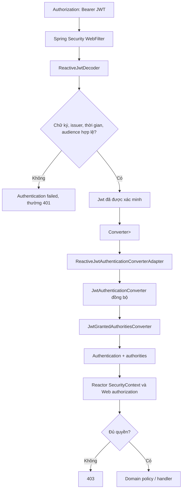
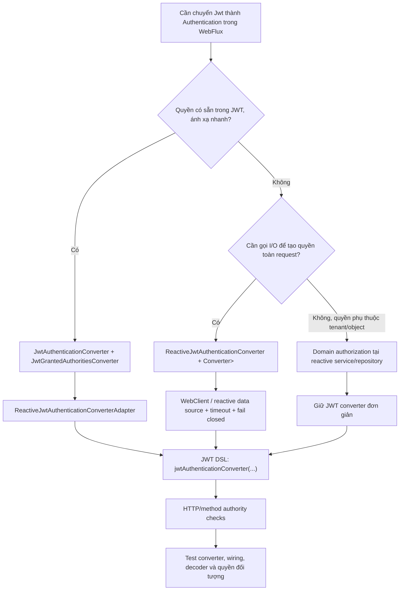

# ReactiveJwtAuthenticationConverterAdapter và giới hạn của converter đồng bộ

Trong **Spring Security OAuth 2.0 Resource Server** sử dụng **Spring WebFlux**, access token JWT sau khi được kiểm tra bởi `ReactiveJwtDecoder` cần được biến thành một `Authentication` chứa principal và danh sách `GrantedAuthority`. Mặc định Spring Security có cơ chế ánh xạ scope thông dụng, nhưng nhiều hệ thống cần đọc claim `permissions`, thay tiền tố `SCOPE_`, hoặc thay tên hiển thị của principal.

Ở ứng dụng Servlet, ta thường cấu hình `JwtAuthenticationConverter` và `JwtGrantedAuthoritiesConverter`. Khi chuyển sang WebFlux, câu hỏi xuất hiện: **Có thể tái sử dụng converter đồng bộ đó không?** Spring Security cung cấp `ReactiveJwtAuthenticationConverterAdapter` chính cho tình huống này. Tuy nhiên, tên gọi “Reactive” **không biến phép tính blocking thành non-blocking**. Adapter chỉ thích hợp để đưa một converter *imperative nhưng thực thi nhanh, không gọi I/O blocking* vào hợp đồng trả `Mono`.

Bài học phân biệt **converter đồng bộ được bọc bằng adapter**, **`ReactiveJwtAuthenticationConverter` thực sự hỗ trợ publisher của authorities**, và **converter tùy chỉnh dùng `Mono`/`Flux` khi cần tương tác bất đồng bộ**. Các ví dụ áp dụng cho **Spring Boot 3, Spring Security 6, Java 17+ và WebFlux**, tập trung vào JWT Resource Server; các thư viện và API cần được chọn theo phiên bản thực tế.

## 1. Vì sao cần converter sau khi đã xác minh JWT?

Một access token có thể chứa:

```json
{
  "iss": "https://identity.example.com/realms/shop",
  "sub": "user-123",
  "aud": ["orders-api"],
  "scope": "orders.read orders.write",
  "permissions": ["reports.export"],
  "exp": 1900000000
}
```

Đây chỉ là **JWT payload minh họa**, không phải token đã ký. Resource Server chỉ được tin các claim **sau khi decoder chấp nhận chữ ký, issuer, thời hạn, audience và những điều kiện token profile bắt buộc**.

Các câu hỏi khác nhau:

| Thành phần | Trách nhiệm chính |
| --- | --- |
| `ReactiveJwtDecoder` | Giải mã và **xác minh** JWT theo policy được cấu hình. |
| JWT authentication converter | Chuyển **JWT đã chấp nhận** thành `Authentication`, gồm principal name và authorities. |
| `SecurityWebFilterChain` | Kiểm tra request có quyền truy cập endpoint theo HTTP path/method không. |
| Reactive method security | Kiểm tra quyền tại service method khi đã được bật và đi qua proxy phù hợp. |
| Domain authorization | Kiểm tra tenant, owner, ACL hoặc quyền đối với **bản ghi cụ thể**. |

Khi token có `scope = "orders.read orders.write"`, converter scope mặc định thường tạo:

```text
SCOPE_orders.read
SCOPE_orders.write
```

`hasAuthority("SCOPE_orders.read")` sẽ so sánh **đúng chuỗi authority** được sinh ra. Nếu đổi prefix sang `PERM_`, các authorization rule cũng phải đổi tương ứng.

## 2. Vị trí của adapter trong pipeline WebFlux



Sơ đồ trên mô tả **nhánh có sử dụng adapter**. Nếu sử dụng `ReactiveJwtAuthenticationConverter` thuần reactive, bước adapter sẽ được thay bằng converter đó.

Ranh giới quan trọng: **Adapter không thay `ReactiveJwtDecoder`**. Converter chỉ được giao đối tượng `Jwt` sau quá trình decode/verify trong đường đi thực, nên không có nhiệm vụ tự kiểm chữ ký, đi lấy JWKS hay đọc `Authorization` header.

## 3. Ba hợp đồng converter cần phân biệt

Đây là nguồn gốc của phần lớn lỗi kiểu dữ liệu khi copy cấu hình MVC sang WebFlux.

| Loại converter | Hợp đồng Java | Chức năng |
| --- | --- | --- |
| `JwtGrantedAuthoritiesConverter` | `Converter<Jwt, Collection<GrantedAuthority>>` | Đọc scope/claim và trả authorities **đồng bộ**. |
| `JwtAuthenticationConverter` | `Converter<Jwt, AbstractAuthenticationToken>` | Dựng một Authentication **đồng bộ**, thường là `JwtAuthenticationToken`. |
| `ReactiveJwtAuthenticationConverterAdapter` | `Converter<Jwt, Mono<AbstractAuthenticationToken>>` | **Bọc** converter đồng bộ loại thứ hai theo hợp đồng reactive. |
| `ReactiveJwtAuthenticationConverter` | `Converter<Jwt, Mono<AbstractAuthenticationToken>>` | Chuyển đổi Authentication theo API reactive, có thể lấy authorities từ `Flux`. |
| Custom reactive converter | `Converter<Jwt, Mono<AbstractAuthenticationToken>>` | Tự dựng Authentication bằng `Mono`/`Flux` khi cần logic chuyên biệt. |

Chi tiết quan trọng:

```java
Converter<Jwt, AbstractAuthenticationToken> imperative;

Converter<Jwt, Mono<AbstractAuthenticationToken>> reactive;
```

Hai kiểu này **không tương đương**. Dù phương thức cuối cùng đều tạo `Authentication`, WebFlux cần một publisher có thể tham gia reactive authentication pipeline.

Tương tự:

```java
Converter<Jwt, Collection<GrantedAuthority>> synchronousAuthorities;

Converter<Jwt, Flux<GrantedAuthority>> reactiveAuthorities;
```

`ReactiveJwtAuthenticationConverterAdapter` nhận converter **dựng Authentication**, không nhận trực tiếp converter chỉ trả `Collection<GrantedAuthority>`. Nếu muốn tái sử dụng `JwtGrantedAuthoritiesConverter`, hãy gắn nó vào `JwtAuthenticationConverter` trước khi tạo adapter.

## 4. API chính xác của `ReactiveJwtAuthenticationConverterAdapter`

Class nằm trong package:

```java
org.springframework.security.oauth2.server.resource.authentication
    .ReactiveJwtAuthenticationConverterAdapter
```

Chữ ký có thể tóm tắt:

```java
public class ReactiveJwtAuthenticationConverterAdapter
        implements Converter<Jwt, Mono<AbstractAuthenticationToken>> {

    public ReactiveJwtAuthenticationConverterAdapter(
            Converter<Jwt, AbstractAuthenticationToken> delegate);

    public Mono<AbstractAuthenticationToken> convert(Jwt jwt);
}
```

Đây là **chữ ký giải thích**, không phải source code để copy thành class trùng tên với Spring Security. `delegate` là converter imperative. Adapter đáp ứng hợp đồng reactive mà WebFlux JWT DSL cần.

Trong API documentation của Spring Security, adapter được mô tả là dành cho một **imperative converter không blocking**. Nó không hứa hẹn tự chuyển việc gọi JDBC, HTTP client đồng bộ hoặc `Thread.sleep` sang worker thread khác.

```text
Jwt đã xác minh
  -> Adapter
      -> imperative delegate nhận Jwt
      -> kết quả AbstractAuthenticationToken
  -> Mono<AbstractAuthenticationToken> cho reactive pipeline
```

**Đổi hình thức trả về thành `Mono` không tự biến công việc bên trong delegate thành non-blocking.**

## 5. Trường hợp phù hợp: chỉ ánh xạ claim đã có trong JWT

Converter đồng bộ thường phù hợp nếu nó chỉ:

- Đọc `scope` hoặc `scp` đã được decoder xác minh.
- Phân tách chuỗi scope hoặc đọc danh sách claim.
- Thêm tiền tố `SCOPE_`, `PERM_`, hoặc một namespace đã được phê duyệt.
- Ánh xạ alias quyền bằng một bảng `Map` bất biến trong bộ nhớ.
- Chọn claim để đặt principal name, chẳng hạn `sub` hoặc `preferred_username`.
- Tạo `SimpleGrantedAuthority`, `JwtAuthenticationToken` mà không chờ I/O.

Ví dụ:

```text
scope = "orders.read orders.write"
  -> JwtGrantedAuthoritiesConverter
  -> [SCOPE_orders.read, SCOPE_orders.write]
  -> JwtAuthenticationToken
```

Công việc nhỏ, xác định được và không gọi mạng/DB có thể tái sử dụng giữa MVC và WebFlux bằng adapter. Đây là **use case cốt lõi** của `ReactiveJwtAuthenticationConverterAdapter`.

Nếu policy phải hỏi một database hoặc entitlement service để xác định quyền hiện hành, bài toán đã khác: kết quả phụ thuộc **I/O** và cần một publisher reactive hoặc một domain authorization check riêng.

## 6. Ví dụ nhỏ nhất: bọc `JwtAuthenticationConverter` mặc định

```java
import org.springframework.core.convert.converter.Converter;
import org.springframework.security.authentication.AbstractAuthenticationToken;
import org.springframework.security.oauth2.jwt.Jwt;
import org.springframework.security.oauth2.server.resource.authentication.JwtAuthenticationConverter;
import org.springframework.security.oauth2.server.resource.authentication.ReactiveJwtAuthenticationConverterAdapter;
import reactor.core.publisher.Mono;

Converter<Jwt, Mono<AbstractAuthenticationToken>> adapter =
    new ReactiveJwtAuthenticationConverterAdapter(
        new JwtAuthenticationConverter());
```

Ở đây `JwtAuthenticationConverter` đọc authorities theo cơ chế của nó và tạo authentication. Adapter đưa kết quả đó về đúng kiểu WebFlux kỳ vọng.

Nếu chỉ muốn **các scope mặc định**, Spring Security WebFlux đã có converter mặc định thích hợp, nên không nhất thiết phải khai báo bean này. Adapter hữu ích nhất khi **đã có converter imperative tùy chỉnh** hoặc cần chia sẻ mapping quy ước giữa hai stack.

## 7. Cấu hình đầy đủ: đổi claim và tiền tố một cách đồng bộ

Giả sử Authorization Server phát hành:

```json
{
  "iss": "https://identity.example.com/realms/shop",
  "sub": "subject-123",
  "aud": ["orders-api"],
  "permissions": "orders.read,orders.write,reports.export"
}
```

API muốn dùng các authority:

```text
PERM_orders.read
PERM_orders.write
PERM_reports.export
```

Spring Security 6.1+ cho phép tùy chỉnh delimiter:

```java
import org.springframework.context.annotation.Bean;
import org.springframework.context.annotation.Configuration;
import org.springframework.core.convert.converter.Converter;
import org.springframework.security.authentication.AbstractAuthenticationToken;
import org.springframework.security.oauth2.jwt.Jwt;
import org.springframework.security.oauth2.server.resource.authentication.JwtAuthenticationConverter;
import org.springframework.security.oauth2.server.resource.authentication.JwtGrantedAuthoritiesConverter;
import org.springframework.security.oauth2.server.resource.authentication.ReactiveJwtAuthenticationConverterAdapter;
import reactor.core.publisher.Mono;

@Configuration
public class AuthorityConverterConfig {

    @Bean
    Converter<Jwt, Mono<AbstractAuthenticationToken>>
    customJwtAuthenticationConverter() {
        JwtGrantedAuthoritiesConverter permissions =
            new JwtGrantedAuthoritiesConverter();

        permissions.setAuthoritiesClaimName("permissions");
        permissions.setAuthorityPrefix("PERM_");
        permissions.setAuthoritiesClaimDelimiter("\\s*,\\s*");

        JwtAuthenticationConverter imperative =
            new JwtAuthenticationConverter();
        imperative.setJwtGrantedAuthoritiesConverter(permissions);

        return new ReactiveJwtAuthenticationConverterAdapter(imperative);
    }
}
```

Điều gì đang xảy ra:

1. `setAuthoritiesClaimName("permissions")`: chỉ chọn claim `permissions` trong converter được cấu hình.
2. `setAuthoritiesClaimDelimiter("\\s*,\\s*")`: phân tách string theo dấu phẩy và khoảng trắng bao quanh; đây là **regex**.
3. `setAuthorityPrefix("PERM_")`: gắn tiền tố vào từng giá trị sau phân tách.
4. `JwtAuthenticationConverter` tạo Authentication từ JWT và authorities.
5. Adapter cung cấp `Mono<AbstractAuthenticationToken>` cho WebFlux.

**Một lưu ý:** `setAuthoritiesClaimName("permissions")` không tự kết hợp đồng thời cả `scope` và `permissions`. Nếu API cần hai nguồn quyền, hãy định nghĩa composite mapping có kiểm soát.

Với claim dạng `["orders.read", "orders.write"]`, các phần tử đã là một collection; delimiter chủ yếu áp dụng khi claim là **string**, không phải công cụ biến mọi JSON object thành chuỗi quyền.

## 8. Gắn converter vào `SecurityWebFilterChain`

Gradle:

```gradle
dependencies {
    implementation 'org.springframework.boot:spring-boot-starter-webflux'
    implementation 'org.springframework.boot:spring-boot-starter-security'
    implementation 'org.springframework.boot:spring-boot-starter-oauth2-resource-server'
}
```

YAML:

```yaml
spring:
  security:
    oauth2:
      resourceserver:
        jwt:
          issuer-uri: https://identity.example.com/realms/shop
```

Security chain:

```java
import org.springframework.context.annotation.Bean;
import org.springframework.context.annotation.Configuration;
import org.springframework.core.convert.converter.Converter;
import org.springframework.http.HttpMethod;
import org.springframework.security.authentication.AbstractAuthenticationToken;
import org.springframework.security.config.Customizer;
import org.springframework.security.config.web.server.ServerHttpSecurity;
import org.springframework.security.oauth2.jwt.Jwt;
import org.springframework.security.web.server.SecurityWebFilterChain;
import reactor.core.publisher.Mono;

@Configuration
public class ReactiveApiSecurityConfig {

    @Bean
    SecurityWebFilterChain apiSecurity(
            ServerHttpSecurity http,
            Converter<Jwt, Mono<AbstractAuthenticationToken>>
                customJwtAuthenticationConverter) {

        return http
            .csrf(ServerHttpSecurity.CsrfSpec::disable)
            .authorizeExchange(exchanges -> exchanges
                .pathMatchers(HttpMethod.GET, "/api/orders/**")
                    .hasAuthority("PERM_orders.read")
                .pathMatchers(HttpMethod.POST, "/api/orders")
                    .hasAuthority("PERM_orders.write")
                .anyExchange().denyAll())
            .oauth2ResourceServer(oauth2 -> oauth2
                .jwt(jwt -> jwt.jwtAuthenticationConverter(
                    customJwtAuthenticationConverter)))
            .build();
    }
}
```

Giải thích:

- WebFlux sử dụng **`ServerHttpSecurity` và `SecurityWebFilterChain`**, không phải `HttpSecurity` và `SecurityFilterChain` của Servlet.
- `jwtAuthenticationConverter(...)` của JWT DSL chấp nhận kiểu reactive `Converter<Jwt, Mono<AbstractAuthenticationToken>>`.
- Đăng ký bean converter **không phải bằng chứng bean luôn tự được gắn vào mọi chain**. Ở đây ta chủ động truyền nó vào DSL.
- Rule dùng đúng `PERM_orders.read`, khớp tiền tố mà converter tạo.
- `anyExchange().denyAll()` bảo vệ những URL chưa được cho phép trong chain bao phủ ứng dụng.
- Ví dụ tắt CSRF theo giả định **API thuần Bearer header**, không dùng cookie tự đính kèm làm credential. Với cookie/BFF/session web, phải thiết kế CSRF riêng.

Chain này không khai báo `securityMatcher` hẹp nên đóng vai trò bao phủ các exchange phù hợp mặc định. Nếu ứng dụng có nhiều `SecurityWebFilterChain`, phải thiết kế matcher và `@Order` để không bỏ lọt docs, Actuator hoặc admin endpoint.

## 9. Kiểm tra kết quả với một request thật

Token đã được xác minh có:

```json
{
  "sub": "alice",
  "permissions": "orders.read,orders.write"
}
```

Request:

```http
GET /api/orders/101
Authorization: Bearer <signed-access-token>
```

Khi converter được gắn vào JWT DSL:

```text
Jwt decoder: chấp nhận token
JwtGrantedAuthoritiesConverter:
  PERM_orders.read
  PERM_orders.write
JwtAuthenticationConverter:
  JwtAuthenticationToken(name=alice, authorities=[...])
ReactiveJwtAuthenticationConverterAdapter:
  Mono<AbstractAuthenticationToken>
HTTP authorization:
  hasAuthority("PERM_orders.read") -> đủ quyền chức năng
Domain authorization:
  còn phải kiểm tra tenant, owner/ACL của order 101
```

`PERM_orders.read` cho phép đi qua cổng chức năng, **không tự cho Alice xem mọi order**. Resource Server vẫn phải kiểm tra owner, tenant hoặc rule chia sẻ tại nghiệp vụ.

## 10. Đổi principal name không thay đổi danh tính gốc của JWT

`JwtAuthenticationConverter` hỗ trợ:

```java
imperative.setPrincipalClaimName("preferred_username");
```

Điều này ảnh hưởng `Authentication.getName()` khi claim đó có giá trị phù hợp; nó không đổi chữ ký, `iss`, `sub` hoặc giá trị principal mà JWT đã chứa.

Ví dụ:

```json
{
  "iss": "https://identity.example.com",
  "sub": "user-123",
  "preferred_username": "alice"
}
```

Sau cấu hình, `getName()` có thể trả `"alice"`, nhưng danh tính đáng tin để liên kết bản ghi thường nên dựa trên **`issuer + subject`**, hoặc một internal user ID ánh xạ đáng tin. Username/email có thể đổi, trùng giữa các issuer hoặc bị tái sử dụng.

Với `ReactiveJwtAuthenticationConverter`, phương thức `setPrincipalClaimName(...)` cũng có trong các phiên bản Spring Security 6.1+ tương ứng.

**Đổi principal name là một quyết định về representation, không phải một phép nâng quyền.** Không dùng `preferred_username` thay thế kiểm tra `sub`/issuer trong domain policy nếu chưa có hợp đồng nhận dạng phù hợp.

## 11. `scope`, `scp`, role và quyền nội bộ là các namespace khác nhau

Các token có thể có:

```json
{
  "scope": "orders.read",
  "scp": ["orders.read"],
  "roles": ["support"],
  "permissions": ["reports.export"]
}
```

Không nên tự kết luận mọi claim trên có cùng authority. Cần định nghĩa:

| Nguồn | Authority ví dụ | Ai định nghĩa ý nghĩa? |
| --- | --- | --- |
| `scope`/`scp` | `SCOPE_orders.read` | Hợp đồng scope giữa issuer và API. |
| `permissions` | `PERM_reports.export` | Hợp đồng permissions mà API tin cậy. |
| `roles` | `ROLE_SUPPORT` | Application/domain role mapping theo issuer. |
| `tenant_id` | Không tự là `GrantedAuthority`. | Tenant/identity context, cần kiểm tra membership. |
| `client_id` | Không tự là `ROLE_ADMIN`. | Metadata của OAuth client, cần policy riêng. |

`hasAuthority("PERM_orders.read")` so sánh đúng authority string. `hasRole("ADMIN")` thường dùng quy ước `ROLE_ADMIN`, không tự khớp `PERM_ADMIN` hoặc `SCOPE_ADMIN`.

Nếu dùng `JwtGrantedAuthoritiesConverter` để đổi prefix sang `ROLE_`, phải đánh giá **ngữ nghĩa thực của claim**. Một OAuth scope có tên `admin` không tự đồng nghĩa role quản trị ứng dụng.

## 12. Adapter không tự chuyển lời gọi blocking thành reactive

Đây là giới hạn quan trọng nhất của bài:

```java
Converter<Jwt, AbstractAuthenticationToken> blockingDelegate =
    jwt -> {
        // Giả sử ở đây có JDBC query hoặc HTTP client blocking.
        return loadAuthenticationFromBlockingSystem(jwt);
    };

Converter<Jwt, Mono<AbstractAuthenticationToken>> wrapped =
    new ReactiveJwtAuthenticationConverterAdapter(blockingDelegate);
```

**Đây là phản ví dụ**. Adapter thỏa kiểu dữ liệu reactive, nhưng `loadAuthenticationFromBlockingSystem(jwt)` vẫn là công việc đồng bộ cần đợi kết quả. Nếu chạy trên một event-loop thread, nó có thể giữ thread đó lâu, ảnh hưởng đến nhiều request khác.

Nên phân biệt hai khái niệm:

```text
API trả về Mono
    !=
I/O bên trong tự trở thành non-blocking
```

Adapter không phải database client, HTTP client reactive, scheduler, bulkhead hoặc circuit breaker. Không nên dựa vào tên class để giả định nó có cơ chế offload blocking operations.

Tài liệu API Spring Security mô tả adapter là cách dùng một **imperative converter non-blocking**. Nếu converter bắt buộc phải gọi mạng/DB, cần thiết kế theo các phần sau.

## 13. Vì sao blocking trong authentication path đặc biệt nguy hiểm?

Mỗi protected request cần authentication. Nếu converter mỗi lần lại gọi hệ thống external theo kiểu blocking:

```text
1000 concurrent requests
  -> JWT decode
  -> 1000 synchronous HTTP/DB calls trong converter
  -> threads bị giữ chờ I/O
  -> response latency tăng và hệ thống dễ quá tải
```

Ở WebFlux, event-loop threads thường phục vụ **nhiều kết nối đồng thời**, không phải mỗi request có một Servlet thread độc lập. Một lời gọi blocking kéo dài có thể gây:

- Chậm xử lý những HTTP request khác cùng event-loop.
- Tích tụ pending publishers và connection pressure.
- Timeout lan sang các dịch vụ downstream.
- Tăng p99 latency dù CPU không cao.
- Suy giảm tác dụng của backpressure.
- Khó cô lập lỗi identity provider hoặc entitlement service.

Khi authorization enrichment nằm trong JWT converter, mọi request đến endpoint dùng JWT có thể phải chịu latency của enrichment, kể cả endpoint không cần dữ liệu entitlement đó.

Hãy cân nhắc **quyền nào cần lấy ở authentication** và **quyền nào nên kiểm tra tại domain service sau khi đã xác thực token**.

## 14. `.block()` trong converter không phải giải pháp cho `Mono`

Một phản ví dụ:

```java
JwtAuthenticationConverter imperative = new JwtAuthenticationConverter();

Converter<Jwt, Collection<GrantedAuthority>> bad =
    jwt -> entitlementWebClient
        .get()
        .uri("/entitlements")
        .retrieve()
        .bodyToFlux(String.class)
        .map(SimpleGrantedAuthority::new)
        .collectList()
        .block();

imperative.setJwtGrantedAuthoritiesConverter(bad);
```

Đoạn này dùng `WebClient` reactive nhưng gọi `.block()` để biến kết quả trở lại collection đồng bộ. Khi chạy trong authentication pipeline WebFlux, `.block()` có thể bị Reactor từ chối trên non-blocking thread hoặc làm nghẽn xử lý, tùy execution context.

Sau đó:

```java
new ReactiveJwtAuthenticationConverterAdapter(imperative);
```

**không sửa được vấn đề cốt lõi**. Một reactive client bị ép `.block()` vẫn trở thành thao tác chờ đồng bộ.

Hướng đúng là trả `Flux<GrantedAuthority>`/`Mono<AbstractAuthenticationToken>` từ một converter reactive, hoặc tách kiểm tra dữ liệu bên ngoài sang domain authorization policy có giao diện reactive.

## 15. `.subscribe()` cũng không tạo ra kết quả Authentication đúng

Một anti-pattern khác:

```java
Converter<Jwt, AbstractAuthenticationToken> bad = jwt -> {
    entitlementWebClient.get()
        .uri("/entitlements")
        .retrieve()
        .bodyToFlux(String.class)
        .subscribe(value -> updateSharedAuthorities(value));

    return new JwtAuthenticationToken(jwt, List.of());
};
```

**Không dùng cách này.** `subscribe()` khởi tạo một công việc tách rời khỏi publisher authentication, có thể kết thúc **sau khi** `JwtAuthenticationToken` đã được tạo. Authorization có thể chạy với danh sách authority rỗng, không nhất quán hoặc giá trị mutable chia sẻ giữa những request.

Ngoài race condition, fire-and-forget subscription dễ làm mất khả năng xử lý lỗi, cancellation, tracing context và kiểm soát timeout theo request.

Trong reactive authentication, phải **compose** tất cả publisher cần thiết vào cùng chuỗi, để authentication chỉ hoàn tất sau khi các bước bắt buộc được hoàn thành.

## 16. Dùng `ReactiveJwtAuthenticationConverter` khi cần authorities dạng `Flux`

Spring Security có class:

```java
org.springframework.security.oauth2.server.resource.authentication
    .ReactiveJwtAuthenticationConverter
```

Contract chính:

```java
Converter<Jwt, Mono<AbstractAuthenticationToken>>
```

Và phương thức:

```java
setJwtGrantedAuthoritiesConverter(
    Converter<Jwt, Flux<GrantedAuthority>> converter);
```

Khác biệt quan trọng với phiên bản imperative:

```text
JwtAuthenticationConverter:
    Converter<Jwt, Collection<GrantedAuthority>>

ReactiveJwtAuthenticationConverter:
    Converter<Jwt, Flux<GrantedAuthority>>
```

Vì converter trả `Flux`, nó có thể kết hợp kết quả bất đồng bộ bằng `flatMap`, `concatWith`, `collectList`, `timeout` hoặc các toán tử Reactor khác.

Tuy nhiên, **dùng class có chữ Reactive cũng không bảo đảm mọi code trong callback không blocking**. Nếu bạn đặt JDBC `findById()` đồng bộ bên trong `Flux.defer(...)` rồi chạy trên event-loop, vấn đề blocking vẫn còn. Reactive design cần **dependency non-blocking thật sự** hoặc offload được kiểm soát.

## 17. Nếu chỉ có claim local, reactive converter vẫn dùng được

Không bắt buộc dùng adapter nếu muốn đi theo API reactive hoàn toàn. Có thể chuyển collection đồng bộ từ một converter đơn giản thành `Flux`:

```java
import org.springframework.context.annotation.Bean;
import org.springframework.core.convert.converter.Converter;
import org.springframework.security.authentication.AbstractAuthenticationToken;
import org.springframework.security.core.GrantedAuthority;
import org.springframework.security.oauth2.jwt.Jwt;
import org.springframework.security.oauth2.server.resource.authentication.JwtGrantedAuthoritiesConverter;
import org.springframework.security.oauth2.server.resource.authentication.ReactiveJwtAuthenticationConverter;
import reactor.core.publisher.Flux;
import reactor.core.publisher.Mono;

@Bean
Converter<Jwt, Mono<AbstractAuthenticationToken>>
reactiveLocalConverter() {
    JwtGrantedAuthoritiesConverter scope =
        new JwtGrantedAuthoritiesConverter();

    scope.setAuthorityPrefix("SCOPE_");

    ReactiveJwtAuthenticationConverter reactive =
        new ReactiveJwtAuthenticationConverter();
    reactive.setJwtGrantedAuthoritiesConverter(
        jwt -> Flux.fromIterable(scope.convert(jwt)));

    return reactive;
}
```

Đây vẫn chỉ là một phép chuyển collection đã có thành `Flux`; việc truy xuất `scope.convert(jwt)` là **đồng bộ và phải nhẹ**. Phương án này có lợi nếu bạn muốn sau đó thêm nguồn quyền reactive bằng một converter cùng hợp đồng.

Hai thiết kế đều hợp lý với mapping local:

```text
A. JwtAuthenticationConverter
      + ReactiveJwtAuthenticationConverterAdapter

B. ReactiveJwtAuthenticationConverter
      + Flux.fromIterable(JwtGrantedAuthoritiesConverter.convert(jwt))
```

**Không cần viết lại mọi converter đồng bộ thành reactive** chỉ để dùng WebFlux, nếu chúng thuần CPU nhỏ và không blocking.

## 18. Khi nào thật sự cần quyền từ nguồn bên ngoài?

Một số use case:

- Hỏi entitlement service quyền `reports.export` hiện hành.
- Đọc membership/role từ reactive database.
- Kiểm tra chính sách đa tenant hoặc grant ngắn hạn.
- Lấy permission có thể thay đổi nhanh hơn JWT lifetime.
- Áp một chính sách resource-specific sau khi caller đã được xác thực.

Nhưng **không phải tất cả đều nên diễn ra tại JWT authentication converter**. Nếu quyền phụ thuộc `orderId` đang được truy cập, converter chỉ có JWT và không biết endpoint/domain object cụ thể; hãy thực hiện **domain authorization tại service**.

Ví dụ:

```text
JWT scope:
   orders.read

WebFlux HTTP authorization:
   hasAuthority("SCOPE_orders.read")

Reactive domain service:
   membership.canReadOrders(issuer, sub, tenantId)
   AND orderRepository.findVisibleToOwner(...)
```

Chỉ đưa dữ liệu external vào Authentication khi nó là **authority có ngữ nghĩa cho cả request** và khi việc phụ thuộc external call trong authentication path là quyết định đã được cân nhắc về latency, lỗi và revocation.

## 19. Ví dụ dùng `WebClient` để nhận authorities bất đồng bộ

Giả sử một entitlement service nội bộ đáng tin trả mảng JSON các permission cho cặp `(issuer, subject)` của JWT đã xác minh:

```json
[
  "reports.export",
  "orders.approve"
]
```

Một converter reactive có thể trả `Flux<GrantedAuthority>`:

```java
import java.time.Duration;
import java.util.Set;

import org.springframework.core.convert.converter.Converter;
import org.springframework.security.authentication.BadCredentialsException;
import org.springframework.security.core.GrantedAuthority;
import org.springframework.security.core.authority.SimpleGrantedAuthority;
import org.springframework.security.oauth2.jwt.Jwt;
import org.springframework.security.oauth2.server.resource.authentication.JwtGrantedAuthoritiesConverter;
import org.springframework.web.reactive.function.client.WebClient;
import reactor.core.publisher.Flux;

public final class EntitlementAuthoritiesConverter
        implements Converter<Jwt, Flux<GrantedAuthority>> {

    private static final Set<String> ALLOWED = Set.of(
        "reports.export", "orders.approve");

    private final JwtGrantedAuthoritiesConverter scopes =
        new JwtGrantedAuthoritiesConverter();

    private final WebClient trustedEntitlements;

    public EntitlementAuthoritiesConverter(WebClient trustedEntitlements) {
        this.trustedEntitlements = trustedEntitlements;
    }

    @Override
    public Flux<GrantedAuthority> convert(Jwt jwt) {
        if (jwt.getIssuer() == null
                || jwt.getSubject() == null
                || jwt.getSubject().isBlank()) {
            return Flux.error(new BadCredentialsException(
                "Verified issuer and subject required"));
        }

        Flux<GrantedAuthority> scopeAuthorities =
            Flux.fromIterable(scopes.convert(jwt));

        Flux<GrantedAuthority> liveEntitlements =
            trustedEntitlements.get()
                .uri(builder -> builder
                    .path("/v1/entitlements")
                    .queryParam("issuer", jwt.getIssuer().toString())
                    .queryParam("subject", jwt.getSubject())
                    .build())
                .retrieve()
                .bodyToFlux(String.class)
                .filter(ALLOWED::contains)
                .map(value -> (GrantedAuthority)
                    new SimpleGrantedAuthority("PERM_" + value))
                .timeout(Duration.ofSeconds(1));

        return Flux.concat(scopeAuthorities, liveEntitlements)
            .distinct(GrantedAuthority::getAuthority);
    }
}
```

Đây là **mô hình minh họa về composition**, không phải bộ HTTP client production hoàn chỉnh. Cần tạo `trustedEntitlements` với **base URL cố định**, xác thực service-to-service hoặc mTLS phù hợp, TLS verification, giới hạn response body/connection/concurrency, retry policy có kiểm soát và endpoint trả JSON theo contract. Không sử dụng `iss` chưa xác minh làm URL động để gửi request tùy ý.

Quan trọng: trong ví dụ, entitlement service **phải là nguồn có thẩm quyền** cho các permission mà API tin. Nếu dịch vụ trả một quyền bất kỳ do client tự quyết định, filter `ALLOWED` chỉ giới hạn tên được biết, **không tự chứng minh quyền đó đã được cấp đúng**. Authorization of the entitlement service itself is part of the trust boundary.

Không dùng `onErrorResume(e -> Flux.empty())` một cách tùy tiện nếu remote entitlements là **bắt buộc** để xác thực/phân quyền. Khi upstream lỗi, chuỗi authentication nên fail closed theo chính sách, thay vì âm thầm tạo tập quyền thiếu hoặc cho caller đi qua rule chỉ cần `.authenticated()`.

## 20. Kết nối converter reactive vào JWT DSL

Tạo bean converter từ thành phần ở phần trước:

```java
import org.springframework.context.annotation.Bean;
import org.springframework.core.convert.converter.Converter;
import org.springframework.security.authentication.AbstractAuthenticationToken;
import org.springframework.security.oauth2.jwt.Jwt;
import org.springframework.security.oauth2.server.resource.authentication.ReactiveJwtAuthenticationConverter;
import reactor.core.publisher.Mono;

@Bean
Converter<Jwt, Mono<AbstractAuthenticationToken>>
remoteAuthoritiesConverter(
        EntitlementAuthoritiesConverter entitlementAuthorities) {

    ReactiveJwtAuthenticationConverter converter =
        new ReactiveJwtAuthenticationConverter();
    converter.setJwtGrantedAuthoritiesConverter(
        entitlementAuthorities);
    return converter;
}
```

Sau đó truyền bean này vào:

```java
.oauth2ResourceServer(oauth2 -> oauth2
    .jwt(jwt -> jwt.jwtAuthenticationConverter(
        remoteAuthoritiesConverter)))
```

Biến `remoteAuthoritiesConverter` trong đoạn trên đại diện bean đã được inject vào method tạo `SecurityWebFilterChain`; cần nối wiring thật tương tự phần 8.

**Không bọc `ReactiveJwtAuthenticationConverter` bằng `ReactiveJwtAuthenticationConverterAdapter`**. Converter reactive đã trả đúng `Mono<AbstractAuthenticationToken>`. Adapter chỉ nhận `Converter<Jwt, AbstractAuthenticationToken>` dạng imperative, không nhận một publisher-producing converter.

## 21. Chọn nơi thực hiện authorization: trong converter hay tại service?

Đây là lựa chọn kiến trúc có tác động lớn đến tải hệ thống:

| Quyền cần kiểm tra | Nơi phù hợp | Lý do |
| --- | --- | --- |
| JWT `scope = orders.read` | Authentication converter và HTTP policy. | Dữ liệu đã ở token, mapping nhanh. |
| Role/permission cố định trong claim đã xác minh | Converter với allowlist/hợp đồng. | Không cần I/O bổ sung. |
| Membership tenant hiện hành | Reactive domain service/policy. | Phụ thuộc tenant request và trạng thái hiện tại. |
| Owner của một order | Reactive repository/service authorization. | Phụ thuộc object cụ thể, không có sẵn trong JWT. |
| Entitlement toàn API từ service tin cậy | Có thể reactive converter hoặc policy layer. | Cần cân nhắc latency/failure/TTL. |
| Scope dành cho một audience khác | **Không tạo authority tin cậy** cho API này. | Decoder/token profile phải từ chối token sai audience. |
| Claim `roles` từ issuer không có thẩm quyền | Bỏ qua hoặc từ chối theo contract. | Tránh privilege escalation. |

Authentication converter là nơi tạo identity và authorities. Nó **không thay thế** domain authorization, không nên gọi `findById(orderId)` không kiểm tra tenant, và không nên đưa mọi permission của toàn hệ thống vào Authentication chỉ để “phòng khi cần”.

## 22. `ReactiveSecurityContextHolder` liên quan gì tới converter?

Trong WebFlux, Spring Security mang `SecurityContext` qua **Reactor Context** của subscription, không dựa vào `ThreadLocal` mặc định của Servlet.

Trong reactive controller/service:

```java
Mono<Authentication> current =
    ReactiveSecurityContextHolder.getContext()
        .map(SecurityContext::getAuthentication);
```

Converter nhận `Jwt` đã được decoder xác minh, sau đó trả publisher chứa `Authentication`; Spring Security tích hợp kết quả vào security context cho request.

**Không nên tìm Authentication hiện tại bằng `SecurityContextHolder.getContext()` bên trong converter imperative của WebFlux.** `SecurityContextHolder` thường gắn với ThreadLocal, trong khi reactive authentication flow theo subscription. Hơn nữa, JWT converter đã **được truyền chính Jwt cần ánh xạ**, nên không cần đọc security context cũ.

Nếu một policy cần dữ liệu từ request như `tenantId` hoặc `orderId`, converter chỉ nhận `Jwt` thường không phải nơi phù hợp. Có thể dùng service authorization sau authentication, nơi các selector được xác định rõ.

## 23. Vì sao `publishOn` không làm converter blocking an toàn?

Một publisher sử dụng:

```java
return Mono.just(jwt)
    .publishOn(Schedulers.parallel())
    .map(blockingConverter::convert);
```

**Vẫn là phản ví dụ** nếu `blockingConverter` gọi JDBC/HTTP đồng bộ. `Schedulers.parallel()` dành cho công việc CPU non-blocking, không phải nơi chạy các tác vụ chờ I/O lâu.

Nếu buộc phải giữ một thư viện imperative legacy, mẫu offload có kiểm soát:

```java
Converter<Jwt, Mono<AbstractAuthenticationToken>> bridge =
    jwt -> Mono.fromCallable(() -> blockingConverter.convert(jwt))
        .subscribeOn(Schedulers.boundedElastic());
```

Điều này **khác** việc sử dụng adapter mặc định: ta chủ động phân công thao tác blocking sang scheduler phù hợp. Tuy nhiên, `boundedElastic` vẫn sử dụng threads/queue hữu hạn, không tạo ra non-blocking I/O thật. Cần kiểm soát max concurrency, timeout, kết nối DB, cancellation, tracing và lượng công việc khi pod scale.

Nếu có API reactive tương đương (R2DBC, WebClient hoặc policy service reactive), ưu tiên dùng API đó. Đừng đưa một dependency blocking nặng vào authentication path chỉ vì đã có code cũ.

## 24. Cẩn trọng khi ánh xạ kết quả rỗng hoặc lỗi của converter

Các tình huống:

```text
Jwt hợp lệ
    -> converter thành công, authorities rỗng
    -> caller có thể vẫn được coi là authenticated
    -> endpoint chỉ yêu cầu .authenticated() có thể được truy cập
```

Điều này **khác**:

```text
Jwt hợp lệ
    -> converter lỗi vì entitlement service bắt buộc không sẵn sàng
    -> authentication không được hoàn tất thành công
```

Khi viết reactive converter, không nên biến mọi lỗi thành:

```java
.onErrorResume(ex -> Flux.empty())
```

trừ khi **đã xác định rõ** quyền bổ sung chỉ là tùy chọn và endpoint không thể bị cấp quyền quá mức khi thiếu dữ liệu.

Một nguyên tắc:

- Claim quyền không có hoặc giá trị không được nhận diện: không tạo authority ngoài contract.
- Dữ liệu quyền bắt buộc không thể xác thực/kiểm tra: **fail closed**.
- Lỗi upstream không phải bằng chứng caller không có quyền; telemetry nên tách `unavailable` và `denied`.
- Token sai chữ ký/issuer/audience: từ chối tại decoder, không hỏi entitlement service để cố “cứu” token.

Không tạo một `JwtAuthenticationToken` giả chứa `ROLE_ADMIN` khi exception xảy ra.

## 25. Những điểm cần biết về timeouts, caching và circuit breaker

Nếu gọi entitlement service trong quá trình JWT authentication, mỗi request có thể tạo thêm remote I/O. Hãy thiết kế:

1. Timeout kết nối và timeout response trên WebClient/HTTP client.
2. Giới hạn số connection và in-flight calls, tránh một dịch vụ lỗi làm nghẽn toàn API.
3. Retry chỉ cho transient errors có điều kiện, số lần nhỏ và có jitter; không nhân lên thành retry storm.
4. Circuit breaker để fail fast khi dependency hỏng; **không cho qua authentication** vì breaker mở.
5. Giới hạn kích thước JSON entitlement response và cardinality của authority.
6. Cache quyền nếu có yêu cầu hiệu năng, với namespace theo issuer/subject/audience/tenant policy và TTL phù hợp.
7. Độ trễ thu hồi quyền: cache token/entitlement có thể khiến permission bị revoke vẫn được áp dụng trong TTL.
8. Metrics phân biệt converter latency, remote timeout, 5xx, forbidden và authorization failure.

Một request bị denied vì **thiếu quyền** là kết quả nghiệp vụ khác với request không thể được kiểm tra vì **upstream error**. Mã HTTP cuối tùy exception handling; không nên hứa mọi `WebClient` timeout sẽ tự biến thành 503. Quan trọng là không biến lỗi thành quyền mặc định.

## 26. Nhiều issuer: cùng tên claim chưa chắc cùng quyền

Hai Authorization Server:

```text
issuer A: https://identity-a.example.com
issuer B: https://identity-b.example.com
```

có thể đều phát:

```json
{
  "permissions": ["admin"]
}
```

Nhưng giá trị `admin` của issuer A có thể chỉ áp dụng cho tài nguyên thuộc A, trong khi B có contract hoàn toàn khác. **Adapter không phân loại nguồn quyền thay bạn**.

Với Resource Server nhiều issuer, cần:

- Chỉ tin **danh sách issuer được cấu hình phê duyệt**, không chấp nhận JWT tự quảng cáo một JWKS URL bất kỳ.
- Decoder/AuthenticationManager phù hợp xác minh issuer trước khi mapping.
- Authority mapping theo issuer và token profile.
- Audience validator tương ứng protected resource.
- Tên permission canonical và allowlist; không tự coi mọi `roles=["admin"]` thành `ROLE_ADMIN`.
- Tránh dùng `sub` trần làm identity toàn cục giữa hai issuer.

Nếu converter dùng remote service, request đến service phải mô tả issuer và subject đã xác minh, đồng thời xác thực **chính Resource Server** với service đó. Không tin authority do client gửi trong header phụ.

## 27. Audience validation và mapping là hai bước độc lập

Một JWT có chữ ký hợp lệ từ issuer đáng tin nhưng:

```json
{
  "aud": ["payments-api"],
  "scope": "orders.read"
}
```

**không nên được orders-api chấp nhận** nếu policy yêu cầu audience `orders-api`. Converter vẫn có thể tạo `SCOPE_orders.read` từ claim, nhưng điều đó không hợp thức hóa token dành cho một API khác.

Validation phải thực hiện tại `ReactiveJwtDecoder`/token validator:

```text
Verify signature + issuer + exp/nbf + audience + token profile
    -> Jwt
    -> Authentication converter
    -> HTTP/domain authorization
```

Không dùng `JwtAuthenticationConverter` để thay thế việc xác minh token. `Jwt` trong unit test được tạo bằng `Jwt.withTokenValue(...)` cũng không tự là token đã kiểm chữ ký.

**Tại sao cần nhấn mạnh?** Vì khi chuyển từ Servlet sang WebFlux, developer có thể copy chỉ converter và rule `hasAuthority(...)`, rồi quên `ReactiveJwtDecoder` và audience validator cần được cấu hình tương ứng.

## 28. Sự khác nhau giữa JWT và opaque token converter

Trong WebFlux:

```text
JWT Resource Server:
  ReactiveJwtDecoder
  -> Jwt
  -> Converter<Jwt, Mono<AbstractAuthenticationToken>>

Opaque Resource Server:
  ReactiveOpaqueTokenIntrospector
  -> OAuth2AuthenticatedPrincipal
  -> reactive opaque authentication handling
```

`ReactiveJwtAuthenticationConverterAdapter` **chỉ dùng cho JWT conversion**, không tự thay đổi authorities của opaque token qua introspection.

Nếu ứng dụng hỗ trợ opaque token, phải cấu hình conversion/introspector tương ứng và kiểm tra scope/authority policy ở đúng đường đi. Việc client đều gửi:

```http
Authorization: Bearer <token>
```

không có nghĩa JWT converter áp dụng cho mọi Bearer credential.

## 29. Method security và service authorization sau converter

Reactive method security:

```java
import org.springframework.context.annotation.Configuration;
import org.springframework.security.config.annotation.method.configuration.EnableReactiveMethodSecurity;

@Configuration
@EnableReactiveMethodSecurity
public class ReactiveMethodSecurityConfig {}
```

Một service method trả publisher:

```java
@PreAuthorize("hasAuthority('PERM_orders.read')")
public Mono<OrderDto> getOrder(
        String tenantId,
        Long orderId) {
    return orderPolicy.requireCanRead(tenantId, orderId)
        .then(orderRepository.findVisibleOrder(tenantId, orderId))
        .map(OrderDto::from);
}
```

`OrderDto`, `orderPolicy` và `orderRepository` là các kiểu/domain abstractions minh họa cần triển khai. `@PreAuthorize` kiểm tra **authority đã được authentication converter tạo**; `orderPolicy` còn phải kiểm tra quyền trên bản ghi cụ thể.

Lưu ý:

- `@EnableReactiveMethodSecurity` không tự bật khi dùng `@EnableMethodSecurity` của Servlet.
- Method security thường cần Spring-managed bean/proxy; **self-invocation** không đi qua proxy có thể bỏ qua interceptor.
- Test gọi `new Service(...)` không tự kiểm chứng annotation method security đã chạy.
- Reactor Context truyền authentication theo subscription, không phải `SecurityContextHolder` ThreadLocal mặc định của Servlet.

Nếu dùng JWT converter để tạo `PERM_orders.read`, rule HTTP/method cần kiểm tra **chính chuỗi đó**.

## 30. Kiểm thử adapter bằng `StepVerifier`

Tách unit test converter ra khỏi HTTP server để kiểm tra đúng mapping:

```java
import static org.assertj.core.api.Assertions.assertThat;

import org.junit.jupiter.api.Test;
import org.springframework.security.core.GrantedAuthority;
import org.springframework.security.oauth2.jwt.Jwt;
import org.springframework.security.oauth2.server.resource.authentication.JwtAuthenticationConverter;
import org.springframework.security.oauth2.server.resource.authentication.JwtGrantedAuthoritiesConverter;
import org.springframework.security.oauth2.server.resource.authentication.ReactiveJwtAuthenticationConverterAdapter;
import reactor.test.StepVerifier;

class AdapterTest {

    @Test
    void convertsTwoScopesWithoutBlockingIo() {
        JwtGrantedAuthoritiesConverter scopes =
            new JwtGrantedAuthoritiesConverter();

        JwtAuthenticationConverter imperative =
            new JwtAuthenticationConverter();
        imperative.setJwtGrantedAuthoritiesConverter(scopes);

        ReactiveJwtAuthenticationConverterAdapter adapter =
            new ReactiveJwtAuthenticationConverterAdapter(imperative);

        Jwt jwt = Jwt.withTokenValue("not-a-signed-token")
            .header("alg", "RS256")
            .claim("sub", "alice")
            .claim("scope", "orders.read orders.write")
            .build();

        StepVerifier.create(adapter.convert(jwt))
            .assertNext(auth -> {
                assertThat(auth.getName()).isEqualTo("alice");
                assertThat(auth.getAuthorities())
                    .extracting(GrantedAuthority::getAuthority)
                    .containsExactlyInAnyOrder(
                        "SCOPE_orders.read",
                        "SCOPE_orders.write");
            })
            .verifyComplete();
    }
}
```

Test cần dependency `reactor-test`, JUnit và AssertJ. Tên `"not-a-signed-token"` cố ý cho thấy **`Jwt.withTokenValue` chỉ tạo đối tượng unit test**, không gọi `ReactiveJwtDecoder` và không kiểm tra chữ ký JWT.

Test này chứng minh:

1. Adapter nhận `JwtAuthenticationConverter` đồng bộ.
2. `convert(jwt)` trả `Mono` có Authentication.
3. `scope` biến thành hai authority.
4. Principal name được lấy từ `sub`.

Nó **không chứng minh converter đã được gắn vào JWT DSL**, cũng không kiểm tra blocking behavior bằng benchmark; cần integration/performance tests tương ứng.

## 31. Test reactive converter với quyền từ `Flux`

Một unit test độc lập cho `ReactiveJwtAuthenticationConverter`:

```java
import org.springframework.security.core.authority.SimpleGrantedAuthority;
import org.springframework.security.oauth2.server.resource.authentication.ReactiveJwtAuthenticationConverter;
import reactor.core.publisher.Flux;
import reactor.test.StepVerifier;

ReactiveJwtAuthenticationConverter converter =
    new ReactiveJwtAuthenticationConverter();

converter.setJwtGrantedAuthoritiesConverter(jwt ->
    Flux.just(
        new SimpleGrantedAuthority("SCOPE_orders.read"),
        new SimpleGrantedAuthority("PERM_reports.export")));

StepVerifier.create(converter.convert(jwt))
    .assertNext(auth ->
        assertThat(auth.getAuthorities())
            .extracting(GrantedAuthority::getAuthority)
            .contains(
                "SCOPE_orders.read",
                "PERM_reports.export"))
    .verifyComplete();
```

Đoạn này nằm trong test fixture có `jwt` và imports AssertJ/JUnit/`GrantedAuthority` từ phần trước. Nó cho thấy chính `ReactiveJwtAuthenticationConverter` có thể thu thập authorities từ `Flux`.

Đối với integration thật có entitlement service, nên dùng **HTTP stub server** với response thành công, timeout, 401/403, 429, 5xx, body lỗi và giới hạn kích thước; không chỉ mock return `Flux.just(...)` rồi kết luận WebClient/transport an toàn.

## 32. `WebTestClient` test HTTP policy: hiểu giới hạn của `mockJwt()`

Spring Security Test hỗ trợ `mockJwt()` cho WebFlux:

```java
import static org.springframework.security.test.web.reactive.server.SecurityMockServerConfigurers.mockJwt;
import static org.springframework.security.test.web.reactive.server.SecurityMockServerConfigurers.springSecurity;

WebTestClient client = WebTestClient
    .bindToApplicationContext(applicationContext)
    .apply(springSecurity())
    .configureClient()
    .build();

client.mutateWith(mockJwt().authorities(
        new SimpleGrantedAuthority("PERM_orders.read")))
    .get()
    .uri("/api/orders/101")
    .exchange()
    .expectStatus().isOk();
```

Đây là ví dụ đặt trong một test fixture đã có `applicationContext`, `WebTestClient` và endpoint trả thành công cho caller được phép. Các câu `import` trong source Java phải được viết một dòng hợp lệ, như ví dụ trên.

**`mockJwt()` tạo Authentication giả lập**. Khi `.authorities(...)` được gán trực tiếp, nó **không chứng minh**:

- `ReactiveJwtDecoder` đã xác minh chữ ký, issuer, audience và expiry.
- `JwtGrantedAuthoritiesConverter` thực sự tạo quyền từ token.
- `ReactiveJwtAuthenticationConverterAdapter` đã được gắn vào JWT DSL.
- Entitlement service đã được gọi hay timeout đúng chính sách.

`mockJwt()` rất hữu ích cho kiểm thử HTTP authorization/method security, nhưng phải bổ sung converter unit tests, configuration integration tests và JWT ký thật nếu muốn kiểm chứng toàn bộ pipeline.

## 33. Kiểm thử đường đi converter thật qua WebFlux authentication

Một cách kiểm tra wiring mà chưa cần khóa ký thật là dùng **test `ReactiveJwtDecoder` stub** trong một WebFlux test context, để decoder trả `Mono.just(jwt)` theo fixture:

```text
HTTP Authorization: Bearer test-token
  -> Spring Security WebFilters
  -> ReactiveJwtDecoder test stub trả Jwt có claims
  -> converter đã gắn trong JWT DSL
  -> authority mapping
  -> HTTP rule 200/403 theo test
```

Test này chứng minh **converter và JWT DSL đang nối với nhau**, nhưng decoder stub **không chứng minh crypto**.

Để kiểm chứng end-to-end, dùng JWT có chữ ký thực với test issuer/JWK Set:

```text
signed JWT với scope orders.read, aud orders-api -> auth thành công
signed JWT thiếu scope -> 403 tại authorization
signed JWT sai audience -> authentication bị từ chối
signed JWT sai issuer -> authentication bị từ chối
signed JWT hết hạn -> authentication bị từ chối
JWT bị sửa payload nhưng giữ signature -> authentication bị từ chối
```

Token signing/test keys phải chỉ dùng trong môi trường test. Đặc biệt, không coi việc có `"alg": "RS256"` trong header của `Jwt` unit test là bằng chứng chữ ký đã được kiểm.

## 34. Ma trận test giới hạn của converter đồng bộ

| Tình huống | Loại converter nên dùng | Test cần chứng minh |
| --- | --- | --- |
| `scope` string hai giá trị | Adapter + `JwtAuthenticationConverter`. | Hai `SCOPE_*` authorities khớp. |
| `permissions` CSV | Adapter + `JwtGrantedAuthoritiesConverter`, Spring Security 6.1+. | Tách đúng delimiter và prefix. |
| Claim `permissions` là array | Adapter + converter claim. | Mỗi phần tử thành authority đúng. |
| Prefix thay từ `SCOPE_` sang `PERM_` | Adapter đủ nếu mapping local. | Rule HTTP/method dùng prefix mới. |
| Chọn `preferred_username` làm `getName` | Adapter + principal claim setting. | `getName` đổi, `sub`/issuer vẫn là identity gốc. |
| Converter chứa `Thread.sleep`/JDBC blocking | **Không dùng adapter như cách offload**. | Tìm blocking I/O, đo event-loop latency. |
| Quyền lấy bằng reactive WebClient | `ReactiveJwtAuthenticationConverter` + `Flux`. | Publisher đợi remote decision, xử lý timeout/fail closed. |
| Remote quyền không khả dụng | Converter/policy reactive có error handling rõ. | Không biến lỗi thành quyền mặc định hoặc cache nhầm. |
| Token sai chữ ký/audience | `ReactiveJwtDecoder`/validators. | Không chạy mapping để hợp thức hóa token sai. |
| Scope đúng nhưng tenant sai | Reactive domain service/policy. | Không đọc dữ liệu cross-tenant. |
| JWT qua `mockJwt()` | HTTP authorization test. | Không suy ra decoder/adapter wiring đã được test. |
| JWT ký thật qua WebFlux | Full integration test. | Decoder, converter, HTTP rule và method policy nối đúng. |
| Multi-issuer claim trùng `admin` | Issuer-scoped mapping. | Không nâng quyền từ issuer không có thẩm quyền. |

Khi viết test, cần cả ca **được phép** và **phải từ chối**, vì một chain `denyAll()` đặt nhầm cũng có thể làm tất cả test âm “xanh” mà không chứng minh mapping thực sự đúng.

## 35. Các lỗi thường gặp khi chuyển MVC sang WebFlux

### 35.1. Truyền trực tiếp `JwtAuthenticationConverter` vào reactive DSL

```java
// Không khớp contract cần Mono.
.jwtAuthenticationConverter(new JwtAuthenticationConverter())
```

Hãy dùng `ReactiveJwtAuthenticationConverterAdapter` hoặc converter reactive đúng kiểu.

### 35.2. Adapter nhận converter chỉ trả collection

```java
// Sai loại delegate.
new ReactiveJwtAuthenticationConverterAdapter(
    new JwtGrantedAuthoritiesConverter());
```

Phải gắn `JwtGrantedAuthoritiesConverter` vào `JwtAuthenticationConverter`, rồi bọc **Authentication converter**.

### 35.3. Dùng adapter để che JDBC hoặc HTTP client blocking

Một delegate blocking vẫn có thể làm chậm event loop. Chuyển sang reactive dependency hoặc offload có kiểm soát nếu bất khả kháng.

### 35.4. Gọi `.block()` trên WebClient trong synchronous converter

Đó là blocking bridge ngược chiều. Hãy trả `Flux` và để authentication pipeline kết hợp publisher.

### 35.5. Gọi `.subscribe()` để lấy quyền rồi trả Authentication ngay

Tạo race và side effect tách rời: authorization có thể được thực hiện trước khi permission được tải xong.

### 35.6. Nghĩ tên `Reactive` nghĩa là mọi callback tự non-blocking

`Mono.fromCallable` chứa JDBC vẫn là blocking nếu không offload. Sự an toàn nằm ở code/dependency thực, không nằm ở kiểu trả.

### 35.7. Đổi prefix mà không đổi rule

Nếu converter tạo `PERM_orders.read` nhưng `hasAuthority("SCOPE_orders.read")`, caller hợp lệ sẽ bị từ chối.

### 35.8. Map mọi claim `roles` thành quyền admin

Chỉ ánh xạ những claim đến từ issuer/token profile mà API cho phép, với allowlist semantics rõ ràng.

### 35.9. Dùng `SecurityContextHolder` ThreadLocal trong converter WebFlux

Converter đã có `Jwt`; đừng dựa vào request thread. Reactive context được mang theo subscription.

### 35.10. Dùng `mockJwt().authorities(...)` rồi kết luận converter production đúng

Mock authority bypass phần mapping cần kiểm tra. Cần test converter trực tiếp và test wiring riêng.

## 36. Troubleshooting: đã đổi converter nhưng request vẫn 403

Nếu JWT được chấp nhận nhưng route thiếu quyền:

1. **Xác minh stack thật.** Ứng dụng chạy WebFlux hay MVC? Có vô tình import `HttpSecurity` thay vì `ServerHttpSecurity`?
2. **Xác minh bean đã được dùng.** `jwtAuthenticationConverter(...)` đã gắn vào `oauth2ResourceServer().jwt()` của đúng `SecurityWebFilterChain` chưa?
3. **Xác minh claim.** Token thật có `scope`, `scp`, `permissions` hay một nested claim khác?
4. **Xác minh delimiter.** Claim là `"a b"`, `"a,b"` hay danh sách JSON `["a","b"]`?
5. **Xác minh prefix.** Converter tạo `SCOPE_`, `ROLE_` hay `PERM_`; rule dùng chuỗi nào?
6. **Xác minh principal name.** `getName()` bị đổi do `setPrincipalClaimName`, có làm domain lookup khác đi không?
7. **Xác minh đúng issuer/audience.** Token được ký bởi issuer đúng nhưng dành cho API khác có phải đang bị từ chối tại decoder?
8. **Tìm blocking I/O.** Có `.block()`, `Thread.sleep`, JDBC hoặc HTTP client đồng bộ trong converter không?
9. **Tìm remote errors.** Entitlement service timeout/5xx có làm authentication lỗi, hay bị `onErrorResume` che đi?
10. **Tìm external context assumptions.** Converter có đọc `SecurityContextHolder` hoặc ThreadLocal thay vì argument `Jwt` không?
11. **Kiểm tra method security.** HTTP matcher đã qua nhưng `@PreAuthorize` kiểm tra authority khác?
12. **Kiểm tra domain policy.** 403/404 có thể đến từ owner/tenant authorization chứ không phải converter.
13. **Phân biệt mock test và signed-token test.** `mockJwt()` chưa kiểm tra `ReactiveJwtDecoder`.

Khi chẩn đoán, có thể log **số lượng và tên authority chuẩn hóa** ở mức được phép, nhưng không ghi raw access token, `Authorization` header, full claims, client secret hay dữ liệu định danh nhạy cảm vào log.

## 37. Hướng lựa chọn kiến trúc



Hướng đơn giản nên được ưu tiên khi đủ đáp ứng yêu cầu:

- **Local deterministic mapping** → adapter là lựa chọn rõ ràng, ít code.
- **Reactive enrichment thật sự cần cho Authentication** → dùng reactive converter, xử lý I/O và lỗi như một dependency bảo mật.
- **Tenant/owner authorization** → kiểm tra ở service/repository theo request và object; không nhồi vào JWT converter.

## 38. Tài liệu tham khảo chính thức

- [Spring Security 6.5 — OAuth 2.0 Resource Server JWT trong WebFlux](https://docs.spring.io/spring-security/reference/6.5/reactive/oauth2/resource-server/jwt.html): JWT DSL và ví dụ dùng adapter để ánh xạ authorities.
- [Spring Security API — ReactiveJwtAuthenticationConverterAdapter](https://docs.spring.io/spring-security/site/docs/6.5.6/api/org/springframework/security/oauth2/server/resource/authentication/ReactiveJwtAuthenticationConverterAdapter.html): constructor nhận `Converter<Jwt, AbstractAuthenticationToken>` và contract `Mono<AbstractAuthenticationToken>`.
- [Spring Security API — ReactiveJwtAuthenticationConverter](https://docs.spring.io/spring-security/reference/6.5/api/java/org/springframework/security/oauth2/server/resource/authentication/ReactiveJwtAuthenticationConverter.html): converter nhận `Converter<Jwt, Flux<GrantedAuthority>>`.
- [Spring Security 6.5 — Reactive OAuth2 Resource Server](https://docs.spring.io/spring-security/reference/6.5/reactive/oauth2/index.html): `ReactiveJwtDecoder`, JWT/opaque WebFlux authentication.
- [Reactor — Context](https://projectreactor.io/docs/core/release/reference/advancedFeatures/context.html): metadata theo subscription và `contextWrite`, khác `ThreadLocal`.

## 39. Kết luận

`ReactiveJwtAuthenticationConverterAdapter` là một **cầu nối kiểu dữ liệu có chủ đích**: nó nhận một **`Converter<Jwt, AbstractAuthenticationToken>` đồng bộ, không blocking** — thường là `JwtAuthenticationConverter` kết hợp `JwtGrantedAuthoritiesConverter` — rồi cung cấp **`Converter<Jwt, Mono<AbstractAuthenticationToken>>`** cho JWT authentication pipeline trong WebFlux.

Nó phù hợp để tái sử dụng những phép ánh xạ claim, scope, prefix và principal name nhanh, thuần bộ nhớ. Nó **không phải công cụ biến JDBC, REST client đồng bộ hoặc `.block()` thành non-blocking**, không tự điều khiển scheduler, không thay `ReactiveJwtDecoder` và không thay các rule HTTP/domain authorization.

Khi cần quyền từ nguồn dữ liệu bất đồng bộ, hãy dùng `ReactiveJwtAuthenticationConverter` với `Flux<GrantedAuthority>` hoặc một converter reactive thực sự; thiết kế timeouts, bounded concurrency, fail-closed behavior và kiểm thử trạng thái lỗi. Khi quyền phụ thuộc **tenant, owner hoặc một object cụ thể**, đặt kiểm tra tại reactive service/repository thay vì cố kéo tất cả vào conversion của JWT.

**Điểm cốt lõi:** *Adapter giúp converter đồng bộ **hòa nhập về contract** với WebFlux; chỉ một implementation non-blocking và thiết kế authorization đúng mới giúp nó **hòa nhập về hành vi** với WebFlux.*
