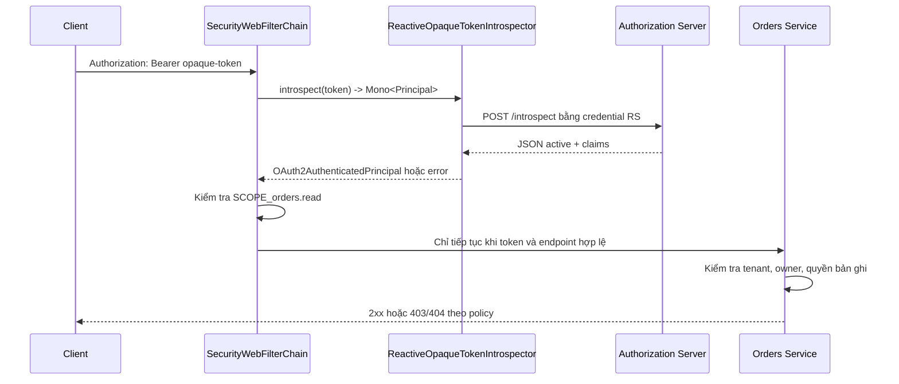

# SpringReactiveOpaqueTokenIntrospector và cấu hình theo phiên bản

## 1. Bài toán: cùng một ý tưởng introspection nhưng mã cấu hình không giống nhau giữa các phiên bản

Giả sử một ứng dụng **Spring WebFlux** làm OAuth 2.0 Resource Server. API bảo vệ đơn hàng bằng opaque access token:

```http
GET /api/orders/42 HTTP/1.1
Host: orders.example.com
Authorization: Bearer <opaque-access-token>
Accept: application/json
```

Resource Server không thể tự xác minh chữ ký của chuỗi opaque theo cách dùng JWT decoder. Thay vào đó, nó gửi token đến **OAuth 2.0 Token Introspection Endpoint** của Authorization Server (AS), nhận các thuộc tính token và quyết định có cho request tiếp tục hay không.

Spring Security có lớp `SpringReactiveOpaqueTokenIntrospector` để thực hiện phần này cho **stack WebFlux/reactive**. Một sự cố phổ biến khi học và nâng cấp framework là gặp các cách tạo đối tượng khác nhau:

```java
// Cách thường thấy trong code sử dụng Spring Security 5.6–6.4:
new SpringReactiveOpaqueTokenIntrospector(
    introspectionUri, clientId, clientSecret);
```

và:

```java
// Cách khuyến nghị từ Spring Security 6.5 trở lên:
SpringReactiveOpaqueTokenIntrospector
    .withIntrospectionUri(introspectionUri)
    .clientId(clientId)
    .clientSecret(clientSecret)
    .build();
```

Hai đoạn phục vụ cùng mục tiêu, nhưng **khác vòng đời API**. Factory builder `withIntrospectionUri(...)` xuất hiện **từ Spring Security 6.5**; constructor ba `String` bị đánh dấu deprecated-for-removal từ 6.5. Nếu copy code builder vào project 6.4, bạn có thể gặp lỗi biên dịch; nếu giữ constructor cũ trong project mới, bạn có thể gặp deprecation warning và rủi ro khi nâng cấp tiếp.

**Mục tiêu bài học:** nắm rõ `SpringReactiveOpaqueTokenIntrospector` là gì, cách hoạt động, cách cấu hình từ property/DSL/bean, cách chọn API tương thích với phiên bản Spring Security, cùng những yêu cầu bảo mật và tính reactive không được bỏ qua.

### Sau bài học, bạn sẽ có khả năng

1. Giải thích `ReactiveOpaqueTokenIntrospector` và `SpringReactiveOpaqueTokenIntrospector` khác nhau ở cấp interface/implementation.
2. Hiểu luồng `Bearer token → introspection → principal → authorities → authorization` của WebFlux.
3. Chọn **builder từ 6.5+**, **constructor có ở các bản cũ**, và không nhầm với `NimbusReactiveOpaqueTokenIntrospector` legacy.
4. Sử dụng cấu hình Spring Boot `opaquetoken.*` khi chỉ cần introspection mặc định.
5. Tự tạo `@Bean ReactiveOpaqueTokenIntrospector` hoặc gắn introspector qua `ServerHttpSecurity` khi cần policy riêng.
6. Thiết kế custom `WebClient` và xử lý TLS, Basic client authentication, timeout mà không chặn event loop.
7. Bao `delegate.introspect(token)` để kiểm tra audience/Client/claims, tránh nhận token cấp cho API khác.
8. Giữ đúng scope mapping `SCOPE_`, error handling, đối tượng tenant và quyền nghiệp vụ.
9. Kiểm thử độc lập introspector và kiểm thử WebFlux HTTP mà không nhầm mock authentication với introspection thật.
10. Tra cứu tài liệu API đúng phiên bản khi migration, thay vì sao chép snippet của một bản khác.

---

## 2. Introspection hoạt động như thế nào?

### 2.1. Resource Server phải hỏi Authorization Server

Đối với opaque token, Resource Server thường không có thông tin để tự diễn giải chuỗi token. Nó sử dụng một introspection endpoint **được cấu hình trước** và credential mà AS cấp riêng cho bên gọi introspection.

Một request minh họa:

```http
POST /oauth2/introspect HTTP/1.1
Host: id.example.com
Authorization: Basic <credentials-of-resource-server>
Content-Type: application/x-www-form-urlencoded

token=<opaque-access-token>
```

Một response minh họa:

```json
{
  "active": true,
  "sub": "user-417",
  "client_id": "shop-web",
  "aud": ["orders-api"],
  "scope": "orders.read orders.write",
  "tenant_id": "tenant-alpha",
  "exp": 1893456000
}
```

Nếu token không được AS coi là hoạt động, response thường là:

```json
{
  "active": false
}
```

Theo RFC 7662, `active` là dấu hiệu về trạng thái token trong ngữ cảnh AS và bên introspect. Những thuộc tính như `scope`, `sub`, `client_id`, `aud`, `iss` hay `exp` có thể được công bố tùy hợp đồng.

Cần phân biệt **HTTP 200 từ introspection endpoint** với **`"active": true` trong body**: AS có thể trả HTTP 200 với `{"active":false}`; đó **không** phải token hợp lệ.

### 2.2. Dòng chảy trong Spring Security WebFlux



Trong WebFlux:

- `SecurityWebFilterChain` định nghĩa security filters/authorization rules.
- `ServerHttpSecurity` là DSL cấu hình WebFlux.
- `ReactiveOpaqueTokenIntrospector` là interface dùng để introspect token một cách reactive.
- `SpringReactiveOpaqueTokenIntrospector` là implementation Spring gọi HTTP introspection endpoint.
- Giá trị trả về `Mono<OAuth2AuthenticatedPrincipal>` tham gia vào reactive authentication pipeline.
- Sau khi authentication thành công, `BearerTokenAuthentication` chứa principal và các authorities được ánh xạ.

**Đừng nhầm với Servlet/MVC:** `HttpSecurity`, `SecurityFilterChain` và `OpaqueTokenIntrospector` không phải các kiểu cần dùng cho WebFlux reactive trong bài này.

### 2.3. `active=true` không thay thế phân quyền API

Ví dụ:

```json
{
  "active": true,
  "aud": ["billing-api"],
  "scope": "orders.read",
  "sub": "user-417"
}
```

Nếu hệ thống hiện tại là `orders-api` và yêu cầu audience `orders-api`, token vẫn phải bị từ chối dù `active=true` và scope trùng tên.

Một token đúng audience nhưng thiếu `orders.read` cũng không được xem endpoint đọc đơn hàng. Và một token đầy đủ scope vẫn cần kiểm tra tenant/owner của đơn hàng trong Service hoặc Repository.

Ba lớp phải tách rời:

```text
Token status / intended Resource Server
    → active, audience, issuer hoặc token contract

Endpoint authorization
    → SCOPE_orders.read, client policy, role

Object-level authorization
    → tenant, owner, membership, record ACL
```

---

## 3. API cốt lõi: interface, class và package

### 3.1. `ReactiveOpaqueTokenIntrospector`

Giao diện reactive có hình thức:

```java
package org.springframework.security.oauth2.server.resource.introspection;

public interface ReactiveOpaqueTokenIntrospector {
    Mono<OAuth2AuthenticatedPrincipal> introspect(String token);
}
```

Đây là **chữ ký rút gọn để minh họa**, không phải toàn bộ source của thư viện.

Đặc trưng:

- Nhận `String` là giá trị Bearer token.
- Trả một `Mono` mang principal đã được xác thực hoặc error signal.
- Không tự bắt buộc implementation phải dùng HTTP; có thể delegate đến AS, token store, cache có policy hoặc một service tin cậy khác.
- Khi token bị từ chối, implementation phải báo lỗi phù hợp, **không** tạo principal giả mạo.
- Không tự subscribe hoặc gọi `block()` trong đường xác thực.

### 3.2. `SpringReactiveOpaqueTokenIntrospector`

Tên fully qualified:

```text
org.springframework.security.oauth2.server.resource.introspection
  .SpringReactiveOpaqueTokenIntrospector
```

Lớp này là implementation `ReactiveOpaqueTokenIntrospector` dùng introspection endpoint OAuth 2.0. Nó có từ **Spring Security 5.6**.

Khác với tên class, `SpringReactiveOpaqueTokenIntrospector` không phải một `JwtDecoder`. Nó không cần mở/verify JWT token cục bộ để biết token active hay không, mà dựa vào phản hồi introspection từ AS đáng tin. AS có thể introspect cả chuỗi token trông giống JWT nếu hợp đồng yêu cầu, nhưng cách xác thực lúc đó vẫn là **introspection**.

### 3.3. `OAuth2AuthenticatedPrincipal` và `BearerTokenAuthentication`

Khi introspection thành công, kết quả thường có kiểu `OAuth2AuthenticatedPrincipal` với:

- `getName()`: tên principal theo mapping.
- `getAttributes()`: bản đồ claim/thuộc tính từ introspection đã được xử lý.
- `getAuthorities()`: các `GrantedAuthority` phục vụ authorization.
- `getAttribute("sub")`, `getAttribute("client_id")` ... nếu AS công bố.

Spring Security có thể tạo `BearerTokenAuthentication` từ principal. Đừng mặc định `@AuthenticationPrincipal Jwt` hoạt động ở chế độ opaque token; đó là kiểu thường dùng ở JWT Resource Server, không phải opaque principal mặc định.

Ví dụ Controller minh họa:

```java
@GetMapping("/api/whoami")
public Mono<Map<String, String>> whoami(
        @AuthenticationPrincipal OAuth2AuthenticatedPrincipal principal) {

    String subject = principal.getAttribute("sub");
    return Mono.just(Map.of(
        "subject", subject == null ? "" : subject));
}
```

Chỉ công bố những thông tin hợp đồng API cho phép. Endpoint này cần rule `authorizeExchange` tương ứng nếu default là deny-all.

---

## 4. Bảng phiên bản: chọn constructor, builder và converter API chính xác

Đây là phần quan trọng khi đọc ví dụ cũ và chuyển project.

| Spring Security | `SpringReactiveOpaqueTokenIntrospector` | Cách tạo phổ biến | Ghi chú |
|---|---|---|---|
| Trước 5.6 | Chưa có class này | Có thể gặp `NimbusReactiveOpaqueTokenIntrospector` ở project cũ | Cần tra cứu đúng version cụ thể |
| 5.6 đến 6.2 | Có | Constructor ba `String` hoặc constructor nhận `WebClient` | Không copy builder 6.5+ |
| 6.3 đến 6.4 | Có | Constructor; có `setAuthenticationConverter(...)` từ 6.3 | `NimbusReactiveOpaqueTokenIntrospector` là API cũ, bị khuyến nghị thay trong nhánh mới |
| 6.5.x | Có | **Builder `withIntrospectionUri(...).clientId(...).clientSecret(...).build()`** | Builder thêm từ 6.5; constructor ba `String` deprecated-for-removal |
| 7.0.x | Có | Builder được khuyến nghị | Không viết code mới phụ thuộc constructor deprecated nếu có thể |
| 7.1.x | Có | Builder; có thêm `postProcessor(...)` từ 7.1.0 | Cần đối chiếu patch version và mục đích customization |

Các điểm từ tài liệu API:

- `SpringReactiveOpaqueTokenIntrospector`: **Since 5.6**.
- `setAuthenticationConverter(...)`: **Since 6.3**.
- `withIntrospectionUri(...)` và `Builder`: **Since 6.5**.
- Constructor `(String introspectionUri, String clientId, String clientSecret)`: **@Deprecated(since="6.5", forRemoval=true)**; các tài liệu 7.1 vẫn ghi API này, nhưng không nên coi nó là tương lai ổn định.
- `Builder.postProcessor(...)`: **Since 7.1.0**; không dùng trong code phải biên dịch bằng 6.5.

Không suy ra rằng “đang dùng Java 17 nên chắc có builder”. **Phiên bản Spring Security artifact thực tế** mới quyết định API có mặt.

### 4.1. Vì sao project báo `Cannot resolve method 'withIntrospectionUri'`?

Có thể vì code lấy từ tài liệu 6.5/7.x nhưng dependency đang ở Spring Security 6.4 hoặc cũ hơn.

Giải pháp là:

1. Xác định version `spring-security-oauth2-resource-server` đang được ứng dụng dùng.
2. Nếu phải giữ 6.4, dùng API tương thích 6.4 như constructor phù hợp.
3. Nếu có kế hoạch nâng cấp, cập nhật BOM/dependency management một cách đồng bộ trước khi chuyển code sang builder.
4. Không “sửa” bằng cách import `SpringOpaqueTokenIntrospector` Servlet, vì class đó không implement interface reactive.

### 4.2. Vì sao project cảnh báo constructor deprecated?

Với bản 6.5 trở lên:

```java
new SpringReactiveOpaqueTokenIntrospector(
    uri, clientId, clientSecret);
```

có thể vẫn biên dịch nhưng bị IDE/compiler cảnh báo deprecation. Đó không phải bằng chứng runtime đã lỗi. Tuy nhiên, builder là cách thay thế nên dùng cho code mới trên version có hỗ trợ.

### 4.3. `NimbusReactiveOpaqueTokenIntrospector` và migration

Một số code legacy dùng:

```java
new NimbusReactiveOpaqueTokenIntrospector(
    uri, clientId, clientSecret);
```

Trong các nhánh Spring Security mới, lớp `NimbusReactiveOpaqueTokenIntrospector` đã được đánh dấu deprecated với hướng dẫn chuyển sang `SpringReactiveOpaqueTokenIntrospector`.

Khi đổi class, không chỉ sửa tên import: cần đối chiếu **hành vi HTTP authentication, claim mapping, converter, timeouts và unit/integration tests** của dự án, đặc biệt nếu code từng tùy biến introspection bằng các class Nimbus.

### 4.4. Mapping Spring Boot và Spring Security

Spring Boot quản lý phiên bản Spring Security qua dependency management/BOM. Không nên đoán phiên bản Security bằng cách nhìn duy nhất code `spring-boot-starter-webflux` hoặc version Java.

Với Gradle/Maven, hãy đọc **dependency graph/resolved versions** của project mình rồi chọn tài liệu Spring Security tương ứng. Đừng thêm một version `spring-security-oauth2-resource-server` lẻ không tương thích với các module Security khác để chỉ có phương thức builder.

Tài liệu chính thức có các nhánh `/6.4/`, `/6.5/`, `/7.0/` và bản hiện hành. Khi copy snippet, kiểm tra nhánh URL tài liệu và `Since:` trong Javadoc.

---

## 5. Cấu hình tối thiểu bằng Spring Boot properties — cách nên bắt đầu

Nếu chỉ cần gọi introspection endpoint và ánh xạ scope thông thường, **thường không cần tạo bean `SpringReactiveOpaqueTokenIntrospector` thủ công**.

### 5.1. Dependency

Ví dụ `build.gradle` cho một WebFlux API:

```groovy
dependencies {
    implementation 'org.springframework.boot:spring-boot-starter-webflux'
    implementation 'org.springframework.boot:spring-boot-starter-security'
    implementation 'org.springframework.boot:spring-boot-starter-oauth2-resource-server'

    testImplementation 'org.springframework.boot:spring-boot-starter-test'
    testImplementation 'org.springframework.security:spring-security-test'
    testImplementation 'io.projectreactor:reactor-test'
}
```

Spring Boot/plugin/dependency management và Java toolchain phải tương thích với Spring Security version đang dùng.

**Kiểm tra web stack thật:** nếu đồng thời đưa `spring-boot-starter-web` và `spring-boot-starter-webflux`, ứng dụng có thể chọn MVC/Servlet theo mặc định; khi đó cấu hình `SecurityWebFilterChain` có thể không chạy như kỳ vọng. Bài này giả định ứng dụng thực sự là WebFlux Resource Server.

### 5.2. `application.yml`

```yaml
spring:
  security:
    oauth2:
      resourceserver:
        opaquetoken:
          introspection-uri: https://id.example.com/oauth2/introspect
          client-id: ${INTROSPECTION_CLIENT_ID}
          client-secret: ${INTROSPECTION_CLIENT_SECRET}
```

Giải thích:

- `introspection-uri`: endpoint do AS tin cậy cung cấp, không lấy từ URL Client yêu cầu.
- `client-id`: định danh Resource Server/introspection Client theo hợp đồng AS.
- `client-secret`: bí mật để xác thực với AS; phải lấy từ secret manager hoặc biến môi trường an toàn.
- `opaquetoken` là **tên property đúng** trong Spring Boot Resource Server configuration (viết liền, không phải `opaque-token` ở vị trí này).

**Không commit credential thật vào repository**, không log HTTP Basic header hoặc form body chứa access token.

### 5.3. `SecurityWebFilterChain` đơn giản

```java
package com.example.orders;

import org.springframework.context.annotation.Bean;
import org.springframework.context.annotation.Configuration;
import org.springframework.http.HttpMethod;
import org.springframework.security.config.Customizer;
import org.springframework.security.config.annotation.web.reactive.EnableWebFluxSecurity;
import org.springframework.security.config.web.server.ServerHttpSecurity;
import org.springframework.security.web.server.SecurityWebFilterChain;

@Configuration
@EnableWebFluxSecurity
public class SecurityConfig {

    @Bean
    SecurityWebFilterChain apiSecurity(ServerHttpSecurity http) {
        return http
            .csrf(ServerHttpSecurity.CsrfSpec::disable)
            .authorizeExchange(exchanges -> exchanges
                .pathMatchers("/api/public/**").permitAll()
                .pathMatchers(HttpMethod.GET, "/api/orders/**")
                    .hasAuthority("SCOPE_orders.read")
                .pathMatchers(HttpMethod.POST, "/api/orders")
                    .hasAuthority("SCOPE_orders.write")
                .anyExchange().denyAll()
            )
            .oauth2ResourceServer(oauth2 -> oauth2
                .opaqueToken(Customizer.withDefaults()))
            .build();
    }
}
```

Đây là cách cấu hình idiomatic cho WebFlux:

- `ServerHttpSecurity`, `SecurityWebFilterChain` và `authorizeExchange` thuộc stack reactive.
- `opaqueToken(Customizer.withDefaults())` bật introspection.
- Spring Boot sẽ sử dụng cấu hình `opaquetoken` để cung cấp introspector mặc định khi phù hợp.
- `SCOPE_orders.read` được kiểm tra sau khi Authentication được tạo từ kết quả introspection.
- `anyExchange().denyAll()` chỉ cho phép những thao tác có rule tường minh.

**CSRF:** ví dụ tắt CSRF cho API thuần Bearer header, không phải ứng dụng trình duyệt có session/cookie authentication. Nếu ứng dụng có web session, phải thiết kế chain riêng hoặc chính sách CSRF phù hợp.

### 5.4. Cấu hình này làm những gì?

Với request:

```http
GET /api/orders/42 HTTP/1.1
Authorization: Bearer opaque-demo-token
```

Spring Security sẽ cố:

1. Trích Bearer credential.
2. Gọi reactive introspector tới endpoint tin cậy.
3. Kiểm tra kết quả introspection và trạng thái `active`.
4. Tạo `OAuth2AuthenticatedPrincipal` với attributes/authorities theo implementation.
5. Dùng `authorizeExchange` kiểm tra `SCOPE_orders.read`.
6. Cho phép vào Controller/Service nếu đạt policy.
7. Tiếp tục kiểm tra tenant, owner và object-level authorization trong nghiệp vụ.

Không token ở endpoint protected thường nhận `401`; token đúng nhưng thiếu scope thường nhận `403`.

### 5.5. Khi nào không cần bean custom?

Nếu AS trả `scope` theo profile tương thích, Resource Server chỉ cần `active` + scope và không có yêu cầu riêng về aud/client/claim mapping, property + DSL thường đã đủ để bắt đầu.

**Nhưng** nếu API cần audience binding hoặc các điều kiện token contract khác mà AS không tự đảm bảo, bạn phải thêm policy phù hợp. Không coi cấu hình mặc định là bằng chứng mọi claim nghiệp vụ đều đã được kiểm tra.

---

## 6. Cấu hình từ Spring Security 6.5+: builder `withIntrospectionUri`

### 6.1. Bean dùng builder

Ví dụ Spring Security **6.5 trở lên**:

```java
package com.example.orders;

import org.springframework.beans.factory.annotation.Value;
import org.springframework.context.annotation.Bean;
import org.springframework.context.annotation.Configuration;
import org.springframework.security.oauth2.server.resource.introspection.ReactiveOpaqueTokenIntrospector;
import org.springframework.security.oauth2.server.resource.introspection.SpringReactiveOpaqueTokenIntrospector;

@Configuration
public class IntrospectionConfig {

    @Bean
    ReactiveOpaqueTokenIntrospector introspector(
            @Value("${spring.security.oauth2.resourceserver.opaquetoken.introspection-uri}")
            String introspectionUri,
            @Value("${spring.security.oauth2.resourceserver.opaquetoken.client-id}")
            String clientId,
            @Value("${spring.security.oauth2.resourceserver.opaquetoken.client-secret}")
            String clientSecret) {

        return SpringReactiveOpaqueTokenIntrospector
            .withIntrospectionUri(introspectionUri)
            .clientId(clientId)
            .clientSecret(clientSecret)
            .build();
    }
}
```

Ưu điểm:

- Theo API khuyến nghị từ 6.5.
- Không dùng constructor ba `String` đã deprecated.
- Nguồn configuration tập trung, dễ inject từ secret store.
- Bean vẫn có kiểu interface `ReactiveOpaqueTokenIntrospector`, tiện thay thế/decorate sau này.

**Lưu ý:** Với trường hợp không có custom policy, bean này gần như lặp lại Spring Boot auto-configuration; hãy chỉ thêm khi có lý do rõ ràng.

### 6.2. Builder tự mã hóa Client credentials

Javadoc của `Builder.clientId(...)` và `Builder.clientSecret(...)` nêu rằng builder **tự encode giá trị được cung cấp**. Vì vậy bạn nên truyền **Client ID và Client secret nguyên bản (unencoded)**.

Ví dụ nếu secret có ký tự `+` hoặc dấu cách:

```text
raw client secret:  demo+secret 42
```

không tự URL-encode thành `demo%2Bsecret%2042` rồi truyền vào builder. Encode hai lần có thể làm authentication tới AS thất bại.

Với code legacy dùng constructor ở những bản cũ, cần xem hợp đồng constructor và implementation của chính version đó trước khi thay cách xử lý special characters. **Không dùng một mẹo encode áp dụng mù cho tất cả API các phiên bản.**

### 6.3. Bean custom có thể thay auto-config

Spring Boot thông thường chỉ tạo default `ReactiveOpaqueTokenIntrospector` nếu không có bean custom tương thích. Khi bạn khai một bean cùng kiểu, nó có thể được dùng thay default theo auto-configuration.

Nếu có nhiều bean `ReactiveOpaqueTokenIntrospector` hoặc nhiều `SecurityWebFilterChain`, cần xác định rõ bean nào được dùng cho API nào. Dùng `.introspector(...)` trong DSL để tránh mơ hồ khi cần.

### 6.4. Từ 7.1 có `postProcessor(...)` trên Builder

Ở Spring Security **7.1.0 trở lên**, builder có thêm phương thức `postProcessor(Consumer<SpringReactiveOpaqueTokenIntrospector>)` để cấu hình instance sau khi nó được build.

Phương thức này **không có trong 6.5 hay 7.0**. Nếu source project phải chạy trên nhiều nhánh phiên bản, không dựa vào nó.

Chẳng hạn, nếu bạn chỉ cần một `setAuthenticationConverter(...)` và không cần dùng builder post-processor, có thể làm theo cách tường minh:

```java
SpringReactiveOpaqueTokenIntrospector introspector =
    SpringReactiveOpaqueTokenIntrospector
        .withIntrospectionUri(uri)
        .clientId(clientId)
        .clientSecret(clientSecret)
        .build();

// API setAuthenticationConverter có từ 6.3.
// Đặt converter đã được thiết kế đúng claim/authority contract:
introspector.setAuthenticationConverter(myConverter);
```

`myConverter` là converter minh họa cần được định nghĩa với kiểu reactive phù hợp, không phải biến tự có sẵn trong framework. Mục 11 giải thích sâu hơn về converter.

---

## 7. Cấu hình Spring Security 5.6–6.4: constructor

### 7.1. Constructor ba tham số

Với các bản có class `SpringReactiveOpaqueTokenIntrospector` nhưng **chưa có builder 6.5**, cách tạo phổ biến là:

```java
@Bean
ReactiveOpaqueTokenIntrospector introspector(
        @Value("${spring.security.oauth2.resourceserver.opaquetoken.introspection-uri}")
        String uri,
        @Value("${spring.security.oauth2.resourceserver.opaquetoken.client-id}")
        String clientId,
        @Value("${spring.security.oauth2.resourceserver.opaquetoken.client-secret}")
        String clientSecret) {

    return new SpringReactiveOpaqueTokenIntrospector(
        uri, clientId, clientSecret);
}
```

Đây là **ví dụ cho nhánh API cũ**, không phải lựa chọn ưu tiên cho 6.5+.

Giữ nguyên phần interface return type để Spring Security dễ wiring; khác biệt nằm ở cách khởi tạo implementation.

### 7.2. Constructor nhận WebClient

Một dạng constructor khác:

```java
new SpringReactiveOpaqueTokenIntrospector(
    introspectionUri,
    configuredWebClient);
```

Hình thức này có ở các version nêu trên và phù hợp khi cần custom transport như timeout/HTTP Client authentication.

Điểm rất quan trọng: với constructor nhận `WebClient`, **WebClient được cung cấp phải được cấu hình đúng authentication cho introspection endpoint**. Bạn không nên cho rằng constructor sẽ tự thêm Basic credential khi nó chỉ nhận URI và WebClient.

Ví dụ WebClient cần có `Authorization: Basic ...` hoặc cơ chế AS yêu cầu, TLS, timeout, connection pool, proxy và các policy cần thiết.

### 7.3. Tại sao không cứ giữ constructor mãi?

Constructor ba `String` được đánh dấu deprecated-for-removal từ 6.5. Việc nó vẫn xuất hiện trong Javadoc 7.1 không bảo đảm nó sẽ tồn tại mãi.

Nếu codebase đã ở 6.5+ và không có lý do tương thích ngược, migration sang builder sớm giúp giảm technical debt và bám theo API công khai được khuyến nghị.

---

## 8. Cấu hình qua DSL: property, `introspectionUri` và `introspector`

Spring Security cung cấp nhiều vị trí cấu hình opaque-token introspection. Chúng không hoàn toàn tương đương về ưu tiên.

### 8.1. Property — cấu hình mặc định

```yaml
spring:
  security:
    oauth2:
      resourceserver:
        opaquetoken:
          introspection-uri: https://id.example.com/oauth2/introspect
          client-id: ${INTROSPECTION_CLIENT_ID}
          client-secret: ${INTROSPECTION_CLIENT_SECRET}
```

Dùng khi không cần tùy biến sâu. Spring Boot auto-configuration thường cung cấp bean introspector phù hợp.

### 8.2. DSL — khai báo trực tiếp URI và credentials

```java
@Bean
SecurityWebFilterChain security(ServerHttpSecurity http) {
    return http
        .authorizeExchange(exchanges -> exchanges
            .anyExchange().authenticated())
        .oauth2ResourceServer(oauth2 -> oauth2
            .opaqueToken(opaque -> opaque
                .introspectionUri(
                    "https://id.example.com/oauth2/introspect")
                .introspectionClientCredentials(
                    "resource-server-client",
                    "secret-from-secure-config")))
        .build();
}
```

Đây là ví dụ trực quan để thấy API, **không phải cách nên hardcode secret production**.

Ở WebFlux DSL có `introspectionUri(...)` và `introspectionClientCredentials(...)`. Khi thiết lập qua DSL, cấu hình này có thể **ghi đè property** tương ứng trong Spring Boot.

### 8.3. DSL — gắn custom introspector

```java
@Bean
SecurityWebFilterChain apiSecurity(
        ServerHttpSecurity http,
        ReactiveOpaqueTokenIntrospector introspector) {

    return http
        .authorizeExchange(exchanges -> exchanges
            .pathMatchers("/api/public/**").permitAll()
            .pathMatchers("/api/orders/**")
                .hasAuthority("SCOPE_orders.read")
            .anyExchange().denyAll())
        .oauth2ResourceServer(oauth2 -> oauth2
            .opaqueToken(opaque -> opaque
                .introspector(introspector)))
        .build();
}
```

`introspector(...)` cho phép thay **toàn bộ component introspection** được dùng trong chain này. Thích hợp khi bạn có delegate + audience policy, custom transport hoặc converter.

### 8.4. Bảng lựa chọn

| Cách | Khi nào dùng | Điểm cần chú ý |
|---|---|---|
| Boot `opaquetoken.*` | Cấu hình tiêu chuẩn | Ít code, theo BOM/auto-config |
| WebFlux DSL `introspectionUri + introspectionClientCredentials` | Muốn chỉ định trực tiếp cho chain | Có thể ghi đè properties; không hardcode secret |
| `@Bean ReactiveOpaqueTokenIntrospector` | Muốn decorate/override default | Tránh nhiều bean cùng kiểu mơ hồ |
| DSL `.introspector(custom)` | Muốn chỉ rõ introspector cho chain | Có ưu tiên với chain được cấu hình |
| `SpringReactiveOpaqueTokenIntrospector.withIntrospectionUri(...)` | Bean custom trên Spring Security 6.5+ | Builder tự encode credentials |
| Constructor `new SpringReactiveOpaqueTokenIntrospector(...)` | Code nhánh 5.6–6.4 | Deprecated từ 6.5 với constructor ba `String` |
| Constructor nhận `WebClient` | Custom HTTP transport | WebClient phải tự có authentication đúng |

Một cấu hình dùng cả properties, bean custom và DSL tùy biến có thể rất khó đọc. **Nên chọn một nguồn sự thật rõ ràng** rồi dùng bean/DSL khi có yêu cầu bổ sung có căn cứ.

---

## 9. Custom WebClient: timeout, TLS, credentials và giữ non-blocking

`SpringReactiveOpaqueTokenIntrospector` có thể được xây với `WebClient` đã cấu hình. Đây là lựa chọn khi AS đòi yêu cầu kết nối khác mặc định.

### 9.1. Ví dụ custom WebClient với Reactor Netty

Một cấu hình dành cho các bản có constructor `(String, WebClient)`:

```java
package com.example.orders;

import java.time.Duration;
import org.springframework.beans.factory.annotation.Value;
import org.springframework.context.annotation.Bean;
import org.springframework.context.annotation.Configuration;
import org.springframework.http.client.reactive.ReactorClientHttpConnector;
import org.springframework.security.oauth2.server.resource.introspection.ReactiveOpaqueTokenIntrospector;
import org.springframework.security.oauth2.server.resource.introspection.SpringReactiveOpaqueTokenIntrospector;
import org.springframework.web.reactive.function.client.WebClient;
import reactor.netty.http.client.HttpClient;

@Configuration
public class CustomIntrospectionHttpConfig {

    @Bean
    ReactiveOpaqueTokenIntrospector introspector(
            @Value("${spring.security.oauth2.resourceserver.opaquetoken.introspection-uri}")
            String uri,
            @Value("${spring.security.oauth2.resourceserver.opaquetoken.client-id}")
            String clientId,
            @Value("${spring.security.oauth2.resourceserver.opaquetoken.client-secret}")
            String clientSecret) {

        HttpClient client = HttpClient.create()
            .responseTimeout(Duration.ofSeconds(3));

        WebClient introspectionWebClient =
            WebClient.builder()
                .clientConnector(
                    new ReactorClientHttpConnector(client))
                .defaultHeaders(headers ->
                    headers.setBasicAuth(clientId, clientSecret))
                .build();

        return new SpringReactiveOpaqueTokenIntrospector(
            uri, introspectionWebClient);
    }
}
```

Đây là một phương án minh họa HTTP Basic client authentication khi AS cho phép. Nếu AS dùng `private_key_jwt`, mTLS hoặc một phương thức client authentication khác, phải cấu hình theo đúng hợp đồng, không ép dùng Basic.

### 9.2. Timeout không phải toàn bộ chính sách chịu lỗi

`responseTimeout` trong Reactor Netty đặt timeout cho response theo semantics của client. Với hệ thống production còn nên cân nhắc:

- TCP connect timeout.
- TLS handshake timeout.
- Connection pool size và pending acquisition.
- DNS/proxy behavior.
- Tổng deadline theo request.
- Giới hạn concurrent introspection requests.
- Giới hạn retry với lỗi có thể retry.
- Metrics latency p95/p99 và AS availability.

Một response chậm từ AS có thể khiến nhiều request của API đang chờ, dù event loop không bị chặn theo kiểu JDBC/RestTemplate. **Reactive không tự giải quyết capacity, timeout và overload**.

### 9.3. Không dùng RestTemplate rồi bọc Mono.just

Sai:

```java
@Override
public Mono<OAuth2AuthenticatedPrincipal> introspect(String token) {
    OAuth2AuthenticatedPrincipal principal =
        blockingIntrospector.introspect(token);

    return Mono.just(principal);
}
```

Lời gọi đồng bộ đã diễn ra trên thread hiện tại trước khi Mono được tạo; event loop có thể bị chặn.

Ưu tiên `SpringReactiveOpaqueTokenIntrospector` với `WebClient`. Nếu bất khả kháng phải dùng implementation blocking tạm thời, dùng:

```java
return Mono.fromCallable(() ->
        legacyIntrospector.introspect(token))
    .subscribeOn(Schedulers.boundedElastic());
```

và giới hạn worker/HTTP timeout. Đây chỉ là **adapter chuyển tiếp**: blocking call vẫn chiếm một worker thread và có thể không bị dừng ngay khi Reactor timeout.

### 9.4. Không để Client tự chọn introspection URL

Sai về nguyên tắc:

```java
String url = request.getHeader("X-Introspection-Endpoint");
```

Rồi dùng URL này để gửi access token sẽ tạo nguy cơ **SSRF** và rò rỉ Bearer token tới server không tin cậy.

Introspection URL phải đến từ cấu hình/allowlist đáng tin. Với multi-issuer, cần cơ chế chọn endpoint tin cậy rõ ràng; không thử gửi cùng một token tới các AS ngẫu nhiên cho đến khi một nơi trả `active=true`.

---

## 10. Cấu hình các chain WebFlux và phân quyền HTTP

Một ứng dụng có thể có:

```text
/api/**  → opaque Bearer Resource Server
/web/**  → OIDC/web session login
```

Khi nhiều `SecurityWebFilterChain`, Spring Security WebFlux chọn chain theo matcher và thứ tự phù hợp.

### 10.1. Chain API riêng

```java
package com.example.orders;

import org.springframework.context.annotation.Bean;
import org.springframework.context.annotation.Configuration;
import org.springframework.core.annotation.Order;
import org.springframework.http.HttpMethod;
import org.springframework.security.config.Customizer;
import org.springframework.security.config.web.server.ServerHttpSecurity;
import org.springframework.security.web.server.SecurityWebFilterChain;
import org.springframework.security.web.server.util.matcher.ServerWebExchangeMatchers;

@Configuration
public class ApiChainsConfig {

    @Bean
    @Order(1)
    SecurityWebFilterChain apiChain(
            ServerHttpSecurity http,
            ReactiveOpaqueTokenIntrospector introspector) {

        return http
            .securityMatcher(
                ServerWebExchangeMatchers.pathMatchers("/api/**"))
            .csrf(ServerHttpSecurity.CsrfSpec::disable)
            .authorizeExchange(exchanges -> exchanges
                .pathMatchers(HttpMethod.GET, "/api/public/ping")
                    .permitAll()
                .pathMatchers(HttpMethod.GET, "/api/orders/**")
                    .hasAuthority("SCOPE_orders.read")
                .pathMatchers(HttpMethod.POST, "/api/orders")
                    .hasAuthority("SCOPE_orders.write")
                .anyExchange().denyAll())
            .oauth2ResourceServer(oauth2 -> oauth2
                .opaqueToken(opaque ->
                    opaque.introspector(introspector)))
            .build();
    }
}
```

Các imports bổ sung `ReactiveOpaqueTokenIntrospector` và các class WebFlux đã được nêu ở các ví dụ trước.

**Cần có chain khác/catch-all cho URL nằm ngoài `/api/**`** nếu ứng dụng còn phục vụ web endpoints; `anyExchange().denyAll()` trong API chain chỉ bảo vệ request đã match chain đó.

### 10.2. Thứ tự matcher và rule

`securityMatcher(...)` chọn cả chain, còn `pathMatchers(...)` trong `authorizeExchange` chọn rule bên trong chain được chọn.

Không đặt catch-all web chain trước API chain, vì request API có thể nhận redirect tới login thay vì Bearer challenge `401`.

### 10.3. CORS và preflight

Browser có thể gửi `OPTIONS` preflight mà không mang access token. Cần cấu hình CORS phù hợp trên API chain với `CorsConfigurationSource` cho phép origin/method/header mong muốn, không biến preflight thành yêu cầu introspection vô nghĩa.

Không dùng `permitAll("/api/**")` chỉ để sửa lỗi CORS; request thật vẫn cần token và scope.

---

## 11. Custom decorator: audience, Client và claim contract trước authorization

### 11.1. Vì sao cần decorator?

Default introspector giải quyết **token introspection** và ánh xạ metadata theo profile Spring Security. Nhưng API có thể yêu cầu thêm:

- Audience phải chứa `orders-api`.
- `client_id` phải nằm trong allowlist dành cho endpoint nội bộ.
- Token phải có subject hoặc tenant claim đúng kiểu.
- Token được AS xác nhận là access token phù hợp contract.
- Một claim bắt buộc cần được chuẩn hóa trước khi tạo principal.

**Không được kết luận `active=true` là đủ**. Những yêu cầu ngoài mặc định phải được AS bảo đảm tường minh hoặc kiểm tra tại Resource Server.

### 11.2. Decorator kiểm tra audience

Ví dụ độc lập với cách tạo delegate:

```java
package com.example.orders;

import java.util.Collection;
import org.springframework.security.oauth2.core.OAuth2AuthenticatedPrincipal;
import org.springframework.security.oauth2.server.resource.introspection.BadOpaqueTokenException;
import org.springframework.security.oauth2.server.resource.introspection.ReactiveOpaqueTokenIntrospector;
import reactor.core.publisher.Mono;

public final class AudienceCheckingIntrospector
        implements ReactiveOpaqueTokenIntrospector {

    private final ReactiveOpaqueTokenIntrospector delegate;
    private final String expectedAudience;

    public AudienceCheckingIntrospector(
            ReactiveOpaqueTokenIntrospector delegate,
            String expectedAudience) {

        this.delegate = delegate;
        this.expectedAudience = expectedAudience;
    }

    @Override
    public Mono<OAuth2AuthenticatedPrincipal> introspect(
            String token) {

        return delegate.introspect(token)
            .flatMap(principal -> {
                Object audience = principal.getAttribute("aud");

                boolean allowed =
                    expectedAudience.equals(audience)
                    || (audience instanceof Collection<?> values
                        && values.contains(expectedAudience));

                if (!allowed) {
                    return Mono.error(
                        new BadOpaqueTokenException(
                            "Token audience not accepted"));
                }

                return Mono.just(principal);
            });
    }
}
```

Điều kiện này chấp nhận:

```json
{"aud": "orders-api"}
```

hoặc:

```json
{"aud": ["orders-api", "reports-api"]}
```

nhưng từ chối:

```json
{"aud": ["billing-api"]}
```

hoặc response không có `aud`.

So khớp là **exact identifier**; không dùng `String.contains("orders-api")` vì `orders-api-admin` có thể bị nhận nhầm.

Đây là policy phù hợp khi **hợp đồng quy định `aud` bắt buộc**. Nếu AS không công bố `aud` nhưng thực hiện resource-specific introspection bằng danh tính Resource Server gọi AS, phải xác minh bằng tài liệu và integration tests trước khi chọn cơ chế tương ứng.

### 11.3. Wiring decorator cho Spring Security 6.5+

```java
@Configuration
public class PolicyIntrospectorConfig {

    @Bean
    ReactiveOpaqueTokenIntrospector introspector(
            @Value("${spring.security.oauth2.resourceserver.opaquetoken.introspection-uri}")
            String uri,
            @Value("${spring.security.oauth2.resourceserver.opaquetoken.client-id}")
            String clientId,
            @Value("${spring.security.oauth2.resourceserver.opaquetoken.client-secret}")
            String clientSecret) {

        ReactiveOpaqueTokenIntrospector delegate =
            SpringReactiveOpaqueTokenIntrospector
                .withIntrospectionUri(uri)
                .clientId(clientId)
                .clientSecret(clientSecret)
                .build();

        return new AudienceCheckingIntrospector(
            delegate, "orders-api");
    }
}
```

Đây là phương án **thay thế** `IntrospectionConfig` ở mục 6, không khai báo hai bean `ReactiveOpaqueTokenIntrospector` cạnh tranh nếu không có chủ đích.

Để dùng trên 6.4 hoặc cũ hơn, thay **chỉ bước khởi tạo delegate** bằng constructor tương thích. Lớp decorator vẫn dùng interface `ReactiveOpaqueTokenIntrospector`.

### 11.4. Kết hợp Client ID và tenant

Một số endpoint cần Client allowlist:

```java
String clientId = principal.getAttribute("client_id");

if (!allowedClients.contains(clientId)) {
    return Mono.error(
        new BadOpaqueTokenException("Client not accepted"));
}
```

Đoạn này chỉ minh họa token-level Client binding. Nên quyết định **policy này áp dụng cho toàn API hay chỉ endpoint cụ thể**. Không tự coi `client_id` tương đương `aud` và không lấy danh sách Client được phép từ HTTP body/header.

Nếu quyền Client phụ thuộc tenant hoặc trạng thái hiện hành trong DB, hãy dùng một **ReactiveAuthorizationManager** hoặc service dùng I/O reactive phù hợp; không chặn event loop bằng JDBC trong decorator.

### 11.5. Phân biệt lỗi token và quyền

- Audience không đúng điều kiện chấp nhận token → thường xử lý như authentication failure, trả `401`.
- Token được chấp nhận nhưng thiếu authority đọc đơn hàng → authorization failure, thường `403`.
- Có authority nhưng order không thuộc tenant/owner → Service từ chối `403` hoặc `404` theo policy.

Không cần cố biến tất cả thành `invalid_token` hay tất cả thành `403`. Nơi thực thi điều kiện giúp phản ánh ý nghĩa lỗi đúng.

---

## 12. Custom principal và authority mapping: từ 6.3 có `setAuthenticationConverter`

### 12.1. Converter làm gì?

`SpringReactiveOpaqueTokenIntrospector` cung cấp:

```java
setAuthenticationConverter(
    Converter<OAuth2TokenIntrospectionClaimAccessor,
              Mono<? extends OAuth2AuthenticatedPrincipal>>
);
```

Theo Javadoc, API này có từ **Spring Security 6.3**. Nó dùng để chuyển các claim từ introspection thành principal theo policy của ứng dụng.

Nếu chỉ muốn thêm hoặc chỉnh authorities **sau khi** delegate đã xử lý introspection, việc decorate kết quả principal bằng `map(...)` thường dễ hiểu và ít phụ thuộc implementation hơn.

### 12.2. Scope mapping mặc định

Introspection response:

```json
{
  "active": true,
  "scope": "orders.read orders.write",
  "sub": "user-417"
}
```

Theo mapping thông dụng Spring Security, mỗi scope trở thành một `GrantedAuthority`:

```text
SCOPE_orders.read
SCOPE_orders.write
```

Với URL rule:

```java
.pathMatchers(HttpMethod.GET, "/api/orders/**")
    .hasAuthority("SCOPE_orders.read")
```

Đừng nhầm `hasAuthority("orders.read")` với `hasAuthority("SCOPE_orders.read")`, và đừng dùng `hasRole("orders.read")` để kiểm tra scope.

### 12.3. Decorate principal nhưng giữ authorities

Ví dụ sau vẫn giữ authority mặc định, đồng thời minh họa cách đóng gói lại principal khi thật sự cần:

```java
package com.example.orders;

import org.springframework.security.oauth2.core.OAuth2AuthenticatedPrincipal;
import org.springframework.security.oauth2.core.DefaultOAuth2AuthenticatedPrincipal;
import org.springframework.security.oauth2.server.resource.introspection.ReactiveOpaqueTokenIntrospector;
import reactor.core.publisher.Mono;

public final class PrincipalMappingIntrospector
        implements ReactiveOpaqueTokenIntrospector {

    private final ReactiveOpaqueTokenIntrospector delegate;

    public PrincipalMappingIntrospector(
            ReactiveOpaqueTokenIntrospector delegate) {
        this.delegate = delegate;
    }

    @Override
    public Mono<OAuth2AuthenticatedPrincipal> introspect(
            String token) {

        return delegate.introspect(token)
            .map(principal ->
                new DefaultOAuth2AuthenticatedPrincipal(
                    principal.getName(),
                    principal.getAttributes(),
                    principal.getAuthorities()));
    }
}
```

Ví dụ này **không đổi quyền**, nên thực tế không cần wrapper chỉ để làm như vậy; nó giúp minh họa constructor. Khi custom mapping, bạn phải bảo đảm giữ đúng các `SCOPE_...` authorities từ AS và không cấp `ROLE_ADMIN` chỉ vì Client tự khai một thuộc tính trong request.

### 12.4. Khi muốn thêm quyền từ database

Giả sử cần tra role kế toán tenant hiện hành, hãy dùng nguồn quyền đáng tin và repository reactive:

```java
return delegate.introspect(token)
    .flatMap(principal -> membershipService
        .loadMembership(
            principal.getAttribute("sub"),
            principal.getAttribute("tenant_id"))
        .map(membership ->
            createPrincipalWithAllowedAuthorities(
                principal, membership)));
```

`membershipService.loadMembership(...)` phải trả `Mono<Membership>` dựa trên I/O không chặn (R2DBC/WebClient), và `createPrincipalWithAllowedAuthorities(...)` là hàm minh họa cần tự triển khai.

Không dùng:

```java
// KHÔNG NÊN trong callback chạy trên event loop:
return delegate.introspect(token)
    .map(principal -> jdbcDao.loadMembership(
        principal.getAttribute("sub")));
```

Đây là JDBC blocking ẩn trong `map`. Nếu chưa thể đổi, cần adapter `Mono.fromCallable(...).subscribeOn(Schedulers.boundedElastic())` có giới hạn. Không coi `setAuthenticationConverter` là nơi đương nhiên phù hợp cho mọi truy vấn DB: việc converter có thể trả `Mono` không thay thế quyết định đặt business policy đúng tầng.

### 12.5. Khác biệt version của converter

- **5.6–6.2:** Không dùng `setAuthenticationConverter` theo API Since 6.3; customize qua decorator hoặc cách extension phù hợp phiên bản.
- **6.3–6.4:** Có converter API, nhưng chưa có builder.
- **6.5+ và 7.x:** Có cả converter và builder.
- **7.1+:** Có thêm builder `postProcessor` để thực hiện một số tùy chỉnh sau build.

Không trộn những API chỉ có ở version sau vào code phục vụ version trước.

---

## 13. Opaque token không chỉ có một loại response: các trường hợp cần diễn giải

### 13.1. `active=false`

```json
{
  "active": false
}
```

Resource Server không được chấp nhận token; protected endpoint thường trả `401` với Bearer challenge.

### 13.2. `active=true`, sai audience

```json
{
  "active": true,
  "aud": ["billing-api"],
  "scope": "orders.read"
}
```

`AudienceCheckingIntrospector` phải từ chối nếu API yêu cầu `orders-api`.

### 13.3. `active=true`, đúng audience nhưng thiếu scope

```json
{
  "active": true,
  "aud": ["orders-api"],
  "scope": "profile.read"
}
```

Token được introspect và đáp ứng audience policy, nhưng endpoint yêu cầu `SCOPE_orders.read` nên thường trả `403`.

### 13.4. `active=true`, đúng scope nhưng sai tenant

```json
{
  "active": true,
  "aud": ["orders-api"],
  "scope": "orders.read",
  "sub": "user-417",
  "tenant_id": "tenant-alpha"
}
```

Request:

```http
GET /api/tenants/tenant-beta/orders/42 HTTP/1.1
Authorization: Bearer <valid-alpha-token>
```

Bộ lọc cần xác minh tenant từ principal/entitlement và truy vấn giới hạn tenant/owner. **Không tin `tenant-beta` trong URL là quyền được cấp**, và không lấy toàn bộ orders rồi filter sau.

### 13.5. AS trả lỗi HTTP hoặc không truy cập được

Nếu introspection endpoint timeout, TLS lỗi, HTTP 401 do credential RS sai hoặc HTTP 5xx, Resource Server không thể kết luận token `active=false` từ response không có. Nó phải **fail safely**, không tạo principal hợp lệ hoặc trả dữ liệu.

Tùy exception pipeline, API có thể trả lỗi server/upstream thay vì `401 invalid_token`. Cần phân biệt trong log/metrics và không in raw access token.

### 13.6. HTTP status matrix

| Input | Introspection/token-level | Endpoint/business | Kết quả thường gặp |
|---|---|---|---|
| Protected request không Bearer | Không introspect | Chưa xác thực | `401` |
| Token inactive | `active=false` | Không chạy | `401` |
| Token active sai audience | Validator từ chối | Không chạy | `401` |
| Token active, thiếu aud bắt buộc | Validator từ chối | Không chạy | `401` |
| Token đúng aud, thiếu scope | Authentication thành công | Không đủ authority | `403` |
| Token đủ scope, sai owner/tenant | Authentication thành công | Service/Repository từ chối | `403`/`404` |
| Token đủ mọi điều kiện | Thành công | Xử lý nghiệp vụ | `2xx` hoặc status domain |
| Introspection service lỗi | Không thể xác minh | Không được cấp quyền | Lỗi an toàn, tùy handler |

---

## 14. Những giới hạn vận hành của reactive introspection

### 14.1. Non-blocking không có nghĩa miễn phí

Khi gọi AS, ngay cả WebClient non-blocking vẫn tiêu thụ:

- Socket/connection pool.
- Bộ nhớ cho request chờ.
- CPU parse HTTP và claims.
- AS processing capacity.
- Network latency và TLS overhead.

Nếu request throughput cao và introspection mỗi request, AS có thể trở thành bottleneck. Thiết kế cần giám sát concurrency, response time và các thông số pool.

### 14.2. Timeout và cancellation

Một `Mono.timeout(...)` có thể kết thúc publisher theo deadline, nhưng không thay thế cấu hình connect/response timeout và connection pool của WebClient.

Nếu thay WebClient bằng adapter JDBC/HTTP sync trên boundedElastic, Reactor cancellation **không bảo đảm** OS socket/driver blocking call dừng ngay; cần timeout ngay trong thư viện tương ứng.

### 14.3. Retry phải giới hạn

Không retry `active=false` như lỗi hạ tầng. Với lỗi network tạm thời, nếu retry thì giới hạn attempts, backoff và thời gian tổng, tránh tạo vòng lặp khuếch đại tải AS.

Không được dùng `onErrorResume(error -> Mono.just(adminPrincipal))` hoặc một kiểu fail-open tương tự.

### 14.4. Cache introspection và revocation

Một số ứng dụng cache principal/metadata để giảm số lần gọi AS. Nhưng cache `active=true` có thể tiếp tục cho token đã bị thu hồi đi qua đến khi TTL hết.

Các yêu cầu:

- Cache TTL phù hợp risk tolerance và không vượt `exp` nếu có.
- Không log raw token/cache key chứa token nguyên văn.
- Không dùng kết quả audience của API A cho API B.
- Có invalidation/revocation policy nếu quyền cần thay đổi nhanh.
- Không coi cached membership/role là quyền chắc chắn hiện hành trong mọi bối cảnh.

### 14.5. Bảo vệ credential introspection

Introspection Client secret **không phải** access token do end user gửi. Hai loại credential đều nhạy cảm nhưng phục vụ vai trò khác nhau.

- Access token: Resource Server nhận trong inbound Bearer header và gửi tới AS chỉ ở trusted endpoint.
- Introspection Client ID/secret: Resource Server dùng để tự xác thực khi gọi AS.
- Session/OIDC ID token: không mặc nhiên có vai trò trong opaque introspection.

Không xuất cả hai loại credential vào request logs, traces, errors hoặc ticket.

---

## 15. WebTestClient, mockOpaqueToken và kiểm thử introspector

### 15.1. Tách test thành ba cấp

Một bộ test hữu ích cần phân biệt:

1. **Introspector unit tests:** kiểm tra audience decorator, claim contract và cách xử lý error signal.
2. **Security HTTP tests:** kiểm tra `SecurityWebFilterChain`, `SCOPE_`, 401/403 bằng `WebTestClient`.
3. **Introspection integration tests:** kiểm tra HTTP outbound tới AS giả lập, Basic credentials, form body token, `active` và lỗi AS.

Một test chỉ dùng mock authentication **không chứng minh** AS thật đã được gọi.

### 15.2. Unit test audience decorator bằng StepVerifier

Ví dụ JUnit 5, Spring Security và Reactor Test:

```java
package com.example.orders;

import java.util.List;
import java.util.Map;
import org.junit.jupiter.api.Test;
import org.springframework.security.oauth2.core.DefaultOAuth2AuthenticatedPrincipal;
import org.springframework.security.oauth2.server.resource.introspection.BadOpaqueTokenException;
import org.springframework.security.oauth2.server.resource.introspection.ReactiveOpaqueTokenIntrospector;
import reactor.core.publisher.Mono;
import reactor.test.StepVerifier;

class AudienceCheckingIntrospectorTest {

    private ReactiveOpaqueTokenIntrospector fakeDelegate(
            String audience) {

        return token -> Mono.just(
            new DefaultOAuth2AuthenticatedPrincipal(
                "user-417",
                Map.of("aud", List.of(audience),
                       "scope", List.of("orders.read")),
                List.of()));
    }

    @Test
    void rejectsTokenForAnotherApi() {
        AudienceCheckingIntrospector introspector =
            new AudienceCheckingIntrospector(
                fakeDelegate("billing-api"), "orders-api");

        StepVerifier.create(
                introspector.introspect("sample-token"))
            .expectError(BadOpaqueTokenException.class)
            .verify();
    }

    @Test
    void acceptsTokenForThisApi() {
        AudienceCheckingIntrospector introspector =
            new AudienceCheckingIntrospector(
                fakeDelegate("orders-api"), "orders-api");

        StepVerifier.create(
                introspector.introspect("sample-token"))
            .expectNextCount(1)
            .verifyComplete();
    }
}
```

Test không dùng access token thật. Nó chứng minh **logic audience decorator**, không chứng minh HTTP credential/AS behavior. `Map.of`, `List.of` yêu cầu Java 9+; trong các project Java 8 cũ có thể thay bằng collections tương đương.

### 15.3. Test HTTP authorization bằng WebTestClient

Với `spring-security-test` cho WebFlux, có thể mô phỏng authenticated opaque principal:

```java
import static org.springframework.security.test.web.reactive.server
    .SecurityMockServerConfigurers.mockOpaqueToken;

client.mutateWith(
        mockOpaqueToken().authorities(
            new SimpleGrantedAuthority("SCOPE_orders.read")))
    .get()
    .uri("/api/orders/42")
    .exchange()
    .expectStatus().isOk();
```

Ở đây `client` là `WebTestClient` đã cấu hình với application context, và `/api/orders/42` cần có handler/fixture trả thành công khi được phép.

**Giới hạn quan trọng:** `mockOpaqueToken()` tạo Authentication giả lập và có thể **bỏ qua introspection thật**. Không dùng test này để kết luận AS đã xác thực `active`, audience decorator đã chạy hoặc WebClient đã được cấu hình đúng.

### 15.4. Test thiếu token

```java
client.get()
    .uri("/api/orders/42")
    .exchange()
    .expectStatus().isUnauthorized();
```

Với endpoint protected bằng Bearer, có thể kiểm tra thêm `WWW-Authenticate` header. Nếu API trả 302 tới login, cần kiểm tra nó có bị web login chain chọn nhầm không.

### 15.5. Test thiếu scope

```java
client.mutateWith(
        mockOpaqueToken().authorities(
            new SimpleGrantedAuthority("SCOPE_profile.read")))
    .get()
    .uri("/api/orders/42")
    .exchange()
    .expectStatus().isForbidden();
```

Giá trị mock đã được authenticated nhưng không có `SCOPE_orders.read`, nên test tập trung vào authorization.

### 15.6. Integration test với AS stub

Để chứng minh introspection hoạt động thật, dùng mock HTTP server được kiểm soát (ví dụ WireMock/MockWebServer hoặc tương đương):

- Cấu hình `introspection-uri` trỏ tới stub local test.
- Cấu hình credential thử nghiệm không phải production secret.
- Stub xác nhận request `POST` có body `token=...` form-encoded và authentication đúng.
- Trả từng response `active=false`, active đúng audience/thiếu scope, active sai audience.
- Gửi Bearer token vào WebFlux test HTTP endpoint.
- Quan sát `401/403` và kiểm tra Controller không chạy khi authentication bị từ chối.
- Stub phản hồi chậm/timeout hoặc 5xx để xác minh hệ thống không fail open.

Đây mới là cấp test đi qua **real `SpringReactiveOpaqueTokenIntrospector` + HTTP transport**, giúp phát hiện khác biệt giữa các phiên bản.

### 15.7. Bảng test cần có khi nâng cấp version

| Case | Cấu hình liên quan | Mục tiêu |
|---|---|---|
| Builder 6.5+ build thành công | `withIntrospectionUri` | Xác nhận API tương thích version |
| Basic credentials có dấu `+`/space | Builder encoding | Không double-encode |
| Active false | Introspection delegate | Token bị từ chối |
| Active true đúng audience và scope | Delegate + decorator | Được vào endpoint |
| Active true sai audience | Audience policy | Không chấp nhận cross-resource token |
| Active true thiếu aud bắt buộc | Audience policy | Fail closed |
| Active true thiếu scope | Authorization rule | 403 |
| AS trả HTTP 401 do RS credentials sai | HTTP client/AS | Không fail open |
| AS timeout | Timeout/error mapping | Không cấp Authentication |
| Legacy constructor migration | 6.4 → 6.5+ | Giữ hành vi scope/claim mapping |
| Trùng nhiều introspector bean | DI/DSL | Chọn đúng bean cho chain |
| `mockOpaqueToken` pass | SecurityWebFilterChain | Chỉ chứng minh authorization |
| WebClient HTTPS/cert mismatch | TLS trust | Không bỏ certificate validation |
| R2DBC tenant lookup chậm | Reactive pipeline | Không chặn event loop |

---

## 16. Lỗi thường gặp khi cấu hình theo phiên bản

### 16.1. `Cannot resolve method withIntrospectionUri`

**Nguyên nhân:** Spring Security thực tế cũ hơn 6.5.

**Cách xử lý:** dùng constructor có trong version đó hoặc nâng phiên bản đồng bộ qua BOM.

### 16.2. Constructor deprecated

**Nguyên nhân:** Code `new SpringReactiveOpaqueTokenIntrospector(uri, id, secret)` chạy trên 6.5+.

**Cách xử lý:** chuyển sang builder. Không bỏ warning chỉ vì runtime hiện tại vẫn chạy.

### 16.3. Import nhầm class Servlet

Sai:

```java
import org.springframework.security.oauth2.server.resource.introspection
    .SpringOpaqueTokenIntrospector;
```

Tên class này là **Servlet implementation**, không phải `SpringReactiveOpaqueTokenIntrospector`. Trong code Java, import phải nằm trên một dòng; block trên chỉ trình bày để dễ thấy khác biệt tên.

**Dùng cho WebFlux:**

```java
import org.springframework.security.oauth2.server.resource.introspection.SpringReactiveOpaqueTokenIntrospector;
import org.springframework.security.oauth2.server.resource.introspection.ReactiveOpaqueTokenIntrospector;
```

### 16.4. Import nhầm `SecurityFilterChain`

Servlet:

```java
SecurityFilterChain filterChain(HttpSecurity http)
```

WebFlux:

```java
SecurityWebFilterChain filterChain(ServerHttpSecurity http)
```

Không “chữa” lỗi compile bằng cách đổi tên method nhưng vẫn giữ DSL Servlet.

### 16.5. AS trả 401 khi custom WebClient

Có thể WebClient custom không gửi Client credentials, gửi sai phương thức xác thực hoặc credentials bị double-encode.

Đầu tiên xác nhận WebClient thực sự được dùng bởi constructor `(uri, WebClient)` và AS nhận đúng HTTP Basic/mTLS/private-key authentication theo hợp đồng.

### 16.6. AS trả `active=true` nhưng API cho token sai audience đi qua

Default behavior có thể chưa thực thi audience policy riêng của API. Cần validator/decorator hoặc AS resource-specific introspection có bằng chứng. **`active=true` không thay thế `aud`.**

### 16.7. Token có scope nhưng `hasAuthority` luôn 403

Có thể scope mapping không tạo `SCOPE_orders.read` như rule yêu cầu, hoặc custom converter đã bỏ authorities mặc định.

Kiểm tra `scope` do AS trả, principal authorities và chính xác chuỗi authority trong `authorizeExchange`. Không tự cấp mọi scope để sửa 403.

### 16.8. Mọi request đều gọi AS dù endpoint công khai

`permitAll` ở bước authorization không nhất thiết bỏ qua Bearer filter. Nếu Client gửi token sai lên public endpoint, authentication có thể thất bại trước authorization.

Nếu cần public endpoint hoàn toàn không xử lý Bearer token, thiết kế chain public riêng không bật opaque Resource Server, sắp thứ tự matcher đúng; không tắt security một cách tùy tiện.

### 16.9. Test mock pass nhưng production AS không hoạt động

`mockOpaqueToken()` có thể bypass outbound HTTP. Cần integration test với AS stub để xác nhận URI, credentials, TLS, body, `active` và error behavior.

### 16.10. Dùng `block()` trong introspector reactive

Ví dụ:

```java
return Mono.just(
    legacyClient.introspect(token).block());
```

Điều đó có thể chặn event loop và phá mục tiêu reactive. Dùng delegate trả `Mono` và chain `map/flatMap`; chỉ offload thư viện sync bằng scheduler khi chưa có lựa chọn tốt hơn.

---

## 17. Ma trận lựa chọn thực tế

Giả sử bạn được giao triển khai một WebFlux Resource Server ở ba môi trường:

| Môi trường | Yêu cầu | Hướng tiếp cận |
|---|---|---|
| Project cũ Spring Security 6.4 | Chỉ introspect token | Dùng Boot properties; nếu custom bean, constructor tương thích |
| Project 6.4 cần timeout tùy biến | AS chậm | Constructor `(uri, WebClient)` với WebClient được xác thực và timeout |
| Project 6.5+ mới | Introspection tiêu chuẩn | Boot properties + `opaqueToken`; chỉ thêm bean nếu cần |
| Project 6.5+ cần audience | Token chỉ cấp cho `orders-api` | Builder làm delegate + `AudienceCheckingIntrospector` |
| Project 7.0+ | Nâng cấp code constructor cũ | Ưu tiên builder và test compatibility |
| Project 7.1+ cần converter customization | Mapping principal riêng | `setAuthenticationConverter` hoặc builder `postProcessor` khi phù hợp |
| Project chấp nhận nhiều API audiences | Các chain khác nhau | Chính sách introspector/authorization theo từng API surface |
| AS dùng JWT nhưng yêu cầu revocation online | Bắt buộc introspect mỗi request | Có thể dùng opaque-token support theo hợp đồng AS |
| User/tenant membership cần tra DB | Quyền hiện hành | Reactive user/tenant lookup ở authentication/authorization/service |
| AS không trả aud nhưng tuyên bố đã ràng buộc RS | Resource-specific introspection | Kiểm chứng hợp đồng bằng test token cross-resource |

Không có quy tắc “cứ mới nhất thì tự viết bean custom”. **Cách cấu hình ít mã nhất vẫn thường phù hợp nhất** khi nó đáp ứng đúng hợp đồng token và API.

---

## 18. Các câu hỏi tự kiểm tra

**Câu 1.** `SpringReactiveOpaqueTokenIntrospector` khác `SpringOpaqueTokenIntrospector` thế nào?

**Trả lời:** Lớp thứ nhất implement `ReactiveOpaqueTokenIntrospector` và dùng trong WebFlux; lớp thứ hai là implementation cho interface `OpaqueTokenIntrospector` đồng bộ ở Servlet stack. Chúng không thay thế trực tiếp cho nhau trong bean wiring.

**Câu 2.** `SpringReactiveOpaqueTokenIntrospector.withIntrospectionUri(...)` có từ phiên bản nào?

**Trả lời:** Từ Spring Security **6.5**. Các bản cũ hơn có constructor phù hợp thay thế.

**Câu 3.** Constructor ba tham số `(uri, clientId, clientSecret)` có bị xóa ngay trong 6.5 không?

**Trả lời:** Không. Nó được đánh dấu **deprecated-for-removal từ 6.5**; tài liệu 7.1 vẫn có, nhưng nên chuyển builder cho code mới và không phụ thuộc vào việc nó còn mãi.

**Câu 4.** `setAuthenticationConverter(...)` được giới thiệu từ khi nào?

**Trả lời:** Từ Spring Security **6.3** theo Javadoc class.

**Câu 5.** `Builder.postProcessor(...)` có dùng được trên 6.5 không?

**Trả lời:** Không; API này có từ **7.1.0**.

**Câu 6.** Tại sao không nên URL-encode `clientSecret` trước khi truyền vào builder 6.5+?

**Trả lời:** Builder tự encode Client ID/secret. Truyền giá trị đã encode có thể dẫn đến double-encoding và AS từ chối client authentication.

**Câu 7.** Khi nào không cần tự tạo `ReactiveOpaqueTokenIntrospector` bean?

**Trả lời:** Khi Spring Boot properties và DSL mặc định đã đáp ứng hợp đồng introspection và không cần audience/claim/HTTP customization riêng.

**Câu 8.** `active=true` và `scope=orders.read` có bảo đảm token dành cho `orders-api` không?

**Trả lời:** Không. Phải có audience/resource-binding được AS bảo đảm hoặc RS kiểm tra đúng theo hợp đồng.

**Câu 9.** Vì sao custom `WebClient` có thể làm AS trả HTTP 401?

**Trả lời:** WebClient được truyền vào constructor có thể không có Client authentication phù hợp hoặc gửi sai credentials. Cần cấu hình Basic/mTLS/private-key JWT theo hợp đồng, TLS và encoding đúng.

**Câu 10.** Có được gọi `block()` để lấy kết quả introspection trong WebFlux filter không?

**Trả lời:** Không nên. `Mono` phải được phối hợp bất đồng bộ; blocking trên event loop gây nghẽn và có thể phát sinh lỗi Reactor.

**Câu 11.** `mockOpaqueToken()` có kiểm chứng `SpringReactiveOpaqueTokenIntrospector` đã gọi AS không?

**Trả lời:** Không. Nó giả lập Authentication cho test HTTP authorization; cần AS stub/integration test để xác minh outbound introspection thật.

**Câu 12.** Một token đúng audience nhưng thiếu `SCOPE_orders.read` có thể nhận gì?

**Trả lời:** Thường `403 Forbidden` do endpoint authorization; không phải mặc định `401 invalid_token`.

**Câu 13.** Nếu API dùng nhiều SecurityWebFilterChain, phải quan tâm điều gì?

**Trả lời:** Thứ tự matcher; chain đầu tiên khớp được chọn. Chọn introspector đúng cho từng API surface và đừng nghĩ policy chain sau được cộng dồn.

**Câu 14.** Nếu Spring Security 6.4 và 6.5 có hai ví dụ khác nhau, nên chọn ví dụ nào?

**Trả lời:** Chọn theo version resolved thực của project. 6.4 dùng constructor/bean API tương thích, 6.5+ dùng builder nếu cần tự tạo implementation. Không nâng lẻ một artifact Security chỉ để có builder.

**Câu 15.** Nếu AS introspection không sẵn sàng, Resource Server có được coi token active để tiếp tục xử lý không?

**Trả lời:** Không. Không xác minh được token thì phải từ chối an toàn hoặc trả lỗi hạ tầng phù hợp; không cấp quyền mặc định.

---

## 19. Tài liệu tham khảo chính thức theo phiên bản

Nên đối chiếu API trước khi chọn code:

- [Spring Security 6.4 — `SpringReactiveOpaqueTokenIntrospector` API](https://docs.spring.io/spring-security/site/docs/6.4.12/api/org/springframework/security/oauth2/server/resource/introspection/SpringReactiveOpaqueTokenIntrospector.html): constructor trước thời kỳ builder.
- [Spring Security 6.5 — `SpringReactiveOpaqueTokenIntrospector` API](https://docs.spring.io/spring-security/reference/6.5/api/java/org/springframework/security/oauth2/server/resource/introspection/SpringReactiveOpaqueTokenIntrospector.html): builder từ 6.5, converter từ 6.3 và constructor deprecated.
- [Spring Security 6.5 — opaque-token Resource Server WebFlux](https://docs.spring.io/spring-security/reference/6.5/reactive/oauth2/resource-server/opaque-token.html): properties, bean và DSL.
- [Spring Security 7.x — API hiện hành của `SpringReactiveOpaqueTokenIntrospector`](https://docs.spring.io/spring-security/reference/api/java/org/springframework/security/oauth2/server/resource/introspection/SpringReactiveOpaqueTokenIntrospector.html): tham chiếu phiên bản hiện hành.
- [Spring Security 7.x — `Builder` API](https://docs.spring.io/spring-security/reference/api/java/org/springframework/security/oauth2/server/resource/introspection/SpringReactiveOpaqueTokenIntrospector.Builder.html): `clientId`, `clientSecret`, `build` và `postProcessor` khi version hỗ trợ.
- [Spring Security — reactive opaque-token reference](https://docs.spring.io/spring-security/reference/reactive/oauth2/resource-server/opaque-token.html): luồng introspection, authority mapping, customization.
- [RFC 7662 — OAuth 2.0 Token Introspection](https://www.rfc-editor.org/rfc/rfc7662): ngữ nghĩa `active` và các metadata.
- [RFC 6750 — OAuth 2.0 Bearer Token Usage](https://www.rfc-editor.org/rfc/rfc6750): trình Bearer credential và phản hồi lỗi.

Tài liệu online có thể dịch chuyển theo minor/patch version. Nếu code đang dùng nhánh cũ, truy cập đúng Javadoc của version đó thay vì giả định trang “current” biên dịch được với project.

## 20. Ghi nhớ

**`SpringReactiveOpaqueTokenIntrospector` là implementation introspection cho Spring Security WebFlux**, trả `Mono<OAuth2AuthenticatedPrincipal>` thông qua interface `ReactiveOpaqueTokenIntrospector`. Nó làm việc với Authorization Server trên đường I/O reactive; nó không phải `JwtDecoder` và không được bọc bằng các lời gọi `block()` trong event loop.

**Chọn API theo phiên bản thật:**

- **Spring Security 5.6–6.4:** dùng constructor tương thích hoặc để Spring Boot auto-config.
- **Spring Security 6.5+:** khi tự tạo introspector, ưu tiên `withIntrospectionUri(uri).clientId(id).clientSecret(secret).build()`.
- **Spring Security 6.3+:** có `setAuthenticationConverter` khi cần customize principal.
- **Spring Security 7.1+:** builder có thêm `postProcessor` nếu phù hợp.

Về bảo mật, cấu hình đúng HTTP introspection mới là bước đầu. Resource Server vẫn phải kiểm tra token còn hoạt động, audience/Resource Server binding, scope, Client/tenant khi hợp đồng yêu cầu và quyền trên từng bản ghi. Custom WebClient phải dùng AS tin cậy, xác thực Client, HTTPS, timeout và không tiết lộ token.

Về triển khai, hãy bắt đầu với **Boot properties + `SecurityWebFilterChain`** khi đủ; chỉ thêm bean/decorator khi cần chính sách rõ ràng, và **kiểm thử cả introspector thật lẫn authorization**. Cách làm đó giúp project WebFlux nâng cấp Spring Security theo từng phiên bản mà không đánh đổi tính reactive hoặc bỏ qua bảo vệ dữ liệu.
