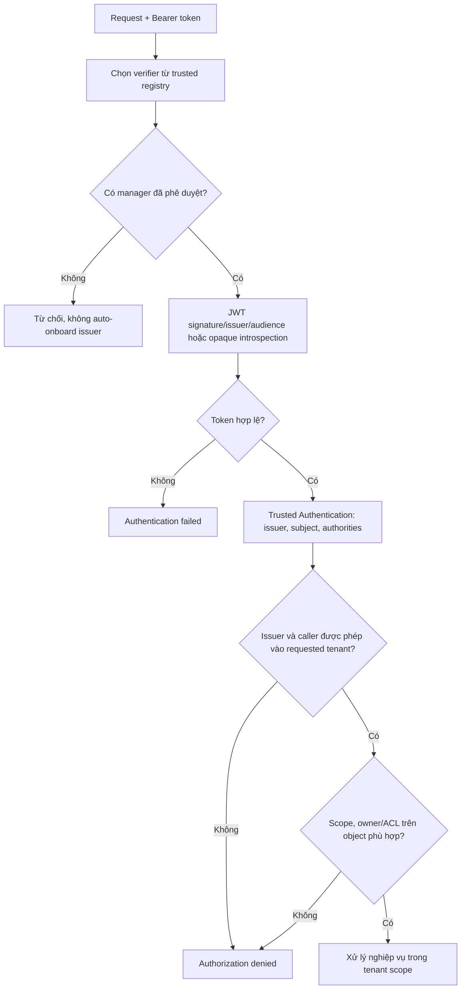
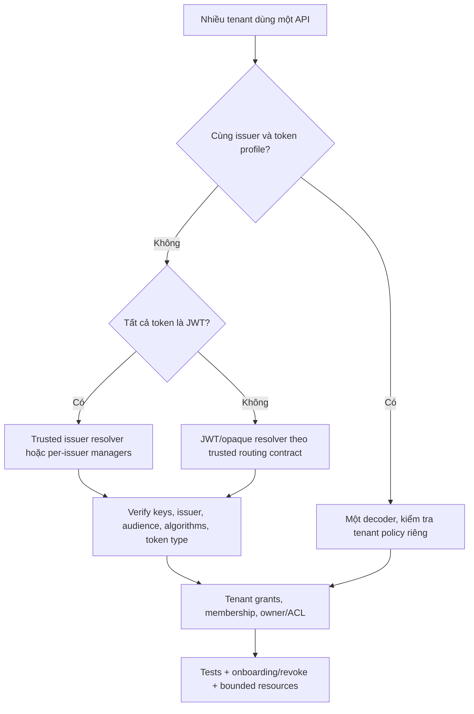

# Tenant, issuer và chiến lược xác minh token có thể khác nhau

Trong một **Spring Security OAuth 2.0 / OIDC Resource Server** phục vụ nhiều tenant, không phải lúc nào một `issuer-uri` và một `JwtDecoder` cũng đủ. Một doanh nghiệp có thể dùng IdP riêng, doanh nghiệp khác dùng cùng IdP với nhiều tổ chức, còn một hệ thống cũ chỉ phát **opaque access token** yêu cầu introspection. Các tenant cũng có thể sử dụng **audience, thuật toán ký, JWK Set, token profile, scope và cách cấp quyền** khác nhau.

Lỗi kiến trúc thường gặp là đánh đồng ba khái niệm: **tenant** (ranh giới dữ liệu), **issuer** (bên phát token) và **chiến lược xác minh token** (decoder, khóa, endpoint, validators). Một JWT có chữ ký hợp lệ từ issuer A **không tự được truy cập dữ liệu tenant B**. Ngược lại, một trường `tenant_id` hoặc `iss` được đọc từ payload JWT chưa được xác minh **không thể tự trở thành bằng chứng đáng tin**.

Bài học hướng dẫn mô hình tin cậy, cách chọn JWT/opaque verifier cho từng tenant, sử dụng `JwtIssuerAuthenticationManagerResolver`, cấu hình validators theo issuer, phân biệt issuer với quyền trong tenant, ví dụ Servlet và WebFlux, bảo vệ dynamic onboarding, caching, key rotation và kiểm thử đa tenant. Ví dụ dựa trên **Spring Boot 3 / Spring Security 6**; URL, tenant ID và tokens là dữ liệu giả định cần thay bằng cấu hình đã được quản trị phê duyệt.

## 1. Ba khái niệm phải tách biệt

| Khái niệm | Câu hỏi nó trả lời | Ví dụ | Điều nó không tự chứng minh |
| --- | --- | --- | --- |
| **Tenant** | Dữ liệu, khách hàng hoặc chính sách nghiệp vụ nào? | `acme`, `beta` | Tenant có IdP riêng hay không. |
| **Issuer (`iss`)** | Ai phát hành token và chịu trách nhiệm về claims? | `https://login.acme.example/realms/prod` | Caller có quyền vào mọi tenant. |
| **Verification strategy** | API dùng cơ chế nào để xác minh token? | JWT/JWKS, opaque introspection | Caller sở hữu đối tượng nghiệp vụ. |
| **Audience (`aud`)** | Access token dành cho protected resource nào? | `orders-api` | Token được dùng ở API khác có cùng issuer. |
| **Principal identity** | Chủ thể nào đã được xác thực? | `(verifiedIssuer, verifiedSubject)` | Chủ thể có membership tenant hiện hành. |

Một số quan hệ thực tế:

```text
Tenant A -------- Issuer A -------- JWT + JWKS A
Tenant B -------- Issuer B -------- JWT + JWKS B
Tenant C ----+
             +---- Issuer Shared --- JWT + JWKS Shared
Tenant D ----+
Tenant E -------- Issuer Legacy --- opaque introspection
```

**Tenant và issuer không có quan hệ một-một bắt buộc.** Trong migration, một tenant có thể tin issuer cũ lẫn issuer mới trong thời gian nhất định. Một issuer shared có thể xác thực người dùng của nhiều tenant nhưng quyền truy cập dữ liệu vẫn phải tách.

## 2. Ví dụ SaaS orders-api

Giả sử ứng dụng có các chính sách:

| Tenant | Trusted issuer/authority | Token | Audience |
| --- | --- | --- | --- |
| `acme` | `https://login.acme.example/realms/prod` | JWT RS256 | `orders-api` |
| `beta` | `https://sso.beta.example/tenant` | JWT thuật toán đã phê duyệt | `orders-api-beta` |
| `gamma` | `https://login.platform.example/shared` | JWT RS256 | `orders-api` |
| `delta` | `https://login.platform.example/shared` | JWT RS256 | `orders-api` |
| `legacy` | Legacy Authorization Server | Opaque token | Theo introspection contract |

Token giả định của Alice thuộc Acme:

```json
{
  "iss": "https://login.acme.example/realms/prod",
  "sub": "alice",
  "aud": ["orders-api"],
  "scope": "orders.read orders.write",
  "exp": 1900000000
}
```

JSON trên chỉ là **payload minh họa, không phải JWT ký thật**. Ngay cả khi token có chữ ký hợp lệ, Alice **không được đọc đơn của Beta** chỉ vì có scope `orders.read`.

```http
GET /api/tenants/beta/orders/201
Authorization: Bearer <acme-access-token>
```

API phải kiểm tra **issuer được tin cho tenant Beta không**, Alice có membership Beta không, và order 201 có thuộc phạm vi Alice được phép đọc không.

## 3. Quy trình xác thực và phân quyền chuẩn



Quy trình có ba quyết định độc lập:

1. **Resolve strategy:** dùng issuer hint hoặc tenant route để chọn từ một tập verifier **đã có và đã được phê duyệt**.
2. **Authenticate:** JWT decoder/introspector thực sự kiểm tra token theo issuer/keys/audience/profile tương ứng.
3. **Authorize:** domain service kiểm tra tenant membership, scope, role/permission và object-level policy.

**Hint để chọn verifier không tự là bằng chứng xác thực.** Chỉ sau khi bước 2 thành công mới tin các claims; chỉ sau bước 3 mới cho phép thao tác dữ liệu.

## 4. Những cách xác định tenant

| Nguồn | Ví dụ | Có thể dùng để | Không được làm |
| --- | --- | --- | --- |
| JWT `iss` | `https://idp-a.example` | Tra trusted issuer registry. | Tự fetch JWKS của issuer bất kỳ rồi tin. |
| JWT `tenant_id` | `tenant_id=acme` | Chọn tenant theo token contract sau verification. | Tin dữ liệu chưa ký hoặc claim issuer không có thẩm quyền. |
| Subdomain | `acme.api.example.com` | Định tuyến tenant đã cấu hình. | Coi Host do client tự gửi là membership. |
| URL path | `/api/tenants/acme/orders` | Chỉ định tenant client muốn thao tác. | Cho phép chỉ vì client biết tenant slug. |
| Header | `X-Tenant-Id: acme` | Tenant hint theo API contract. | Tin như token/role của caller. |
| Opaque introspection response | `active`, `aud`, `sub` | Đọc claims từ authority tin cậy. | Dùng kết quả IdP A để xác minh token B. |
| mTLS certificate | Authenticated service identity | Mapping M2M tenant theo policy. | Tin fingerprint/cert không validate chain. |

Tenant được chọn từ route có thể giúp chọn **manager cố định**; nhưng request route, header hoặc host **vẫn là input**. Sau khi token được xác minh, phải kiểm tra token/identity có được phép hoạt động trong chính tenant đó.

## 5. JWT `iss` chưa xác minh là untrusted input

JWT compact JWS:

```text
base64url(header).base64url(payload).base64url(signature)
```

Attacker có thể tự tạo:

```json
{
  "iss": "https://attacker.example/issuer",
  "sub": "administrator",
  "scope": "orders.read orders.write"
}
```

rồi ký bằng khóa của họ. Nếu Resource Server làm:

```java
// PHẢN VÍ DỤ: không tạo trusted decoder từ input của JWT.
String issuer = readUnverifiedIssuer(rawToken);
JwtDecoder decoder = JwtDecoders.fromIssuerLocation(issuer);
return decoder.decode(rawToken);
```

thì một issuer do attacker tự kiểm soát có thể được API tin, hoặc API có thể bị **SSRF, DNS rebinding, issuer-cardinality DoS, JWKS/discovery amplification**. Decoder được dựng từ URL chưa phê duyệt không phải mô hình trust hợp lệ.

**Ranh giới bắt buộc:** `iss` chưa được verify chỉ là **lookup hint vào danh sách allowlist**; verifier được chọn phải kiểm tra chữ ký, issuer, audience và token profile. Không auto-provision issuer từ token.

## 6. Khi nào một `issuer-uri` đủ?

Nếu Gamma và Delta dùng **cùng issuer/JWKS và token profile**, một decoder có thể đủ:

```yaml
spring:
  security:
    oauth2:
      resourceserver:
        jwt:
          issuer-uri: https://login.platform.example/shared
```

Sau authentication, service vẫn cần:

```text
requestedTenant = gamma hoặc delta
verifiedIssuer = shared issuer
verifiedSubject = alice
membership = lookup(requestedTenant, issuer, subject)
order = query(id, tenantId, owner/ACL)
```

Một decoder cho shared issuer không có nghĩa mọi user của issuer đó đều có quyền vào tất cả tenant.

Ngược lại, khi hai issuers có JWT keys/audience/profile khác nhau, không nên tắt issuer validation để cố dùng chung một decoder. Hãy chọn manager theo trusted issuer.

## 7. `JwtIssuerAuthenticationManagerResolver` trong Servlet

Spring Security 6.2+ cung cấp:

```java
import org.springframework.security.oauth2.server.resource.authentication.JwtIssuerAuthenticationManagerResolver;

JwtIssuerAuthenticationManagerResolver resolver =
    JwtIssuerAuthenticationManagerResolver.fromTrustedIssuers(
        "https://login.acme.example/realms/prod",
        "https://sso.beta.example/tenant");
```

Resolver lấy issuer hint từ Bearer JWT để tìm `AuthenticationManager` tương ứng trong **trusted issuer set**. Issuer ngoài danh sách bị từ chối; việc tìm manager không phải việc tin token trước khi xác minh.

Đối với cấu hình có cùng verification contract, `fromTrustedIssuers` là giải pháp đơn giản. Spring Security có thể **lazy initialize** manager/JWT decoder của từng issuer khi request đầu tiên đến, giảm phụ thuộc các IdP lúc startup nhưng có thể tăng latency request đầu và gặp lỗi khi JWKS/discovery endpoint không sẵn sàng.

**Không mặc định API này giải quyết audience validator và scope mapping riêng cho mỗi issuer.** Khi policy khác nhau, tạo các manager cấu hình riêng.

## 8. `SecurityFilterChain` cho hai trusted issuers

```java
import org.springframework.context.annotation.Bean;
import org.springframework.context.annotation.Configuration;
import org.springframework.http.HttpMethod;
import org.springframework.security.config.annotation.web.builders.HttpSecurity;
import org.springframework.security.config.http.SessionCreationPolicy;
import org.springframework.security.oauth2.server.resource.authentication.JwtIssuerAuthenticationManagerResolver;
import org.springframework.security.web.SecurityFilterChain;

@Configuration
public class MultiIssuerSecurityConfig {

    @Bean
    SecurityFilterChain apiSecurity(HttpSecurity http) throws Exception {
        var resolver =
            JwtIssuerAuthenticationManagerResolver.fromTrustedIssuers(
                "https://login.acme.example/realms/prod",
                "https://sso.beta.example/tenant");

        return http
            .csrf(csrf -> csrf.disable())
            .sessionManagement(session -> session
                .sessionCreationPolicy(SessionCreationPolicy.STATELESS))
            .authorizeHttpRequests(auth -> auth
                .requestMatchers(
                    HttpMethod.GET, "/api/tenants/{tenantId}/orders/**")
                    .hasAuthority("SCOPE_orders.read")
                .anyRequest().denyAll())
            .oauth2ResourceServer(oauth2 -> oauth2
                .authenticationManagerResolver(resolver))
            .build();
    }
}
```

Ví dụ dùng path-variable matcher để tránh nhầm một route khác với route tenant. Ứng dụng thật phải test matcher với Spring MVC/path matching và reverse proxy configuration cụ thể.

- JWT phải được xác minh bởi manager cho trusted issuer.
- `SCOPE_orders.read` là quyền chức năng, **chưa xác minh membership tenant**.
- `STATELESS` chỉ nói Spring Security không dựa vào web session để khôi phục Authentication.
- `csrf.disable()` chỉ phù hợp nếu API thuần Bearer header, không dùng browser cookie tự đính kèm làm credential.
- `anyRequest().denyAll()` đóng các URL không khai báo trong chain. Cần thêm những route thật được sử dụng.

## 9. Audience là điều kiện khác issuer

Một JWT:

```json
{
  "iss": "https://login.acme.example/realms/prod",
  "aud": ["payments-api"],
  "sub": "alice",
  "scope": "orders.read"
}
```

có thể được ký đúng bởi issuer Acme nhưng không dành cho `orders-api`. API phải từ chối nếu protected resource yêu cầu `aud=orders-api`.

```text
Verified signature AND trusted iss
  AND valid exp/nbf
  AND correct aud/token type
    -> Authentication
    -> scope + tenant + object authorization
```

Nếu Beta dùng `orders-api-beta` còn Acme dùng `orders-api`, mỗi issuer cần audience validator phù hợp. Không dựa vào `fromTrustedIssuers` như bằng chứng tự động rằng audience đã đúng. `iss` cho biết ai phát token; `aud` cho biết token dành cho ai.

## 10. Trusted issuer policy và registry

Một model nhỏ:

```java
public record IssuerPolicy(
    String issuer,
    String jwkSetUri,
    String audience,
    String tenantId
) {}
```

Ví dụ được control plane phê duyệt:

```text
Acme:
  issuer      = https://login.acme.example/realms/prod
  jwkSetUri   = https://login.acme.example/realms/prod/keys
  audience    = orders-api
  algorithm   = RS256

Beta:
  issuer      = https://sso.beta.example/tenant
  jwkSetUri   = https://sso.beta.example/tenant/jwks
  audience    = orders-api-beta
  algorithm   = ES256 (nếu policy chấp nhận)
```

Đây là cấu hình minh họa; URL JWK thực phải lấy từ IdP/trusted configuration, không tự đoán tên path. Registry production nên lưu hoặc tham chiếu:

- Exact issuer URI và trạng thái `ACTIVE`/`DISABLED`.
- JWK Set URI hoặc introspection endpoint có TLS/network policy được phê duyệt.
- JWS algorithm allowlist, audience, token profile, clock skew.
- Claim/authority mapping và trust scope của từng issuer.
- Tenant-issuer grants và identity linking policy.
- Activation/retirement timestamps, audit/version và cơ chế revoke.

Không dùng `tenantId` trong record trên làm bằng chứng quan hệ một-một khi **một issuer phục vụ nhiều tenants**. Trong trường hợp shared issuer, tách verification profile với tenant grants.

## 11. Tạo JWT manager riêng với audience validator

Đoạn code Servlet dưới đây tạo một `AuthenticationManager` theo profile trusted:

```java
import org.springframework.security.authentication.AuthenticationManager;
import org.springframework.security.authentication.ProviderManager;
import org.springframework.security.oauth2.core.DelegatingOAuth2TokenValidator;
import org.springframework.security.oauth2.core.OAuth2Error;
import org.springframework.security.oauth2.core.OAuth2TokenValidator;
import org.springframework.security.oauth2.core.OAuth2TokenValidatorResult;
import org.springframework.security.oauth2.jwt.Jwt;
import org.springframework.security.oauth2.jwt.JwtValidators;
import org.springframework.security.oauth2.jwt.NimbusJwtDecoder;
import org.springframework.security.oauth2.server.resource.authentication.JwtAuthenticationProvider;

public final class JwtManagerFactory {

    public static AuthenticationManager create(IssuerPolicy p) {
        NimbusJwtDecoder decoder =
            NimbusJwtDecoder.withJwkSetUri(p.jwkSetUri())
                .build();

        OAuth2TokenValidator<Jwt> audience = jwt ->
            jwt.getAudience().contains(p.audience())
                ? OAuth2TokenValidatorResult.success()
                : OAuth2TokenValidatorResult.failure(
                    new OAuth2Error(
                        "invalid_token", "Wrong audience", null));

        decoder.setJwtValidator(
            new DelegatingOAuth2TokenValidator<>(
                JwtValidators.createDefaultWithIssuer(p.issuer()),
                audience));

        return new ProviderManager(
            new JwtAuthenticationProvider(decoder));
    }

    private JwtManagerFactory() {}
}
```

Điều quan trọng:

1. JWK Set URI phải là **cấu hình trusted của issuer**, không lấy từ JWT header/payload.
2. Decoder xác minh signature bằng keys của profile đó.
3. Validators kiểm tra `iss`, thời gian và `aud` đúng chính sách.
4. Provider chỉ tạo Authentication khi token đã được xác minh.

Đoạn code cố ý chưa trình bày toàn bộ cấu hình JWS algorithm, HTTP timeouts/JWK cache hoặc token `typ`. Trong triển khai thật, những thứ này phải được cấu hình **theo issuer**; đừng chỉ ghi “ES256” trong YAML rồi giả định decoder đang chấp nhận đúng thuật toán.

## 12. Sử dụng map manager đã được phê duyệt

```java
import java.util.Map;
import jakarta.servlet.http.HttpServletRequest;
import org.springframework.context.annotation.Bean;
import org.springframework.security.authentication.AuthenticationManager;
import org.springframework.security.authentication.AuthenticationManagerResolver;
import org.springframework.security.oauth2.server.resource.authentication.JwtIssuerAuthenticationManagerResolver;

@Bean
AuthenticationManagerResolver<HttpServletRequest>
approvedJwtManagers() {
    IssuerPolicy acme = new IssuerPolicy(
        "https://login.acme.example/realms/prod",
        "https://login.acme.example/realms/prod/keys",
        "orders-api", "acme");

    IssuerPolicy beta = new IssuerPolicy(
        "https://sso.beta.example/tenant",
        "https://sso.beta.example/tenant/jwks",
        "orders-api-beta", "beta");

    Map<String, AuthenticationManager> managers = Map.of(
        acme.issuer(), JwtManagerFactory.create(acme),
        beta.issuer(), JwtManagerFactory.create(beta));

    return new JwtIssuerAuthenticationManagerResolver(
        managers::get);
}
```

Inject bean này vào `SecurityFilterChain` rồi dùng:

```java
.oauth2ResourceServer(oauth2 -> oauth2
    .authenticationManagerResolver(approvedJwtManagers))
```

`approvedJwtManagers` trong DSL là **biến đã inject**, không phải biểu thức tự có ở mọi class. Khi token có `iss` không nằm trong map, resolver không có manager được phép để xác thực. Đây là hành vi đúng.

Nếu cùng issuer chấp nhận nhiều audiences hoặc tenant-specific token profiles, cần thiết kế registry/validator phù hợp, không mặc định map `<issuer, tenant>` đủ biểu diễn mọi tổ hợp.

## 13. Chọn manager theo `iss` chưa verify có an toàn không?

Có thể an toàn **nếu dùng làm khóa tra allowlist**:

```text
unverified JWT iss
  -> exact-match trusted registry lookup
  -> selected manager/decoder with trusted keys
  -> verified JWT iss, signature, aud, exp/nbf
  -> principal
```

Không an toàn nếu:

```text
unverified JWT iss
  -> build new URL/JWKS decoder
  -> trust the new issuer
  -> authenticate
```

Cần giới hạn số manager/decoder, timeout và network resources. Token lạ phải bị từ chối **trước khi hệ thống tự tạo bất kỳ trusted issuer mới nào**.

Spring Security cung cấp resolver cho multi-issuer, nhưng người triển khai vẫn có trách nhiệm giới hạn trust source khi dùng constructor nhận resolver động.

## 14. Tenant path/host chỉ chọn bối cảnh, không cấp quyền

Ví dụ:

```http
GET /api/tenants/beta/orders/201
Authorization: Bearer <signed-acme-jwt>
```

Giả sử Acme là issuer đáng tin với API chung. Token được xác minh đúng **không có nghĩa** caller được vào Beta. Domain policy cần:

```text
issuerAllowedForTenant(beta, verifiedIssuer)
AND activeMembership(beta, verifiedIssuer, verifiedSubject)
AND hasRequiredFunctionalAuthority
AND objectBelongsToTenantAndCallerCanAccess
```

Host/path/header do client chọn chỉ cho biết **tenant được yêu cầu**. Một `X-Tenant-Id` đúng tên khách hàng không phải credential. Không để gateway thêm header `X-User` do client có thể spoof nếu upstream dùng header đó làm principal; cần strip/rewrite tại trusted boundary và xác minh lại.

## 15. Quan hệ issuer-to-tenant và membership nên tách

Một mô hình domain:

```text
Tenant
  id, status

TrustedIssuer
  issuerUri, verificationPolicyId, status

TenantIssuerGrant
  tenantId, issuerUri, status

Membership
  tenantId, issuerUri, subject, role, status

Order
  id, tenantId, ownerIssuer, ownerSubject, ...
```

Khi gọi `GET /api/tenants/beta/orders/201`:

1. Xác thực token theo issuer/strategy trusted.
2. Lấy verified `(issuer, subject)`.
3. Kiểm tra Tenant Beta đang active.
4. Kiểm tra issuer được grant để xác thực caller cho Beta.
5. Kiểm tra subject có membership/role phù hợp trong Beta.
6. Kiểm tra order 201 thuộc Beta và owner/ACL cho phép.

Ứng dụng có thể sử dụng internal user ID hoặc một policy engine thay cho schema này. Bất biến không thay đổi: **issuer authentication và tenant authorization là hai câu hỏi khác nhau**.

## 16. Shared issuer phục vụ Gamma và Delta

Một token:

```json
{
  "iss": "https://login.platform.example/shared",
  "sub": "alice",
  "aud": ["orders-api"],
  "scope": "orders.read",
  "tenant_id": "gamma"
}
```

được xác thực bởi một decoder cho shared issuer. Nếu request trỏ đến Delta:

```http
GET /api/tenants/delta/orders/900
```

thì policy phải quyết định:

- Token contract là **single tenant**? Khi đó không cho dùng claim `gamma` ở Delta.
- Token đại diện một user có thể thuộc **nhiều tenants**? Cần kiểm tra membership hiện hành ở Delta.
- Issuer có thẩm quyền phát `tenant_id` cho ứng dụng không? Nếu không, không dùng claim này làm nguồn quyết định.

**Không phải mọi người dùng của shared issuer đều có quyền trong mọi tenant của issuer đó.**

## 17. Một tenant chấp nhận hai issuer trong migration

Acme chuyển từ IdP cũ sang mới:

```text
Old issuer: https://old-idp.acme.example
New issuer: https://login.acme.example/realms/prod
```

Cả hai chỉ được trusted trong **giai đoạn overlap đã phê duyệt**. Cần:

- Thời hạn tắt issuer cũ rõ ràng.
- Audience/algorithm/JWKS và scope mapping cho từng issuer.
- Identity linking giữa `(oldIssuer, oldSub)` và `(newIssuer, newSub)` qua quy trình có kiểm soát.
- Không tự gộp account theo email/username/subject giống nhau.
- Test token từ issuer cũ sau khi registry revoke.
- Đồng bộ danh sách trusted trên tất cả pod.

**Bỏ nút đăng nhập bằng IdP cũ không tự khiến Resource Server ngừng chấp nhận token do nó cấp.**

## 18. Định danh `(issuer, subject)` là một namespace

Hai token có thể cùng:

```text
sub = "42"
```

nhưng:

```text
Issuer Acme -> Alice
Issuer Beta -> Bob
```

Nếu database lưu `ownerSubject="42"` mà không gắn issuer hoặc canonical internal user ID, hai chủ thể có thể bị nhập nhằng. Khóa domain phù hợp:

```text
(verifiedIssuer, verifiedSubject)
```

hoặc mapping:

```text
(iss, sub) -> trusted identity linking -> internalUserId
```

Không lấy `email`, `preferred_username`, display name hoặc `sub` độc lập làm identity toàn cục mà thiếu hợp đồng. Claim `email_verified` cũng không tự xác nhận hai tài khoản thuộc hai IdP là một.

## 19. Có thể trộn JWT và opaque token trong một API

Ví dụ:

```text
Acme   -> JWT + JwtAuthenticationProvider
Beta   -> JWT + JwtAuthenticationProvider
Legacy -> opaque + OpaqueTokenAuthenticationProvider
```

Trong Servlet, Spring Security dùng:

```java
AuthenticationManagerResolver<HttpServletRequest>
```

để chọn strategy. Hai managers có thể được tạo như sau:

```java
AuthenticationManager jwt = new ProviderManager(
    new JwtAuthenticationProvider(acmeJwtDecoder));

AuthenticationManager opaque = new ProviderManager(
    new OpaqueTokenAuthenticationProvider(legacyIntrospector));
```

Các đối tượng `acmeJwtDecoder` và `legacyIntrospector` **phải được cấu hình từ trusted policies**, không từ raw request.

Đừng chọn “JWT nếu token có hai dấu chấm, opaque nếu không”. Opaque token cũng có thể chứa dấu chấm; hình thức của chuỗi không chứng minh verification profile phù hợp.

## 20. Resolver JWT/opaque theo trusted route

Giả sử contract:

```text
/api/tenants/acme/...   -> chỉ JWT của Acme
/api/tenants/legacy/... -> chỉ opaque của Legacy
```

Một resolver minh họa:

```java
import jakarta.servlet.http.HttpServletRequest;
import org.springframework.security.authentication.AuthenticationManager;
import org.springframework.security.authentication.AuthenticationManagerResolver;
import org.springframework.security.oauth2.core.OAuth2AuthenticationException;
import org.springframework.security.oauth2.core.OAuth2Error;

AuthenticationManagerResolver<HttpServletRequest> resolver =
    request -> {
        String path = request.getServletPath();

        if (path.startsWith("/api/tenants/acme/")) {
            return acmeJwtManager;
        }
        if (path.startsWith("/api/tenants/legacy/")) {
            return legacyOpaqueManager;
        }

        throw new OAuth2AuthenticationException(
            new OAuth2Error(
                "invalid_token",
                "Unsupported tenant route",
                null));
    };
```

`acmeJwtManager` và `legacyOpaqueManager` là managers đã tạo trước từ trusted configuration. Sau đó:

```java
.oauth2ResourceServer(oauth2 -> oauth2
    .authenticationManagerResolver(resolver))
```

Ở production, dùng route matcher có kiểm soát context path, URL normalization, proxy rewrite, encoded path và trailing slash. `startsWith` chỉ thể hiện nguyên lý chọn manager cố định, **không thay thế kiểm thử security routing thật**.

Path chỉ **chọn verifier**, không tự chứng minh caller có quyền tenant. Với JWT, decoder cần chặn token khác issuer/audience. Với opaque, introspection phải trả status/claims hợp lệ từ đúng authority.

## 21. Opaque introspection có thể khác theo tenant

Hai legacy authorities có thể dùng:

| Yếu tố | Legacy A | Legacy B |
| --- | --- | --- |
| Introspection URI | `https://idp-a.example/introspect` | `https://idp-b.example/check_token` |
| Client authentication | Client A | Client B |
| Audience | `orders-api-a` | `orders-api-b` |
| Claim policy | `scope` string | `permissions` array |
| Network/TLS | Trust config A | Trust config B |
| Cache/revocation | TTL/active policy A | TTL/active policy B |

Không dùng một `OpaqueTokenIntrospector` mặc định chung cho mọi tenant nếu endpoint/credentials/token contract khác nhau.

```json
{
  "active": true,
  "sub": "user-123",
  "aud": ["orders-api-a"],
  "scope": "orders.read"
}
```

`active: true` là **một phần** của quyết định chấp nhận token. API vẫn phải kiểm tra audience, scope và tenant/domain policy theo contract.

Lỗi introspection **timeout, 429, 5xx, TLS hoặc client credentials** không phải bằng chứng token `active:false`; phải fail closed nhưng không negative-cache như một kết luận inactive. Với opaque token random spray, rate/bulkhead/timeout bảo vệ upstream.

## 22. JWS algorithm, JWK Set và `kid` theo issuer

Issuer Acme dùng RS256, Beta có thể dùng ES256 nếu đã được phê duyệt. Decoder cần được cấu hình:

```text
Trusted Issuer A -> JWK Set A -> allowed JWS algorithms A
Trusted Issuer B -> JWK Set B -> allowed JWS algorithms B
```

Không:

- Tin `alg` header tùy ý mà không có allowlist.
- Chấp nhận `alg=none` cho protected API.
- Lấy JWK theo URL `jku` hoặc `x5u` do attacker tự gắn trong JWT.
- Dùng key A để xác minh token tự khai issuer B.
- Dùng `kid` như định danh toàn cục không gắn issuer.
- Thử mọi algorithm trong một key store global cho đến khi signature khớp.

Hai IdP có thể cùng `kid="key-1"` nhưng public keys khác nhau. **Namespace key selection và cache theo issuer/JWK Set trusted**.

Key rotation cần kiểm soát refresh cache, TLS, timeout, độ trễ giữa các pod và thời điểm gỡ key cũ; không cho token chưa xác minh làm thay đổi JWKS source.

## 23. OIDC ID Token không phải OAuth access token cho Resource Server

Một ID Token có thể:

```json
{
  "iss": "https://login.acme.example/realms/prod",
  "sub": "alice",
  "aud": ["web-oidc-client"]
}
```

ID Token được OIDC Client dùng để xác thực End-User sau login. Nó **không tự là access token dành cho orders-api** dù chữ ký hợp lệ cùng issuer.

Resource Server cần xác minh:

- Audience của **protected resource**.
- Token profile/type theo contract IdP, nếu có `typ`, `token_use` hoặc claims tương tự.
- Scope/permissions thực sự dành cho business API.
- Issuer, signature, expiry, not-before và validators khác.

Không dùng ID Token thay Bearer access token chỉ vì đều mang JWT. `oauth2Login()` của Client/BFF và `oauth2ResourceServer()` của API có trách nhiệm khác nhau.

## 24. Authority mapping phải phụ thuộc thẩm quyền issuer

Issuer A:

```json
{"scope": "orders.read orders.write", "roles": ["admin"]}
```

Issuer B:

```json
{"scp": ["order:read"], "permissions": ["admin"]}
```

Từ `admin` chưa nói rõ đó là quyền quản trị tenant hay hệ thống. Một mapping có chủ đích:

```text
Issuer A: "orders.read" -> "SCOPE_orders.read"
Issuer B: "order:read"  -> "SCOPE_orders.read"
Issuer A: "admin"       -> chỉ map quyền tenant nếu policy cấp
Issuer B: "admin"       -> bỏ qua nếu issuer B không được cấp quyền admin
```

Sử dụng allowlist các scope/permission hợp lệ theo **issuer/token profile**. `JwtGrantedAuthoritiesConverter`/custom converter tạo authorities từ JWT đã xác minh, nhưng **không tự định nghĩa issuer nào có thẩm quyền cấp global roles**.

Quyền `SCOPE_orders.read` vẫn phải được giới hạn theo membership tenant và owner/ACL khi xử lý object.

## 25. WebFlux cần resolver reactive

Trong Spring WebFlux, tương ứng với Servlet là:

```java
import org.springframework.security.oauth2.server.resource.authentication.JwtIssuerReactiveAuthenticationManagerResolver;

JwtIssuerReactiveAuthenticationManagerResolver resolver =
    JwtIssuerReactiveAuthenticationManagerResolver.fromTrustedIssuers(
        "https://login.acme.example/realms/prod",
        "https://sso.beta.example/tenant");
```

Và DSL:

```java
import org.springframework.context.annotation.Bean;
import org.springframework.security.config.web.server.ServerHttpSecurity;
import org.springframework.security.web.server.SecurityWebFilterChain;

@Bean
SecurityWebFilterChain apiSecurity(ServerHttpSecurity http) {
    return http
        .csrf(ServerHttpSecurity.CsrfSpec::disable)
        .authorizeExchange(exchanges -> exchanges
            .pathMatchers("/api/**").authenticated()
            .anyExchange().denyAll())
        .oauth2ResourceServer(oauth2 -> oauth2
            .authenticationManagerResolver(resolver))
        .build();
}
```

`resolver` phải được tạo hoặc inject ở method thật. WebFlux dùng `SecurityWebFilterChain`, `ServerHttpSecurity`, `ReactiveJwtDecoder` và `ReactiveAuthenticationManagerResolver`; Servlet dùng các counterpart imperative.

Nếu trộn JWT/opaque ở WebFlux, chọn từ các `ReactiveAuthenticationManager` trusted phù hợp, ví dụ JWT reactive manager và opaque reactive manager, không `.block()` HTTP client đồng bộ trên event-loop. Reactor `SecurityContext` theo subscription không thay tenant authorization tại service.

## 26. Dynamic onboarding không được đồng nghĩa dynamic trust

Một SaaS có thể muốn thêm issuer mới không restart. Spring Security cho phép registry manager động:

```java
import java.util.concurrent.ConcurrentHashMap;
import java.util.concurrent.ConcurrentMap;
import org.springframework.security.authentication.AuthenticationManager;
import org.springframework.security.oauth2.server.resource.authentication.JwtIssuerAuthenticationManagerResolver;

ConcurrentMap<String, AuthenticationManager> approved =
    new ConcurrentHashMap<>();

JwtIssuerAuthenticationManagerResolver resolver =
    new JwtIssuerAuthenticationManagerResolver(approved::get);
```

Chỉ **sau khi admin/control plane phê duyệt** một policy:

```java
approved.put(policy.issuer(),
    JwtManagerFactory.create(policy));
```

Khi revoke:

```java
approved.remove(issuer);
```

Đây là minh họa về map đồng thời, chưa giải quyết atomic snapshots, race in-flight, nhiều pod hay cache invalidation.

**Phản ví dụ nguy hiểm:**

```java
approved.computeIfAbsent(untrustedIssuer,
    x -> createManagerFromUnverifiedJwtIssuer(x));
```

Đoạn trên cho phép bất kỳ Bearer token nào kích hoạt việc tạo trusted manager, mở cửa cho SSRF, auto-trust và cạn tài nguyên. **Issuer onboarding phải ở control plane được phân quyền**, không ở data plane của request.

## 27. Quy trình onboarding issuer/tenant

1. Nhận issuer URL từ tenant qua quản trị đã xác thực và có quyền.
2. Xác minh URL HTTPS, hostname/domain, TLS, metadata và JWK/introspection endpoints.
3. Chốt audience, token type, thuật toán cho phép, expiry/skew và scope mapping.
4. Kiểm thử JWT/opaque hợp lệ và token sai issuer/key/audience/alg.
5. Tạo tenant-to-issuer grant và identity linking policy nếu cần.
6. Kiểm soát ai được cấp role/permission nào cho API.
7. Kích hoạt policy version, audit thao tác và đồng bộ đến pods.
8. Theo dõi first-request latency, JWKS rotation, introspection availability.
9. Có rollback hoặc disable issuer rõ ràng.
10. Có test cross-tenant và khả năng revoke ngay trong trust registry.

Thêm trusted issuer là **thay đổi ranh giới xác thực**; không chỉ là thêm một hostname vào một bảng dữ liệu. Tenant A cũng không được tự thêm issuer cho tenant B nếu không có quyền quản trị tương ứng.

## 28. Revoke issuer khi chạy nhiều pod

Trong cụm:

```text
Pod A: trust registry v10
Pod B: trust registry v10
Pod C: trust registry v9
```

Nếu issuer X đã bị disable ở v10 nhưng pod C còn tin v9, token của X có thể tiếp tục được chấp nhận trên pod C.

Vận hành cần:

- Nguồn cấu hình/registry đáng tin có version.
- Đồng bộ và áp dụng snapshot nhất quán cho managers, validators và tenant grants.
- Theo dõi thời gian từ revoke đến khi mọi instance từ chối.
- Không giữ decoder/manager cũ vô hạn sau khi issuer bị disable.
- Bảo vệ race với requests in-flight và policy update giữa chừng.
- Cache invalidation khi thay đổi algorithm, audience, JWK source hoặc authority mapping.
- Audit đầy đủ thay đổi trust, người phê duyệt và rollback.

**Thời gian áp dụng revoke trên toàn hệ thống là một security SLO**, không tự bằng 0 chỉ vì database vừa cập nhật.

## 29. Chống DoS qua random issuer/token

Attacker có thể gửi:

```text
iss=random1.attacker.example
iss=random2.attacker.example
...
```

Với registry đúng, những issuer này bị từ chối **mà không tạo HTTP discovery request đến issuer mới**.

Các lớp bảo vệ khác:

| Tài nguyên | Biện pháp |
| --- | --- |
| HTTP headers và Bearer token length | Giới hạn ở ingress/server trước decode. |
| Decoder/manager registry | Bounded, chỉ thêm qua control plane. |
| JWKS HTTP client | TLS, timeout, allowed destinations, connection cap. |
| Opaque introspection | Per-upstream bulkhead, rate limiting, timeouts. |
| Negative cache | Chỉ confirmed inactive, TTL ngắn và max entries. |
| Positive cache | Theo expiry/revocation freshness, namespace authority. |
| Metrics | Không dùng token/raw issuer tùy ý làm label cardinality cao. |
| Proxy/host routing | Allowed hosts, path normalization và network policies. |

Negative cache không chống được random opaque tokens vì mỗi token mới vẫn cache miss. Cần kết hợp global/source rate limit và concurrency cap.

## 30. Cache keys phải có namespace trust

Hai opaque introspection clients có thể quan sát cùng một token khác nhau theo quyền của họ. Không sử dụng cache key chỉ:

```text
SHA256(rawToken)
```

nếu cache được chia sẻ qua IdP/clients khác thẩm quyền.

Nên scope:

```text
namespace = trusted issuer/introspection-uri/client/policy-version
tokenFingerprint = HMAC-SHA256(secret, rawToken)
cacheKey = namespace + ":" + tokenFingerprint
```

Không lưu raw token trong logs/metric labels/cache keys. Giới hạn input size trước HMAC; bảo vệ HMAC secret; TTL và số entry có trần.

Với JWT, JWK caches cũng phải gắn với issuer/JWK Set. `kid` chỉ là **key identifier trong tập khóa**, không phải định danh toàn cục.

## 31. Phân biệt các loại lỗi HTTP

| Trường hợp | Tầng | Kết quả thường gặp |
| --- | --- | --- |
| Thiếu Bearer | Authentication | `401`. |
| `iss` chưa được trust | Resolver | `401`. |
| Signature, JWK, algorithm sai | JWT validation | `401`. |
| Audience/token profile sai | Token validation | `401`. |
| Opaque introspection xác nhận `active:false` | Authentication | `401`. |
| Token hợp lệ, thiếu `orders.read` | HTTP/method authorization | `403`. |
| Issuer đúng nhưng không được grant ở tenant path | Tenant authorization | `403` hoặc `404`. |
| Cùng tenant nhưng không sở hữu order | Object authorization | `403` hoặc `404`. |
| Opaque IdP timeout/429/5xx | Dependency unavailable | Fail closed; mã cuối theo error mapping. |

Không coi một `403` là bằng chứng domain policy đã chạy: HTTP filter có thể từ chối trước controller. Không tiết lộ “order của Bob thuộc Beta” cho caller bị từ chối qua response `404`.

Trong telemetry, tách `untrusted_issuer`, `invalid_signature`, `wrong_audience`, `scope_denied`, `tenant_denied`, `introspection_unavailable` và `policy_version_mismatch`; tránh token/client secret/claims nhạy cảm.

## 32. Ma trận kiểm thử đa issuer và JWT

| # | Token và tình huống | Kỳ vọng |
| --- | --- | --- |
| 1 | JWT Acme ký đúng, aud `orders-api` và scope đúng | Xác thực được, còn domain policy. |
| 2 | JWT Beta ký đúng, aud `orders-api-beta` | Xác thực bằng manager Beta. |
| 3 | JWT tự ký của issuer attacker | Từ chối, không tải JWKS attacker. |
| 4 | JWT Acme thay `iss` thành Beta, giữ signature | Từ chối. |
| 5 | JWT Acme có `aud=payments-api` | Từ chối token sai audience. |
| 6 | JWT Acme đúng scope gọi tenant Beta | Từ chối issuer-to-tenant grant. |
| 7 | JWT Shared có `tenant_id=gamma`, gọi Delta | Từ chối nếu không có quyền Delta. |
| 8 | Shared issuer user thuộc cả Gamma và Delta | Phân quyền đúng theo tenant được chọn. |
| 9 | JWT hết hạn hoặc `nbf` vượt skew cho phép | Từ chối. |
| 10 | JWT dùng `alg` ngoài policy | Từ chối. |
| 11 | Hai issuers dùng cùng `kid` | Không nhầm JWK của issuer khác. |
| 12 | ID Token `aud=web-client` | Không chấp nhận làm API access token. |
| 13 | Issuers khác nhau cùng `sub=42` | Không gộp owners khác nhau. |
| 14 | Issuer bị revoke ở registry | Bị từ chối trên mọi pod trong SLO. |
| 15 | JWT hợp lệ nhưng sai owner của order | Không trả dữ liệu người khác. |

Phải có cả **positive và negative tests**. Một chain khóa hết route cũng có thể làm test âm xanh dù không triển khai đúng verification strategy.

## 33. Kiểm thử JWT crypto khác kiểm thử converter

`Jwt.withTokenValue("test-only")` có thể tạo một `Jwt` để kiểm thử authority converter, nhưng **không hề xác minh chữ ký**.

Test crypto/registry thật cần:

1. Tạo test key pairs/JWK Sets riêng cho issuer A và B.
2. Ký access tokens bằng private keys test tương ứng.
3. Gửi token qua `JwtDecoder`/HTTP Resource Server thực.
4. Thử sai `iss`, sai `aud`, sai chữ ký, hết hạn, `nbf`, algorithm ngoài allowlist.
5. Thử token A vào manager B hoặc tenant B.
6. Thử issuer giả và xác nhận không tự tạo decoder/JWKS fetch.

Trong Spring Security Test, `MockMvc` `.with(jwt())` và WebFlux `mockJwt()` tạo test authentication, **thường không chạy decoder crypto production**. Dùng chúng cho HTTP authorization, nhưng thêm integration test signed tokens cho trust boundary.

## 34. Kiểm thử opaque và mixed strategy

| Kịch bản | Điều cần chứng minh |
| --- | --- |
| Opaque Legacy `active:true` đúng profile | Authentication thành công theo đúng introspector. |
| Opaque Legacy `active:false` | Từ chối token. |
| Introspection timeout/429/5xx | Fail closed, không negative-cache như inactive. |
| Token Legacy A gửi vào Legacy B manager | Không được chấp nhận nếu không thuộc authority B. |
| JWT Acme gửi vào opaque-only route | Từ chối. |
| Opaque Legacy gửi vào JWT-only route | Từ chối. |
| Client đổi tenant path/header | Không bypass verifier hoặc tenant policy. |
| Nhiều random opaque tokens | Rate/bulkhead/timeout giới hạn upstream. |
| Introspection client credentials rotate | Chính sách/cache/namespace cập nhật đúng. |

Nên dùng HTTP stub server cho introspection để kiểm tra **POST, client authentication, response parsing, error classification, timeouts và response size**. Mock introspector trả principal không chứng minh upstream protocol thực đã đúng.

## 35. Gọi trực tiếp service vẫn phải giữ tenant boundary

Một API có JWT authentication đúng vẫn có thể mắc **BOLA/IDOR**:

```java
return orderRepository.findById(orderId);
```

vì query không xét tenant/owner. Với owner-only policy:

```sql
SELECT *
FROM orders
WHERE id = :orderId
  AND tenant_id = :requestedTenant
  AND owner_issuer = :verifiedIssuer
  AND owner_subject = :verifiedSubject
```

hoặc dùng ACL/tenant admin policy được định nghĩa rõ.

Kiểm thử:

- Cùng tenant khác owner.
- Khác tenant cùng subject.
- Cùng `sub` khác issuer.
- Admin tenant A thử truy cập tenant B.
- Membership bị thu hồi khi JWT còn hạn.
- List/count/export/nested resources và cache theo caller/tenant.
- Service method được gọi **trực tiếp**, không qua REST controller.

Nhờ đó một GraphQL resolver, message consumer hoặc service khác không thể bypass policy chỉ vì HTTP controller cũ đã có tenant check.

## 36. Runbook khi chỉ một tenant bị 401/403

1. Xác nhận tenant path/host và gateway rewrite có đúng không.
2. Đối chiếu issuer token với trusted registry **mà không log raw token**.
3. Kiểm tra policy version trên từng pod; issuer có bị disabled/revoke không?
4. Kiểm tra resolver chọn đúng manager không, có manager/decoder cache cũ không.
5. Kiểm tra JWKS/discovery URI, TLS, `kid`, key rotation, allowed algorithm.
6. Kiểm tra issuer/audience/expiry/not-before/access-token profile.
7. Kiểm tra scope claim, `scp`, `permissions` và authority prefix theo issuer.
8. Kiểm tra issuer-to-tenant grant và membership/role/owner trong database.
9. Nếu opaque, phân biệt `active:false` với timeout/429/5xx/credentials sai.
10. So sánh metrics/lỗi giữa các tenants để phát hiện lỗi chung và lỗi riêng.
11. Không sửa 401 bằng cách bỏ chữ ký/issuer/audience validation.
12. Sau sửa lỗi, chạy cả positive lẫn negative tests cho nhiều tenants.

Không log Authorization header, full JWT, client secret, JWK private key, session ID hoặc introspection response có PII. Ghi request ID, issuer alias đã trust, policy version và loại lỗi là đủ cho nhiều tình huống.

## 37. Lộ trình chọn kiến trúc



Thực hiện theo thứ tự:

1. Vẽ **trust map**: tenant ↔ issuer ↔ token format ↔ audience.
2. Chọn source of truth cho registry, tenant grants, membership và canonical identity.
3. Thiết kế issuer/route lookup chỉ từ trusted configuration.
4. Cấu hình JWT decoders hoặc opaque introspectors đúng trust profile.
5. Ánh xạ scope/roles theo issuer với allowlist semantics.
6. Bảo vệ tenant/object trong domain service và scoped data queries.
7. Thiết kế onboarding, revoke, key rotation, đồng bộ đa pod.
8. Giới hạn HTTP input, JWKS/introspection network và caches.
9. Kiểm thử signed JWT, wrong issuer/audience, mixed token, shared issuer tenants, owner mismatch.
10. Quan sát 401/403 theo nguyên nhân, audit changes và có rollback plan.

## 38. Tài liệu tham khảo

- [Spring Security 6.5 — OAuth 2.0 Resource Server Multi-tenancy (Servlet)](https://docs.spring.io/spring-security/reference/6.5/servlet/oauth2/resource-server/multitenancy.html): resolver nhiều issuer, JWT + opaque, dynamic tenant managers.
- [Spring Security 6.5 — JWT Resource Server (Servlet)](https://docs.spring.io/spring-security/reference/6.5/servlet/oauth2/resource-server/jwt.html): issuer, JWK Set, audience, algorithms và validators.
- [Spring Security — Multi-tenancy Reactive](https://docs.spring.io/spring-security/reference/6.5-SNAPSHOT/reactive/oauth2/resource-server/multitenancy.html): `JwtIssuerReactiveAuthenticationManagerResolver`.
- [Spring Security — `JwtIssuerAuthenticationManagerResolver` API](https://docs.spring.io/spring-security/reference/6.5/api/java/org/springframework/security/oauth2/server/resource/authentication/JwtIssuerAuthenticationManagerResolver.html): `fromTrustedIssuers` và dynamic manager lookup.
- [RFC 7519 — JSON Web Token](https://www.rfc-editor.org/rfc/rfc7519): `iss`, `sub`, `aud`, `exp`.
- [RFC 7662 — OAuth 2.0 Token Introspection](https://www.rfc-editor.org/rfc/rfc7662): `active` và introspection security.
- [RFC 6750 — OAuth 2.0 Bearer Token Usage](https://www.rfc-editor.org/rfc/rfc6750): Bearer credential và HTTP error semantics.

## 39. Kết luận

**Tenant**, **issuer** và **verification strategy** không phải một khái niệm. Issuer xác định nguồn phát hành token; strategy xác định JWT keys/algorithms/validators hoặc opaque introspection; tenant là ranh giới dữ liệu cần quản lý riêng. Trong hệ thống nhiều khách hàng, có thể dùng một issuer cho nhiều tenant, nhiều issuer cho một tenant, hoặc nhiều token formats song song.

Khi nhiều JWT issuers được tin cậy, `JwtIssuerAuthenticationManagerResolver.fromTrustedIssuers(...)` là một điểm bắt đầu phù hợp. Với yêu cầu audience/algorithm/claim mapping riêng, hãy cấu hình manager/decoder riêng cho từng trusted issuer. Với cả JWT và opaque, sử dụng resolver chọn verifier từ trusted policy, không dựa vào token format hay URL do caller tự cung cấp.

**Nguyên tắc bảo mật quan trọng nhất:** `iss` chưa xác minh chỉ là **hint để tra allowlist**, không phải lời mời tự tạo trusted IdP. Sau khi xác minh token, Resource Server vẫn phải kiểm tra **issuer-to-tenant grant, membership, scope và owner/ACL**; nếu không, hệ thống vẫn có thể rò rỉ dữ liệu cross-tenant dù chữ ký JWT hoàn toàn hợp lệ.

**Điểm cốt lõi:** *Xác minh đúng nơi phát token giúp ta tin danh tính; chỉ chính sách tenant và nghiệp vụ mới quyết định danh tính đó có quyền truy cập tài nguyên nào.*
