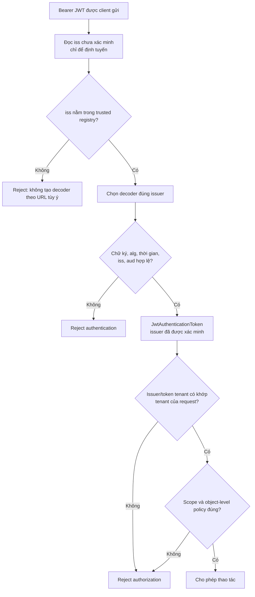
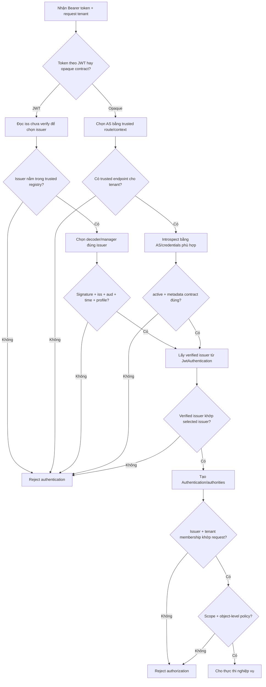

# Ràng buộc issuer đã chọn với kết quả xác minh cuối cùng

Trong một **Spring Security OAuth 2.0/OIDC Resource Server** phục vụ **nhiều tenant**, API có thể tin cậy nhiều Authorization Server (AS) hoặc nhiều realm của cùng một Identity Provider (IdP). Mỗi tenant có thể có issuer, bộ khóa ký JWT, chính sách audience và tên scope khác nhau. Để xác thực Bearer token, hệ thống thường phải **chọn một issuer** trước, rồi mới sử dụng cơ chế xác minh tương ứng.

Đây là một ranh giới bảo mật đặc biệt quan trọng: trong JWT, trường `iss` nằm trong payload và có thể **đọc được trước khi kiểm tra chữ ký**. Đọc được không có nghĩa là tin được. Một attacker có thể tự tạo chuỗi JWT chứa `"iss": "https://idp.alpha.example/realms/alpha"` rồi gửi cho API. Nếu ứng dụng dùng giá trị đó để tải cấu hình từ URL tùy ý, tự cấp quyền hoặc bỏ qua việc xác minh issuer cuối cùng, cơ chế multi-tenant có thể dẫn đến **issuer confusion**, **token substitution**, **SSRF** hoặc cấp quyền nhầm tenant.

Nguyên tắc của bài:

> **Issuer đọc trước khi xác minh chỉ là gợi ý định tuyến; issuer của Authentication được chấp nhận phải được xác nhận bởi bộ xác minh thuộc nguồn tin cậy đã chọn.**

Viết ngắn gọn:

```text
unverified iss
    -> chọn trong danh sách issuer được tin cậy
    -> decoder/introspector của issuer được chọn
    -> xác minh token thật
    -> xác nhận issuer đã được xác minh = issuer đã chọn
    -> xác nhận audience / token profile / thời hạn
    -> kiểm tra tenant nghiệp vụ và scope
    -> mới cho phép truy cập
```

Bài học tập trung vào **ràng buộc issuer đã chọn với kết quả xác minh cuối cùng** trong chương **Nhiều tenant**: phân biệt định tuyến và chứng thực, cấu hình multi-issuer Spring Security, các biến thể chọn tenant theo URL/host/token, JWT/JWKS, opaque introspection, WebFlux, chống lẫn quyền giữa tenant và kiểm thử âm để chứng minh không có đường đi sai trust boundary.

## 1. Bối cảnh: tại sao Resource Server phải chọn issuer?

Giả sử Orders API nhận access token từ hai realm:

| Tenant | Issuer tin cậy | Audience mong đợi | Scope đọc đơn hàng |
|---|---|---|---|
| **alpha** | `https://idp.alpha.example/realms/alpha` | `orders-api` | `orders.read` |
| **beta** | `https://idp.beta.example/realms/beta` | `orders-api` | `orders.read` |

Token của alpha:

```json
{
  "iss": "https://idp.alpha.example/realms/alpha",
  "sub": "user-842",
  "aud": ["orders-api"],
  "scope": "orders.read",
  "tenant_id": "alpha",
  "exp": 1893459600
}
```

Token của beta:

```json
{
  "iss": "https://idp.beta.example/realms/beta",
  "sub": "user-842",
  "aud": ["orders-api"],
  "scope": "orders.read",
  "tenant_id": "beta",
  "exp": 1893459600
}
```

Đây là **các payload minh họa**, không phải JWT đã ký; timestamps không phải hạn sử dụng của một token thật. Cùng `sub=user-842` và cùng scope không có nghĩa đây là một người dùng hay một tập quyền. `sub` thường chỉ có ý nghĩa định danh **trong phạm vi issuer**. Tương tự, cùng tên `SCOPE_orders.read` không tự cho phép token beta đọc dữ liệu alpha.

Resource Server cần trả lời:

1. Token đến từ issuer nào **theo nguồn đã xác minh**?
2. Token có được ký bằng khóa tin cậy của issuer đó không?
3. Token có còn hợp lệ theo thời gian, audience và profile không?
4. Request này đang truy cập tenant nào?
5. Caller có quyền đối với tenant/tài nguyên được yêu cầu không?

Chỉ một trong năm câu trả lời không đủ để cấp quyền.

### 1.1. Sơ đồ chuỗi tin cậy



Điểm quan trọng nằm ở **nút E**: bộ xác minh phải kiểm tra issuer **sau khi** chứng minh token hợp lệ. Nút B chỉ quyết định thử kiểm tra bằng bộ nào; không được biến gợi ý trước xác minh thành kết luận “user thuộc alpha”.

## 2. Ba khái niệm không được đánh đồng

| Giá trị | Đến từ đâu? | Mức tin cậy trước xác thực | Cách dùng đúng |
|---|---|---|---|
| **Issuer hint** | `iss` trong JWT chưa verify hoặc tenant được nêu trong request | **Không đáng tin** | Chọn cấu hình trong allowlist, không cấp quyền |
| **Validated issuer** | Claims từ JWT **sau xác minh** hoặc metadata introspection đáng tin | Đáng tin trong phạm vi bộ xác minh/hợp đồng | Xác nhận danh tính issuer của token |
| **Business tenant** | Tenant trong path/host/context nghiệp vụ, kết hợp membership/DB | Request routing tự nó không chứng minh quyền | Xác nhận actor được thao tác trên tenant đó |

Ví dụ:

```http
GET /tenants/alpha/orders/ORD-123 HTTP/1.1
Authorization: Bearer TOKEN_FROM_BETA
```

Nếu resolver đọc `iss=beta` và xác minh token beta thành công, **authentication của token beta có thể hợp lệ**. Nhưng request đang muốn truy cập **tenant alpha**. Không được cấp quyền chỉ vì issuer beta là một issuer được tin cậy chung. Business policy phải kiểm tra token beta có được phép ở alpha hay không theo hợp đồng; trong mô hình một issuer cho một tenant, phải **từ chối**.

Nói cách khác:

- **Token validation:** “Token này thực sự do beta phát hành và dành cho API này.”
- **Tenant authorization:** “Danh tính beta này có được truy cập tenant alpha không?”

Ràng buộc issuer được chọn với kết quả xác minh cuối cùng giải quyết phần đầu; ràng buộc issuer đã xác minh với tenant nghiệp vụ giải quyết phần tiếp theo. Cả hai cần hiện diện.

## 3. Hai pha trong xác thực JWT nhiều issuer

### Pha A — Định tuyến bằng thông tin chưa xác minh

Một JWT thường có cấu trúc:

```text
base64url(header).base64url(payload).base64url(signature)
```

Payload có thể chứa:

```json
{
  "iss": "https://idp.alpha.example/realms/alpha",
  "sub": "user-842",
  "scope": "orders.read"
}
```

Phần này đọc được mà không cần khóa ký. Attacker cũng có thể sửa nó và tạo một JWT có chữ ký sai. Do đó `iss` trước verify chỉ nên:

1. Được trích xuất bằng cơ chế parsing có giới hạn dữ liệu và lỗi rõ ràng.
2. Được so khớp **chính xác** với issuer trong registry tin cậy.
3. Dẫn đến **một bộ xác minh đã được cấu hình từ nguồn tin cậy**.
4. Nếu issuer không nằm trong registry, từ chối thay vì thử tải URL mới.

Không dùng nó để tạo principal, nối database theo tenant, quyết định permission, chấp nhận role hoặc gọi web tùy ý.

### Pha B — Xác minh bằng bộ được chọn

Khi đã chọn cấu hình alpha, verifier của alpha cần kiểm tra tối thiểu các điều kiện áp dụng:

- JWS signature hợp lệ theo **key source tin cậy của alpha**.
- Thuật toán ký được policy cho phép; không nhận `alg=none` hoặc algorithm không phù hợp.
- `iss` **của claims đã xác minh** bằng issuer alpha đã chọn.
- `aud` chứa resource identifier được phép, ví dụ `orders-api`.
- `exp`, `nbf` và các điều kiện thời gian theo validator/token profile.
- Token là **access token hợp lệ cho API**, không phải ID token dùng sai mục đích; áp thêm `typ`/`client_id`/`azp`/`token_use` nếu hợp đồng yêu cầu.
- Chỉ sau đó mới ánh xạ `scope`/claims được tin cậy thành `GrantedAuthority`.

Nếu chữ ký đúng nhưng `iss` không khớp issuer alpha, **phải reject**. Nếu issuer đúng nhưng audience là `payments-api`, **phải reject**. Nếu token hợp lệ nhưng route yêu cầu tenant khác, authorization vẫn phải **reject**.

### 3.1. Điều kiện logic

Ký hiệu:

- `I_route`: issuer được chọn ở pha định tuyến.
- `I_verified`: issuer của token **sau xác thực**.
- `I_expected(tenant)`: issuer mà chính sách tin cậy gắn với tenant được truy cập.
- `A_expected`: audience của API.

Điều kiện cần trong mô hình một issuer/một tenant:

```text
I_route ∈ TrustedIssuers

SignatureValid(token, keysFor(I_route))
AND IssuerValid(token, I_route)
AND AudienceValid(token, A_expected)
AND TimeAndTokenProfileValid(token)

I_verified == I_route
AND I_verified == I_expected(requestTenant)

AND HasRequiredScope(Authentication)
AND HasDomainPermission(Authentication, requestedObject)
```

Trong mô hình **một issuer quản lý nhiều tenant**, điều kiện `I_verified == I_expected(requestTenant)` có thể đúng cho nhiều tenant. Khi đó phải kiểm tra thêm `tenant_id`, membership, ACL hoặc policy domain; issuer một mình **không phân biệt** hai tenant thuộc cùng một IdP.

### 3.2. Không chỉ “đọc iss lần thứ hai”

Nếu cả hai lần đọc cùng một payload chưa được xác minh, kết quả trùng nhau **không chứng minh gì**. Ràng buộc cuối cùng chỉ có giá trị khi:

1. Chữ ký được kiểm tra bằng khóa tin cậy cho issuer đã chọn.
2. Bộ validator kiểm tra claim `iss` sau verify.
3. Authentication thành công được tạo **từ chính token đã được verify**, không từ metadata của request.

Không tự tạo `JwtAuthenticationToken` từ `Jwt` dựng bằng claims chưa verify rồi cho rằng việc so hai chuỗi `iss` đã an toàn.

## 4. Những kiểu chọn issuer thường gặp

### 4.1. Chọn theo `iss` trong JWT

```text
Bearer JWT
   |
   v
unverified iss = alpha
   |
   v
trusted registry có alpha?
   |
   v
alpha JwtDecoder
   |
   v
verify signature + validate iss + aud + time
```

Đây là mô hình thường được Spring Security hỗ trợ bằng **`JwtIssuerAuthenticationManagerResolver`** ở Servlet hoặc **`JwtIssuerReactiveAuthenticationManagerResolver`** ở WebFlux. Giá trị issuer ban đầu là hint; **trusted issuers** phải được xác định từ cấu hình đáng tin.

### 4.2. Chọn theo URL tenant

```http
GET /tenants/alpha/orders/ORD-123
Authorization: Bearer ...
```

Ứng dụng ánh xạ slug `alpha` sang issuer alpha đã biết. Token có `iss=beta` thì decoder của alpha phải từ chối, cho dù beta cũng là một issuer được tin cậy trong API.

Lựa chọn này phù hợp khi tài nguyên truy cập đã xác định tenant rõ qua URL. Tuy nhiên, path do caller điều khiển **chỉ là input chọn cấu hình**, không phải bằng chứng caller có quyền ở tenant đó.

### 4.3. Chọn theo host/subdomain

```text
alpha.api.example.com -> issuer alpha
beta.api.example.com  -> issuer beta
```

Host có thể đến từ HTTP Host header hoặc proxy headers như `X-Forwarded-Host`; chúng cần được xử lý theo **trusted proxy configuration**. Đừng tin một `X-Tenant-ID`/`X-Forwarded-Host` bất kỳ do caller gửi trực tiếp. Kể cả chọn được issuer đúng bằng host, token vẫn phải được xác minh và business tenant phải được kiểm tra.

### 4.4. Chọn theo token prefix hoặc metadata của opaque token

Một opaque token có thể có namespace/prefix theo hợp đồng:

```text
alpha_opaque_token_...
beta_opaque_token_...
```

Prefix chỉ là **route hint** nếu hệ thống thật sự quy định nó; attacker có thể giả prefix. Phải gửi token tới introspection endpoint thích hợp, xác thực response và ràng buộc issuer/resource cuối cùng. Nếu không có prefix an toàn, có thể chọn issuer qua tenant route hay client context đã được thiết lập theo nguồn tin cậy.

### 4.5. Không chọn issuer bằng email domain

Email `alice@alpha.example` hoặc field `preferred_username` do client truyền không phải bằng chứng access token đến từ issuer alpha. Email có thể thay đổi, trùng, chưa xác minh hoặc không xuất hiện trong client-credentials tokens. Hãy tách **discovery/user experience** khỏi **token trust validation**.

## 5. Cấu hình multi-issuer JWT bằng Spring Security Servlet

Trong Spring Security Servlet, `JwtIssuerAuthenticationManagerResolver` hỗ trợ chọn AuthenticationManager dựa trên issuer và xây/xử lý manager theo issuer tin cậy.

Ví dụ cấu hình tin cậy **tĩnh**:

```java
import jakarta.servlet.http.HttpServletRequest;

import org.springframework.context.annotation.Bean;
import org.springframework.context.annotation.Configuration;
import org.springframework.http.HttpMethod;
import org.springframework.security.authentication.AuthenticationManagerResolver;
import org.springframework.security.config.annotation.web.builders.HttpSecurity;
import org.springframework.security.config.annotation.web.configurers.AbstractHttpConfigurer;
import org.springframework.security.config.http.SessionCreationPolicy;
import org.springframework.security.oauth2.server.resource.authentication
    .JwtIssuerAuthenticationManagerResolver;
import org.springframework.security.web.SecurityFilterChain;

@Configuration
public class MultiIssuerApiSecurity {

    @Bean
    AuthenticationManagerResolver<HttpServletRequest> issuerResolver() {
        return JwtIssuerAuthenticationManagerResolver.fromTrustedIssuers(
            "https://idp.alpha.example/realms/alpha",
            "https://idp.beta.example/realms/beta"
        );
    }

    @Bean
    SecurityFilterChain apiSecurity(
            HttpSecurity http,
            AuthenticationManagerResolver<HttpServletRequest> issuerResolver)
            throws Exception {

        return http
            .securityMatcher("/api/**")
            // Chỉ cho API thuần Bearer header; không dùng browser
            // cookie/session làm credential cho thao tác ghi.
            .csrf(AbstractHttpConfigurer::disable)
            .sessionManagement(session -> session
                .sessionCreationPolicy(SessionCreationPolicy.STATELESS))
            .authorizeHttpRequests(auth -> auth
                .requestMatchers(HttpMethod.GET, "/api/orders/**")
                    .hasAuthority("SCOPE_orders.read")
                .requestMatchers(HttpMethod.POST, "/api/orders/**")
                    .hasAuthority("SCOPE_orders.create")
                .anyRequest().denyAll())
            .oauth2ResourceServer(oauth2 -> oauth2
                .authenticationManagerResolver(issuerResolver))
            .build();
    }
}
```

Đây là ví dụ đường Servlet cho các phiên bản Spring Security có factory `fromTrustedIssuers`. Với phiên bản cũ hơn, chữ ký constructor/factory có thể khác; hãy dùng API của phiên bản dự án đang chạy. Cấu hình cần thêm các endpoint/method thực tế, CORS/CSRF theo credential model, audit và fallback chain khi ứng dụng có nhiều chains.

### 5.1. Vì sao dùng `fromTrustedIssuers`?

Resolver có thể nhìn thấy claim issuer **trước** khi xác minh token để quyết định manager nào xử lý. Khi gọi:

```java
JwtIssuerAuthenticationManagerResolver.fromTrustedIssuers(
    "https://idp.alpha.example/realms/alpha",
    "https://idp.beta.example/realms/beta"
)
```

danh sách này là **nguồn tin cậy của ứng dụng**, không phải danh sách lấy từ token. Khi có token tự khai `iss=https://attacker.example`, issuer đó không được tự động trở thành một AS mới. Điều này ngăn việc tùy ý discovery/JWKS retrieval tới địa chỉ attacker chọn.

### 5.2. Chính xác thì verifier kiểm tra issuer ở đâu?

Trong luồng tiêu chuẩn được cấu hình đúng, mỗi issuer được giải quyết qua decoder gắn với issuer đó và validators tương ứng. **Một resolver chỉ có giá trị bảo mật khi manager/decoder được chọn thật sự xác minh và ràng buộc issuer**. Nếu ứng dụng thay factory bằng custom resolver trả một manager “chấp nhận mọi issuer” hoặc một decoder chỉ parse token mà không validate, trusted issuer routing **không còn đủ**.

Ví dụ thiếu an toàn:

```java
// KHÔNG LÀM: route theo iss rồi tin luôn payload.
String issuer = parseIssuerWithoutVerification(token);
if (trustedIssuers.contains(issuer)) {
    return authenticationCreatedFromUnverifiedClaims(token);
}
```

Đoạn code chỉ chứng minh attacker đã viết một chuỗi issuer thuộc allowlist, không chứng minh có issuer đó phát hành token.

### 5.3. Lưu ý về audience

`JwtIssuerAuthenticationManagerResolver.fromTrustedIssuers(...)` giải quyết **đa issuer**, không có nghĩa nó tự biết Orders API yêu cầu `aud=orders-api` trong mọi hệ thống. Khi API cần audience cụ thể, phải cấu hình audience validator qua decoder/manager hoặc token profile được triển khai và **kiểm thử thực tế**.

Đặc biệt, các property như:

```yaml
spring:
  security:
    oauth2:
      resourceserver:
        jwt:
          issuer-uri: https://idp.alpha.example/realms/alpha
          audiences:
            - orders-api
```

thường biểu diễn cấu hình một issuer mặc định. Nếu bạn thay nhánh JWT decoder bằng một **multi-issuer authenticationManagerResolver tùy biến**, đừng mặc định mọi validator từ auto-configuration vẫn được áp lên **từng decoder trong resolver**. Cần đảm bảo rõ bằng code/config và test.

## 6. Tạo decoder cho từng issuer với validator cuối cùng

Với API cần kiểm soát thuật toán, JWKS endpoint và audience riêng cho từng tenant, có thể tạo một **registry cấu hình bất biến**:

```java
public record TrustedIssuerConfig(
    String issuer,
    String jwkSetUri,
    String audience
) {}
```

Ví dụ cấu hình do application quản trị:

```java
import java.util.Map;

Map<String, TrustedIssuerConfig> trusted = Map.of(
    "https://idp.alpha.example/realms/alpha",
    new TrustedIssuerConfig(
        "https://idp.alpha.example/realms/alpha",
        "https://idp.alpha.example/realms/alpha/protocol/openid-connect/certs",
        "orders-api"
    ),
    "https://idp.beta.example/realms/beta",
    new TrustedIssuerConfig(
        "https://idp.beta.example/realms/beta",
        "https://idp.beta.example/realms/beta/protocol/openid-connect/certs",
        "orders-api"
    )
);
```

Đây là các URL **minh họa**; `jwkSetUri` và discovery endpoints phải tuân thủ IdP thực tế. Không thể suy ra JWKS endpoint của một issuer bằng cách nối path tùy ý nếu chưa có hợp đồng rõ.

### 6.1. Validator bắt buộc: issuer và audience

Ví dụ tạo `NimbusJwtDecoder` từ JWKS URI **đã được tin cậy trong registry**:

```java
import org.springframework.security.oauth2.core.OAuth2Error;
import org.springframework.security.oauth2.core.OAuth2TokenValidator;
import org.springframework.security.oauth2.core.OAuth2TokenValidatorResult;
import org.springframework.security.oauth2.jwt.Jwt;
import org.springframework.security.oauth2.jwt.JwtValidators;
import org.springframework.security.oauth2.jwt.NimbusJwtDecoder;
import org.springframework.security.oauth2.core.DelegatingOAuth2TokenValidator;
import org.springframework.security.oauth2.jose.jws.SignatureAlgorithm;

public final class TrustedJwtDecoders {

    public static NimbusJwtDecoder create(TrustedIssuerConfig config) {
        NimbusJwtDecoder decoder = NimbusJwtDecoder
            .withJwkSetUri(config.jwkSetUri())
            // Chỉ minh họa trường hợp AS ký RS256 theo hợp đồng.
            .jwsAlgorithm(SignatureAlgorithm.RS256)
            .build();

        // Bao gồm các validator mặc định về thời gian và issuer.
        OAuth2TokenValidator<Jwt> issuerAndDefaults =
            JwtValidators.createDefaultWithIssuer(config.issuer());

        OAuth2TokenValidator<Jwt> audience = jwt -> {
            if (jwt.getAudience().contains(config.audience())) {
                return OAuth2TokenValidatorResult.success();
            }
            return OAuth2TokenValidatorResult.failure(
                new OAuth2Error(
                    "invalid_token",
                    "Token audience is not accepted",
                    null
                ));
        };

        decoder.setJwtValidator(
            new DelegatingOAuth2TokenValidator<>(
                issuerAndDefaults, audience));

        return decoder;
    }
}
```

Chú ý:

- `withJwkSetUri(config.jwkSetUri())` lấy URL **từ cấu hình tin cậy**, không từ `iss`, `jku` hay `x5u` tùy ý trong token.
- `jwsAlgorithm(SignatureAlgorithm.RS256)` chỉ phù hợp nếu AS có hợp đồng RS256. Không tùy tiện cho phép nhiều algorithm chỉ để “token nào cũng verify được”.
- `JwtValidators.createDefaultWithIssuer(config.issuer())` giúp xác minh claim issuer **sau khi chữ ký token được chấp nhận**, cùng các validators mặc định phù hợp phiên bản.
- Audience validator yêu cầu `aud` chứa `orders-api`; thiếu hoặc sai audience sẽ bị từ chối.
- Nếu API áp token profile như **RFC 9068**, có thể cần thêm validator `typ`/token-use/client binding theo hợp đồng. Ví dụ không thay toàn bộ yêu cầu của RFC.

**Lỗi dễ mắc:** gọi `decoder.setJwtValidator(audienceOnly)` sẽ **thay validators hiện tại** nếu không gộp issuer/default, có thể vô tình bỏ `iss`/timestamp checks. Trong code trên, hai validator được kết hợp rõ ràng.

### 6.2. Tạo AuthenticationManager sử dụng decoder đó

```java
import org.springframework.security.authentication.AuthenticationManager;
import org.springframework.security.oauth2.server.resource.authentication.JwtAuthenticationProvider;

public static AuthenticationManager managerFor(TrustedIssuerConfig config) {
    JwtAuthenticationProvider provider =
        new JwtAuthenticationProvider(
            TrustedJwtDecoders.create(config));

    return provider::authenticate;
}
```

`JwtAuthenticationProvider` sẽ dùng decoder và converter của nó để xác thực token, rồi tạo Authentication. Nếu ứng dụng custom `JwtAuthenticationConverter` để map roles/scopes, converter đó **chỉ được chạy sau decoder**, không được lấy unverified claims từ giai đoạn routing.

### 6.3. Ràng buộc selected issuer và manager bằng cấu hình

Một registry thực tế có thể được khởi tạo:

```java
Map<String, AuthenticationManager> managers =
    trusted.values().stream()
        .collect(Collectors.toUnmodifiableMap(
            TrustedIssuerConfig::issuer,
            TrustedJwtDecoders::managerFor));
```

Ý tưởng sử dụng của issuer resolver:

```text
unverified issuer = alpha
   |
   v
trusted.get("alpha issuer") -> TrustedIssuerConfig(alpha)
   |
   v
managers.get("alpha issuer") -> JwtAuthenticationProvider
   |
   v
decoder với JWKS alpha
   |
   v
issuer validator == alpha + audience validator == orders-api
```

Khi nối map này với một `AuthenticationManagerResolver` tùy chỉnh, **API/constructor của resolver tùy Spring Security version**; không nhất thiết phải tự viết một parser `iss` khác với framework. Nếu chỉ cần danh sách issuers tin cậy và không cần audience riêng theo issuer, ưu tiên `JwtIssuerAuthenticationManagerResolver.fromTrustedIssuers(...)`; nếu cần custom registry, đảm bảo manager **được tạo từ TrustedIssuerConfig tương ứng** và không bao giờ dùng một decoder chung thiếu issuer validator.

### 6.4. Vì sao không dùng một decoder với tất cả JWKS?

Một thiết kế nguy hiểm:

```text
token khai iss = alpha
       |
       v
kiểm chữ ký bằng "tất cả keys của mọi issuer"
       |
       v
nếu chữ ký hợp lệ bất kỳ key -> accept
```

Nếu key beta có thể ký token khai `iss=alpha` và hệ thống không buộc key source/issuer tương ứng, có thể hình thành **cross-issuer token substitution**. Decoder per issuer với nguồn khóa và issuer validator đúng là cách dễ kiểm soát hơn.

Key ID `kid` cũng **không phải danh tính issuer toàn cục**. Hai AS có thể dùng cùng `kid`. Chỉ tìm `kid` trong **JWKS của issuer đã chọn**, không trong một kho toàn bộ keys thiếu namespace.

## 7. Tình huống tấn công: token beta khai mình là alpha

Giả sử attacker kiểm soát một JWT được ký bằng key beta nhưng sửa claim:

```json
{
  "iss": "https://idp.alpha.example/realms/alpha",
  "sub": "admin",
  "aud": ["orders-api"],
  "scope": "orders.delete"
}
```

Token tự khai issuer alpha. Resolver chọn alpha decoder.

Hành vi đúng:

1. Alpha là issuer được tin cậy, nên có thể **chọn alpha decoder**.
2. Alpha decoder chỉ chấp nhận signature từ keys đã tin cậy của alpha.
3. Nếu token được ký bằng beta key, signature verification phải thất bại.
4. Không tạo Authentication; route không vào controller.

Nếu attacker làm giả chuỗi payload mà không có chữ ký đúng, `iss` có thể vẫn được đọc để định tuyến, nhưng **không được cấp quyền**.

### 7.1. Nếu hai issuer có chung khóa ký thì sao?

Trong một số hệ thống, nhiều realm/issuers có thể dùng chung key material hoặc một key service chia sẻ. Khi đó signature đúng **không tự phân biệt issuer**. Issuer validator trở nên đặc biệt quan trọng, nhưng còn phải xem:

- AS nào thực sự được phép tạo token có issuer nào?
- Có cơ chế đảm bảo một bên không thể ký token tùy ý khai issuer bên khác không?
- Key reuse có làm mất trust boundary đã định nghĩa không?
- Có cần phân tách khóa/ứng dụng/resource theo issuer?

Nếu một AS có thể dùng cùng private key để ký token với `iss` bất kỳ, không có cách đơn thuần dựa vào chữ ký + chuỗi issuer để phân biệt **ai thực sự đã tạo payload**. Đây là vấn đề **hợp đồng tin cậy và quản trị khóa**, không chỉ là cấu hình Java.

### 7.2. Không dùng `kid` hay `jku` để vượt trusted registry

Header JWT có thể chứa:

```json
{
  "alg": "RS256",
  "kid": "key-1",
  "jku": "https://attacker.example/jwks.json"
}
```

Đừng tự động tải `jku` hoặc `x5u` từ một header chưa xác minh. Nếu thư viện/implementation cho phép header key location tùy ý, attacker có thể khiến API lấy attacker key rồi xác minh chính JWT attacker ký.

JWKS URI phải được ràng buộc với issuer từ registry đáng tin hoặc metadata discovery được giới hạn issuer đã tin cậy. Key rotation cũng phải cập nhật trong **đúng trust namespace**, không biến key mới thành khả năng thay issuer.

## 8. Case nguy hiểm: issuer hợp lệ nhưng audience sai

Token:

```json
{
  "iss": "https://idp.alpha.example/realms/alpha",
  "aud": ["billing-api"],
  "sub": "user-842",
  "scope": "orders.read"
}
```

Nếu alpha decoder chỉ kiểm chữ ký và `iss`, nó có thể xác thực một token **không được cấp cho Orders API**. Scope giống `orders.read` không đủ; token có thể dành cho Billing API hoặc một resource khác.

**Audience là ràng buộc độc lập với issuer.** Một issuer có thể cấp token cho nhiều API. Cấu hình multi-issuer phải kiểm tra:

```text
issuer đúng      -> token phát hành từ AS được tin cậy
audience đúng    -> token được cấp cho Resource Server này
scope đúng       -> token được phép dùng loại thao tác này
tenant đúng      -> actor được vào tenant/tài nguyên yêu cầu
```

Trong cấu hình decoder ở phần 6, audience validator được thêm vào **từng decoder**. Test “JWT alpha có audience billing-api” phải bị reject dù chữ ký và issuer đúng.

### 8.1. `azp`/`client_id` không thay `aud`

Một số AS trả `azp`, `client_id` hoặc `appid`. Đây có thể là danh tính client, không phải resource audience. Không lấy `client_id=shop-web` làm bằng chứng token dành cho Orders API, trừ khi hợp đồng token profile của AS định nghĩa rõ và policy đã xem xét.

### 8.2. ID token OIDC không phải API access token

OIDC **ID token** chứng minh sự kiện xác thực cho OAuth client/Relying Party; `aud` của nó thường là client ID. Resource Server cần **access token** phù hợp. Nếu một ID token có issuer thuộc allowlist nhưng audience không phải `orders-api`, phải từ chối. Đừng hạ audience validator để nhận ID token cho tiện.

Đối với JWT access token theo **RFC 9068**, có các quy tắc cụ thể về issuer, audience, token type và claims. Cần áp đúng profile của AS/Resource Server, không chỉ kiểm chữ ký.

## 9. Ràng buộc issuer đã xác minh với tenant của request

Giả sử multi-tenant API có URL:

```http
GET /api/tenants/alpha/orders/ORD-123 HTTP/1.1
Authorization: Bearer VALID_BETA_TOKEN
```

Nếu API dùng `JwtIssuerAuthenticationManagerResolver` đọc `iss` token, beta decoder có thể xác minh token beta thành công. Nhưng request vẫn chỉ nên được xử lý nếu beta actor có **ủy quyền hợp lệ** tới tenant alpha.

Trong mô hình một tenant gắn với một issuer, rule đơn giản:

```text
token issuer == issuer configured for route tenant
```

Điều này phải chạy **sau token verification**, trên `JwtAuthenticationToken.getToken()` đã được Spring Security tạo từ decoder hợp lệ.

### 9.1. Policy bean kiểm tra tenant và issuer

Giả sử business tenant slug `alpha`/`beta` ánh xạ 1-1 tới issuer:

```java
import java.util.Map;
import java.util.Objects;

import org.springframework.security.core.Authentication;
import org.springframework.security.oauth2.server.resource.authentication
    .JwtAuthenticationToken;
import org.springframework.stereotype.Component;

@Component("tenantAccess")
public class TenantAccessPolicy {

    private final Map<String, String> issuerByTenant = Map.of(
        "alpha", "https://idp.alpha.example/realms/alpha",
        "beta", "https://idp.beta.example/realms/beta"
    );

    public boolean mayAccess(
            Authentication authentication,
            String requestedTenant) {

        if (!(authentication instanceof JwtAuthenticationToken jwtAuth)) {
            return false;
        }

        String expectedIssuer = issuerByTenant.get(requestedTenant);
        if (expectedIssuer == null) {
            return false;
        }

        var jwt = jwtAuth.getToken();
        String verifiedIssuer = jwt.getIssuer() == null
            ? null
            : jwt.getIssuer().toString();

        return Objects.equals(expectedIssuer, verifiedIssuer)
            && Objects.equals(
                requestedTenant,
                jwt.getClaimAsString("tenant_id"));
    }
}
```

Ví dụ yêu cầu **cả issuer và `tenant_id`**, phù hợp khi AS có hợp đồng phát hành claim tenant. Claim này không có mặc định trong OAuth 2.0/OIDC, nên chỉ dùng khi IdP bảo đảm nó được xác thực và giới hạn đúng ngữ nghĩa. Nếu app không dùng `tenant_id`, thay bằng membership/ACL từ nguồn có thẩm quyền.

### 9.2. Gọi policy từ service method

```java
import org.springframework.security.access.prepost.PreAuthorize;
import org.springframework.stereotype.Service;

@Service
public class OrderQueryService {

    private final OrderRepository orders;

    public OrderQueryService(OrderRepository orders) {
        this.orders = orders;
    }

    @PreAuthorize(
        "hasAuthority('SCOPE_orders.read') " +
        "and @tenantAccess.mayAccess(authentication, #tenant)")
    public OrderView readOrder(String tenant, String orderId) {
        return orders.findVisibleByTenantAndId(tenant, orderId)
            .orElseThrow(OrderNotFoundException::new);
    }
}
```

Để annotation được thực thi, cần `@EnableMethodSecurity`, bean Spring-managed, lời gọi qua proxy và Spring Security context phù hợp. Với SpEL `#tenant`, bảo đảm tên tham số được giữ khi compile (`-parameters`) hoặc dùng annotation `@P` theo hỗ trợ phiên bản.

`OrderRepository`, `OrderView`, `OrderNotFoundException` là domain abstractions minh họa. Trong thực tế, query còn phải kiểm tra **owner/membership**: hai người cùng tenant không mặc nhiên được xem mọi order của nhau.

### 9.3. Không dùng tenant từ body để chứng minh quyền

Anti-pattern:

```java
if (requestBody.tenantId().equals(pathTenant)) {
    repository.deleteOrder(orderId);
}
```

Attacker có thể tự điền tenant trong body. Điều kiện trên chỉ so hai giá trị do caller kiểm soát, không gắn với Authentication đã xác thực hoặc bản ghi trong DB. Kiểm tra tenant phải dựa vào principal đáng tin và dữ liệu domain; mutation phải diễn ra **sau** policy.

## 10. Một issuer có thể phục vụ nhiều tenant

Không phải hệ thống nào cũng có ánh xạ tenant ↔ issuer 1-1. Một IdP có thể dùng:

```text
issuer: https://login.example.com/realms/enterprise
    |
    +-- tenant alpha
    +-- tenant beta
    +-- tenant gamma
```

Khi đó:

```text
verified iss = enterprise issuer
```

chỉ chứng minh danh tính token thuộc AS này. Nó **không phân biệt** alpha/beta/gamma. Cần thêm:

- `tenant_id` được AS cấp theo chính sách đáng tin;
- Danh sách tenant membership/roles từ authorization service;
- Tenant-specific resource permissions trong DB;
- Các điều kiện owner, manager, delegated access hoặc support access được định nghĩa rõ.

Nếu user A là member cả alpha và beta, việc user đổi active tenant vẫn cần ràng buộc **operation tới tenant được chọn**. Không dùng active tenant từ header làm bypass membership validation.

### 10.1. Identity key nên bao gồm issuer

`sub=user-842` không mặc định duy nhất giữa nhiều issuer. Một khóa danh tính an toàn thường bắt đầu từ:

```text
IdentityKey = (verifiedIssuer, subject)
```

và tiếp tục:

```text
AuthorizationContext =
  IdentityKey + requestedTenant + role/permissions + object state
```

Nếu dự án liên kết hai identity từ hai issuers vào một user nội bộ, đó là một **quy trình account linking có kiểm soát**, không phải suy luận từ `sub` hoặc email trùng nhau.

### 10.2. Cross-tenant service accounts

Token client credentials có thể đại diện một service như `nightly-order-job`, không phải người dùng tương tác. Các field `client_id`, `sub` và `scope` phải được diễn giải theo hợp đồng riêng. Nếu một service có quyền cross-tenant, quyền đó nên được biểu diễn tường minh, giới hạn resource và audit; không cấp quyền cross-tenant chỉ vì issuer là “system”.

## 11. Chọn issuer theo route: cần cả xác thực lẫn validation cuối

Thay vì tự đọc `iss`, một hệ thống có thể chọn tenant từ URL trước khi tiếp xúc với token:

```text
/api/tenants/alpha/** -> manager của alpha
/api/tenants/beta/**  -> manager của beta
```

Đây là một phương án mạnh khi route xác định được tenant một cách đáng tin. Token beta gửi vào route alpha sẽ được kiểm tra bằng **alpha decoder** và bị từ chối. Tuy nhiên, vẫn cần:

1. Trích xuất route tenant an toàn, không dựa vào header không đáng tin.
2. Lookup tenant trong trusted registry, không tự tạo AS từ slug lạ.
3. Dùng đúng decoder có issuer validator gắn với tenant đó.
4. Giữ business authorization kiểm tra owner/tenant của bản ghi.

### 11.1. Không giả định MVC URI_TEMPLATE_VARIABLES đã tồn tại trước controller

Ở tầng Servlet filter chain, security filters có thể chạy **trước** khi Spring MVC handler mapping xác định path variables. Vì vậy code:

```java
// Không mặc định attribute này đã tồn tại ở security filter:
request.getAttribute(
    HandlerMapping.URI_TEMPLATE_VARIABLES_ATTRIBUTE);
```

không phải lúc nào cũng lấy được `tenant` tại thời điểm resolver chạy. Nếu custom resolver theo path, cần một **path parser/matcher được dùng ngay ở filter layer**, có quy tắc URL normalization rõ; hoặc chọn design tách SecurityFilterChain theo route cố định.

### 11.2. Đừng tạo decoder bằng request parameter

Anti-pattern:

```java
String tenant = request.getParameter("tenant");
String issuer = "https://" + tenant + ".example.com";
JwtDecoder decoder = JwtDecoders.fromIssuerLocation(issuer);
```

Attacker có thể sửa tenant, tạo hostname bất kỳ, kích hoạt metadata discovery/JWKS retrieval tới địa chỉ không được phép hoặc gây DoS. Đổi thành:

```java
TrustedIssuerConfig config = registry.findByTenant(tenant);
if (config == null) {
    throw new BadCredentialsException("Unknown tenant");
}
// Lấy verifier đã chuẩn bị từ cấu hình được tin cậy.
AuthenticationManager manager = managers.get(config.issuer());
```

`registry`/`managers` ở đây là services cấu hình tin cậy của ứng dụng. Không tự suy ra issuer/jwkSetUri từ input public.

## 12. Discovery metadata, JWKS và nguy cơ SSRF

Spring Security có thể sử dụng issuer discovery theo OIDC/OAuth metadata để tìm cấu hình liên quan (trong đó có `jwks_uri`). Điều này an toàn hơn khi issuer đến từ **trusted registry** và HTTP client được bảo vệ.

Ngược lại:

```text
unverified JWT iss = http://169.254.169.254/...
       |
       v
JwtDecoders.fromIssuerLocation(iss)
       |
       v
HTTP request tới địa chỉ nội bộ
```

là pattern có rủi ro SSRF nghiêm trọng nếu dùng issuer raw mà không allowlist.

### 12.1. Biện pháp phòng vệ

- Chỉ chấp nhận issuer từ allowlist/registry được quản trị.
- Bắt buộc HTTPS cho AS/JWKS trong môi trường production, với TLS verification hợp lệ.
- Đảm bảo egress/network policy giới hạn nơi Resource Server có thể gọi.
- Không cho HTTP redirects đưa discovery/JWKS request tới địa chỉ bất kỳ.
- Đặt timeout, limit response size và kiểm tra định dạng JSON/JWK.
- Không lấy JWKS URI từ `jku`/`x5u` JWT header chưa verify.
- Cache cấu hình/khóa trong phạm vi đúng issuer, xử lý rotation an toàn.
- Không dùng một key store chung thiếu issuer namespace.

### 12.2. Tên issuer phải so khớp chính xác

Ví dụ:

```text
https://idp.example.com/realms/alpha
https://idp.example.com/realms/alpha/
https://IDP.example.com/realms/alpha
https://idp.example.com/realms/Alpha
```

Chúng **không nên bị coi là tương đương một cách tự phát** trong quy tắc xác minh `iss`. Chuỗi issuer là định danh do AS công bố; ứng dụng phải dùng issuer **chính xác theo metadata/hợp đồng**.

Không dùng `startsWith`, `contains` hoặc so domain một cách tùy tiện:

```java
// KHÔNG LÀM:
if (issuer.startsWith("https://idp.example.com/realms/")) {
    trust(issuer);
}
```

Một issuer mới không được quản trị trong cùng domain/realm namespace cũng có thể không đáng tin. Đừng dùng DNS suffix thay thế quyết định cho phép issuer.

### 12.3. Không dùng “cùng nhà cung cấp” làm bằng chứng

Hai realm trên cùng một Keycloak/Auth0/Entra deployment có thể có chính sách cấp token khác nhau. Việc cùng nhà cung cấp hoặc cùng domain **không tự đồng nghĩa** mọi realm là trusted issuer. Trusted set phải là danh sách các issuer mà hệ thống đã thẩm định và có cơ chế thu hồi trust.

## 13. Reactive WebFlux: cùng quy tắc, khác API

Trong **Spring WebFlux**, Resource Server dùng `SecurityWebFilterChain` và `ServerHttpSecurity`; đối tượng Authentication cùng JWT claim validation vẫn cần ràng buộc issuer sau verify.

Ví dụ cấu hình sử dụng resolver nhiều issuer:

```java
import org.springframework.context.annotation.Bean;
import org.springframework.context.annotation.Configuration;
import org.springframework.http.HttpMethod;
import org.springframework.security.config.annotation.web.reactive.EnableWebFluxSecurity;
import org.springframework.security.config.web.server.ServerHttpSecurity;
import org.springframework.security.oauth2.server.resource.authentication
    .JwtIssuerReactiveAuthenticationManagerResolver;
import org.springframework.security.web.server.SecurityWebFilterChain;

@Configuration
@EnableWebFluxSecurity
public class ReactiveMultiIssuerSecurity {

    @Bean
    SecurityWebFilterChain apiSecurity(ServerHttpSecurity http) {
        JwtIssuerReactiveAuthenticationManagerResolver resolver =
            JwtIssuerReactiveAuthenticationManagerResolver.fromTrustedIssuers(
                "https://idp.alpha.example/realms/alpha",
                "https://idp.beta.example/realms/beta"
            );

        return http
            .csrf(ServerHttpSecurity.CsrfSpec::disable)
            .authorizeExchange(auth -> auth
                .pathMatchers(HttpMethod.GET, "/api/orders/**")
                    .hasAuthority("SCOPE_orders.read")
                .anyExchange().denyAll())
            .oauth2ResourceServer(oauth2 -> oauth2
                .authenticationManagerResolver(resolver))
            .build();
    }
}
```

Ví dụ dựa trên factory hiện đại; các APIs của `JwtIssuerReactiveAuthenticationManagerResolver` cần được đối chiếu với phiên bản Spring Security của dự án. Đoạn code chỉ mô tả tenant resolution/HTTP authorization; cấu hình production còn cần audience validator cho từng issuer, CORS, xử lý lỗi và các route còn lại.

### 13.1. Reactor Context không thay issuer validation

Sau khi Authentication thành công, WebFlux thường lưu SecurityContext trong **Reactor Context** và truy cập qua `ReactiveSecurityContextHolder`. Nó không tự tạo security boundary giữa issuers: nếu decoder sai, Reactor Context chỉ truyền **Authentication sai** đi tiếp.

Do đó phải kiểm tra token trước khi đưa principal vào context, rồi dùng `iss` đã được xác minh để kiểm tra tenant tại reactive service:

```java
return ReactiveSecurityContextHolder.getContext()
    .map(SecurityContext::getAuthentication)
    .flatMap(auth -> tenantPolicy.allowed(auth, requestedTenant))
    .filter(Boolean::booleanValue)
    .switchIfEmpty(Mono.error(
        new AccessDeniedException("Tenant access denied")))
    .then(orderRepository.findVisibleById(...));
```

Đây là **mẫu ý tưởng**; các biến `tenantPolicy`, `requestedTenant`, `orderRepository` và `...` cần được thay bằng code domain thực. Trong nhánh reactive, `tenantPolicy.allowed` trả `Mono<Boolean>`, không được dùng `block()` trên event loop.

### 13.2. Mono/Flux không phải cách bỏ qua security check

`Mono` có thể trì hoãn thực thi tới subscription; security filter/method interceptor phải gắn đúng context và authorization vào cùng reactive chain. Không dùng detached `subscribe()` để kiểm tra quyền rồi song song truy vấn dữ liệu — như vậy dễ tạo race:

```java
// Không an toàn: authorization chạy tách rời thao tác.
tenantPolicy.allowed(authentication, tenant).subscribe();
return repository.deleteById(orderId);
```

Phải compose:

```java
return tenantPolicy.allowed(authentication, tenant)
    .flatMap(allowed -> {
        if (!allowed) {
            return Mono.error(new AccessDeniedException("Denied"));
        }
        return repository.deleteById(orderId);
    });
```

Issuer binding, tenant authorization và mutation phải nằm trên **đúng pipeline**, không mặc định một subscription side effect sẽ bảo vệ subscription khác.

## 14. Opaque token: không có issuer JWT để đọc trước

Với **opaque access token**, Resource Server có thể không đọc được bất kỳ `iss` nào từ Bearer string. Lựa chọn issuer/introspection endpoint phải dựa vào:

- Tenant từ route hoặc host **được map qua registry đáng tin**;
- Client context/service contract đã được xác thực;
- Prefix token chỉ khi AS có hợp đồng định tuyến rõ, sau đó vẫn phải verify;
- Một introspection gateway tin cậy có khả năng xác nhận token từ nhiều issuers.

Không dùng:

```java
String issuer = decodeJwtWithoutVerification(opaqueToken).getIssuer();
```

Opaque token không bắt buộc là JWT; ngay cả khi chuỗi tình cờ có dấu chấm, không được coi là JWT để suy ra issuer.

### 14.1. Ràng buộc kết quả introspection với issuer đã chọn

Giả sử tenant alpha được map tới:

```text
issuer = https://idp.alpha.example/realms/alpha
introspection-uri = https://idp.alpha.example/oauth2/introspect
resource-server credential = alpha-orders-api
```

Resource Server gọi **endpoint đã được tin cậy**. Nếu AS trả metadata:

```json
{
  "active": true,
  "iss": "https://idp.alpha.example/realms/alpha",
  "aud": ["orders-api"],
  "scope": "orders.read",
  "sub": "user-842"
}
```

thì wrapper có thể kiểm tra:

```text
introspection response trusted
AND active accepted by delegate
AND returned iss == selected issuer alpha
AND aud contains orders-api
```

Nếu response không có `iss`, **RFC 7662 không bắt buộc mọi AS trả nó**. Cần một hợp đồng khác đủ mạnh: ví dụ endpoint alpha chỉ introspect token alpha và dùng credentials của Resource Server dành riêng cho alpha. Nếu AS có thể trả active cho token của beta mà không có issuer metadata, Resource Server khó chứng minh token thực sự thuộc issuer đã chọn. Không bỏ qua ràng buộc rồi gọi đó là issuer verification.

### 14.2. Ví dụ decorator Servlet cho issuer sau introspection

```java
import java.util.Collection;
import java.util.Objects;

import org.springframework.security.oauth2.core.OAuth2AuthenticatedPrincipal;
import org.springframework.security.oauth2.server.resource.introspection
    .BadOpaqueTokenException;
import org.springframework.security.oauth2.server.resource.introspection
    .OpaqueTokenIntrospector;

public final class IssuerBoundOpaqueIntrospector
        implements OpaqueTokenIntrospector {

    private final OpaqueTokenIntrospector delegate;
    private final String selectedIssuer;
    private final String requiredAudience;

    public IssuerBoundOpaqueIntrospector(
            OpaqueTokenIntrospector delegate,
            String selectedIssuer,
            String requiredAudience) {
        this.delegate = Objects.requireNonNull(delegate);
        this.selectedIssuer = Objects.requireNonNull(selectedIssuer);
        this.requiredAudience = Objects.requireNonNull(requiredAudience);
    }

    @Override
    public OAuth2AuthenticatedPrincipal introspect(String token) {
        OAuth2AuthenticatedPrincipal principal =
            delegate.introspect(token);

        if (!selectedIssuer.equals(principal.getAttribute("iss"))) {
            throw new BadOpaqueTokenException(
                "Introspected token issuer not accepted");
        }

        Object aud = principal.getAttribute("aud");
        boolean audienceMatches =
            (aud instanceof String s && requiredAudience.equals(s))
            || (aud instanceof Collection<?> values
                && values.contains(requiredAudience));

        if (!audienceMatches) {
            throw new BadOpaqueTokenException(
                "Introspected token audience not accepted");
        }
        return principal;
    }
}
```

Decorator **chỉ** kiểm tra attributes sau khi delegate đã xác minh token qua AS. Nó không tự xác thực `active`, không gọi API từ input chưa tin cậy, không thay đổi `principal.getAuthorities()`. Nếu delegate ném exception, lỗi phải truyền lên để không cấp quyền dự phòng.

### 14.3. WebFlux opaque introspection

Với WebFlux, tương đương là `ReactiveOpaqueTokenIntrospector`:

```java
import reactor.core.publisher.Mono;
import org.springframework.security.oauth2.core.OAuth2AuthenticatedPrincipal;
import org.springframework.security.oauth2.server.resource.introspection
    .ReactiveOpaqueTokenIntrospector;
import org.springframework.security.oauth2.server.resource.introspection
    .BadOpaqueTokenException;

public final class IssuerBoundReactiveIntrospector
        implements ReactiveOpaqueTokenIntrospector {

    private final ReactiveOpaqueTokenIntrospector delegate;
    private final String selectedIssuer;

    public IssuerBoundReactiveIntrospector(
            ReactiveOpaqueTokenIntrospector delegate,
            String selectedIssuer) {
        this.delegate = delegate;
        this.selectedIssuer = selectedIssuer;
    }

    @Override
    public Mono<OAuth2AuthenticatedPrincipal> introspect(String token) {
        return Mono.defer(() -> delegate.introspect(token))
            .switchIfEmpty(Mono.error(new BadOpaqueTokenException(
                "Missing introspection principal")))
            .map(principal -> {
                if (!selectedIssuer.equals(
                        principal.getAttribute("iss"))) {
                    throw new BadOpaqueTokenException(
                        "Introspection issuer mismatch");
                }
                return principal;
            });
    }
}
```

Trong production cần thêm audience/resource check theo hợp đồng, timeout/HTTP error policy và bảo vệ credentials. `Mono.empty()` hay `onError` không được chuyển thành một principal có quyền. `Mono.defer` giúp giữ việc gọi delegate trong subscription, không biến một HTTP client blocking thành non-blocking.

### 14.4. Không thử tất cả introspection endpoints vô điều kiện

Một implementation có thể nghĩ:

```text
Try AS alpha
  nếu inactive -> try AS beta
  nếu inactive -> try AS gamma
  đến khi có active=true
```

Cách này có các vấn đề:

- Gửi cùng bearer credential đến nhiều bên hơn cần thiết.
- Làm tăng latency, tải và khả năng token bị lộ qua logs/metrics.
- Không rõ một token có thể active ở hai AS theo hai ngữ nghĩa không.
- Dễ thiếu ràng buộc issuer cuối khi chọn “bên nào nói active”.
- Khi AS down có thể fallback sang bên khác theo logic nguy hiểm.

Nếu kiến trúc thật sự cần một introspection service liên hợp, nên dùng **gateway tin cậy với hợp đồng nguồn phát hành/ràng buộc issuer rõ** hoặc một chiến lược chọn AS từ context được kiểm soát. Không dùng “thử mọi AS và tin kết quả đầu tiên” làm mặc định.

## 15. Tính năng multi-tenant động: onboard/offboard issuer an toàn

Trusted issuer registry có thể được cập nhật khi onboarding tenant mới. Việc cập nhật registry **là thay đổi trust configuration**, không phải dữ liệu thông thường.

Luồng onboarding nên bao gồm:

1. Xác minh issuer identity, URL metadata, JWKS URI và ownership của tenant.
2. Xác định audience/token profile, algorithms, scopes và principals được chấp nhận.
3. Kiểm tra TLS, endpoint reachability, response size/timeout và egress policy.
4. Cấu hình registry từ nguồn quản trị có kiểm soát.
5. Tạo decoder/manager **gắn cứng** với issuer tin cậy đã đăng ký.
6. Kiểm thử token issuer mới không được dùng ở tenant khác.
7. Có đường thu hồi trust, invalidation manager/JWKS/cache khi tenant bị offboard.

### 15.1. Vì sao cần invalidation?

Một resolver có thể cache AuthenticationManager/decoder theo issuer. Nếu tenant bị offboard nhưng cache còn giữ manager hoặc trust predicate cũ, cần xác nhận request mới không tiếp tục dùng issuer đã bị thu hồi.

Không giả định chỉ xóa một row khỏi database registry thì mọi instance lập tức ngừng chấp nhận token; xem:

- Cache manager theo issuer;
- JWKS cache;
- Introspection result cache;
- Replica configuration propagation;
- Gateway allowlist;
- Long-lived session hoặc asynchronous jobs.

Một cơ chế offboarding đúng phải có thời gian hiệu lực chính sách được quy định và test theo cluster.

### 15.2. Không tạo decoder mới cho mỗi request

`JwtDecoder` có thể cần gọi metadata/JWKS và giữ cache khóa. Việc khởi tạo lại decoder theo `iss` trên mọi request gây:

- Latency và network overhead lớn;
- Dễ bị lạm dụng làm discovery DoS;
- Thiếu kiểm soát key cache/rotation;
- Race khi cấu hình thay đổi;
- Rủi ro SSRF nếu issuer không được allowlist.

Nên tái sử dụng decoder/manager theo **trusted issuer key** với lifecycle và invalidation rõ.

### 15.3. Cấu hình nhiều issuer từ database cũng cần review

Một issuer record do tenant admin tự nhập trực tiếp không nên được tin như một issuer mới của API. Cần quy trình xét duyệt, kiểm chứng domain, ownership, hợp đồng ký token, resource audience và quyền tenant admin. Dữ liệu nằm trong DB không có nghĩa “đáng tin hơn request” nếu người dùng bên ngoài được phép tùy ý chỉnh sửa.

## 16. Phân biệt lỗi xác thực issuer và lỗi phân quyền tenant

| Trường hợp | Lỗi ở tầng | Kết quả HTTP thường gặp |
|---|---|---|
| JWT thiếu hoặc không đúng cấu trúc | Authentication | 401 |
| `iss` không nằm trong allowlist | Authentication/routing | 401 |
| Chữ ký không hợp lệ với issuer đã chọn | Authentication | 401 |
| Chữ ký hợp lệ nhưng `iss` không đúng expected issuer | Authentication | 401 |
| Issuer đúng nhưng `aud` không dành cho API | Authentication | 401 |
| Token hết hạn/chưa có hiệu lực | Authentication | 401 |
| Token hợp lệ nhưng thiếu `SCOPE_orders.read` | Authorization | 403 |
| Token beta hợp lệ nhưng request tenant alpha | Domain/tenant authorization | 403 hoặc 404 theo policy |
| Token có scope nhưng không sở hữu order | Domain authorization | 403 hoặc 404 theo policy |
| JWKS/AS endpoint timeout hoặc 5xx | Infrastructure/authentication unavailable | Phải fail closed; HTTP response tùy exception handler |

Không mặc định mọi authentication failure thành 403 hay mọi business denial thành 401. Với Bearer token theo **RFC 6750**, 401 thường có `WWW-Authenticate: Bearer` và có thể kèm mã lỗi tương ứng; thiếu scope có thể dẫn đến `insufficient_scope` và 403. Exception handlers/gateway có thể tùy chỉnh chi tiết nhưng không được làm thay đổi quyết định deny.

### 16.1. Đừng phản hồi issuer nội bộ quá chi tiết

Khi một issuer không được tin cậy, API không cần nói:

```text
We only trust https://idp.alpha.example/... and
https://idp.beta.example/...
```

cho caller vô danh. Có thể trả thông điệp chung về token không hợp lệ; log server-side một **mã lỗi an toàn** hoặc issuer ID nội bộ đã được chuẩn hóa theo chính sách. Không ghi nguyên bearer token hoặc header JWT tùy ý có chứa dữ liệu nhạy cảm.

## 17. Kiểm thử âm: chứng minh issuer routing không đủ để cấp quyền

Chỉ test “token alpha hợp lệ được 200” là chưa đủ. Một cơ chế multi-issuer cần test các trường hợp có **issuer hint đúng nhưng chữ ký/scope/resource sai**.

### 17.1. Ma trận JWT cần có

| Token/Request | Kỳ vọng |
|---|---|
| Alpha JWT ký bởi alpha, `iss=alpha`, `aud=orders-api` | Qua authentication, tiếp tục scope/domain policy |
| Beta JWT ký bởi beta, `iss=beta`, `aud=orders-api` | Qua authentication, nhưng chỉ quyền beta theo policy |
| Token giả `iss=alpha` nhưng chữ ký rác | Reject authentication |
| Token ký bằng beta key nhưng `iss=alpha` | Reject bằng alpha verification/key policy |
| Token ký bằng alpha nhưng `iss=beta` | Reject bằng beta verification/key policy |
| Token alpha hợp lệ nhưng `aud=payments-api` | Reject authentication |
| Token alpha hết hạn/`nbf` tương lai | Reject authentication |
| Token có `iss=https://attacker.example` | Reject trước khi tạo discovery request |
| Token có `jku` trỏ attacker | Không lấy JWKS tùy ý; verify theo key source tin cậy |
| Token có `alg=none` hoặc algorithm không hỗ trợ | Reject |
| Token beta hợp lệ vào `/tenants/alpha/**` | Reject tenant authorization |
| Token alpha chỉ có `orders.read` gọi DELETE | Reject authorization |
| Hai token có cùng `sub` từ alpha và beta | Không coi là cùng identity nếu chưa account-linking |
| Issuer thiếu/trailing slash không khớp exact issuer | Reject theo hợp đồng |
| JWT claim `tenant_id=alpha` nhưng object thuộc beta | Reject domain authorization |

**Đặc biệt test cross-key/cross-issuer:** đây là phép thử chứng minh **issuer routing ban đầu không bị nhầm thành proof**. Trong integration test phải dùng JWT thật được ký bằng **test keys tách biệt** và decoder thật, thay vì chỉ tạo Authentication mock.

### 17.2. Unit test validator issuer và audience

Có thể kiểm tra claim validators bằng một `Jwt` fixture:

```java
import java.time.Instant;
import java.util.List;

import org.junit.jupiter.api.Test;
import org.springframework.security.oauth2.core.OAuth2TokenValidatorResult;
import org.springframework.security.oauth2.jwt.Jwt;
import org.springframework.security.oauth2.jwt.JwtValidators;

import static org.assertj.core.api.Assertions.assertThat;

class JwtIssuerClaimValidatorTest {

    @Test
    void rejectsIssuerDifferentFromSelectedIssuer() {
        Jwt jwt = Jwt.withTokenValue("synthetic.jwt.token")
            .header("alg", "RS256")
            .issuer("https://idp.beta.example/realms/beta")
            .audience(List.of("orders-api"))
            .issuedAt(Instant.now().minusSeconds(5))
            .expiresAt(Instant.now().plusSeconds(600))
            .subject("user-842")
            .build();

        var validator = JwtValidators.createDefaultWithIssuer(
            "https://idp.alpha.example/realms/alpha");

        OAuth2TokenValidatorResult result = validator.validate(jwt);
        assertThat(result.hasErrors()).isTrue();
    }
}
```

Đây là **unit test của validator claims**, **không** xác minh chữ ký thực vì `Jwt.withTokenValue(...)` tạo object đã parse giả lập. Nó không thay thế integration test decoder ký bằng alpha/beta keys khác nhau.

### 17.3. Test với `mockJwt()` có giới hạn

Trong Spring Security Test, `MockMvc`:

```java
mockMvc.perform(get("/api/orders/123")
    .with(jwt().jwt(jwt ->
        jwt.claim("iss", "https://idp.alpha.example/realms/alpha"))
        .authorities(
            new SimpleGrantedAuthority("SCOPE_orders.read"))));
```

giúp kiểm tra controller/service authorization khi Authentication đã được giả lập. Nó thường **bỏ qua decoder thật**, nên **không chứng minh**:

- Chữ ký đúng với key source issuer alpha;
- Issuer resolver dùng allowlist;
- `iss` đã được validator kiểm tra;
- Audience/time checks thực sự chạy;
- Untrusted issuer không thể kích hoạt remote discovery.

Vì vậy, test nhiều issuer bắt buộc phải có đường **Bearer compact JWT qua filter chain với decoder thực** (và JWKS/IdP test có kiểm soát) nếu muốn chứng minh trust boundary.

### 17.4. Integration test với hai JWKS test servers

Một cấu hình test nghiêm túc:

```text
Test Issuer A:
  iss = https://issuer-a.test
  JWKS = key-A

Test Issuer B:
  iss = https://issuer-b.test
  JWKS = key-B

Application:
  trusted issuers = [A, B]
  audience = orders-api
```

Test gửi token:

```text
token-A-signed-A -> 200 nếu có scope và đúng tenant
token-B-signed-B -> 200 nếu có scope và đúng tenant
token-claims-A-signed-B -> 401
token-claims-B-signed-A -> 401
token-A-aud-other -> 401
token-A-to-tenant-B -> 403/404 theo policy
unknown-issuer -> 401, không có HTTP request tới unknown URL
```

Để test discovery theo issuer, có thể dùng môi trường mock OIDC metadata/JWKS được định tuyến rõ. Nếu test dùng JWKS URI cố định trong trusted registry, cần xác minh không truy cập URL từ token header. Không cần gọi IdP production hoặc lưu private keys thật trong repository.

### 17.5. Unit test tenant policy sau authentication

Giả sử `TenantAccessPolicy` từ phần 9:

```java
Jwt jwt = Jwt.withTokenValue("test-token")
    .header("alg", "RS256")
    .issuer("https://idp.beta.example/realms/beta")
    .subject("user-842")
    .claim("tenant_id", "beta")
    .build();

JwtAuthenticationToken auth =
    new JwtAuthenticationToken(jwt);

boolean allowed = policy.mayAccess(auth, "alpha");
assertThat(allowed).isFalse();
```

Đây là **unit test policy** với một Authentication giả định đã được xác minh. Nó chứng minh logic “beta không được truy cập alpha”, không chứng minh chữ ký token beta thật.

### 17.6. Test opaque introspection

Với opaque token và hai AS endpoints, test:

- Token alpha introspect alpha, `active=true, iss=alpha` → chấp nhận nếu audience/scope đúng.
- Token beta gửi vào alpha endpoint, AS trả `active=false` → từ chối.
- Endpoint alpha trả `active=true, iss=beta` → decorator alpha từ chối.
- Response `active=true` nhưng thiếu `iss` khi policy yêu cầu → từ chối.
- Endpoint down/timeout → không cấp principal dự phòng.
- `scope` hợp lệ nhưng request tenant khác → domain authorization từ chối.

Một fake `OpaqueTokenIntrospector` đủ để test wrapper; mock HTTP introspection server kiểm tra RFC 7662 parsing; environment IdP thật cần test client credentials/AS contract riêng.

## 18. Những lỗi thiết kế phổ biến và cách sửa

| Anti-pattern | Vì sao nguy hiểm | Hướng đúng |
|---|---|---|
| Tin `iss` trước verify là issuer thật | Attacker tự viết JWT payload | Chỉ dùng làm hint, verify chữ ký + issuer cuối |
| Tạo issuer URL từ input chưa tin cậy | SSRF/discovery tới server tùy ý | Registry/allowlist tin cậy |
| Dùng một decoder nhận mọi issuer, không check `iss` | Cross-issuer substitution | Decoder + issuer validator theo selected issuer |
| Chỉ so `iss` nhưng bỏ signature | Token giả có thể tự khai đúng issuer | Bắt buộc kiểm chứng chữ ký/token authenticity |
| Chỉ check signature nhưng bỏ audience | Token cấp cho API khác được tái sử dụng | Audience validator cho từng manager |
| Dùng `kid` toàn cục để chọn khóa | Hai issuers có thể trùng `kid` | Tìm key trong issuer-scoped JWKS |
| Tin `jku`/`x5u` trong header | Attacker chỉ tới JWKS họ sở hữu | Chỉ dùng key source được cấu hình tin cậy |
| So issuer bằng `startsWith` | Trust nhầm realm/issuer lạ | So issuer chính xác |
| Cho token beta vào route alpha vì beta cũng trusted | Authentication đúng không chứng minh tenant authorization | Bind verified issuer với requested tenant |
| So tenant từ hai request parameters | Caller kiểm soát cả hai | So với verified principal + domain data |
| Dùng `sub` không kèm issuer | Collision identity giữa AS | Identity key bằng (issuer, sub) |
| Dùng email làm primary cross-issuer identity | Email có thể đổi/trùng/chưa xác minh | Account linking có kiểm soát |
| Dựa vào Spring Boot JWT properties trong custom resolver mà không test | Validator có thể không gắn với từng manager | Tạo/kiểm chứng validator tường minh |
| Tạo decoder mới mỗi request | DoS/latency, discovery risk | Cache manager theo trusted issuer và quản lý lifecycle |
| Offboard issuer nhưng giữ manager cached | Tiếp tục tin token issuer đã bị thu hồi | Invalidate registry/manager/cache trên mọi instance |
| HTTP tests chỉ dùng `mockJwt()` | Bỏ qua decoder/signature/issuer resolver | Test compact JWT ký bằng test keys |
| Opaque introspection gặp timeout thì thử AS khác rồi accept | Token confusion và phát tán credential | Chọn endpoint tin cậy, fail closed |
| “Token active” đồng nghĩa scope/tenant đúng | Active chỉ là trạng thái token | Scope, audience, object policy riêng |

### 18.1. Cần phân biệt sai cấu hình với token sai

Nếu token từ issuer hợp lệ liên tục 401:

1. Issuer trong token có **khớp tuyệt đối** metadata issuer được cấu hình không?
2. Resolver chọn manager của issuer nào?
3. JWKS URI/alg/key rotation có đúng issuer đó không?
4. Signature có pass không?
5. `aud`, `exp`, `nbf`, token profile có pass không?
6. Custom JWT validator có vô tình **ghi đè** default issuer/time validators không?
7. Có nhiều `SecurityFilterChain` và request đang đi vào chain nào?

Không “fix” bằng cách bỏ issuer/audience validator hoặc thêm `permitAll()`. Cần tìm đúng điểm trust boundary thất bại.

## 19. Quan sát hệ thống mà không làm lộ dữ liệu

Logging/metrics hữu ích cho một Resource Server multi-issuer:

```text
requestCorrelationId
issuerRegistryKey (đã chuẩn hóa)
tenantRouteId (đã chuẩn hóa)
authenticationMechanism = JWT / OPAQUE
selectedVerifierId
validationOutcome = success / invalid_signature / issuer_mismatch /
                    audience_mismatch / expired / upstream_failure
authorizationOutcome = allow / deny
JWKS refresh / cache hit / AS latency
```

Nhưng không ghi nguyên:

```text
Authorization: Bearer eyJ...
raw compact JWT hoặc opaque token
client_secret/introspection credentials
toàn bộ token claims chưa lọc
private keys
```

Issuer từ **token chưa xác minh** có thể là attacker-controlled string rất dài hoặc chứa ký tự gây log injection. Không đưa trực tiếp vào metrics label có cardinality không giới hạn. Nên log “issuer_known=false” hoặc ID nội bộ trong trusted registry.

### 19.1. Cần thấy hai thời điểm khác nhau trong trace

Một trace đầy đủ có thể cho biết:

```text
issuer_selection:
  selected = alpha
  source = unverified-iss
  trusted_registry_match = yes

token_verification:
  signature = valid
  verified_issuer = alpha
  audience = orders-api
  token_profile = accepted

tenant_authorization:
  requested_tenant = alpha
  allowed = yes
```

Không phải ghi raw JWT để chứng minh việc này. Dùng ID/trạng thái đã kiểm soát. Đặc biệt, khi truy vết một 403 do tenant mismatch, đừng nhầm với 401 vì issuer token không verify.

## 20. Quy trình triển khai theo từng bước

Một quy trình đáng tin cậy cho multi-tenant Resource Server:

1. **Định nghĩa trust model:** một issuer/một tenant hay một issuer/nhiều tenant? Những AS nào được phép phát access token?
2. **Lập trusted registry:** issuer exact URI, JWKS/introspection endpoints, algorithms, token profile, audience, scopes và tenant mapping.
3. **Chọn routing hint:** `iss` chưa verify, tenant URL, trusted host hoặc opaque prefix theo hợp đồng; không dùng hint để cấp quyền.
4. **Lookup issuer trong allowlist:** thiếu/không khớp thì reject, không discovery từ attacker input.
5. **Chọn verifier theo registry:** decoder/AS creds phải được lấy từ config trusted, không từ header token tùy ý.
6. **Xác minh token:** signature/active, time, `iss`, audience, token type/alg theo hợp đồng.
7. **Bind final issuer:** issuer từ kết quả **đã verify** phải khớp issuer đã chọn; nếu khác thì reject.
8. **Tạo Authentication:** map scope/permissions từ claims đã được xác minh, không từ request headers.
9. **Bind business tenant:** khớp issuer/tenant_id/membership với tenant trong route/resource; không chỉ tin URL hay body.
10. **Kiểm tra scope/domain:** `SCOPE_...`, owner, ACL, trạng thái, update authorization trước mutation.
11. **Kiểm thử cross-issuer:** signed-A/claims-B, wrong audience, unknown issuer, wrong tenant, token profile sai, JWKS key confusion.
12. **Vận hành trust lifecycle:** onboard/offboard, cache invalidation, secret/JWKS rotation, fail closed và quan sát an toàn.

### 20.1. Cây quyết định



Với opaque introspection không trả `iss`, nút “verified issuer” phải dựa vào **bằng chứng tương đương từ AS contract** (endpoint độc quyền/token audience/ràng buộc resource), không được giả vờ metadata thiếu vẫn chứng minh issuer.

## 21. Tổng kết

```text
1. ROUTING (chưa phải authentication)
   unverified JWT iss / route tenant
           |
           v
   trusted issuer registry (exact match)
           |
           v
   selected issuer + selected verifier

2. VERIFICATION (bằng chứng bảo mật)
   selected key source / trusted introspection endpoint
           |
           v
   signature hoặc active token confirmation
           |
           v
   iss đã xác minh == issuer đã chọn
   aud đúng API, time/algorithm/profile hợp lệ
           |
           v
   trusted Authentication

3. AUTHORIZATION (quyền truy cập)
   SCOPE_orders.read / SCOPE_orders.update
           |
           v
   requested tenant + membership/owner/ACL
           |
           v
   dữ liệu hoặc mutation được phép
```

**Việc chọn một issuer không phải bằng chứng token do issuer đó phát hành.** Với JWT nhiều tenant, `iss` đọc trước chữ ký chỉ được dùng như **hint để chọn một verifier trong allowlist**. Verifier phải chứng minh chữ ký bằng khóa đúng issuer và xác nhận **issuer sau verify khớp issuer đã chọn**, đồng thời kiểm tra audience, thời gian và token profile. Với opaque token, endpoint introspection và metadata đáng tin phải cung cấp cùng ràng buộc nguồn phát hành.

Ngay cả khi token đã được xác thực đúng issuer, Resource Server vẫn phải **ràng buộc issuer/identity với tenant mà request thực sự truy cập**, kiểm tra scope và quyền trên từng tài nguyên. Đây là cách phân tách ba câu hỏi không thể thay nhau: **“Ai cấp token?”, “Token được cấp cho API và thao tác nào?”, “Caller được làm gì trên tenant/object này?”**

## Tài liệu tham khảo

- [Spring Security Reference — Multitenancy (Servlet Resource Server)](https://docs.spring.io/spring-security/reference/servlet/oauth2/resource-server/multitenancy.html): `JwtIssuerAuthenticationManagerResolver`, trusted issuers và giải quyết AuthenticationManager.
- [Spring Security Reference — Multitenancy (Reactive Resource Server)](https://docs.spring.io/spring-security/reference/reactive/oauth2/resource-server/multitenancy.html): giải quyết nhiều issuer trong WebFlux.
- [Spring Security Reference — JWT Resource Server (Servlet)](https://docs.spring.io/spring-security/reference/servlet/oauth2/resource-server/jwt.html): JWT decoder, issuer, audience và mapping authorities.
- [Spring Security Reference — Reactive JWT Resource Server](https://docs.spring.io/spring-security/reference/reactive/oauth2/resource-server/jwt.html): decoder/Authentication trong WebFlux.
- [Spring Security Reference — Opaque Token Resource Server](https://docs.spring.io/spring-security/reference/servlet/oauth2/resource-server/opaque-token.html): introspection và principal.
- [Spring Security Reference — Reactive Opaque Token Resource Server](https://docs.spring.io/spring-security/reference/reactive/oauth2/resource-server/opaque-token.html): `ReactiveOpaqueTokenIntrospector`.
- [Spring Security API — JwtIssuerAuthenticationManagerResolver](https://docs.spring.io/spring-security/reference/api/java/org/springframework/security/oauth2/server/resource/authentication/JwtIssuerAuthenticationManagerResolver.html): resolver issuer Servlet.
- [Spring Security API — JwtIssuerReactiveAuthenticationManagerResolver](https://docs.spring.io/spring-security/reference/api/java/org/springframework/security/oauth2/server/resource/authentication/JwtIssuerReactiveAuthenticationManagerResolver.html): resolver issuer Reactive.
- [Spring Security API — JwtValidators](https://docs.spring.io/spring-security/reference/api/java/org/springframework/security/oauth2/jwt/JwtValidators.html): validator issuer/defaults.
- [RFC 8414 — OAuth 2.0 Authorization Server Metadata](https://www.rfc-editor.org/rfc/rfc8414): issuer/metadata và discovery.
- [OpenID Connect Discovery 1.0](https://openid.net/specs/openid-connect-discovery-1_0.html): metadata OIDC, issuer và `jwks_uri`.
- [RFC 7519 — JSON Web Token (JWT)](https://www.rfc-editor.org/rfc/rfc7519): `iss`, `aud`, `exp`, `nbf` và semantics token claims.
- [RFC 8725 — JSON Web Token Best Current Practices](https://www.rfc-editor.org/rfc/rfc8725): chống algorithm/key confusion và cross-JWT confusion.
- [RFC 9068 — JWT Profile for OAuth 2.0 Access Tokens](https://www.rfc-editor.org/rfc/rfc9068): issuer, audience, token type và profile access token.
- [RFC 7662 — OAuth 2.0 Token Introspection](https://www.rfc-editor.org/rfc/rfc7662): `active`, metadata introspection và Resource Server contract.
- [RFC 6750 — OAuth 2.0 Bearer Token Usage](https://www.rfc-editor.org/rfc/rfc6750): Bearer credential và lỗi 401/403.
- [RFC 8707 — Resource Indicators for OAuth 2.0](https://www.rfc-editor.org/rfc/rfc8707): resource indicators/audience.
- [OWASP API Security Top 10 (2023) — Broken Object Level Authorization](https://owasp.org/API-Security/editions/2023/en/0xa1-broken-object-level-authorization/): object/tenant authorization ngoài token validation.
