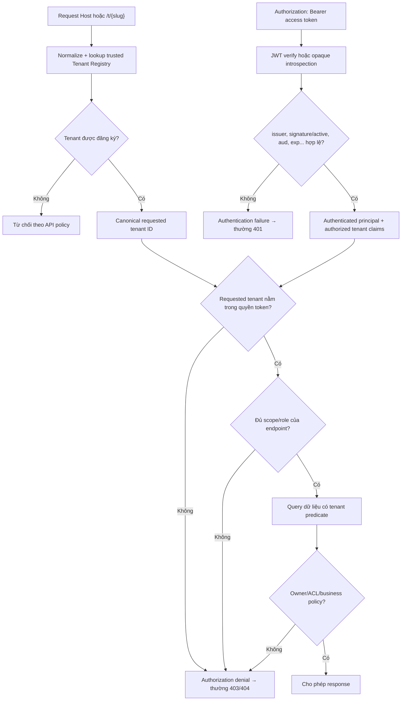

# Xác định tenant qua host hoặc đường dẫn và đối chiếu với token

## 1. Đặt vấn đề: đường dẫn của request không phải danh tính được ủy quyền

Trong hệ thống **multi-tenant**, một ứng dụng Spring Security OAuth 2.0 Resource Server có thể phục vụ nhiều tổ chức trên cùng hạ tầng. Mỗi tổ chức là một **tenant**; ví dụ:

- Tenant **Acme** có định danh nội bộ `t-acme`.
- Tenant **Beta** có định danh nội bộ `t-beta`.
- Cả hai dùng API quản lý đơn hàng với các resource và quyền riêng.

Client có thể chọn tenant đích qua **hostname**:

```http
GET /api/orders/ord-101 HTTP/1.1
Host: acme.api.example.test
Authorization: Bearer <alice-access-token>
```

Hoặc qua **đường dẫn**:

```http
GET /t/acme/api/orders/ord-101 HTTP/1.1
Host: api.example.test
Authorization: Bearer <alice-access-token>
```

Dù client gửi URL của Acme, nó không có nghĩa client **được quyền** sử dụng tài nguyên của Acme. `Host` và path là **địa chỉ tài nguyên được yêu cầu**, không phải bằng chứng về tenant membership.

Một attacker có token hợp lệ cho Beta có thể cố gửi:

```http
GET /t/acme/api/orders/ord-101 HTTP/1.1
Host: api.example.test
Authorization: Bearer <valid-token-for-beta>
```

Nếu API chỉ kiểm `authenticated()` hoặc `SCOPE_orders:read` mà không đối chiếu tenant trên URL với tenant của token, nó có thể tạo lỗ hổng **cross-tenant authorization / Broken Object Level Authorization (BOLA)**.

**Nguyên tắc cốt lõi của bài học:**

> **Tenant được chọn bởi host/path phải là tenant nằm trong danh mục đáng tin; token phải được xác minh bằng issuer, signature, audience và thời hạn; sau đó API phải đối chiếu quyền tenant của token với tenant của request và tiếp tục lọc dữ liệu theo tenant tại service/repository.**

Nội dung thuộc chương **Nhiều tenant** của mô-đun **Spring Security OAuth 2.0 OIDC Resource Server**. Ví dụ chính dùng Spring Boot 3.x, Spring Security 6.x, Java 17+ và Spring MVC/Servlet; cuối bài giải thích cách chuyển nguyên tắc sang WebFlux. Tên miền, tokens và ID là dữ liệu giả.

---

## 2. Mô hình: ba giá trị tenant khác nhau

Một API nhiều tenant thường gặp ít nhất ba khái niệm:

1. **Requested tenant**: tenant được client chọn qua hostname hoặc path.
2. **Authorized tenant**: tenant mà **access token đã xác thực** cho phép caller hoạt động.
3. **Data tenant**: tenant sở hữu bản ghi, bảng, schema hoặc tập dữ liệu được truy vấn.

Ví dụ:

| Thành phần | Giá trị | Nguồn |
|---|---|---|
| URL | `https://acme.api.example.test/api/orders/ord-101` | HTTP request do client gửi qua gateway |
| Requested tenant | `t-acme` | Bảng ánh xạ host → canonical tenant ID |
| Token `tenant_id` | `t-beta` | Claim trong access token đã được Resource Server verify |
| Database `orders.tenant_id` | `t-acme` | Cột/khóa tenant của dữ liệu |
| Kết quả | **Deny** | Requested tenant khác authorized tenant |

Nếu API chỉ xem token valid và scope read, Beta có thể đọc nhầm dữ liệu Acme. Nếu API chỉ xem URL `/t/acme`, client có thể tự đổi path để giả danh tenant.

### 2.1. Tenant slug khác canonical tenant ID

URL dùng slug thân thiện:

```text
/t/acme/api/orders
/t/beta/api/orders
```

Nhưng database và token có thể dùng ID ổn định:

```text
acme -> t-acme
beta -> t-beta
```

Không nên so sánh path slug trực tiếp với một claim có thể sử dụng ID khác định dạng. Cần một **Tenant Registry** làm nguồn ánh xạ được kiểm soát.

Ví dụ:

| Hostname được phép | Slug được phép | Canonical tenant ID |
|---|---|---|
| `acme.api.example.test` | `acme` | `t-acme` |
| `beta.api.example.test` | `beta` | `t-beta` |

Không có mục nào cho `attacker.example.test` hoặc `unknown.api.example.test`. Các host/slug không đăng ký phải bị từ chối; **không tự tạo tenant mới chỉ vì một chuỗi xuất hiện trên URL**.

### 2.2. Scope không phải tenant membership

Một token có thể có:

```json
{
  "iss": "https://auth.example.test/realms/orders",
  "sub": "bob-456",
  "aud": ["orders-api"],
  "scope": "orders:read",
  "tenant_id": "t-beta"
}
```

`orders:read` cho biết **loại thao tác** đọc đơn. Nó không tự nói Bob được đọc đơn của Acme. Điều kiện thực tế là:

```text
Valid access token
AND audience contains orders-api
AND required scope present
AND requestedTenantId == authorizedTenantId
AND order.tenant_id == requestedTenantId
AND object-level owner/ACL policy allows the operation
```

Không xem `tenant_id` hay `scope` trong payload JWT **chưa xác minh chữ ký** là nguồn quyền.

---

## 3. Hai chiến lược chọn tenant

### 3.1. Tenant qua hostname

Ví dụ:

```text
acme.api.example.test  → t-acme
beta.api.example.test  → t-beta
```

Ưu điểm:

- URL ngắn cho mỗi tổ chức.
- Dễ tách branding, certificate, routing hoặc rate limit theo host.
- Có thể phù hợp với mô hình subdomain per tenant.

Giới hạn và rủi ro:

- `Host` trong HTTP request do client cung cấp; attacker có thể thay đổi.
- Đằng sau reverse proxy, ứng dụng có thể thấy backend hostname thay vì public hostname.
- `Forwarded` và `X-Forwarded-Host` có thể bị giả mạo nếu gateway không kiểm soát.
- Domain tùy biến của khách hàng cần xác minh quyền sở hữu và quản lý lifecycle.
- DNS, wildcard subdomains, IDN/Punycode và canonicalization có thể dẫn đến ánh xạ nhầm.
- Host được dùng sai khi dựng URL, redirect hoặc password-reset link có thể gây host-header injection.

**Phải map host vào tenant theo allowlist/registry**, không cắt tiền tố tùy ý rồi coi đó là tenant ID.

Không làm:

```java
// KHÔNG DÙNG như một cơ chế ủy quyền tenant:
String tenant = request.getHeader("Host")
    .split("\\.")[0];
```

Code này không kiểm host thuộc domain cho phép, không xử lý port/IPv6/proxy đúng và coi một header do client gửi như định danh đã xác thực.

### 3.2. Tenant qua path

Ví dụ:

```text
https://api.example.test/t/acme/api/orders
https://api.example.test/t/beta/api/orders
```

Ưu điểm:

- Không cần wildcard DNS/TLS certificate theo tenant.
- Dễ viết route trong controller: `@PathVariable String tenantSlug`.
- Có thể thuận tiện cho tenant discovery và API Gateway.

Rủi ro:

- Attacker có thể thay slug từ `acme` sang `beta`.
- URL rewriting giữa gateway và application có thể làm sai tenant mà các lớp nhìn thấy.
- Encoded slash, double encoding, dot segments, semicolon/matrix parameters và path normalization có thể khiến lớp kiểm tra và controller hiểu **khác nhau**.
- Nếu lấy tenant từ raw `getRequestURI()` bằng substring thủ công, có thể lệch với path đã được Spring MVC route match.
- Tenant slug đổi tên phải được ánh xạ sang canonical ID ổn định, không dùng nguyên slug làm khóa phân quyền vĩnh viễn.

Ưu tiên lấy slug từ **path variable do Spring MVC đã resolve**, rồi lookup registry có validate định dạng.

### 3.3. Nếu host và path cùng chỉ tenant?

Ví dụ:

```http
GET /t/beta/api/orders/ord-101 HTTP/1.1
Host: acme.api.example.test
Authorization: Bearer <token-for-acme>
```

Không được tùy tiện “host ưu tiên hơn path” hoặc “path ưu tiên hơn host” nếu contract không quy định rõ. Các lựa chọn hợp lý:

1. **Chỉ một nguồn có hiệu lực trên mỗi route**: host-based endpoints không chứa tenant slug; path-based endpoints trên host trung lập.
2. **Bắt buộc cả hai khớp cùng canonical tenant ID** nếu thiết kế cho phép cùng xuất hiện.
3. **Từ chối khi xung đột** bằng 400/403/404 theo chính sách công khai đã thiết kế.

Không “chọn bên nào khớp token” để cứu request mâu thuẫn, vì việc tự động fallback khiến API khó audit và có thể tạo confused-deputy behavior.

---

## 4. Chuỗi tin cậy hoàn chỉnh



Có thể chọn thứ tự resolve tenant trước/sau authentication tùy kiến trúc. Điều quan trọng là **không cấp quyền trước khi cả hai nguồn đã được xác minh và đối chiếu**.

### 4.1. Một token hợp lệ vẫn có thể bị từ chối

Token hợp lệ của Beta, request host Acme:

```text
JWT signature: PASS
iss: PASS
aud: PASS
exp: PASS
scope orders:read: PASS
requested tenant: t-acme
token tenant: t-beta
tenant binding: FAIL
→ DENY
```

Đây thường là **authorization failure** vì token đã được xác thực nhưng không có quyền sử dụng tenant được yêu cầu. Không nên biến thành 200 chỉ vì scope đủ.

### 4.2. Chưa xác minh token thì không thể tin tenant claim

Không làm:

```java
// SAI: parse payload trước khi xác minh JWT rồi dùng làm quyền.
String tenant = parseUnverifiedJwt(token)
    .getClaim("tenant_id");
```

JWT là Base64URL-readable, **không phải một container dữ liệu đáng tin chỉ vì có cấu trúc JSON**. Attacker có thể tự sửa `tenant_id`, `scope` và `sub` nếu ứng dụng không thực sự verify chữ ký/issuer/audience.

Với opaque token, không parse chuỗi ngẫu nhiên để tìm tenant. Resource Server dùng `OpaqueTokenIntrospector` và chỉ tin các attributes đã nhận qua endpoint introspection của AS được ủy quyền.

---

## 5. Thiết kế hợp đồng với Authorization Server

Trước khi code Spring Security, đội API và Identity cần thống nhất token contract.

Ví dụ mô hình **một issuer chung**:

```json
{
  "iss": "https://auth.example.test/realms/orders",
  "sub": "alice-123",
  "aud": ["orders-api"],
  "scope": "orders:read orders:write",
  "client_id": "web-portal",
  "tenant_id": "t-acme",
  "exp": 1890003600
}
```

Trong mô hình này:

- `iss`: issuer tin cậy; không phải tenant riêng.
- `aud`: resource định danh `orders-api`.
- `tenant_id`: **custom claim** do AS quy định, bắt buộc cho user token của API này.
- `sub`: subject ổn định trong namespace issuer, không phải tự động là owner mọi record.
- `scope`: quyền thao tác, không thay thế tenant authorization.
- `client_id`: OAuth client đã yêu cầu token, không đồng nghĩa tenant.
- `exp`: thời gian hết hạn token, không phải thời hạn membership của user.

`tenant_id` không phải claim bắt buộc của OAuth 2.0/OIDC/JWT RFC nói chung. API chỉ được phép dựa vào nó nếu issuer cam kết phát hành đúng, có profile rõ ràng, và decoder/introspector đã xác minh token.

### 5.1. Một token chỉ đại diện một tenant

Đơn giản nhất: token có đúng một canonical tenant:

```json
"tenant_id": "t-acme"
```

Mỗi khi user đổi tenant trong giao diện, OAuth client phải lấy **access token phù hợp tenant mới** theo cơ chế issuer hỗ trợ. Không cho frontend chỉ đổi path mà giữ token Beta rồi sử dụng dữ liệu Acme.

Đây là mô hình thuận tiện để giới hạn blast radius: một token bị lộ chỉ có quyền trên đúng tenant nếu các lớp kiểm tra hoạt động.

### 5.2. Một token được ủy quyền nhiều tenants

Một số hệ thống cần token dạng:

```json
{
  "tenant_ids": ["t-acme", "t-beta"]
}
```

Đây cũng là **custom claim**, không có schema phổ quát. Nếu chọn mô hình này, application contract phải quy định:

- Claim là mảng string, không nhận scalar tùy tiện.
- Issuer nào có quyền phát hành nó.
- Mỗi tenant ID đã được canonicalize và nằm trong registry.
- Số lượng tenants tối đa; trường hợp list quá lớn.
- Token thiếu claim/rỗng/sai kiểu phải từ chối thế nào.
- Có cần scope/role **riêng cho từng tenant** hay không.
- Cách thu hồi quyền một tenant trong thời hạn token còn sống.

Một danh sách tenants **không có nghĩa** mọi scope đều được phép trên từng tenant, nhất là với quyền quản trị. Nếu entitlements có cấu trúc như `permissionsByTenant`, cần parser/validator đúng schema, không tự hợp nhất tất cả quyền.

### 5.3. Nhiều issuers: tenant nào tương ứng issuer nào?

Một mô hình khác có **mỗi tenant một issuer/realm**:

```text
t-acme -> https://id.example.test/realms/acme
t-beta -> https://id.example.test/realms/beta
```

Đây là ranh giới **identity provider/issuer** khác với mô hình một issuer chung. Khi có nhiều issuers:

1. Tenant Registry phải biết issuer được phép của từng tenant.
2. Resource Server chỉ chọn decoder/introspection client từ **allowlist đã onboard**.
3. Token phải verify thành công với đúng issuer/nguồn khóa.
4. Requested tenant phải khớp issuer được tenant đăng ký.
5. Có thể vẫn cần `tenant_id` nếu issuer phát token cho nhiều logical tenants.
6. `sub` phải được namespace theo `iss`; cùng `sub` khác issuer không nhất thiết là cùng user.

Không đọc `iss` từ token **chưa xác minh** rồi tự động trust URL issuer đó. Nếu dùng `JwtIssuerAuthenticationManagerResolver`, phải có trusted issuers hoặc custom resolver với registry allowlist rõ ràng; unverified `iss` chỉ có thể là **hint để chọn trong trust set đã xác lập**.

### 5.4. Client Credentials không phải user membership

Token service-to-service có thể đại diện workload, không có người dùng tương tác:

```json
{
  "iss": "https://auth.example.test/realms/orders",
  "client_id": "orders-importer",
  "sub": "orders-importer-service",
  "aud": ["orders-api"],
  "scope": "orders:import",
  "tenant_id": "t-acme"
}
```

Không mặc định `sub` của token này là user sở hữu order. Các API dành cho workload phải có **actor profile và permissions riêng** (ví dụ chỉ importer được ghi batch vào tenant được cấp). Không cho một token client_credentials vô tình vượt user authorization vì thiếu username.

---

## 6. Độ tin cậy của `Host` và proxy headers

### 6.1. Host header là input từ client

`request.getServerName()` trong Servlet có thể được suy ra từ Host header hoặc cấu hình proxy/container. Nó không tự là một giá trị “do server xác nhận” trong mọi deployment. Một attacker có thể gửi:

```http
GET /api/orders HTTP/1.1
Host: acme.api.example.test
Authorization: Bearer <beta-token>
```

Đó là lý do **không dùng Host header một mình để cấp tenant membership**. Host chỉ lựa chọn tenant đích trong registry; token verified phải chứng minh caller có quyền trên tenant đó.

### 6.2. Không tin `X-Forwarded-Host` trực tiếp từ Internet

Sau reverse proxy:

```text
Client → CDN/WAF → Ingress/API Gateway → Spring Boot
```

Spring Boot có thể nhận các header:

```http
Forwarded: host=acme.api.example.test;proto=https
X-Forwarded-Host: acme.api.example.test
X-Forwarded-Proto: https
```

Các header này chỉ đáng tin **nếu hệ thống gateway/proxy đã loại bỏ giá trị do client tự gửi và tự tạo giá trị chuẩn**. Nếu API public chấp nhận `X-Forwarded-Host` tùy ý, attacker có thể giả danh host ở những tầng phía trong.

Một cấu hình triển khai an toàn cần:

- Chỉ cho backend nhận traffic từ proxy tin cậy.
- Proxy **strip/overwrite** các forwarded headers từ client không tin cậy.
- Spring chỉ bật xử lý forwarded headers trong deployment đã xác minh đường truyền.
- Nếu có nhiều proxy, xác định chính xác trusted hops và cách hợp nhất forwarded chain.
- Host được map vào allowlist sau khi giải quyết trusted forwarding.
- Thử trực tiếp với Host và X-Forwarded-Host xung đột để xem hệ thống sử dụng giá trị nào.

### 6.3. Cấu hình Spring forward headers có điều kiện

Spring Boot có thuộc tính:

```yaml
server:
  forward-headers-strategy: framework
```

Đây là **ví dụ** khi application chạy sau proxy đáng tin và muốn framework xử lý forwarded headers. Không bật blindly trên backend có thể bị Internet truy cập trực tiếp hoặc proxy chưa lọc header. Tùy hạ tầng, `native` hoặc thiết lập của container/gateway có thể phù hợp hơn. Cần kiểm tra version và deployment.

Không tự đọc:

```java
// KHÔNG DÙNG: user có thể tự gửi header này.
String tenantHost = request.getHeader("X-Forwarded-Host");
```

rồi biến nó thành tenant. Nếu cần host qua proxy, lấy từ **server request đã được framework/proxy chuẩn hóa theo trust model**, và tiếp tục allowlist + token binding.

### 6.4. Host normalization và allowlist

Với DNS names, normalize theo **đúng quy tắc contract**:

- Lowercase bằng `Locale.ROOT` vì DNS names không phân biệt hoa/thường.
- Chỉ chấp nhận hostname thuộc registry; không tạo tenant từ substring.
- Nếu cho phép trailing dot, canonicalize có kiểm soát.
- Nếu dùng IDN, thống nhất A-label/Punycode và xác minh domain ownership.
- Không chấp nhận hostname chứa khoảng trắng, control characters, path, URL scheme hay comma.
- Nếu route phân biệt theo port, quyết định rõ port có thuộc key mapping không; `getServerName()` không chứa port.
- Không dùng `endsWith("example.test")` bừa bãi vì `notexample.test` hoặc subdomain không được đăng ký có thể lọt.

Với customer custom domains, cần quy trình DNS verification, TLS certificate/ownership, mapping lifecycle, revoke domain cũ, chống **subdomain takeover** và stale mappings. Không cho tenant A đăng ký domain đang thuộc tenant B.

---

## 7. Path normalization và route variables

### 7.1. Ưu tiên Spring MVC path variable

Dùng:

```java
@GetMapping("/t/{tenantSlug}/api/orders/{orderId}")
public OrderDto get(
        @PathVariable String tenantSlug,
        @PathVariable String orderId,
        @AuthenticationPrincipal Jwt jwt) {
    // Resolve tenantSlug qua registry và bind với token.
}
```

Thay vì tự làm:

```java
// KHÔNG DÙNG:
String tenant = request.getRequestURI().split("/")[2];
```

URL decoding, servlet context path, reverse proxy rewrite, semicolon parameters và encoded separators có thể khiến cách split khác với route matcher của Spring. Tệ hơn, application có thể **authorize một path nhưng truy vấn dữ liệu của path khác**.

### 7.2. Mẫu đường dẫn dễ gây bất đồng

Kiểm thử với các dạng như:

```text
/t/acme/api/orders/42
/t/AcMe/api/orders/42
/t/%61cme/api/orders/42
/t/acme%2Fbeta/api/orders/42
/t/acme/../beta/api/orders/42
/t/acme;foo=bar/api/orders/42
/t//api/orders/42
/t/%252Fbeta/api/orders/42
```

Không khẳng định một chuỗi cụ thể luôn đi qua hoặc luôn bị từ chối trên mọi container. **Cách proxy, container và Spring Security firewall xử lý encoding phụ thuộc cấu hình/phiên bản.** Tiêu chí quan trọng là:

1. Proxy và application **không hiểu tenant khác nhau**.
2. Bản ghi bị truy vấn không thuộc tenant khác với tenant được authorize.
3. Input không hợp lệ bị từ chối, không fallback sang “tenant mặc định”.
4. Tenant slug chỉ lấy sau đúng một quy tắc normalize/decode được thiết kế.
5. Route patterns dành cho tenant được kiểm thử qua HTTP thực, không chỉ unit test controller.

### 7.3. Slug được giới hạn

Nếu product chỉ cho phép lowercase ASCII slugs như `acme`, `beta-02`, có thể kiểm tra:

```java
private static final Pattern TENANT_SLUG =
    Pattern.compile("[a-z0-9](?:[a-z0-9-]{0,61}[a-z0-9])?");
```

`Pattern.matcher(...).matches()` bảo đảm toàn bộ slug phù hợp. Không tự `trim()`/lowercase một path value để “cố sửa” input lạ trừ khi đó là quy tắc canonicalization đã được tài liệu hóa. Nếu chấp nhận bí danh/slug lịch sử, map chúng sang **cùng canonical tenant ID** có kiểm soát.

---

## 8. Thiết kế Tenant Registry với nguồn dữ liệu đáng tin

Ví dụ record mô tả một tenant:

```java
package com.example.orders.tenancy;

public record TenantDescriptor(
    String tenantId,
    String slug,
    String publicHost,
    String expectedIssuer
) {}
```

Ở mô hình một issuer chung:

```text
TenantDescriptor(
  tenantId="t-acme",
  slug="acme",
  publicHost="acme.api.example.test",
  expectedIssuer="https://auth.example.test/realms/orders"
)
```

Registry có thể là immutable configuration, database có kiểm soát hoặc tenant-management service. Không cho client sửa mapping qua một endpoint không được bảo vệ.

### 8.1. Một registry đơn giản cho ví dụ

```java
package com.example.orders.tenancy;

import java.util.Locale;
import java.util.Map;
import java.util.regex.Pattern;

import org.springframework.http.HttpStatus;
import org.springframework.stereotype.Component;
import org.springframework.web.server.ResponseStatusException;

@Component
public final class TenantRegistry {

    private static final String ISSUER =
        "https://auth.example.test/realms/orders";

    private static final Pattern SLUG =
        Pattern.compile("[a-z0-9](?:[a-z0-9-]{0,61}[a-z0-9])?");

    private final Map<String, TenantDescriptor> byHost;
    private final Map<String, TenantDescriptor> bySlug;

    public TenantRegistry() {
        TenantDescriptor acme = new TenantDescriptor(
            "t-acme", "acme",
            "acme.api.example.test", ISSUER);
        TenantDescriptor beta = new TenantDescriptor(
            "t-beta", "beta",
            "beta.api.example.test", ISSUER);

        this.byHost = Map.of(
            acme.publicHost(), acme,
            beta.publicHost(), beta
        );
        this.bySlug = Map.of(
            acme.slug(), acme,
            beta.slug(), beta
        );
    }

    public TenantDescriptor byTrustedHost(String serverName) {
        if (serverName == null || serverName.isBlank()) {
            throw unknownTenant();
        }
        String host = normalizeHost(serverName);
        TenantDescriptor result = byHost.get(host);
        if (result == null) {
            throw unknownTenant();
        }
        return result;
    }

    public TenantDescriptor byPathSlug(String slug) {
        if (slug == null || !SLUG.matcher(slug).matches()) {
            throw unknownTenant();
        }
        TenantDescriptor result = bySlug.get(slug);
        if (result == null) {
            throw unknownTenant();
        }
        return result;
    }

    private static String normalizeHost(String value) {
        String host = value.toLowerCase(Locale.ROOT);
        if (host.endsWith(".")) {
            host = host.substring(0, host.length() - 1);
        }

        // Ví dụ chỉ cho DNS host ASCII đơn giản, không phải
        // URL, IPv6 literal, hostname có port hoặc nhiều giá trị.
        if (!host.matches("[a-z0-9.-]+")
                || host.length() > 253
                || host.startsWith(".")
                || host.contains("..")) {
            throw unknownTenant();
        }
        return host;
    }

    private static ResponseStatusException unknownTenant() {
        // Chọn 404 để không xác nhận tenant lạ cho bên ngoài.
        return new ResponseStatusException(
            HttpStatus.NOT_FOUND, "Resource not found");
    }
}
```

**Giới hạn minh họa:** `byTrustedHost(...)` nhận **server name đã được Servlet container/framework giải quyết theo trust model của deployment**. Nó **không tự làm cho Host header đáng tin**. Ví dụ giữ registry hardcode để học; production nên dùng cấu hình/DB có version, audit, validation, lifecycle và tests. Regex host trên chỉ phù hợp bộ DNS host ASCII đã thống nhất; nếu hỗ trợ IDN/IPv6/custom ports, thiết kế rõ canonicalization.

Không thêm:

```java
// KHÔNG DÙNG:
return byHost.getOrDefault(host, defaultTenant);
```

khi host lạ. **Default tenant fallback** là một trong những cách phổ biến gây rò dữ liệu giữa tenants.

### 8.2. Không lấy tenant ID trực tiếp từ Header

`X-Tenant-Id` có thể hữu ích trong **hạ tầng** nếu gateway đã xác thực, xóa header từ Internet và ký/bảo vệ identity metadata bằng một trust channel rõ. Nhưng trong Resource Server nhận request Internet, không dùng:

```java
String tenantId = request.getHeader("X-Tenant-Id");
```

làm bằng chứng khách hàng được phép thao tác tenant đó. Header này do caller có thể tự đặt. Đối chiếu với token verified và registry luôn cần thiết; nếu có gateway-enforced identity forwarding, đó phải là **hợp đồng bảo mật riêng**.

---

## 9. Binding policy: đối chiếu tenant đã chọn với JWT đã xác thực

Khi JWT vượt qua `JwtDecoder`, Spring Security cung cấp `Jwt` principal. Ta cần policy:

- Issuer của token khớp issuer tin cậy dành cho tenant.
- Audience chứa `orders-api`.
- `tenant_id` là string không rỗng.
- Giá trị `tenant_id` **đúng bằng** canonical tenant ID đã resolve.
- Nếu route dành cho user, actor profile phải là user theo hợp đồng.
- Authorization theo scope/role và owner/tenant được kiểm tra riêng.

### 9.1. Policy lớp ứng dụng

```java
package com.example.orders.tenancy;

import java.util.List;

import org.springframework.security.access.AccessDeniedException;
import org.springframework.security.oauth2.jwt.Jwt;
import org.springframework.stereotype.Component;

@Component
public final class TenantBindingPolicy {

    private static final String API_AUDIENCE = "orders-api";

    public VerifiedTenantActor requireUser(
            Jwt jwt, TenantDescriptor requestedTenant) {

        if (jwt == null || requestedTenant == null) {
            throw denied();
        }

        // Layer JwtDecoder cũng PHẢI verify issuer/audience.
        // Check lại giúp binding theo tenant rõ ràng.
        if (jwt.getIssuer() == null
                || !requestedTenant.expectedIssuer().equals(
                    jwt.getIssuer().toString())
                || !jwt.getAudience().contains(API_AUDIENCE)) {
            throw denied();
        }

        Object rawTenant = jwt.getClaim("tenant_id");
        if (!(rawTenant instanceof String tokenTenant)
                || tokenTenant.isBlank()
                || !requestedTenant.tenantId().equals(tokenTenant)) {
            throw denied();
        }

        Object rawActorType = jwt.getClaim("actor_type");
        // actor_type là CUSTOM CLAIM của hợp đồng minh họa.
        if (!(rawActorType instanceof String actorType)
                || !"user".equals(actorType)) {
            throw denied();
        }

        String subject = jwt.getSubject();
        if (subject == null || subject.isBlank()) {
            throw denied();
        }

        return new VerifiedTenantActor(
            requestedTenant.tenantId(),
            jwt.getIssuer().toString(),
            subject
        );
    }

    private static AccessDeniedException denied() {
        // Không log raw token hoặc leak claim mismatches.
        return new AccessDeniedException(
            "Access is not permitted for this tenant");
    }
}
```

Record output:

```java
package com.example.orders.tenancy;

public record VerifiedTenantActor(
    String tenantId,
    String issuer,
    String subject
) {}
```

**`actor_type=user` chỉ là một contract giả định** cho ví dụ user endpoint. Spring Security và OAuth 2.0 **không mặc định** phát claim đó. Nếu AS của bạn không có claim này, phải định nghĩa cách tin cậy để phân biệt user/workload, hoặc thiết kế endpoint có policy actor riêng. **Không bỏ check rồi mặc định bất kỳ `sub` nào cũng là user**.

### 9.2. Tại sao không tự sửa tenant mismatch?

Một anti-pattern:

```java
// SAI: lấy token tenant rồi lén chuyển đích request.
String effectiveTenant = jwt.getClaimAsString("tenant_id");
return orderRepository.findById(orderId); // tenant không được lọc
```

Nếu request URL chỉ Acme nhưng token của Beta, ứng dụng có thể trả dữ liệu Beta dưới URL Acme hoặc tệ hơn lấy order theo ID không tenant-scoped. Điều này khiến audit, cache, link và authorization semantics trở nên mâu thuẫn.

Policy nên **từ chối request mismatch**, không cố tìm một tenant khác để cho request thành công. Nếu người dùng đổi tenant, client phải dùng URL/token hợp lệ theo flow được sản phẩm cho phép.

### 9.3. Đối với multi-tenant membership token

Nếu token có `tenant_ids`:

```json
{
  "tenant_ids": ["t-acme", "t-beta"]
}
```

Một validator riêng có thể xác minh array of strings và so sánh exact canonical ID:

```java
static boolean membershipContains(Object raw, String requested) {
    if (!(raw instanceof java.util.List<?> values)) {
        return false;
    }
    if (values.isEmpty()) {
        return false;
    }
    for (Object value : values) {
        if (!(value instanceof String s) || s.isBlank()) {
            return false; // Toàn claim phải đúng schema.
        }
    }
    return values.contains(requested);
}
```

Đây chỉ là **membership predicate**. Nó không chứng minh user có role admin hoặc scope write trên tenant được chọn. Với entitlement phân vùng theo tenant, policy cần validate cả **permission của tenant cụ thể**, không lấy union mọi roles trong toàn token.

---

## 10. Đặt validation ở đâu: JWT decoder hay authorization layer?

Không phải mọi lỗi tenant đều thuộc cùng loại.

| Điều kiện | Lớp phù hợp | Hành vi điển hình |
|---|---|---|
| JWT signature sai, token hết hạn | **Authentication / decoder** | 401. |
| Token sai issuer so với issuer tin cậy | **Authentication / decoder** | 401. |
| Token sai audience của API | **Authentication / decoder** | 401. |
| `tenant_id` sai kiểu/missing trong token profile bắt buộc | Token contract validator hoặc authorization policy theo thiết kế | Từ chối; status phụ thuộc boundary. |
| Token hợp lệ nhưng `tenant_id=t-beta`, URL chỉ `t-acme` | **Request-specific tenant authorization** | Thường 403 hoặc 404. |
| Token hợp lệ, tenant khớp nhưng thiếu `orders:read` | HTTP/method authorization | 403. |
| Token hợp lệ, tenant khớp, đủ scope nhưng order thuộc người khác | Domain object authorization | 403/404. |
| Host/slug không đăng ký | Routing/tenant resolution | 404/400 hoặc chính sách API tương đương. |

Một token có thể có quyền cho Beta khi dùng URL Beta, nhưng bị từ chối ở URL Acme. Vì vậy **request-specific tenant binding** thường thuộc authorization và không nhất thiết làm toàn token “invalid” theo authentication contract. Trong mô hình **mỗi tenant một issuer**, decoder cũng có thể được chọn theo requested tenant và từ chối token thuộc issuer khác ngay khi authentication.

### 10.1. JWT validator chung cho issuer và audience

Cấu hình Boot ví dụ:

```yaml
spring:
  security:
    oauth2:
      resourceserver:
        jwt:
          issuer-uri: https://auth.example.test/realms/orders
          audiences:
            - orders-api
```

Đường auto-configuration tương ứng có thể kiểm issuer và audience; nếu tự khai báo bean `JwtDecoder`, phải chủ động gắn issuer/audience/time/profile validators.

**Không dùng `tenant_id` thay cho `iss` hoặc `aud`**. Một token có claim tenant đúng nhưng dành cho API khác vẫn không được nhận.

### 10.2. Vì sao tenant binding không nên chỉ nằm ở controller?

Controller check là một điểm thực thi có thể nhìn thấy rõ, nhưng các tác vụ khác có thể vượt qua:

- Service được gọi từ scheduled job hoặc message consumer.
- GraphQL resolver không sử dụng controller cùng kiểu.
- Export/bulk endpoint quên kiểm tenant.
- Một controller mới trả dữ liệu trực tiếp từ repository.
- Method chạy async, context thay đổi.

Thiết kế production nên **kết hợp**:

1. Token validation ở authentication boundary.
2. Tenant authorization ở method/service hoặc custom `AuthorizationManager`.
3. Query/filter dựa vào canonical tenant ID.
4. Database row-level security nếu phù hợp.
5. Tests cho mọi entry points, kể cả batch/list/export.

---

## 11. Controller mẫu: một endpoint theo Host, một endpoint theo Path

### 11.1. Service nghiệp vụ dùng verified actor

Trong ví dụ, service **không tự đọc Host header, token string hoặc path slug**. Nó nhận một `VerifiedTenantActor` đã qua tenant binding.

```java
package com.example.orders.api;

public record OrderDto(
    String id,
    String status
) {}
```

Service:

```java
package com.example.orders.api;

import com.example.orders.tenancy.VerifiedTenantActor;
import org.springframework.http.HttpStatus;
import org.springframework.stereotype.Service;
import org.springframework.web.server.ResponseStatusException;

@Service
public final class OrderQueryService {

    private final OrderRepository repository;

    public OrderQueryService(OrderRepository repository) {
        this.repository = repository;
    }

    public OrderDto readOwnOrder(
            String orderId, VerifiedTenantActor actor) {

        OrderEntity entity = repository
            .findByIdAndTenantIdAndOwnerIssuerAndOwnerSubject(
                orderId,
                actor.tenantId(),
                actor.issuer(),
                actor.subject()
            )
            .orElseThrow(() -> new ResponseStatusException(
                HttpStatus.NOT_FOUND, "Order not found"));

        return new OrderDto(entity.getId(), entity.getStatus());
    }
}
```

Repository concept:

```java
package com.example.orders.api;

import java.util.Optional;
import org.springframework.data.jpa.repository.JpaRepository;

public interface OrderRepository
        extends JpaRepository<OrderEntity, String> {

    Optional<OrderEntity>
        findByIdAndTenantIdAndOwnerIssuerAndOwnerSubject(
            String id,
            String tenantId,
            String ownerIssuer,
            String ownerSubject
        );
}
```

Trong code mẫu, `OrderEntity` là entity giả định có các thuộc tính tương ứng `id`, `tenantId`, `ownerIssuer`, `ownerSubject`, `status`. Project thực cần ánh xạ JPA, schema, migrations và indexes phù hợp.

Câu truy vấn về mặt logic:

```sql
SELECT id, status
FROM orders
WHERE id = :requested_order_id
  AND tenant_id = :verified_tenant_id
  AND owner_issuer = :verified_issuer
  AND owner_subject = :verified_subject;
```

**Không** làm `findById(orderId)` rồi bỏ qua tenant filter. Query có predicate tenant/owner vừa giúp ngăn rò dữ liệu, vừa làm việc không tìm thấy/không có quyền khó phân biệt với attacker nếu API chọn concealment policy.

### 11.2. Host-based controller

```java
package com.example.orders.api;

import com.example.orders.tenancy.TenantBindingPolicy;
import com.example.orders.tenancy.TenantDescriptor;
import com.example.orders.tenancy.TenantRegistry;
import com.example.orders.tenancy.VerifiedTenantActor;

import jakarta.servlet.http.HttpServletRequest;

import org.springframework.http.HttpHeaders;
import org.springframework.security.core.annotation.AuthenticationPrincipal;
import org.springframework.security.oauth2.jwt.Jwt;
import org.springframework.web.bind.annotation.GetMapping;
import org.springframework.web.bind.annotation.PathVariable;
import org.springframework.web.bind.annotation.RestController;

@RestController
public class HostTenantOrderController {

    private final TenantRegistry registry;
    private final TenantBindingPolicy policy;
    private final OrderQueryService service;

    public HostTenantOrderController(
            TenantRegistry registry,
            TenantBindingPolicy policy,
            OrderQueryService service) {
        this.registry = registry;
        this.policy = policy;
        this.service = service;
    }

    @GetMapping("/api/orders/{orderId}")
    public OrderDto getOrder(
            HttpServletRequest request,
            @PathVariable String orderId,
            @AuthenticationPrincipal Jwt jwt) {

        TenantDescriptor requested =
            registry.byTrustedHost(request.getServerName());

        VerifiedTenantActor actor =
            policy.requireUser(jwt, requested);

        return service.readOwnOrder(orderId, actor);
    }
}
```

Tên method `byTrustedHost` chỉ có ý nghĩa khi deployment đã thiết kế trusted host resolution và allowlist. Bản thân `getServerName()` **không xác thực Host header**; attacker có thể điều khiển Host nhưng **không được phép vượt tenant binding bằng việc đó**.

### 11.3. Path-based controller

```java
package com.example.orders.api;

import com.example.orders.tenancy.TenantBindingPolicy;
import com.example.orders.tenancy.TenantDescriptor;
import com.example.orders.tenancy.TenantRegistry;
import com.example.orders.tenancy.VerifiedTenantActor;

import org.springframework.security.core.annotation.AuthenticationPrincipal;
import org.springframework.security.oauth2.jwt.Jwt;
import org.springframework.web.bind.annotation.GetMapping;
import org.springframework.web.bind.annotation.PathVariable;
import org.springframework.web.bind.annotation.RestController;

@RestController
public class PathTenantOrderController {

    private final TenantRegistry registry;
    private final TenantBindingPolicy policy;
    private final OrderQueryService service;

    public PathTenantOrderController(
            TenantRegistry registry,
            TenantBindingPolicy policy,
            OrderQueryService service) {
        this.registry = registry;
        this.policy = policy;
        this.service = service;
    }

    @GetMapping("/t/{tenantSlug}/api/orders/{orderId}")
    public OrderDto getOrder(
            @PathVariable String tenantSlug,
            @PathVariable String orderId,
            @AuthenticationPrincipal Jwt jwt) {

        TenantDescriptor requested =
            registry.byPathSlug(tenantSlug);

        VerifiedTenantActor actor =
            policy.requireUser(jwt, requested);

        return service.readOwnOrder(orderId, actor);
    }
}
```

Ở đây **slug đến từ path route đã được Spring MVC match**. Tenant binding vẫn kiểm JWT và repository vẫn lọc theo canonical tenant. Không tin path vì client tự điền được.

### 11.4. Hai controller có thể dùng chung service

Một hệ thống có thể công bố cả host-based và path-based API, nhưng nên có contract rõ:

- Host-based path không mang tenant slug.
- Path-based route dùng một API host trung lập được allowlist.
- Nếu host-based domain và path-based route có thể kết hợp, server phải kiểm tra xung đột hoặc hạn chế route.
- Cả hai đi qua **cùng một policy binding và dữ liệu tenant-scoped**.
- Không có fallback sang tenant mặc định, không dùng raw slug trong SQL.

Việc dùng controller-level binding trong bài giúp thấy rõ logic; nếu có hàng trăm endpoints, hãy chuyển sự kiện resolve/bind sang middleware/service/method policy để tránh copy-paste và test coverage gaps.

---

## 12. Cấu hình Spring Security HTTP authorization

Giả sử API chỉ có các endpoints học tập đã nêu và token được xác thực bằng JWT từ issuer chung:

```java
package com.example.orders.security;

import org.springframework.context.annotation.Bean;
import org.springframework.context.annotation.Configuration;
import org.springframework.http.HttpMethod;
import org.springframework.security.config.Customizer;
import org.springframework.security.config.annotation.web.builders.HttpSecurity;
import org.springframework.security.config.annotation.web.configurers.AbstractHttpConfigurer;
import org.springframework.security.config.http.SessionCreationPolicy;
import org.springframework.security.web.SecurityFilterChain;

@Configuration
public class OrdersApiSecurityConfig {

    @Bean
    SecurityFilterChain apiSecurity(HttpSecurity http)
            throws Exception {
        return http
            .sessionManagement(session -> session
                .sessionCreationPolicy(SessionCreationPolicy.STATELESS))
            .csrf(AbstractHttpConfigurer::disable)
            .authorizeHttpRequests(auth -> auth
                .requestMatchers(HttpMethod.GET,
                    "/api/public/ping")
                    .permitAll()
                .requestMatchers(HttpMethod.GET,
                    "/api/orders/**",
                    "/t/*/api/orders/**")
                    .hasAuthority("SCOPE_orders:read")
                .requestMatchers(HttpMethod.POST,
                    "/api/orders",
                    "/t/*/api/orders")
                    .hasAuthority("SCOPE_orders:write")
                .anyRequest().denyAll())
            .oauth2ResourceServer(oauth ->
                oauth.jwt(Customizer.withDefaults()))
            .build();
    }
}
```

Đây là mẫu cho **Servlet/Spring MVC**. `csrf(...disable)` phù hợp khi API chỉ dùng Bearer header và không dùng browser cookie/session để xác thực; với ứng dụng kết hợp web login cần thiết kế CSRF và `SecurityFilterChain` riêng. Nếu expose public endpoint, phải bảo đảm nó không vô tình leak thông tin tenant hoặc dùng credential khác.

Hai tầng authorization:

1. **HTTP matcher**: token cần authority `SCOPE_orders:read`.
2. **Tenant binding + service**: token phải có quyền requested tenant và được đọc đúng order của mình.

Một request có scope đúng nhưng tenant sai **vẫn bị từ chối**. Không thay tenant binding bằng `.authenticated()`.

### 12.1. Method security để giảm phụ thuộc controller

Với `@EnableMethodSecurity`, có thể dùng policy bean trong biểu thức:

```java
@PreAuthorize(
    "hasAuthority('SCOPE_orders:read') and " +
    "@tenantAuthorization.canRead(authentication, #tenantId)"
)
public MonoOrResult read(...);
```

Đây chỉ là **cú pháp khái niệm**; trong Servlet service thực tế phương thức nên có kiểu trả về domain thông thường, còn WebFlux có method authorization reactive riêng. Quan trọng là `tenantId` truyền vào phải là **canonical tenant ID đã resolve**, không phải header client. Một SpEL policy bean cũng phải đọc authentication đã được xác minh, không parse token raw.

Nếu annotation nằm ở method không được Spring proxy intercept (tự gọi nội bộ, instance không là bean, cấu hình method security thiếu), rule có thể không được thực thi. Luôn test request đi qua đường runtime thật và giữ data-scoped query defense-in-depth.

---

## 13. Chọn issuer và decoder trong mô hình nhiều tenant

Hai mô hình chính có hệ quả rất khác.

### 13.1. Mô hình A: một issuer, claim `tenant_id`

```text
Issuer:
  https://auth.example.test/realms/orders

JWKS:
  https://auth.example.test/realms/orders/jwks

Tokens:
  alice -> tenant_id=t-acme
  bob   -> tenant_id=t-beta
```

Resource Server cấu hình **một decoder** với issuer/audience validation. Sau decode, API so sánh `tenant_id` với canonical requested tenant ID.

Ưu điểm:

- Ít decoder/JWKS caches.
- Phù hợp với tenant isolation logic trong một identity realm.
- Dễ dùng chung configuration.

Cần lưu ý:

- Quyền đổi tenant của user do AS/authorization policy cấp.
- Một JWT đã phát hành có thể còn chứa membership cũ cho tới khi hết hạn.
- `tenant_id` phải là claim do issuer phát hành với semantics rõ, không phải header client tùy ý.
- Nếu user có nhiều tenant, phải chọn single-tenant token hay multi-tenant entitlements một cách tường minh.

### 13.2. Mô hình B: mỗi tenant một issuer

```text
Tenant Acme:
  issuer = https://id.example.test/realms/acme
  jwks   = https://id.example.test/realms/acme/certs

Tenant Beta:
  issuer = https://id.example.test/realms/beta
  jwks   = https://id.example.test/realms/beta/certs
```

Có ít nhất hai cách triển khai:

- **Chọn `AuthenticationManager`/decoder theo requested tenant** đã resolve từ host/path thông qua registry, và verify token với issuer **đúng tenant đó**.
- **Chọn issuer theo token như hint** nhưng chỉ qua `JwtIssuerAuthenticationManagerResolver` với tập issuers **tin cậy**, rồi làm bước tenant binding để chắc chắn issuer của token đúng tenant của request.

Trong cả hai phương án, không tự trust bất kỳ issuer nào chỉ vì JWT header/payload chỉ tới URL đó. Metadata discovery/JWKS fetching từ arbitrary unverified issuer dễ dẫn tới **SSRF** và authentication bypass.

### 13.3. Pseudocode chọn decoder theo tenant

```text
requestedTenant = resolve(host_or_path)           // registry allowlist
expectedIssuer = requestedTenant.expectedIssuer  // trusted config

manager = preconfiguredManagerFor(expectedIssuer)
if manager missing:
    reject

authentication = manager.authenticate(bearerToken)
  -> verify signature with trusted JWKS for expected issuer
  -> require JWT iss == expectedIssuer
  -> require aud contains orders-api
  -> validate exp/nbf and token profile

check requestedTenant vs verified tenant entitlement
check scope
check business owner/data tenant
```

Điểm cốt lõi: `expectedIssuer` từ **registry trusted**, không được lấy từ `jwt.getClaim("iss")` trước validation rồi tự tạo manager mới.

### 13.4. Token issuer của Beta gửi tới hostname Acme

```http
GET /api/orders HTTP/1.1
Host: acme.api.example.test
Authorization: Bearer <token-signed-by-beta-issuer>
```

Với resolver chọn issuer từ host Acme, token Beta có thể bị từ chối ở **authentication** vì không khớp key/issuer. Với resolver chọn trong global trusted issuers rồi so tenant sau, token có thể được xác thực là Beta nhưng sau đó bị từ chối ở **authorization**. Cả hai có thể hợp lý nếu **không cho phép truy cập Acme** và error semantics được tài liệu hóa.

Đừng cố “thử mọi issuer cho đến khi có một issuer nhận token” rồi tự cấp quyền tenant không kiểm tra tiếp. Việc thử hàng loạt cũng làm tăng tải và mở rộng bề mặt trust không cần thiết.

---

## 14. Các điểm dễ tạo lỗi cross-tenant trong nghiệp vụ

### 14.1. Tìm một bản ghi chỉ bằng ID

Sai:

```java
OrderEntity order = repository.findById(orderId)
    .orElseThrow(NotFoundException::new);
return toDto(order);
```

Đúng về mặt tenant policy:

```java
OrderEntity order = repository
    .findByIdAndTenantIdAndOwnerIssuerAndOwnerSubject(
        orderId, actor.tenantId(), actor.issuer(), actor.subject())
    .orElseThrow(NotFoundException::new);
```

Điều kiện owner có thể khác nếu use case là tenant administrator hoặc shared-order delegation. Dù vậy **tenant predicate luôn cần có** trừ khi có policy cross-tenant được thiết kế, kiểm toán và thực thi rõ ràng.

### 14.2. List/search/export

Khi triển khai:

```text
GET /t/acme/api/orders?page=0
GET /t/acme/api/orders/export
POST /t/acme/api/orders/search
```

không chỉ validate tenant một lần rồi query toàn bảng. Repository/data access phải áp tenant constraint cho **mọi** list/search/export và total count. Một lỗi phổ biến là list SQL có `WHERE tenant_id` nhưng count query/export query không có, làm lộ số lượng hoặc dữ liệu của tenant khác.

### 14.3. Bulk operations

Ví dụ:

```json
{
  "orderIds": [
    "acme-ord-1",
    "beta-ord-7"
  ]
}
```

Một request trên URL Acme chứa ID của Beta phải **không được update Beta**, kể cả token có `orders:write` cho Acme. Truy vấn/UPDATE phải include tenant predicate cho từng ID và kiểm tra kết quả trước commit.

Nếu API hỗ trợ batch cross-tenant, đó là **policy khác** dành cho actor/service có quyền đặc biệt; không cho user endpoint vô tình trở thành cross-tenant batch API.

### 14.4. Object store, file attachments và search index

Một order có thể tham chiếu file ở S3/Blob/CDN, hoặc record trong Elasticsearch/OpenSearch. Tenant isolation phải áp dụng cả:

- Object storage keys/buckets/ACL.
- Signed download URLs và token expiry.
- Search filters, index aliases.
- Event stream partition keys.
- Audit logs và export artifacts.
- Background tasks nhận tenant context.

Không để controller kiểm tenant rồi service phát signed URL cho object thuộc tenant khác chỉ vì object key được client gửi.

### 14.5. Cache và key namespace

Sai:

```java
@Cacheable(cacheNames = "orders", key = "#orderId")
OrderDto findOrder(String orderId) { ... }
```

Nếu IDs chỉ unique trong phạm vi tenant hoặc response phụ thuộc permissions, key như vậy có thể làm dữ liệu của tenant khác bị trả từ cache. Thiết kế cache key theo tenant và authorization context thích hợp:

```text
orders:<canonicalTenantId>:<orderId>:<visibilityPolicyVersion>
```

Nếu cùng order nhưng user có quyền xem các trường khác nhau, cache key/authorization check còn cần phân biệt representation/visibility hoặc không cache DTO sau policy một cách dùng chung.

Không đưa raw Bearer token vào cache key/log. Cache **không** thay thế tenant-scoped database filter hoặc object-level permission.

### 14.6. Database isolation không tự bằng table-per-tenant

Các mô hình phổ biến:

| Mô hình | Điểm mạnh | Rủi ro phải kiểm |
|---|---|---|
| Shared DB, shared tables + `tenant_id` | Dễ vận hành, đơn giản triển khai. | Mọi query phải lọc tenant; dễ quên predicate. |
| Shared DB, schema-per-tenant | Phân tách schema, thuận tiện một số operations. | Tenant routing/schema switch sai, pooled connection giữ schema trước. |
| Database-per-tenant | Tách data plane mạnh hơn. | Sai connection routing, migrations/credentials và operational overhead. |
| Database Row-Level Security | DB áp tenant policy độc lập một phần app query. | Session DB variables/connection reuse, privileged bypass, policy config sai. |

Ngay cả schema-per-tenant/database-per-tenant vẫn phải so URL tenant với token; nếu chọn nhầm datasource theo Host, user Beta có thể lọt vào DB Acme nếu không có binding policy.

---

## 15. Từ chối chính xác: 401, 403, 404 và 421

Một request có thể bị từ chối ở nhiều ranh giới. Không có một status bắt buộc cho mọi tenant mismatch, nhưng cần **nhất quán**.

| Tình huống | Lớp từ chối | Status thông dụng |
|---|---|---|
| Không có Bearer token cho route bảo vệ | Authentication chưa có | **401** với `WWW-Authenticate: Bearer`. |
| Token sai chữ ký/issuer/audience/exp | Token validation | **401**. |
| Token active, scope đọc thiếu | Authorization | **403**. |
| Token hợp lệ của Beta, request Acme | Tenant binding authorization | **403** hoặc **404** theo concealment policy. |
| Tenant slug không tồn tại trong registry | Routing/tenant resolution | **404** hoặc **400** theo API contract. |
| Host không thuộc virtual host được phục vụ | Host routing/security | **400**, **404** hoặc **421 Misdirected Request** tùy gateway/server design. |
| Tenant khớp, scope đủ, order thuộc user khác | Object-level authorization | **403** hoặc **404**. |
| AS/JWKS/introspection không truy cập được | Dependency validation failure | Fail closed; HTTP status theo exception/error policy. |

**`421 Misdirected Request` không phải status mặc định của Spring Security cho mọi Host mismatch.** Nó có ý nghĩa trong các tình huống HTTP routing/server authority đặc biệt; chỉ dùng nếu gateway/app có contract rõ.

Đối với `404` để che giấu sự tồn tại, cần tránh timing/error-body differences làm lộ tenant/object enumeration và vẫn ghi audit đầy đủ trong hệ thống nội bộ.

### 15.1. Vì sao không trả luôn 401 cho tenant mismatch?

Với token đã verify hợp lệ cho Beta, request Acme thất bại vì **không có quyền đối với Acme**, không nhất thiết token là credential sai. Trả 403 thường dễ hiểu hơn. Trong mô hình resolver theo requested issuer, token Beta gửi Acme có thể bị từ chối ngay ở JWT validator nên trả 401. Điều quan trọng là **logic và error contract khớp trust model**, không phải cố ép mọi deployment cùng một status.

### 15.2. Không lộ thông tin tenant trong response

Không trả:

```json
{
  "error": "Token belongs to t-beta but URL requested t-acme",
  "ownerEmail": "alice@acme.example.test"
}
```

nếu không cần và chưa được policy cho phép. Client chỉ cần biết request bị từ chối; logging nội bộ có thể ghi reason code và pseudonymized tenant identifiers dưới chính sách audit.

---

## 16. MockMvc: test tenant binding trong Spring Security

Để test HTTP authorization và tenant policy, dùng `spring-security-test` với `jwt()` tạo authenticated principal giả; như vậy test **không phụ thuộc JWKS network**, nhưng **không chứng minh chữ ký JWT được xác minh thật**.

### 16.1. Test path-based bằng JWT mock

Ví dụ skeleton giả định có fixtures:

- Order `acme-ord-1` thuộc Alice ở `t-acme`.
- Order `beta-ord-1` thuộc Bob ở `t-beta`.
- `PathTenantOrderController` và `OrderQueryService` sử dụng registry và policy đã trình bày.
- Spring MVC/Security filter chain được nạp trong test.

```java
package com.example.orders.security;

import static org.springframework.security.test.web.servlet.request
    .SecurityMockMvcRequestPostProcessors.jwt;
import static org.springframework.test.web.servlet.request
    .MockMvcRequestBuilders.get;
import static org.springframework.test.web.servlet.result
    .MockMvcResultMatchers.status;

import java.util.List;
import org.junit.jupiter.api.Test;
import org.springframework.beans.factory.annotation.Autowired;
import org.springframework.boot.test.autoconfigure.web.servlet.AutoConfigureMockMvc;
import org.springframework.boot.test.context.SpringBootTest;
import org.springframework.security.core.authority.SimpleGrantedAuthority;
import org.springframework.test.web.servlet.MockMvc;

@SpringBootTest
@AutoConfigureMockMvc
class TenantPathAuthorizationTest {

    @Autowired
    MockMvc mvc;

    @Test
    void acmeTokenCanReadOwnAcmeOrder() throws Exception {
        mvc.perform(get("/t/acme/api/orders/acme-ord-1")
                .with(jwt().jwt(j -> j
                    .claim("iss",
                        "https://auth.example.test/realms/orders")
                    .claim("aud", List.of("orders-api"))
                    .claim("sub", "alice-123")
                    .claim("tenant_id", "t-acme")
                    .claim("actor_type", "user"))
                    .authorities(new SimpleGrantedAuthority(
                        "SCOPE_orders:read"))))
            .andExpect(status().isOk());
    }

    @Test
    void betaTokenCannotUseAcmePath() throws Exception {
        mvc.perform(get("/t/acme/api/orders/acme-ord-1")
                .with(jwt().jwt(j -> j
                    .claim("iss",
                        "https://auth.example.test/realms/orders")
                    .claim("aud", List.of("orders-api"))
                    .claim("sub", "bob-456")
                    .claim("tenant_id", "t-beta")
                    .claim("actor_type", "user"))
                    .authorities(new SimpleGrantedAuthority(
                        "SCOPE_orders:read"))))
            .andExpect(status().isForbidden());
    }

    @Test
    void missingTokenIsUnauthorized() throws Exception {
        mvc.perform(get("/t/acme/api/orders/acme-ord-1"))
            .andExpect(status().isUnauthorized());
    }
}
```

Các status `200` dựa trên **fixtures tồn tại và owner policy**. Test `betaTokenCannotUseAcmePath` giả định mismatch được ném bằng `AccessDeniedException` và không có custom handler cố ý conceal bằng 404; hãy điều chỉnh expected status theo policy thực tế.

**`jwt()` không chạy JwtDecoder**, do đó nó không đủ để test issuer/audience/signature. Nó chỉ tạo một `Authentication` giả cho route/policy tests. Cần có signed-token integration tests độc lập.

### 16.2. Test host-based với `serverName`

Trong MockMvc, cấu hình host của request tại builder:

```java
@Test
void tokenForBetaCannotUseAcmeHost() throws Exception {
    mvc.perform(get("/api/orders/acme-ord-1")
            .with(request -> {
                request.setServerName("acme.api.example.test");
                return request;
            })
            .with(jwt().jwt(j -> j
                .claim("iss",
                    "https://auth.example.test/realms/orders")
                .claim("aud", List.of("orders-api"))
                .claim("sub", "bob-456")
                .claim("tenant_id", "t-beta")
                .claim("actor_type", "user"))
                .authorities(new SimpleGrantedAuthority(
                    "SCOPE_orders:read"))))
        .andExpect(status().isForbidden());
}
```

Ở đây `request.setServerName(...)` mô phỏng Servlet container đã nhìn thấy host nào. **Test này không kiểm được proxy đã strip `X-Forwarded-Host` của attacker hay chưa.** Điều đó phải được kiểm riêng ở HTTP/gateway integration.

### 16.3. Test tenant binding qua nhiều request

Một chuỗi rất quan trọng:

```text
1. GET /t/acme/api/orders/acme-ord-1 + token Alice t-acme → 200
2. GET /t/beta/api/orders/beta-ord-1 + token Bob t-beta    → 200
3. GET /t/acme/api/orders/acme-ord-1 + token Bob t-beta    → 403/404
4. GET /t/acme/api/orders/acme-ord-1 không token          → 401
```

Không dùng singleton `CurrentTenant` hoặc ThreadLocal giữ tenant Acme sau request 1 rồi tái sử dụng cho request 2. Với Spring MVC Servlet, bất kỳ tenant context dạng thread-local nào cũng phải cleanup trong `finally`, kể cả exception/async dispatch. Ưu tiên **truyền canonical tenant ID thành tham số** vào service/repository để giảm nguy cơ state leakage.

---

## 17. Ma trận kiểm thử cross-tenant chi tiết

| # | Tenant request | Access token / request | Kỳ vọng |
|---:|---|---|---|
| 1 | Host Acme | Token Alice `tenant_id=t-acme`, đủ read | Cho phép nếu Alice có quyền object. |
| 2 | Host Acme | Token Bob `tenant_id=t-beta`, đủ read | Từ chối tenant mismatch. |
| 3 | Path `/t/acme` | Token Alice Acme | Cho phép trong giới hạn scope/owner. |
| 4 | Path `/t/acme` | Token Bob Beta | Từ chối. |
| 5 | Host Acme | Không token | 401 trên route bảo vệ. |
| 6 | Path `/t/acme` | JWT hết hạn | 401. |
| 7 | Host Acme | JWT sai chữ ký | 401. |
| 8 | Path `/t/acme` | Token `aud=payments-api` | 401 từ validator. |
| 9 | Path `/t/acme` | Token sai issuer | 401 từ validator. |
| 10 | Host Acme | Token Acme nhưng thiếu `orders:read` | 403. |
| 11 | Path `/t/acme` | Token Acme nhưng `tenant_id` thiếu | Từ chối theo token contract. |
| 12 | Path `/t/acme` | Token Acme có `tenant_id` là object/list | Từ chối; không ép kiểu. |
| 13 | Host lạ | Token Acme valid | Không fallback default tenant. |
| 14 | Slug lạ | Token Acme valid | 404/400 theo routing contract. |
| 15 | Host Acme + path Beta | Token Acme | Từ chối xung đột hai nguồn tenant. |
| 16 | Host Acme | Header `X-Tenant-Id: t-beta` | Header không tự quyết định identity/tenant. |
| 17 | Host Acme | Header `X-Forwarded-Host: beta...` từ client | Proxy phải strip/rewrite; không đổi tenant trái ý. |
| 18 | Path `/t/acme` | Encoded slash/double decode | Không cho route/data tenant hiểu khác nhau. |
| 19 | Acme | Token đúng tenant, order thuộc Beta | Không đọc/order không được trả. |
| 20 | Acme | Token đúng tenant, order Acme thuộc Bob | Không vượt owner policy. |
| 21 | Acme list | Token Alice Acme | Chỉ list/count dữ liệu được phép trong Acme. |
| 22 | Acme bulk update | Có ID của Beta trong body | Không sửa Beta. |
| 23 | Acme export | Token Acme | Không chứa dữ liệu Beta. |
| 24 | Acme cache | Đã cache order Beta cùng ID | Không trả cached object sai tenant. |
| 25 | Beta → Acme | Hai requests cùng thread | Không tái sử dụng tenant/principal của request trước. |
| 26 | Nhiều requests | Acme/Beta đồng thời | Không có ThreadLocal/cache contamination. |
| 27 | Multi-issuer | Beta issuer token trên Acme host | Từ chối theo issuer/tenant binding. |
| 28 | Multi-issuer | Cùng `sub=123` khác issuer | Không coi là cùng user. |
| 29 | Client Credentials | Workload token gửi user-owned endpoint | Không tự suy ra service là user. |
| 30 | Multi-tenant token | `tenant_ids` chỉ chứa Beta, request Acme | Từ chối. |
| 31 | Domain custom | Domain của Acme bị gỡ registry | Không tự chuyển sang tenant khác. |
| 32 | Gateway rewrite | Public URL Acme, internal path thay đổi | Authorization và data tenant vẫn đồng nhất. |

Những test về gateway headers, DNS/custom domain và proxy rewrite nên chạy qua **HTTP staging/integration** với cấu hình proxy thực tế. MockMvc chỉ chứng minh logic application trong giới hạn request đã được mô phỏng.

---

## 18. Kiểm thử decoder thật và giả mạo Host

### 18.1. JWT ký thật, không chỉ `jwt()`

Dùng một **test RSA keypair** và JWKS endpoint thử nghiệm:

1. Công bố public key test trong một JWKS mà decoder tin.
2. Ký token Alice Acme bằng private key test.
3. Ký token Bob Beta bằng cùng test issuer/key (mô hình một issuer chung).
4. Test đúng issuer/audience/expiry.
5. Gửi token Beta đến host Acme và path Acme; xác minh vẫn bị từ chối sau decode thành công.
6. Sửa `tenant_id` trong payload token mà không ký lại; xác minh chữ ký thất bại và trả 401.
7. Dùng token của issuer lạ hoặc audience khác; từ chối.
8. Dùng token có `tenant_id` sai kiểu; từ chối theo contract.
9. Thay `kid`/`alg` hoặc dùng key không tin; từ chối token chưa xác minh.
10. Không sử dụng private keys production trong test.

Nếu `JwtDecoder` đã được mock, việc `tenant_id` không bị attacker thay đổi **không được kiểm chứng**. Tách rõ **cryptographic validation tests** và **tenant authorization tests**.

### 18.2. Host spoofing qua reverse proxy

Trong staging, thử:

```http
GET /api/orders HTTP/1.1
Host: acme.api.example.test
X-Forwarded-Host: beta.api.example.test
Authorization: Bearer <test-token-for-beta>
```

Cần xác định thực tế gateway:

- Có xóa/ghi đè `X-Forwarded-Host` không?
- Có chấp nhận domain không thuộc allowlist không?
- Backend thấy `request.getServerName()` là Acme hay Beta?
- Có nhiều `Forwarded` headers bị ghép sai không?
- Có thể dùng direct backend address để bypass ingress policy không?
- URL/host được dùng cho query data có đúng canonical tenant đã authorize không?

Kỳ vọng không nhất thiết là **một status cụ thể**, vì mỗi gateway có routing rules riêng. Kỳ vọng bắt buộc là **không dùng một host giả mạo để truy cập tenant mà token không có quyền**, và không có bất đồng giữa gateway/application dẫn đến rò dữ liệu.

### 18.3. Path spoofing qua encoded variants

Thử các biến thể trong phần 7 bằng HTTP client thật, qua proxy và container. Nếu reverse proxy decode một lần còn Spring decode lần nữa, có thể có double-decoding hazards. Cần chọn một **đường route chuẩn** và từ chối encoding ambiguities, không để authorization đọc raw path còn repository dùng path variable đã decode khác.

---

## 19. Opaque access token: tenant binding vẫn giống nhau

Một Resource Server có thể dùng opaque tokens và RFC 7662:

```text
Authorization: Bearer opaque-token
     ↓
OpaqueTokenIntrospector -> HTTPS POST /introspect
     ↓
active=true + trusted metadata
     ↓
OAuth2AuthenticatedPrincipal
     ↓
Resolve requested tenant from host/path
     ↓
Compare tenant claim/entitlement with requested tenant
     ↓
scope + object-level policy
```

Introspection response minh họa:

```json
{
  "active": true,
  "iss": "https://auth.example.test/realms/orders",
  "sub": "alice-123",
  "aud": ["orders-api"],
  "scope": "orders:read",
  "tenant_id": "t-acme",
  "client_id": "web-portal"
}
```

**`tenant_id` không phải metadata bắt buộc của RFC 7662**. Đội Identity phải cung cấp custom field theo contract; API chỉ dựa vào attributes đã được introspector tin cậy trả về và validate kiểu.

Không dùng `tenant_id` từ request header khi introspection thiếu field, không tự tạo quyền của Acme từ host. Khi `active=false`, không dùng metadata kèm theo để cấp authenticated principal.

Với mỗi tenant một introspection endpoint, endpoint/credential cũng phải chọn từ **trusted tenant registry**, không từ URL/issuer do token raw chứa. Tránh gửi Bearer token hoặc introspection client credential tới endpoint do attacker chỉ định.

---

## 20. WebFlux: giữ nguyên nguyên tắc, thay bằng reactive APIs

Trong WebFlux, không có `HttpServletRequest`/`HttpSecurity` trên reactive pipeline. Các thành phần tương ứng:

| Spring MVC/Servlet | WebFlux/Reactive |
|---|---|
| `SecurityFilterChain` | `SecurityWebFilterChain` |
| `HttpSecurity` | `ServerHttpSecurity` |
| `JwtDecoder` | `ReactiveJwtDecoder` |
| `AuthenticationManagerResolver<HttpServletRequest>` | Reactive authentication manager resolver tích hợp theo `ServerWebExchange`/API tương ứng |
| `HttpServletRequest.getServerName()` | `ServerWebExchange.getRequest().getURI().getHost()` hoặc server exchange metadata sau trusted proxy handling |
| `@PathVariable` MVC | `@PathVariable` WebFlux |
| `SecurityContextHolder` | `ReactiveSecurityContextHolder`/Reactor context |
| `MockMvc` | `WebTestClient` |

Ví dụ khung route policy WebFlux:

```java
@Bean
SecurityWebFilterChain apiSecurity(ServerHttpSecurity http) {
    return http
        .csrf(ServerHttpSecurity.CsrfSpec::disable)
        .authorizeExchange(exchange -> exchange
            .pathMatchers(HttpMethod.GET,
                "/t/*/api/orders/**")
                .hasAuthority("SCOPE_orders:read")
            .anyExchange().denyAll())
        .oauth2ResourceServer(oauth ->
            oauth.jwt(Customizer.withDefaults()))
        .build();
}
```

Đây là **mảnh cấu hình**, với imports phù hợp (`ServerHttpSecurity`, `SecurityWebFilterChain`, `Customizer`, `HttpMethod`). Nó chỉ kiểm route scope; **bắt buộc còn tenant binding** trong reactive controller/service/filter. Không dùng `.block()` trên event loop để tìm tenant trong database; nếu tenant registry external, dùng reactive access hoặc cache có kiểm soát.

### 20.1. Reactive tenant binding

Ý tưởng:

```text
Mono<Jwt> principal = reactiveSecurityContext principal
Mono<TenantDescriptor> tenant = registry.resolve(exchange/pathVariable)
Mono<VerifiedTenantActor> actor =
    combine(principal, tenant)
      .flatMap(validateIssuerAudienceTenantScope)
Mono<OrderDto> result =
    actor.flatMap(queryOrderScopedByTenantAndOwner)
```

Không dùng singleton field hoặc ThreadLocal để giữ “current tenant” trong reactive flow; Reactor có thể chuyển threads giữa các stages. Nếu dùng Reactor Context, context propagation phải đúng request và không thay source of truth là verified token + registry.

### 20.2. Test WebFlux

`WebTestClient` với `mockJwt()` kiểm route/tenant authorization đã có authentication giả. Muốn kiểm JWT signature/issuer/audience thật, phải gửi signed Bearer JWT qua `ReactiveJwtDecoder` và JWKS test endpoint. Với host-based URL, cần mô phỏng URI/Host thực tế qua WebTestClient và test proxy separately.

Nguyên tắc không đổi giữa Servlet và Reactive:

```text
requestedTenant = canonicalize(approved host/path)
verifiedIdentity = validate(access token)
requireTenantEntitlement(verifiedIdentity, requestedTenant)
queryOnlyInsideTenant(requestedTenant, verifiedIdentity)
```

---

## 21. Tenant context, async jobs và cache: đừng để request trước rò sang request sau

Một mô hình nguy hiểm:

```java
// KHÔNG DÙNG:
public static String currentTenantId;
```

Request Alice Acme có thể ghi `t-acme`; request Bob Beta đến sau hoặc đồng thời có thể đọc nhầm giá trị đó.

Trong Servlet, một số framework sử dụng ThreadLocal tenant context nhưng phải quản lý cẩn thận:

- Set sau khi đã resolve tenant tin cậy và validate binding với token.
- Clear trong `finally` kể cả khi exception.
- Không kế thừa context sang thread pool/scheduled jobs tự động.
- Với database multi-tenancy, connection/schema/tenant routing phải được reset trước khi trả về connection pool.
- Với async operations, truyền **immutable verified tenant/actor context** chủ động.
- Tránh lưu raw JWT trong long-lived job state.

**Ưu tiên truyền `VerifiedTenantActor`/`tenantId` thành tham số service**, vì dễ audit, unit test và tránh phụ thuộc global state.

### 21.1. Background tasks phải có actor rõ

Một asynchronous export có thể tiếp tục chạy sau khi HTTP request kết thúc:

```text
POST /t/acme/api/reports/export
  → create ExportJob(tenantId=t-acme, actor=Alice, permissions checked)
  → worker runs later
```

Worker không được lấy “tenant hiện tại” từ một ThreadLocal còn sót. Cần lưu tenant/actor context tối thiểu trong job payload đã kiểm soát, xác thực job origin và quyết định quyền có cần kiểm tra lại khi thực thi không. Khi xuất dữ liệu, vẫn phải lọc theo tenant.

### 21.2. Tenant đổi trạng thái sau khi token phát hành

User có thể bị xóa khỏi tenant khi JWT chưa hết hạn. Nếu `tenant_id` là claim tĩnh trong token, API có thể vẫn chấp nhận tới thời điểm token hết hạn theo thiết kế. Với API nhạy cảm, cân nhắc token TTL ngắn, revocation/introspection hoặc kiểm tra entitlement hiện hành tại backend. **Token tenant claim không nhất thiết phản ánh thay đổi membership tức thì**.

Nếu cache entitlement, key theo issuer, subject, tenant và policy version; TTL/invalidation theo yêu cầu thu hồi quyền. Không dùng one-time authorization check làm quyền vĩnh viễn.

---

## 22. Checklist bảo mật và vận hành

| Hạng mục | Cần xác nhận |
|---|---|
| **Host allowlist** | Chỉ domain đã đăng ký; không lấy subdomain tùy ý làm tenant ID. |
| **Proxy trust** | Backend không nhận direct bypass; gateway strip/rewrite forwarded headers. |
| **Path parsing** | Dùng path variables/router đã chuẩn hóa, tránh raw substring/double decoding. |
| **Canonical tenant** | Host/path đều map sang ID ổn định và có lifecycle. |
| **Host + path conflict** | Có chính sách rõ và test; không tự fallback. |
| **JWT verification** | Signature, issuer, audience, time, algorithm/token profile đúng. |
| **Opaque introspection** | Chỉ tin active metadata từ AS được xác thực; schema custom claims rõ. |
| **Tenant claim** | `tenant_id` hoặc entitlements có schema, issuer contract, fail-closed khi thiếu/sai. |
| **Actor profile** | User và Client Credentials/workload không bị nhầm. |
| **Scope / role** | Quyền hành động tách khỏi tenant membership. |
| **Data isolation** | Queries/list/count/bulk/export có tenant predicate. |
| **Object authorization** | Owner/ACL/delegated access được kiểm riêng. |
| **Cache isolation** | Keys namespace theo tenant và đúng policy visibility. |
| **DB routing** | Schema/datasource/connection context không rò qua pool. |
| **Unknown tenant** | Từ chối, không có default tenant. |
| **Concurrency** | Không ThreadLocal/static current tenant leakage. |
| **Multi-issuer** | Trusted issuers allowlist; decoder không lấy dynamic issuer tùy ý. |
| **Secret privacy** | Không log raw Bearer token/secret và dữ liệu tenant nhạy cảm. |
| **Error semantics** | 401 authn vs 403 authz vs 404 concealment có contract. |
| **Integration tests** | Signed JWT, host spoof, forwarded headers, path encoding, cross-tenant fixtures. |
| **Observability** | Metrics/log reason codes không dùng token/subject làm high-cardinality labels. |

### 22.1. Logging an toàn

Một event nội bộ có thể dùng:

```text
event=tenant_binding_denied
reason=requested_tenant_not_in_verified_entitlements
endpoint=/api/orders/{id}
request_id=req-123
issuer_config_id=orders-auth
```

Không ghi:

- Raw `Authorization: Bearer ...`.
- JWT payload chưa xác minh hoặc access token trong logs.
- Client secret introspection.
- Toàn bộ user email/PII nếu không có lý do audit.
- Host do attacker cung cấp như metric label không giới hạn.
- Tên tenant/tenant ID nhạy cảm trong error body trả cho user lạ.

Trong metrics, ưu tiên `reason` enum hữu hạn, `route template` và `issuer_config_id` từ config thay vì raw URL/token.

### 22.2. Runbook khi phát hiện cross-tenant response

1. Khoanh vùng endpoint, thời điểm, tenant impacted và request IDs.
2. Ngừng/giới hạn route rủi ro theo kế hoạch incident response, **không vô hiệu hóa xác thực chung**.
3. Xác nhận tenant được resolve từ host/path hay một header không tin cậy.
4. Kiểm tra gateway rewriting, Host/Forwarded trust và matcher order.
5. Kiểm tra JWT decoder đã xác minh issuer/audience/signature/token profile chưa.
6. Kiểm tra `tenant_id`/membership schema và binding policy có được gọi trên route đó không.
7. Kiểm tra repository/list/count/export/bulk có tenant predicate không.
8. Kiểm tra cache key, datasource/schema routing, async jobs và stale context.
9. Tạo fixtures Acme/Beta, tái tạo negative tests không dùng production tokens.
10. Sửa theo policy, audit khả năng dữ liệu đã lộ, rotation/revocation nếu credential bị ảnh hưởng.
11. Triển khai canary/staging qua gateway thật và theo dõi regression.
12. Cập nhật threat model, tenant registry lifecycle và reviewer checklist.

---

## 23. Bài tập thực hành

### Bài tập A — Host và path cùng tenant

Cấu hình:

```text
acme.api.example.test → t-acme
/t/acme               → t-acme
token: tenant_id=t-acme, scope=orders:read
```

Hãy xác định nơi kiểm:

1. Host allowlist.
2. JWT issuer/audience/time/signature.
3. `tenant_id` kiểu string và khớp `t-acme`.
4. `SCOPE_orders:read`.
5. `orders.tenant_id=t-acme` và owner policy.

**Kết quả:** chỉ có thể trả dữ liệu Acme được phép nếu **tất cả** điều kiện đạt. Việc path/host và token tenant khớp vẫn chưa chứng minh ownership.

### Bài tập B — Token Beta trên path Acme

```text
URL: /t/acme/api/orders/acme-ord-1
token: tenant_id=t-beta
scope: orders:read
JWT signature/issuer/audience valid
```

Hỏi: API có nên tự đổi URL/query sang Beta rồi trả data Beta?

**Không.** Phải từ chối tenant mismatch. Nếu user muốn Beta, client gửi request Beta với token phù hợp và đúng policy.

### Bài tập C — Mất `tenant_id`

```json
{
  "iss": "https://auth.example.test/realms/orders",
  "aud": ["orders-api"],
  "sub": "alice-123",
  "scope": "orders:read"
}
```

Token có thể hợp lệ về mặt chữ ký/issuer/audience, nhưng nếu user-token contract của API bắt buộc `tenant_id` thì **không có đủ bằng chứng để chọn tenant**. Không lấy tenant từ host để tự bổ sung quyền cho token.

### Bài tập D — Một token có hai tenants

```json
{
  "tenant_ids": ["t-acme", "t-beta"],
  "scope": "orders:read"
}
```

Hãy bổ sung policy ràng buộc **scope theo tenant** nếu quyền thực tế khác nhau:

```json
{
  "tenant_permissions": {
    "t-acme": ["orders:read"],
    "t-beta": ["orders:export"]
  }
}
```

Đây là schema **giả định** phải được AS và API thỏa thuận. Với request `/t/beta/api/orders/42`, một scope tổng quát `orders:read` không đủ nếu contract của sản phẩm quy định quyền Beta chỉ export. Hãy xác định source-of-truth rõ, không trộn global và tenant-specific grants một cách tùy tiện.

### Bài tập E — Host spoofing

Attacker gửi:

```http
Host: acme.api.example.test
X-Forwarded-Host: beta.api.example.test
Authorization: Bearer <valid-beta-token>
```

Đặt câu hỏi:

- Gateway có overwrite forwarded headers không?
- Spring thấy host nào?
- Tenant registry trả canonical ID nào?
- Token Beta có được phép trên tenant đã resolve không?
- Có host/path mismatch không?
- Database query dùng tenant nào?

**Tiêu chí:** không có bất kỳ đường đi nào trả data Acme cho token chỉ có quyền Beta, hoặc trả Beta data dưới một route Acme ngoài hợp đồng API.

---

## 24. Các hiểu lầm thường gặp

| Hiểu lầm | Cách hiểu đúng |
|---|---|
| “Host `acme.api.example.test` chứng minh user thuộc Acme.” | Host là requested destination, không phải quyền user. |
| “Path `/t/acme` do Spring match nên trusted.” | Routing xác định nơi client muốn tới; token vẫn phải cho phép tenant đó. |
| “Token JWT signed hợp lệ là đủ truy cập mọi tenant.” | Còn issuer, audience, tenant entitlements, scope và owner policy. |
| “Scope `orders:read` đã bao hàm tenant.” | Scope loại thao tác, tenant membership/permissions là ranh giới riêng. |
| “`tenant_id` là claim chuẩn bắt buộc của OAuth 2.0.” | Đây thường là custom claim theo hợp đồng issuer/API. |
| “Có thể chọn tenant từ `X-Tenant-Id` header.” | Header client tự gửi không đáng tin nếu không có trusted gateway contract. |
| “`X-Forwarded-Host` luôn đúng vì có proxy.” | Chỉ đúng khi proxy lọc/ghi đè header và backend không bị bypass. |
| “Subdomain đầu tiên chính là canonical tenant ID.” | Cần lookup allowlist/registry và ID ổn định. |
| “Host và path xung đột thì chọn cái khớp JWT.” | Cần chính sách một nguồn hoặc từ chối mismatch, không fallback mơ hồ. |
| “Một issuer cho nhiều tenants thì không cần `tenant_id`.” | Phải có entitlement/resource binding đủ mạnh; issuer chung không phân biệt tenants. |
| “Một issuer cho mỗi tenant thì chỉ cần kiểm chữ ký.” | Vẫn phải kiểm issuer đúng requested tenant, audience, scope và object policy. |
| “JWT `iss` chưa verify có thể tự chọn issuer tin cậy bất kỳ.” | Chỉ dùng làm hint trong allowlist đã định nghĩa. |
| “Mọi token có `sub` đều là user token.” | Client Credentials có thể dùng service subject; actor profile riêng. |
| “Controller check tenant là đủ.” | Service/repository/export/cache/bulk/async vẫn phải tenant-scoped. |
| “Database-per-tenant không còn cần authorization.” | Sai DB routing hoặc token/tenant mismatch vẫn gây cross-tenant leak. |
| “Dùng `findById(id)` vì ID globally unique nên an toàn.” | Global uniqueness không thay thế tenant/owner authorization. |
| “Test `jwt()` đủ chứng minh JWT signature an toàn.” | `jwt()` mock authentication; cần signed-JWT decoder integration riêng. |
| “Token cũ luôn biết ngay user bị xóa khỏi tenant.” | Claim có thể stale đến token expiry hoặc revocation/entitlement refresh. |
| “Cache order chỉ cần key orderId.” | Với tenant-unique IDs hoặc visibility khác nhau, cache có thể rò dữ liệu. |

---

## 25. Tổng kết

Một Resource Server nhiều tenant nên giữ chuỗi quyết định minh bạch:

```text
HTTP request
  │
  ├─ Host/path (client-selected destination)
  │    └─ trusted mapping → canonical requestedTenantId
  │
  └─ Bearer access token
       └─ verify signature / introspection, iss, aud, exp, profile
             └─ trusted tenant entitlement, subject, scopes
                           │
                           ▼
          Compare authorized tenant vs requested tenant
                           │
           ┌───────────────┴────────────────┐
           │                                │
        MISMATCH                           MATCH
           │                                │
        DENY                      Check scope and actor policy
                                            │
                                            ▼
                               Query tenant-scoped data
                                            │
                                            ▼
                             Check owner/ACL/business rule
                                            │
                                            ▼
                                Permit or deny response
```

**Bốn điều cần nhớ:**

1. **Host/path chọn tenant được yêu cầu, không cấp quyền tenant.**
2. **Token chỉ đáng tin sau khi được xác minh và đạt issuer/audience/token contract.**
3. **Canonical tenant ID từ registry phải được đối chiếu với token entitlements.**
4. **Data access phải được tenant-scoped và object-authorized, kể cả khi token và route đã khớp.**

Nếu hệ thống sử dụng proxy, nhiều issuers, custom domains, database routing hoặc cache, hãy coi mỗi thành phần là một nơi có thể gây **tenant confusion**. Thiết kế allowlist, canonicalization, kiểm thử cross-tenant và fail-closed phải được áp dụng xuyên suốt.

### Tài liệu tham khảo

- [Spring Security — OAuth 2.0 Resource Server JWT (Servlet)](https://docs.spring.io/spring-security/reference/servlet/oauth2/resource-server/jwt.html): JWT validation, issuer, audience và authorities.
- [Spring Security — OAuth 2.0 Resource Server Opaque Token](https://docs.spring.io/spring-security/reference/servlet/oauth2/resource-server/opaque-token.html): introspection và principal metadata.
- [Spring Security — OAuth 2.0 Resource Server Multitenancy](https://docs.spring.io/spring-security/reference/servlet/oauth2/resource-server/multitenancy.html): nhiều issuers, resolver và trust policies.
- [Spring Security — Authorize HTTP Requests](https://docs.spring.io/spring-security/reference/servlet/authorization/authorize-http-requests.html): `authorizeHttpRequests`, authorization matching.
- [Spring Security — Method Security](https://docs.spring.io/spring-security/reference/servlet/authorization/method-security.html): authorization ở service/method boundary.
- [Spring Security — Reactive Resource Server Multitenancy](https://docs.spring.io/spring-security/reference/reactive/oauth2/resource-server/multitenancy.html): tương ứng multi-issuer trong WebFlux.
- [RFC 7519 — JSON Web Token (JWT)](https://www.rfc-editor.org/rfc/rfc7519.html): `iss`, `aud`, `sub`, `exp`.
- [RFC 9068 — JWT Profile for OAuth 2.0 Access Tokens](https://www.rfc-editor.org/rfc/rfc9068.html): access token profile, tránh token-type confusion.
- [RFC 8725 — JWT Best Current Practices](https://www.rfc-editor.org/rfc/rfc8725.html): issuer/audience validation và JWT confusion.
- [RFC 7662 — OAuth 2.0 Token Introspection](https://www.rfc-editor.org/rfc/rfc7662.html): opaque token metadata, `active` và quyền requester.
- [RFC 6750 — OAuth 2.0 Bearer Token Usage](https://www.rfc-editor.org/rfc/rfc6750.html): Bearer token HTTP behavior.
- [OWASP API Security Top 10 2023 — Broken Object Level Authorization](https://owasp.org/API-Security/editions/2023/en/0xa1-broken-object-level-authorization/): chống truy cập sai object/tenant.
- [OWASP — Authorization Cheat Sheet](https://cheatsheetseries.owasp.org/cheatsheets/Authorization_Cheat_Sheet.html): least privilege, deny by default, kiểm quyền trên từng request.
- [OWASP — Unvalidated Redirects and Forwards Cheat Sheet](https://cheatsheetseries.owasp.org/cheatsheets/Unvalidated_Redirects_and_Forwards_Cheat_Sheet.html): tránh trust input host/redirect không được kiểm soát.
