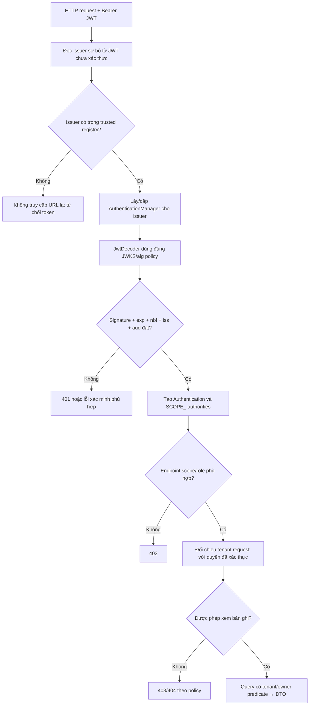
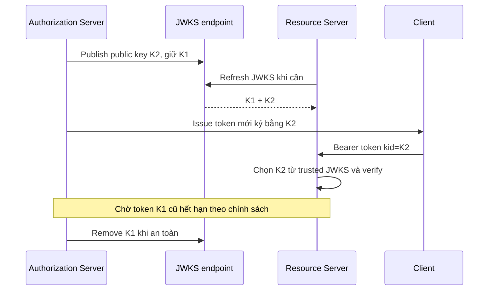

# Quản lý decoder, khóa, cache và cấu hình theo từng tenant

## 1. Bối cảnh: một Resource Server phục vụ nhiều tenant

Một hệ thống quản lý đơn hàng có thể tiếp nhận request của nhiều khách hàng tổ chức:

- **Tenant Alpha** đăng nhập qua Authorization Server `https://login.alpha.example/realms/store`.
- **Tenant Beta** đăng nhập qua `https://login.beta.example/realms/store`.
- **Tenant Gamma** cùng dùng một Authorization Server tập trung với một số tenant khác, nhưng có định danh tenant và chính sách dữ liệu riêng.

Các Client gọi cùng một REST API:

```http
GET /api/tenants/alpha/orders/123 HTTP/1.1
Host: orders.example.com
Authorization: Bearer <access-token>
```

Nếu Resource Server chỉ cấu hình một decoder với một `issuer-uri`, có thể nó sẽ không xác minh được token của tất cả các issuer được phép. Nhưng nếu ứng dụng “chấp nhận mọi issuer” để tiện tích hợp, nó lại mở ra rủi ro **tin nhầm token, tải khóa từ địa chỉ do Client kiểm soát, sử dụng nhầm cache và truy cập chéo tenant**.

Một hệ thống multi-tenant an toàn phải giải quyết đồng thời các câu hỏi:

1. Request này đang **yêu cầu** tenant nào?
2. Token do **issuer nào** phát hành? Issuer đó có nằm trong danh sách được tin cậy không?
3. Phải sử dụng **decoder, JWK Set URI và thuật toán ký** nào để xác minh token?
4. Token có được cấp **đúng audience của API** không?
5. Tenant được yêu cầu có khớp **tenant/entitlement đã xác thực** không?
6. Decoder và khóa được **cache** như thế nào, có thể luân chuyển/thu hồi ra sao?
7. Nếu tenant mới được onboarding hoặc tenant cũ bị vô hiệu hóa, cấu hình và cache cần cập nhật thế nào?
8. Làm sao ngăn một issuer hoặc endpoint không đáng tin được Client tự chọn?

**Nguyên tắc xuyên suốt:** *Thông tin từ token chưa xác minh hoặc URL request có thể giúp định tuyến tới một cấu hình ứng viên **đã được phê duyệt**, nhưng không bao giờ đủ để mở rộng tập issuer, khóa, audience hoặc tenant được tin cậy.*

### Sau bài học, bạn cần nắm được

- Phân biệt **tenant**, **issuer**, **audience**, **OAuth Client** và **JWK Set URI**.
- Tổ chức **trusted tenant registry** chứa các cấu hình security có phiên bản và chính sách cập nhật.
- Sử dụng `JwtIssuerAuthenticationManagerResolver` cho nhiều issuer trong Spring Security Servlet.
- Xây `JwtDecoder` độc lập với issuer validator, audience validator và chính sách thuật toán ký.
- Phân biệt cache **decoder/authentication manager**, cache **JWKS**, cache **entitlement** và cache **response/data**.
- Thiết kế key rotation, cache invalidation, tenant suspension và onboarding an toàn.
- Biết khi nào nhiều tenant cùng issuer **không cần nhiều decoder** nhưng vẫn cần phân quyền tenant.
- Xử lý trường hợp opaque token và WebFlux theo nguyên tắc tương ứng.
- Thiết kế test cross-issuer, cross-tenant, unknown issuer, audience confusion và JWKS rotation.

---

## 2. Trước hết phải phân biệt năm định danh

### 2.1. Tenant ID

`tenant_id` là định danh khách hàng tổ chức hoặc vùng dữ liệu mà ứng dụng quản lý:

```text
alpha
beta
gamma
```

Nó thường liên quan đến data isolation: bảng `orders` có `tenant_id`, mỗi user thuộc một hoặc nhiều tenant, và quản trị viên một tenant không tự có quyền trên tenant khác.

Tenant ID **không mặc nhiên là một OAuth issuer**. Một issuer có thể phát hành token cho nhiều tenant; một tenant cũng có thể có nhiều identity providers trong một hệ thống liên kết phức tạp.

### 2.2. Issuer (`iss`)

Issuer là định danh của Authorization Server hoặc vùng phát hành token theo profile:

```json
{
  "iss": "https://login.alpha.example/realms/store"
}
```

Trong JWT, `iss` nằm trong payload nhưng **chưa được tin** trước khi xác minh chữ ký và issuer validator. Nó có thể được đọc sơ bộ chỉ để tìm **một cấu hình tin cậy đã tồn tại**.

Nếu API cho phép Alpha và Beta, hãy coi hai giá trị issuer là **hai trust anchors độc lập** khi chúng thực sự đại diện cho những nhà phát hành khác nhau.

### 2.3. Audience (`aud`)

Audience cho biết token được cấp cho Resource Server/tài nguyên nào:

```json
{
  "aud": ["orders-api"]
}
```

Một token đúng issuer nhưng `aud=["billing-api"]` **không được tự động chấp nhận tại `orders-api`**. Có thể nhiều tenant cùng sử dụng audience `orders-api` hoặc mỗi tenant có API audience riêng; điều quan trọng là kiểm tra theo **hợp đồng đã được cấu hình**.

### 2.4. OAuth Client (`client_id` hoặc `azp` theo profile)

OAuth Client là ứng dụng xin token, chẳng hạn `web-portal` hoặc `billing-worker`. Nó không đồng nghĩa issuer, audience hoặc tenant.

Một access token có `client_id=web-portal` chưa chứng minh nó được dùng cho mọi API; và việc user đến từ tenant Alpha không đồng nghĩa mọi Client do Alpha đăng ký đều có quyền đọc tất cả dữ liệu Alpha.

### 2.5. JWKS/JWK Set URI và `kid`

JWT thường được ký bằng khóa riêng của Authorization Server. Resource Server xác minh chữ ký bằng **public key** từ JWK Set đáng tin hoặc nguồn khóa đã được kiểm soát.

Một JOSE header minh họa:

```json
{
  "alg": "RS256",
  "kid": "alpha-2026-key-2",
  "typ": "at+jwt"
}
```

`kid` là gợi ý chọn **khóa trong tập khóa đã được tin cậy cho issuer đó**. Nó không phải bằng chứng quyền truy cập; cũng không có nghĩa `kid` là duy nhất trên mọi issuer.

```text
Issuer Alpha:
  jwks_uri = https://login.alpha.example/.../certs
  kid      = alpha-2026-key-2

Issuer Beta:
  jwks_uri = https://login.beta.example/.../certs
  kid      = beta-2026-key-2
```

Ngay cả khi hai issuer dùng cùng một chuỗi `kid`, **không được lấy public key của Alpha để xác minh token Beta** chỉ vì `kid` trùng.

### 2.6. Bảng đối chiếu nhanh

| Khái niệm | Chức năng | Nguồn tin cậy | Lỗi thường gặp |
|---|---|---|---|
| `tenant_id` | Phạm vi dữ liệu và membership | Claim đã xác minh, entitlement DB hoặc policy | Tin tenant từ URL là đã có quyền |
| `iss` | Nhà phát hành token | Allowlist/registry và validator | Tải khóa theo issuer chưa được phê duyệt |
| `aud` | Resource Server được nhận token | API configuration và token validator | Chỉ kiểm tra chữ ký và issuer |
| `client_id` | Ứng dụng được cấp token | Metadata token đã xác minh/AS | Coi Client ID thay audience |
| `jwks_uri` | Nguồn khóa công khai để kiểm chứng JWT | Cấu hình/discovery của issuer đáng tin | Dùng `jku` tùy ý trong JWT header |
| `kid` | Chọn khóa trong JWKS của issuer | Header chưa tin + key set đã tin | Cache khóa toàn hệ thống theo `kid` |
| `scope`/`scp` | Quyền thao tác được AS cấp | Token đã xác minh | Coi `SCOPE_orders.read` là quyền mọi bản ghi |

---

## 3. Hai mô hình multi-tenant khác nhau về mặt bảo mật

### 3.1. Mô hình A: mỗi tenant có một issuer

```text
Alpha → issuer A → JWKS A
Beta  → issuer B → JWKS B
Gamma → issuer C → JWKS C
                    |
                    v
                orders-api
```

Trong mô hình này, Resource Server cần chọn **bộ kiểm tra token theo issuer**. Có thể dùng nhiều decoder/authentication manager, mỗi manager gắn với:

- Issuer được phê duyệt.
- JWKS URI tin cậy.
- Thuật toán ký được phép.
- Audience của API.
- Claims validators.
- Cách mapping authorities.
- Lifecycle/cache của tenant tương ứng.

### 3.2. Mô hình B: nhiều tenant cùng issuer

```text
Alpha ─┐
Beta  ─┼→ https://id.example.com/realms/shared → chung JWKS
Gamma ─┘                                      |
                                               v
                                           orders-api
```

Khi dùng **cùng issuer, cùng key material, cùng token profile và cùng audience validation**, một decoder có thể xác minh token của nhiều tenant. Việc tạo hàng trăm decoder giống hệt nhau theo `tenant_id` có thể chỉ làm tăng tải JWKS và cache.

Nhưng **một decoder dùng chung không đồng nghĩa tenant được dùng chung quyền**. Sau khi token được xác minh, ứng dụng vẫn phải kiểm tra tenant claim, membership/ACL và điều kiện dữ liệu cụ thể.

Ví dụ:

```json
{
  "iss": "https://id.example.com/realms/shared",
  "aud": ["orders-api"],
  "sub": "user-417",
  "tenant_id": "alpha",
  "scope": "orders.read"
}
```

Request tới `/api/tenants/beta/orders/123` phải bị từ chối nếu principal chỉ được cấp quyền Alpha, dù token xác thực qua decoder chung.

### 3.3. Mô hình C: nhiều issuer cho một tenant

Một tenant có thể chấp nhận cả IdP nội bộ và IdP đối tác:

```text
Tenant Alpha:
  issuer A1 → corporate IdP
  issuer A2 → partner IdP
```

Khi đó, registry có thể là ánh xạ **nhiều issuer → một tenant**. Cần ánh xạ `(iss, sub)` hoặc subject đã được liên kết qua quy trình đáng tin đến danh tính người dùng nội bộ.

**Không coi cùng `sub` của hai issuer là cùng một user**. `sub=user-417` ở A1 và `sub=user-417` ở A2 có thể là hai chủ thể khác nhau.

### 3.4. Chọn kiến trúc dựa trên ranh giới tin cậy thật

Không nên mặc định:

```text
tenant_id = issuer = client_id = audience = hostname
```

Những chuỗi đó có thể tương tự nhau trong một demo nhưng hoàn toàn độc lập trong mô hình thật. Một cấu trúc registry phù hợp phải diễn đạt được các quan hệ một-nhiều/nhiều-một, thay vì ép mọi cấu hình vào một chuỗi `tenantId`.

---

## 4. Đường đi request: chọn manager chỉ là bước định tuyến

### 4.1. Flow an toàn cho JWT nhiều issuer



**Một chi tiết quan trọng:** Đọc `iss` trước khi kiểm tra chữ ký **không đồng nghĩa tin `iss`**. Nó chỉ chọn ứng viên từ registry **đã phê duyệt từ trước**, rồi decoder bắt buộc xác minh chữ ký và giá trị issuer chính xác.

Nếu ứng dụng nhìn `iss` chưa xác thực và tự động tải metadata/JWKS từ host đó, token của kẻ tấn công có thể đưa API tới một host ngoài ý định.

### 4.2. Ví dụ token phát hành từ nguồn không tin cậy

JWT chưa xác thực có payload:

```json
{
  "iss": "https://evil.example/issuer",
  "aud": ["orders-api"],
  "sub": "admin",
  "scope": "orders.read"
}
```

Nếu Resource Server tự gọi `JwtDecoders.fromIssuerLocation(iss)` cho mọi issuer mới xuất hiện, nó có thể:

- Gửi HTTP tới host bên ngoài do người gửi token kiểm soát.
- Tải metadata và JWK không được phê duyệt.
- Tạo cache entry/authentication manager không giới hạn.
- Chấp nhận token tự ký nếu không có bước allowlist độc lập.
- Gây SSRF hoặc cạn tài nguyên qua những URL issuer khác nhau.

Vì vậy **không xây trust registry bằng cách “gặp issuer nào thì thêm issuer đó”**.

### 4.3. Một số yêu cầu phải kiểm tra hai lần về mặt ý nghĩa

Thông tin `iss` được dùng để tìm config là **dữ liệu chưa đáng tin**. Sau decode, giá trị `iss` trong JWT được decoder xác thực phải đúng issuer mà manager đã được cấu hình.

Nếu request path chọn Alpha nhưng JWT đã xác minh là Beta, vẫn cần kiểm tra điều kiện Alpha/Beta ở tầng nghiệp vụ. Đừng coi “manager đã giải mã được token” là bằng chứng token được phép truy cập tenant có tên trong path.

---

## 5. Trusted tenant registry: nguồn cấu hình gốc

### 5.1. Mỗi profile phải có những thông tin gì?

Một profile ví dụ:

```yaml
security:
  tenants:
    alpha:
      enabled: true
      issuer: https://login.alpha.example/realms/store
      jwks-uri: https://login.alpha.example/realms/store/protocol/openid-connect/certs
      audience: orders-api
      allowed-algorithms:
        - RS256
      token-tenant-claim: tenant_id
      expected-tenant-claim-value: alpha
    beta:
      enabled: true
      issuer: https://login.beta.example/realms/store
      jwks-uri: https://login.beta.example/realms/store/protocol/openid-connect/certs
      audience: orders-api
      allowed-algorithms:
        - RS256
      token-tenant-claim: tenant_id
      expected-tenant-claim-value: beta
```

Đây là **schema đề xuất của ứng dụng**, không phải nhóm properties mà Spring Boot tự đọc. Bạn phải định nghĩa `@ConfigurationProperties`, registry loader hoặc binding tương ứng.

Các trường thường cần:

| Trường | Vai trò |
|---|---|
| `tenantId` | ID nội bộ ổn định |
| `enabled` | Cho phép/vô hiệu hóa tenant |
| `issuer` | Định danh issuer chính xác được tin cậy |
| `jwksUri` | Nguồn public keys được phê duyệt |
| `audience` | API/token recipient bắt buộc |
| `allowedAlgorithms` | Chính sách thuật toán ký |
| `tokenProfile` | Điều kiện token type/claims theo hợp đồng |
| `tenantClaim` | Cách ánh xạ principal vào tenant |
| `scopeMapping` | Claim/prefix authorities nếu khác mặc định |
| `version` | Phiên bản snapshot để cập nhật/invalidate cache |
| `maxStale`/`timeouts` | Chính sách cache và network |
| `status` | Active/suspended/offboarded |

Không bắt buộc mọi tenant phải có JWKS URI khác nhau. Khi chung issuer/trust anchor, registry có thể tái sử dụng cùng decoder và giữ mapping nghiệp vụ riêng.

### 5.2. Ai được quyền cập nhật registry?

Registry là **cấu hình bảo mật**, không phải danh sách tùy ý do HTTP Client tự khai. Nguồn cập nhật có thể là:

- Cấu hình deploy đã qua review.
- Cơ sở dữ liệu nội bộ có quyền quản trị giới hạn.
- Control-plane onboarding được xác thực/ủy quyền riêng.
- Secret manager/config service có audit và versioning.

Với onboarding tenant mới, cần quy trình xác thực issuer, metadata, JWKS URI, audience, key algorithm và tenant mapping. Không cho API public “tự đăng ký issuer bằng URL” rồi dùng ngay trong request đầu tiên.

### 5.3. Snapshot cấu hình bất biến

Một cách dễ kiểm soát là load registry vào **immutable snapshot**:

```text
Registry revision 18:
  alpha → profile A v5
  beta  → profile B v2

Registry revision 19:
  alpha → profile A v6
  beta  → disabled
```

Với mỗi request, chỉ dùng một snapshot nhất quán để chọn/kiểm tra policy. Khi cập nhật, thay snapshot một cách nguyên tử rồi thực hiện chính sách invalidation tương ứng.

Tránh thay đổi riêng lẻ `issuer`, `jwksUri`, `audience` và `enabled` trên cùng một mutable bean trong khi request đang chạy; có thể xuất hiện trạng thái lai không mong muốn.

### 5.4. Không tin chỉ dựa vào tên miền “gần giống”

Ví dụ trust check không phù hợp:

```java
if (issuer.startsWith("https://login.example.com")) {
    return true;
}
```

Nó có thể nhận những chuỗi không đúng như:

```text
https://login.example.com.attacker.example/issuer
```

Nên dùng định danh issuer **chính xác**, theo cấu hình đã xác thực. Nếu cần chính sách hostname/URL phức tạp, phải parse/canonicalize và so khớp đúng thành phần, nhưng issuer string trong JWT validator vẫn phải khớp giá trị hợp đồng.

### 5.5. Bảo vệ network khi discovery/JWKS refresh

Ngay cả issuer đã được approve cũng có thể bị cấu hình sai hoặc DNS/redirect thay đổi. Cần cân nhắc:

- Chỉ HTTPS, chứng thư TLS/hostname hợp lệ.
- Hạn chế outbound destinations theo allowlist/network policy.
- Chặn truy cập tới địa chỉ metadata cloud, loopback/private network ngoài mục đích.
- Kiểm soát redirect của HTTP client.
- Timeout và connection limits.
- Không nhận `jku`/`x5u` từ token làm URL tải khóa.
- Kiểm soát DNS và egress để giảm SSRF.
- Không đưa Bearer token tới endpoint introspection/JWKS không thuộc trust registry.

---

## 6. Cấu hình đơn giản với nhiều issuer đã biết

### 6.1. Dependency

Ví dụ Spring Boot Servlet Resource Server:

```groovy
dependencies {
    implementation 'org.springframework.boot:spring-boot-starter-web'
    implementation 'org.springframework.boot:spring-boot-starter-security'
    implementation 'org.springframework.boot:spring-boot-starter-oauth2-resource-server'

    testImplementation 'org.springframework.boot:spring-boot-starter-test'
    testImplementation 'org.springframework.security:spring-security-test'
}
```

Ví dụ trong các mục 6–11 dùng **Servlet/MVC** với `HttpSecurity`, `SecurityFilterChain` và `JwtIssuerAuthenticationManagerResolver`. Phần WebFlux có các kiểu khác, sẽ được tách ở mục riêng.

### 6.2. `JwtIssuerAuthenticationManagerResolver` với trusted issuers

Khi có số ít issuer tĩnh, Spring Security Servlet hỗ trợ `JwtIssuerAuthenticationManagerResolver`.

Ví dụ với API tương ứng ở các bản Spring Security hiện đại:

```java
package com.example.orders;

import org.springframework.context.annotation.Bean;
import org.springframework.context.annotation.Configuration;
import org.springframework.http.HttpMethod;
import org.springframework.security.config.annotation.web.builders.HttpSecurity;
import org.springframework.security.web.SecurityFilterChain;
import org.springframework.security.oauth2.server.resource.authentication.JwtIssuerAuthenticationManagerResolver;

@Configuration
public class MultiIssuerSecurityConfig {

    @Bean
    SecurityFilterChain apiSecurity(HttpSecurity http) throws Exception {
        JwtIssuerAuthenticationManagerResolver resolver =
            JwtIssuerAuthenticationManagerResolver
                .fromTrustedIssuers(
                    "https://login.alpha.example/realms/store",
                    "https://login.beta.example/realms/store");

        return http
            .securityMatcher("/api/**")
            .csrf(csrf -> csrf.disable())
            .authorizeHttpRequests(auth -> auth
                .requestMatchers("/api/public/**").permitAll()
                .requestMatchers(HttpMethod.GET, "/api/orders/**")
                    .hasAuthority("SCOPE_orders.read")
                .anyRequest().denyAll())
            .oauth2ResourceServer(oauth2 -> oauth2
                .authenticationManagerResolver(resolver))
            .build();
    }
}
```

Ý nghĩa:

1. Danh sách trusted issuers đã được khai báo ở server.
2. Resolver dùng issuer ứng viên để chọn AuthenticationManager thích hợp.
3. Decoder tương ứng thực hiện **xác minh token**, không chỉ đọc `iss`.
4. API kiểm tra `SCOPE_orders.read` sau khi Authentication được chấp nhận.

**Lưu ý phiên bản:** Factory `fromTrustedIssuers(...)` có thể khác giữa các phiên bản Spring Security; với project cũ cần đối chiếu Javadoc của dependency đang dùng. Không copy một chữ ký API từ phiên bản khác rồi sửa bằng cách bỏ kiểm tra issuer. Một số phiên bản có constructor nhận trusted issuers hoặc `AuthenticationManagerResolver<String>`; ý tưởng allowlist và post-decode issuer validation không thay đổi.

### 6.3. Hạn chế của ví dụ tối thiểu

Ví dụ trên giúp chọn issuer/decoder, nhưng **không tự áp dụng mọi chính sách đặc thù theo tenant**:

- Audience riêng cho `orders-api`.
- Token `typ`/profile.
- Claim `tenant_id` bắt buộc.
- Chủ sở hữu dữ liệu.
- Role của từng tenant.
- Cache policy, timeout tùy biến, key rotation theo yêu cầu.
- Onboarding/offboarding tenant động.

Để làm các việc đó, cần xây manager/decoder per tenant hoặc một tầng policy bổ sung.

### 6.4. Khi nào không dùng resolver theo issuer?

Nếu tất cả tenant chung issuer và chung khóa, decoder per issuer có thể chỉ có **một entry**. Lúc đó quyết định tenant thuộc **authorization/data isolation**, không nằm trong việc chọn JWT verifier.

Ngược lại, nếu một tenant có nhiều issuer hoặc AS cấp nhiều loại token, một map đơn giản `tenantId → issuer` có thể quá hạn chế. Thiết kế registry phải theo **trust profile**, không theo một giả định quan hệ 1:1.

---

## 7. Tự tạo decoder theo từng trusted issuer

Khi cần audience, JWKS URI và thuật toán riêng, có thể xây manager cụ thể.

### 7.1. Profile bất biến

Ví dụ:

```java
package com.example.orders;

public record TenantJwtProfile(
    String tenantId,
    String issuer,
    String jwksUri,
    String audience,
    boolean enabled,
    long version
) {
}
```

Đây là mẫu tối giản; không nên để Client tự gửi một object `TenantJwtProfile` rồi dùng nó làm nguồn cấu hình security.

### 7.2. Factory tạo `JwtDecoder` có validator

```java
package com.example.orders;

import org.springframework.security.oauth2.core.DelegatingOAuth2TokenValidator;
import org.springframework.security.oauth2.core.OAuth2Error;
import org.springframework.security.oauth2.core.OAuth2TokenValidator;
import org.springframework.security.oauth2.core.OAuth2TokenValidatorResult;
import org.springframework.security.oauth2.jwt.Jwt;
import org.springframework.security.oauth2.jwt.JwtValidators;
import org.springframework.security.oauth2.jwt.NimbusJwtDecoder;
import org.springframework.security.oauth2.jose.jws.SignatureAlgorithm;

public final class TenantJwtDecoderFactory {

    public NimbusJwtDecoder create(TenantJwtProfile profile) {
        if (!profile.enabled()) {
            throw new IllegalArgumentException(
                "Tenant is not enabled");
        }

        // JWKS URL và thuật toán xuất phát từ registry đã approve.
        NimbusJwtDecoder decoder =
            NimbusJwtDecoder
                .withJwkSetUri(profile.jwksUri())
                .jwsAlgorithm(SignatureAlgorithm.RS256)
                .build();

        OAuth2TokenValidator<Jwt> issuerAndTime =
            JwtValidators.createDefaultWithIssuer(
                profile.issuer());

        OAuth2TokenValidator<Jwt> audience = jwt ->
            jwt.getAudience().contains(profile.audience())
                ? OAuth2TokenValidatorResult.success()
                : OAuth2TokenValidatorResult.failure(
                    new OAuth2Error(
                        "invalid_token",
                        "Token audience is not accepted",
                        null));

        decoder.setJwtValidator(
            new DelegatingOAuth2TokenValidator<>(
                issuerAndTime, audience));

        return decoder;
    }
}
```

Đoạn mã mô tả chính sách **RS256 cố định theo ví dụ**. Nếu mỗi tenant cho phép thuật toán khác nhau, phải thêm tập thuật toán được approve vào profile và cấu hình builder theo đúng API/algorithm policy — không lấy `alg` chưa xác thực trong token làm căn cứ chấp nhận một thuật toán mới.

### 7.3. Vì sao cần `JwtValidators.createDefaultWithIssuer`?

Khi tạo decoder trực tiếp từ `jwksUri`, bạn phải bảo đảm không chỉ xác minh chữ ký mà còn áp dụng các điều kiện cần thiết như issuer/thời hạn và audience.

`JwtValidators.createDefaultWithIssuer(profile.issuer())` tạo bộ validator mặc định theo issuer cho JWT trong API tương ứng. Audience được thêm riêng qua validator. Nếu dự án có thêm validator `typ`/`azp`/tenant claim, phải kết hợp với các validator cần giữ lại, **không ghi đè chúng bằng một validator duy nhất**.

Đừng chỉ làm:

```java
// Không đầy đủ nếu không có issuer/audience/time policy:
NimbusJwtDecoder.withJwkSetUri(jwksUri).build();
```

rồi kết luận token dùng đúng API và tenant.

### 7.4. Chữ ký hợp lệ nhưng issuer sai

Giả sử cấu hình Alpha dùng JWKS A. Một token giả lập có:

```json
{
  "iss": "https://login.beta.example/realms/store",
  "aud": ["orders-api"],
  "scope": "orders.read"
}
```

Nếu một thiết kế sai vô tình xác minh được chữ ký bằng khóa chia sẻ hoặc nhầm cache, token vẫn phải thất bại vì `iss` không khớp profile Alpha.

**Chữ ký và issuer là hai điều kiện độc lập**. Không dùng việc tìm thấy một public key phù hợp làm bằng chứng token được phát hành đúng ranh giới tin cậy.

### 7.5. Validate tenant claim theo hợp đồng

Nếu issuer A chỉ cấp token cho tenant Alpha, có thể yêu cầu `tenant_id=alpha` trong profile. Nhưng cần phân biệt:

- **Bắt buộc token claim:** có thể validate ngay ở decoder nếu mọi token của issuer/profile phải có claim này.
- **Membership tùy endpoint:** thường kiểm tra trong authorization/Service với nguồn quyền hiện hành.
- **Nhiều tenant cùng issuer:** decoder dùng chung, nhưng tenant claim vẫn phải được đối chiếu với request/DB.

Ví dụ validator đơn giản:

```java
OAuth2TokenValidator<Jwt> tenantClaim = jwt -> {
    String tenant = jwt.getClaimAsString("tenant_id");

    return profile.tenantId().equals(tenant)
        ? OAuth2TokenValidatorResult.success()
        : OAuth2TokenValidatorResult.failure(
            new OAuth2Error(
                "invalid_token",
                "Token tenant does not match its profile",
                null));
};
```

Chỉ dùng validator này nếu hợp đồng **mỗi token thuộc đúng một tenant và profile ứng với tenant đó**. Nếu user được phép nhiều tenant hoặc issuer chung, cần membership policy phù hợp, không hardcode mỗi issuer một tenant.

---

## 8. AuthenticationManager theo issuer và cache đúng nơi

### 8.1. Vì sao cần manager cache?

Nếu mỗi request tạo lại `JwtDecoder`/`JwtAuthenticationProvider`, hệ thống có thể lặp công việc:

- Xây decoder/JWK source.
- Nạp metadata/key set không cần thiết.
- Khởi tạo converter và validation policy.
- Tạo nhiều cache JWKS không dùng chung.
- Gây tăng latency, memory và tải AS.

Một chiến lược thường dùng là **lazy initialization**: chỉ tạo manager cho issuer tin cậy khi token của issuer đó được trình lần đầu, sau đó reuse.

### 8.2. Factory AuthenticationManager

```java
package com.example.orders;

import org.springframework.security.authentication.AuthenticationManager;
import org.springframework.security.authentication.ProviderManager;
import org.springframework.security.oauth2.server.resource.authentication.JwtAuthenticationProvider;

public final class TenantAuthenticationManagerFactory {

    private final TenantJwtDecoderFactory decoderFactory =
        new TenantJwtDecoderFactory();

    public AuthenticationManager create(
            TenantJwtProfile profile) {

        JwtAuthenticationProvider provider =
            new JwtAuthenticationProvider(
                decoderFactory.create(profile));

        return new ProviderManager(provider);
    }
}
```

`JwtAuthenticationProvider` chuyển request mang Bearer JWT sang `JwtAuthenticationToken` khi decoder xác minh thành công. Scope thường được ánh xạ thành `SCOPE_...` authorities theo converter tương ứng.

Nếu tenant có claim authority khác mặc định, cần gắn một `JwtAuthenticationConverter` có mapping phù hợp và kiểm soát role/tenant claim. Không tự cấp `ROLE_ADMIN` cho mọi token đến từ issuer Admin chỉ vì tên tenant.

### 8.3. Registry và cache mang tính minh họa

Giả sử registry có API:

```java
public interface TrustedIssuerRegistry {
    Optional<TenantJwtProfile> findEnabledByIssuer(
        String issuer);
}
```

Có thể triển khai một manager cache **theo issuer** nếu cấu hình issuer là duy nhất, cố định trong runtime hiện tại:

```java
package com.example.orders;

import java.util.concurrent.ConcurrentHashMap;
import java.util.concurrent.ConcurrentMap;
import org.springframework.security.authentication.AuthenticationManager;
import org.springframework.security.authentication.AuthenticationManagerResolver;
import org.springframework.security.oauth2.core.OAuth2AuthenticationException;
import org.springframework.security.oauth2.core.OAuth2Error;

public final class TrustedIssuerManagerResolver
        implements AuthenticationManagerResolver<String> {

    private final TrustedIssuerRegistry registry;
    private final TenantAuthenticationManagerFactory factory;
    private final ConcurrentMap<String, AuthenticationManager> cache =
        new ConcurrentHashMap<>();

    public TrustedIssuerManagerResolver(
            TrustedIssuerRegistry registry,
            TenantAuthenticationManagerFactory factory) {

        this.registry = registry;
        this.factory = factory;
    }

    @Override
    public AuthenticationManager resolve(String issuer) {
        TenantJwtProfile profile =
            registry.findEnabledByIssuer(issuer)
                .orElseThrow(() ->
                    new OAuth2AuthenticationException(
                        new OAuth2Error(
                            "invalid_token",
                            "Issuer is not trusted",
                            null)));

        return cache.computeIfAbsent(
            profile.issuer(),
            key -> factory.create(profile));
    }
}
```

**Giới hạn quan trọng của ví dụ:** `cache` ở đây phù hợp cho **trusted registry bất biến trong thời gian chạy**, nơi mỗi issuer có một profile ổn định. Nếu registry cập nhật `jwksUri`, `audience`, thuật toán, `enabled` hoặc `version` trong runtime, cache chỉ key bằng issuer có thể giữ manager **stale**. Mục 12 sẽ giải thích cách giải quyết versioning/invalidation.

Điều khác biệt so với cache nguy hiểm:

```java
// KHÔNG AN TOÀN:
return cache.computeIfAbsent(
    untrustedIssuer,
    JwtDecoders::fromIssuerLocation);
```

Ví dụ sai tự phát sinh decoder cho mọi issuer token tự khai mà không có allowlist trước khi gọi HTTP/discovery.

### 8.4. Nối registry resolver vào Servlet security chain

Với phiên bản cung cấp constructor `JwtIssuerAuthenticationManagerResolver(AuthenticationManagerResolver<String>)`:

```java
@Bean
AuthenticationManagerResolver<HttpServletRequest>
multiIssuerResolver(
        TrustedIssuerRegistry registry) {

    TrustedIssuerManagerResolver trustedManagers =
        new TrustedIssuerManagerResolver(
            registry,
            new TenantAuthenticationManagerFactory());

    return new JwtIssuerAuthenticationManagerResolver(
        trustedManagers);
}
```

Sau đó:

```java
@Bean
SecurityFilterChain api(
        HttpSecurity http,
        AuthenticationManagerResolver<HttpServletRequest> resolver)
        throws Exception {

    return http
        .securityMatcher("/api/**")
        .authorizeHttpRequests(auth -> auth
            .requestMatchers(HttpMethod.GET, "/api/orders/**")
                .hasAuthority("SCOPE_orders.read")
            .anyRequest().denyAll())
        .oauth2ResourceServer(oauth2 -> oauth2
            .authenticationManagerResolver(resolver))
        .build();
}
```

Các imports cho ví dụ:

```java
import jakarta.servlet.http.HttpServletRequest;
import org.springframework.http.HttpMethod;
import org.springframework.security.authentication.AuthenticationManagerResolver;
import org.springframework.security.oauth2.server.resource.authentication.JwtIssuerAuthenticationManagerResolver;
import org.springframework.security.web.SecurityFilterChain;
```

Đây là cấu hình **thay thế** factory trusted issuer tĩnh ở mục 6; không đăng ký nhiều chain tương đương mà không chủ ý. Khi dùng Spring Security khác phiên bản, cần đối chiếu constructor/factory thực tế. Nếu ứng dụng chạy Servlet theo `javax.servlet` ở thế hệ cũ, imports có thể khác.

### 8.5. Tách registry lookup và decoder creation

Tránh để tất cả logic trong một lambda không có kiểm soát:

```text
untrusted iss
  → registry lookup/enable check
  → approved immutable profile
  → cache lookup by config identity/version
  → decoder with approved JWKS and validators
  → token verification
```

Cách phân lớp này tạo chỗ rõ ràng để:

- Từ chối unknown issuer ngay, không outbound request.
- Kiểm tra tenant suspension.
- Dùng factory đã kiểm thử cho decoder.
- Giới hạn số profile và số manager được tạo.
- Quản lý invalidation khi control plane đổi cấu hình.

---

## 9. Cache không chỉ có một loại

Trong một hệ thống multi-tenant, cụm từ “cache decoder” dễ gây hiểu lầm vì có nhiều thứ khác nhau được cache.

| Lớp cache | Nội dung | Key/ranh giới phù hợp | Nguy cơ khi sai |
|---|---|---|---|
| Registry snapshot | Trusted tenant/issuer policies | Revision cấu hình và trusted tenant IDs | Dùng issuer đã offboard hoặc policy cũ |
| AuthenticationManager cache | Provider + decoder + converters | Issuer và version của profile | Tiếp tục dùng JWKS URI/audience cũ |
| Decoder cache | Decoder/JWK source đã khởi tạo | Trust profile/issuer/version | Decoder của tenant này dùng cho tenant khác |
| JWKS cache | Public JWK Set | JWKS URI/issuer theo thiết kế | Trộn khóa, giữ stale keys, refresh storm |
| Token validation/result cache | Kết quả giải mã/xác minh token | Chỉ khi có policy rất rõ | Dùng token hết hạn/revoked/đổi policy |
| Entitlement cache | Role/tenant membership/ACL | Issuer + subject + tenant + version | Quyền bị thu hồi vẫn sử dụng |
| Response/data cache | DTO/list/count đã phân quyền | Principal + tenant + query/policy | Rò rỉ dữ liệu giữa tenant |

**Không giải quyết tất cả bằng một `ConcurrentHashMap<String, Object>` toàn hệ thống.** Mỗi cache có semantics, vòng đời và yêu cầu invalidation riêng.

### 9.1. Cache decoder không thay thế xác thực mỗi request

Tái sử dụng cùng `JwtDecoder` **không có nghĩa** token của request mới được chấp nhận mà không xác minh.

Mỗi JWT vẫn cần:

- Kiểm tra chữ ký/thuật toán/khóa.
- Kiểm tra `exp`, `nbf`, `iss`, `aud` và validators cần thiết.
- Ánh xạ authorities.
- Áp dụng authorization và data isolation.

Decoder cache chỉ tránh lặp lại việc tạo các object/configuration tốn kém.

### 9.2. JWKS cache khác token cache

**JWKS cache** giữ public keys để xác minh token. Nó không giữ một quyết định “token T chắc chắn hợp lệ mãi mãi”.

Một token đã hết hạn vẫn phải thất bại ở thời điểm mới, kể cả chữ ký còn xác minh được bằng khóa trong cache.

### 9.3. Có nên cache JWT Authentication?

Không nên tự thêm một cache **“token string → Authentication đã được approve”** khi chưa có lý do và thiết kế riêng: token hết hạn, quyền thay đổi, policy tenant bị offboard hoặc audience cập nhật đều có thể khiến kết quả cũ không còn đúng.

Nếu dự án có caching kết quả token vì yêu cầu hiệu năng, phải đảm bảo TTL không vượt token expiry, có policy versioning/revocation và phân biệt issuer/tenant/audience. Thường **tái sử dụng decoder/JWKS** trước khi cân nhắc cache quyết định authentication.

### 9.4. Cách đặt key cache an toàn

Không nên key public key bằng `kid` đơn độc:

```text
cache["key-1"] = publicKey
```

Vì Alpha và Beta có thể cùng dùng `kid=key-1`.

Mẫu khái niệm phù hợp:

```text
JWKS-cache namespace:
  issuer=https://login.alpha.example/realms/store
  jwksUri=https://login.alpha.example/.../certs
  keySetVersion=...
```

Hoặc tách một cache object riêng cho từng trusted issuer, với lifecycle riêng. Không lưu private signing key của AS vào Resource Server: **Resource Server thông thường chỉ cần public keys** để xác minh JWT.

---

## 10. JWK Set và key rotation: tránh phụ thuộc mãi vào một `kid`

### 10.1. Vì sao Authorization Server thay khóa?

AS có thể luân chuyển khóa vì:

- Chu kỳ bảo mật định kỳ.
- Thay hạ tầng HSM hoặc signing service.
- Khóa cũ gần hết vòng đời.
- Nghi ngờ lộ private key.
- Tách signing policy cho issuer/tenant.

Một JWKS có thể chứa nhiều public keys:

```json
{
  "keys": [
    {
      "kty": "RSA",
      "kid": "alpha-key-2026-01",
      "use": "sig",
      "alg": "RS256",
      "n": "BASE64URL_MODULUS_1",
      "e": "AQAB"
    },
    {
      "kty": "RSA",
      "kid": "alpha-key-2026-02",
      "use": "sig",
      "alg": "RS256",
      "n": "BASE64URL_MODULUS_2",
      "e": "AQAB"
    }
  ]
}
```

Đây là dữ liệu minh họa, **không phải JWKS RSA hợp lệ để chạy thử**; các giá trị `n` giả định.

### 10.2. Rotation với giai đoạn chồng lấn

Một quy trình rotation bình thường:



Việc publish khóa mới trước khi ký token bằng khóa đó giảm nguy cơ Resource Server không xác minh được token mới.

### 10.3. Không khẳng định cache tự refresh tức thì

Mỗi phiên bản thư viện JWT/JWK source có chính sách cache và refresh riêng. Một số implementation làm mới JWK Set khi `kid` chưa tìm thấy, nhưng hành vi thực tế có thể phụ thuộc version/cache/provider.

Không nên đưa ra cam kết “JWT decoder luôn refresh mỗi khi `kid` lạ” nếu chưa kiểm tra implementation. Thiết kế vận hành cần có:

- TTL cache/JWKS refresh strategy phù hợp.
- Timeout/retry giới hạn.
- Theo dõi unknown `kid` rate.
- Khả năng reload/invalidate cache có kiểm soát.
- Test key rotation trên phiên bản Spring Security thật.
- Hạn chế request từ Client với hàng nghìn `kid` giả gây refresh storm.

### 10.4. Nếu private key bị lộ

Rotation theo chu kỳ khác với **compromise**:

- Khi khóa bị lộ, có thể cần loại bỏ tin cậy khóa cũ sớm và từ chối token ký bằng khóa đó.
- Chỉ chờ token tự hết hạn có thể không đủ.
- Cần cập nhật/invalidates JWKS caches trên các Resource Server.
- Cần phối hợp AS và incident response; có thể thu hồi token, đổi chính sách phát hành hoặc vô hiệu hóa issuer.
- Không dùng `kid` để tự động cho phép một key bất kỳ từ JWT header.

### 10.5. Các giới hạn của `kid`

`kid` giúp tìm key, nhưng:

- Không chứng minh key thuộc issuer nào.
- Không bảo đảm key còn tin cậy.
- Không thay signature verification.
- Không cho phép vượt algorithm allowlist.
- Không thay claims validation.

Với các hệ thống nhiều issuer, cùng `kid` ở hai issuer phải được xử lý trong **hai vùng trust riêng biệt**.

---

## 11. Cấu hình JWKS cache trong Spring Security

### 11.1. Mặc định framework có thể đã cache khóa

`NimbusJwtDecoder` sử dụng cơ chế JWK source/cache của thư viện bên dưới để tránh tải khóa ở mỗi request. Không nên lập tức tự xây một Redis cache hoặc ghi public key vào bảng DB khi chưa xem behavior của decoder đang dùng.

Trước tiên hãy đo:

- Số HTTP GET tới JWKS theo issuer.
- Cache hit/miss khi token cùng `kid`.
- Thời gian refresh khi key rotation.
- Memory và số decoder đang sống.
- Tải khi nhiều issuer đồng thời rotate keys.

### 11.2. API cache ở `NimbusJwtDecoder` builder

Một số phiên bản Spring Security Servlet hỗ trợ cấu hình Spring `Cache` cho JWK Set:

```java
// Ví dụ API builder khi version hỗ trợ cache(Cache).
NimbusJwtDecoder decoder =
    NimbusJwtDecoder.withJwkSetUri(profile.jwksUri())
        .cache(jwksCache)
        .build();
```

`jwksCache` là `org.springframework.cache.Cache` mà bạn cung cấp. Đoạn này thể hiện cách tích hợp cache, **không phải khẳng định một cache manager cụ thể luôn phù hợp cho mọi tenant**. Hãy đối chiếu Javadoc của dependency đã resolve và semantics key/TTL mà decoder sử dụng.

Không gọi `cache(...)` trong project WebFlux bằng cách copy API Servlet; `NimbusReactiveJwtDecoder` có builder/cấu hình riêng.

### 11.3. Cache theo tenant hoặc issuer

Khi nhiều decoder dùng riêng các JWKS URI, có thể áp dụng cache namespace rõ ràng:

```text
jwks.alpha
jwks.beta
jwks.gamma
```

hoặc một cache backend có key bao gồm URI/trust profile đã được chuẩn hóa. Không dùng chung một cache entry toàn hệ thống cho những JWK Sets khác nhau.

**Cẩn thận:** không tự đưa token, Client secret, private signing key hoặc toàn bộ claim nhạy cảm vào cache keys/logs. JWKS thông thường chỉ gồm public key nhưng vẫn cần kiểm soát nguồn và integrity của dữ liệu nhận.

### 11.4. TTL không nên do một con số bất biến quyết định

Thời gian cache phụ thuộc:

- Tần suất rotation của AS.
- Độ dài access token lifetime.
- Sự cần thiết thu hồi khóa khẩn cấp.
- HTTP caching headers/implementation của JWK provider.
- Tải request và AS capacity.
- Chính sách vận hành của tổ chức.

TTL quá ngắn có thể gây JWKS request storm; quá dài khiến API sử dụng thông tin khóa cũ lâu hơn mong muốn. Khi đổi chính sách, cần cơ chế cập nhật trong runtime hoặc thay decoder instance an toàn.

### 11.5. Vì sao không cache mãi “not found kid”?

Nếu cache âm tính `kid-not-found` quá lâu, key vừa được AS publish có thể vẫn bị từ chối. Nếu không cache/giới hạn gì, hàng loạt token có `kid` ngẫu nhiên có thể tạo refresh storm.

Cần **negative caching/rate limiting** có giới hạn theo implementation, không biến kết quả “không thấy key” thành phán đoán vĩnh viễn.

---

## 12. Cập nhật tenant động: versioning và invalidation

### 12.1. Vấn đề cache stale

Giả sử registry ban đầu:

```text
Alpha v1:
  enabled = true
  issuer  = https://login.alpha.example/realms/store
  jwksUri = https://login.alpha.example/old/certs
  aud     = orders-api
```

Sau đó đổi:

```text
Alpha v2:
  enabled = true
  issuer  = https://login.alpha.example/realms/store
  jwksUri = https://login.alpha.example/new/certs
  aud     = orders-api-v2
```

Nếu manager cache chỉ key bằng issuer:

```java
cache.computeIfAbsent(issuer, ignored -> factory.create(profile));
```

thì một `AuthenticationManager` được tạo khi còn v1 có thể tiếp tục dùng `old/certs` và `orders-api` sau khi registry đã đổi v2.

Đó là **lỗi nhất quán policy**, có thể dẫn tới chấp nhận token không còn phù hợp.

### 12.2. Key gồm issuer + config version

Mẫu ý tưởng:

```text
AuthenticationManager cache key:
  (issuer, securityConfigRevision)

For Alpha v1:
  ("https://login.alpha.example/realms/store", 1)

For Alpha v2:
  ("https://login.alpha.example/realms/store", 2)
```

Khi revision thay đổi, manager mới được tạo từ snapshot mới. Manager cũ cần được evict và không còn được resolver hiện tại trả về.

**Không chỉ tăng version trong DB rồi để code tra cứu cache theo issuer cũ.** Cả lookup/caching phải sử dụng cùng source revision.

### 12.3. Thay snapshot nguyên tử

Một cách triển khai:

```text
Control plane approves change
    ↓
Validate new tenant security profile
    ↓
Prepare immutable registry snapshot v19
    ↓
Atomically switch active snapshot v18 → v19
    ↓
Invalidate/recreate affected manager + JWKS entries
    ↓
Observe error rates, enforce disabled tenants
```

Nếu có nhiều node/pod Resource Server, phải có cơ chế propagation và convergence. Một node dùng v18 trong khi node khác dùng v19 có thể dẫn tới hành vi xác thực không nhất quán.

### 12.4. Vô hiệu hóa tenant phải được kiểm tra mỗi request

Một tenant bị suspended/offboarded:

```yaml
tenantId: beta
enabled: false
```

Không đủ nếu chỉ xóa entry từ một cache map nhưng một manager cũ vẫn được request handler giữ trong biến khác.

Nên đảm bảo:

1. Resolver kiểm tra trạng thái enable trong registry snapshot đang hoạt động.
2. Disabled issuer không được trả manager.
3. Caches liên quan được invalidated.
4. Dữ liệu và entitlement business có policy thu hồi riêng.
5. Requests đang thực thi được xử lý theo chính sách nhất quán.
6. Có audit log cho việc disable.

Nếu tenant có cùng issuer với tenant khác, **không thể vô hiệu hóa cả issuer** mà không ảnh hưởng những tenant còn lại. Lúc đó cần tenant-level authorization, membership hoặc token-level policy theo tenant.

### 12.5. Giới hạn số tenant/manager

Với hệ thống cho phép onboarding động, không nên để một Client gửi 100.000 giá trị issuer ngẫu nhiên dẫn tới 100.000 decoder entries. Registry chỉ có những profile đã phê duyệt, đồng thời hệ thống nên đặt:

- Giới hạn số tenant active.
- Giới hạn concurrent decoder creation.
- Timeout metadata/JWKS requests.
- Quota/cache eviction policy khi hợp lý.
- Rate limiting cho invalid issuer/`kid` requests.
- Giám sát memory và manager count.

---

## 13. Khởi tạo decoder lazily hay eagerly?

### 13.1. Lazy initialization

Với hàng trăm tenant, tạo tất cả decoder lúc startup có thể kéo theo nhiều HTTP discovery/JWKS calls và làm tăng thời gian khởi động.

Lazy initialization chỉ tạo decoder khi token của issuer đã được tin cậy được trình lần đầu:

```text
Request for Alpha
   → Alpha trusted?
   → no cached manager?
   → create Alpha manager/decoder
   → verify JWT
```

Ưu điểm:

- Startup nhanh hơn.
- Tenant không có traffic không tốn nhiều resource.
- Tải AS phân tán theo nhu cầu.

Nhược điểm:

- First request latency cao hơn.
- Một tenant bị cấu hình sai chỉ được phát hiện khi có traffic.
- Nhiều request đồng thời lần đầu có thể gây khởi tạo trùng hoặc contention nếu cache không đồng bộ đúng.

### 13.2. Eager initialization

Có thể warm-up decoder/JWKS cho một số tenant quan trọng trước khi phục vụ traffic:

```text
Application start
   → validate approved tenant registry
   → precreate selected managers
   → attempt JWKS warmup/health verification
   → mark readiness according to policy
```

Ưu điểm:

- Phát hiện sớm lỗi cấu hình.
- Giảm cold-start latency khi có request đầu tiên.

Nhược điểm:

- Startup phụ thuộc vào nhiều AS.
- Quá nhiều tenant khiến deployment khó sẵn sàng.
- Một AS lỗi có thể ảnh hưởng readiness toàn cụm nếu không phân loại tenant critical/optional.

### 13.3. Kết hợp hai chiến lược

Một chính sách thực tế:

- Cấu hình/issuer trust registry được validate khi deploy.
- Tạo sẵn decoder cho tenant có SLA cao.
- Lazy-load các tenant ít traffic.
- Prewarm JWKS có giới hạn concurrency.
- Tách health của từng AS/tenant khỏi readiness tổng theo yêu cầu sản phẩm.
- Có cơ chế refresh/eviction khi tenant rotation.

Không dùng lazy initialization làm lý do **tạm chấp nhận token mà chưa có key** trong request đầu tiên.

---

## 14. Đồng thời và thread safety của cache manager

### 14.1. Không dùng HashMap thường cho concurrent requests

Trong API Servlet, nhiều request thread có thể cùng chọn Alpha. Một `HashMap` không đồng bộ được sửa từ nhiều thread có nguy cơ race/visibility.

`ConcurrentHashMap.computeIfAbsent(...)` là kỹ thuật phổ biến cho lazy manager creation trong một runtime với registry ổn định.

Nhưng cần lưu ý:

- Factory có thể làm network I/O hoặc khởi tạo tốn kém.
- Lock/contention có thể khiến request chờ.
- Nếu creation thất bại, behavior retry và negative caching cần được kiểm soát.
- Nếu registry thay đổi cùng lúc, kết quả phải tương ứng snapshot policy còn hiệu lực.

### 14.2. Chia cache theo trust profile, không theo token

Không tạo một decoder mới cho mỗi raw Bearer token:

```text
decoderCache[hashOfRawToken] = JwtDecoder
```

Một decoder thường dùng chung cho **nhiều token thuộc cùng issuer/profile**. Key theo token vừa tốn tài nguyên, vừa mở đường cho Client tạo hàng loạt token khác nhau để gây cache explosion.

### 14.3. Nếu cùng issuer nhưng hai profile khác audience?

Không nên dùng cache key chỉ có issuer nếu profile thực sự khác audience hoặc token type policy theo API surface. Có thể cần key:

```text
(issuer, audience-policy, algorithm-policy, config-version)
```

hoặc một decoder kiểm tra tập điều kiện token-level chung và authorization manager thực thi audience theo API route. Phải chọn rõ ranh giới policy thay vì tùy tiện dùng chung manager có audience quá rộng.

### 14.4. Đừng tự dùng cache instance của tenant A cho tenant B

Nếu code:

```java
static JwtDecoder sharedDecoder;
```

rồi thay `jwksUri` nội bộ khi có request Beta, request Alpha đang chạy có thể dùng nhầm khóa Beta. **Decoder/security config nên bất biến theo profile**, và việc thay policy nên thay instance/registry snapshot, không mutate một singleton theo từng request.

---

## 15. Tenant resolution từ request: không dùng làm bằng chứng quyền

### 15.1. Những nguồn tenant mà API thường thấy

Ứng dụng có thể nhận tenant theo:

- Path: `/api/tenants/alpha/orders`.
- Subdomain: `alpha.api.example.com`.
- Header: `X-Tenant-ID: alpha`.
- Claim đã xác minh: `tenant_id=alpha`.
- Internal user membership/entitlement DB.

Path/subdomain/header giúp xác định **tenant được yêu cầu**, nhưng Client có thể sửa chúng. Không được lấy tenant từ path rồi tự coi principal thuộc tenant đó.

### 15.2. Luồng đúng

```text
1. Parse tenant được yêu cầu từ URL/routing.
2. Xác thực token bằng trust policy phù hợp.
3. Lấy tenant grants từ claims đã xác minh hoặc nguồn quyền.
4. Kiểm tra caller được phép thao tác ở tenant yêu cầu.
5. Query orders theo tenant và owner.
6. Map DTO chỉ chứa trường được phép.
```

Ví dụ token Alpha:

```json
{
  "iss": "https://login.alpha.example/realms/store",
  "aud": ["orders-api"],
  "sub": "user-417",
  "tenant_id": "alpha",
  "scope": "orders.read"
}
```

Request:

```http
GET /api/tenants/beta/orders/123 HTTP/1.1
Authorization: Bearer <alpha-access-token>
```

Nếu policy không cho phép user Alpha truy cập Beta, Resource Server phải từ chối dù token có chữ ký hợp lệ và scope đọc.

### 15.3. Query Repository có tenant/owner predicate

```sql
SELECT id, order_no, total_amount
FROM orders
WHERE id = :order_id
  AND tenant_id = :verified_tenant_id
  AND owner_issuer = :verified_issuer
  AND owner_subject = :verified_subject;
```

`verified_tenant_id`, `verified_issuer`, `verified_subject` phải lấy từ Authentication/entitlement đã xác minh.

Không tải `findById(orderId)` trên toàn hệ thống rồi trả Entity trước khi kiểm tra tenant/owner. Nếu bản ghi ngoài phạm vi quyền, có thể trả `404` theo policy để không tiết lộ nó tồn tại.

### 15.4. Tenant role không phải global role

Một user có thể là `TENANT_ADMIN` của Alpha nhưng chỉ là viewer của Beta. Không biến role tenant-scoped thành `ROLE_ADMIN` toàn hệ thống mà không kèm tenant context.

Nếu role được thêm từ token:

```text
user-417:
  alpha → ADMIN
  beta  → VIEWER
```

thì permission check phải kết hợp **role + tenant được yêu cầu**, không chỉ `hasRole("ADMIN")`.

---

## 16. Khóa và JWT claims: kiểm tra đủ mọi lớp

### 16.1. Các validator cần thiết

Một decoder multi-issuer thường cần:

| Điều kiện | Câu hỏi |
|---|---|
| Chữ ký | Token có được ký bởi key phù hợp issuer tin cậy? |
| `alg` | Thuật toán có nằm trong allowlist của profile? |
| `kid` | Key có thuộc approved JWK Set của issuer? |
| `iss` | Giá trị chính xác có khớp issuer được chọn? |
| `aud` | Token có dành cho API hiện tại? |
| `exp` | Token còn hiệu lực? |
| `nbf` | Token đã tới thời điểm được dùng? |
| Token type/profile | Token có phải access token theo hợp đồng, không phải ID token? |
| Claim types | Tenant/Client/subject claims có đúng kiểu và semantics? |
| Scope | Có authority thao tác phù hợp? |
| Business ACL | Principal có quyền với bản ghi cụ thể? |

### 16.2. Không dùng ID token thay access token

Trong OIDC, ID token thường có audience là OAuth Client. Nó dành cho Client xác minh danh tính login, **không phải mặc định token mà `orders-api` nên chấp nhận**.

Một Resource Server multi-tenant cần ngăn token confusion bằng audience/type validators theo contract. Không dùng “cùng issuer và chữ ký đúng” như điều kiện duy nhất.

### 16.3. Algorithm confusion

Không chọn thuật toán chỉ từ token:

```java
// KHÔNG NÊN:
String algorithm = unverifiedHeader.getAlgorithm();
decoder.configureToAccept(algorithm);
```

Phải cố định tập thuật toán được phép theo trusted profile, dùng verification library đúng mode, và không tin `alg=none` hoặc symmetric/asymmetric algorithm ngoài contract.

### 16.4. Metadata endpoint từ issuer

Nếu dùng issuer discovery để lấy `jwks_uri`, discovery chỉ được thực hiện với **issuer đã nằm trong registry**. Cần kiểm tra metadata issuer match, redirect/network policy và sử dụng validator cho `iss` trong JWT.

Nếu dùng explicit `jwksUri` trong profile, nó cũng phải được kiểm duyệt và đi qua TLS/egress policy, không chỉ vì cấu hình được lấy từ database là tự động tin cậy.

---

## 17. Opaque token multi-tenant: không áp dụng máy móc JWT decoder

Không phải mọi tenant đều dùng JWT access token. Một số AS cấp opaque token và yêu cầu Resource Server introspect.

### 17.1. Không có `iss` đọc được từ opaque string

Với JWT, resolver có thể đọc `iss` chưa xác minh để chọn **trusted decoder**. Với opaque token, chuỗi token thường không mang issuer có thể parse an toàn.

Không nên thử:

```text
for each introspectionEndpoint in registry:
    send raw token
    if active=true:
        trust it
```

Đây là một chiến lược nguy hiểm: raw Bearer token bị gửi đến nhiều AS, tăng nguy cơ lộ credential và truy cập sai trust boundary.

### 17.2. Chọn introspection endpoint bằng ngữ cảnh đáng tin

Các phương án có thể bao gồm:

- Token/Client được cấp theo một API hostname hoặc route tenant đã được mapping tới AS tin cậy.
- Gateway đáng tin đưa request vào từng API deployment gắn với một issuer.
- Token prefix/metadata routing chỉ khi **AS có hợp đồng rõ ràng** và không cho phép giả mạo/chuyển tiếp sai.
- Một introspection service tập trung được tổ chức cấp quyền cho nhiều issuer và tự phân giải token theo giao thức đáng tin.

Sau khi AS trả principal, vẫn cần audience/resource binding, scope và tenant ACL. Nếu chọn AS theo tenant URL do Client sửa được, request chưa được phép truy cập dữ liệu chỉ vì endpoint introspection trả `active=true`; phải xác minh chính sách tenant sau đó.

### 17.3. Spring Security OpaqueTokenIntrospector

Với Servlet, interface thường là:

```java
OpaqueTokenIntrospector
```

Với WebFlux:

```java
ReactiveOpaqueTokenIntrospector
```

Mỗi tenant có thể cần introspection URI, credential, timeout và principal converter riêng. Không đưa Client secret của Alpha cho AS của Beta, không dùng một cache `active=true` không phân biệt Resource Server/audience.

### 17.4. Mã lỗi và outage

- `active=false`: token không được chấp nhận, thường `401`.
- `active=true` nhưng thiếu scope: thường `403`.
- `active=true` nhưng không đúng audience: token-level policy phải từ chối.
- Introspection endpoint timeout: không xác minh được token; **không fail open**.
- Tenant disabled: không được đưa principal qua chỉ vì introspection cache còn `active=true`.

---

## 18. WebFlux: reactive manager/decoder registry

Trong WebFlux, các kiểu thay đổi:

| Servlet Resource Server | WebFlux Resource Server |
|---|---|
| `HttpSecurity` | `ServerHttpSecurity` |
| `SecurityFilterChain` | `SecurityWebFilterChain` |
| `JwtDecoder` | `ReactiveJwtDecoder` |
| `AuthenticationManager` | `ReactiveAuthenticationManager` |
| `JwtIssuerAuthenticationManagerResolver` | `JwtIssuerReactiveAuthenticationManagerResolver` |
| `OpaqueTokenIntrospector` | `ReactiveOpaqueTokenIntrospector` |
| `JwtAuthenticationProvider` | `JwtReactiveAuthenticationManager` |

### 18.1. Chọn trusted issuer trong WebFlux

Spring Security WebFlux có thể dùng `JwtIssuerReactiveAuthenticationManagerResolver` cho multi-issuer JWT. Tùy phiên bản, API xây resolver có factory/constructor nhận trusted issuers hoặc resolver theo issuer; cần đối chiếu API của version thực tế.

Ví dụ theo phong cách Spring Security có factory `fromTrustedIssuers(...)`:

```java
JwtIssuerReactiveAuthenticationManagerResolver resolver =
    JwtIssuerReactiveAuthenticationManagerResolver
        .fromTrustedIssuers(
            "https://login.alpha.example/realms/store",
            "https://login.beta.example/realms/store");
```

Gắn vào chain:

```java
@Bean
SecurityWebFilterChain api(
        ServerHttpSecurity http,
        JwtIssuerReactiveAuthenticationManagerResolver resolver) {

    return http
        .authorizeExchange(auth -> auth
            .pathMatchers("/api/public/**").permitAll()
            .pathMatchers("/api/orders/**")
                .hasAuthority("SCOPE_orders.read")
            .anyExchange().denyAll())
        .oauth2ResourceServer(oauth2 -> oauth2
            .authenticationManagerResolver(resolver))
        .build();
}
```

Tương tự Servlet, danh sách trusted issuers phải đến từ server-side registry. **Không tạo reactive decoder theo mọi issuer mới xuất hiện trong token.**

### 18.2. Reactive JWKS I/O

`NimbusReactiveJwtDecoder` được thiết kế cho đường JWT authentication reactive. Dùng đúng decoder reactive thay vì gọi một `JwtDecoder` Servlet đồng bộ ngay trong event loop.

Nếu ứng dụng cần user/tenant membership từ DB, dùng client reactive như R2DBC hoặc WebClient để giữ non-blocking. Tránh `Mono.just(jdbcRepository.findUser())` hoặc `block()` trong security filter.

### 18.3. Không đánh đổi security khi chuyển reactive

Ngay cả trong WebFlux, vẫn phải có:

- Issuer allowlist trước khi discovery.
- Issuer/signature/audience validators.
- JWKS cache phân biệt trust profile.
- Tenant entitlement và owner policy.
- Invalidation khi tenant disabled.
- Fail closed khi AS/JWKS không xác minh được.

“Reactive” mô tả cách thực thi I/O, không phải loại bỏ ranh giới tin cậy.

---

## 19. Logging, monitoring và sự cố theo tenant

### 19.1. Quan sát hệ thống mà không log token

Các trường log hữu ích:

```text
correlation_id
route_pattern
resolved_trusted_issuer_id
tenant_id_after_authorization
security_config_revision
decoder_cache_hit
jwks_refresh_attempt/result
jwt_validation_failure_category
http_status
request_latency
```

Không ghi:

```text
Authorization: Bearer <real-token>
raw JWT payload chứa PII
introspection client_secret
private signing key
session cookie
```

Nếu cần kiểm tra token có lặp lại hay không, dùng một phương án định danh/hashing có kiểm soát phù hợp chính sách, không log raw token.

### 19.2. Metrics nên phân vùng

| Metric | Mục đích |
|---|---|
| JWT decode duration theo profile | Tìm tenant có token/crypto bất thường |
| JWK refresh hit/miss/rate | Theo dõi key rotation/cache |
| Unknown issuer count | Phát hiện request token từ nguồn lạ |
| Unknown `kid` rate | Cảnh báo key rotation hoặc DoS |
| Decoder manager count | Phát hiện cache growth |
| Registry revision age | Phát hiện node chưa cập nhật config |
| AS/JWKS latency và error rate | Phân biệt hạ tầng và token invalid |
| 401/403 theo nhóm nguyên nhân | Phân biệt authentication và authorization |
| Cross-tenant deny count | Phát hiện truy cập sai tenant |
| Cache eviction/recreation | Đánh giá policy rollout |
| Memory/GC and connection pool | Tìm hiệu năng khi số tenant tăng |

Không đưa `sub`, raw token, email, hoặc tenant ID quá nhạy cảm vào metrics labels có cardinality không giới hạn. Có thể nhóm theo ID/profile nội bộ được phép quan sát.

### 19.3. Sự cố nhiều tenant cần có phạm vi ảnh hưởng rõ

Một AS của Alpha bị chậm **không nên kéo sập tất cả Beta/Gamma** nếu kiến trúc có thể cô lập kết nối, timeout và thread pools.

Các biện pháp:

- HTTP client timeouts.
- Concurrency limits/circuit breakers theo issuer hoặc AS.
- JWKS cache phân vùng.
- Bulkhead theo tenant quan trọng.
- Fallback **từ chối an toàn** khi không thể xác minh.
- Monitoring phân biệt outage AS và lỗi token thật.

Không được “chuyển token Alpha sang decoder Beta” như một fallback khi JWKS A lỗi.

---

## 20. Kiểm thử multi-issuer và rotation

### 20.1. Dữ liệu thử nghiệm

Tạo hai issuer giả lập:

```text
Issuer Alpha:
  iss  = https://login.alpha.test/issuer
  aud  = orders-api
  JWKS = A
  key  = A1 / A2
  tenant = alpha

Issuer Beta:
  iss  = https://login.beta.test/issuer
  aud  = orders-api
  JWKS = B
  key  = B1
  tenant = beta
```

Dùng public/private key pairs thử nghiệm riêng, JWKS endpoint stub và access tokens được ký thật bằng private key test. **Không dùng production signing key** trong test fixture.

### 20.2. Ma trận kiểm tra cốt lõi

| Test case | Kết quả mong đợi |
|---|---|
| JWT Alpha ký bằng A1, issuer/audience đúng | Qua token validation |
| JWT Beta ký bằng B1, issuer/audience đúng | Qua token validation |
| Issuer lạ chưa đăng ký | Từ chối, không gọi host lạ |
| JWT giả issuer Alpha nhưng ký bằng B1 | Từ chối chữ ký |
| JWT issuer Alpha ký đúng nhưng `aud=billing-api` | Từ chối audience |
| JWT Alpha hết hạn | `401` |
| JWT Alpha có `alg` ngoài allowlist | Từ chối |
| JWT Alpha có `kid` lạ | Không tự tin khóa từ nơi khác |
| JWT dùng `jku` do Client khai tới host lạ | Không tự tải URL đó |
| JWT Alpha đủ scope, request tenant Beta | Từ chối dữ liệu Beta |
| JWT Alpha thiếu `orders.read` | `403` |
| Tenant Beta disabled trong registry mới | Token Beta bị từ chối theo policy |
| Alpha rotate A1 → A2, publish cả hai | Token ký A2 được chấp nhận sau refresh phù hợp |
| A1 bị thu hồi vì compromise | Không tiếp tục tin A1 quá policy |
| JWKS Alpha outage | Không fail open/fallback sang Beta |
| Tăng 1000 issuer lạ ngẫu nhiên | Cache không tạo 1000 manager |
| Cùng `kid` trong JWKS A và B | Không trộn key |
| Cùng issuer cho Alpha/Beta, claim tenant khác | Dùng đúng data authorization |
| Same issuer + same sub nhưng tenant quyền khác | Đúng membership/ACL theo tenant |
| Client gửi cookie web nhưng không Bearer | Theo API policy, không tự lấy web session |
| Opaque token của AS Beta thử gửi qua AS Alpha | Không phát tán token tới endpoint không liên quan |

### 20.3. Mock authentication không kiểm tra decoder

Spring Security Test `with(jwt())` ở Servlet hoặc `mockJwt()` trong WebFlux có thể tạo Authentication cho authorization tests. Nhưng chúng **bỏ qua bước JWT signature/JWKS/issuer validation thật** trong nhiều cấu hình test.

Ví dụ:

```java
mvc.perform(get("/api/orders/123")
        .with(jwt().authorities(
            new SimpleGrantedAuthority("SCOPE_orders.read"))))
    .andExpect(status().isOk());
```

Test trên chỉ chứng minh request được xử lý khi đã có Authentication với authority tương ứng, **không chứng minh** multi-issuer resolver hay JWKS cache hoạt động.

Để kiểm tra multi-issuer logic, cần integration test đi qua **real decoder/resolver** với JWKS stub và JWT được ký thật.

### 20.4. Test key rotation

Một kịch bản:

1. JWKS A chỉ có A1; token A1 được xác minh thành công.
2. AS publish thêm A2, vẫn giữ A1.
3. Token mới được ký bằng A2.
4. Resource Server làm mới JWK Set theo implementation/cache policy.
5. Token A2 được xác minh thành công.
6. Sau giai đoạn chồng lấn và hết hạn token A1, AS xóa A1.
7. Xác nhận Resource Server không còn chấp nhận A1 sau khi chính sách/refresh có hiệu lực.

Với tình huống compromise, policy có thể yêu cầu ngắt A1 sớm; test riêng cho sự kiện khẩn cấp.

### 20.5. Test registry update và invalidation

Kịch bản:

```text
Revision 10:
  beta.enabled=true
  beta.audience=orders-api

Revision 11:
  beta.enabled=false
```

Bảo đảm request mới không tiếp tục dùng `AuthenticationManager` Beta đang cache từ revision 10. Nếu code chỉ key bằng issuer, test này rất dễ bộc lộ lỗ hổng.

### 20.6. Kiểm tra không có SSRF

Gửi token giả có issuer:

```text
http://127.0.0.1:8080/internal
http://169.254.169.254/latest/meta-data
https://attacker.example/jwks
https://login.alpha.example.attacker.example
```

Đảm bảo resolver từ chối ngay ở allowlist và **không phát sinh HTTP outbound tới những địa chỉ này**. Trong test dùng recorder/stub để xác nhận không có request; không cần gọi thực những địa chỉ nguy hiểm.

---

## 21. Vấn đề performance và các quyết định trade-off

### 21.1. Một decoder cho mỗi tenant có luôn tốt nhất?

**Không.** Khi mọi tenant cùng issuer/key/audience, nhiều decoder riêng có thể lãng phí memory và lặp JWKS fetch.

Ngược lại, khi issuer/key/algorithm khác nhau, dùng một decoder toàn cục với tập khóa không phân biệt trust boundary có thể gây confusion.

Cách chọn:

- **Decoder per trust profile** khi cần phân biệt issuer/JWKS/policy.
- **Shared decoder per issuer** nếu issuer/key/validator hoàn toàn dùng chung.
- **Tenant-level ACL riêng** ở Service/Repository dù decoder được chia sẻ.

### 21.2. Có nên đưa mỗi tenant một SecurityFilterChain?

Không nhất thiết. Một `SecurityFilterChain` bảo vệ `/api/**` có thể dùng `AuthenticationManagerResolver` chọn manager theo issuer. Nhiều chain thích hợp khi các API surface cần filter/entry point/session policy thật sự khác nhau.

Nếu mỗi tenant có route và trust policy đặc biệt, nhiều chain có thể là lựa chọn nhưng cần quản lý `securityMatcher` và `@Order` cẩn thận. Spring Security chọn chain đầu tiên khớp, không cộng dồn policies của tất cả chain.

### 21.3. Nên cấu hình decoder bằng issuer hay JWKS URI?

Hai hướng thường gặp:

- **Issuer discovery:** thuận tiện khi AS công bố metadata chuẩn, nhưng yêu cầu issuer tin cậy và kiểm soát discovery/network.
- **Explicit JWKS URI:** cho phép kiểm soát chính xác điểm lấy key, nhưng phải chủ động gắn issuer/time/audience validators.

Không để Client tùy chọn cơ chế nào dễ vượt trust policy hơn.

### 21.4. Shared cache có phải lúc nào cũng tốt?

Không. Một cache JWKS dùng chung theo key không đủ phân vùng có thể gây cross-tenant contamination. Ngược lại, cache tách quá nhỏ có thể tăng network/connection overhead.

Hãy tối ưu bằng số liệu đo được và **đặt ranh giới security lên trước lợi ích cache hit rate**.

### 21.5. Có nên chấp nhận stale JWKS khi AS offline?

Đó là quyết định rủi ro và hợp đồng key rotation/revocation. Có thể cache public keys được cấp trước đó trong thời gian đã phê duyệt để tiếp tục xác minh token, nhưng không được mở rộng trust hoặc chấp nhận khóa mới chưa được xác thực. Khi khóa bị thu hồi khẩn cấp, việc dùng stale JWKS quá lâu có thể làm token không còn đáng tin vẫn được nhận.

Không có một TTL “luôn đúng” cho mọi issuer; cần quy tắc theo từng trust profile và sự cố.

---

## 22. Các lỗi thiết kế thường gặp

| Sai lầm | Vì sao nguy hiểm | Cách xử lý |
|---|---|---|
| Tạo decoder từ `iss` bất kỳ trong token | SSRF/trust bypass/cache explosion | Trusted issuer registry trước khi discovery |
| Chọn tenant bằng header rồi tin luôn | Client tự chọn quyền | Xác minh token và tenant entitlement |
| Cho issuer A dùng JWKS của B | Cross-issuer key confusion | Gắn decoder/JWKS với trust profile |
| Cache key chỉ bằng `kid` | Trùng `kid` giữa issuer | Namespace issuer/JWKS |
| Chỉ kiểm tra signature | Token đúng chữ ký có thể sai API | Issuer, time, audience, type validators |
| Chỉ kiểm tra issuer/audience | User có thể đọc dữ liệu tenant khác | Owner/tenant/ACL ở Repository |
| Cache manager theo issuer bất biến mãi | Policy thay đổi mà cache stale | Versioned key/invalidation |
| Tenant disabled nhưng cache còn manager | Token tenant cũ vẫn dùng | Check enabled ở resolver + evict |
| Tạo decoder mỗi request | Tốn I/O, memory, CPU | Cache theo trust profile |
| Tạo decoder cho mỗi token khác nhau | Cache bùng nổ | Reuse theo issuer/profile |
| Token `kid` lạ → tải `jku` | Untrusted key source | Chỉ dùng configured JWKS |
| Accept `alg` token tự khai | Algorithm confusion | Algorithm allowlist |
| Onboard tenant qua HTTP public | Tự mở rộng trust | Control plane có approval/audit |
| Không kiểm tra `aud` | Cross-resource token replay | Audience validator |
| Dùng `sub` đơn độc multi-issuer | Principal collision | Định danh `(iss, sub)` |
| Không phân biệt shared issuer/tenant | Tạo nhầm decoder hoặc mở quyền | Chia trust và data isolation |
| Cho opaque token thử mọi AS | Lộ Bearer token | Chọn endpoint từ trust context |
| Key rotation không test | Token mới 401 hoặc khóa cũ vẫn tin | Overlap, refresh, incident policy |
| Cache `active=true` vô hạn | Revoked token vẫn hoạt động | TTL/revocation theo hợp đồng |
| JWKS outage → accept all | Fail-open security | Từ chối an toàn |
| Test `with(jwt())` rồi kết luận key đúng | Bypass decoder thực | Signed JWT/JWKS integration tests |

---

## 23. Hướng triển khai theo từng giai đoạn

### Giai đoạn 1: Vẽ ranh giới trust

Xác định:

- Các issuer được tin cậy.
- Tenant nào ánh xạ tới issuer nào.
- JWKS endpoint nào được approve.
- Audience/token profile nào được phép.
- Tenant claim hoặc entitlement source nào là authoritative.
- Client applications và scopes.
- Quyền xem/sửa bản ghi và dữ liệu trả về.

### Giai đoạn 2: Registry và chính sách cập nhật

Xây config loader có validation, immutable snapshot, enable/disable, versioning, audit và giới hạn quyền admin. Không đưa issuer tự khai từ token vào registry.

### Giai đoạn 3: Decoder factory

Tạo decoder với:

- JWKS URI trust-bound.
- Allowed JWS algorithms.
- Default issuer/time validation.
- Audience validator.
- Claim/type validators theo hợp đồng.

Không để factory đọc dữ liệu routing chưa xác thực ngoài registry đã được phê duyệt.

### Giai đoạn 4: Resolver và cache

Dùng trusted issuer resolver hoặc custom manager resolver. Cache manager theo trust profile/config revision, quản lý lifecycle và hạn chế cold-start/refresh storm.

### Giai đoạn 5: Business authorization

Sau Authentication:

- Xác định tenant được yêu cầu.
- Kiểm tra tenant entitlement/role.
- Query data theo tenant và owner.
- Chỉ trả DTO/fields đã cấp quyền.

### Giai đoạn 6: Rotation và offboarding

Thử thay JWKS, đổi issuer URI, disable tenant, cache invalidation và multi-node propagation.

### Giai đoạn 7: Quan sát và vận hành

Theo dõi unknown issuer, decoder count, JWKS refresh, 401/403, cache hit/miss và latency theo trust profile. Có runbook phân biệt key rotation bình thường, AS outage và suspected compromise.

---

## 24. Câu hỏi tự kiểm tra

**Câu 1.** Multi-tenant có bắt buộc một `JwtDecoder` cho mỗi tenant không?

**Trả lời:** Không. Nếu nhiều tenant chung issuer/JWKS/validators, có thể dùng một decoder và tách tenant authorization ở tầng nghiệp vụ. Nếu issuer/key/policy khác nhau, cần trust profiles/decoder tương ứng.

**Câu 2.** Có thể tin `iss` từ JWT trước khi kiểm tra chữ ký không?

**Trả lời:** Không. Có thể đọc sơ bộ để chọn **cấu hình ứng viên trong allowlist**, nhưng decoder sau đó phải xác minh chữ ký và `iss` chính xác. Không tự thêm issuer mới chỉ vì token khai như vậy.

**Câu 3.** Vì sao không cache public key bằng `kid` đơn độc?

**Trả lời:** `kid` chỉ định danh key trong JWK Set; nhiều issuer có thể dùng cùng giá trị. Key/cache phải gắn với issuer/JWKS trust boundary.

**Câu 4.** JWT của Beta có chữ ký hợp lệ và scope `orders.read`. Có được xem order Alpha không?

**Trả lời:** Không nếu không có quyền Alpha. Audience/scope và object-level tenant authorization là các quyết định khác nhau.

**Câu 5.** Nếu nhiều tenant cùng issuer, có được dùng `sub` làm user ID global không?

**Trả lời:** Chỉ khi hợp đồng issuer bảo đảm semantics định danh phù hợp. Với nhiều issuer, dùng `(issuer, subject)` hoặc internal user ID được mapping đáng tin để tránh trùng danh tính.

**Câu 6.** Khi tenant bị disable, chỉ xóa một JWK cache entry có đủ không?

**Trả lời:** Không. Resolver phải ngừng cấp manager cho tenant/issuer theo policy mới, manager caches cần invalidation, và entitlement/data access vẫn phải kiểm soát.

**Câu 7.** Tại sao JWKS rotation thường publish key mới trước khi AS bắt đầu ký token mới?

**Trả lời:** Để Resource Server có cơ hội nhận public key mới, giảm khả năng token vừa phát hành bị từ chối vì decoder/cache chưa biết `kid` mới.

**Câu 8.** Nếu issuer chưa tin cậy có `jwks_uri` hoạt động, có thể chấp nhận không?

**Trả lời:** Không. Khả năng tải public key không phải bằng chứng issuer được phê duyệt; tin cậy phải xuất phát từ server-side registry/control plane.

**Câu 9.** Đổi audience của Alpha nhưng cache manager vẫn key bằng issuer có vấn đề gì?

**Trả lời:** Manager cũ có thể tiếp tục dùng validator audience trước khi đổi. Cần version-aware cache hoặc evict/recreate theo registry revision.

**Câu 10.** `SCOPE_orders.read` có đủ để trả mọi order không?

**Trả lời:** Chưa. Service/Repository cần giới hạn tenant, owner, role/ACL của từng bản ghi và các trường được phép.

**Câu 11.** Có thể gửi opaque token tới mọi introspection endpoint để tìm AS đúng không?

**Trả lời:** Không. Việc đó làm lộ credential cho nhiều bên, vượt trust boundary. Cần cơ chế chọn introspection endpoint được thiết kế/tin cậy.

**Câu 12.** JWKS cache có thể khiến một JWT đã hết hạn tiếp tục hợp lệ không?

**Trả lời:** Cache public key không thay thời hạn token; `exp` phải được kiểm tra mỗi lần xác thực. Nguy cơ stale cache liên quan khóa đã bị thu hồi hoặc policy JWKS thay đổi, không phải `exp` tự bị bỏ qua.

**Câu 13.** Test dùng `with(jwt())` đã kiểm chứng manager resolver và JWKS chưa?

**Trả lời:** Chưa. Nó thường giả lập Authentication, cần signed tokens và JWKS stub để test đường decoder/resolver thật.

**Câu 14.** Khi AS Alpha bị timeout, có nên dùng decoder Beta để “cứu” request Alpha không?

**Trả lời:** Không. Đó là cross-issuer trust fallback sai. Cần từ chối an toàn hoặc phản hồi sự cố theo policy mà không chuyển token sang trust anchor khác.

**Câu 15.** Lợi ích chính của cache AuthenticationManager theo trusted issuer là gì?

**Trả lời:** Giảm khởi tạo lặp decoder/provider/JWKS source và hỗ trợ lazy creation. Nhưng cache phải có ranh giới trust và invalidation khi security profile thay đổi.

---

## 25. Ghi nhớ

Trong **Spring Security OAuth 2.0 Resource Server nhiều tenant**, việc quản lý decoder không chỉ là “đọc `iss` rồi gọi một JWKS URL”. Bạn cần **trusted tenant/issuer registry**, một đường resolver giới hạn nguồn tin cậy, decoder gắn với JWKS và thuật toán được phép, issuer/audience/time validators, cache theo trust profile và quy trình rotation/thu hồi có kiểm soát.

Các quyết định chính:

1. **Tách issuer khỏi tenant:** nhiều tenant có thể cùng issuer; một tenant có thể có nhiều issuer. Decoder theo trust profile, phân quyền dữ liệu theo tenant/owner.
2. **Không cho token tạo niềm tin mới:** `iss` và `kid` chưa được xác thực chỉ giúp chọn ứng viên trong cấu hình đã approve; không tự tải khóa từ URL Client khai.
3. **Cache đúng lớp:** reuse AuthenticationManager/decoder/JWKS; không biến cache thành quyền vượt hạn; có versioning và invalidation khi đổi audience, JWKS URI hoặc disable tenant.
4. **Chuẩn bị key rotation:** publish khóa mới, chồng lấn có kiểm soát, refresh JWKS và xử lý compromise riêng; không trộn khóa giữa issuer.
5. **Kiểm tra đủ quyền:** token xác thực đúng issuer/audience/scope vẫn cần tenant membership và object-level authorization ở Repository.
6. **Vận hành có quan sát:** đo JWKS refresh, cache counts, unknown issuer/`kid`, 401/403, timeout và tính nhất quán policy giữa các node.

**Mục tiêu cuối cùng:** mọi token chỉ được xác minh bằng **đúng trust anchor và đúng chính sách của tenant/issuer đã được phê duyệt**, mọi cache phản ánh policy còn hiệu lực, và không một request nào vượt ranh giới dữ liệu của tenant chỉ vì decoder đã xác minh được chữ ký.
