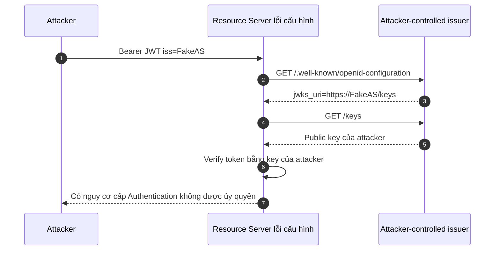

# Không discovery tùy ý từ URL hoặc issuer do token cung cấp

Trong một hệ thống **Spring Security OAuth 2.0 / OIDC Resource Server** phục vụ **nhiều tenant**, không phải mọi access token đều do cùng một Authorization Server phát hành. Tenant A có thể dùng issuer `https://id-a.example.com/realms/a`, tenant B dùng `https://id-b.example.com/realms/b`; thậm chí các tenant có thể thuộc hai tổ chức quản lý danh tính khác nhau. Resource Server cần **chọn đúng cơ chế xác minh cho từng token**, nhưng tuyệt đối không được đồng nghĩa “chọn issuer” với “tin bất kỳ URL do token đưa ra”.

Một cách cài đặt có vẻ thuận tiện nhưng nguy hiểm:

```text
Nhận JWT chưa xác minh
    → đọc claim iss hoặc header jku
    → tự động GET metadata tại issuer bất kỳ
    → tải jwks_uri trong metadata
    → dùng public key vừa tải để xác minh JWT
    → chấp nhận người gọi
```

Nếu kẻ tấn công có thể tự chọn issuer và tự điều hành JWKS, họ có thể **tự ký JWT** rồi khiến Resource Server tải khóa do chính họ công bố. Ngoài nguy cơ chấp nhận token giả, việc gửi các HTTP request ra URL chưa được phê duyệt còn tạo nguy cơ **SSRF (Server-Side Request Forgery)**, truy vấn mạng nội bộ, rò thông tin và làm cạn tài nguyên.

**Nguyên tắc quan trọng nhất:** dữ liệu do token chưa xác minh cung cấp, kể cả `iss`, `kid`, `jku`, `x5u`, `tid`, tenant path hay hostname trong header, **không có quyền mở rộng danh sách issuer/JWKS được tin cậy**. Resource Server có thể đọc một phần dữ liệu đó như **gợi ý định tuyến vào danh sách cấu hình đã tin**, nhưng manager/decoder được chọn **phải xác minh chữ ký, issuer chính xác, audience và các ràng buộc token trước khi authentication thành công**.

Bài học này thuộc chương **Nhiều tenant**, tập trung vào ranh giới tin cậy của **metadata discovery và key retrieval** khi xây multi-tenant JWT Resource Server, đồng thời chỉ ra cách xử lý token opaque, mapping tenant, vận hành và kiểm thử an toàn.

> **Ngữ cảnh minh họa:** Orders API tại `https://api.example.com` nhận JWT access token dành cho audience `orders-api`. Tenant `acme` tin issuer `https://id.acme.example/realms/orders`; tenant `beta` tin issuer `https://identity.beta.example/tenant/orders`. Ứng dụng sử dụng Spring Boot 3.x / Spring Security 6.x; ví dụ Servlet là chính, phần riêng trình bày WebFlux. Tên host, khóa và token chỉ để học; khi áp dụng phải đối chiếu API chính xác của phiên bản Spring Security đang chạy.

## 1. Vì sao nhiều tenant khiến metadata discovery trở thành một quyết định bảo mật?

Với một issuer duy nhất, cấu hình có thể rõ ràng:

```yaml
spring:
  security:
    oauth2:
      resourceserver:
        jwt:
          issuer-uri: https://id.acme.example/realms/orders
          audiences:
            - orders-api
```

Resource Server biết issuer từ **cấu hình do người vận hành kiểm soát**. Khi cần khám phá metadata hoặc JWKS, nó chỉ làm việc với nguồn đã được định nghĩa.

Với nhiều tenant, API có thể nhận:

```text
Request A: JWT iss = https://id.acme.example/realms/orders
Request B: JWT iss = https://identity.beta.example/tenant/orders
Request C: JWT iss = https://attacker-controlled.invalid/issuer
```

Nếu lập trình viên muốn “tự động hỗ trợ mọi tenant” bằng cách tạo decoder từ từng `iss` xuất hiện, request C có thể kích hoạt request mạng đến host do kẻ tấn công chọn. Việc kẻ tấn công **tự cung cấp** một issuer không biến issuer ấy thành nguồn tin cậy.

### 1.1. Phân biệt tenant, issuer và audience

| Thuộc tính | Ví dụ | Ý nghĩa |
|---|---|---|
| **Tenant ID của ứng dụng** | `acme` | Ranh giới dữ liệu/nghiệp vụ tại Orders API |
| **Issuer** (`iss`) | `https://id.acme.example/realms/orders` | Danh tính Authorization Server phát hành token |
| **Audience** (`aud`) | `orders-api` | Token được dự định dùng tại Resource Server nào |
| **OAuth client** (`client_id`/`azp` theo hợp đồng) | `acme-portal` | Ứng dụng đã xin/nhận token hoặc authorized party |
| **Subject** (`sub`) | `user-42` | Danh tính user/workload trong phạm vi issuer |
| **JWK key ID** (`kid`) | `key-2026-11` | Gợi ý chọn public key trong tập đã tin |
| **Key set URL** (`jwks_uri`) | `https://id.acme.example/keys` | Endpoint công bố public keys |
| **Tenant hint của request** | `/tenants/acme/orders` | Dữ liệu định tuyến từ caller, chưa phải quyền |

**Một issuer có thể phục vụ nhiều tenant**, và một tenant ứng dụng cũng có thể được chuyển từ issuer cũ sang issuer mới. Không thiết lập quan hệ tenant–issuer bằng phép so sánh chuỗi hostname hời hợt. Cần một **registry/hợp đồng** được người quản trị hoặc hệ thống onboarding đáng tin phê duyệt.

### 1.2. Ba câu hỏi độc lập phải có câu trả lời

Để xử lý `GET /tenants/acme/orders/42`, Resource Server cần:

1. **Tin token của issuer nào?** Chỉ những issuer nằm trong registry được cấp phép.
2. **Token có hợp lệ và dành cho Orders API không?** Kiểm tra chữ ký, `iss`, `exp`, `nbf`, `aud`, thuật toán, token type/profile.
3. **Actor có được truy cập tenant acme và order 42 không?** Kiểm tra mapping tenant, scope, subject/client, ownership và business policy.

Xác minh câu 1 hoặc câu 2 **không tự trả lời câu 3**.

## 2. Vì sao claim iss bên trong JWT chưa đáng tin?

Compact JWT có dạng:

```text
BASE64URL(protected-header).BASE64URL(payload).BASE64URL(signature)
```

Payload có thể chứa:

```json
{
  "iss": "https://id.acme.example/realms/orders",
  "sub": "user-42",
  "aud": ["orders-api"],
  "scope": "orders.read",
  "tenant_id": "acme",
  "exp": 2000000000
}
```

Bất kỳ ai cũng có thể **Base64URL-decode payload**, cũng như tạo một JWT mới chứa chính các trường này. Chỉ khi chữ ký và claims được kiểm tra bởi decoder dùng **khóa của một issuer đã tin cậy** thì dữ liệu token mới được dùng để xác thực và phân quyền.

### 2.1. Đọc để định tuyến không phải đọc để tin

Trong hệ thống nhiều issuer, có lúc Resource Server cần đọc `iss` **trước** khi xác minh chữ ký để biết **manager nào sẽ kiểm tra chữ ký**. Đây là tình huống hợp lệ khi có điều kiện:

```text
Unverified JWT iss
        |
        v
Lookup trong registry issuer đã được phê duyệt
        |
        +-- Không có -> REJECT; KHÔNG discovery
        |
        +-- Có -> Chọn manager/decoder đã cấu hình
                      |
                      v
                 Verify signature
                 Verify exact iss
                 Verify audience/time/algorithm/profile
                      |
                      v
                 Authentication hợp lệ
```

Điểm khác biệt quyết định: giá trị `iss` chưa verified chỉ được dùng làm **index vào một allowlist hữu hạn**, không được dùng tạo một URL internet mới mà Resource Server sẽ tự tin.

### 2.2. JWT header cũng chưa đáng tin

Ví dụ:

```json
{
  "alg": "RS256",
  "kid": "key-a",
  "jku": "https://untrusted.example/keys.json"
}
```

- `alg` do token khai báo; decoder phải có allowlist thuật toán của **issuer đã tin**.
- `kid` chỉ gợi ý chọn key trong JWKS đáng tin; nó **không phải chứng cứ xác minh** và không nên được đưa thẳng thành URL/path.
- `jku` có thể gợi ý vị trí JWK Set, nhưng **không được tự động fetch URL trong JWT chưa xác minh**.
- `x5u` hoặc URL chứa certificate cũng không được dùng làm trust source tùy ý.

**Token header và payload đều là input không tin cậy cho đến khi signature/validation hoàn tất.**

## 3. Mối đe dọa 1: tự chấp nhận JWT do attacker phát hành

Giả sử Resource Server xử lý:

```text
Token payload:
  iss = https://issuer.attacker.example
  aud = orders-api
  scope = orders.read orders.admin

Token header:
  kid = attacker-key
```

Kẻ tấn công có thể:

1. Tạo private/public key pair riêng.
2. Công bố metadata `issuer=https://issuer.attacker.example` và `jwks_uri` chứa public key của họ.
3. Ký JWT bằng private key họ giữ.
4. Gửi Bearer token tới Orders API.

Nếu Orders API quyết định **“issuer nào token nói thì tự tìm và tin issuer ấy”**, chữ ký có thể xác minh được — **nhưng chỉ vì hệ thống đã tự tin khóa của kẻ tấn công**.



**Vấn đề không nằm ở thuật toán chữ ký bị phá**, mà ở **lựa chọn nguồn khóa tin cậy** không được giới hạn.

### 3.1. Signature hợp lệ không đồng nghĩa issuer được tin

Một JWT hoàn toàn có thể được ký đúng bằng private key của một issuer mà Orders API **không được phép tin**. Signature chỉ chứng minh token được ký bởi khóa tương ứng, chứ không chứng minh issuer đó thuộc tập trust anchors của API.

Tính hợp lệ cần:

```text
Trusted issuer
AND trusted JWKS/key source for that issuer
AND valid signature
AND allowed algorithm and token profile
AND matching issuer claim
AND correct audience
AND valid timestamps
AND required token claims
```

Một bước thiếu có thể khiến authentication sai hoặc token bị sử dụng nhầm resource.

## 4. Mối đe dọa 2: SSRF từ issuer discovery

**SSRF** xảy ra khi ứng dụng chủ động gửi HTTP request tới một địa chỉ do người không đáng tin ảnh hưởng, qua đó có thể truy cập tài nguyên mạng mà attacker không thể kết nối trực tiếp.

Ví dụ một token giả khai:

```json
{
  "iss": "http://169.254.169.254/latest/meta-data"
}
```

Nếu application tự tạo discovery URL từ issuer bất kỳ, nó có nguy cơ thử truy cập địa chỉ link-local hoặc dịch vụ nội bộ. Không phải mọi URL như trên đều đúng chuẩn metadata của issuer; **điểm rủi ro là server vẫn bị ép mở kết nối ngoài phạm vi cho phép**.

Các mục tiêu SSRF có thể gồm:

- Metadata service của hạ tầng cloud.
- Service chỉ listen trên `localhost` hoặc mạng nội bộ.
- Control plane, admin API hoặc database HTTP endpoint.
- Host nội bộ không public.
- Proxy/redirect chain chuyển tới địa chỉ riêng.
- Các endpoint có side effects hoặc trả thông tin nhạy cảm.

### 4.1. Không chỉ issuer; jwks_uri cũng có thể thành SSRF

Giả sử discovery JSON trả:

```json
{
  "issuer": "https://issuer.example",
  "jwks_uri": "http://127.0.0.1:8080/internal/admin"
}
```

Ngay cả khi issuer nằm trong allowlist, metadata có thể bị cấu hình sai hoặc nguồn cung cấp khóa bị thay đổi ngoài dự kiến. Resource Server cần **kiểm soát `jwks_uri` và egress policy** theo trust contract.

Không nhất thiết JWKS phải cùng hostname với issuer; có provider dùng CDN/host chuyên cung cấp khóa. Nhưng các host khác nhau **phải được phê duyệt rõ ràng**, và metadata phải đến từ issuer đã cấu hình qua kết nối xác thực.

### 4.2. Redirect, DNS và IP cũng là phần của SSRF

Một URL ban đầu hợp lệ có thể trả `302 Location` tới host khác; DNS có thể resolve tới private IP hoặc thay đổi sau bước kiểm tra. Vì thế:

- Không follow redirect tùy ý từ discovery/JWKS HTTP client.
- Giới hạn scheme `https`, hostname và port theo policy.
- Cấu hình egress/network policy để không truy cập arbitrary internal destinations.
- Xem xét DNS rebinding và IP/routing nếu cho onboarding issuer từ bên ngoài.
- Không tin mỗi regex domain hoặc phép kiểm URL string để thay network segmentation.
- Đặt timeout, giới hạn response size và redirect count.

**Kiểm tra URL đầu vào là cần thiết nhưng không đủ.** Mô hình an toàn hơn là **không nhận issuer URL mới từ request**, dùng registry được phê duyệt và mạng outbound chỉ tới những endpoints có thẩm quyền.

## 5. OIDC Discovery, OAuth metadata và JWKS

Một issuer đã tin cậy có thể công bố metadata:

```json
{
  "issuer": "https://id.acme.example/realms/orders",
  "jwks_uri": "https://id.acme.example/realms/orders/keys",
  "authorization_endpoint": "https://id.acme.example/realms/orders/authorize",
  "token_endpoint": "https://id.acme.example/realms/orders/token"
}
```

Với JWT Resource Server, hai thông tin cốt lõi là:

- `issuer`: phải khớp **exact trusted issuer** theo hợp đồng.
- `jwks_uri`: địa chỉ công bố **public keys** phục vụ xác minh JWS.

### 5.1. Metadata chỉ có giá trị khi được lấy từ trust anchor phù hợp

Trust chain hợp lý:

```text
Operator/config registry chấp nhận issuer X
               |
               v
Resource Server tìm metadata của X qua HTTPS đáng tin
               |
               v
Metadata issuer == X theo contract
               |
               v
jwks_uri được phê duyệt/kiểm soát
               |
               v
Public keys từ JWKS của X
               |
               v
Xác minh JWT iss=X, aud=orders-api
```

Chain sai:

```text
JWT tự khai iss=X
       |
       v
Resource Server tự chấp nhận X là trust anchor
       |
       v
Metadata/JWKS của X được tin vô điều kiện
```

### 5.2. Đường well-known không phải phép nối URL tùy ý

**OpenID Connect Discovery** sử dụng well-known metadata `openid-configuration`; **RFC 8414** mô tả `oauth-authorization-server` với quy tắc URI có thể khác khi issuer có path.

Ví dụ issuer:

```text
https://id.acme.example/realms/orders
```

Một provider OIDC có thể phục vụ:

```text
https://id.acme.example/realms/orders/.well-known/openid-configuration
```

Còn quy tắc OAuth Authorization Server Metadata (RFC 8414) có thể áp dụng dạng:

```text
https://id.acme.example/.well-known/oauth-authorization-server/realms/orders
```

Spring Security dùng các endpoint/procedures phù hợp phiên bản và provider. Không tự nối `/keys` hoặc `/.well-known/...` theo input tùy ý từ token. Khi triển khai multi-tenant, tốt nhất metadata discovery phải bắt đầu **từ issuer cụ thể đã được trust**, không phải từ một URL do caller nhập.

### 5.3. JWKS không phải bộ khóa mật

Một JWKS chứa public keys:

```json
{
  "keys": [
    {
      "kty": "RSA",
      "kid": "acme-key-2026",
      "use": "sig",
      "alg": "RS256",
      "n": "PUBLIC_RSA_MODULUS_EXAMPLE",
      "e": "AQAB"
    }
  ]
}
```

`n` trong ví dụ là placeholder không phải RSA key thực. Private key phải ở Authorization Server/HSM/KMS; nó không được đưa vào JWKS.

Dù public keys được công khai, **nguồn công bố và tính toàn vẹn của JWKS** phải đáng tin. Nếu attacker thay public key mà decoder sử dụng, attacker có thể ký token bằng key tương ứng.

## 6. Bảy bất biến bảo mật của multi-tenant Resource Server

Có thể định nghĩa những bất biến cho mọi request:

1. **Issuer trust set hữu hạn:** chỉ các issuer có trong registry đã được phê duyệt mới được xét.
2. **Không discovery tùy ý:** token chưa verify không được kích hoạt HTTP GET tới issuer/JWKS URL ngoài registry.
3. **Issuer exact match:** decoder/validator xác nhận `iss` đúng issuer đã chọn; không chỉ “cùng domain”.
4. **Key source có ranh giới:** JWKS được lấy từ URI thuộc issuer configuration hoặc metadata tin cậy, không từ `jku`/`x5u` tự khai.
5. **Audience và token profile:** token phải dành cho Orders API, không chỉ do issuer hợp lệ ký.
6. **Tenant binding:** tenant nghiệp vụ của request phải phù hợp actor/tenant claims đã xác minh theo registry và domain policy.
7. **Fail closed:** không được bỏ chữ ký, issuer hoặc tenant validation khi key/metadata không truy cập được.

Một chính sách cho đơn hàng có thể viết:

```text
ALLOW(request, token, order) =
    trustedIssuer(token.iss)
AND validSignature(token, trustedIssuerKeySet)
AND token.iss == selectedIssuer
AND token.aud contains "orders-api"
AND tokenTimeAndProfileValid
AND token.scope contains "orders.read"
AND authorizedTenantBinding(request.tenant, actor, token)
AND order.tenant == authorizedTenant
AND actorCanReadThisOrder(actor, order)
```

Đây là biểu thức **khái niệm**, không phải API cụ thể trong Spring Security. Nhưng nó thể hiện những ràng buộc độc lập mà chương trình cần thực thi.

## 7. Registry tin cậy: nguồn quyết định issuer nào được chấp nhận

Thay vì:

```java
// KHÔNG DÙNG: issuer do JWT tự khai không phải trust anchor.
JwtDecoder decoder =
    JwtDecoders.fromIssuerLocation(unverifiedIssuerFromToken);
```

hãy có một danh sách cấu hình do **người vận hành/administrative workflow** kiểm soát:

```yaml
orders:
  security:
    tenants:
      acme:
        issuer: https://id.acme.example/realms/orders
        jwks-uri: https://id.acme.example/realms/orders/keys
        audience: orders-api
      beta:
        issuer: https://identity.beta.example/tenant/orders
        jwks-uri: https://identity.beta.example/tenant/orders/keys
        audience: orders-api
```

Đây là **cấu hình ứng dụng minh họa**, không phải property chuẩn tự động được Spring Boot bind vào decoder. Muốn dùng phải khai báo `@ConfigurationProperties` hoặc cách đọc cấu hình tương ứng và tạo managers/decoders theo dữ liệu đã kiểm tra.

### 7.1. Mỗi entry phải có những gì?

| Trường | Quy định |
|---|---|
| `tenantId` | ID nội bộ duy nhất, không phụ thuộc hostname do caller tự khai |
| `issuer` | Issuer URI exact đã được phê duyệt, scheme HTTPS |
| `jwksUri` | JWKS URL được phê duyệt hoặc chỉ lấy từ metadata đáng tin |
| `allowedAlgorithms` | Ví dụ RS256 theo hợp đồng, không lấy từ token |
| `audiences` | Audience/resource values mà API chấp nhận |
| `tokenProfile` | Quy tắc cho OAuth access token, ví dụ RFC 9068 nếu áp dụng |
| `allowedClients` | OAuth client allowlist nếu nghiệp vụ yêu cầu |
| `tenantBinding` | Quan hệ giữa issuer/claim tenant và tenant nội bộ |
| `status` | ACTIVE/SUSPENDED/REVOKED theo quy trình quản trị |
| `updatedAt`/version | Phục vụ audit và cập nhật cấu hình có kiểm soát |

Một registry không nên chỉ có “issuer string” rồi ngầm cấp mọi quyền. Muốn hỗ trợ nhiều tenant an toàn, cần một **policy bundle rõ ràng**.

### 7.2. Không dựa vào prefix/suffix của issuer

Ví dụ anti-pattern:

```java
// CỐ Ý SAI: kiểm tra hostname/issuer bằng substring.
if (issuer.contains("example.com")) {
    trust(issuer);
}
```

Những issuer sau không tương đương:

```text
https://id.example.com/tenant-a
https://id.example.com/tenant-b
https://id.example.com.evil.invalid/tenant-a
https://evil.example.com/tenant-a
http://id.example.com/tenant-a
```

Ngay cả một tên miền dưới `example.com` cũng không tự được phép nếu không nằm trong registry. Cần kiểm tra **exact canonical URI** theo contract và không tự sửa tenant/realm paths.

### 7.3. “Chuẩn hóa URL” không được làm mất danh tính issuer

Nhiều người muốn gọi:

```java
issuer.toLowerCase().replaceAll("/+$", "")
```

rồi so sánh. Cách làm này có thể sửa path có ý nghĩa hoặc thay đổi issuer string mà JWT/metadata công bố.

Nên:

- Định nghĩa một issuer value canonical trong registry và dùng **đúng value đó** cho validator.
- Xử lý trailing slash, path và case theo contract của AS, không suy luận tùy tiện.
- Dùng URI parser để kiểm tra scheme/host khi **onboarding**, nhưng đừng thay so khớp exact issuer claim bằng fuzzy comparison.
- Từ chối các URL có user-info, fragment hoặc cấu trúc không được cho phép trong chính sách.
- Không cho request tạo alias issuer mới bằng encoding/Unicode/mixed-case tricks.

## 8. Phương án an toàn đơn giản nhất: danh sách issuer cố định

Nếu các issuer được biết khi deploy, Spring Security cung cấp một cơ chế multi-issuer được thiết kế cho tình huống này: **`JwtIssuerAuthenticationManagerResolver`** ở Servlet stack.

Ý tưởng:

```text
Unverified iss chỉ để chọn
    |
    +-- Trusted issuer A -> Manager A -> Verify with A's keys + validators
    +-- Trusted issuer B -> Manager B -> Verify with B's keys + validators
    +-- Other issuer     -> REJECT; không tự tạo manager
```

### 8.1. Ví dụ Spring Security Servlet với trusted issuers

```java
package com.example.orders.security;

import jakarta.servlet.http.HttpServletRequest;
import org.springframework.context.annotation.Bean;
import org.springframework.context.annotation.Configuration;
import org.springframework.security.authentication.AuthenticationManagerResolver;
import org.springframework.security.config.annotation.web.builders.HttpSecurity;
import org.springframework.security.config.http.SessionCreationPolicy;
import org.springframework.security.oauth2.server.resource.authentication.JwtIssuerAuthenticationManagerResolver;
import org.springframework.security.web.SecurityFilterChain;

@Configuration
public class TrustedIssuerResourceServerSecurity {

    private static final String ACME_ISSUER =
        "https://id.acme.example/realms/orders";

    private static final String BETA_ISSUER =
        "https://identity.beta.example/tenant/orders";

    @Bean
    AuthenticationManagerResolver<HttpServletRequest> issuerResolver() {
        return JwtIssuerAuthenticationManagerResolver
            .fromTrustedIssuers(
                ACME_ISSUER,
                BETA_ISSUER
            );
    }

    @Bean
    SecurityFilterChain apiSecurity(
            HttpSecurity http,
            AuthenticationManagerResolver<HttpServletRequest>
                issuerResolver) throws Exception {

        return http
            .securityMatcher("/api/**")
            .authorizeHttpRequests(auth -> auth
                .requestMatchers("/api/public/**").permitAll()
                .anyRequest().authenticated()
            )
            .sessionManagement(session ->
                session.sessionCreationPolicy(
                    SessionCreationPolicy.STATELESS
                )
            )
            .oauth2ResourceServer(oauth2 -> oauth2
                .authenticationManagerResolver(issuerResolver)
            )
            .build();
    }
}
```

Đây là ví dụ cho các phiên bản Spring Security có API `fromTrustedIssuers(...)` tương ứng. Một số bản cung cấp constructor hoặc biến thể overload khác; cần đối chiếu Javadoc phiên bản sử dụng khi tích hợp.

**Điểm cốt lõi:** danh sách trusted issuers được truyền từ cấu hình/server code, **không phải lấy từ JWT do request vừa gửi**.

### 8.2. Hành vi nào được kỳ vọng?

- Token có `iss=ACME_ISSUER`: resolver có thể chọn manager của Acme, sau đó decoder xác minh chữ ký và issuer.
- Token có `iss=BETA_ISSUER`: resolver có thể chọn manager của Beta.
- Token có `iss=https://random.example`: không được tạo một manager tự động cho issuer này.
- Token khai issuer A nhưng ký bằng key của B: manager A **không** chấp nhận chữ ký chỉ vì B cũng thuộc registry.
- Token ký đúng nhưng audience sai: phải bị từ chối khi audience validator đã được gắn.

**Lưu ý về audience:** cách cấu hình trusted issuer mặc định có thể cung cấp issuer/signature/time validation, nhưng **không tự suy ra mọi audience và tenant policy riêng của Orders API**. Khi cần ràng buộc audience hoặc thuật toán theo từng issuer, sử dụng phương án manager/decoder cấu hình tường minh ở phần tiếp theo.

### 8.3. Discovery chỉ diễn ra cho nguồn đã được cho phép

Tùy implementation, manager có thể được tạo một cách lazy khi lần đầu thấy token của issuer A/B. “Lazy discovery” **không phải lỗi bảo mật** khi trust set đã cố định và decoder vẫn xác minh token.

Điểm quan trọng không phải “có HTTP discovery hay không”, mà là **“ai được quyền quyết định một issuer trở thành nguồn discovery?”**. Với trusted allowlist, câu trả lời là người vận hành/registry được kiểm soát, không phải caller.

## 9. Manager riêng cho từng issuer để ràng buộc audience, algorithm và JWKS

Khi chính sách yêu cầu chặt hơn, có thể cấu hình một `AuthenticationManager` riêng cho mỗi issuer từ **JWKS URI đã được phê duyệt**, không cần tự discovery từ token.

### 9.1. Ví dụ khởi tạo hai manager có validators

```java
package com.example.orders.security;

import java.util.List;
import java.util.Map;

import jakarta.servlet.http.HttpServletRequest;

import org.springframework.context.annotation.Bean;
import org.springframework.context.annotation.Configuration;
import org.springframework.security.authentication.AuthenticationManager;
import org.springframework.security.authentication.AuthenticationManagerResolver;
import org.springframework.security.oauth2.core.DelegatingOAuth2TokenValidator;
import org.springframework.security.oauth2.core.OAuth2Error;
import org.springframework.security.oauth2.core.OAuth2TokenValidator;
import org.springframework.security.oauth2.core.OAuth2TokenValidatorResult;
import org.springframework.security.oauth2.jose.jws.SignatureAlgorithm;
import org.springframework.security.oauth2.jwt.Jwt;
import org.springframework.security.oauth2.jwt.JwtValidators;
import org.springframework.security.oauth2.jwt.NimbusJwtDecoder;
import org.springframework.security.oauth2.server.resource.authentication.JwtAuthenticationProvider;
import org.springframework.security.oauth2.server.resource.authentication.JwtIssuerAuthenticationManagerResolver;

@Configuration
public class PerIssuerManagerConfiguration {

    private static final String ACME =
        "https://id.acme.example/realms/orders";

    private static final String BETA =
        "https://identity.beta.example/tenant/orders";

    @Bean
    AuthenticationManagerResolver<HttpServletRequest>
            perIssuerAuthenticationManagerResolver() {

        Map<String, AuthenticationManager> managers = Map.of(
            ACME,
            managerFor(
                ACME,
                "https://id.acme.example/realms/orders/keys",
                "orders-api"
            ),
            BETA,
            managerFor(
                BETA,
                "https://identity.beta.example/tenant/orders/keys",
                "orders-api"
            )
        );

        // Resolver đọc issuer như hint nhưng CHỈ chọn manager
        // đã có sẵn trong registry; không tạo manager từ URL lạ.
        return new JwtIssuerAuthenticationManagerResolver(
            managers::get
        );
    }

    private static AuthenticationManager managerFor(
            String issuer,
            String jwksUri,
            String audience) {

        NimbusJwtDecoder decoder =
            NimbusJwtDecoder.withJwkSetUri(jwksUri)
                .jwsAlgorithm(SignatureAlgorithm.RS256)
                .build();

        OAuth2TokenValidator<Jwt> issuerAndTime =
            JwtValidators.createDefaultWithIssuer(issuer);

        OAuth2TokenValidator<Jwt> audienceRule = jwt -> {
            if (jwt.getAudience() != null
                    && jwt.getAudience().contains(audience)) {
                return OAuth2TokenValidatorResult.success();
            }
            return OAuth2TokenValidatorResult.failure(
                new OAuth2Error(
                    "invalid_token",
                    "Required audience is missing",
                    null
                )
            );
        };

        decoder.setJwtValidator(
            new DelegatingOAuth2TokenValidator<>(
                List.of(issuerAndTime, audienceRule)
            )
        );

        JwtAuthenticationProvider provider =
            new JwtAuthenticationProvider(decoder);

        return provider::authenticate;
    }
}
```

**Cách dùng:** gắn bean `perIssuerAuthenticationManagerResolver` này vào `oauth2ResourceServer(...authenticationManagerResolver(...))` trong `SecurityFilterChain`, thay cho resolver bean ở phần 8. Đây là **hai phương án thay thế**, không đăng ký cùng lúc hai bean `AuthenticationManagerResolver<HttpServletRequest>` mà không chỉ định qualifier/lựa chọn rõ.

### 9.2. Điều gì khiến phương án này an toàn hơn một lời gọi discovery động?

- Map `managers` có hai issuer **hữu hạn**.
- Mỗi issuer gắn với một `jwksUri` **do ứng dụng cấu hình**, không tự động lấy từ payload.
- Decoder xác minh JWT bằng khóa ở đúng JWKS.
- Issuer validator vẫn kiểm tra `iss` sau signature.
- Audience validator xác nhận `orders-api`.
- `jwsAlgorithm(RS256)` giới hạn thuật toán đã đồng thuận; nếu issuer dùng thuật toán khác, chính sách phải được cập nhật riêng.
- Không có manager cho issuer ngoài map nên resolver không có đối tượng nào để dùng xác thực token đó.

### 9.3. Vì sao phải giữ issuer validation dù đã map theo iss?

Vì `iss` đọc để chọn map là **unverified hint**. Nếu chỉ chọn manager dựa trên hint rồi verify bằng một tập key dùng chung mà không kiểm tra exact issuer, có thể nhận token được phát hành cho realm/tenant khác.

Ví dụ một issuer có thể reuse public keys giữa nhiều realms. Signature đúng không chứng minh token đến từ realm được chọn nếu không kiểm tra `iss`. Vì vậy manager đã chọn phải gắn với **exact issuer validator**.

### 9.4. Cần chú ý token profile

Một access token theo RFC 9068 có thể yêu cầu kiểm tra `typ=at+jwt` và các claims profile cụ thể. Mẫu code trên minh họa issuer/audience/time/algorithm, **chưa trình bày một validator RFC 9068 hoàn chỉnh**. Nếu hợp đồng yêu cầu profile, phải thêm validator tương ứng, không chấp nhận ID token chỉ vì cùng JWKS.

## 10. Trường hợp một issuer phục vụ nhiều tenant

Không phải lúc nào nhiều tenant cũng tương ứng nhiều issuer. Ví dụ:

```text
Acme tenant  ----+
                 +--> Shared issuer: https://login.example.com
Beta tenant  ----+
```

Lúc này issuer có thể là một nguồn tin cậy duy nhất. Tenant nằm ở claims hoặc dữ liệu nghiệp vụ đã được Authorization Server xác nhận, chẳng hạn `tenant_id`, `organization_id`, `realm_access` theo provider contract.

Một JWT:

```json
{
  "iss": "https://login.example.com",
  "sub": "user-42",
  "aud": ["orders-api"],
  "tenant_id": "acme",
  "scope": "orders.read"
}
```

Khi request đi vào `/tenants/beta/orders/42`, token **không được** xem là thuộc Beta chỉ vì path nói `beta`. Service cần đối chiếu tenant claim (nếu được tin cậy) và membership/authorization policy.

### 10.1. Tenant hint trong path không phải identity

```http
GET /tenants/beta/orders/42 HTTP/1.1
Authorization: Bearer JWT_FOR_ACME
```

`beta` trong URL là **resource selector**, không phải bằng chứng quyền. Authentication có thể hợp lệ với issuer chung, nhưng authorization phải từ chối khi actor không có quyền trên Beta.

### 10.2. Nếu user thuộc nhiều tenant thì sao?

Một người dùng có thể là thành viên của Acme và Beta. Lúc đó:

- Token có thể có tenant context cụ thể hoặc danh sách organizations.
- API phải xác định **tenant hiện tại** theo workflow được phê duyệt.
- Nếu request yêu cầu thao tác trong Beta, cần kiểm tra membership và quyền Beta từ nguồn tin cậy.
- Không suy ra toàn bộ quyền từ `sub`/email chung.
- Không cho token của Acme đọc đơn Beta vì người dùng cùng email trên hai tenant.

**Một issuer dùng chung không làm cho multi-tenant authorization biến mất.** Nó chỉ giảm bài toán multi-issuer decoder.

## 11. Trường hợp nhiều issuer cho cùng một tenant

Một tenant có thể chuyển identity provider từ IdP cũ sang mới:

```text
Tenant acme
  |
  +-- issuer-old: https://legacy-id.example/acme
  +-- issuer-new: https://new-id.example/acme
```

Đây là một quyết định quản trị có thời gian chuyển đổi, không phải giấy phép chấp nhận mọi issuer do user khai.

Trong registry cần:

- Cả hai issuer được phê duyệt rõ ràng cho tenant Acme trong giai đoạn migration.
- Audience và client authorization của mỗi issuer được kiểm tra riêng.
- Subject mapping có chiến lược tránh collision `(iss, sub)`.
- Tài khoản ở hai issuer cần được liên kết bằng quy trình đáng tin (không dựa vào email tự khai).
- Có mốc dừng chấp nhận issuer cũ.
- Có audit và rollback phù hợp.

Không tự suy ra rằng hai token cùng email hoặc cùng `sub` nhưng khác `iss` là cùng danh tính.

## 12. Định tuyến theo tenant hint: kiểm tra ràng buộc hai chiều

Có thể dùng hostname/subdomain/path để xác định tenant **mong muốn**, ví dụ:

```text
https://acme.api.example.com/orders/42
https://api.example.com/tenants/beta/orders/42
```

Nhưng đây vẫn là dữ liệu do caller điều khiển. Nếu dùng nó để chọn manager:

1. Chỉ chấp nhận tenant ID nằm trong registry đã biết.
2. Map tenant ID → tập issuer được phép dùng cho tenant đó.
3. Chọn decoder có nguồn khóa được phê duyệt.
4. Xác minh JWT signature, issuer, audience, timestamps.
5. Đối chiếu tenant claim/membership với tenant route.
6. Kiểm tra quyền tài nguyên.

### 12.1. Ma trận quyết định

| Tenant route | Issuer đã verify | Tenant claim/membership | Kết quả |
|---|---|---|---|
| Acme | Acme issuer | Thuộc Acme | Có thể tiếp tục scope/object policy |
| Acme | Beta issuer | Chỉ thuộc Beta | Từ chối |
| Beta | Acme issuer | Chỉ thuộc Acme | Từ chối |
| Acme | Issuer lạ | Bất kỳ | Từ chối từ authentication |
| Unknown tenant | Issuer hợp lệ | Bất kỳ | Từ chối tenant routing |
| Acme | Issuer chung được phê duyệt | Có membership Acme | Có thể tiếp tục policy |
| Beta | Issuer chung được phê duyệt | Không có membership Beta | Từ chối |

Không nên coi “issuer được chấp nhận ở toàn hệ thống” đồng nghĩa “issuer ấy có quyền với mọi tenant”. Quan hệ **allowed issuer per tenant** là một phần của trust policy.

## 13. Vì sao HTTP header Host không đủ để chọn issuer tin cậy?

Một số hệ thống phân tenant bằng subdomain:

```http
Host: acme.api.example.com
```

Đây có thể là một route hint hợp lệ ở reverse proxy đáng tin. Nhưng nếu backend trực tiếp đọc `Host` hoặc `X-Forwarded-Host` chưa được kiểm soát để tạo issuer URL, có rủi ro host-header injection.

Ví dụ không an toàn:

```java
// CỐ Ý SAI: request Host không xác lập issuer trust.
String issuer = "https://" + request.getHeader("Host") + "/issuer";
JwtDecoder decoder = JwtDecoders.fromIssuerLocation(issuer);
```

Bảo vệ cần:

- Ingress/proxy xác định allowed hosts và định tuyến đúng tenant.
- Backend chỉ tin forwarded headers từ **trusted proxy**, không từ Internet.
- Tenant ID lấy từ route vẫn phải lookup trong **trusted registry**, không dùng để ghép URL tùy ý.
- JWT issuer và audience phải được xác minh sau khi chọn route.
- Service đối chiếu quyền trên tenant cụ thể.

## 14. WebFlux Resource Server: cùng nguyên tắc, thành phần reactive

Trong **Spring WebFlux**, thành phần tương ứng khác Servlet:

| Servlet | WebFlux |
|---|---|
| `SecurityFilterChain` | `SecurityWebFilterChain` |
| `HttpSecurity` | `ServerHttpSecurity` |
| `JwtDecoder` | `ReactiveJwtDecoder` |
| `AuthenticationManager` | `ReactiveAuthenticationManager` |
| `JwtIssuerAuthenticationManagerResolver` | `JwtIssuerReactiveAuthenticationManagerResolver` trong các phiên bản hỗ trợ |
| `AuthenticationManagerResolver<HttpServletRequest>` | Resolver reactive cho `ServerWebExchange` |
| `SecurityContextHolder` | `ReactiveSecurityContextHolder` |

### 14.1. Trusted issuer resolver trong WebFlux

Một ví dụ theo API Spring Security reactive ở phiên bản hỗ trợ trusted issuers:

```java
package com.example.orders.security;

import org.springframework.context.annotation.Bean;
import org.springframework.context.annotation.Configuration;
import org.springframework.security.config.web.server.ServerHttpSecurity;
import org.springframework.security.oauth2.server.resource.authentication.JwtIssuerReactiveAuthenticationManagerResolver;
import org.springframework.security.web.server.SecurityWebFilterChain;

@Configuration
public class ReactiveTrustedIssuerSecurity {

    @Bean
    SecurityWebFilterChain ordersApi(ServerHttpSecurity http) {

        var resolver =
            JwtIssuerReactiveAuthenticationManagerResolver
                .fromTrustedIssuers(
                    "https://id.acme.example/realms/orders",
                    "https://identity.beta.example/tenant/orders"
                );

        return http
            .authorizeExchange(exchanges -> exchanges
                .pathMatchers("/api/public/**").permitAll()
                .anyExchange().authenticated()
            )
            .oauth2ResourceServer(oauth2 -> oauth2
                .authenticationManagerResolver(resolver)
            )
            .build();
    }
}
```

Tùy phiên bản Spring Security, tên overload/constructor có thể thay đổi; tra Javadoc tương ứng. **Không đổi danh sách issuer này thành dữ liệu được tính trực tiếp từ JWT hoặc header của request**.

### 14.2. Không dùng blocking discovery trong event loop

Một cách tự viết không phù hợp:

```java
// KHÔNG DÙNG: blocking và tin issuer URL do caller khai.
Mono<Authentication> authenticate(String unverifiedIssuer) {
    JwtDecoder decoder =
        JwtDecoders.fromIssuerLocation(unverifiedIssuer);
    // Tạo decoder và discovery network tùy ý trong reactive path.
    return Mono.empty();
}
```

Ở WebFlux cần dùng `ReactiveJwtDecoder` và HTTP client reactive phù hợp, nhưng quan trọng hơn vẫn là **issuer source phải được phê duyệt**. API nonblocking không giúp ứng dụng an toàn nếu nó nonblocking-fetch metadata của kẻ tấn công.

### 14.3. SecurityContext không giải quyết issuer confusion

WebFlux đưa Authentication vào Reactor Context sau khi xác thực thành công. Nếu authentication manager đã tin nguồn khóa sai, context đó vẫn có thể chứa principal giả.

Vì vậy phải giải quyết **trust selection** trước khi có Authentication. `ReactiveSecurityContextHolder` chỉ truyền danh tính đã được tạo; nó **không kiểm tra lại** rằng issuer có nằm trong allowlist.

## 15. Opaque token trong hệ thống nhiều tenant

Với opaque token, Resource Server thường hỏi Authorization Server qua introspection thay vì tải JWKS để tự verify JWT. Rủi ro tương tự nếu chọn `introspection-uri` từ input không tin cậy.

Anti-pattern:

```text
Opaque token text / URL header / tenant claim chưa xác minh
       |
       v
Chọn arbitrary introspection endpoint
       |
       v
POST raw bearer token và introspection credentials
```

Hậu quả có thể **nghiêm trọng hơn SSRF discovery** vì outbound introspection request mang:

- Raw bearer access token của caller.
- Client authentication credential của Resource Server.
- Thông tin được AS trả về nếu proxy/log sai.

### 15.1. Thiết kế đúng cho opaque multitenancy

- Có registry tenant → introspection endpoint đã phê duyệt.
- Có credential riêng theo issuer/tenant hoặc theo ranh giới tài nguyên.
- Chỉ gửi bearer token tới endpoint hợp lệ cho issuer/token format theo chính sách.
- Không “thử token lần lượt với mọi Authorization Server” chỉ để tìm chỗ nào trả `active=true`: cách đó có thể rò token cho bên không được phép nhận.
- Kiểm tra `active`, scope, audience/resource, issuer/client/tenant contract.
- Không tạo `OAuth2AuthenticatedPrincipal` hợp lệ nếu introspection lỗi hoặc `active=false`.
- Bảo vệ HTTPS, proxy/redirect, secrets và timeout.

Nếu opaque token không tự công bố issuer tin cậy, cần một **routing strategy được thiết kế trước**: API route/tenant context có kiểm chứng, token prefix do AS quản lý theo hợp đồng, hoặc gateway đã xác thực. Không tự decode token opaque rồi tin những byte đầu như issuer thực.

## 16. Algorithm confusion và cross-issuer key reuse

Một hệ thống có nhiều issuer có thể dùng:

- RS256 tại Acme.
- ES256 tại Beta.
- Các JWK khác nhau hoặc (không lý tưởng) cùng public key giữa realms.

Nếu một decoder toàn cục tin nhiều bộ khóa và nhiều thuật toán mà không ràng buộc chính xác issuer, nó có thể gặp **cross-issuer confusion**.

### 16.1. Không để alg từ token quyết định trust policy

Sai:

```text
JWT header alg = HS256/RS256/none
       |
       v
Application tự lựa chọn bất kỳ thuật toán nào token khai
```

Đúng:

```text
Trusted issuer config
      |
      +-- Acme: allow RS256 + Acme JWKS
      +-- Beta: allow ES256 + Beta JWKS
      |
      v
JWT header alg phải nằm trong allowlist của issuer đã chọn
      |
      v
Verify signature bằng đúng kiểu key
```

Không bật `alg=none`, không trộn public RSA key với symmetric HMAC secret và không map thuật toán qua input chưa verify.

### 16.2. Không tái sử dụng key chung làm căn cứ bỏ issuer validator

Một AS có thể cấu hình nhiều realm dùng cùng public key. Lúc đó token của realm B có thể verify bằng key vốn được giữ ở manager realm A. Nếu không kiểm tra `iss`, API có thể chấp nhận sai realm.

Vì vậy **signature validation và exact issuer validation là hai điều kiện độc lập**.

### 16.3. Key ID có thể trùng nhau giữa issuers

`kid=main` ở Acme và `kid=main` ở Beta không làm hai key tương đương. Không cache public key chỉ bằng `kid` trên toàn hệ thống mà thiếu issuer/key-set namespace.

Cache key strategy phải phân biệt **trusted issuer/JWKS source** và key selection. Nếu custom cache dùng key ID toàn cục, có thể gây key collision hoặc nhầm nguồn xác minh.

## 17. Dynamic onboarding: thêm tenant mà không redeploy vẫn phải có xét duyệt

Một yêu cầu phổ biến: “Cho khách hàng mới tự đăng ký issuer của họ, Orders API nhận token ngay.”

**Tự phục vụ onboarding** có thể hỗ trợ, nhưng **runtime request authentication không được đồng nghĩa runtime trust onboarding**.

### 17.1. Hai giai đoạn cần tách

**Giai đoạn quản trị (control plane):**

1. Khách hàng/tổ chức gửi thông tin issuer qua một workflow đã xác thực.
2. Đội quản trị hoặc chính sách tự động đáng tin kiểm tra tổ chức có quyền khai báo issuer đó.
3. Xác thực định dạng issuer, HTTPS, hostname, DNS/egress và các rủi ro SSRF.
4. Tải metadata từ issuer đã cho phép theo quy trình kiểm soát.
5. Xác minh `issuer` công bố khớp URI dự kiến.
6. Kiểm tra `jwks_uri`, redirect, TLS, issuer metadata, algorithms và token profile.
7. Xác nhận audience/client registration và hợp đồng claim tenant.
8. Chạy test token theo môi trường cách ly.
9. Duyệt và publish bản ghi registry có version/audit.
10. Chỉ sau khi publish, **data plane** mới chấp nhận token từ issuer mới.

**Giai đoạn request (data plane):**

```text
Incoming JWT
   |
   v
Read iss as untrusted lookup hint
   |
   v
Lookup pre-approved registry
   |
   +-- absent/suspended -> reject immediately
   |
   v
Manager for approved issuer
   |
   v
Verify signature + claims + tenant
   |
   v
Authorize request
```

### 17.2. Không cho request tự tạo entry registry

Đặc biệt không nên:

```java
// KHÔNG DÙNG: tự động promote unverified issuer thành trusted.
authenticationManagers.computeIfAbsent(
    tokenIssuer,
    issuer -> {
        JwtDecoder decoder =
            JwtDecoders.fromIssuerLocation(issuer);
        return new JwtAuthenticationProvider(decoder)::authenticate;
    }
);
```

Đoạn mã này vừa có thể SSRF, vừa tạo một cache không giới hạn cho các issuer ngẫu nhiên, vừa cho attacker tự giới thiệu nguồn khóa tin cậy.

**Nếu sử dụng `computeIfAbsent`**, key phải **đã được kiểm tra nằm trong approved registry** và manager factory chỉ dùng thông tin endpoint được lưu ở registry, không đọc URL thô từ JWT.

### 17.3. Registry update và revocation của tenant

Khi một tenant bị khóa hoặc issuer bị compromise:

- Gỡ/vô hiệu hóa entry trong registry theo quy trình.
- Ngừng chọn manager cho issuer/tenant bị thu hồi.
- Evict decoder/cached keys khi policy yêu cầu.
- Xem xét in-flight requests và cache invalidation.
- Có audit actor nào thay đổi trust registry.
- Không để một pod tiếp tục tin entry cũ vô hạn sau khi control plane thu hồi.

Một registry đang thay đổi cần chiến lược **atomic updates, versioning, bounded cache và consistency** giữa replicas. Metadata discovery không nên tự thêm trust relationship lúc token mới xuất hiện.

## 18. Giới hạn tài nguyên: arbitrary issuer còn có thể gây DoS

Giả sử attacker gửi 100.000 JWT khác nhau, mỗi token có `iss` ngẫu nhiên:

```text
https://new-issuer-000001.attacker.invalid
https://new-issuer-000002.attacker.invalid
...
https://new-issuer-100000.attacker.invalid
```

Nếu mỗi issuer tạo một decoder và fetch metadata:

- CPU bị dùng để parse token, tạo HTTP clients và cache entries.
- DNS lookups tăng mạnh.
- TCP/TLS connections/file descriptors bị chiếm.
- Memory cache tăng không giới hạn.
- Thread pool hoặc reactive event loop phải xử lý nhiều network tasks.
- API request latency và AS/network capacity suy giảm.

### 18.1. Từ chối issuer ngoài allowlist trước mọi outbound call

Luồng mong đợi:

```text
Parse bounded JWT header/payload for routing hint
    |
    v
Issuer in registry?
    |
    +-- NO -> fail without DNS/HTTP calls
    |
    +-- YES -> reuse manager/decoder for that issuer
```

Không cần tự động GET metadata cho 100.000 issuer mới; một lookup trong map/registry là đủ để từ chối.

### 18.2. Bounded parsing cũng là một lớp bảo vệ

Ngay cả thao tác parse JWT chưa verify để lấy `iss` có thể bị lạm dụng nếu payload cực lớn hoặc chứa cấu trúc bất thường. Do đó:

- Giới hạn kích thước header Bearer/token.
- Có giới hạn độ sâu JSON/size theo parser và framework.
- Không parse token nhiều lần không cần thiết.
- Không log raw token.
- Không ném mọi token malformed vào một pipeline retry discovery.
- Giám sát tỷ lệ unknown issuer, malformed token và request rate.

**Allowlist không thay thế rate limiting**, nhưng ngăn một request attacker tạo kết nối tới một host tùy ý.

## 19. TLS, egress và truststore như hàng rào bổ sung

Dù registry đã kiểm soát issuer, network vẫn có thể bị sai cấu hình:

- TLS certificate không khớp hostname.
- DNS resolver bị thay.
- Proxy trả redirect không mong đợi.
- JWKS URI trỏ tới domain thay đổi ngoài policy.
- Outbound firewall cho phép truy cập mạng quản trị quá rộng.

### 19.1. HTTPS xác thực nguồn phân phối public keys

Public key trong JWKS không phải secret, nhưng nếu HTTP response có thể bị thay, attacker có thể đưa public key của mình vào decoder. Vì vậy cần:

- HTTPS tới metadata/JWKS endpoints thật.
- Certificate chain và hostname validation đúng.
- CA/truststore theo môi trường.
- Không dùng trust-all hoặc hostname verifier luôn thành công.
- Không tự động fallback sang HTTP khi HTTPS lỗi.

### 19.2. Egress policy không cho arbitrary destination

Trong Kubernetes hoặc hạ tầng tương đương:

- Cho Resource Server kết nối những hostname/service cần thiết cho metadata/JWKS.
- Chặn truy cập tới cloud metadata, admin network và endpoint nội bộ ngoài danh sách.
- Xem xét cách egress firewall xử lý hostname→IP và DNS changes.
- Nếu có proxy, kiểm soát redirect và target URL ở proxy.
- Giới hạn request timeout, response body size, connection concurrency.

Không chỉ chặn SSRF bằng regex. **Defense in depth:** registry + URI validation + TLS + egress restrictions + bounded resources.

### 19.3. Sửa cấu hình AS nếu metadata công bố URL nội bộ

Ví dụ public issuer:

```text
https://id.acme.example/realms/orders
```

nhưng metadata trả:

```json
{
  "issuer": "http://id-service.internal:8080/realms/orders",
  "jwks_uri": "http://id-service.internal:8080/keys"
}
```

Đây là dấu hiệu cấu hình external URL/proxy của AS có thể sai. Không nên “cho qua” bằng cách tắt issuer validation hoặc TLS; cần sửa metadata của issuer để công bố đúng URL và đáp ứng trust policy.

## 20. Audience, azp/client_id và token type trong multi-issuer

Một token có chữ ký hợp lệ của issuer A chưa chắc dành cho Orders API.

```json
{
  "iss": "https://id.acme.example/realms/orders",
  "aud": ["billing-api"],
  "scope": "orders.read",
  "sub": "user-42"
}
```

Nếu Orders API bỏ qua `aud`, token cấp cho Billing API có thể bị tái sử dụng sai resource (token substitution/cross-resource misuse).

### 20.1. Kiểm tra audience trên từng issuer

Registry nên định nghĩa expected audiences:

```text
issuer A -> allowed audiences: orders-api
issuer B -> allowed audiences: orders-api
```

Có những issuer dùng audience URI, ví dụ `https://api.example.com/orders`, thay vì tên ngắn. Điều quan trọng là value phải được phê duyệt theo contract; không chấp nhận tất cả audience chỉ vì issuer nằm trong allowlist.

### 20.2. OAuth client identity và token profile

Tùy loại token:

- `client_id` có thể là OAuth client nhận token, theo profile/AS contract.
- `azp` trong một số token OIDC có semantics riêng, không nên tự coi nó tương đương `client_id` mọi trường hợp.
- `sub` là subject trong phạm vi issuer; với `client_credentials` có thể đại diện workload.
- `typ=at+jwt` theo RFC 9068 giúp phân biệt JWT access token nếu hợp đồng yêu cầu.

Không nhận **OIDC ID token** làm OAuth access token chỉ vì cùng issuer và JWKS. ID token phục vụ OAuth/OIDC client, không mặc nhiên dành cho Resource Server.

### 20.3. Token được xác minh đúng vẫn cần scope và domain policy

Một token hợp lệ có `SCOPE_orders.read` vẫn không có quyền đọc đơn của tenant khác nếu business policy không cho phép. Đây là **Broken Object Level Authorization (BOLA/IDOR)** nếu API chỉ dựa vào authentication và scope.

## 21. Kiểm tra tenant membership và ownership trong service

Giả sử API có endpoint:

```http
GET /api/tenants/acme/orders/42 HTTP/1.1
Authorization: Bearer <JWT>
```

Sau khi Security filter xác thực token, controller/service cần truyền **actor context đã được xác minh** và tenant/resource ID của request vào policy.

### 21.1. Mô hình actor context

```java
package com.example.orders.security;

public record TrustedActor(
    String issuer,
    String subject,
    String tenantId,
    String clientId
) {}
```

`TrustedActor` chỉ nên được tạo từ **Authentication/JWT đã được decoder chấp nhận** và registry policy; không tạo trực tiếp từ HTTP headers/path.

### 21.2. Trích actor sau JWT verification

```java
package com.example.orders.security;

import org.springframework.security.access.AccessDeniedException;
import org.springframework.security.oauth2.jwt.Jwt;
import org.springframework.security.oauth2.server.resource.authentication.JwtAuthenticationToken;

public final class TrustedActorFactory {

    public TrustedActor from(JwtAuthenticationToken authentication) {
        Jwt jwt = authentication.getToken();

        if (!authentication.isAuthenticated()
                || jwt.getIssuer() == null
                || jwt.getSubject() == null) {
            throw new AccessDeniedException("Invalid actor context");
        }

        String tenant = jwt.getClaimAsString("tenant_id");
        if (tenant == null || tenant.isBlank()) {
            throw new AccessDeniedException("Tenant context required");
        }

        return new TrustedActor(
            jwt.getIssuer().toString(),
            jwt.getSubject(),
            tenant,
            jwt.getClaimAsString("client_id")
        );
    }
}
```

Đây là ví dụ cho contract có claim `tenant_id` dạng string. Không phải mọi AS đều phát claim này; nếu thiếu, cần mapping/membership theo nguồn tin cậy khác.

### 21.3. Đối chiếu tenant và object

```java
package com.example.orders.security;

import org.springframework.security.access.AccessDeniedException;

public final class OrderAccessPolicy {

    public void assertCanRead(
            TrustedActor actor,
            String requestedTenant,
            Order order) {

        if (!actor.tenantId().equals(requestedTenant)) {
            throw new AccessDeniedException(
                "Tenant mismatch"
            );
        }

        if (!order.tenantId().equals(requestedTenant)) {
            throw new AccessDeniedException(
                "Resource belongs to another tenant"
            );
        }

        if (!order.ownerIssuer().equals(actor.issuer())
                || !order.ownerSubject().equals(actor.subject())) {
            throw new AccessDeniedException(
                "Actor does not own resource"
            );
        }
    }
}
```

`Order` là domain type giả định có `tenantId()`, `ownerIssuer()`, `ownerSubject()`. Một hệ thống thật có thể hỗ trợ admin/delegation; chính sách đó cần được định nghĩa riêng thay vì bỏ ownership checks.

**Lưu ý:** nếu một issuer phục vụ nhiều tenant hoặc user được phép chọn tenant context, phải có membership/authorization check theo contract; một claim `tenant_id` đơn lẻ chưa tự chứng minh mọi quan hệ domain.

## 22. Gỡ lỗi token issuer đúng nhưng tenant sai

Một request có token đã xác minh của issuer A có thể vẫn cần bị từ chối do:

- URL yêu cầu tenant B.
- Claim tenant không phù hợp route.
- Subject thuộc tenant A nhưng order thuộc tenant B.
- OAuth client không được cấp quyền với tenant B.
- User/service không có delegated rights.
- Trạng thái tài nguyên không cho phép hành động.

Đừng “khắc phục” bằng cách thêm issuer B vào allowlist hoặc bỏ audience validation. Vấn đề nằm ở **business authorization** chứ không phải metadata discovery.

### 22.1. Phân biệt 401 và 403

| Trường hợp | Nhóm lỗi | Phản hồi thường gặp |
|---|---|---|
| Không có Bearer token | Authentication missing | **401** Bearer challenge |
| JWT sai signature, issuer không được trust | Authentication failed | **401 invalid_token** |
| JWT expired/wrong audience | Token invalid | **401 invalid_token** |
| Token đúng nhưng thiếu `orders.read` | Insufficient scope | **403 insufficient_scope** |
| Token đúng nhưng sai tenant/object | Domain authorization denied | **403** hoặc **404** theo chính sách |
| Metadata/JWKS endpoint timeout | Dependency failure | Fail closed; HTTP mapping 5xx/401 theo cấu hình |
| Issuer ngoài registry | Không phải trusted issuer | Từ chối trước discovery |
| Registry suspended tenant | Không được phép xác thực cho tenant này | Từ chối theo chính sách, không tự bật lại |

Mã HTTP cụ thể cho lỗi network phụ thuộc exception handlers và phiên bản; **không mặc định Spring luôn trả 503** khi JWKS unavailable. Nhưng trong mọi trường hợp, không chuyển kết quả thành authentication thành công.

## 23. Metadata và JWKS caching: cache không được thành registry

Có hai cache khác nhau:

1. **Registry/trust cache:** issuer nào được phép, audience/alg/tenant mapping.
2. **JWKS key cache:** public keys lấy từ JWKS URI đã được phê duyệt.

JWKS cache giúp decoder verify nhiều request mà không cần GET JWKS mỗi lần. Nhưng **không được** dùng một cache “mọi issuer URL từng xuất hiện” làm registry trust.

### 23.1. Trust registry phải có quyền quản trị

Nếu một issuer chưa được admin phê duyệt, việc JWKS request thành công và signature verify được **không đủ để promote issuer vào trust registry**.

Registry nên có:

- Version/ETag hoặc generation number.
- Issuer status ACTIVE/SUSPENDED.
- Audit ai đã phê duyệt hoặc thu hồi.
- Bound về số lượng tenant/issuer.
- Rule cập nhật/eviction atomic.
- Quá trình xác nhận DNS/TLS/metadata độc lập với incoming requests.

### 23.2. JWKS cache phải phân tách issuer

Khi nhiều issuer có `kid=default`, cache phải không trộn keys giữa các JWKS sources. Dùng decoder/cache per issuer hoặc cấu trúc key namespace rõ.

### 23.3. Khi AS key rotation

Một lộ trình thường gặp:

```text
T0: AS A ký JWT bằng kid=A1
T1: AS A public cả A1 và A2 trong JWKS
T2: AS A bắt đầu ký token mới bằng A2
T3: RS fetch/refresh JWKS của issuer A
T4: A1 được gỡ sau khi token cũ hết hạn theo policy
```

**Không đổi issuer trust set** chỉ vì key mới xuất hiện. Key rotation thuộc **một issuer đã được tin**, không phải lý do chấp nhận một issuer mới.

## 24. Chiến lược xử lý unknown kid, unknown issuer và missing metadata

Ba tình huống nhìn giống “JWT không verify được” nhưng cách xử lý khác:

### 24.1. Unknown issuer

```text
JWT iss = https://untrusted.example/issuer
Registry contains only Acme and Beta
```

Hành vi đúng: **từ chối ngay**; không GET metadata/JWKS.

### 24.2. Known issuer, unknown kid

```text
JWT iss = trusted Acme
JWT kid = acme-key-new
Cache currently has acme-key-old
```

Decoder có thể refresh **JWKS của Acme** theo policy để tìm key mới. Nếu không tìm thấy hoặc không verify được, từ chối. Không tải URL ngoài Acme config.

### 24.3. Known issuer, metadata endpoint unavailable

```text
JWT iss = trusted Beta
Beta metadata/JWKS endpoint is down
```

Nếu decoder/key cache đã đủ dữ liệu đáng tin, một số request có thể verify local; nếu không có key, phải fail closed. Không chuyển sang issuer A để “thử xem khóa có đúng không”, cũng không cho token qua tạm.

## 25. Kiểm thử âm: những ca phát hiện lỗ hổng trust discovery

Test multi-issuer không thể chỉ dùng `mockJwt()` hoặc tự tạo Authentication đã authenticated. Cần gửi JWT được ký thật bằng **test keys** qua filter chain và dùng fake metadata/JWKS server trong môi trường biệt lập.

### 25.1. Ma trận test quan trọng

| Trường hợp | Dữ liệu | Điều phải xảy ra |
|---|---|---|
| Token A hợp lệ | `iss=A`, ký A, `aud=orders-api` | Authentication thành công khi chính sách khác đạt |
| Token B hợp lệ | `iss=B`, ký B, `aud=orders-api` | Authentication thành công khi chính sách khác đạt |
| Issuer lạ C | `iss=C`, ký C, metadata/JWKS C hợp lệ | **Từ chối, không gửi bất kỳ GET tới C** |
| Claim iss giả A, ký key B | `iss=A`, signature B | Từ chối |
| Issuer A, audience billing | `iss=A`, `aud=billing-api` | Từ chối |
| Issuer A, expired token | `exp` quá hạn | Từ chối |
| Issuer A, `typ` sai profile | ID token hoặc token class không được phép | Từ chối theo contract |
| Issuer A, `alg=none` | Chữ ký không hợp lệ | Từ chối |
| Issuer A, `jku` attacker | Header chứa URL attacker | **Không GET attacker URL** |
| Issuer A, `x5u` attacker | Header chứa URL attacker | **Không GET attacker URL** |
| Issuer A, kid dạng URL | `kid` chứa địa chỉ nội bộ | Không dùng làm network endpoint |
| Issuer A, unknown kid | Cache thiếu key mới | Chỉ refresh JWKS **của A** nếu policy cho phép |
| Token A tại tenant B | Signature/audience A hợp lệ | Tenant binding/domain policy từ chối |
| Tenant unknown route | Path tenant không có trong registry | Từ chối, không tự onboarding |
| Suspended issuer | Registry đánh dấu blocked | Từ chối dù JWT có signature hợp lệ |
| JWKS A timeout | Network dependency lỗi | Fail closed, không phát Authentication |
| JWKS A redirect sang internal IP | 302 Location nội bộ | Không follow redirect ngoài policy |
| Metadata issuer mismatch | Response `issuer` khác trusted config | Không dùng metadata |
| 1000 issuer ngẫu nhiên | JWT đều khai iss khác | Không tạo 1000 decoders/HTTP requests |
| Hai issuer cùng kid | A và B đều dùng `kid=main` | Không trộn public keys |
| Rollback registry | A bị gỡ rồi request JWT A | Không tự khôi phục A qua discovery |

### 25.2. Một test phải kiểm tra cả network side effect

Nếu muốn chứng minh “không discovery tùy ý”, chỉ kiểm tra HTTP `401` là **chưa đủ**. Một chương trình vẫn có thể đã GET tới host attacker rồi mới trả 401.

Cần kiểm tra thêm:

- Fake malicious issuer server **nhận 0 request**.
- Mock HTTP client/egress logs không có call tới URL ngoài allowlist.
- Unknown issuer không tạo thêm manager/decoder/cache entry.
- Redirect tới host ngoài policy bị chặn.
- Không có request tới địa chỉ nội bộ theo token header hoặc claim.
- Token A không bị gửi sang JWKS/introspection endpoint B.

### 25.3. Ví dụ kiểm tra resolver với issuer ngoài danh sách

Pseudocode test ý tưởng:

```java
// TEST IDEA: tạo một signed JWT bằng private key của issuer C;
// JWT payload khai iss=C, header kid=c-key.
// Registry chỉ có issuer A và B.

HttpResponse response = callOrdersApi(
    "Bearer " + signedTokenFromUntrustedIssuerC
);

assertThat(response.statusCode()).isEqualTo(401);
assertThat(fakeIssuerC.requestCount()).isZero();
```

Đây là **pseudocode**, không phải Java test có thể chạy trực tiếp: `HttpResponse`, `callOrdersApi`, `fakeIssuerC` là test fixtures cần được triển khai. Điểm cốt lõi là **negative network assertion**, không chỉ status.

### 25.4. Unit test và integration test giải quyết hai lớp khác nhau

- **Unit test registry:** input issuer C → lookup fail; không gọi downloader.
- **Unit test validator:** issuer/audience/tenant không đúng → reject.
- **Integration test filter chain:** signed JWT A/B/C → authentication đúng.
- **Integration test network:** chỉ allowlisted endpoints được gọi, kể cả redirect/timeout.
- **End-to-end qua gateway:** hostname/tenant route không thay trust decision ngoài dự kiến.

`mockJwt()` trong Spring Security Test tiện kiểm tra `SCOPE_*` và object policy, nhưng nó **bỏ qua signed JWT verification và metadata discovery**, nên không thay thế được những test trên.

## 26. Kiểm thử dynamic onboarding và thay đổi trust

Nếu tenant registry thay đổi khi ứng dụng đang chạy, test thêm:

1. Issuer C chưa được approve → token C bị từ chối, 0 network calls tới C.
2. Admin thực hiện onboarding qua control plane được kiểm soát → metadata/TLS/JWKS được kiểm tra, C được approve.
3. Registry bản mới được publish → token C hợp lệ bắt đầu được xác minh.
4. Một pod còn registry cũ → có kế hoạch eventual consistency/rollout rõ.
5. Issuer C bị suspended → mọi pod ngừng chấp nhận token C theo deadline chính sách.
6. Cached decoder của C được remove/disable sau revoke.
7. Audit ghi ai phê duyệt, ai vô hiệu hóa issuer và thời điểm.
8. Không có API caller nào tự thay đổi trust registry qua đường request thông thường.

**Đừng dùng GET metadata thành công như sự kiện approve tenant.** Discovery là hoạt động kỹ thuật; trust approval là quyết định quản trị.

## 27. Chẩn đoán production: API trả 401 cho một tenant

Một số nguyên nhân:

- Issuer chưa có trong allowlist hoặc entry đang suspended.
- Token `iss` khác issuer canonical trong registry.
- JWKS URI được cấu hình sai hoặc AS đã đổi endpoint.
- TLS certificate/truststore/proxy/egress lỗi.
- AS rotate key nhưng JWKS chưa công bố key mới.
- Decoder chỉ cho RS256 còn issuer đã chuyển ES256.
- Audience không phải `orders-api`.
- Token hết hạn, `nbf` tương lai hoặc clock skew.
- Custom validator token profile chặn ID token.
- Tenant claim/membership không khớp policy.

Đừng sửa nhanh bằng:

```java
JwtDecoders.fromIssuerLocation(jwt.getClaimAsString("iss"))
```

trên request bất kỳ. Hãy phân loại nguyên nhân và sửa **trusted configuration**, không mở trust set tùy ý.

### 27.1. Chẩn đoán mà không log raw JWT

Một log nội bộ an toàn có thể bao gồm:

```text
authentication_rejected
reason=unknown_issuer
requestId=abc...
tenantRoute=acme
endpoint=/api/orders
knownIssuerId=none
```

Với issuer đã được trust, có thể ghi issuer **ID nội bộ** hoặc tên registry entry, không nhất thiết raw URL do attacker khai. Nếu log token `iss` unverified, phải giới hạn/truncate và escape để tránh log injection/cardinality abuse.

Không ghi:

```text
Authorization: Bearer <token>
JWT payload with all PII claims
JWT signature raw bytes
Private key / client secret
```

### 27.2. Metrics nên quan sát

| Metric gợi ý | Mục đích |
|---|---|
| `auth.unknown_issuer.count` | Phát hiện token issuer ngoài allowlist |
| `auth.issuer_mismatch.count` | Phát hiện iss claim không đúng manager |
| `auth.invalid_signature.count` | Lỗi crypto hoặc key rotation |
| `auth.invalid_audience.count` | Token sai resource |
| `auth.tenant_binding_denied.count` | Ranh giới tenant bị từ chối |
| `jwks.fetch.duration` | Latency tải public keys |
| `jwks.fetch.failure.count` | DNS/TLS/HTTP/parse |
| `jwks.key_miss.count` | Unknown kid/key rotation |
| `trust_registry.version` | Theo dõi rollout trust configuration |
| `decoder.cache.entries` | Kiểm soát số issuer decoders |
| `egress.denied_destination.count` | Phát hiện SSRF attempts |
| `security.401/403.rate` | Quan sát lỗi xác thực/phân quyền |

Đây là **gợi ý tên metrics**, không phải mọi metric đều được Spring Security tạo sẵn. Không dùng raw `iss` hoặc `kid` chưa xác minh làm metric labels có cardinality vô hạn.

## 28. Quy trình vận hành an toàn khi nhà cung cấp đổi metadata/JWKS

Khi trusted issuer A đổi `jwks_uri`:

1. Nhà cung cấp thông báo thay đổi qua kênh quản trị đã phê duyệt.
2. Platform/security team kiểm tra endpoint mới, HTTPS certificate, DNS và egress.
3. Đối chiếu metadata `issuer` với exact trusted issuer A.
4. Test JWT ký bằng key hiện tại và key mới với decoder cấu hình được phê duyệt.
5. Cập nhật registry/config hoặc discovery policy theo quy trình.
6. Canary rollout, kiểm tra tăng `unknown_kid`, `invalid_signature` và JWKS failures.
7. Giữ overlap public keys khi xoay vòng key theo TTL token, trừ tình huống ứng cứu khẩn cấp.
8. Thu hồi endpoint/key cũ theo kế hoạch.

Việc issuer A đổi keys **không phải lý do chấp nhận issuer B mới do một token khai**. Trust registry và key rotation là hai cơ chế khác nhau.

### 28.1. Nếu JWKS endpoint unavailable?

- Nếu cache có public key đã tin và còn phù hợp, decoder có thể tiếp tục verify local theo chính sách/version.
- Nếu cache cold hoặc token có `kid` chưa biết, không có key đáng tin thì **phải từ chối**.
- Không thử bất kỳ issuer khác để tìm key cho token đó.
- Không disable signature validation hoặc issuer validation.
- Có thể map dependency outage riêng với token invalid để client/SRE hiểu tình trạng, nhưng vẫn fail closed.

## 29. Checklist thiết kế trước khi bật multi-tenant

| Câu hỏi | Yêu cầu |
|---|---|
| Ai được thêm issuer vào registry? | Chỉ control plane/admin workflow được xác thực/kiểm toán |
| Có chấp nhận issuer từ JWT bất kỳ? | **Không**; chỉ làm lookup hint vào trusted allowlist |
| Có kiểm tra exact `iss` sau verify? | **Có** |
| Có kiểm tra `aud=orders-api`? | **Có**, hoặc resource contract rõ khác |
| Có giới hạn JWS algorithm theo issuer? | **Có** |
| Có fetch `jku`/`x5u` từ header JWT? | **Không** khi chưa nằm trong trust policy |
| JWKS URI đến từ đâu? | Config/metadata issuer đã được phê duyệt |
| Metadata `issuer` mismatch? | **Từ chối** |
| Có tự follow redirect sang host khác? | Không, trừ policy redirect được kiểm soát rõ |
| Có HTTPS, CA, hostname verification? | **Có** |
| Có egress allowlist và chống truy cập internal services? | **Có** |
| Có bounded token parsing/manager cache? | **Có** |
| Có tách tên `kid` theo issuer/JWKS namespace? | **Có** |
| Có kiểm tra token type/access token profile? | Theo AS/API contract |
| Có phân biệt tenant routing với tenant authorization? | **Có** |
| Có membership/owner/object policy? | **Có** |
| Có xử lý khi issuer bị suspended? | **Có**, không tự restore |
| Có test unknown issuer không gây outbound request? | **Có** |
| Có test cross-issuer signature/audience/tenant? | **Có** |
| Có kế hoạch key rotation và trust revocation? | **Có** |
| Có phân loại 401/403/JWKS network lỗi? | **Có**, không cấp quyền khi lỗi |
| Có logs/metrics không lộ token/URL attacker tự do? | **Có** |

Checklist là các yêu cầu cần thực hiện và kiểm chứng trong môi trường cụ thể, không phải chứng nhận rằng ứng dụng đã đáp ứng.

## 30. Tóm lược những lựa chọn an toàn

### Phương án A — Issuers cố định, tự động discovery trên trusted set

Dùng `JwtIssuerAuthenticationManagerResolver.fromTrustedIssuers(...)` (Servlet) hoặc resolver reactive tương đương (WebFlux) khi số issuer hữu hạn và đã được phê duyệt.

**Ưu điểm:** ít mã tự viết, không discovery cho issuer lạ.

**Phải bổ sung:** audience, token profile, tenant binding, ownership và các điều kiện theo hợp đồng.

### Phương án B — Per-issuer manager, JWKS URL được cấu hình

Dùng registry map `issuer → (JWKS URI, audience, alg, validators)`; mỗi issuer có decoder và manager riêng.

**Ưu điểm:** kiểm soát chặt nguồn khóa, chính sách thuật toán và network/egress; có thể tránh metadata discovery tại runtime khi JWKS URL đã biết.

**Phải bổ sung:** lifecycle/rotation, cache, registry updates, rule tách tenant, kiểm thử lỗi network.

### Phương án C — Dynamic onboarding qua control plane

Cho phép thêm issuer mới nhưng **chỉ sau workflow phê duyệt**, không phải theo một HTTP request mang token mới.

**Ưu điểm:** phục vụ tổ chức mới mà không cần redeploy mỗi lần.

**Phải bổ sung:** ownership verification, SSRF-safe onboarding, metadata validation, audit, tenant mapping, suspend/revoke và đồng bộ registry giữa các pods.

**Không có phương án nào cho phép** tự lấy một URL issuer bất kỳ từ JWT rồi biến nó thành trust anchor.

## 31. Những lỗi tư duy cần tránh

- **“Chữ ký verify được nghĩa là issuer được tin.”** Sai: nếu public key cũng do attacker tự cung cấp, verification không có giá trị trust.
- **“Issuer nằm trong JWT nên là sự thật.”** Sai: payload chưa verify là input chưa tin.
- **“Chỉ fetch metadata, chưa cấp quyền, nên không sao.”** Sai: bản thân network request có thể là SSRF và DoS.
- **“Cho user nhập IdP URL rồi accept ngay giúp onboarding nhanh.”** Sai: phải có quy trình phê duyệt và validation.
- **“Hostname cùng suffix là issuer hợp lệ.”** Sai: trust phải theo issuer/realm exact được phê duyệt.
- **“kid là một URL để tải khóa.”** Sai: `kid` chỉ là key identifier trong trusted JWKS.
- **“jku trong header trỏ JWK nên nên follow.”** Sai: URL từ token chưa verify không phải key source tin cậy.
- **“Cùng ký bằng key A nên issuer B cũng được.”** Sai: `iss`/audience vẫn phải match.
- **“Token có tenant_id=acme thì được chọn decoder Acme và cấp quyền.”** Sai: chỉ sau verify mới được tin tenant claim, và vẫn phải kiểm tra domain.
- **“Dùng WebFlux thì hết SSRF.”** Sai: nonblocking HTTP vẫn có thể SSRF.
- **“Bất kỳ active opaque introspection nào cũng đáng tin.”** Sai: phải gọi AS đúng được phê duyệt và kiểm tra metadata/resource.
- **“Khi JWKS lỗi thì dùng key của issuer khác.”** Sai: fail closed, không cross-trust.
- **“Chỉ cần trả 401 là test được SSRF.”** Sai: phải assert **không hề phát request tới host lạ**.

## 32. Tài liệu tham khảo

- [RFC 8414 — OAuth 2.0 Authorization Server Metadata](https://www.rfc-editor.org/rfc/rfc8414): metadata, issuer và well-known endpoints.
- [OpenID Connect Discovery 1.0](https://openid.net/specs/openid-connect-discovery-1_0.html): OpenID Provider metadata, `issuer` và `jwks_uri`.
- [RFC 7517 — JSON Web Key (JWK)](https://www.rfc-editor.org/rfc/rfc7517): JWKS và key identifiers.
- [RFC 7515 — JSON Web Signature (JWS)](https://www.rfc-editor.org/rfc/rfc7515): signature, protected headers và key selection.
- [RFC 7519 — JSON Web Token (JWT)](https://www.rfc-editor.org/rfc/rfc7519): `iss`, `aud`, `sub`, `exp` và claims.
- [RFC 8725 — JWT Best Current Practices](https://www.rfc-editor.org/rfc/rfc8725): thuật toán, validation, key confusion và token substitution.
- [RFC 9068 — JWT Profile for OAuth 2.0 Access Tokens](https://www.rfc-editor.org/rfc/rfc9068): JWT access token profile.
- [RFC 7662 — OAuth 2.0 Token Introspection](https://www.rfc-editor.org/rfc/rfc7662): introspection cho token và trạng thái `active`.
- [Spring Security — Multitenancy (Servlet)](https://docs.spring.io/spring-security/reference/servlet/oauth2/resource-server/multitenancy.html): `JwtIssuerAuthenticationManagerResolver` và trusted issuers.
- [Spring Security — Multitenancy (Reactive)](https://docs.spring.io/spring-security/reference/reactive/oauth2/resource-server/multitenancy.html): resolver và authentication manager cho WebFlux.
- [Spring Security — Resource Server JWT (Servlet)](https://docs.spring.io/spring-security/reference/servlet/oauth2/resource-server/jwt.html): issuer/JWKS/validator và custom decoder.
- [Spring Security — Resource Server JWT (Reactive)](https://docs.spring.io/spring-security/reference/reactive/oauth2/resource-server/jwt.html): `ReactiveJwtDecoder` và reactive security.
- [OWASP — Server-Side Request Forgery Prevention Cheat Sheet](https://cheatsheetseries.owasp.org/cheatsheets/Server_Side_Request_Forgery_Prevention_Cheat_Sheet.html): allowlist, egress và URL/host validation.
- [OWASP API Security Top 10 — Broken Object Level Authorization](https://owasp.org/API-Security/editions/2023/en/0xa1-broken-object-level-authorization/): quyền truy cập từng tài nguyên sau authentication.

**Kết luận:** Một JWT có thể tự khai bất kỳ `iss`, `kid` hoặc `jku` nào trước khi được xác minh. Trong Resource Server phục vụ nhiều tenant, giá trị `iss` chưa verified chỉ nên là **gợi ý lookup vào registry issuer đã được phê duyệt**, không bao giờ là lệnh “hãy discovery và tin URL này”. Sau khi chọn manager cho issuer đáng tin, Resource Server phải xác minh **signature, exact issuer, audience, thuật toán, thời hạn và token profile**, rồi tiếp tục kiểm tra **tenant binding, scope, subject/client và quyền trên đối tượng**. Tách **control-plane onboarding** khỏi **data-plane authentication**, khóa egress và test rằng unknown issuer **không gây outbound HTTP call** là nền tảng để tránh cả **issuer confusion** lẫn **SSRF**.
