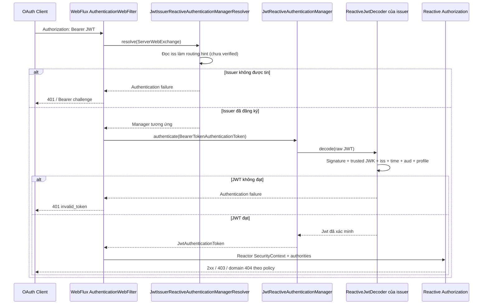

# JwtIssuerReactiveAuthenticationManagerResolver trong WebFlux

## 1. Bài toán: một WebFlux Resource Server tin nhiều issuer

Một **Spring Security OAuth 2.0/OIDC Resource Server** có thể phục vụ nhiều khách hàng, tổ chức hoặc miền danh tính. Trong mô hình đơn giản, mọi JWT access token đến từ một Authorization Server có `iss` cố định. Trong mô hình **multi-tenant**, API có thể nhận JWT từ **nhiều issuer đã được phê duyệt**:

```text
Tenant A:
  iss = https://idp-a.example.test/realms/alpha
  aud = orders-api

Tenant B:
  iss = https://idp-b.example.test/realms/bravo
  aud = orders-api
```

Cả hai tenant gọi cùng endpoint:

```http
GET /api/orders/6a5c...
Host: api.example.test
Authorization: Bearer <access-token>
```

API cần:

1. Chọn **đúng chiến lược xác minh** cho issuer liên quan.
2. Chỉ tin issuer thuộc **tập đã đăng ký**.
3. Xác minh **chữ ký, khóa, thuật toán, issuer, thời hạn, audience và token profile** bằng decoder của issuer đã chọn.
4. Chuyển token hợp lệ thành `Authentication` và authorities.
5. Ngăn tenant A truy cập dữ liệu của tenant B, kể cả khi hai token có cùng scope.

Với **Spring WebFlux**, Spring Security cung cấp:

```java
JwtIssuerReactiveAuthenticationManagerResolver
```

Đây là resolver chọn một `ReactiveAuthenticationManager` dựa trên claim **`iss`** của JWT Bearer token, phù hợp tình huống **nhiều issuer JWT**.

> **Nguyên tắc bảo mật:** `iss` trong token chưa xác minh **chỉ là thông tin dùng để định tuyến đến manager ứng viên**. Giá trị đó không tự chứng minh issuer đáng tin. Một manager/decoder đã được chọn vẫn phải xác minh chữ ký và yêu cầu `iss` đúng **issuer đã được cấu hình**, trước khi API coi principal là authenticated.

## 2. Phân biệt multi-tenancy, multi-issuer và multi-resource

Ba khái niệm liên quan nhưng không đồng nhất:

| Khái niệm | Câu hỏi chính | Ví dụ |
| --- | --- | --- |
| **Multi-issuer** | Token nào được phát hành bởi Authorization Server nào? | `idp-a` và `idp-b` ký token bằng hai JWKS khác nhau. |
| **Multi-tenant** | Chủ thể thuộc không gian dữ liệu/tổ chức nào? | Đơn hàng tenant A không được trả cho tenant B. |
| **Multi-resource** | Token được cấp để gọi API nào? | `aud=orders-api` khác `aud=payments-api`. |

Một issuer có thể quản lý **nhiều tenant**, ví dụ một realm trung tâm phát JWT có `tenant_id`. Ngược lại, mỗi tenant có thể có issuer riêng. Vì thế:

- `iss` có thể là **một khóa tra cứu cấu hình tenant**, **nhưng không phải lúc nào cũng bằng tenant ID**.
- `aud` là resource identifier; không được thay thế bằng `iss`.
- `sub` là subject theo namespace issuer; trong multi-issuer nên hiểu external identity bằng **`(verified iss, verified sub)`**, không chỉ `sub`.
- `scope` hoặc `scp` thường mô tả quyền chức năng, không tự xác nhận ownership/tenant membership.
- `tenant_id` chỉ là dữ liệu dùng để quyết định quyền nếu **issuer contract xác nhận ý nghĩa và độ tin cậy** của claim đó.

Ví dụ hai issuers cùng phát `sub="user-42"` không chứng minh đó là cùng một người. Hai người có thể trùng email hoặc tên hiển thị mà vẫn là hai principal độc lập.

## 3. Vị trí của JwtIssuerReactiveAuthenticationManagerResolver trong WebFlux

Trong Servlet, API tương ứng là `JwtIssuerAuthenticationManagerResolver` sử dụng `AuthenticationManagerResolver<HttpServletRequest>`. Trong WebFlux, class cần dùng là:

```java
org.springframework.security.oauth2.server.resource.authentication
    .JwtIssuerReactiveAuthenticationManagerResolver
```

Nó triển khai:

```java
ReactiveAuthenticationManagerResolver<ServerWebExchange>
```

với phương thức cốt lõi:

```java
Mono<ReactiveAuthenticationManager> resolve(ServerWebExchange exchange);
```

Một manager JWT thường là `JwtReactiveAuthenticationManager`, sử dụng `ReactiveJwtDecoder` như `NimbusReactiveJwtDecoder` để tạo `JwtAuthenticationToken`.

### 3.1. Sơ đồ luồng xác thực



Sơ đồ là mô hình khái niệm. Điểm quan trọng là **resolver chọn manager** còn **decoder xác minh token**. Không trao toàn bộ trách nhiệm tin cậy cho việc đọc `iss`.

### 3.2. Resolver có làm những việc này không?

| Công việc | Resolver tự đảm bảo? | Cần thành phần nào? |
| --- | --- | --- |
| Đọc issuer hint trong Bearer JWT | Có, theo cơ chế của class. | `JwtIssuerReactiveAuthenticationManagerResolver`. |
| Kiểm tra issuer thuộc allowlist | Có khi dùng `fromTrustedIssuers`; custom resolver phải tự bảo đảm. | Trusted issuer registry/predicate. |
| Xác minh JWT signature và `alg` | **Không** chỉ bằng bước chọn manager. | `ReactiveJwtDecoder`. |
| Kiểm tra `iss` thật sự khớp issuer đã chọn | **Phải xác minh lại**. | `JwtValidators.createDefaultWithIssuer(...)` hoặc decoder contract tương đương. |
| Kiểm tra `exp` / `nbf` | Không phải việc đọc routing hint. | JWT timestamp validators. |
| Kiểm tra `aud=orders-api` | Không mặc nhiên theo mọi cấu hình. | Audience validator riêng cho resource. |
| Ánh xạ scope thành `GrantedAuthority` | Manager/converter thực hiện. | `JwtAuthenticationConverter` và các converters phù hợp. |
| Kiểm tra owner/tenant của đơn hàng | Không. | Service/domain authorization và truy vấn ràng buộc tenant. |

## 4. Chuẩn bị một Spring Boot WebFlux Resource Server

Ví dụ Gradle Groovy DSL:

```gradle
dependencies {
    implementation("org.springframework.boot:spring-boot-starter-webflux")
    implementation("org.springframework.boot:spring-boot-starter-security")
    implementation("org.springframework.boot:spring-boot-starter-oauth2-resource-server")

    testImplementation("org.springframework.boot:spring-boot-starter-test")
    testImplementation("org.springframework.security:spring-security-test")
    testImplementation("io.projectreactor:reactor-test")
}
```

Spring Security JWT Resource Server cần các module hỗ trợ resource-server và JOSE; khi dùng Spring Boot starter thích hợp, dependency management sẽ sắp xếp các thư viện liên quan. Nếu dùng dependency thủ công, cần có cả `spring-security-oauth2-jose`.

**Chú ý WebFlux:** Không dùng `HttpSecurity`, `SecurityFilterChain` hoặc `JwtDecoder` (Servlet) trong ví dụ này. WebFlux cần:

- `ServerHttpSecurity`;
- `SecurityWebFilterChain`;
- `ReactiveAuthenticationManager`;
- `ReactiveJwtDecoder`;
- `ReactiveSecurityContextHolder`.

Nếu thêm đồng thời `spring-boot-starter-web` và `spring-boot-starter-webflux`, phải xác định application type do Boot chọn. Có mặt Reactor trên classpath **không tự chứng minh ứng dụng đang chạy WebFlux security chain**.

## 5. Cấu hình đơn giản với danh sách trusted issuers tĩnh

Với Spring Security **6.2 trở lên**, nên sử dụng factory:

```java
JwtIssuerReactiveAuthenticationManagerResolver.fromTrustedIssuers(...)
```

thay cho constructor chuỗi/collection đã bị deprecated ở dòng 6.2+. Ví dụ:

```java
import org.springframework.context.annotation.Bean;
import org.springframework.context.annotation.Configuration;
import org.springframework.security.config.annotation.web.reactive.EnableWebFluxSecurity;
import org.springframework.security.config.web.server.ServerHttpSecurity;
import org.springframework.security.oauth2.server.resource.authentication
        .JwtIssuerReactiveAuthenticationManagerResolver;
import org.springframework.security.web.server.SecurityWebFilterChain;

@Configuration
@EnableWebFluxSecurity
public class MultiIssuerSecurityConfiguration {

    @Bean
    SecurityWebFilterChain apiSecurity(ServerHttpSecurity http) {

        var resolver =
                JwtIssuerReactiveAuthenticationManagerResolver
                        .fromTrustedIssuers(
                                "https://idp-a.example.test/realms/alpha",
                                "https://idp-b.example.test/realms/bravo");

        return http
                .authorizeExchange(exchanges -> exchanges
                        .pathMatchers("/api/public/**").permitAll()
                        .pathMatchers("/api/**").authenticated()
                        .anyExchange().denyAll())
                .oauth2ResourceServer(oauth2 ->
                        oauth2.authenticationManagerResolver(resolver))
                .build();
    }
}
```

Với API thật, hai issuer strings phải đến từ **trusted configuration** được duyệt (ví dụ cấu hình triển khai hoặc registry có IAM), không từ request của người dùng.

Đường `/api/public/**` được cho phép ở URL layer. Nhưng nếu client **tự gửi Bearer token không hợp lệ**, filter có thể vẫn từ chối request ngay ở authentication; `permitAll` không có nghĩa phải bỏ qua mọi Bearer credential được gửi vào.

### 5.1. Chính xác factory này làm gì?

Theo Spring Security Reference và Javadoc, resolver dùng danh sách issuer đáng tin để chọn `JwtReactiveAuthenticationManager` tương ứng. Việc tạo manager và khởi tạo thông tin từ issuer có cơ chế **lazy**, thường diễn ra khi lần đầu gặp request thuộc issuer đó. Điều này giúp startup không buộc **mọi** Authorization Server đang trực tuyến cùng lúc.

Ví dụ:

```text
Application startup:
  trustedIssuers = [A, B]
  Chưa cần xử lý một JWT nào.

Request đầu tiên từ A:
  Chọn A trong trusted allowlist.
  Khởi tạo/tra decoder và manager của A.
  Xác minh JWT với issuer/JWKS A.

Request đầu tiên từ B:
  Chọn B.
  Khởi tạo/tra decoder và manager của B.
  Xác minh JWT với issuer/JWKS B.
```

**Lazy không có nghĩa không có dependency mạng.** Nếu issuer A đang lỗi discovery/JWKS khi request A đầu tiên đến, request có thể thất bại. Thiết kế readiness, latency, monitoring và key cache phải xét tình huống này.

### 5.2. Phiên bản API

| Spring Security | Thông tin tương thích |
| --- | --- |
| **5.3–6.1** | `JwtIssuerReactiveAuthenticationManagerResolver` đã có từ 5.3; có các constructors dùng trusted issuers trong API lịch sử. |
| **6.2+** | Static factories `fromTrustedIssuers(String...)`, `fromTrustedIssuers(Collection)` và `fromTrustedIssuers(Predicate)` được bổ sung. |
| **6.2–6.5** | Constructor nhận chuỗi/collection được đánh dấu deprecated, khuyến nghị dùng factories. |
| **7.x** | Factory `fromTrustedIssuers` vẫn có trong tài liệu API; constructor nhận custom issuer resolver vẫn hỗ trợ cách tạo manager riêng. |

Nếu IDE báo không tìm thấy `fromTrustedIssuers` trên Spring Security 6.1, đó là **khác biệt phiên bản**, không nhất thiết là import sai. Đừng ghép ngẫu nhiên Spring Security 7.x JAR vào một ứng dụng còn quản lý version 6.1 chỉ để có API mới; chọn constructor đúng phiên bản hoặc nâng cấp bộ dependencies nhất quán.

## 6. Vì sao claim iss chưa xác minh vẫn được đọc?

Resolver cần biết **manager nào** để xác minh JWT. Nhưng muốn xác minh chữ ký thì phải biết public key/JWKS của issuer. Vì vậy bước chọn manager có thể đọc `iss` từ **payload chưa được xác thực**.

Ví dụ attacker có thể tự tạo payload:

```json
{
  "iss": "https://idp-a.example.test/realms/alpha",
  "sub": "ceo",
  "aud": ["orders-api"],
  "scope": "orders:admin",
  "exp": 1893456000
}
```

Payload có `iss` đúng **không chứng minh** token được issuer A ký. Nếu chữ ký không hợp lệ với key A, `ReactiveJwtDecoder` của A phải từ chối.

Đây là sự khác nhau giữa:

```text
iss chưa xác minh  →  CHỌN manager ứng viên

iss đã xác minh + JWS hợp lệ + validators đúng  →  TIN danh tính/claims
```

### 6.1. Mô hình nguy hiểm: tự tạo decoder cho mọi URL trong token

Không làm:

```java
// SAI: issuerUri là giá trị lấy từ JWT payload chưa xác minh.
String issuerUri = parseUnverifiedIssuer(rawToken);

ReactiveJwtDecoder decoder =
        ReactiveJwtDecoders.fromIssuerLocation(issuerUri);
```

Điều này có thể:

- Kích hoạt HTTP discovery tới domain do attacker kiểm soát (**SSRF**).
- Làm API tin public key/JWKS không được cấp quyền.
- Gây tốn tài nguyên nếu có vô số issuer khác nhau.
- Mở đường chấp nhận access token của một AS không được tổ chức phê duyệt.

Đặc biệt, **một attacker có thể tự tạo một Authorization Server và ký JWT hoàn toàn hợp lệ cho server của họ**. JWT signature hợp lệ theo key *của attacker* không phải bằng chứng đủ để API tin issuer.

### 6.2. Mô hình an toàn

```text
Bearer token
  → đọc iss như routing hint
  → kiểm tra exact match trong trusted issuer registry
  → lấy manager/decoder đã đăng ký cho issuer đó
  → xác minh JWS với trusted keys
  → kiểm tra iss, aud, exp, nbf, token type
  → chỉ khi tất cả pass mới tạo Authentication
```

**Không dùng phép so sánh prefix** như `issuer.startsWith("https://idp.example.test")` vì `https://idp.example.test.attacker.test` có thể lọt qua. Sử dụng **issuer identifier đầy đủ, chính xác**, với canonical value đã được xác nhận từ AS/metadata và ứng dụng thống nhất.

## 7. Giới hạn của factory mặc định: audience và policy theo issuer

Factory `fromTrustedIssuers` rất phù hợp khi các issuers đã được phê duyệt và cách xác minh token theo defaults đáp ứng nhu cầu. Tuy nhiên, một Resource Server thường có yêu cầu riêng:

- Mỗi JWT phải có `aud=orders-api`.
- Issuer A phát `scope` dạng chuỗi, issuer B có `scp` dạng danh sách.
- Mỗi issuer dùng JWS algorithm/key policy riêng.
- Một số issuers chỉ được gọi `/api/read-only/**`.
- Tenant mapping/role grants không giống nhau.
- Access token phải theo **RFC 9068** hoặc một token profile đã thỏa thuận.

Khi cần cấu hình các validators/converters khác nhau theo issuer, **tạo và quản lý các managers riêng** rồi cấp resolver một repository đáng tin cậy.

## 8. Tạo registry của các ReactiveAuthenticationManager theo issuer

Một thiết kế minh bạch dùng mapping:

```text
issuer A -> JwtReactiveAuthenticationManager(decoder A)
issuer B -> JwtReactiveAuthenticationManager(decoder B)
```

Với decoder:

```text
decoder A:
  trusted JWKS A
  expected iss A
  expected aud orders-api

decoder B:
  trusted JWKS B
  expected iss B
  expected aud orders-api
```

### 8.1. DTO cấu hình tin cậy

```java
public record TrustedIssuer(
        String issuer,
        String jwksUri,
        String audience) {
}
```

`TrustedIssuer` chỉ là domain/config record do ứng dụng định nghĩa. Các giá trị trong record phải lấy từ **deployment configuration đã được phê duyệt** hoặc hệ thống tenant registry được bảo vệ, không từ Bearer JWT chưa xác minh.

### 8.2. Tạo JWT manager với issuer và audience validator

```java
import org.springframework.security.authentication.ReactiveAuthenticationManager;
import org.springframework.security.oauth2.core.DelegatingOAuth2TokenValidator;
import org.springframework.security.oauth2.core.OAuth2Error;
import org.springframework.security.oauth2.core.OAuth2TokenValidator;
import org.springframework.security.oauth2.core.OAuth2TokenValidatorResult;
import org.springframework.security.oauth2.jwt.Jwt;
import org.springframework.security.oauth2.jwt.JwtValidators;
import org.springframework.security.oauth2.jwt.NimbusReactiveJwtDecoder;
import org.springframework.security.oauth2.server.resource.authentication
        .JwtReactiveAuthenticationManager;

public final class TrustedJwtManagerFactory {

    private TrustedJwtManagerFactory() {
    }

    public static ReactiveAuthenticationManager create(
            TrustedIssuer settings) {

        NimbusReactiveJwtDecoder decoder =
                NimbusReactiveJwtDecoder
                        .withJwkSetUri(settings.jwksUri())
                        .build();

        OAuth2TokenValidator<Jwt> defaults =
                JwtValidators.createDefaultWithIssuer(settings.issuer());

        OAuth2TokenValidator<Jwt> audience = jwt ->
                jwt.getAudience().contains(settings.audience())
                        ? OAuth2TokenValidatorResult.success()
                        : OAuth2TokenValidatorResult.failure(
                                new OAuth2Error(
                                        "invalid_token",
                                        "Access token not accepted for this API",
                                        null));

        decoder.setJwtValidator(
                new DelegatingOAuth2TokenValidator<>(
                        defaults,
                        audience));

        return new JwtReactiveAuthenticationManager(decoder);
    }
}
```

Điểm cần hiểu:

- `withJwkSetUri(...)` đặt **nguồn public keys tin cậy** được phê duyệt cho issuer.
- `JwtValidators.createDefaultWithIssuer(...)` giữ các kiểm tra claim mặc định (điển hình gồm `exp`/`nbf`) và **issuer validation**.
- Audience validator yêu cầu JWT dành cho đúng resource.
- `DelegatingOAuth2TokenValidator` ghép rules; setter `setJwtValidator(...)` **thay validator hiện tại**. Nếu chỉ truyền audience validator sẽ có nguy cơ đánh mất defaults/issuer checks.
- `JwtReactiveAuthenticationManager` nhận decoded `Jwt` và tạo `JwtAuthenticationToken`; authority converter có thể được tùy biến theo issuer khi cần.

**Không phải mọi decoder configuration đều đã đáp ứng đầy đủ RFC 9068/token type, `client_id` hay tenant policy.** Khi API yêu cầu những điều đó, phải bổ sung chính sách theo phiên bản Spring Security và contract issuer tương ứng.

### 8.3. Registry dùng Map bất biến

```java
import java.util.Map;
import org.springframework.context.annotation.Bean;
import org.springframework.context.annotation.Configuration;
import org.springframework.security.authentication.ReactiveAuthenticationManager;
import org.springframework.security.authentication
        .ReactiveAuthenticationManagerResolver;
import org.springframework.security.oauth2.server.resource.authentication
        .JwtIssuerReactiveAuthenticationManagerResolver;
import org.springframework.web.server.ServerWebExchange;
import reactor.core.publisher.Mono;

@Configuration
public class IssuerManagerRegistryConfiguration {

    @Bean
    JwtIssuerReactiveAuthenticationManagerResolver jwtIssuerResolver() {

        var alpha = new TrustedIssuer(
                "https://idp-a.example.test/realms/alpha",
                "https://idp-a.example.test/realms/alpha/certs",
                "orders-api");

        var bravo = new TrustedIssuer(
                "https://idp-b.example.test/realms/bravo",
                "https://idp-b.example.test/realms/bravo/certs",
                "orders-api");

        Map<String, ReactiveAuthenticationManager> managers = Map.of(
                alpha.issuer(), TrustedJwtManagerFactory.create(alpha),
                bravo.issuer(), TrustedJwtManagerFactory.create(bravo));

        ReactiveAuthenticationManagerResolver<String> byIssuer =
                issuer -> Mono.justOrEmpty(managers.get(issuer));

        return new JwtIssuerReactiveAuthenticationManagerResolver(
                byIssuer);
    }

    @Bean
    SecurityWebFilterChain apiSecurity(
            ServerHttpSecurity http,
            JwtIssuerReactiveAuthenticationManagerResolver jwtIssuerResolver) {
        return http
                .authorizeExchange(exchanges -> exchanges
                        .pathMatchers("/api/**").authenticated()
                        .anyExchange().denyAll())
                .oauth2ResourceServer(oauth2 ->
                        oauth2.authenticationManagerResolver(
                                jwtIssuerResolver))
                .build();
    }
}
```

Ví dụ minh họa ở mức cấu hình, yêu cầu các Spring imports đã xuất hiện ở mục 5 (như `ServerHttpSecurity`/`SecurityWebFilterChain`). Trong dự án thật, chuyển các URI thành **trusted application properties** hoặc registry được bảo vệ. Không đưa issuer/JWKS URI từ token vào `new TrustedIssuer(...)`.

Mỗi map key là một issuer đã phê duyệt, nên `managers.get(issuer)` chỉ trả manager nếu issuer được nhận diện chính xác. Với issuer không có trong map, `Mono.justOrEmpty(...)` không cấp manager. Framework sẽ xử lý việc không thể resolve; nếu chính sách muốn báo lỗi xác thực rõ hơn, có thể trả `Mono.error(...)` đã được sanitize thay vì tự thêm issuer mới.

### 8.4. Tại sao không dùng một decoder cho mọi issuer?

Nếu issuers có JWKS khác nhau hoặc policy khác nhau, một decoder dùng **union tất cả public keys** mà không ràng buộc issuer nghiêm ngặt có thể mở đường **cross-issuer token substitution**. Tách decoder/manager:

- Key A chỉ xác minh token issuer A theo contract.
- Key B chỉ xác minh token issuer B theo contract.
- Mỗi decoder kiểm tra `iss` và audience riêng.
- Mỗi policy có thể ánh xạ scope/role theo issuer riêng.

Đừng tin token B chỉ vì chữ ký khớp một public key nằm trong tập khóa toàn hệ thống nếu token không thỏa issuer/resource policy.

## 9. Multi-issuer trên cùng endpoint: lựa chọn chính sách authorization

Sau authentication, API có thể nhận:

```text
Tenant A JWT -> authorities [SCOPE_orders:read]
Tenant B JWT -> authorities [SCOPE_orders:read]
```

Cùng authority `SCOPE_orders:read` chỉ chứng minh **cả hai được phép gọi chức năng đọc** theo contract. Nó không chứng minh rằng tenant A được đọc bảng ghi của tenant B.

Nên tách:

```text
Authentication:
  JWT hợp lệ + iss được tin + aud đúng + exp/nbf đúng

Functional authorization:
  Có SCOPE_orders:read

Data authorization:
  Internal actor thuộc tenant nào?
  Tenant đó có quyền trên orderId nào?
  Owner/membership/business rule có đạt không?
```

### 9.1. Không map claim tenant thành quyền nếu chưa có hợp đồng

Ví dụ token:

```json
{
  "iss": "https://idp-a.example.test/realms/alpha",
  "sub": "user-42",
  "aud": ["orders-api"],
  "scope": "orders:read",
  "tenant_id": "tenant-a"
}
```

Claim `tenant_id` chỉ có nghĩa đáng tin nếu:

1. Token đã được xác minh bằng issuer A.
2. Issuer A cam kết ý nghĩa/kiểu dữ liệu của `tenant_id`.
3. API có mapping đã phê duyệt giữa external tenant và **internal tenant**.
4. Quyền thành viên/owner và lifecycle của actor được kiểm tra khi policy yêu cầu.

Không cho HTTP client tự gửi `X-Tenant-ID: tenant-b` rồi dùng nó thay verified tenant context. Nếu API cho user chủ động chọn tenant trong nhiều membership, phải **xác minh membership** của user trong tenant đó, không lấy header làm bằng chứng.

## 10. Lấy danh tính đã xác minh trong WebFlux

Controller với JWT principal:

```java
import org.springframework.security.core.annotation.AuthenticationPrincipal;
import org.springframework.security.oauth2.jwt.Jwt;
import org.springframework.web.bind.annotation.GetMapping;
import org.springframework.web.bind.annotation.RestController;
import reactor.core.publisher.Mono;

@RestController
public class WhoAmIController {

    @GetMapping("/api/me")
    public Mono<SubjectInfo> me(@AuthenticationPrincipal Jwt jwt) {
        if (jwt.getIssuer() == null
                || jwt.getSubject() == null
                || jwt.getSubject().isBlank()) {
            return Mono.error(new IllegalStateException(
                    "Authenticated JWT is missing required identity"));
        }

        return Mono.just(new SubjectInfo(
                jwt.getIssuer().toString(),
                jwt.getSubject()));
    }

    public record SubjectInfo(String issuer, String subject) {
    }
}
```

Đây là **ví dụ học thuật** minh họa cách truy cập `iss` và `sub` đã qua decoder. Response production phải theo privacy contract; không tự expose mọi JWT claim hoặc thông tin tenant. Nếu các token profiles có service actor không có `sub` theo format trên, cần thiết kế `CurrentActor` abstraction riêng cho actor loại đó.

### 10.1. ReactiveSecurityContextHolder

Trong service reactive, có thể đọc `Authentication` qua Reactor Context:

```java
public Mono<Jwt> currentJwt() {
    return ReactiveSecurityContextHolder.getContext()
            .map(SecurityContext::getAuthentication)
            .flatMap(authentication -> {
                if (authentication instanceof JwtAuthenticationToken jwtAuth) {
                    return Mono.just(jwtAuth.getToken());
                }
                return Mono.empty();
            });
}
```

Khi principal type không như mong đợi, security-sensitive code nên **từ chối có kiểm soát**, không âm thầm dùng một actor “system admin” mặc định. `Mono.empty()` ở đây chỉ là tín hiệu ví dụ; code production cần hợp đồng rõ về absent/unsupported principal.

**Không nên dùng `SecurityContextHolder` ThreadLocal của Servlet làm nguồn chính cho WebFlux**: reactive pipeline có thể chuyển threads. Không tạo subscription riêng bằng `subscribe()` rồi kỳ vọng security context/request context luôn đi theo.

## 11. Ánh xạ external identity sang internal actor/tenant

Một thiết kế dữ liệu minh họa:

```sql
CREATE TABLE app_user (
    id UUID PRIMARY KEY,
    display_name VARCHAR(200)
);

CREATE TABLE external_identity (
    issuer VARCHAR(512) NOT NULL,
    subject VARCHAR(512) NOT NULL,
    app_user_id UUID NOT NULL REFERENCES app_user(id),
    PRIMARY KEY (issuer, subject)
);

CREATE TABLE tenant_membership (
    app_user_id UUID NOT NULL REFERENCES app_user(id),
    tenant_id UUID NOT NULL,
    membership_status VARCHAR(40) NOT NULL,
    PRIMARY KEY (app_user_id, tenant_id)
);

CREATE TABLE orders (
    id UUID PRIMARY KEY,
    tenant_id UUID NOT NULL,
    owner_user_id UUID NOT NULL REFERENCES app_user(id)
);
```

Mô hình này chỉ là ví dụ SQL; kiểu constraint/index và multi-tenant partitioning cần thiết kế theo database thực tế.

**Vì sao `PRIMARY KEY (issuer, subject)`?** Subject thường được hiểu theo namespace issuer. `sub=user-42` của issuer A và `sub=user-42` của issuer B không được tự gộp account.

Ví dụ service reactive:

```java
@Service
public class OrderApplicationService {

    private final ReactiveCurrentActorService actorService;
    private final ReactiveOrderRepository orderRepository;

    public OrderApplicationService(
            ReactiveCurrentActorService actorService,
            ReactiveOrderRepository orderRepository) {
        this.actorService = actorService;
        this.orderRepository = orderRepository;
    }

    public Mono<OrderDto> readOwnOrder(UUID orderId) {
        return actorService.requireCurrentActor()
                .flatMap(actor -> orderRepository
                        .findByIdAndOwnerUserIdAndTenantId(
                                orderId,
                                actor.userId(),
                                actor.tenantId()))
                .switchIfEmpty(Mono.error(
                        new OrderNotFoundException(orderId)))
                .map(OrderDto::from);
    }
}
```

Các kiểu `ReactiveCurrentActorService`, `ReactiveOrderRepository`, `OrderDto` và exception là **domain abstractions do ứng dụng tự triển khai**. Điều quan trọng là repository **lọc theo `orderId`, internal user và tenant trong cùng truy vấn**, tránh load nhầm bản ghi của tenant khác rồi mới che kết quả.

Nếu đây là chức năng đọc đơn của mọi thành viên trong tenant, điều kiện owner sẽ khác theo policy. Nhưng **mọi biến thể đều phải kiểm tra tenant boundary**.

## 12. Phân biệt issuer trust và quyền sử dụng API

Issuer đã nằm trong allowlist chỉ nói rằng API **có thể xác minh token do issuer đó phát hành**. Nó không tự chứng minh:

- Token được cấp cho `orders-api`.
- OAuth client của token được phép gọi endpoint.
- Principal có `SCOPE_orders:read`.
- Principal có membership tenant đang được yêu cầu.
- Principal được truy cập order cụ thể.
- JWT thuộc loại access token phù hợp (không phải OIDC ID token).

Ví dụ security rule:

```java
return http
        .authorizeExchange(exchanges -> exchanges
                .pathMatchers(HttpMethod.GET, "/api/orders/**")
                    .hasAuthority("SCOPE_orders:read")
                .pathMatchers(HttpMethod.POST, "/api/orders/**")
                    .hasAuthority("SCOPE_orders:write")
                .anyExchange().authenticated())
        .oauth2ResourceServer(oauth2 ->
                oauth2.authenticationManagerResolver(jwtIssuerResolver))
        .build();
```

`hasAuthority(...)` được áp dụng **sau authentication**. Method security hoặc service policy vẫn cần bảo vệ truy vấn owner/tenant.

### 12.1. Role và scope có quy ước khác nhau

Trong Spring Security JWT Resource Server thông dụng, scope:

```json
{"scope": "orders:read orders:write"}
```

có thể được ánh xạ thành:

```text
SCOPE_orders:read
SCOPE_orders:write
```

`hasRole("ADMIN")` thường kiểm tra `ROLE_ADMIN` chứ không phải `SCOPE_orders:read`. Nếu hai issuers có claim `roles` khác nhau, hãy tạo một **issuer-specific converter/policy** thay vì tự kết hợp tất cả role claims thành quyền toàn cục.

### 12.2. Hợp đồng audience chính xác

Theo JWT, `aud` có thể là string hoặc array. Spring `Jwt.getAudience()` trả danh sách tiện cho exact membership. Không kiểm tra bằng chuỗi con:

```java
// SAI: tên "orders-api-admin" có thể gây nhầm.
boolean accepted = jwt.getClaims()
        .get("aud").toString().contains("orders-api");
```

Dùng:

```java
boolean accepted = jwt.getAudience().contains("orders-api");
```

Nếu issuer dùng một resource identifier khác, cần đặt expected audience riêng cho issuer theo contract, không tự nới lỏng bằng wildcard.

## 13. Dynamic tenants: thêm issuer mà không restart

Hệ thống SaaS có thể onboarding tenant mới khi ứng dụng đang chạy. Spring Security hỗ trợ constructor nhận một **`ReactiveAuthenticationManagerResolver<String>`** để tìm manager theo issuer:

```java
JwtIssuerReactiveAuthenticationManagerResolver resolver =
        new JwtIssuerReactiveAuthenticationManagerResolver(
                issuer -> Mono.justOrEmpty(managers.get(issuer)));
```

Với `managers` là registry chỉ chứa issuer được phê duyệt, ứng dụng có thể thêm/xóa các entries thông qua **quy trình quản trị an toàn**.

### 13.1. Không tự onboard theo request Bearer

Sai lầm nghiêm trọng:

```java
// SAI: issuer từ token chưa verified được thêm trực tiếp.
return issuer -> Mono.just(
        new JwtReactiveAuthenticationManager(
                ReactiveJwtDecoders.fromIssuerLocation(issuer)));
```

Một attacker có thể chỉ định một host riêng và khiến API tải metadata/JWKS của họ, tạo manager mới liên tục hoặc chấp nhận token ngoài trust boundary.

**Onboarding issuer phải là control-plane operation**, tách khỏi data-plane HTTP request của người dùng.

### 13.2. Registry thread-safe và danh tính cấu hình

Ví dụ skeleton:

```java
import java.util.concurrent.ConcurrentHashMap;
import java.util.concurrent.ConcurrentMap;
import org.springframework.security.authentication.ReactiveAuthenticationManager;
import org.springframework.security.oauth2.server.resource.authentication
        .JwtIssuerReactiveAuthenticationManagerResolver;
import reactor.core.publisher.Mono;

public final class TrustedTenantManagerRegistry {

    private final ConcurrentMap<String, ReactiveAuthenticationManager>
            managers = new ConcurrentHashMap<>();

    public JwtIssuerReactiveAuthenticationManagerResolver resolver() {
        return new JwtIssuerReactiveAuthenticationManagerResolver(
                issuer -> Mono.justOrEmpty(managers.get(issuer)));
    }

    public void registerApprovedIssuer(
            TrustedIssuer reviewedSettings,
            ReactiveAuthenticationManager prebuiltManager) {
        // Chỉ control plane đã được ủy quyền mới được gọi method này.
        if (reviewedSettings == null || prebuiltManager == null) {
            throw new IllegalArgumentException("Missing approved registration");
        }
        managers.put(reviewedSettings.issuer(), prebuiltManager);
    }

    public void revokeApprovedIssuer(String issuer) {
        managers.remove(issuer);
    }
}
```

Đây là **skeleton thiết kế**, không phải registration API công khai hay bảo đảm an ninh đầy đủ. Những phần bên ngoài cần triển khai:

- Xác thực/ủy quyền thao tác đăng ký issuer.
- Kiểm tra issuer nằm trong danh mục tenant được tổ chức chấp thuận.
- Validate issuer URI và JWKS URI có HTTPS/trust anchor, không dùng URL do attacker chọn.
- Thực hiện metadata discovery/key checks ngoài HTTP request của user, có timeout và SSRF protections.
- Test manager/decoder mới bằng token kiểm thử hợp lệ trước khi kích hoạt.
- Xác nhận resource audience, algorithm/profile, scope và tenant mapping.
- Ghi audit version của registry và người phê duyệt.
- Đồng bộ registry giữa nhiều ứng dụng/pods, xử lý version và trạng thái.
- Thu hồi issuer cũ, cache/key lifecycle và in-flight requests có kiểm soát.

**`ConcurrentHashMap` chỉ giải quyết cạnh tranh truy cập trong một JVM**, không phải distributed tenant registry hoặc nguồn xác thực tenant.

### 13.3. Atomic publish và quy trình onboarding

Một trình tự an toàn:

1. Administrator đăng ký issuer B vào hệ thống quản lý tenant.
2. Control plane xác nhận issuer B được phê duyệt, URL/TLS, metadata/JWKS, audience, profile và policy.
3. Xây `ReactiveJwtDecoder`/`JwtReactiveAuthenticationManager` cho B bằng trusted settings.
4. Chạy test/health checks và validate B không cấp quyền vượt contract.
5. Publish manager B vào registry của từng pod, có version/audit.
6. Bắt đầu chấp nhận token B trên request path.

Không nên publish manager trước bước phê duyệt rồi hy vọng bước claim validation sẽ “tự phát hiện mọi vấn đề”.

### 13.4. Ngừng tin issuer

Khi tenant bị offboard hoặc issuer bị xâm phạm:

- Chặn các request mới của issuer từ registry.
- Xem xét requests đang thực thi và token authentication đã cached.
- Thu hồi quyền domain/membership, session/refresh tokens nếu phù hợp.
- Kiểm tra cache và downstream services có giữ quyền theo issuer đó không.
- Audit việc xóa issuer, lưu thông tin cần thiết cho điều tra theo retention policy.

Xóa một entry khỏi map không tự vô hiệu mọi transaction hoặc job đã bắt đầu từ trước. Cần **revocation policy toàn hệ thống**.

## 14. Lazy issuer discovery và availability

Factory `fromTrustedIssuers(...)` khởi tạo manager liên quan khi issuer xuất hiện lần đầu. Đây là lợi ích quan trọng:

```text
Startup không buộc A, B, C đều online.
Request A đầu tiên có thể cần issuer metadata/JWKS A.
Request B đầu tiên có thể cần issuer metadata/JWKS B.
Các request sau có thể sử dụng cache/manager đã tạo.
```

Những điểm cần thiết kế:

| Tình huống | Tác động | Cách quản lý |
| --- | --- | --- |
| Issuer A không online lúc startup | Ứng dụng có thể vẫn khởi động. | Đo readiness riêng với từng tenant nếu SLA yêu cầu. |
| Issuer A không online lúc request đầu | Authentication của A có thể thất bại/tăng latency. | Timeout, error classification, retry có giới hạn. |
| JWKS A đổi `kid` | Decoder cần nhận public key mới từ nguồn tin cậy. | Key rotation runbook và cache management. |
| Metadata bị cấu hình sai | Manager có thể không tạo/verify được. | Onboarding checks, rollback registry config. |
| Nhiều tenants tạo traffic lần đầu cùng lúc | Discovery/cache initialization có thể tăng tải. | Warm-up được phép, giới hạn concurrency, monitor. |
| Một issuer bị sự cố | Tenant đó có thể bị ảnh hưởng. | Không tự chấp nhận JWT chưa xác minh; cô lập blast radius. |

**Lazy startup không đồng nghĩa token verification không cần mạng**. JWT signature verification có thể diễn ra cục bộ sau khi đã có trusted keys, nhưng cache miss/rotation vẫn có thể cần JWKS.

### 14.1. Không fail-open khi JWKS lỗi

Không làm:

```java
// SAI: thay vì verify, tự dựng authentication khi fetch JWK lỗi.
return jwtDecoder.decode(rawToken)
        .onErrorResume(error -> Mono.just(
                unverifiedJwtFromPayload(rawToken)));
```

Lỗi mạng không cho phép bỏ chữ ký. Nếu không xác minh được token, Resource Server phải **fail-closed**, đồng thời phân loại lỗi dependency để vận hành xử lý.

### 14.2. Egress và SSRF

Dù issuers nằm trong allowlist, cần bảo vệ việc outbound HTTP tới metadata/JWKS:

- Chỉ cho phép HTTPS endpoints được phê duyệt.
- Validate redirects/proxy/TLS trust.
- Giới hạn host/port/routing theo cấu hình hạ tầng.
- Không cho token header `jku`/`x5u` tùy ý quyết định key source.
- Timeout, hạn chế số kết nối và payload size.
- Monitor sự thay đổi bất thường của metadata URLs.

Một trusted issuer registration sai cấu hình vẫn có thể tạo rủi ro kết nối tới mạng nội bộ; vì thế onboarding phải xem xét URL thực tế.

## 15. Chính sách riêng theo issuer: validators và authorities

Nếu issuer A và B khác nhau về token profile, xây managers riêng cho phép:

1. **Audience chính xác** theo từng issuer.
2. **Allowed algorithms/JWKS** đúng issuer.
3. **Issuer validation** ở decoder.
4. **Token profile**: access token, `typ` (nếu yêu cầu), `client_id`, `exp` và các mandatory claims.
5. **Authority converter** theo scope/roles claim contract.
6. **Tenant authorization** trên internal actor.

Ví dụ:

```text
Issuer A:
  scope claim = "orders:read orders:write"
  role semantics = none
  audience = "orders-api"

Issuer B:
  scp claim = ["orders.read", "orders.export"]
  role semantics = "org_admin" trong namespace B
  audience = "https://api.example.test/orders"
```

Không tự coi `orders.read` của B tương đương `orders:read` của A nếu chưa có **hợp đồng ánh xạ**. Nếu cần chuẩn hóa, thực hiện trong converter riêng, có allowlist và regression tests.

### 15.1. Custom JWT converter theo manager

Ý tưởng:

```java
JwtReactiveAuthenticationManager manager =
        new JwtReactiveAuthenticationManager(decoderForAlpha);

manager.setJwtAuthenticationConverter(converterForAlpha);
```

`converterForAlpha` phải là `Converter<Jwt, Mono<AbstractAuthenticationToken>>` theo API manager. Nếu bắt đầu từ `JwtAuthenticationConverter` đồng bộ, có thể dùng `ReactiveJwtAuthenticationConverterAdapter` khi phù hợp, nhưng không để JDBC/HTTP blocking chạy trên event-loop bên trong converter.

**Không map một claim `roles=["ADMIN"]` thành `ROLE_ADMIN` toàn hệ thống** chỉ vì nó hiện diện trong token. Điều kiện cấp quyền phải thuộc contract của issuer, API và tenant.

### 15.2. Token type và OIDC ID token

Một OIDC **ID token** có thể được issuer ký bằng cùng key set với OAuth access token. ID token dành cho **OIDC client**, còn Resource Server phải nhận **access token có audience/resource contract phù hợp**.

Nếu API chỉ kiểm tra chữ ký và `iss`, có thể mắc lỗi token confusion. Yêu cầu:

- `aud` trùng API/resource.
- Token profile/`typ` phù hợp nếu issuer áp dụng RFC 9068 hoặc profile riêng.
- Các claims mandatory theo hợp đồng.
- Scope và authorization theo API, không lấy OIDC userinfo claims làm quyền.

## 16. Một API phục vụ cả human và machine clients

Một issuer có thể phát JWT qua Authorization Code + PKCE đại diện người dùng và token theo **Client Credentials** đại diện workload.

| Thuộc tính | Human token | Machine token |
| --- | --- | --- |
| Principal | User subject, issuer, membership. | Client/workload identity theo grant contract. |
| Quyền | Scopes và policy user/tenant/owner. | Scopes dành cho service, allowed job/task. |
| Dữ liệu nhận diện | `sub`, claims đã thỏa thuận. | `client_id` và subject theo token profile. |
| Sai lầm thường gặp | Dùng email/name làm user ID. | Giả định machine có email/user profile. |

`JwtIssuerReactiveAuthenticationManagerResolver` **không tự phân biệt human và machine actor**. Sau khi xác thực issuer/token, resource authorization phải chọn actor type phù hợp.

Không áp một policy dựa trên `email_verified` cho Client Credentials token nếu contract không có email. Ngược lại, không cho machine client truy cập user-owned orders chỉ vì nó có scope rộng.

## 17. Multi-issuer không đồng nghĩa multi-tenant isolation

Một lỗi kiến trúc phổ biến:

```java
@GetMapping("/api/orders/{id}")
public Mono<OrderDto> get(@PathVariable UUID id) {
    return orderRepository.findById(id).map(OrderDto::from);
}
```

Giả sử chỉ cần `SCOPE_orders:read` ở URL, user của tenant A đoán `id` thuộc tenant B vẫn có thể lấy dữ liệu nếu repository không ràng buộc tenant.

Hãy thiết kế **tenant context dựa trên principal đã xác thực**:

```text
Verified JWT (iss, sub, tenant claims)
  → External identity mapping
  → Internal actor + active tenant memberships
  → Scope/domain policy
  → Query where tenant_id = approvedInternalTenantId
  → Result
```

Đừng dùng email, username hoặc header `X-Tenant-ID` chưa kiểm tra làm nguồn chính để phân tách dữ liệu.

### 17.1. Một issuer quản lý nhiều tenant

Nếu issuer A phát JWT cho `tenant-a` và `tenant-b`, resolver chỉ chọn **cùng manager A**. Để bảo vệ dữ liệu, API cần thêm:

- Tenant claim đã được issuer bảo đảm hoặc context chọn tenant được kiểm tra membership.
- Mapping tenant ngoại bộ sang internal tenant.
- Chính sách ràng buộc owner/organization.
- Query hoặc database row-level security theo thiết kế.

Nếu user có quyền trong cả hai tenant, việc chuyển tenant phải là thao tác đã kiểm tra, không dựa vào thay một path parameter.

### 17.2. Một tenant dùng nhiều issuers

Trong giai đoạn IdP migration, tenant A có thể dùng issuer cũ và mới. Khi đó mapping:

```text
(iss-old, sub-old) ──┐
                    ├──> internal user id
(iss-new, sub-new) ──┘
```

phải được thực hiện qua quy trình account linking **có kiểm chứng**, không tự gộp bằng email hiển thị hay subject trùng tình cờ. Việc tin hai issuers không đồng nghĩa tất cả tài khoản cùng email là một principal.

## 18. Khác biệt với OAuth2/OIDC Login

Từ “OIDC” thường xuất hiện trong hệ thống nhiều tenant, nhưng **Resource Server JWT validation** khác **OIDC client login**:

| Tình huống | Thành phần chính | Token được dùng thế nào? |
| --- | --- | --- |
| Web application đăng nhập người dùng bằng OIDC | `oauth2Login()`/reactive OIDC client | ID token và authorization code dùng cho client authentication flow. |
| API WebFlux nhận Bearer access token | `oauth2ResourceServer()` | API xác thực access token dành cho resource. |
| API nhận access token từ nhiều issuers JWT | `JwtIssuerReactiveAuthenticationManagerResolver` | Chọn manager theo issuer và kiểm tra JWT đầy đủ. |
| API nhận opaque token | `ReactiveOpaqueTokenIntrospector` | Hỏi AS theo introspection contract, không dùng issuer resolver JWS mặc định. |

Một ID token được ký hợp lệ **không được coi là access token cho API** chỉ vì issuer có trong danh sách tin cậy.

## 19. Resolver này có hỗ trợ opaque token không?

`JwtIssuerReactiveAuthenticationManagerResolver` đọc `iss` từ một **signed JWT (JWS)** theo contract. Với opaque token như:

```text
8NsP2s0Y43randomopaque
```

không có payload JWT để resolver an toàn đọc issuer. Với OAuth 2.0 Token Introspection:

```java
ReactiveOpaqueTokenIntrospector
OpaqueTokenReactiveAuthenticationManager
```

là các thành phần phù hợp. Nếu cần JWT và opaque đồng thời, phải xây **mô hình routing khác đã được kiểm soát**, chẳng hạn theo endpoint hoặc client registration/trust boundary được cấu hình, không tự suy token type từ số dấu chấm.

**Không nên viết fallback:**

```java
// SAI: JWT failed → thử opaque với policy khác.
return jwtManager.authenticate(authentication)
        .onErrorResume(error ->
                opaqueManager.authenticate(authentication));
```

Điều này có thể tạo token confusion hoặc chấp nhận một token không đúng audience trên đường xác thực còn lại. Chỉ cho phép hai cơ chế khi có policy rõ về nguồn issuer, route, audience và negative tests.

## 20. HTTP 401, 403 và lỗi dependency theo tenant

| Tình huống | Authentication | Kết quả HTTP thường gặp |
| --- | --- | --- |
| Không gửi Bearer token tới endpoint cần xác thực | Thiếu credential. | **401 Unauthorized**, Bearer challenge. |
| JWT malformed hoặc `iss` không thể resolve | Không chọn được manager đáng tin. | **401 invalid_token** hoặc phản hồi Bearer phù hợp. |
| JWT `iss` không trong allowlist | Resolver từ chối. | **401**. |
| JWT `iss` được tin nhưng chữ ký sai | Decoder từ chối. | **401 invalid_token**. |
| JWT issuer A nhưng `aud=payments-api` | Audience validation từ chối. | **401 invalid_token**. |
| JWT đúng issuer/audience nhưng `exp` quá khứ | Timestamp validator từ chối. | **401 invalid_token**. |
| JWT hợp lệ nhưng thiếu `SCOPE_orders:read` | Authentication thành công, authorization từ chối. | **403 Forbidden**, có thể `insufficient_scope`. |
| JWT hợp lệ, đủ scope nhưng order của tenant khác | Domain authorization từ chối. | **403** hoặc **404** theo API contract. |
| Issuer discovery/JWKS tạm không truy cập được | Không xác minh được token. | Fail-closed; status có thể là 401/5xx/503 tùy exception handling. |
| Tenant vừa bị offboard | Issuer/tenant registry từ chối theo policy. | 401 hoặc 403 tùy ranh giới authentication/authorization. |

Response thông dụng:

```http
HTTP/1.1 401 Unauthorized
WWW-Authenticate: Bearer error="invalid_token"
```

hoặc:

```http
HTTP/1.1 403 Forbidden
WWW-Authenticate: Bearer error="insufficient_scope"
```

Ví dụ chỉ mang tính giao thức; actual Spring handler có thể khác về `realm`, `error_description` hoặc việc có challenge cho một domain policy `403`. Không trả raw JWT, header `Authorization`, danh sách trusted issuers/JWKS hoặc thông tin tenant nội bộ ra client.

### 20.1. Không biến lỗi key/discovery thành quyền truy cập

Nếu issuer A đang unavailable:

- Không tự chọn issuer B chỉ vì B còn hoạt động.
- Không chấp nhận JWT A bằng JWK của B.
- Không dùng `onErrorResume(... -> Mono.just(adminAuthentication))`.
- Không tự gán tên user từ payload chưa được xác minh.
- Không bỏ issuer/audience validators để “hết 401”.

Khi không thể xác minh, **không tạo authenticated principal**. Đội vận hành có thể phân loại dependency error, tăng khả năng quan sát hoặc dùng cache trusted keys phù hợp nhưng không fail-open.

## 21. Kiểm thử factory với trusted issuer allowlist

Để chứng minh bảo mật, không chỉ test “JWT từ A đi được”. Cần kiểm tra **chữ ký sai, issuer lạ, audience sai và cross-tenant access**.

### 21.1. Ma trận negative tests

| Input | Resolver | Decoder/policy | Kỳ vọng |
| --- | --- | --- | --- |
| JWT A hợp lệ, scope `orders:read` | Chọn A | JWS/iss/aud/time đều đúng | Qua authentication, cho phép nếu domain policy đạt. |
| JWT B hợp lệ, scope `orders:read` | Chọn B | JWS/iss/aud/time đều đúng | Qua authentication, chỉ dữ liệu B theo policy. |
| JWT issuer C không đăng ký | Không có trusted manager | Không tải metadata C | 401, không tạo manager C. |
| JWT payload khai `iss=A` nhưng ký bằng key B | Chọn A theo hint | Verify key A thất bại | 401. |
| JWT ký bằng key A nhưng `iss=B` | Chọn B theo hint | Verify key B/issuer policy thất bại | 401. |
| JWT A đúng chữ ký nhưng `aud=payments-api` | Chọn A | Audience validator từ chối | 401. |
| JWT A quá hạn | Chọn A | Timestamp validator từ chối | 401. |
| JWT A chưa đến `nbf` | Chọn A | Timestamp validator từ chối | 401. |
| JWT A đúng nhưng thiếu scope | Chọn A | Authentication có thể thành công | Endpoint 403. |
| JWT A đúng, có scope, truy vấn order B | Chọn A | Domain/tenant policy từ chối | 403/404. |
| ID token A gửi tới API | Có thể chọn A theo issuer | Audience/type/profile validator từ chối | 401. |
| Opaque token gửi tới JWT-only route | Không giải được issuer JWS | Không chọn opaque fallback | 401. |
| JWKS của A unavailable khi cache miss | Chọn A nhưng decoder không xác minh được | Dependency failure | Fail-closed, không tạo Authentication. |

Test số 4 và 5 rất quan trọng: **issuer hint không quyết định tính xác thực**. Chỉ manager có trusted keys và đúng validators mới được tạo principal.

### 21.2. Test không tự tin `iss` chưa xác minh

Một kịch bản an toàn:

1. Tạo JWS với payload `iss=A` nhưng ký bằng private key **không thuộc A**.
2. Gửi qua WebFlux Resource Server với `fromTrustedIssuers(A,B)`.
3. Assert HTTP 401, không có access tới domain service.
4. Kiểm tra resolver không tải JWKS từ một URL tùy ý trong JWT.
5. Lặp lại với `iss=C` chưa đăng ký, assert C bị từ chối **trước khi** API tạo manager từ C.

Chỉ dùng private keys và Issuer endpoints giả lập của test environment.

## 22. Kiểm thử với WebTestClient: authorization mock khác decoder thật

Với WebFlux, Spring Security Test có `mockJwt()` để mô phỏng authenticated JWT:

```java
import static org.springframework.security.test.web.reactive.server
        .SecurityMockServerConfigurers.mockJwt;

import org.springframework.security.core.authority.SimpleGrantedAuthority;

webTestClient.mutateWith(
        mockJwt().authorities(
                new SimpleGrantedAuthority("SCOPE_orders:read")))
        .get()
        .uri("/api/orders")
        .exchange()
        .expectStatus().isOk();

webTestClient.mutateWith(
        mockJwt().authorities(
                new SimpleGrantedAuthority("SCOPE_orders:write")))
        .get()
        .uri("/api/orders")
        .exchange()
        .expectStatus().isForbidden();
```

Điều kiện: WebTestClient phải được bind/apply Spring Security Test đúng mode, và endpoint mock trả thành công khi đủ quyền. `mockJwt()` hữu ích để kiểm tra **authorization**, nhưng nó **không chứng minh**:

- Resolver đọc issuer A/B.
- `ReactiveJwtDecoder` chọn đúng JWKS.
- Chữ ký được xác minh.
- Issuer/audience/expiry validators được chạy.
- Tenant isolation thực sự hoạt động.

### 22.1. Full integration test phải dùng JWT có chữ ký test

Một bộ integration test đúng mục tiêu của bài:

1. Tạo **hai key pairs riêng** cho test issuer A/B.
2. Cấu hình mock issuer metadata/JWKS endpoints cho A/B hoặc các decoders đã đăng ký riêng với trusted test public keys.
3. Tạo signed JWT A và B với issuer/audience/scopes/exp tương ứng.
4. Dùng `WebTestClient` gửi **HTTP `Authorization: Bearer <signed-test-JWS>`**, không dùng `mockJwt()`.
5. Assert A được chọn đúng manager và không dùng public key B để verify.
6. Assert JWT issuer lạ C bị từ chối mà không kích hoạt dynamic registration.
7. Assert JWT sai signature, audience, issuer, expiry/nbf đều 401.
8. Assert JWT hợp lệ thiếu scope là 403.
9. Assert A không thể đọc order thuộc B dù scope đúng.
10. Đảm bảo response/log không chứa raw token hoặc internal JWKS secrets.

Những bài test này có thể dùng `@SpringBootTest`, `WebTestClient` và mock HTTP server như WireMock/MockWebServer cho issuer metadata. **Đây là hướng dẫn thiết kế test, không phải lời khẳng định đã chạy test.**

### 22.2. Test bằng StepVerifier

Khi kiểm thử riêng manager/decoder:

```java
Mono<Authentication> authentication =
        managerA.authenticate(
                new BearerTokenAuthenticationToken(
                        signedJwtA));

StepVerifier.create(authentication)
        .expectNextMatches(auth ->
                auth.isAuthenticated()
                && auth.getAuthorities().stream()
                        .anyMatch(a -> "SCOPE_orders:read"
                                .equals(a.getAuthority())))
        .verifyComplete();
```

Trong ví dụ, `managerA` phải là manager có decoder thực sự xác minh signed JWS test, `signedJwtA` là JWT được ký bằng **test key A**. Nếu thay decoder bằng lambda `token -> Mono.just(jwtFixture)` thì test chỉ kiểm tra manager mapping, **không kiểm tra signature validation**.

### 22.3. Test resolver trực tiếp bằng ServerWebExchange

Với resolver có custom registry, có thể tạo `MockServerWebExchange` và đặt request header Bearer có test JWT. Tuy nhiên `JwtIssuerReactiveAuthenticationManagerResolver.resolve(...)` chỉ tìm manager, **không tự xác minh token đầy đủ**. Vì vậy:

- Resolver unit test: issuer A → manager A; B → manager B; C → không có trusted manager.
- Decoder test: token A/B đúng/sai chữ ký/claims.
- HTTP integration test: đủ toàn bộ chain và domain authorization.

Không gộp các loại test rồi kết luận một unit test resolver đã kiểm tra mọi thứ.

## 23. Dynamic tenant registry tests

Với registry thay đổi runtime:

| Trạng thái | Hành động | Kỳ vọng |
| --- | --- | --- |
| Chỉ A trusted | Gửi JWT B | B bị từ chối, không tự thêm B. |
| B vừa được phê duyệt | Registry publish manager B | JWT B hợp lệ có thể xác thực. |
| B có sai JWKS | Gửi JWT B signed bằng key đúng | Bị từ chối; không fallback key A. |
| B có sai audience | Gửi JWT B `aud=another-api` | 401. |
| B bị offboard | Registry remove B | Request mới của B bị từ chối. |
| Hai threads cùng cập nhật registry | Add/remove có version | Không tạo entry không hoàn chỉnh/null manager. |
| Nhiều pods | Chỉ một pod có B | Kết quả không nhất quán; cần đồng bộ control plane. |
| Issuer chưa phê duyệt | Request chứa `iss=https://attacker.test` | Không gọi network tới host attacker. |

### 23.1. Concurrent requests và warm-up

Khi tenant mới được publish, có thể có nhiều requests tới cùng issuer ngay lập tức. Một registry cần giải quyết:

- Ai tạo decoder/manager?
- Có cache kết quả không?
- Khi initialization lỗi, có retry storm không?
- Manager partially initialized có thể bị dùng không?
- Onboarding version có được propagate đồng nhất không?
- Khi revoke, requests đã bắt đầu có thể còn dùng manager cũ không?

Một `ConcurrentHashMap` cộng một callable init **không tự giải quyết** mọi câu hỏi trên. Nên tạo, kiểm thử rồi publish manager một cách nguyên tử; quản lý lifecycle ở control plane.

## 24. Giám sát và audit cho nhiều issuer

Với multi-issuer, phân loại lỗi theo **trusted issuer identity** giúp vận hành nhưng cũng tạo rủi ro thông tin.

### 24.1. Những metrics hữu ích

| Metric | Giá trị nên dùng | Tránh |
| --- | --- | --- |
| Authentication outcome | `success`, `invalid_token`, `dependency_error`. | Raw JWT. |
| Issuer ID | ID nội bộ thuộc **trusted registry**. | `iss` chưa xác minh lấy trực tiếp làm metric label. |
| Decoder/JWKS latency | Percentile, cache misses, network failures. | Full JWKS URL nội bộ/Authorization header trong public logs. |
| Registry version | Version ID đã phê duyệt, số issuers active. | Nội dung secret hoặc private key. |
| Scope authorization | 403 count theo route group. | Danh sách scopes/roles nhạy cảm từ token. |
| Domain access | Quyết định allow/deny, tenant context đã xác minh. | Email, raw token, ID của tenant khác trong client response. |

`iss` ở payload JWT chưa xác minh do caller kiểm soát. Nếu dùng nguyên làm metric label, attacker có thể tạo hàng triệu giá trị và gây high-cardinality metrics. Với issuer chưa đăng ký, dùng category **`untrusted_issuer`**. Với issuer đã xác minh, có thể gắn **internal registry ID** trong log/tracing được bảo vệ theo policy.

### 24.2. Giảm thông tin lỗi đưa cho client

Không trả:

```json
{
  "error": "invalid_token",
  "untrustedIss": "https://idp-c.example.test",
  "trustedIssuers": [
    "https://idp-a.example.test/realms/alpha",
    "https://idp-b.example.test/realms/bravo"
  ],
  "jwksUri": "https://internal-idp/keys",
  "token": "eyJ..."
}
```

Chỉ trả Bearer challenge/status phù hợp, thêm correlation ID đã được tạo an toàn nếu client cần liên hệ support. Log nội bộ phải scrub token, secret, private key và thông tin nhận diện chưa xác minh.

### 24.3. Phân loại sự cố đúng tenant

Nếu JWT của tenant A đột nhiên 401 sau key rotation, kiểm tra:

1. Issuer A đã publish public key mới chưa?
2. Decoder A có đang dùng đúng JWKS URL/key cache không?
3. `kid`/`alg` có đúng allowlist theo A không?
4. Token A có `iss`/`aud`/`exp` đúng không?
5. Issuer A có đang bị tạm ngừng trong registry không?
6. Tenant membership/data policy có thay đổi không?

Không sửa manager B hoặc tắt validation toàn hệ thống chỉ vì sự cố riêng A.

## 25. Những sai lầm phổ biến và cách khắc phục

### 25.1. Tin bất kỳ issuer vì nó có HTTPS và JWKS

Attacker có thể vận hành HTTPS server/JWKS hợp lệ. Chỉ có issuer trong **trusted allowlist/registry** mới được phép dùng để tạo manager. HTTPS giúp bảo vệ kết nối, không tạo quyền tin cậy cho issuer lạ.

### 25.2. Đọc iss rồi coi token đã xác thực

JWT payload có thể được đọc trước signature verification để chọn manager, nhưng không được dùng `sub`, `scope`, `tenant_id` hay roles cho security decision trước khi decoder xác minh.

### 25.3. Quên issuer validation khi tạo decoder từ JWKS URI

`NimbusReactiveJwtDecoder.withJwkSetUri(uri).build()` không phải bằng chứng đã kiểm tra `iss` theo trusted issuer. Cần `JwtValidators.createDefaultWithIssuer(issuer)` và custom audience validator.

### 25.4. Gọi setJwtValidator(audienceOnly)

Setter có thể thay validator chain hiện tại và làm mất defaults/issuer checks. Dùng `DelegatingOAuth2TokenValidator` chứa defaults + issuer + audience + custom rules.

### 25.5. Coi iss là tenant ID trong mọi mô hình

Một issuer có thể phát token cho nhiều tenants; một tenant cũng có thể dùng nhiều issuers. Cần internal tenant model độc lập và identity mapping rõ ràng.

### 25.6. Coi scope đủ để đọc mọi bản ghi

`SCOPE_orders:read` không bảo đảm ownership. Dùng data-layer query giới hạn tenant/owner và method policy.

### 25.7. Nhầm WebFlux resolver với Servlet resolver

`JwtIssuerReactiveAuthenticationManagerResolver` là cho `ServerWebExchange`/`ReactiveAuthenticationManager`. `JwtIssuerAuthenticationManagerResolver` là Servlet. Không truyền Servlet resolver vào `ServerHttpSecurity`.

### 25.8. Dùng constructor cũ trong Spring Security 6.2+

Constructor nhận danh sách issuers bị deprecated từ 6.2. Ưu tiên `fromTrustedIssuers(...)` khi version hỗ trợ.

### 25.9. Thêm issuer vào map từ Bearer request

Đây là lỗi **trust-on-first-use** và có nguy cơ SSRF. Onboarding phải là control-plane operation có phê duyệt.

### 25.10. Dùng role ADMIN từ mọi issuer như cùng một quyền

Issuer A và B có thể có semantics khác nhau cho `admin`. Chỉ map roles/scope qua policy riêng, không union quyền hoặc coi admin của tenant A là admin toàn API.

### 25.11. Fallback từ JWT A sang manager B sau lỗi signature

Token chữ ký sai theo A không được “thử may mắn” với B. Nếu manager được chọn từ issuer hint và token không vượt validators của A thì từ chối.

### 25.12. Đọc SecurityContextHolder ThreadLocal trong WebFlux

WebFlux dùng Reactor Context; nên dùng `ReactiveSecurityContextHolder` hoặc controller principal. Không kỳ vọng ThreadLocal nguyên vẹn khi Reactor đổi thread.

### 25.13. Dùng mockJwt() để chứng minh multi-issuer trust

`mockJwt()` bypass signature verification và resolver. Dùng JWT có chữ ký test với issuers/JWKS riêng trong integration tests.

### 25.14. Xóa issuer khỏi map rồi tuyên bố mọi quyền đã hết ngay

Requests đang chạy, cache và downstream tokens có thể còn tồn tại. Phải có policy revoke/offboarding toàn hệ thống, audit và chiến lược data isolation.

## 26. Các tình huống thực tế

### Tình huống A — SaaS có hai Identity Providers

Khách hàng Alpha dùng issuer A, Bravo dùng issuer B. Resource Server dùng `fromTrustedIssuers(A,B)` để xác minh token cả hai. Sau đó ánh xạ external identity theo `(iss,sub)`, kiểm tra membership và lọc `orders.tenant_id`. Hai tenant có cùng `SCOPE_orders:read` nhưng không thể đọc dữ liệu của nhau.

### Tình huống B — Token issuer lạ nhưng chữ ký hợp lệ

Attacker dựng AS C, phát token ký đúng với key C và đặt `scope=orders:admin`. Resolver từ chối vì C không thuộc trusted issuers. API **không** tải metadata/JWKS từ C chỉ vì token có `iss=C`.

### Tình huống C — JWT khai issuer A nhưng ký bằng key B

Resolver có thể chọn manager A từ `iss=A`, nhưng decoder A phải dùng trusted keys A. Vì signature không khớp, token bị từ chối. Không thử manager B làm fallback.

### Tình huống D — Onboarding tenant mới không restart

Admin phê duyệt issuer D, control plane kiểm tra metadata/JWKS và audience, xây manager D rồi publish vào registry. Chỉ sau khi publish, request D mới được chấp nhận. Attacker gửi `iss=E` không thể tự tạo registration E.

### Tình huống E — Một issuer cấp token cho nhiều tenant

Issuer A phát JWT có `tenant_id=alpha` hoặc `beta`. Resolver chỉ có manager A; tenant isolation vẫn phải nằm ở domain authorization. Không dựa vào `iss=A` để suy ra tất cả users đều thuộc tenant alpha.

### Tình huống F — Migrate IdP nhưng giữ internal user

Tenant Alpha chuyển từ issuer A sang A2. Trong cửa sổ migration, API tin cả A và A2, nhưng external identities phải được account-linked bằng quy trình xác minh riêng. Không gộp tài khoản qua email trùng.

### Tình huống G — Key rotation xảy ra ở B

JWKS B phát key mới, JWT B chứa `kid` mới. Decoder B cần refresh keys từ trusted source. Không đổi JWKS A hoặc chấp nhận JWT B chỉ vì nó có `aud=orders-api`.

### Tình huống H — OIDC ID token được gửi tới API

ID token từ issuer A có chữ ký hợp lệ nhưng audience thường là OIDC client ID. Resource Server phải kiểm tra token type/profile và audience của chính API, không chấp nhận ID token làm access token.

### Tình huống I — Tenant đã offboard

Admin xóa issuer B khỏi registry và thu hồi membership của B. Request mới từ B phải bị từ chối. Nếu có background jobs/cache đang giữ quyền, phải xử lý qua offboarding protocol, không chỉ một lệnh `map.remove`.

### Tình huống J — Gateway gửi X-Tenant-ID

Một gateway thêm header `X-Tenant-ID=alpha` cho routing/telemetry. Header chỉ được dùng làm thông tin phụ khi có trust contract; API vẫn phải xác thực JWT và kiểm tra actor thuộc tenant alpha. Header từ bên ngoài không được tự cấp quyền trên dữ liệu.

## 27. Câu hỏi tự kiểm tra

**1. `JwtIssuerReactiveAuthenticationManagerResolver` được dùng trong stack nào?** Spring Security **WebFlux**, chọn `ReactiveAuthenticationManager` theo issuer của Bearer JWT.

**2. API này triển khai interface gì?** `ReactiveAuthenticationManagerResolver<ServerWebExchange>`.

**3. Resolver có tự chứng minh token do issuer đã chọn ký không?** Không. Nó chọn manager từ `iss` hint; `ReactiveJwtDecoder` phải xác minh chữ ký và các validators.

**4. Vì sao `iss` chưa xác minh vẫn có thể được đọc?** Để chọn public key/trust domain **ứng viên** trước khi xác minh JWS; không dùng dữ liệu đó làm principal đã xác thực.

**5. Vì sao phải giới hạn trusted issuers?** Bất kỳ bên nào cũng có thể vận hành AS/JWKS và phát JWT hợp lệ cho chính họ; API chỉ nên tin tập issuer được phê duyệt.

**6. Factory được khuyến nghị từ 6.2 là gì?** `JwtIssuerReactiveAuthenticationManagerResolver.fromTrustedIssuers(...)`.

**7. Tính lazy có tác dụng gì?** Manager/metadata liên quan issuer có thể được khởi tạo khi issuer được sử dụng lần đầu, giúp startup ít phụ thuộc mọi AS; không loại bỏ lỗi mạng ở request.

**8. Khi nào cần custom registry?** Khi tenant thay đổi runtime hoặc từng issuer cần JWT decoder, audience, algorithms hay authority converters riêng.

**9. Có được tạo manager từ URL iss bất kỳ trên request không?** Không; đây là rủi ro trust confusion/SSRF. Chỉ control plane được phê duyệt mới đăng ký issuer.

**10. `JwtValidators.createDefaultWithIssuer(issuer)` có thay thế JWT signature verification không?** Không. JWS verification thuộc decoder/JOSE layer.

**11. Có phải `aud` tự được kiểm tra đầy đủ khi dùng fromTrustedIssuers không?** Không được giả định. API phải ràng buộc expected resource audience theo token contract.

**12. Vì sao cùng `sub` từ hai issuers không chứng minh cùng user?** Subject có namespace theo issuer; identity nên ánh xạ theo `(verified iss, verified sub)`.

**13. Vì sao `iss` không luôn bằng tenant ID?** Một issuer có thể phục vụ nhiều tenants, và một tenant có thể dùng nhiều issuers.

**14. JWT hợp lệ nhưng không có `SCOPE_orders:read` thì HTTP thường là gì?** Authentication thành công, authorization từ chối: thường **403**.

**15. JWT sai chữ ký nhưng `iss` thuộc allowlist thì sao?** Manager được chọn nhưng decoder phải từ chối, thường **401**.

**16. Có thể dùng mockJwt() để kiểm tra signature trust của A/B không?** Không; mockJwt() chỉ mô phỏng authentication. Cần signed JWT integration tests.

**17. Nếu JWKS B down, có nên thử manager A hoặc tạo principal từ payload B không?** Không. Fail-closed và phân loại dependency failure.

**18. Multi-issuer resolver có tự bảo vệ dữ liệu tenant không?** Không. Cần domain authorization, membership và query-level tenant isolation.

**19. WebFlux lấy security context qua gì?** Thường qua `ReactiveSecurityContextHolder` và Reactor Context, không giả định Servlet ThreadLocal.

**20. Khi offboard tenant, xóa issuer khỏi registry có hoàn tất mọi revocation không?** Không. Cần xét in-flight requests, caches, membership và downstream services.

## 28. Tài liệu chính thức và tiêu chuẩn tham khảo

- **Spring Security Reference — Reactive OAuth 2.0 Resource Server Multi-tenancy:** https://docs.spring.io/spring-security/reference/reactive/oauth2/resource-server/multitenancy.html
- **Spring Security API — JwtIssuerReactiveAuthenticationManagerResolver:** https://docs.spring.io/spring-security/reference/api/java/org/springframework/security/oauth2/server/resource/authentication/JwtIssuerReactiveAuthenticationManagerResolver.html
- **Spring Security Reference — Reactive OAuth 2.0 Resource Server JWT:** https://docs.spring.io/spring-security/reference/reactive/oauth2/resource-server/jwt.html
- **Spring Security API — JwtReactiveAuthenticationManager:** https://docs.spring.io/spring-security/reference/api/java/org/springframework/security/oauth2/server/resource/authentication/JwtReactiveAuthenticationManager.html
- **Spring Security API — ReactiveAuthenticationManagerResolver:** https://docs.spring.io/spring-security/reference/api/java/org/springframework/security/authentication/ReactiveAuthenticationManagerResolver.html
- **Spring Security API — NimbusReactiveJwtDecoder:** https://docs.spring.io/spring-security/reference/api/java/org/springframework/security/oauth2/jwt/NimbusReactiveJwtDecoder.html
- **Spring Security Reference — Reactive Method Security:** https://docs.spring.io/spring-security/reference/reactive/authorization/method.html
- **Spring Security Reference — Reactive Testing:** https://docs.spring.io/spring-security/reference/reactive/test/index.html
- **RFC 7519 — JSON Web Token (JWT):** https://www.rfc-editor.org/rfc/rfc7519
- **RFC 8725 — JWT Best Current Practices:** https://www.rfc-editor.org/rfc/rfc8725
- **RFC 9068 — JWT Profile for OAuth 2.0 Access Tokens:** https://www.rfc-editor.org/rfc/rfc9068
- **RFC 6750 — OAuth 2.0 Bearer Token Usage:** https://www.rfc-editor.org/rfc/rfc6750

## 29. Kết luận

**`JwtIssuerReactiveAuthenticationManagerResolver`** giải quyết một bài toán cụ thể của **Spring Security WebFlux Resource Server**: khi API chấp nhận JWT của nhiều issuers, cần chọn đúng `ReactiveAuthenticationManager` cho token đang được trình bày. Có hai mô hình chính:

```java
// Issuers cố định, Spring Security 6.2+:
var resolver =
        JwtIssuerReactiveAuthenticationManagerResolver
                .fromTrustedIssuers(ISSUER_A, ISSUER_B);

// Manager registry đã được ứng dụng phê duyệt:
var resolverWithRegistry =
        new JwtIssuerReactiveAuthenticationManagerResolver(
                issuer -> Mono.justOrEmpty(
                        trustedManagers.get(issuer)));
```

Trong cả hai trường hợp, **`iss` đọc từ JWT chưa xác minh chỉ là gợi ý định tuyến**. Mỗi decoder được chọn vẫn phải xác minh **JWS signature, trusted keys, issuer, expiration/not-before, audience và token profile**. Sau authentication, API cần kiểm tra **scope, role, tenant membership, owner và query-level data isolation**.

Một multi-issuer API chỉ thực sự an toàn khi ba quyết định độc lập đều chính xác: **issuer nào được tin**, **JWT nào hợp lệ dành cho resource**, và **principal đã xác thực được làm gì trên dữ liệu tenant nào**. Resolver giải quyết bước chọn chiến lược; nó không thay thế các bước còn lại.
