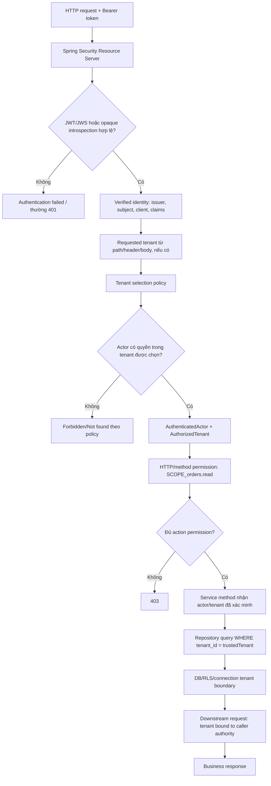

# Truyền tenant đã được xác minh xuống truy vấn và dịch vụ phía sau

Trong **Spring Security OAuth 2.0/OIDC Resource Server**, một API đa tenant phải trả lời hai câu hỏi độc lập: **caller là ai và token có đáng tin không?** và **caller được hành động trong tenant nào, trên những đối tượng nào?** Nếu API chỉ xác minh chữ ký JWT hoặc trạng thái opaque token rồi dùng `tenantId` lấy trực tiếp từ URL, header hoặc request body để truy vấn cơ sở dữ liệu, ứng dụng có thể bị **rò rỉ dữ liệu xuyên tenant (cross-tenant data leakage)**.

Một thiết kế an toàn cần hình thành **tenant context đã được xác minh**, rồi **truyền context đó qua ranh giới Controller → Service → Repository → Database → Downstream service** mà không để input chưa tin cậy ghi đè.

Ví dụ:

```text
JWT access token (đã xác minh):
  iss       = https://login.example.test/realms/shop
  sub       = user-123
  aud       = orders-api
  tenant_id = shop-a
  scope     = orders.read

HTTP request:
  GET /api/tenants/shop-b/orders/order-99

Câu hỏi:
  Có nên dùng shop-b lấy từ URL để query Orders database?

Trả lời:
  Không. shop-b chỉ là lựa chọn do caller gửi.
  Phải kiểm tra caller có được truy cập shop-b không.
  Nếu token chỉ xác nhận quyền shop-a, từ chối trước khi query.
```

Bài này trình bày cách xây dựng và truyền **tenant đã được kiểm chứng**, bao gồm JWT/opaque token, multi-issuer, tenant membership, tầng truy vấn JPA/SQL/R2DBC, database-per-tenant, RLS, downstream OAuth, queue/async jobs, logging và kiểm thử.

> **Nguyên tắc xuyên suốt:** Tenant ID không phải một bí mật; **khả năng tự khai một tenant ID không phải bằng chứng có quyền trong tenant đó**. Mọi truy cập dữ liệu phải bị giới hạn bằng tenant context xuất phát từ thông tin đã xác thực và chính sách membership/authorization server-side.

## 1. Ba khái niệm tenant không được đánh đồng

Trong API đa tenant, cùng từ “tenant” có thể chỉ ba đối tượng khác nhau.

| Khái niệm | Nguồn | Tính tin cậy | Cách dùng |
|---|---|---|---|
| **Token tenant** | Claim như `tenant_id` trong JWT đã xác minh hoặc introspection response từ AS đáng tin | AS xác nhận theo hợp đồng tại thời điểm phát hành/introspection | Ràng buộc identity/token-wide policy |
| **Requested tenant** | Path `/tenants/{tenantId}`, `X-Tenant-Id` hoặc body | Do caller chọn; chưa phải quyền | Chỉ là một *yêu cầu chọn tenant* |
| **Authorized/active tenant** | Kết quả kiểm tra token claims **và** membership, delegated policy, tenant state | Đã được server xác minh cho tác vụ hiện tại | Dùng để truy vấn, ghi dữ liệu, gọi downstream |

Với token chỉ có một tenant được phép và API theo chính sách single-active-tenant, authorized tenant có thể chính là `tenant_id` trong token **sau khi** JWT/opaque authentication và validation hoàn tất. Với user thuộc nhiều tenants hoặc khi membership cần hiệu lực tức thời, phải làm thêm bước xác minh quyền đối với tenant được chọn.

### 1.1. “Đã xác minh chữ ký” chưa đồng nghĩa membership hiện hành

JWT có chữ ký hợp lệ chứng minh claims đã được issuer đáng tin phát hành và chưa bị thay đổi, **không bảo đảm mọi dữ liệu tổ chức còn đúng tới thời điểm hiện tại**.

Ví dụ:

```text
09:00  AS cấp JWT tenant_id=shop-a, exp=10:00
09:15  Admin thu hồi membership của user trong shop-a
09:20  Caller dùng JWT cũ để gọi API
```

Nếu Resource Server chỉ kiểm tra chữ ký/expiration, token có thể còn hợp lệ về mật mã. Nhưng hệ thống yêu cầu thu hồi membership ngay cần kiểm tra trạng thái **hiện hành** qua database/policy service, token revocation hoặc flow cấp token có TTL phù hợp.

Không có một quy tắc bắt buộc “mọi request phải query membership” cho tất cả ứng dụng; đó là quyết định bảo mật dựa trên độ nhạy dữ liệu, contract AS, TTL và yêu cầu thu hồi.

### 1.2. Tenant của identity khác tenant lưu trữ

Một doanh nghiệp có thể dùng:

```text
Identity tenant / realm:
  customers-identity

Data tenants:
  shop-a
  shop-b
  shop-c
```

Không suy ra `iss` (issuer) hoặc realm ID chính là data tenant. Một issuer có thể cấp token cho nhiều data tenants; ngược lại, một data tenant có thể chấp nhận nhiều issuer đáng tin theo federation contract.

## 2. Mô hình threat: sửa tenant trong request

Giả sử Orders API nhận:

```http
GET /api/tenants/shop-a/orders/order-1
Authorization: Bearer <TOKEN_USER_123>
```

Token đã xác thực:

```json
{
  "iss": "https://login.example.test/realms/shop",
  "sub": "user-123",
  "aud": ["orders-api"],
  "tenant_id": "shop-a",
  "scope": "orders.read"
}
```

Đúng policy, user-123 có thể xem order-1 trong shop-a nếu còn đủ quyền và owner/ACL cho phép.

Caller đổi request:

```http
GET /api/tenants/shop-b/orders/order-3
Authorization: Bearer <SAME_TOKEN_USER_123>
```

Nếu controller truyền thẳng `shop-b` vào repository:

```java
@GetMapping("/api/tenants/{tenantId}/orders/{orderId}")
public OrderDto findOrder(
        @PathVariable String tenantId,
        @PathVariable String orderId) {

    return repository.findByTenantIdAndId(tenantId, orderId)
        .map(OrderDto::from)
        .orElseThrow(OrderNotFoundException::new);
}
```

thì attacker có thể đọc dữ liệu shop-b nếu đoán/biết order ID. **Dù SQL có điều kiện tenant, giá trị tenant vẫn do caller điều khiển và chưa được authorize.**

### 2.1. Đây là Broken Object Level Authorization

Lỗi này thuộc họ **Broken Object Level Authorization (BOLA)**, có thể dẫn tới:

- Đọc order/customer/invoice từ tenant khác.
- Cập nhật hoặc xóa bản ghi của tenant khác.
- Tìm kiếm và export toàn hệ thống.
- Trả aggregate/count của tenant không được phép.
- Gửi thông báo hoặc tạo job cho tenant khác.
- Gọi downstream service dưới tenant không thuộc caller.
- Trộn cache data giữa các tenants.

UUID khó đoán và TLS không thay tenant authorization. TLS bảo vệ đường truyền; UUID giảm khả năng đoán ID; cả hai không thay kiểm tra quyền.

## 3. Luồng bảo mật từ token đến truy vấn

Một thiết kế có thể được phân tách:



Thứ tự chi tiết giữa lựa chọn tenant và action permission có thể khác theo kiến trúc, nhưng **không được để dữ liệu tenant khác đi vào kết quả trước khi quyền được xác minh**.

### 3.1. Bốn lớp kiểm tra không thay thế nhau

| Lớp | Ví dụ | Điều nó không tự chứng minh |
|---|---|---|
| Authentication | JWT signature, `iss`, `aud`, `exp` hoặc opaque introspection `active` | Không biết order ID thuộc ai |
| Tenant authorization | Caller được hoạt động trong shop-a | Không biết caller có `orders.delete` |
| Action permission | `SCOPE_orders.read` | Không biết caller có quyền xem order-99 |
| Object permission | Owner/share/assignment của order-99 | Không thay validation token hoặc business state |

Một request đọc order có thể cần **cả bốn điều kiện** cùng đạt.

## 4. Nguồn danh tính đáng tin ở Resource Server

### 4.1. JWT access token

JWT access token được trình bày ví dụ:

```json
{
  "iss": "https://login.example.test/realms/shop",
  "sub": "user-123",
  "aud": ["orders-api"],
  "scope": "orders.read",
  "tenant_id": "shop-a",
  "exp": 1900000000
}
```

Spring Security JWT Resource Server phải xác minh chữ ký JWS với trusted keys, issuer, expiration/not-before, audience và claims tùy hợp đồng. Chỉ sau đó mới nên lấy `sub` và `tenant_id` từ authenticated principal.

Không đọc Base64URL payload chưa xác minh và coi đó là “decoded user context”.

### 4.2. Opaque token

Opaque token thường không có claims mà API tự parse. Resource Server gọi AS introspection endpoint. Response có thể chứa:

```json
{
  "active": true,
  "sub": "user-123",
  "aud": ["orders-api"],
  "scope": "orders.read",
  "tenant_id": "shop-a"
}
```

Spring Security dùng `OpaqueTokenIntrospector` (Servlet) hoặc `ReactiveOpaqueTokenIntrospector` (WebFlux). Nếu AS không cung cấp tenant claim trong introspection response, API không được tự điền tenant từ header rồi coi đó là giá trị đã xác thực.

Khi contract bắt buộc tenant, cần yêu cầu AS trả dữ liệu phù hợp hoặc lấy quan hệ tenant từ nguồn server-side đã được bảo vệ.

### 4.3. Những nguồn không được coi là bằng chứng tenant

| Input | Có thể dùng để làm gì? | Không được dùng để làm gì? |
|---|---|---|
| `/tenants/shop-b` | Caller yêu cầu chọn shop-b | Khẳng định caller thuộc shop-b |
| `X-Tenant-Id: shop-b` | Gợi ý active tenant/UI context | Bypass membership |
| Body `{"tenantId":"shop-b"}` | Nêu tenant mục tiêu trong use case tạo hộ | Tự gán owner/tenant không kiểm tra |
| `Origin: https://shop-b.example.test` | Browser CORS decision | Xác thực tenant |
| `Host` hoặc subdomain | Tenant routing hint theo contract | Chứng minh user có membership |
| Cookie unsigned `tenant=shop-b` | UI preference không nhạy cảm | Tenant authorization |
| JWT payload chưa kiểm chữ ký | Debug dữ liệu không đáng tin | Xây `AuthenticatedActor` |

Subdomain hoặc Origin có thể giúp **xác định tenant đang được yêu cầu**, nhưng vẫn cần so với danh tính/quyền từ phía server.

## 5. Thiết kế một `AuthenticatedActor` bất biến

Thay vì truyền chuỗi `tenantId` rời rạc qua nhiều tầng, ta có thể định nghĩa một value object:

```java
public record AuthenticatedActor(
    String issuer,
    String subject,
    String tenantId,
    Set<String> authorities
) {
    public AuthenticatedActor {
        Objects.requireNonNull(issuer, "issuer");
        Objects.requireNonNull(subject, "subject");
        Objects.requireNonNull(tenantId, "tenantId");
        authorities = Set.copyOf(authorities);

        if (issuer.isBlank()
                || subject.isBlank()
                || tenantId.isBlank()) {
            throw new IllegalArgumentException(
                "Verified actor fields must not be blank"
            );
        }
    }

    public boolean hasAuthority(String name) {
        return authorities.contains(name);
    }
}
```

Imports:

```java
import java.util.Objects;
import java.util.Set;
```

Record là immutable container hữu ích, nhưng **không có phép màu bảo mật**: một developer vẫn có thể tự gọi `new AuthenticatedActor("trusted", "admin", "shop-b", ...)`. Sự tin cậy đến từ **nơi tạo object và quy trình validation**, không đến từ tên kiểu `AuthenticatedActor`.

Cần thống nhất chỉ authentication/tenant-resolution adapter có trách nhiệm tạo actor cho HTTP request, từ principal đã được Spring Security xác thực và membership policy đã kiểm tra. Không bind trực tiếp JSON body sang kiểu này.

### 5.1. Vì sao giữ cả issuer và subject?

Multi-issuer có thể có hai principals:

```text
issuer A:
  sub = user-123

issuer B:
  sub = user-123
```

Hai subject trùng chuỗi chưa chắc là cùng một tài khoản. Trong các hệ thống federated identity, một principal key thường cần cặp **(issuer, subject)** hoặc account ID nội bộ ánh xạ từ cặp đó.

Nếu dùng riêng `sub` làm owner ID trên mọi issuer, có nguy cơ hai identities khác issuer truy cập dữ liệu của nhau.

### 5.2. Vì sao lưu authorities trong actor?

Service có thể dùng actor để thực thi action-level policy khi use case được gọi từ HTTP, job hoặc một entrypoint khác. Tuy nhiên không tự gán authorities theo tên role xuất hiện trong request. Tập authorities phải xuất phát từ `Authentication` được Spring Security xây dựng từ token/claims tin cậy, qua converter theo contract.

Một dự án cũng có thể giữ domain actor **không có authorities** và kiểm tra scopes ở HTTP/method layer. Điều quan trọng là boundaries nhất quán và các entrypoints nội bộ không bypass quyền.

## 6. Single-tenant token: đối chiếu tenant trong token với URL

Giả sử chính sách là một access token chỉ hoạt động trong **một tenant đang active**. Token có:

```text
tenant_id = shop-a
```

Với endpoint:

```text
GET /api/tenants/{tenantId}/orders/{orderId}
```

Resource Server phải bảo đảm `{tenantId}` bằng tenant trong token trước khi gọi repository.

Ví dụ adapter ở Servlet Spring Security JWT:

```java
@Component
public class JwtActorFactory {

    public AuthenticatedActor requireActorForTenant(
            JwtAuthenticationToken authentication,
            String requestedTenant) {

        Jwt jwt = authentication.getToken();

        String issuer = jwt.getIssuer() == null
            ? null
            : jwt.getIssuer().toString();

        String subject = jwt.getSubject();
        String tokenTenant =
            jwt.getClaimAsString("tenant_id");

        if (issuer == null
                || subject == null
                || tokenTenant == null
                || tokenTenant.isBlank()) {
            throw new AccessDeniedException(
                "Incomplete authenticated identity"
            );
        }

        if (!tokenTenant.equals(requestedTenant)) {
            throw new AccessDeniedException(
                "Tenant not allowed for this token"
            );
        }

        Set<String> authorities = authentication
            .getAuthorities()
            .stream()
            .map(GrantedAuthority::getAuthority)
            .collect(Collectors.toUnmodifiableSet());

        return new AuthenticatedActor(
            issuer, subject, tokenTenant, authorities
        );
    }
}
```

Imports:

```java
import java.util.Set;
import java.util.stream.Collectors;
import org.springframework.security.access.AccessDeniedException;
import org.springframework.security.core.GrantedAuthority;
import org.springframework.security.oauth2.jwt.Jwt;
import org.springframework.security.oauth2.server.resource.authentication.JwtAuthenticationToken;
import org.springframework.stereotype.Component;
```

Lớp trên giả định `JwtAuthenticationToken` đã được Spring Security tạo sau khi token được decoder xác thực. Nó không thay kiểm tra chữ ký/issuer/audience. Nếu `tenant_id` thiếu hoặc sai kiểu, một validator trong `JwtDecoder` còn có thể từ chối token ngay ở authentication (401); factory vẫn nên kiểm tra phòng thủ trước khi sử dụng.

### 6.1. Controller chỉ chuyển tenant đã được so khớp

```java
@RestController
@RequestMapping("/api/tenants/{tenantId}/orders")
public class OrderController {

    private final OrderService service;
    private final JwtActorFactory actorFactory;

    public OrderController(
            OrderService service,
            JwtActorFactory actorFactory) {
        this.service = service;
        this.actorFactory = actorFactory;
    }

    @GetMapping("/{orderId}")
    public OrderDto read(
            @PathVariable String tenantId,
            @PathVariable String orderId,
            Authentication authentication) {

        if (!(authentication instanceof JwtAuthenticationToken jwtAuth)) {
            throw new AccessDeniedException(
                "JWT authentication required"
            );
        }

        AuthenticatedActor actor =
            actorFactory.requireActorForTenant(
                jwtAuth, tenantId
            );

        return service.readVisibleOrder(orderId, actor);
    }
}
```

Imports:

```java
import org.springframework.security.access.AccessDeniedException;
import org.springframework.security.core.Authentication;
import org.springframework.security.oauth2.server.resource.authentication.JwtAuthenticationToken;
import org.springframework.web.bind.annotation.GetMapping;
import org.springframework.web.bind.annotation.PathVariable;
import org.springframework.web.bind.annotation.RequestMapping;
import org.springframework.web.bind.annotation.RestController;
```

**Điểm then chốt:** Service không nhận một `requestedTenant` do client tùy chọn cùng với actor rồi tự dùng requestedTenant. Nó chỉ nhận actor đã được factory kiểm tra, và dùng `actor.tenantId()` trong truy vấn.

### 6.2. Phải validate URL tenant ID về mặt cú pháp

Tenant ID có thể có quy ước, ví dụ lowercase ASCII và dấu gạch ngang:

```text
shop-a
shop-b
enterprise-42
```

Nếu tên tenant dùng UUID hoặc ký tự khác, cần quy tắc tương ứng. Nên tách:

- **Syntax validation:** tenant ID có đúng định dạng không?
- **Membership/permission validation:** caller có được dùng tenant ID đó không?

Một ID có cú pháp đúng vẫn hoàn toàn có thể là tenant của người khác.

## 7. Multi-tenant token: caller thuộc nhiều tenants

Không phải mọi access token chỉ chứa một `tenant_id`. Một số hệ thống cho user chọn active tenant từ danh sách membership:

```json
{
  "iss": "https://login.example.test/realms/shop",
  "sub": "user-123",
  "aud": ["orders-api"],
  "scope": "orders.read",
  "tenant_ids": ["shop-a", "shop-b"]
}
```

Đây là **claim riêng theo hợp đồng**, không phải claim chuẩn bắt buộc của OAuth 2.0/OIDC.

Caller yêu cầu:

```http
GET /api/tenants/shop-b/orders/order-42
Authorization: Bearer <MULTI_TENANT_TOKEN>
```

Một resolver có thể:

1. Lấy issuer và subject từ authenticated principal.
2. Đọc tenant IDs theo contract và xác minh kiểu dữ liệu.
3. Đối chiếu `requestedTenant` với tập tenant IDs được issuer cho phép.
4. Nếu cần quyền hiện hành, tra membership/role assignment của caller trong tenant đó.
5. Xây `AuthenticatedActor` có **một active tenant duy nhất** cho use case.
6. Truyền active tenant xuống mọi truy vấn.

### 7.1. Đừng truyền cả danh sách tenants xuống query không kiểm soát

Sai:

```java
repository.findByTenantIdIn(tokenTenantIds);
```

khi endpoint chỉ phục vụ một active tenant. Điều đó có thể làm response trộn dữ liệu của shop-a và shop-b, làm sai nghiệp vụ và khó phân quyền theo tenant.

Nếu use case thật sự cần cross-tenant reporting, cần **permission riêng**, định nghĩa rõ tập tenants được phép và giới hạn export/aggregation tương ứng.

### 7.2. Phân biệt membership và quyền thao tác

User có membership shop-b không tự có quyền `orders.export` tại shop-b. Nếu roles là tenant-scoped, token authority `ROLE_ADMIN` không nhất thiết có hiệu lực tại mọi tenant.

Một mô hình permission có thể là:

```text
Membership:
  user-123 is MEMBER of shop-a
  user-123 is SUPPORT of shop-b

Permissions:
  shop-a -> orders.read, orders.write
  shop-b -> orders.read
```

Nếu API dùng tenant-specific roles, phải xác định authorities theo active tenant hoặc kiểm tra per-tenant permissions trong policy service. Không gán quyền cao nhất ở tenant A rồi mặc định áp cho tenant B.

## 8. Membership server-side và kiểm tra trạng thái hiện hành

Khi token không chứa membership hoặc hệ thống cần hiệu lực thu hồi tức thời, có thể tra bảng membership:

```sql
CREATE TABLE tenant_memberships (
    issuer        VARCHAR(255) NOT NULL,
    subject       VARCHAR(255) NOT NULL,
    tenant_id     VARCHAR(64) NOT NULL,
    role_code     VARCHAR(64) NOT NULL,
    status        VARCHAR(32) NOT NULL,
    PRIMARY KEY (issuer, subject, tenant_id)
);
```

Truy vấn quyền:

```sql
SELECT 1
FROM tenant_memberships
WHERE issuer = :trustedIssuer
  AND subject = :trustedSubject
  AND tenant_id = :requestedTenant
  AND status = 'ACTIVE';
```

`trustedIssuer` và `trustedSubject` xuất phát từ Authentication đã xác thực. `requestedTenant` vẫn do client chọn, nhưng **chỉ được nâng thành active tenant khi membership query cho phép**.

### 8.1. Servlet service ví dụ

```java
@Service
public class TenantAccessService {

    private final TenantMembershipRepository memberships;

    public TenantAccessService(
            TenantMembershipRepository memberships) {
        this.memberships = memberships;
    }

    public AuthenticatedActor authorizeTenant(
            JwtAuthenticationToken authentication,
            String requestedTenant) {

        Jwt jwt = authentication.getToken();

        String issuer = jwt.getIssuer() == null
            ? null
            : jwt.getIssuer().toString();

        String subject = jwt.getSubject();

        if (issuer == null || subject == null) {
            throw new AccessDeniedException(
                "Missing verified identity"
            );
        }

        boolean active = memberships.existsActive(
            issuer, subject, requestedTenant
        );

        if (!active) {
            throw new AccessDeniedException(
                "Tenant access denied"
            );
        }

        Set<String> authorities = authentication
            .getAuthorities()
            .stream()
            .map(GrantedAuthority::getAuthority)
            .collect(Collectors.toUnmodifiableSet());

        return new AuthenticatedActor(
            issuer, subject, requestedTenant, authorities
        );
    }
}
```

`TenantMembershipRepository.existsActive(...)` là phương thức domain minh họa cần triển khai theo database, transaction và role policy cụ thể.

### 8.2. “Có membership” cũng có thể chưa đủ

Với dữ liệu nhạy cảm, cần xét thêm:

- Tenant có còn active, suspended hay deleted không?
- Membership có bị revoked hoặc expired không?
- Caller có action permission trong tenant đó không?
- Có delegation/impersonation được phê duyệt không?
- Có giới hạn theo project, branch hoặc data region không?
- Có ràng buộc legal hold/data residency không?
- Permission được xác nhận ở thời điểm token phát hành hay thời điểm request?

Đừng biến bảng membership chỉ có một cột `user_id` và `tenant_id` thành bằng chứng cho mọi action.

## 9. JWT validation: bảo đảm token dành cho API trước khi lấy tenant

Một JWT có `tenant_id=shop-a` không thể được dùng chỉ vì claim đúng định dạng. Trước khi xây actor, API phải xác minh những điều kiện phù hợp.

Ví dụ Spring Security Servlet:

```java
@Configuration
public class JwtDecoderConfiguration {

    private static final String ISSUER =
        "https://login.example.test/realms/shop";

    private static final String JWKS =
        "https://login.example.test/realms/shop/protocol/openid-connect/certs";

    private static final String AUDIENCE = "orders-api";

    @Bean
    JwtDecoder jwtDecoder() {
        NimbusJwtDecoder decoder =
            NimbusJwtDecoder.withJwkSetUri(JWKS).build();

        OAuth2TokenValidator<Jwt> defaultValidators =
            JwtValidators.createDefaultWithIssuer(ISSUER);

        OAuth2TokenValidator<Jwt> audienceValidator = jwt ->
            jwt.getAudience().contains(AUDIENCE)
                ? OAuth2TokenValidatorResult.success()
                : OAuth2TokenValidatorResult.failure(
                    new OAuth2Error(
                        "invalid_token",
                        "Unexpected audience",
                        null
                    ));

        OAuth2TokenValidator<Jwt> tenantClaimValidator = jwt -> {
            Object tenant = jwt.getClaim("tenant_id");

            if (tenant instanceof String text && !text.isBlank()) {
                return OAuth2TokenValidatorResult.success();
            }

            return OAuth2TokenValidatorResult.failure(
                new OAuth2Error(
                    "invalid_token",
                    "Missing tenant claim",
                    null
                )
            );
        };

        decoder.setJwtValidator(
            new DelegatingOAuth2TokenValidator<>(
                defaultValidators,
                audienceValidator,
                tenantClaimValidator
            )
        );

        return decoder;
    }
}
```

Imports:

```java
import org.springframework.context.annotation.Bean;
import org.springframework.context.annotation.Configuration;
import org.springframework.security.oauth2.core.DelegatingOAuth2TokenValidator;
import org.springframework.security.oauth2.core.OAuth2Error;
import org.springframework.security.oauth2.core.OAuth2TokenValidator;
import org.springframework.security.oauth2.core.OAuth2TokenValidatorResult;
import org.springframework.security.oauth2.jwt.Jwt;
import org.springframework.security.oauth2.jwt.JwtDecoder;
import org.springframework.security.oauth2.jwt.JwtValidators;
import org.springframework.security.oauth2.jwt.NimbusJwtDecoder;
```

Ví dụ này đặt ba nhóm điều kiện:

1. Chữ ký JWS phải được xác minh bằng trusted JWKS của issuer.
2. Các validators mặc định kèm expected issuer phải đạt.
3. Audience phải chứa `orders-api` và contract bắt buộc có tenant claim dạng chuỗi.

**Lưu ý quan trọng:** `tenant_id` là dữ liệu do AS phát hành, không phải thông số “Spring Security chuẩn bắt buộc”. Nếu kiến trúc đa tenant dùng membership server-side mà token không có tenant claim, không nên thêm validator bắt buộc như ví dụ; lúc đó identity và membership được kiểm tra theo contract riêng.

### 9.1. Không thay defaults chỉ bằng một validator tenant

Sai:

```java
decoder.setJwtValidator(tenantClaimValidator);
```

Nếu làm mất default issuer/timestamp checks, ứng dụng có thể nhận token sai issuer hoặc hết hạn. Cần **kết hợp** validators theo đúng cấu hình.

### 9.2. Audience khác OAuth client ID

```text
client_id = web-portal
aud       = orders-api
```

`client_id` thường chỉ OAuth client xin token, còn `aud` xác định Resource Server được nhận token. Một OAuth client có thể xin tokens cho nhiều APIs, nên Orders API không thể lấy client ID thay audience.

### 9.3. Không dùng OIDC ID token thay access token

ID token thường có audience là OIDC client, không phải Orders Resource Server. Dù có `sub` và tenant claim, nó không phải bằng chứng bearer access cho Orders API. Token type/profile và expected audience phải theo hợp đồng.

## 10. Cấu hình HTTP authorization vẫn cần thiết

Ví dụ:

```java
@Bean
SecurityFilterChain apiSecurity(HttpSecurity http) throws Exception {
    return http
        .authorizeHttpRequests(auth -> auth
            .requestMatchers(HttpMethod.GET, "/api/tenants/*/orders/**")
                .hasAuthority("SCOPE_orders.read")
            .requestMatchers(HttpMethod.POST, "/api/tenants/*/orders")
                .hasAuthority("SCOPE_orders.write")
            .anyRequest().denyAll()
        )
        .oauth2ResourceServer(oauth2 ->
            oauth2.jwt(Customizer.withDefaults())
        )
        .build();
}
```

Imports:

```java
import org.springframework.context.annotation.Bean;
import org.springframework.http.HttpMethod;
import org.springframework.security.config.Customizer;
import org.springframework.security.config.annotation.web.builders.HttpSecurity;
import org.springframework.security.web.SecurityFilterChain;
```

HTTP authorization yêu cầu scope theo method và URL; controller/service còn phải kiểm tra **tenant đang được chọn** và quyền với **object**. `hasAuthority("SCOPE_orders.read")` không tự xác minh `{tenantId}` trong path bằng claim đã được issuer xác nhận.

### 10.1. Cẩn thận pattern ưu tiên

Nếu có route export:

```text
GET /api/tenants/shop-a/orders/export
```

nó có thể cần `SCOPE_orders.export` chứ không phải chỉ `orders.read`. Cần đặt matcher export cụ thể **trước** wildcard GET orders nếu chúng có thể match cùng request.

## 11. Đưa tenant xuống service bằng tham số tường minh

Trong một hệ thống dễ kiểm toán, service nhận:

```java
public OrderDto readVisibleOrder(
    String orderId,
    AuthenticatedActor actor
) { ... }
```

thay vì:

```java
public OrderDto readAnyOrder(
    String orderId,
    String tenantFromRequest
) { ... }
```

Ví dụ:

```java
@Service
public class OrderService {

    private final OrderRepository repository;

    public OrderService(OrderRepository repository) {
        this.repository = repository;
    }

    @Transactional(readOnly = true)
    public OrderDto readVisibleOrder(
            UUID orderId,
            AuthenticatedActor actor) {

        if (!actor.hasAuthority("SCOPE_orders.read")) {
            throw new AccessDeniedException(
                "Missing orders.read permission"
            );
        }

        Order order = repository
            .findVisibleOrder(
                orderId,
                actor.tenantId(),
                actor.issuer(),
                actor.subject()
            )
            .orElseThrow(OrderNotFoundException::new);

        return OrderDto.from(order);
    }
}
```

Imports:

```java
import java.util.UUID;
import org.springframework.security.access.AccessDeniedException;
import org.springframework.stereotype.Service;
import org.springframework.transaction.annotation.Transactional;
```

Ở đây `OrderRepository`/`OrderDto`/`OrderNotFoundException` là domain types minh họa. Quan trọng nhất là **cùng actor đã được xác minh** được dùng cho cả permission và dữ liệu, không tự lấy tenant từ request lần thứ hai.

### 11.1. Tại sao explicit parameter thường đáng ưu tiên?

- Đường đi của tenant qua Controller → Service → Repository hiển thị ngay trong method signatures.
- Unit test dễ kiểm tra tenant nào được truyền.
- Không phụ thuộc ThreadLocal khi gọi async hoặc reactive.
- Các entrypoints như HTTP, batch, message consumer phải cung cấp context có provenance rõ.
- Dễ phát hiện nơi nào thiếu tenant hoặc lấy từ input không đáng tin.
- Có thể hỗ trợ audit và downstream calls nhất quán.

Hạn chế: Có nhiều method parameters hơn. Có thể nhóm `actor`, `tenant`, `requestContext` thành value objects, nhưng đừng dùng một object tổng quát có thể được khởi tạo tùy tiện từ JSON request.

### 11.2. Không tạo actor trong tầng repository

Repository không nên đọc HTTP header để quyết định tenant. Nó nên nhận tenant đã được service xác định hoặc nhận một context có trust boundary rõ. Nếu repository tự đọc global state, unit tests/async jobs có thể vô tình truy vấn sai tenant.

## 12. Repository JPA: ràng buộc tenant ở chính câu truy vấn

Giả sử entity `Order` có:

```java
@Entity
@Table(name = "orders")
public class Order {

    @Id
    private UUID id;

    @Column(nullable = false, updatable = false)
    private String tenantId;

    @Column(nullable = false, updatable = false)
    private String ownerIssuer;

    @Column(nullable = false, updatable = false)
    private String ownerSubject;

    private String status;

    // getters, constructors và domain methods...
}
```

JPA repository:

```java
public interface OrderRepository
        extends JpaRepository<Order, UUID> {

    @Query("""
        select o
        from Order o
        where o.id = :orderId
          and o.tenantId = :tenantId
          and o.ownerIssuer = :issuer
          and o.ownerSubject = :subject
        """)
    Optional<Order> findVisibleOrder(
        @Param("orderId") UUID orderId,
        @Param("tenantId") String tenantId,
        @Param("issuer") String issuer,
        @Param("subject") String subject
    );
}
```

Imports:

```java
import java.util.Optional;
import java.util.UUID;
import org.springframework.data.jpa.repository.JpaRepository;
import org.springframework.data.jpa.repository.Query;
import org.springframework.data.repository.query.Param;
```

Điểm đáng chú ý:

- Query lọc theo `orderId` **và** tenant.
- Nếu owner-only, query còn lọc issuer + subject.
- Tất cả parameter values do service truyền, không concat SQL strings.
- Bản ghi sai tenant/owner không được tải lên để trả ra ngoài.
- Nếu ACL/shared access được phép, query/policy cần mở rộng **trong giới hạn cùng tenant**.

### 12.1. Không gọi `findById` rồi mới kiểm tra tenant sau đó

Ví dụ rủi ro:

```java
Order order = repository.findById(orderId).orElseThrow();
return OrderDto.from(order);
// Tenant/owner check đã bị bỏ qua.
```

Ngay cả khi sau đó có kiểm tra ở controller, một luồng khác có thể quên gọi check, object có thể bị log/cache/materialize hoặc side effect xảy ra trước authorization. Prefer **scoped query** cho mọi use case cần dữ liệu tenant.

### 12.2. Hibernate filters và @Where có đủ không?

Một số ứng dụng sử dụng Hibernate filters, multi-tenancy APIs hoặc entity listeners để áp tenant predicates tự động. Chúng có thể hữu ích như lớp bảo vệ, nhưng phải hiểu:

- Filter có được bật cho mọi session/transaction không?
- Native queries, bulk updates, joins và projections có luôn chịu filter không?
- Entity managers hoặc caching có được tái sử dụng qua tenants không?
- Test/service/background jobs có bypass filter không?
- Có query nào đọc global statistics không?

Không coi một annotation là bằng chứng mọi truy vấn đã tenant-scoped. Các query quan trọng vẫn nên thể hiện tenant boundary rõ hoặc có database RLS/tenant routing bảo vệ độc lập.

## 13. SQL: query, update và delete đều cần tenant predicate

Đọc:

```sql
SELECT id, tenant_id, status, total_amount
FROM orders
WHERE id = :orderId
  AND tenant_id = :verifiedTenant
  AND owner_issuer = :verifiedIssuer
  AND owner_subject = :verifiedSubject;
```

Sửa:

```sql
UPDATE orders
SET shipping_address = :newAddress
WHERE id = :orderId
  AND tenant_id = :verifiedTenant
  AND owner_issuer = :verifiedIssuer
  AND owner_subject = :verifiedSubject
  AND status IN ('CREATED', 'CONFIRMED');
```

Xóa (nếu nghiệp vụ cho phép):

```sql
DELETE FROM orders
WHERE id = :orderId
  AND tenant_id = :verifiedTenant
  AND owner_issuer = :verifiedIssuer
  AND owner_subject = :verifiedSubject;
```

Các điều kiện tenant và owner phải có ở **chính mutation** nếu cần tránh race giữa check và update.

### 13.1. Kiểm tra affected rows

Nếu UPDATE trả 0 rows, có thể:

- Order không tồn tại.
- Order tồn tại nhưng sai tenant/owner.
- Order đã chuyển trạng thái không còn sửa được.
- Có concurrent update.

Không nên trả message “order tồn tại ở shop-b nhưng bạn không có quyền” cho caller không được phép, vì response có thể tiết lộ sự tồn tại của object tenant khác. Chọn 403/404/409 theo policy và khả năng tiết lộ dữ liệu.

### 13.2. Không bỏ tenant predicate ở câu query “nội bộ”

Một job báo cáo, batch update hay endpoint admin cũng là code phải có policy. “Query do backend thực hiện” không tự bảo đảm nó đã được giới hạn tenant đúng.

## 14. List, search, count và export: nguy cơ rò dữ liệu không cần ID

Sai:

```sql
SELECT * FROM orders ORDER BY created_at DESC;
```

Đúng hơn với owner-only policy:

```sql
SELECT *
FROM orders
WHERE tenant_id = :verifiedTenant
  AND owner_issuer = :verifiedIssuer
  AND owner_subject = :verifiedSubject
ORDER BY created_at DESC
LIMIT :pageSize OFFSET :offset;
```

Một API có thể trả list items đã lọc nhưng dùng tổng số toàn bảng:

```sql
SELECT COUNT(*) FROM orders;
```

Điều này vẫn có thể tiết lộ dữ liệu tenant khác qua `totalElements`, `totalPages` hoặc báo cáo tổng hợp. Count/aggregation phải sử dụng **cùng policy data visibility** với list.

### 14.1. Export nhạy cảm hơn read thông thường

```text
GET /api/tenants/shop-a/orders/export
```

có thể cần cả:

- Caller được hoạt động trong shop-a.
- `SCOPE_orders.export`.
- Dataset chỉ gồm các orders visible trong shop-a.
- Field-level filtering (không xuất internal fraud score).
- Audit người export, tenant và phạm vi.
- Không xuất cross-tenant dữ liệu vì dùng một query báo cáo global.

**Scope export chỉ cho phép loại hành động**; không tự cho phép export mọi tenant.

## 15. Tạo mới: luôn gắn tenant từ context đã được xác minh

Caller gửi:

```http
POST /api/tenants/shop-a/orders
Authorization: Bearer <ACCESS_TOKEN>
Content-Type: application/json

{
  "tenantId": "shop-b",
  "ownerSubject": "user-456",
  "items": [
    {"sku": "SKU-1", "quantity": 2}
  ]
}
```

Nếu endpoint dành cho khách hàng tạo đơn của chính mình, service không được tự dùng `tenantId` và `ownerSubject` từ body.

Ví dụ:

```java
@Transactional
public OrderDto createOwnOrder(
        CreateOrderRequest request,
        AuthenticatedActor actor) {

    requireAuthority(actor, "SCOPE_orders.write");

    Order order = new Order(
        UUID.randomUUID(),
        actor.tenantId(),
        actor.issuer(),
        actor.subject(),
        validateItems(request.items())
    );

    return OrderDto.from(repository.save(order));
}
```

Đây là domain example: `Order` constructor, `validateItems` và `requireAuthority` cần được triển khai tương ứng.

Chủ đích:

- Tenant được gán từ `actor.tenantId()`.
- Owner được gán từ verified issuer/subject.
- Client không được mass-assign owner hoặc tenant.
- Nếu use case tạo hộ người khác, cần **endpoint và permission riêng** cùng policy delegated access.

### 15.1. Field-level authorization

Ngay cả khi caller được tạo/sửa một order, không phải mọi field đều được cập nhật tùy ý:

| Field | Nguồn hợp lệ |
|---|---|
| `tenant_id` | Authorized tenant context |
| `owner_subject` | Verified identity hoặc delegated business flow |
| `unit_price` | Pricing service/catalog server-side |
| `payment_status` | Payment workflow được tin cậy |
| `shipping_address` | User input đã validate và business policy cho phép |
| `internal_note` | Support/admin được giao quyền |

Đừng bind HTTP request trực tiếp vào entity để update mọi field.

## 16. Cross-tenant relationships: kiểm tra cả hai phía

Một API có thể liên kết tài nguyên:

```http
POST /api/tenants/shop-a/orders/order-42/payments
Content-Type: application/json

{"paymentId": "payment-9"}
```

Cần kiểm tra:

1. Order 42 thuộc tenant được phép không?
2. Payment 9 thuộc tenant nào?
3. Caller có quyền liên kết payment đó không?
4. Order và payment có thuộc cùng tenant theo policy không?
5. Payment có tương ứng đúng order/merchant/currency không?

Nếu chỉ kiểm tra order tenant rồi dùng `paymentRepository.findById("payment-9")` toàn hệ thống, có thể tạo association xuyên tenant.

### 16.1. Khóa ngoại và composite key

Trong mô hình shared-table, có thể thiết kế khóa/unique constraint chứa tenant:

```sql
CREATE TABLE orders (
    tenant_id VARCHAR(64) NOT NULL,
    id UUID NOT NULL,
    owner_subject VARCHAR(255) NOT NULL,
    PRIMARY KEY (tenant_id, id)
);
```

Với bảng con, foreign key có thể gồm cả `tenant_id` và `order_id` để DB ngăn liên kết sai tenant:

```sql
CREATE TABLE order_items (
    tenant_id VARCHAR(64) NOT NULL,
    id UUID NOT NULL,
    order_id UUID NOT NULL,
    PRIMARY KEY (tenant_id, id),
    FOREIGN KEY (tenant_id, order_id)
        REFERENCES orders(tenant_id, id)
);
```

Cấu trúc này là ví dụ SQL khái niệm, cần điều chỉnh kiểu dữ liệu và migration theo DB thật. Composite tenant keys giúp giảm một lớp sai sót nhưng **không thay authorization**.

### 16.2. Global ID không miễn tenant check

Dù order ID là UUID v4 toàn cầu, yêu cầu với ID đó vẫn phải giới hạn theo tenant và object policy. IDs có thể lộ qua logs, URLs, exports hoặc integration callbacks.

## 17. Nhiều mô hình lưu trữ multi-tenant

Có ba nhóm kiến trúc phổ biến:

| Mô hình | Dữ liệu tenant | Hàng rào chính | Rủi ro |
|---|---|---|---|
| **Shared table, tenant discriminator** | Một bảng chung, có cột `tenant_id` | Query predicates/RLS | Quên WHERE tenant, join/cache sai |
| **Schema per tenant** | Mỗi tenant có schema | Schema routing/DB permissions | Chọn sai schema, pooled connection context |
| **Database per tenant** | Database/connection pool riêng | Tenant → DB routing | Resolver sai, default fallback, resource cost |

Không có mô hình nào tự loại bỏ nhu cầu xác thực tenant. Một client có thể yêu cầu `shop-b`; nếu routing dùng thẳng giá trị đó, ứng dụng vẫn truy cập database của shop-b dù mỗi tenant có DB riêng.

### 17.1. Shared table cần tenant predicate nhất quán

Ví dụ:

```sql
SELECT * FROM orders
WHERE tenant_id = :verifiedTenant
  AND id = :orderId;
```

Ưu điểm dễ vận hành, nhưng code phải dùng tenant context ở mọi query/update/delete/aggregation.

### 17.2. Schema per tenant

Routing schema phải lấy từ authorized tenant, không lấy raw URL và tự ghép SQL identifier:

```java
// Không an toàn nếu schemaName đến trực tiếp từ request.
String sql = "SET search_path TO " + requestedSchema;
```

Schema names là identifiers, thường không thể bind như thông số query thông thường. Nếu có schema routing, cần mapping allowlist server-side từ verified tenant sang schema thực tế, tránh SQL injection và cross-tenant routing.

### 17.3. Database per tenant

Một resolver có thể ánh xạ:

```text
shop-a -> managed datasource A
shop-b -> managed datasource B
```

Nhưng mapping phải được quản trị. **Không có kết quả mapping thì fail closed**; không fallback sang “default tenant DB” vì có thể ghi nhầm dữ liệu.

## 18. PostgreSQL Row-Level Security (RLS) như defense in depth

Ở PostgreSQL, Row-Level Security có thể giới hạn rows ở mức DB bên cạnh query predicates.

Ví dụ bảng:

```sql
ALTER TABLE orders ENABLE ROW LEVEL SECURITY;
ALTER TABLE orders FORCE ROW LEVEL SECURITY;

CREATE POLICY orders_tenant_policy
ON orders
USING (
    tenant_id = current_setting('app.tenant_id', true)
)
WITH CHECK (
    tenant_id = current_setting('app.tenant_id', true)
);
```

Ý nghĩa:

- `USING` giới hạn rows có thể nhìn thấy/sửa/xóa theo policy.
- `WITH CHECK` kiểm soát rows tạo mới hoặc thay đổi phải thuộc tenant hợp lệ.
- `current_setting(..., true)` trả null nếu setting không có; so sánh với null không match hàng nào, có thể hỗ trợ fail closed.
- `FORCE ROW LEVEL SECURITY` giúp áp cho table owner trong những trường hợp phù hợp, nhưng **superusers và roles có `BYPASSRLS` vẫn có thể bypass**. Application role không nên có quyền đó.

### 18.1. Đặt tenant context theo transaction

Trong một transaction, có thể dùng:

```sql
SELECT set_config(
    'app.tenant_id',
    :verifiedTenant,
    true
);
```

Tham số `true` đặt giá trị local trong transaction ở PostgreSQL. Các queries sau đó trong **cùng transaction/connection** được RLS kiểm tra theo tenant.

Một điều cần cẩn trọng:

- Không dùng `SET` session-wide rồi quên reset khi connection quay về pool.
- Không tin rằng một query khởi tạo context và query thực chắc chắn dùng cùng connection nếu transaction/connection management không bảo đảm.
- Không tự set tenant context từ `X-Tenant-Id` chưa authorize.
- Không cho app role bypass RLS.
- Định nghĩa default-deny khi setting vắng mặt.
- Test cả INSERT/UPDATE, không chỉ SELECT.

RLS **không thay service authorization**, vì nó có thể biết tenant nhưng chưa biết owner/share/support permission hoặc business state. Tuy nhiên, nếu cấu hình đúng, RLS có thể là một lớp bổ sung giảm lỗi do quên WHERE tenant.

### 18.2. RLS với connection pooling

Một lỗi điển hình:

```text
Request A sets tenant=shop-a on pooled connection
Request A returns connection
Request B (shop-b) reuses connection
Connection still has shop-a session setting
```

Nếu dùng session-scoped setting và không reset, request B có thể truy cập/ghi sai tenant. Dùng transaction-scoped context và bảo đảm cùng transaction/connection theo ORM/driver, hoặc dùng cơ chế routing được kiểm soát và tested.

## 19. Tenant routing datasource trong Servlet

Với DB-per-tenant, có thể dùng một routing abstraction như `AbstractRoutingDataSource`:

```java
public final class TenantRoutingDataSource
        extends AbstractRoutingDataSource {

    @Override
    protected Object determineCurrentLookupKey() {
        // Phải lấy từ verified tenant context do backend tạo.
        // Không đọc trực tiếp X-Tenant-Id của request.
        return VerifiedTenantHolder.requiredTenantId();
    }
}
```

Import:

```java
import org.springframework.jdbc.datasource.lookup.AbstractRoutingDataSource;
```

Đây là **khung minh họa**, không phải production-ready implementation của `VerifiedTenantHolder`.

### 19.1. Vì sao ThreadLocal cần cực kỳ cẩn trọng?

Trong Servlet synchronous flow, một holder dựa trên ThreadLocal có thể tiện cho routing. Nhưng:

- Mỗi request phải set context từ actor đã authorize.
- Mỗi request phải clear trong `finally`, kể cả exception.
- `@Async`, executor, scheduled jobs và CompletableFuture không tự carry ThreadLocal an toàn.
- Transaction có thể bind connection trước khi tenant được set.
- Thread reuse có thể khiến request sau thấy tenant cũ nếu quên clear.
- Security context đổi nhưng routing context không đồng bộ có thể dẫn tới cross-tenant mixup.

Vì vậy **truyền tenant tường minh** qua service/repository thường dễ kiểm toán hơn. Nếu buộc dùng holder để routing database, nó cần lifecycle nghiêm ngặt, test concurrency và fail-closed khi tenant thiếu.

### 19.2. Không chọn default DB khi tenant không biết

Sai:

```java
return lookupTenantIdOrNull();
// Khi null, framework fallback sang datasource mặc định.
```

Nếu default DB chứa data thật, lỗi context propagation có thể biến thành truy cập sai tenant. Cấu hình nên từ chối khi tenant không xác định hoặc không có mapping hợp lệ.

## 20. WebFlux: tenant context phải theo Reactor Context hoặc tham số

Trong WebFlux, request không cố định với một Servlet thread. Không thể dùng ThreadLocal holder như một assumption mặc định.

Sau opaque introspection/JWT authentication, reactive security context có thể được đọc:

```java
Mono<Authentication> authentication =
    ReactiveSecurityContextHolder.getContext()
        .map(SecurityContext::getAuthentication);
```

Imports:

```java
import org.springframework.security.core.Authentication;
import org.springframework.security.core.context.ReactiveSecurityContextHolder;
import org.springframework.security.core.context.SecurityContext;
import reactor.core.publisher.Mono;
```

Có thể tạo actor rồi truyền xuống service:

```java
public Mono<OrderDto> readVisibleOrder(String orderId) {
    return currentActorProvider.currentActor()
        .flatMap(actor ->
            orderService.readVisibleOrder(orderId, actor)
        );
}
```

`currentActorProvider` phải chỉ lấy identity từ authenticated principal đáng tin và thực thi tenant authorization theo contract. Không dùng `Mono.just(request.getHeaders().getFirst("X-Tenant-Id"))` để tạo verified tenant.

### 20.1. Repository R2DBC

Một repository reactive minh họa:

```java
public Mono<Order> findVisibleOrder(
        UUID id,
        AuthenticatedActor actor) {

    return databaseClient.sql("""
            SELECT *
            FROM orders
            WHERE id = :id
              AND tenant_id = :tenant
              AND owner_issuer = :issuer
              AND owner_subject = :subject
            """)
        .bind("id", id)
        .bind("tenant", actor.tenantId())
        .bind("issuer", actor.issuer())
        .bind("subject", actor.subject())
        .map((row, metadata) -> mapOrder(row))
        .one();
}
```

Ở đây `DatabaseClient` là API R2DBC của Spring; `mapOrder(row)` là mapper domain cần viết. Đây là ví dụ truy vấn **có tenant predicate bằng bound parameters**. Không đưa `actor.tenantId()` vào SQL bằng nối chuỗi.

### 20.2. Reactor Context thay ThreadLocal

Reactor Context đi theo subscriber chain, có thể được truy cập qua `ReactiveSecurityContextHolder`. Các operators như `flatMap`/`publishOn` thường giữ context trong cùng chain.

Tránh:

```java
service.readVisibleOrder(orderId, actor)
    .subscribe(); // Tách subscription, không chờ kết quả.
```

Nó có thể làm context/error propagation sai và trả response trước khi business authorization hoàn thành.

### 20.3. Transaction-scoped RLS trong R2DBC

Nếu dùng PostgreSQL RLS với R2DBC, việc đặt `app.tenant_id` rồi query phải diễn ra **trong cùng reactive transaction và connection**. Không gọi một câu `set_config` trên connection A rồi assume query trên connection B vẫn nhận cùng setting. Cần dùng `TransactionalOperator`/transaction management thích hợp và xác nhận connection binding trong integration test.

## 21. Opaque Resource Server: ánh xạ tenant từ principal đã introspect

Trong Servlet opaque token:

```java
if (!(authentication instanceof BearerTokenAuthentication bearer)) {
    throw new AccessDeniedException(
        "Opaque bearer authentication required"
    );
}

OAuth2AuthenticatedPrincipal principal = bearer.getPrincipal();
String subject = principal.getAttribute("sub");
String tenant = principal.getAttribute("tenant_id");
```

Imports:

```java
import org.springframework.security.oauth2.core.OAuth2AuthenticatedPrincipal;
import org.springframework.security.oauth2.server.resource.authentication.BearerTokenAuthentication;
```

Tùy AS và Spring Security version, kiểu attributes của principal cần được kiểm tra. Không ép kiểu String nếu claim thực tế không đúng contract; tốt hơn là có introspector wrapper validate claims rồi chỉ trả principal nếu hợp lệ.

### 21.1. Wrapper kiểm tra token-wide contract

Ví dụ một `OpaqueTokenIntrospector` decorator:

```java
public final class TenantCheckingIntrospector
        implements OpaqueTokenIntrospector {

    private final OpaqueTokenIntrospector delegate;

    public TenantCheckingIntrospector(
            OpaqueTokenIntrospector delegate) {
        this.delegate = delegate;
    }

    @Override
    public OAuth2AuthenticatedPrincipal introspect(String token) {
        OAuth2AuthenticatedPrincipal p =
            delegate.introspect(token);

        Object tenant = p.getAttribute("tenant_id");

        if (!(tenant instanceof String text)
                || text.isBlank()) {
            throw new BadOpaqueTokenException(
                "Missing required tenant claim"
            );
        }

        return p;
    }
}
```

Imports:

```java
import org.springframework.security.oauth2.core.OAuth2AuthenticatedPrincipal;
import org.springframework.security.oauth2.server.resource.introspection.BadOpaqueTokenException;
import org.springframework.security.oauth2.server.resource.introspection.OpaqueTokenIntrospector;
```

Delegate kiểm tra `active`; wrapper xác minh tenant claim có cấu trúc phù hợp. Nhưng **chỉ có claim tenant vẫn không chứng minh caller được đọc bất kỳ order cụ thể nào**; policy object vẫn phải chạy.

### 21.2. WebFlux opaque token

Ở WebFlux interface tương ứng là `ReactiveOpaqueTokenIntrospector`, trả `Mono<OAuth2AuthenticatedPrincipal>`. Lớp tenant check cần dùng `map`/`flatMap`/`Mono.error` và giữ fail-closed, không `block()` hay `subscribe()` thủ công.

## 22. Tenant context khi gọi downstream APIs

Giả sử Orders API gọi Payments API:

```text
Caller
  -> Orders API  [aud=orders-api]
      -> Payments API [aud=payments-api]
```

Một request có thể mang:

```text
actor:
  issuer  = https://login.example.test/realms/shop
  subject = user-123
  tenant  = shop-a

action:
  pay order-42
```

Không được làm:

```java
webClient.post()
    .uri("https://payments.example.test/payments")
    .header("X-Tenant-Id", request.getHeader("X-Tenant-Id"))
    .retrieve();
```

vì header từ caller chưa chứng minh quyền tenant. Downstream cũng không được tin `X-Tenant-Id` chỉ vì request có header đó.

### 22.1. Ba thành phần của một downstream contract

1. **Caller identity/delegation:** Payments API biết ai đang gọi (Orders service, end user, delegated actor) qua mTLS/OAuth access token phù hợp.
2. **Tenant binding:** Tenant được truyền từ `AuthenticatedActor` đã xác minh, và Payments API kiểm tra rằng caller được phép thao tác trong tenant đó.
3. **Resource/object authorization:** Payment/order/customer targets thực sự thuộc tenant và caller được phép xử lý theo nghiệp vụ.

Một HTTP header như `X-Verified-Tenant` có thể dùng **làm metadata nội bộ** khi có trust boundary mạnh, nhưng **bản thân tên header không phải chữ ký bảo mật**.

### 22.2. Tránh forwarding token sai audience

Caller gửi access token:

```json
{
  "aud": ["orders-api"],
  "scope": "orders.read"
}
```

Orders API không được tự forward token đó sang Payments API rồi coi là hợp lệ. Payments API cần token hướng tới `payments-api` hoặc delegated credentials theo OAuth token exchange/on-behalf-of flow mà AS hỗ trợ, đồng thời kiểm tra scope và tenant phù hợp.

Một mô hình có thể:

```text
Caller token for orders-api
  -> Orders API validates
  -> AS token exchange / approved delegation
  -> delegated token for payments-api
  -> Payments API validates issuer/audience/scope/tenant
```

OAuth token exchange (ví dụ RFC 8693) chỉ áp dụng khi AS và các APIs **thực sự hỗ trợ**; không giả định Spring Security Resource Server tự trao đổi token chỉ vì đã được cấu hình JWT decoder.

### 22.3. Service credentials không đồng nghĩa user authority

Một service có thể dùng Client Credentials grant:

```text
client_id=orders-service
scope=payments.create
aud=payments-api
```

Token này đại diện service principal, không tự chứng minh end user `user-123` đã ủy quyền thanh toán cho order-42. Khi gọi thay người dùng, cần kiểm soát delegated actor, business policy và audit, không chỉ tin vào scope kỹ thuật rộng của service account.

## 23. WebClient: truyền tenant đã xác minh mà không phụ thuộc request gốc

Ví dụ service nhận actor explicit:

```java
@Service
public class PaymentsGateway {

    private final WebClient paymentsWebClient;
    private final ServiceTokenProvider tokenProvider;

    public PaymentsGateway(
            WebClient paymentsWebClient,
            ServiceTokenProvider tokenProvider) {
        this.paymentsWebClient = paymentsWebClient;
        this.tokenProvider = tokenProvider;
    }

    public Mono<PaymentResponse> createPayment(
            PaymentCommand command,
            AuthenticatedActor actor) {

        return tokenProvider.tokenForPayments(actor)
            .flatMap(paymentAccessToken ->
                paymentsWebClient.post()
                    .uri("/api/payments")
                    .headers(headers -> {
                        headers.setBearerAuth(paymentAccessToken);
                        headers.set("X-Tenant-Id", actor.tenantId());
                    })
                    .bodyValue(command)
                    .retrieve()
                    .bodyToMono(PaymentResponse.class)
            );
    }
}
```

Imports:

```java
import org.springframework.stereotype.Service;
import org.springframework.web.reactive.function.client.WebClient;
import reactor.core.publisher.Mono;
```

`ServiceTokenProvider` là abstraction minh họa: nó cần cấp **token hợp lệ cho Payments API**, sử dụng client credentials/delegation đúng contract. `PaymentCommand` và `PaymentResponse` là domain types.

**Điểm cốt lõi:** header tenant được tạo từ `actor.tenantId()` đã được xác minh, không copy nguyên input. Nhưng Payments API **vẫn phải xác thực token caller và đối chiếu tenant** theo contract; nếu nó chỉ tin header thì attacker có thể gọi API trực tiếp hoặc qua integration không đúng bảo vệ.

### 23.1. Không tự lưu Bearer token trong actor

Không nên đưa raw access token vào `AuthenticatedActor` để mọi service có thể forward tùy ý. Access token là credential có audience/expiry/scope, cần quản lý riêng và không log. Actor domain chỉ nên chứa thông tin cần cho authorization business.

### 23.2. Headers phải được overwrite server-side

Nếu gateway nhận `X-Tenant-Id` từ Internet, cần strip/override ở trust boundary. Một internal proxy gửi thông tin tenant được ký/mTLS authenticated có thể có contract riêng, nhưng downstream phải xác thực nguồn header thay vì tin mọi input.

## 24. Downstream service phải kiểm tra lại tenant

Không có nguyên tắc “Orders API đã kiểm tra nên Payments API không cần kiểm tra”.

Payments API có thể bị gọi từ:

- Orders API.
- Billing worker.
- Admin console.
- External partner.
- Một integration mới.
- Request trực tiếp không qua Orders API.

Do đó Payments API phải thực thi chính sách riêng:

```text
accept(request) if:
  caller access token valid for payments-api
  AND caller has payments.create
  AND tenant selection authorized for caller/delegation
  AND target order/payment belongs to that tenant
  AND payment state valid
```

Không có trust boundary hợp lệ thì `X-Tenant-Id` chỉ là untrusted input. Trong hệ thống phân tán, **mỗi service tự bảo vệ tài nguyên mà nó sở hữu**.

### 24.1. Mapping tenant giữa services

Có thể Orders dùng `tenant_id=shop-a` và Payments dùng `merchant_account_id=merchant-17`. Không tự giả định hai IDs tương đương.

Một mapping server-side đáng tin có thể là:

```text
shop-a -> merchant-17
shop-b -> merchant-29
```

Resolver phải kiểm tra mapping và quyền actor với tenant trước khi gọi Payments. Nếu mapping không tồn tại, **fail closed**. Không cho client gửi merchant account ID rồi dùng nó làm bằng chứng quyền.

## 25. Async jobs: không phụ thuộc SecurityContext của HTTP request

Một export job:

```http
POST /api/tenants/shop-a/reports/export
Authorization: Bearer <ACCESS_TOKEN>
```

được enqueue và chạy 30 phút sau. Khi worker chạy, HTTP request đã kết thúc; Servlet SecurityContext hoặc Reactor Context ban đầu **không tự tồn tại** trong queue consumer.

Một job payload có thể ghi:

```json
{
  "jobId": "job-123",
  "requestedTenant": "shop-a",
  "requestedBy": {
    "issuer": "https://login.example.test/realms/shop",
    "subject": "user-123"
  },
  "reportType": "orders-export"
}
```

Nhưng payload chỉ đáng tin nếu nó được tạo bởi producer/service đã xác thực trong một kênh queue có cơ chế bảo vệ. Worker không được tin một message đến từ nguồn bất kỳ chỉ vì fields mang tên `requestedBy`.

### 25.1. Mô hình job authorization

1. HTTP endpoint xác minh token, scope export và tenant permission.
2. Ghi job command với actor/tenant từ server-side verified context.
3. Bảo vệ queue và producer identities.
4. Worker kiểm tra job type, tenant và **re-check quyền** nếu policy yêu cầu ở thời điểm thực thi.
5. Query theo tenant đã được xác minh ở worker.
6. Ghi audit và bảo vệ file report; download cũng cần authorization.
7. Không lưu access token raw vào queue trừ khi một protocol được thiết kế rõ ràng đòi điều đó.

### 25.2. Thu hồi quyền trong lúc job chờ

Nếu membership bị revoked sau khi enqueue mà trước khi job chạy, phải có chính sách:

- Job bị hủy/từ chối khi chạy?
- Job vẫn chạy vì được authorize tại submission?
- Chỉ một số loại báo cáo nhạy cảm cần recheck?
- File export đã tạo có bị thu hồi quyền download không?

Đây là quyết định nghiệp vụ/bảo mật cần rõ, không tự suy ra từ việc job lưu tenantId.

## 26. @Async, executors và ThreadLocal tenant context

Trong Servlet stack, một số ứng dụng đọc tenant từ `SecurityContextHolder` hoặc ThreadLocal. Khi dùng `@Async`:

```java
@Async
public void generateReport(String reportId) {
    // Có thể chạy trên thread khác request.
}
```

Tenant context dựa trên ThreadLocal **không tự đi cùng** lời gọi này. Nếu fallback sang default tenant, rủi ro cross-tenant rất lớn.

### 26.1. Truyền context explicit cho async worker

Tốt hơn:

```java
@Async
public CompletableFuture<ReportResult> generateReport(
        String reportId,
        AuthenticatedActor authorizedActor) {

    ReportResult result =
        reportService.generateForTenant(
            reportId,
            authorizedActor
        );

    return CompletableFuture.completedFuture(result);
}
```

Các kiểu domain minh họa; cần chú ý actor được tạo từ HTTP auth trước khi enqueue/schedule và policy recheck theo threat model.

Khi dùng framework tools để propagate SecurityContext qua executors, vẫn phải kiểm tra:

- Context được capture ở đúng thời điểm.
- Không leak giữa tasks.
- Tenant routing context và SecurityContext có cùng lifecycle.
- Không copy token/credentials vượt mức cần thiết.
- Trường hợp job không còn HTTP request được xử lý rõ.

## 27. Truyền tenant trong cache và event

### 27.1. Cache keys phải phân biệt tenant

Sai:

```text
cache key = order:42
```

Nếu order IDs trùng giữa tenants hoặc cache chứa DTO gắn owner/tenant, một tenant có thể đọc dữ liệu cached của tenant khác.

An toàn hơn nếu policy phụ thuộc tenant:

```text
cache key = tenant:shop-a:order:42
```

Nếu response còn phụ thuộc owner/role/field visibility, chỉ thêm tenant cũng **chưa đủ**; cần authorization trước khi trả cache hoặc cache phân vùng theo đúng identity/policy.

### 27.2. Eviction/invalidation phải tenant-scoped

Một delete/update event:

```json
{
  "tenantId": "shop-a",
  "orderId": "42",
  "eventType": "ORDER_UPDATED"
}
```

phải được xác thực nguồn và gắn tenant đúng với entity đã cập nhật. Không cho một integration bất kỳ gửi tenantId giả để xóa cache hoặc kích hoạt thao tác trong tenant khác.

### 27.3. Event payload là dữ liệu, không phải Authentication

Một message có `"tenantId": "shop-a"` không tự chứng minh producer có quyền trong shop-a. Consumer phải tin nguồn theo transport/authentication, contract signed event/delegation hoặc policy kiểm tra riêng.

## 28. Multi-issuer: tenant namespace và subject namespace

Giả sử Orders API tin hai issuers:

```text
Issuer A:
  https://login.example.test/realms/shop

Issuer B:
  https://partners.example.test/realms/partners
```

Cả hai có thể có:

```json
{"sub": "user-123", "tenant_id": "shop-a"}
```

Những chuỗi giống nhau **không bảo đảm cùng identity và tenant**. Hệ thống cần một mapping được quản trị:

```text
(issuer A, tenant_id=shop-a) -> internal_tenant_uuid=3c...
(issuer B, tenant_id=shop-a) -> internal_tenant_uuid=8f...
```

Nếu hệ thống quy định tenant IDs global và tin các issuers cùng namespace, contract đó phải rõ. Không tự giả định.

### 28.1. Resolver không được tự tin mọi `iss`

Trong multi-issuer JWT Resource Server, một resolver có thể đọc issuer claim chưa xác thực để **chọn trong allowlist** các authentication managers/decoders đã cấu hình. Nếu issuer không thuộc allowlist, phải từ chối, không fetch JWKS từ URL do attacker đưa.

### 28.2. Tenant mapping là bước server-side

Một mapping function:

```text
mapExternalTenant(issuer, externalTenantId)
    -> internalTenantId
```

chỉ nên dùng với issuer đã xác thực. Không lấy issuer từ query parameter và gửi tới mapping table rồi tự tạo authority.

## 29. Khi nào cần tenant-specific scopes và roles?

Một token có:

```json
{
  "scope": "orders.read",
  "tenant_ids": ["shop-a", "shop-b"]
}
```

có thể mang scope global hoặc scope chỉ áp dụng vào một tenant. Contract phải trả lời:

- `orders.read` áp cho mọi tenant trong token?
- Hay cần membership role per tenant?
- Có tenant nào chỉ được read, tenant nào được write?
- Support/admin được thao tác thay owner trong tenant nào?
- Khi đổi active tenant, token có phải cấp lại không?
- Client credentials service account được phép trong tập tenants nào?

Một trường hợp có policy:

```text
Authorization:
  actor is active member of shop-a
  AND actor has orders.read in shop-a
  AND order is visible to actor in shop-a
```

Nếu đã dùng tenant-specific permissions, chỉ ánh xạ mọi claim `roles=["ADMIN"]` thành `ROLE_ADMIN` toàn hệ thống có thể gây **privilege escalation**.

### 29.1. ABAC/ReBAC thay vì chỉ RBAC

Có thể cần:

- **RBAC:** user có role `ORDER_MANAGER` trong tenant.
- **ABAC:** order.tenant và actor.activeTenant khớp.
- **ReBAC:** user được share order hoặc được assigned support case.
- **Business state:** order chưa bị khóa/ship.
- **Delegation:** một admin cross-tenant được ủy quyền qua workflow có audit.

Service/repository cần thực thi kết hợp theo logic policy, không chỉ tin một chuỗi role trong JWT.

## 30. Chính sách lỗi và tránh tiết lộ tenant

Một ma trận HTTP:

| Tình huống | Lỗi thuộc tầng nào? | HTTP thường gặp |
|---|---|---|
| Không có bearer token ở protected endpoint | Authentication | 401 |
| JWT sai signature/issuer/audience/expiry | Authentication/token validation | 401 |
| Opaque introspection trả `active=false` | Authentication | 401 |
| Tenant claim bắt buộc bị thiếu/sai | Token contract | Thường 401 nếu validator từ chối |
| Caller yêu cầu tenant ngoài tập được phép | Tenant authorization | 403 hoặc 404 theo policy |
| Có tenant quyền nhưng thiếu `orders.write` | Action authorization | 403 |
| Có tenant và scope đọc nhưng order của người khác | Object authorization | 403 hoặc 404 |
| Order không tồn tại | Lookup | 404 |
| Có quyền nhưng order không thể cancel | Business state | 409 hoặc domain error |
| Membership DB lỗi/timeouts | Không xác nhận được quyền | Fail closed, status hạ tầng phù hợp |

### 30.1. Vì sao trả 404 thay cho 403 trong vài trường hợp?

Nếu API trả `403` khi order ID tồn tại ở tenant khác và `404` khi không có order, attacker có thể suy ra object ID hợp lệ. Nhiều ứng dụng chọn **404 cho tất cả object không visible**, để không lộ dữ liệu tồn tại của tenant khác.

Phải có policy thống nhất giữa detail/list/search. Không trả ownerName, tenantName hoặc object status trong error body khi caller không được phép xem.

### 30.2. Không dùng lỗi 401 cho mọi tenant mismatch

Một token hợp lệ có thể được sử dụng tại tenant A nhưng không được phép tại tenant B. Đó thường là **authorization failure**, không phải “token ký sai”. Nếu dùng một tenant-bound token mà contract quy định token không dành cho tenant được yêu cầu, cách mapping lỗi cần được xác định rõ, nhưng không nên che toàn bộ policy bằng `invalid_token` tùy tiện.

## 31. Testing: HTTP, tenant resolution, repository và downstream

Một bài test đủ mạnh cần nhiều layers. Nếu mọi test chỉ có một user và một tenant, lỗi bỏ WHERE tenant hoặc lẫn context có thể vẫn pass.

Fixture tối thiểu:

```text
Issuer shop:
  user-123 member shop-a
  user-456 member shop-a
  user-789 member shop-b

Orders:
  order-a1: shop-a, owner=user-123
  order-a2: shop-a, owner=user-456
  order-b1: shop-b, owner=user-789
```

### 31.1. Ma trận request

| Actor/token | Request | Expected |
|---|---|---|
| user-123, tenant shop-a, scope read | GET order-a1 tại shop-a | Cho phép |
| user-123, tenant shop-a, scope read | GET order-a2 tại shop-a | Từ chối nếu không share |
| user-123, tenant shop-a, scope read | GET order-b1 tại shop-b | Từ chối |
| user-123, tenant shop-a, scope profile | GET order-a1 | 403 thiếu action permission |
| user-123, tenant shop-a, scope write | POST tạo order với body tenant shop-b | Không tạo record shop-b |
| user-123, tenant shop-a, scope read | GET list | Chỉ visible orders của shop-a |
| user-123, tenant shop-a, scope export | Export orders | Không xuất shop-b/không xuất object ngoài ACL |
| user-123, membership shop-a revoked | GET order-a1 với JWT cũ | Theo revocation policy hiện hành |
| service client allowed shop-a | Downstream create payment shop-b | Từ chối |
| user-123 và user-789 concurrent | GET orders của hai tenants | Không trộn data |

### 31.2. Test `JwtActorFactory` bằng unit test

Một test có thể mô phỏng JWT đã xác thực:

```java
@Test
void rejectsRequestedTenantDifferentFromToken() {
    Jwt jwt = Jwt.withTokenValue("test-token")
        .header("alg", "RS256")
        .issuer("https://login.example.test/realms/shop")
        .subject("user-123")
        .claim("tenant_id", "shop-a")
        .claim("scope", "orders.read")
        .build();

    JwtAuthenticationToken authentication =
        new JwtAuthenticationToken(
            jwt,
            List.of(new SimpleGrantedAuthority(
                "SCOPE_orders.read"))
        );

    JwtActorFactory factory = new JwtActorFactory();

    assertThrows(
        AccessDeniedException.class,
        () -> factory.requireActorForTenant(
            authentication, "shop-b")
    );
}
```

Imports:

```java
import static org.junit.jupiter.api.Assertions.assertThrows;
import java.util.List;
import org.junit.jupiter.api.Test;
import org.springframework.security.access.AccessDeniedException;
import org.springframework.security.core.authority.SimpleGrantedAuthority;
import org.springframework.security.oauth2.jwt.Jwt;
import org.springframework.security.oauth2.server.resource.authentication.JwtAuthenticationToken;
```

**Phạm vi:** Test này kiểm tra factory/tenant mismatch, **không xác minh JWS signature thật**. `Jwt.withTokenValue(...)` tạo test Jwt object, không đại diện token đã đi qua NimbusJwtDecoder.

### 31.3. MockMvc với Spring Security Test

Có thể mô phỏng authenticated principal bằng `jwt()`:

```java
mockMvc.perform(get(
            "/api/tenants/shop-b/orders/order-b1")
        .with(jwt().jwt(jwt ->
            jwt.claim("tenant_id", "shop-a")
               .subject("user-123")
               .issuer("https://login.example.test/realms/shop")
        ).authorities(new SimpleGrantedAuthority(
            "SCOPE_orders.read"
        ))))
    .andExpect(status().isForbidden());
```

Đây là HTTP authorization test với fixture. `jwt()` của Spring Security Test thường bypass decoder chữ ký thật, nên cần thêm integration test JWT signed token để kiểm tra issuer/audience/time validation.

### 31.4. Repository integration test

Cần dữ liệu nhiều tenants với IDs dễ phân biệt:

```text
shop-a: order-a1, order-a2
shop-b: order-b1
```

Assertion:

- Query với `tenant=shop-a` không thấy order-b1.
- Query owner user-123 không thấy order-a2.
- Count/search/export cũng lọc đúng.
- UPDATE với order-b1 và verified shop-a ảnh hưởng 0 rows.
- Joins và nested resources không bypass tenant.
- Không có connection/RLS context leakage qua transaction khác.

### 31.5. Downstream contract test

Dùng fake Payments API và fake token provider:

- Orders service gửi tenant header từ authorized actor, không từ raw request.
- Access token gửi downstream có expected audience Payments API.
- Nếu actor chỉ thuộc shop-a, không gửi thanh toán cho shop-b.
- Payments API kiểm tra lại tenant authorization.
- Khi token exchange thất bại, không fallback sang token admin không giới hạn.
- Không log raw bearer/access token.

## 32. Test concurrency để phát hiện lẫn tenant context

Một lỗi nguy hiểm thường chỉ xuất hiện khi requests concurrent:

```text
Request A:
  principal = user-123
  tenant = shop-a

Request B:
  principal = user-789
  tenant = shop-b

Both requests:
  run at the same time
  share connection pool/thread pool/reactive scheduler
```

Test cần xác nhận:

1. A chỉ đọc/ghi dữ liệu shop-a.
2. B chỉ đọc/ghi dữ liệu shop-b.
3. Không có ThreadLocal tenant còn sót sau request.
4. RLS setting không leak giữa pooled connections.
5. Cache keys không trùng tenant.
6. Không có shared mutable field như `currentTenant` trong singleton service.
7. Audit của A/B có identity đúng.
8. Downstream tenant headers không bị hoán đổi.

### 32.1. Không dùng singleton field lưu current tenant

Sai:

```java
@Service
public class CurrentTenantService {
    private String currentTenant; // Shared mutable state!
}
```

Nhiều requests cùng dùng một singleton bean; field có thể bị ghi đè, dẫn tới cross-tenant access. Dùng actor argument, request-scoped lifecycle được quản lý chính xác hoặc Reactor Context theo mô hình WebFlux.

### 32.2. Không tin rằng async luôn giữ context

Servlet `@Async`/thread pool và WebFlux subscriptions tách rời có thể mất tenant context. Nếu không có tenant đáng tin, **từ chối công việc**, không chọn default shop-a.

## 33. Testing bảo mật token khác testing tenant authorization

Cần tách hai nhóm:

**Token tests** dùng JWT thật được ký hoặc opaque introspection stub:

```text
- Signature/JWKS invalid -> reject
- Wrong issuer -> reject
- Wrong audience -> reject
- Expired/not-before -> reject
- Inactive opaque token -> reject
- Required tenant claim malformed -> reject
```

**Tenant authorization tests** dùng authenticated principal fixture:

```text
- Requested tenant differs from allowed tenant -> deny
- Membership revoked -> deny per policy
- Tenant suspended -> deny
- Actor has membership but lacks role -> deny
- Resource belongs another tenant -> deny
- List/export/count stay scoped
- Downstream receives only authorized tenant
```

Dùng MockMvc `jwt()` hoặc WebTestClient `mockJwt()` để test authorization rất hữu ích, nhưng **không được xem chúng đã kiểm tra decoder chữ ký hoặc OAuth introspection thật**.

## 34. WebFlux unit test: context vẫn đến lớp service

Một test có thể dùng reactive security context:

```java
Authentication authentication = /* fixture trusted for test */;

Mono<String> tenantFromService =
    currentActorProvider.currentActor()
        .map(AuthenticatedActor::tenantId);

StepVerifier.create(
        tenantFromService.contextWrite(
            ReactiveSecurityContextHolder
                .withAuthentication(authentication)
        )
    )
    .expectNext("shop-a")
    .verifyComplete();
```

Imports:

```java
import org.springframework.security.core.Authentication;
import org.springframework.security.core.context.ReactiveSecurityContextHolder;
import reactor.core.publisher.Mono;
import reactor.test.StepVerifier;
```

Fixture Authentication phải chứa principal/claims và membership mock phù hợp; test này xác minh **propagation trong Reactor subscriber chain**, không chứng minh token fixture được AS xác thực.

Nếu service dùng reactive repository, test thêm `flatMap`/`publishOn` và đồng thời requests nhiều tenants. Tránh tự `subscribe()` rồi đọc global state.

## 35. Audit: ghi actor thật và tenant thật

Một audit record hữu ích:

```text
request_id      = req-42
issuer          = https://login.example.test/realms/shop
subject         = user-123
active_tenant   = shop-a
action          = READ_ORDER
target_order_id = order-a1
decision        = ALLOW
policy_version  = v7
```

Khi có delegated admin/support, nên ghi cả:

```text
acting_service       = orders-service
delegated_user       = user-123
target_tenant        = shop-a
delegation_reason    = support-ticket-123
```

Không ghi raw bearer token, refresh token, introspection client secret hoặc sensitive claims không cần thiết. Audit phải dùng identity/tenant lấy từ **trusted context**, không phản chiếu `X-User-Id` và `X-Tenant-Id` tùy ý do client gửi.

### 35.1. Business events và audit phải khớp

Nếu order tạo ở shop-a, audit/event/cache invalidation cùng phải ghi shop-a. Một lỗi code lấy tenant riêng từng tầng có thể khiến database ghi shop-a nhưng event phát shop-b, từ đó kích hoạt downstream thao tác sai tenant. Đây là lý do nên truyền cùng một `AuthenticatedActor` hoặc `AuthorizedTenant` qua use case.

## 36. Checklist triển khai theo đường đi dữ liệu

Trước khi phát hành một multi-tenant Resource Server, nhóm phát triển có thể trả lời lần lượt:

1. **Trusted issuers:** JWT được xác minh bằng issuer/JWKS nào? Opaque introspection endpoint nào đáng tin?
2. **Expected audience:** Token có thực sự dành cho API này không?
3. **Tenant contract:** Tenant claim có bắt buộc không? Dạng chuỗi/list? Có namespace theo issuer không?
4. **Active tenant selection:** Nếu client chọn tenant qua URL/header, nó được authorize bằng điều kiện nào?
5. **Membership freshness:** Thu hồi membership có hiệu lực ngay hay sau token TTL/cache?
6. **Tenant-specific permissions:** Roles/scopes áp dụng global hay theo tenant?
7. **Trusted actor:** Ai được phép tạo `AuthenticatedActor`? Nó có bị bind từ JSON không?
8. **Service signatures:** Service có nhận verified tenant/actor tường minh không?
9. **Repository predicates:** SELECT/INSERT/UPDATE/DELETE/list/search/count/export có tenant filter chưa?
10. **Relationships:** Joins, nested resources, association source/target có cùng tenant theo policy không?
11. **Database isolation:** Nếu dùng schema/DB routing, có fallback nguy hiểm không?
12. **RLS:** Có app role bypass? Connection settings có leak qua pool không?
13. **Caching:** Cache key/visibility/invalidation có phân vùng tenant và quyền phù hợp không?
14. **Downstream:** Audience/token exchange/delegation/tenant binding có đúng không? Downstream có reauthorize không?
15. **Jobs/messages:** Actor/tenant có được truyền qua queue theo nguồn tin cậy và recheck policy khi cần không?
16. **Concurrency:** Có global mutable currentTenant, ThreadLocal leak, Reactor Context loss không?
17. **Error behavior:** 401/403/404 có không tiết lộ dữ liệu tenant khác không?
18. **Audit:** Actor, action, tenant, object và decision có lấy từ trusted context không?
19. **Tests:** Có ít nhất hai users, hai tenants, revoked membership, wrong audience, missing tenant, concurrent requests không?
20. **Operations:** Có khả năng phát hiện cross-tenant access, sudden 403/401, routing lỗi và connection context leak không?

Checklist là công cụ thiết kế; độ tin cậy cuối cùng đến từ **kiến trúc, code, tests và chính sách vận hành** của ứng dụng.

## 37. Những sai lầm thường gặp

### 37.1. Tin tenant ID ở URL/header như một claim có chữ ký

`X-Tenant-Id: shop-b` chỉ do client gửi, không giống claim `tenant_id` trong JWT đã xác minh. Chỉ dùng sau khi so với trusted identity/membership.

### 37.2. Nhầm xác minh JWT với quyền tenant hiện hành

JWT đúng signature vẫn có thể chứa membership đã bị revoked. Thống nhất TTL, revocation và membership freshness policy.

### 37.3. Bỏ expected audience

Token dành cho Payments API có tenant_id đúng vẫn không được dùng tại Orders API. Validate `aud` độc lập với `client_id`.

### 37.4. Chỉ kiểm tra tenant ở controller

Services, scheduled jobs hoặc message consumers có thể gọi thẳng repository. Cần ràng buộc ở business/service boundary và queries.

### 37.5. Query `findById` toàn bảng

Một service quên tenant filter có thể trả dữ liệu tenant khác. Dùng scoped lookup và RLS khi phù hợp.

### 37.6. Không tenant-scope COUNT, SEARCH, EXPORT

Dù detail được bảo vệ, aggregates/reporting có thể rò dữ liệu.

### 37.7. Mass assignment tenant khi tạo object

Client gửi body `tenantId=shop-b` rồi backend gán thẳng vào entity. Phải lấy tenant từ authorized context hoặc kiểm tra delegated-create policy.

### 37.8. Cho support/admin role ở tenant A thành quyền toàn hệ thống

Role claims có thể tenant-scoped. Thiết lập policy rõ khi có cross-tenant admin.

### 37.9. Cache chỉ theo object ID

Data tenant A có thể được phục vụ cho B. Cache phải partition và authorize theo visibility.

### 37.10. Fallback về default database/tenant

Khi context mất hoặc mapping không tồn tại, fallback có thể ghi nhầm dữ liệu. **Fail closed**.

### 37.11. Dùng ThreadLocal mà quên cleanup

Thread pool reuse có thể tái sử dụng tenant cũ. Dùng explicit actor và lifecycle nghiêm ngặt nếu bắt buộc holder.

### 37.12. Dùng ThreadLocal trong WebFlux

Reactive execution không cố định thread. Dùng Reactor Context hoặc explicit parameters.

### 37.13. Dùng `SecurityContext` từ HTTP request trong job chạy sau

Job không tự giữ HTTP context. Truyền trusted actor/delegation theo message contract và reauthorize theo policy.

### 37.14. Forward token sang downstream có audience sai

Token `aud=orders-api` không tự hợp lệ tại Payments API. Cần service credentials/delegation/token exchange phù hợp.

### 37.15. Tin `X-Verified-Tenant` do mọi caller gửi

Header không có khả năng tự chứng minh. Downstream phải xác thực nguồn và tenant binding.

### 37.16. Chỉ có một tenant trong test database

Không phát hiện lỗi thiếu WHERE tenant, context leak hoặc cross-tenant cache. Cần fixtures đa tenant và concurrency tests.

### 37.17. Bỏ quyền owner/share khi tenant đúng

User A và User B trong cùng tenant vẫn có thể có object-level permissions khác nhau. Tenant isolation không thay ACL.

### 37.18. RLS với connection session variable không reset

Pooled connection có thể giữ tenant trước. Dùng transaction-scoped setting và xác minh connection lifecycle.

### 37.19. Dùng `sub` không kèm issuer trong hệ thống multi-issuer

Hai users từ hai realms khác nhau có thể trùng `sub`. Namespace identity phải rõ.

### 37.20. Trả lỗi tiết lộ tên/owner tenant khác

Không xác nhận sự tồn tại của object ngoài quyền thông qua error details. 403/404 policy cần nhất quán.

## 38. Một ví dụ tổng hợp: đọc order an toàn trong shop-a

**Input đã được Spring Security xác thực:**

```text
issuer    = https://login.example.test/realms/shop
subject   = user-123
tenant_id = shop-a
audience  = orders-api
authority = SCOPE_orders.read
```

**Request:**

```http
GET /api/tenants/shop-a/orders/order-a1
Authorization: Bearer <VALID_ACCESS_TOKEN>
```

**Policy quyết định:**

```text
1. Token valid for orders-api?                     YES
2. Requested tenant shop-a matches authorized?     YES
3. Membership active (if required)?                YES
4. Authority SCOPE_orders.read?                    YES
5. Order belongs to shop-a?                        YES
6. User owner / ACL permits?                       YES
7. Field-level visibility?                         APPLY
8. Return OrderDto                                 ALLOW
```

**Service chỉ nhận trusted actor:**

```java
OrderDto result =
    orderService.readVisibleOrder(
        orderId, authorizedActor
    );
```

**Repository dùng tenant/owner:**

```sql
SELECT *
FROM orders
WHERE id = :orderId
  AND tenant_id = :verifiedTenant
  AND owner_issuer = :verifiedIssuer
  AND owner_subject = :verifiedSubject;
```

**Nếu gọi downstream Payments API**, service phải dùng token phù hợp cho Payments, chuyển tenant từ actor đã được xác minh và Payments tiếp tục tự xác thực/authorize.

Cùng token đó với request:

```http
GET /api/tenants/shop-b/orders/order-b1
```

phải bị từ chối **trước khi dữ liệu shop-b được lộ** nếu user chỉ có quyền shop-a. Không được lấy `shop-b` từ URL rồi tự chuyển nó thành `actor.tenantId()`.

## 39. Tài liệu tham khảo

- [Spring Security — OAuth 2.0 Resource Server JWT (Servlet)](https://docs.spring.io/spring-security/reference/servlet/oauth2/resource-server/jwt.html): xác minh JWT, issuer, claims và authorities.
- [Spring Security — Opaque Token Resource Server (Servlet)](https://docs.spring.io/spring-security/reference/servlet/oauth2/resource-server/opaque-token.html): introspection và principal.
- [Spring Security — Authorization HTTP Requests](https://docs.spring.io/spring-security/reference/servlet/authorization/authorize-http-requests.html): scope/role authorization ở HTTP layer.
- [Spring Security — Method Security](https://docs.spring.io/spring-security/reference/servlet/authorization/method-security.html): `@PreAuthorize` và service boundaries.
- [Spring Security — OAuth 2.0 Resource Server JWT (Reactive)](https://docs.spring.io/spring-security/reference/reactive/oauth2/resource-server/jwt.html): JWT Authentication trong WebFlux.
- [Spring Security — Opaque Token Resource Server (Reactive)](https://docs.spring.io/spring-security/reference/reactive/oauth2/resource-server/opaque-token.html): introspection reactive và authorities.
- [Spring Security — Reactive SecurityContext](https://docs.spring.io/spring-security/reference/reactive/authorization/method.html): Reactor Context trong reactive security.
- [Spring Data JPA Reference](https://docs.spring.io/spring-data/jpa/reference/): repository queries và transaction boundaries.
- [Spring Data R2DBC Reference](https://docs.spring.io/spring-data/relational/reference/r2dbc.html): reactive database access và `DatabaseClient`.
- [PostgreSQL — Row Security Policies](https://www.postgresql.org/docs/current/ddl-rowsecurity.html): `USING`, `WITH CHECK`, roles và RLS behavior.
- [RFC 7519 — JSON Web Token](https://www.rfc-editor.org/rfc/rfc7519): JWT claims và signed token model.
- [RFC 9068 — JWT Profile for OAuth 2.0 Access Tokens](https://www.rfc-editor.org/rfc/rfc9068): audience, issuer và access token JWT.
- [RFC 7662 — OAuth 2.0 Token Introspection](https://www.rfc-editor.org/rfc/rfc7662): opaque token validation.
- [RFC 8693 — OAuth 2.0 Token Exchange](https://www.rfc-editor.org/rfc/rfc8693): delegated/scope/audience token exchange.
- [OWASP API1:2023 — Broken Object Level Authorization](https://owasp.org/API-Security/editions/2023/en/0xa1-broken-object-level-authorization/): lỗi phân quyền đối tượng.
- [OWASP Authorization Cheat Sheet](https://cheatsheetseries.owasp.org/cheatsheets/Authorization_Cheat_Sheet.html): least privilege, deny-by-default và authorization checks.

**Kết luận:** Với Spring Security OAuth 2.0/OIDC Resource Server đa tenant, cách bảo vệ dữ liệu không dừng ở việc JWT có `tenant_id` hoặc introspection trả `active=true`. Ứng dụng phải xác minh token, xác định tenant caller **thực sự được phép hoạt động**, rồi truyền một actor/tenant context đáng tin qua **Controller → Service → Repository/DB → Downstream**. Mọi SELECT, INSERT, UPDATE, DELETE, list, count, export, cache và async workflow đều phải giữ ranh giới tenant; dịch vụ phía sau phải tự xác thực/authorize tenant thay vì tin một header bất kỳ. **Tenant từ URL/header là yêu cầu, tenant từ policy đã xác minh mới được dùng làm phạm vi dữ liệu.**
