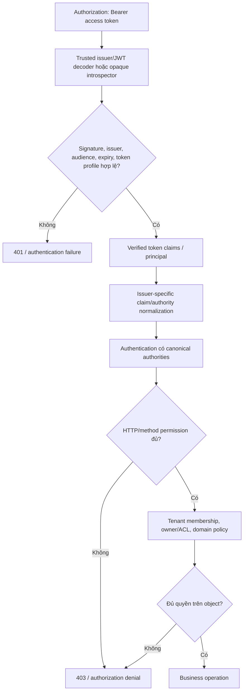
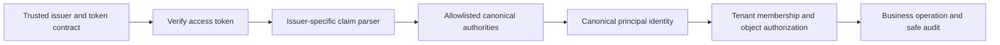

# Chuẩn hóa scope, roles, principal giữa các nhà cung cấp

Trong một hệ thống **Spring Security OAuth 2.0 / OIDC Resource Server** tích hợp nhiều nhà phát hành token, việc xác minh chữ ký hoặc introspection chỉ trả lời câu hỏi: **token có được bên phát hành đáng tin chấp nhận hay không?** Sau bước đó, API còn phải diễn giải claims thành **quyền chức năng**, **vai trò ứng dụng** và **danh tính caller** theo hợp đồng của từng nhà cung cấp. Đây là phần dễ tạo ra lỗi bảo mật khi chuyển từ một Identity Provider (IdP) sang nhiều IdP.

Ví dụ, IdP A phát `scope: "orders.read"`, IdP B phát `scp: ["order:read"]`, IdP C phát `permissions: ["read:orders"]`. Ba giá trị có thể đại diện cùng một **capability** của ứng dụng, nhưng không thể tự đổi thành cùng authority nếu chưa có một **bảng ánh xạ được phê duyệt**. Tương tự, claim `roles: ["admin"]` tại một nhà cung cấp không tự đồng nghĩa quyền `ROLE_ADMIN` toàn hệ thống. Còn `sub: "42"` chỉ nhận diện một chủ thể **trong namespace của issuer**, không đủ để xác định duy nhất người dùng giữa nhiều nhà phát hành.

Bài học thuộc chương **Tích hợp nhà phát hành**. Chúng ta sẽ thiết kế hợp đồng **canonical principal + canonical authorities**, dùng các converter của Spring Security 6 trong Servlet JWT Resource Server, trình bày biến thể WebFlux và opaque token, phân biệt access token/ID Token, kiểm soát tenant/owner, kiểm thử và vận hành khi IdP đổi claims. Ví dụ sử dụng **Spring Boot 3, Spring Security 6, Java 17+**; tên claim cụ thể của nhà cung cấp là **mẫu phổ biến có thể cấu hình**, không phải cam kết rằng mọi tenant hoặc mọi phiên bản IdP đều phát giống nhau.

## 1. “Chuẩn hóa” không phải là tin mọi claim có tên giống nhau

Một API `orders-api` có thể muốn một tập quyền nội bộ ổn định:

```text
APP_orders.read
APP_orders.write
APP_orders.approve
APP_reports.export
```

Trong khi những nhà phát hành khác nhau sử dụng các giá trị bên ngoài:

```text
Issuer A: "orders.read"
Issuer B: "order:read"
Issuer C: "read:orders"
```

Chuẩn hóa là **quyết định có thẩm quyền** rằng mỗi giá trị bên ngoài, **khi đến từ đúng issuer, đúng audience và đúng token profile**, có thể chuyển thành capability nội bộ nào:

```text
(verifiedIssuer, sourceClaim, sourceValue, tokenProfile)
    -> approved mapping
    -> canonical authority
```

Không nên dùng một phép biến đổi chuỗi tùy tiện như “bỏ dấu hai chấm, viết hoa rồi thêm `ROLE_`”. Mapping phải biểu diễn **ý nghĩa được phê duyệt**, không chỉ sự giống nhau về tên.

**Mục tiêu:** business API kiểm tra các authority ổn định, trong khi trust boundary của từng IdP vẫn được duy trì.

## 2. Scope, role, permission và principal là những đối tượng khác nhau

| Khái niệm | Ý nghĩa thường dùng | Ví dụ | Điều không được suy ra |
| --- | --- | --- | --- |
| **OAuth scope** | Phạm vi quyền access token được cấp cho client. | `orders.read` | Quyền trên mọi order hoặc mọi tenant. |
| **Role** | Nhóm trách nhiệm/ngữ nghĩa ứng dụng hoặc IdP. | `support-agent` | Toàn bộ vai trò có cùng nghĩa giữa các issuers. |
| **Permission/capability** | Hành động cụ thể được ứng dụng cho phép. | `reports.export` | Permission có quyền trên mọi object. |
| **Principal** | Caller đã xác thực. | `(iss, sub)` | Principal là con người thay vì service account. |
| **Tenant** | Không gian dữ liệu/tổ chức đang được yêu cầu. | `acme` | Issuer là tenant, hoặc caller thuộc tenant. |
| **Audience** | Protected resource đích của token. | `orders-api` | Token dành cho API khác cũng được chấp nhận. |

Trong Spring Security, các giá trị được đưa vào `GrantedAuthority` thường là **chuỗi**, ví dụ `SCOPE_orders.read` hay `APP_orders.read`. Framework không tự biết role nào tương đương permission nào. Việc tạo và diễn giải authority là **trách nhiệm của hợp đồng ứng dụng**.

`hasAuthority("APP_orders.read")` so sánh chuỗi đúng; `hasRole("ADMIN")` áp dụng quy ước `ROLE_ADMIN`. Không trộn các quy ước này một cách tình cờ.

## 3. Ba lớp phải tách trong pipeline



Lớp xác minh có thể do `JwtDecoder`/`ReactiveJwtDecoder` hoặc `OpaqueTokenIntrospector`/`ReactiveOpaqueTokenIntrospector` đảm nhiệm. Lớp ánh xạ phải dựa trên **issuer đã được xác minh**, không tự chấp nhận issuer mới từ claim chưa xác thực. Domain authorization phải tiếp tục kiểm tra tenant, owner và trạng thái membership hiện hành.

**Chữ ký đúng chưa có nghĩa authority mapping đúng; authority đúng chưa có nghĩa object access đúng.**

## 4. Xác thực access token khác OIDC login và ID Token

OIDC Client có thể nhận:

```text
Authorization Code + PKCE
  -> ID Token cho OIDC Client
  -> Access Token cho protected resources
```

**ID Token** dùng để OIDC Client xác thực End-User theo hợp đồng OIDC; **Access Token** dùng để truy cập OAuth Resource Server. Chúng có thể đều là JWT, đều có `iss`/`sub`, nhưng không có cùng audience và mục đích.

| Token | Audience điển hình | Bên sử dụng | Dùng để tạo API authorities? |
| --- | --- | --- | --- |
| OIDC ID Token | OIDC Client ID | Web/BFF OAuth Client | **Không tự dùng làm API access token.** |
| JWT access token | Protected resource/audience theo IdP contract | Resource Server | Có, **sau khi xác minh đúng token profile**. |
| Opaque access token | Không thể suy diễn từ chuỗi token | Resource Server qua introspection | Có, theo **response đáng tin** và policy. |
| Refresh token | Token endpoint của Authorization Server | OAuth Client hợp lệ | **Không** dùng làm credential gọi business API. |

Một token có `roles: ["admin"]` trong ID Token của web client không tự cấp quyền admin cho Resource Server. Việc dùng `.oauth2Login()` của browser và `.oauth2ResourceServer()` của API là hai luồng khác nhau. Kiểm tra audience/token type của **API** phải hoàn thành trước khi chuẩn hóa authority.

## 5. Claims giữa các nhà cung cấp thường khác nhau

Bảng sau thể hiện **ví dụ thường gặp**, không phải đặc tả bất biến của từng thương hiệu:

| IdP / loại triển khai | Claim thường gặp | Điểm cần kiểm tra |
| --- | --- | --- |
| Keycloak | `scope`, `realm_access.roles`, `resource_access.{client}.roles` | Realm role khác client role; không tự map mọi realm admin thành app admin. |
| Microsoft Entra ID | `scp` cho delegated permissions, `roles` cho app roles/application permissions trong một số token | Phân biệt delegated user token với app-only token; kiểm tra `tid`, `oid`, issuer, audience theo contract. |
| Okta | `scp`, `groups` hoặc custom claims theo Authorization Server/configuration | Không mặc định mọi access token chứa groups; mapping claim phải phụ thuộc issuer/authorization server. |
| Auth0 | `scope`, `permissions` khi các tính năng/cấu hình tương ứng được bật, namespaced custom claims | API audience và permissions contract phải được cấu hình; tránh xem mọi custom claim là global role. |
| Amazon Cognito User Pools | `scope`, `cognito:groups`, `client_id`, `token_use` và claims tùy token profile | Access token profile khác ID Token; việc dùng `aud` hay client/resource binding phải theo loại token. |
| Custom/OIDC-compliant IdP | Claims do issuer định nghĩa hoặc introspection trả | Không suy luận quyền chỉ từ tên trường chung. |

Hai tenant dùng **cùng sản phẩm IdP** vẫn có thể khác token profile, mapping, client registration và audience. Vì vậy thiết kế đúng là **issuer/profile-specific configuration**, không một hàm đọc mọi claim có tên `role`.

## 6. Xác minh issuer/audience trước khi chuẩn hóa

Một JWT:

```json
{
  "iss": "https://issuer-a.example/realms/shop",
  "sub": "user-42",
  "aud": ["payments-api"],
  "scope": "orders.read"
}
```

có thể được ký đúng bởi issuer đáng tin nhưng dành cho `payments-api`, **không phải `orders-api`**. Nếu API kiểm tra scope mà bỏ audience, đây là lỗi **cross-resource token substitution**.

Cần xác minh:

1. **Issuer exact/trusted:** chỉ nhận issuer trong danh sách/cấu hình được phê duyệt.
2. **Signature/JWK/algorithm:** public keys và thuật toán đúng với issuer; không chọn khóa theo URL tùy ý trong token.
3. **Thời gian:** `exp`, `nbf`, đồng hồ/clock skew theo policy.
4. **Audience/resource binding:** token dành cho API này; contract có thể khác giữa các IdP.
5. **Token type/profile:** access token chứ không phải ID Token hay token loại khác.
6. **Authority claim contract:** chỉ sau các bước trên mới đọc scope/role/permission làm quyền.

Khi một issuer phục vụ nhiều tenant, validator đúng issuer/audience cũng **không** xác minh được user thuộc tenant nào. Tenant grants/membership phải được kiểm tra riêng.

## 7. `iss` chưa verify chỉ được làm lookup hint

Attacker có thể tự tạo JWT payload:

```json
{
  "iss": "https://attacker.example",
  "sub": "system-admin",
  "roles": ["admin"]
}
```

Một multi-issuer Resource Server có thể cần đọc `iss` trước để **chọn** AuthenticationManager, nhưng điều đó không có nghĩa token được tin. Chỉ được dùng `iss` làm **khóa tìm trong trusted issuer registry**, rồi manager được chọn phải xác minh chữ ký và `iss`.

Không làm:

```java
// PHẢN VÍ DỤ: không auto-trust URL từ JWT chưa xác thực.
String issuer = readUnverifiedIssuer(rawToken);
JwtDecoder decoder = JwtDecoders.fromIssuerLocation(issuer);
return decoder.decode(rawToken);
```

Nếu tự tạo decoder/JWKS theo URL bất kỳ từ token, API có thể bị **SSRF, malicious issuer acceptance, resource exhaustion và manager-cache poisoning**. Chuẩn hóa claims không bao giờ được thực hiện trên token chưa xác minh.

## 8. Mô hình canonical authority của ứng dụng

Một hướng tốt là tạo authority nội bộ **độc lập cách IdP đặt tên**:

```text
APP_orders.read
APP_orders.write
APP_orders.approve
APP_reports.export
APP_tickets.manage
```

Quy ước tên phải được mô tả trong API authorization contract:

- Prefix `APP_` biểu thị **canonical application permission**.
- Scope bên ngoài chỉ ánh xạ sang một quyền nội bộ khi issuer được phép cấp nó.
- Role bên ngoài có thể ánh xạ sang **một hoặc nhiều permission cụ thể**, nếu policy phê duyệt.
- Quyền privileged như `APP_platform.manage` phải có **trust scope và cấp phát đặc biệt**, không tự suy ra từ chuỗi `admin`.
- Authority tenant-specific cần gắn tenant context hoặc áp domain policy; `APP_orders.read` không mang nghĩa đọc mọi đơn hàng.

Nếu dự án đã có `SCOPE_` conventions, có thể tiếp tục sử dụng, nhưng phải phân biệt **giữ nguyên OAuth scope name** với **canonical hóa nhiều nguồn scope có ý nghĩa tương đương**. Tránh đổi prefix tùy tiện làm các rule `hasAuthority(...)` không khớp.

## 9. Bảng mapping phải theo issuer và token profile

Ví dụ được tổ chức phê duyệt:

| Verified issuer | Claim | Raw value | Canonical authority |
| --- | --- | --- | --- |
| `issuer-a` | `scope` | `orders.read` | `APP_orders.read` |
| `issuer-a` | `scope` | `orders.write` | `APP_orders.write` |
| `issuer-b` | `scp` | `order:read` | `APP_orders.read` |
| `issuer-b` | `roles` | `OrdersApprover` | `APP_orders.approve` |
| `issuer-c` | `permissions` | `read:orders` | `APP_orders.read` |
| `issuer-c` | `permissions` | `export:reports` | `APP_reports.export` |
| `issuer-b` | `roles` | `GlobalAdmin` | **Không ánh xạ tự động** |

Không có một rule global:

```text
Nếu claim có "admin" thì thêm ROLE_ADMIN
```

vì issuer B có thể cấp role `GlobalAdmin` trong **hệ thống B**, không được phép cấp quyền quản trị **nền tảng của chúng ta**.

Ánh xạ nên có version, người phê duyệt, tiêu chí test và chính sách rollout. Khi nhà cung cấp đổi claim semantics, việc cập nhật mapping là một **thay đổi bảo mật**, không chỉ sửa parser.

## 10. Phân biệt app-only token và user-delegated token

Trong OAuth 2.0, principal không luôn là một con người:

```text
Authorization Code + PKCE -> thường đại diện user + client
Client Credentials       -> đại diện client/service, không cần end-user
```

Với một số IdP, app-only access token chứa application roles trong `roles` thay vì delegated scopes trong `scp`. Nếu app-only token thiếu `scp`, **không suy ra token invalid chỉ vì nó thiếu delegated scope**, nhưng vẫn phải kiểm tra loại caller và quyền service thực sự được cấp.

Canonical caller có thể phân biệt:

```text
CallerKind.USER
CallerKind.SERVICE
```

Nhưng cách xác định phải dựa vào **verified issuer/token profile và claims được định nghĩa**, không đoán từ việc có/không có `email`. Một service account có thể có `sub`; một user token có thể có `client_id` hoặc `azp`.

**Không tự tạo human user principal từ `client_id` của application token**, hoặc dùng user-only owner policy cho service credential mà không có mô hình quyền M2M.

## 11. Principal phải có namespace của issuer

Ví dụ:

```text
Issuer A, sub="42" -> Alice
Issuer B, sub="42" -> Bob
```

Hai subject giống chuỗi không nhất thiết là cùng người. Một canonical principal key đơn giản:

```java
public record PrincipalKey(
    String issuer,
    String subject
) {}
```

Với JWT đã được xác minh:

```java
PrincipalKey principalKey(Jwt jwt) {
    if (jwt.getIssuer() == null
            || jwt.getSubject() == null
            || jwt.getSubject().isBlank()) {
        throw new BadCredentialsException(
            "Verified issuer and subject required");
    }

    return new PrincipalKey(
        jwt.getIssuer().toString(),
        jwt.getSubject());
}
```

`Jwt`, `BadCredentialsException` và `PrincipalKey` cần imports/định nghĩa phù hợp. Nếu access token profile **không có human subject**, phải thiết kế canonical service identity riêng; không tự chế một `sub` từ email hoặc tenant header.

**Không dùng `Authentication.getName()` làm global database key** khi tên đó đã được cấu hình thành username/email dễ đổi. Với nhiều issuer, **`(verified iss, verified sub)` hoặc internal ID liên kết tin cậy** là lựa chọn chính xác hơn cho owner và audit.

## 12. `sub`, `oid`, `tid`, email và username có ý nghĩa khác nhau

Một số IdP cấp thêm:

```json
{
  "sub": "pairwise-or-provider-subject",
  "oid": "provider-object-id",
  "tid": "provider-tenant-id",
  "email": "alice@example.com",
  "preferred_username": "alice"
}
```

Tùy provider, `oid` có thể là object ID trong directory và `tid` là tenant/directory identifier; `sub` có thể có semantics pairwise theo client. **Không hoán đổi các giá trị này mà không hiểu chính xác token contract**.

| Field | Thường nên dùng cho | Không nên tự dùng cho |
| --- | --- | --- |
| `iss` | Namespace issuer. | Tenant của ứng dụng nếu không có mapping. |
| `sub` | Subject trong issuer/profile đó. | User ID toàn cục giữa IdP. |
| `oid`/provider ID | Identity theo hợp đồng nhà cung cấp. | Thay cho `sub` của mọi provider. |
| `tid`/directory ID | Context của directory/issuer ở provider tương ứng. | Membership tenant nghiệp vụ không qua policy. |
| `preferred_username` | Display/login hint. | Primary key ổn định. |
| `email` | Liên hệ/hiển thị/lookup có kiểm soát. | Tự động link hai tài khoản ở hai issuers. |
| `client_id`/`azp` | Xác định OAuth client theo profile. | Human subject hoặc global role. |

Nếu cần một `internalUserId`, hãy có bảng identity linking:

```text
(issuer, externalSubject, profile)
    -> verified linking workflow
    -> internalUserId
```

Không tự liên kết tài khoản chỉ vì cùng email, kể cả khi một phía có `email_verified=true`, nếu thiếu quy trình phù hợp với sản phẩm và trust model.

## 13. `JwtAuthenticationToken.getName()` không phải toàn bộ identity

`JwtAuthenticationConverter` mặc định thường sử dụng `sub` làm principal name. Có thể đổi:

```java
JwtAuthenticationConverter converter =
    new JwtAuthenticationConverter();
converter.setPrincipalClaimName("preferred_username");
```

Điều này đổi `Authentication.getName()` theo claim đã chọn, **không đổi `Jwt.getSubject()` hoặc `Jwt.getIssuer()`** và không chứng minh username là global unique.

Khi downstream service cần danh tính ổn định:

```java
Authentication auth =
    SecurityContextHolder.getContext().getAuthentication();

if (!(auth instanceof JwtAuthenticationToken jwtAuth)) {
    throw new AccessDeniedException(
        "Verified JWT caller required");
}

Jwt jwt = jwtAuth.getToken();
PrincipalKey key = principalKey(jwt);
```

Đoạn code minh họa Servlet stack với `SecurityContextHolder`, `JwtAuthenticationToken`, `AccessDeniedException` đã import tương ứng. Với opaque token, lấy verified issuer/subject theo introspection contract; với WebFlux, đọc identity từ Reactor Context thay vì ThreadLocal.

**Quy tắc:** `getName()` có thể là tên hiển thị hoặc `sub`; canonical identity nghiệp vụ phải có cấu trúc/namespace rõ.

## 14. Ánh xạ scope mặc định của Spring Security

Trong Spring Security JWT Resource Server, `JwtGrantedAuthoritiesConverter` thường tìm claim **`scope` hoặc `scp`**, rồi tạo authorities với prefix mặc định `SCOPE_`:

```json
{"scope": "orders.read orders.write"}
```

thành:

```text
SCOPE_orders.read
SCOPE_orders.write
```

Một token khác:

```json
{"scp": ["orders.read", "reports.export"]}
```

thường thành:

```text
SCOPE_orders.read
SCOPE_reports.export
```

`JwtGrantedAuthoritiesConverter` không tự đọc mọi claim `roles`, `groups`, `realm_access`, `permissions` của các nhà cung cấp. Muốn hỗ trợ những claims đó phải **cấu hình claim name** hoặc viết converter chuyên biệt.

`hasAuthority("SCOPE_orders.read")` kiểm tra chính xác chuỗi; `hasRole("ADMIN")` không tự khớp scope này. Một `JwtAuthenticationToken` có authorities hợp lệ vẫn chưa quyết định owner/tenant của record.

## 15. Dùng `JwtGrantedAuthoritiesConverter` khi mapping đơn giản

Khi một issuer phát `permissions` kiểu chuỗi CSV:

```json
{"permissions": "orders.read,orders.write,reports.export"}
```

Spring Security 6.1+ hỗ trợ delimiter cấu hình:

```java
import org.springframework.security.oauth2.server.resource.authentication.JwtGrantedAuthoritiesConverter;
import org.springframework.security.oauth2.server.resource.authentication.JwtAuthenticationConverter;

JwtGrantedAuthoritiesConverter permissions =
    new JwtGrantedAuthoritiesConverter();

permissions.setAuthoritiesClaimName("permissions");
permissions.setAuthorityPrefix("PERM_");
permissions.setAuthoritiesClaimDelimiter("\\s*,\\s*");

JwtAuthenticationConverter converter =
    new JwtAuthenticationConverter();
converter.setJwtGrantedAuthoritiesConverter(permissions);
```

Với cấu hình này, `permissions` trở thành:

```text
PERM_orders.read
PERM_orders.write
PERM_reports.export
```

Nhưng đây là **chuẩn hóa cú pháp**, chưa phải mapping giữa các semantic khác nhau:

- `read:orders` không tự thành `orders.read`.
- `role=admin` không tự thành `APP_platform.manage`.
- `permissions` từ issuer không có thẩm quyền vẫn không nên được tin cho API.
- Thay `setAuthoritiesClaimName` có thể khiến converter **không còn đọc `scope`**; không tự gộp hai nguồn.

Khi cần mapping giữa nhiều claims/issuers, hãy dùng converter có **allowlist rõ ràng**.

## 16. Thiết kế `ProviderClaimProfile`

Một profile bất biến có thể quy định claim và mapping cho từng issuer:

```java
import java.util.Map;

public record ProviderClaimProfile(
    String issuer,
    String scopeClaim,
    String roleClaim,
    Map<String, String> scopeToAuthority,
    Map<String, String> roleToAuthority
) {
    public ProviderClaimProfile {
        scopeToAuthority = Map.copyOf(scopeToAuthority);
        roleToAuthority = Map.copyOf(roleToAuthority);
    }
}
```

Ví dụ cấu hình trusted:

```java
ProviderClaimProfile acme = new ProviderClaimProfile(
    "https://issuer-a.example/realms/shop",
    "scope",
    "roles",
    Map.of(
        "orders.read", "APP_orders.read",
        "orders.write", "APP_orders.write"),
    Map.of(
        "OrdersApprover", "APP_orders.approve"));

ProviderClaimProfile beta = new ProviderClaimProfile(
    "https://issuer-b.example/tenant",
    "scp",
    "app_roles",
    Map.of(
        "order:read", "APP_orders.read"),
    Map.of(
        "ExportReports", "APP_reports.export"));
```

Các tên claim `roles` và `app_roles` ở đây **thuộc hợp đồng ví dụ**, không khẳng định mọi nhà phát hành có các field đó. Profile phải được **control plane phê duyệt**, và token phải đã được xác minh theo issuer tương ứng.

**Không lấy `scopeToAuthority` từ một JSON claim trong access token.** Bảng mapping là policy phía server, không phải input caller được tự quyết định.

## 17. Một converter canonical thực thi hoàn toàn local

Ví dụ sau minh họa mapping đã được allowlist và kiểm tra kiểu dữ liệu claim. Nó nhận **JWT đã được decoder xác minh**, không thực hiện HTTP/DB I/O.

```java
import java.util.ArrayList;
import java.util.Collection;
import java.util.LinkedHashSet;
import java.util.List;
import java.util.Map;
import java.util.Set;

import org.springframework.core.convert.converter.Converter;
import org.springframework.security.authentication.AbstractAuthenticationToken;
import org.springframework.security.authentication.BadCredentialsException;
import org.springframework.security.core.GrantedAuthority;
import org.springframework.security.core.authority.SimpleGrantedAuthority;
import org.springframework.security.oauth2.jwt.Jwt;
import org.springframework.security.oauth2.server.resource.authentication.JwtAuthenticationToken;

public final class CanonicalJwtConverter
        implements Converter<Jwt, AbstractAuthenticationToken> {

    private final Map<String, ProviderClaimProfile> profiles;

    public CanonicalJwtConverter(
            Map<String, ProviderClaimProfile> profiles) {
        this.profiles = Map.copyOf(profiles);
    }

    @Override
    public AbstractAuthenticationToken convert(Jwt jwt) {
        if (jwt.getIssuer() == null
                || jwt.getSubject() == null
                || jwt.getSubject().isBlank()) {
            throw new BadCredentialsException(
                "Verified issuer and subject are required");
        }

        String issuer = jwt.getIssuer().toString();
        ProviderClaimProfile profile = profiles.get(issuer);
        if (profile == null) {
            throw new BadCredentialsException(
                "No trusted claim mapping for issuer");
        }

        Set<GrantedAuthority> authorities =
            new LinkedHashSet<>();

        for (String scope : values(jwt, profile.scopeClaim())) {
            String mapped = profile.scopeToAuthority().get(scope);
            if (mapped != null) {
                authorities.add(new SimpleGrantedAuthority(mapped));
            }
        }

        for (String role : values(jwt, profile.roleClaim())) {
            String mapped = profile.roleToAuthority().get(role);
            if (mapped != null) {
                authorities.add(new SimpleGrantedAuthority(mapped));
            }
        }

        return new JwtAuthenticationToken(jwt, authorities);
    }

    private static List<String> values(
            Jwt jwt, String claimName) {
        Object raw = jwt.getClaims().get(claimName);
        if (raw == null) {
            return List.of();
        }

        if (raw instanceof String string) {
            String trimmed = string.trim();
            return trimmed.isEmpty()
                ? List.of()
                : List.of(trimmed.split("\\s+"));
        }

        if (raw instanceof Collection<?> collection) {
            List<String> result = new ArrayList<>();
            for (Object value : collection) {
                if (!(value instanceof String string)
                        || string.isBlank()) {
                    throw new BadCredentialsException(
                        "Unexpected claim element");
                }
                result.add(string);
            }
            return result;
        }

        throw new BadCredentialsException(
            "Unexpected claim shape");
    }
}
```

Code sử dụng Java 17 pattern matching cho `instanceof`. `ProviderClaimProfile` từ phần trước phải nằm trong package phù hợp. Helper `values` ở đây tách **string theo whitespace**, phù hợp `scope`/`scp` dạng chuỗi hoặc collection; nếu provider phát CSV/nested claims thì cần parser riêng theo **đúng profile**. Không cố chấp nhận mọi kiểu dữ liệu từ JWT.

Khi mapping không có key, converter **bỏ qua quyền không được phê duyệt**, không tự tạo authority. Với quyền bắt buộc của một endpoint, thiếu authority sẽ dẫn đến authorization denial. Việc bỏ qua claim lạ không đồng nghĩa API được bỏ qua **token validation errors**.

Đoạn code cố tình **không gộp roles thành global `ROLE_ADMIN`**. Chỉ những mappings trong trusted profile được tạo; app còn phải kiểm tra tenant/owner.

## 18. Tại sao converter local không gọi DB/HTTP?

JWT authentication converter thường chạy trên **đường xác thực của mọi protected request**. Nếu nó gọi database hoặc HTTP client đồng bộ để lấy roles:

```java
// PHẢN VÍ DỤ: blocking enrichment ngay trong converter.
Converter<Jwt, AbstractAuthenticationToken> bad =
    jwt -> loadUserAndRolesFromBlockingDatabase(jwt);
```

thì mỗi request có thể bị kéo dài bởi I/O, và trong WebFlux còn có nguy cơ chặn event-loop.

Với `CanonicalJwtConverter`, nhiệm vụ chỉ là **ánh xạ claims đã xác minh** bằng bảng bất biến trong bộ nhớ. Những quyền thay đổi theo tenant/owner có thể kiểm tra **tại service** sau authentication qua database/repository theo đúng stack.

Nếu thật sự cần gọi quyền bên ngoài **trước khi Authentication hoàn tất**, dùng reactive converter trong WebFlux hoặc một kiến trúc policy service phù hợp; thiết kế timeout, concurrency cap, fail closed và cache TTL theo yêu cầu bảo mật. `ReactiveJwtAuthenticationConverterAdapter` chỉ bọc converter imperative **non-blocking**, không tự làm JDBC/HTTP client blocking thành non-blocking.

## 19. Nối converter với `JwtAuthenticationProvider` của từng issuer

Trong Servlet Resource Server đa issuer, mỗi manager có thể dùng converter riêng:

```java
import org.springframework.security.authentication.AuthenticationManager;
import org.springframework.security.authentication.ProviderManager;
import org.springframework.security.oauth2.jwt.JwtDecoder;
import org.springframework.security.oauth2.server.resource.authentication.JwtAuthenticationProvider;

AuthenticationManager managerForIssuer(
        JwtDecoder trustedDecoder,
        ProviderClaimProfile profile) {

    CanonicalJwtConverter converter =
        new CanonicalJwtConverter(
            Map.of(profile.issuer(), profile));

    JwtAuthenticationProvider provider =
        new JwtAuthenticationProvider(trustedDecoder);
    provider.setJwtAuthenticationConverter(converter);

    return new ProviderManager(provider);
}
```

`JwtDecoder` trong ví dụ phải **xác minh signature/issuer/audience/token profile** với keys/algorithms đã được tin cậy. Đây là dependency của method, không tự cấu hình ở đây.

Để chọn manager theo `iss` từ một danh sách đã phê duyệt:

```java
import org.springframework.security.oauth2.server.resource.authentication.JwtIssuerAuthenticationManagerResolver;

Map<String, AuthenticationManager> managers = Map.of(
    acmeIssuer, acmeManager,
    betaIssuer, betaManager);

JwtIssuerAuthenticationManagerResolver resolver =
    new JwtIssuerAuthenticationManagerResolver(managers::get);
```

Tất cả `acmeIssuer`, `betaIssuer`, `acmeManager`, `betaManager` phải được xây từ **trusted registry**, không phải URL đọc trực tiếp từ JWT để khởi tạo tự do.

**Không cho một converter map claims của issuer B bằng profile issuer A**. Nếu issuer lạ, từ chối trước khi mapping quyền.

## 20. Cấu hình `SecurityFilterChain` với canonical authorities

Ví dụ Servlet:

```java
import jakarta.servlet.http.HttpServletRequest;
import org.springframework.context.annotation.Bean;
import org.springframework.http.HttpMethod;
import org.springframework.security.authentication.AuthenticationManagerResolver;
import org.springframework.security.config.annotation.web.builders.HttpSecurity;
import org.springframework.security.config.http.SessionCreationPolicy;
import org.springframework.security.web.SecurityFilterChain;

@Bean
SecurityFilterChain ordersApiSecurity(
        HttpSecurity http,
        AuthenticationManagerResolver<HttpServletRequest> resolver)
        throws Exception {

    return http
        .csrf(csrf -> csrf.disable())
        .sessionManagement(session -> session
            .sessionCreationPolicy(SessionCreationPolicy.STATELESS))
        .authorizeHttpRequests(auth -> auth
            .requestMatchers(
                HttpMethod.GET, "/api/tenants/{tenantId}/orders/**")
                .hasAuthority("APP_orders.read")
            .requestMatchers(
                HttpMethod.POST, "/api/tenants/{tenantId}/orders")
                .hasAuthority("APP_orders.write")
            .anyRequest().denyAll())
        .oauth2ResourceServer(oauth2 -> oauth2
            .authenticationManagerResolver(resolver))
        .build();
}
```

Thứ tự:

1. Resolver chọn manager của issuer được phép.
2. Decoder/introspector xác minh token đúng profile.
3. `CanonicalJwtConverter` ánh xạ scope/role thành `APP_*`.
4. HTTP rule kiểm tra canonical capability.
5. Service kiểm tra tenant membership và owner/ACL.

`STATELESS` chỉ giải quyết việc không dùng web `HttpSession` để khôi phục Authentication. `csrf.disable()` chỉ hợp lý với API thuần Bearer header, không dựa cookie tự gửi; nếu có BFF/browser session phải đánh giá CSRF theo kiến trúc.

`anyRequest().denyAll()` là fallback cho chain này. Ứng dụng có nhiều filter chains phải bảo đảm tất cả URLs (docs, metrics, Actuator, admin) có policy rõ và không nằm ngoài vùng bảo vệ.

## 21. Ánh xạ Keycloak realm roles và client roles

Một Keycloak access token có thể có nested claims minh họa:

```json
{
  "iss": "https://keycloak.example/realms/acme",
  "sub": "user-123",
  "aud": ["orders-api"],
  "scope": "openid orders.read",
  "realm_access": {
    "roles": ["default-roles-acme", "support"]
  },
  "resource_access": {
    "orders-api": {
      "roles": ["approver"]
    }
  }
}
```

**Không thể dùng `setAuthoritiesClaimName("realm_access.roles")` rồi mặc định parser của `JwtGrantedAuthoritiesConverter` sẽ hiểu nested JSON**. Đó là claim path, không phải một top-level claim name theo hợp đồng converter mặc định.

Một custom converter có thể đọc nested cấu trúc bằng kiểm tra kiểu nghiêm ngặt:

```java
Object root = jwt.getClaims().get("resource_access");

if (root instanceof Map<?, ?> resources) {
    Object client = resources.get("orders-api");
    if (client instanceof Map<?, ?> clientData) {
        Object roles = clientData.get("roles");
        if (roles instanceof Collection<?> roleValues) {
            for (Object value : roleValues) {
                if ("approver".equals(value)) {
                    authorities.add(new SimpleGrantedAuthority(
                        "APP_orders.approve"));
                }
            }
        }
    }
}
```

Đoạn này là **phần logic bên trong custom converter** với `jwt`, `authorities` đã được khai báo. Trong production phải kiểm tra kiểu `Collection`, giới hạn số phần tử, phân biệt issuer/client role profile và **không chấp nhận roles của client khác làm quyền của orders-api**. Cũng cần xác minh token audience/token profile và issuer Keycloak trước khi tới bước này.

Realm role `admin` của Keycloak **không tự đồng nghĩa** global application admin. Phải có một mapping được phê duyệt, tốt nhất có scope theo tenant/resource.

## 22. Microsoft Entra ID: delegated scopes và app roles

Một số access token của Microsoft Entra ID có:

```json
{
  "iss": "https://login.microsoftonline.com/<tenant-guid>/v2.0",
  "tid": "<tenant-guid>",
  "oid": "<object-guid>",
  "sub": "<subject-value>",
  "aud": "api://orders-api",
  "scp": "Orders.Read",
  "azp": "<client-app-id>"
}
```

Một app-only hoặc token theo app-role contract có thể sử dụng `roles` thay cho delegated scope:

```json
{
  "iss": "https://login.microsoftonline.com/<tenant-guid>/v2.0",
  "aud": "api://orders-api",
  "roles": ["Orders.Read.All"]
}
```

Những claims chỉ để minh họa **kiểu token có thể khác theo phiên bản endpoint, tenant, client và grant**. Resource Server không nên gộp tất cả thành “user roles”:

- `scp` thường biểu diễn **delegated scopes**; có người dùng và client trong trust context.
- `roles` có thể biểu diễn **application permissions/app roles** hoặc vai trò theo token profile.
- `tid` là directory tenant trong Entra; không tự là tenant nghiệp vụ của SaaS.
- `oid` là provider object identity theo issuer/directory contract, không thay trực tiếp global user ID.
- `aud` cần khớp API resource; không dùng token dành cho Microsoft Graph hoặc API khác.

Một bảng mapping ví dụ:

```text
Verified Entra issuer + scp "Orders.Read"
  -> APP_orders.read (delegated profile)

Verified Entra issuer + roles "Orders.Read.All"
  -> APP_orders.read (app-only profile được phê duyệt)
```

Hai trường hợp cùng ra authority chỉ khi **security policy cho phép service và user có cùng capability**. Nếu một endpoint chỉ dành cho người dùng hoặc chỉ cho service, phải kiểm tra **caller kind** ngoài authority.

## 23. Okta, Auth0 và Cognito: claim contracts phải được xác nhận

### Okta

Authorization Server có thể phát `scp` hoặc custom `groups`/claims tùy cấu hình. Không nên mặc định `groups` luôn có trong mọi access token, hoặc map mọi group `Administrators` thành `ROLE_ADMIN`. Xác nhận issuer, token audience và claim source trên Authorization Server đã cấu hình cho API.

### Auth0

Access token dành cho một API có thể chứa `scope`, `permissions` khi RBAC/permissions configuration phù hợp được bật, hoặc custom namespaced claims. Không nên dựa vào `permissions` trên token không dành cho API, và không tự map một custom claim `is_admin=true` thành global quyền quản trị nếu issuer không được phép cấp quyền đó.

### Amazon Cognito

User Pool access tokens có thể chứa `scope`, `cognito:groups`, `client_id`, `token_use` và các claim theo profile. Với Cognito, cần **đọc chính xác token type/access-token contract** để xác nhận issuer, resource binding/audience và client identity; không sao chép máy móc JWT audience validator từ IdP khác nếu access token profile có semantics riêng.

Trong cả ba trường hợp, chuẩn hóa phải dựa trên **hợp đồng cụ thể của issuer + authorization server/user pool + API registration**, không chỉ tên sản phẩm IdP. Khi migration đổi claim source hoặc token version, phải test profile trước khi kích hoạt mapping mới.

## 24. Scope role collision: cùng chuỗi chưa chắc cùng nghĩa

Hai token:

```json
{"scope": "admin"}
```

và:

```json
{"roles": ["admin"]}
```

không tự tương đương. Có thể scope `admin` của API A là quản trị báo cáo, còn role `admin` của IdP B là quản trị tài khoản **trong hệ thống B**. Cả hai có thể không liên quan `APP_platform.manage`.

Một policy tốt ghi rõ:

```text
issuer/profile, raw-claim, raw-value
    -> canonical permission được cấp
```

và mặc định **không ánh xạ** các giá trị chưa biết. Không nên:

```java
new SimpleGrantedAuthority(
    "ROLE_" + rawRole.toUpperCase());
```

cho mọi role của mọi issuer. Điều này tạo privilege escalation ngay khi một nhà phát hành có thêm role cùng tên với role đặc quyền của ứng dụng.

Nếu role `support` của issuer A cần chuyển thành ba permissions nội bộ, dùng mapping có nhiều đích:

```text
issuer A / role support
  -> APP_tickets.read
  -> APP_tickets.reply
  -> APP_orders.read
```

Không trao `APP_orders.write` trừ khi được phê duyệt rõ và có test bảo mật tương ứng.

## 25. Tenant role không phải global role

Một người dùng có thể là:

```text
Tenant Acme:  role = administrator
Tenant Beta:  role = viewer
```

Nếu converter tạo `ROLE_ADMIN` global chỉ vì thấy role `administrator` từ một tenant claim, người dùng có thể vô tình được quyền admin ở Beta.

Một thiết kế vững hơn:

```text
Trusted Authentication:
  principal = (iss, sub)
  canonical functional authorities = APP_orders.read, ...

Requested tenant = beta
Tenant authorization:
  membership(beta, principal)
  tenantRole(beta, principal)
  objectPolicy(beta, orderId, principal)
```

Hoặc tạo tenant-scoped authority có định danh tenant rõ và policy kiểm tra đúng tenant, nhưng phải tránh **high-cardinality authorities**, stale role claims và rủi ro tenant string bị spoof. Với quyền thay đổi nhanh, domain service/database policy thường cần kiểm tra membership hiện hành; một JWT còn hạn có thể chứa role đã bị revoke.

**Chuẩn hóa role không được xóa ranh giới tenant.**

## 26. Canonical identity có thể dùng cho cả user và service, nhưng phải phân biệt loại

Một model nội bộ:

```java
public enum CallerKind {
    USER, SERVICE
}

public record CanonicalCaller(
    PrincipalKey identity,
    CallerKind kind,
    String clientId
) {}
```

Hợp đồng:

- `identity` được tạo từ **verified token profile**.
- `kind` phải được suy ra từ loại grant/token và claims đáng tin, không chỉ có/không có email.
- `clientId` đại diện OAuth client theo profile của issuer, không tự tương đương `sub`.
- Tenant membership/capability phải được quyết định riêng.

Nếu app-only access token dùng `sub` theo semantics khác user token, có thể cần `ServicePrincipalKey` riêng (verified issuer + verified client ID hoặc workload identity theo contract). Đừng ép một service token thành human account để sử dụng quyền owner của user.

Trong audit log, lưu loại caller và canonical identity có kiểm soát; không ghi raw access token hoặc toàn bộ claims.

## 27. Opaque token cần chuẩn hóa từ introspection response

Với opaque access token:

```http
POST /oauth2/introspect
Content-Type: application/x-www-form-urlencoded

token=<opaque-token>
```

Resource Server nhận response từ **introspection endpoint đã được cấu hình tin cậy**, ví dụ:

```json
{
  "active": true,
  "sub": "user-42",
  "client_id": "orders-web",
  "scope": "orders.read",
  "aud": ["orders-api"],
  "iss": "https://legacy-issuer.example"
}
```

`OpaqueTokenIntrospector` cung cấp `OAuth2AuthenticatedPrincipal` và Spring Security có thể ánh xạ scope. Nhưng không được coi mọi opaque response từ mọi IdP có cùng schema/semantics:

- Xác định **introspection authority/client identity** của token theo trusted routing contract.
- Chỉ dùng response `active:true` hợp lệ và token profile/audience phù hợp.
- Map `scope`, `permissions`, `roles` theo **issuer-specific policy** nếu có.
- Xác định canonical principal từ verified `iss`/`sub` hoặc danh tính được authority cam kết; nếu thiếu issuer trong response, registry phải cung cấp trusted namespace phù hợp.
- Namespace cache theo authority/introspection client và policy version.

**Timeout, 429, 5xx và lỗi TLS không phải `active:false`**. Không negative-cache chúng như “token không hợp lệ”; fail closed với telemetry phân biệt dependency outage và denied credential.

`JwtAuthenticationConverter` chỉ dùng cho **JWT**, không tự áp dụng cho opaque. Cần một mapper tương ứng trong introspector hoặc authentication conversion layer của opaque profile.

## 28. Principal Spring Security có thể là các kiểu khác nhau

| Authentication flow | Kiểu principal/auth thường gặp | Không nên giả định |
| --- | --- | --- |
| Servlet JWT Resource Server | `JwtAuthenticationToken` với `Jwt` | Principal luôn là `OidcUser`. |
| Servlet opaque Resource Server | `BearerTokenAuthentication` với `OAuth2AuthenticatedPrincipal` | Có thể gọi `getToken()` trả JWT. |
| OIDC Client web login | OIDC/OAuth2 Client Authentication, có thể có `OidcUser` | Web login session là Bearer access token cho API. |
| WebFlux JWT Resource Server | Reactive Authentication đưa vào Reactor SecurityContext | Có thể luôn đọc bằng Servlet `SecurityContextHolder`. |
| Machine-to-machine | Authentication của service credential | Caller là human end-user. |

**Không cast mọi `Authentication.getPrincipal()` sang `Jwt`**. Thiết kế một lớp lấy canonical identity theo loại Authentication và profile, hoặc truyền canonical identity đã được xác minh từ security boundary tới domain service.

Trong WebFlux dùng `ReactiveSecurityContextHolder.getContext()` hoặc principal được WebFlux argument resolver cung cấp. Reactor Context khác `ThreadLocal` của Servlet; không `.block()` để lấy Authentication khi đang xử lý request reactive.

## 29. WebFlux: bọc converter local bằng adapter

Nếu mapping thuần bộ nhớ như `CanonicalJwtConverter`, có thể tái sử dụng trong WebFlux:

```java
import org.springframework.core.convert.converter.Converter;
import org.springframework.security.authentication.AbstractAuthenticationToken;
import org.springframework.security.oauth2.jwt.Jwt;
import org.springframework.security.oauth2.server.resource.authentication.ReactiveJwtAuthenticationConverterAdapter;
import reactor.core.publisher.Mono;

Converter<Jwt, AbstractAuthenticationToken> imperative =
    new CanonicalJwtConverter(trustedProfiles);

Converter<Jwt, Mono<AbstractAuthenticationToken>> reactive =
    new ReactiveJwtAuthenticationConverterAdapter(imperative);
```

Gắn vào `ServerHttpSecurity`:

```java
.oauth2ResourceServer(oauth2 -> oauth2
    .jwt(jwt -> jwt.jwtAuthenticationConverter(reactive)))
```

Các biến `trustedProfiles`, `reactive` trong ví dụ đại diện dependencies đã được inject/cấu hình. Adapter chỉ bọc converter imperative **không blocking**, không biến JDBC, REST client hoặc `.block()` thành non-blocking.

Nếu cần quyền từ WebClient/R2DBC, dùng `ReactiveJwtAuthenticationConverter` với `Converter<Jwt, Flux<GrantedAuthority>>` hoặc custom `Converter<Jwt, Mono<AbstractAuthenticationToken>>` thật sự reactive; có timeout, concurrency cap, error policy rõ. Cân nhắc để tenant/owner authorization ở domain service thay vì gọi mạng trên **mọi request authentication**.

## 30. HTTP/method authorization nên dùng canonical permission

Sau khi mapping các provider claims thành `APP_orders.read`, HTTP rule có thể ổn định:

```java
.authorizeHttpRequests(auth -> auth
    .requestMatchers(
        HttpMethod.GET,
        "/api/tenants/{tenantId}/orders/**")
        .hasAuthority("APP_orders.read")
    .anyRequest().denyAll())
```

Reactive variant:

```java
.authorizeExchange(exchanges -> exchanges
    .pathMatchers(
        HttpMethod.GET,
        "/api/tenants/{tenantId}/orders/**")
        .hasAuthority("APP_orders.read")
    .anyExchange().denyAll())
```

Với method security:

```java
@PreAuthorize("hasAuthority('APP_orders.read')")
public OrderDto getOrder(String tenantId, long orderId) {
    return orderService.getVisibleOrder(tenantId, orderId);
}
```

Đây là khung minh họa method security Servlet; trong WebFlux sử dụng `@EnableReactiveMethodSecurity` và các method trả publisher khi phù hợp. `@PreAuthorize` cần Spring-managed proxy để hoạt động theo Spring AOP; direct `new Service()` hoặc self-invocation có thể không kích hoạt interceptor.

**Canonical permission chỉ là cổng chức năng**. `getVisibleOrder` vẫn phải kiểm tra membership tenant, owner/ACL và chính sách cập nhật dữ liệu.

## 31. Domain authorization phải kiểm tra tenant và object

Giả sử caller đã có:

```text
principal = (https://issuer-a.example, alice)
authority = APP_orders.read
requestedTenant = beta
orderId = 201
```

API phải kiểm tra:

```text
issuerAllowedForTenant(beta, verifiedIssuer)
AND activeMembership(beta, verifiedIssuer, verifiedSubject)
AND hasCapability(APP_orders.read)
AND orderVisibleToCaller(beta, 201, verifiedPrincipal)
```

Một truy vấn owner-only minh họa:

```sql
SELECT *
FROM orders
WHERE id = :orderId
  AND tenant_id = :tenantId
  AND owner_issuer = :issuer
  AND owner_subject = :subject
```

Nếu nghiệp vụ có admin, shared access hoặc service role, cần ACL/policy riêng được review. Không dùng `findById(orderId)` không ràng buộc tenant rồi trả dữ liệu chỉ vì authority `APP_orders.read` có mặt.

Chuẩn hóa authority **không thay thế** ranh giới BOLA/IDOR, tenant membership hoặc trạng thái quyền hiện hành.

## 32. Khi token claim thay đổi hoặc nhà cung cấp nâng cấp

Các thay đổi có thể xảy ra:

```text
scope: "orders.read"
    -> scp: ["orders.read"]

roles: ["OrderApprover"]
    -> permissions: ["approve:order"]

sub: ổn định
    -> một token profile mới có subject semantics khác
```

Đừng cập nhật parser bằng cách “thử mọi claim cho đến khi có role admin”. Có thể vô tình tăng quyền nếu claim mới có nghĩa khác.

Quy trình migration:

1. Xác định **verified issuer/profile** và phiên bản token mới.
2. Thu thập token fixtures được cung cấp qua kênh an toàn, che secrets.
3. Xác nhận những claims nào là authoritative cho access token của API.
4. Viết mapping allowlist mới trong trusted configuration.
5. Test thiếu claim, sai kiểu, role lạ, multi-issuer collision và owner isolation.
6. Canary rollout/feature flag nếu có dual profile.
7. Giám sát authorization denial, unexpected authority, token validation failure.
8. Loại bỏ mapping cũ sau deadline và cập nhật tài liệu/các policy liên quan.

Một claim đổi tên không nên dẫn đến giải pháp **bỏ issuer/audience validation** để “cho token hoạt động lại”.

## 33. Claim thiếu, sai kiểu và quyền chưa nhận diện

Converter nên có chính sách tường minh:

| Tình huống | Xử lý đề xuất |
| --- | --- |
| JWT thiếu `scope` nhưng endpoint cần `APP_orders.read` | Không cấp authority; authorization từ chối. |
| JWT có scope chưa được allowlist | Bỏ qua, ghi telemetry an toàn nếu cần. |
| Claim `roles` là số/object thay vì danh sách mong đợi | Từ chối theo contract hoặc báo profile error; không tự ép kiểu thiếu kiểm soát. |
| Issuer không có trusted profile | Authentication/mapping failure; không dùng default permissive mapper. |
| Token sai audience/issuer/signature | Từ chối tại decoder trước converter. |
| App-only token không có delegated scope | Xử lý theo service-token profile, không tạo user role tùy ý. |
| Nested claim khác schema dự kiến | Không tự dùng `.toString()` trên mọi object để tạo authority. |
| Entitlement service required bị timeout | Fail closed; không gán quyền mặc định. |

Không nên tạo `APP_platform.manage` từ một raw string lạ do parser fallback. Ngược lại, không phải mọi claim mới đều phải khiến token bị từ chối; **mức strictness** cần xác định theo contract: unknown optional claim có thể bị bỏ qua, nhưng token validation và malformed required claims phải xử lý rõ.

## 34. Không dùng role claim để thay identity linking

Một hệ thống có thể gặp:

```text
Issuer A: alice@example.com, roles=[support]
Issuer B: alice@example.com, roles=[support]
```

Không có bằng chứng hai account này là cùng chủ thể chỉ vì email và role giống nhau. Phân quyền đúng cần:

```text
verified issuer + external subject
  -> explicit trusted linking
  -> internal user ID
  -> tenant membership / ACL
```

Khi link account xảy ra:

- Yêu cầu chứng minh quyền kiểm soát identity theo chính sách.
- Audit người hoặc tiến trình phê duyệt linking.
- Xử lý unlink/revoke khi IdP bị remove.
- Không dùng role của issuer này để mở rộng quyền ở issuer khác trừ khi policy có grant rõ.
- Kiểm tra tác động đến historical ownership/audit records.

Canonical principal là **khóa định danh có provenance**, không chỉ một chuỗi username đã được làm đẹp.

## 35. Cache authorization và claim freshness

Token JWT có thể còn hạn sau khi:

- Một người bị xóa khỏi nhóm IdP.
- Tenant administrator thu hồi role.
- User bị xóa khỏi tenant trong database.
- Một permission mapping bị thu hồi ở control plane.

Nếu Resource Server chỉ dựa vào JWT embedded roles, quyền sẽ không cập nhật cho đến khi token hết hạn hoặc có cơ chế kiểm tra online/revocation khác.

| Dữ liệu | Cách quản lý freshness |
| --- | --- |
| Chữ ký/JWK | Cache theo trusted issuer, key rotation policy. |
| JWT access token claims | Hiệu lực theo expiry và revocation/token status requirements. |
| Canonical mapping profile | Registry version, atomic rollout, invalidate caches khi đổi policy. |
| Tenant membership | Database/policy service, cache TTL/invalidation phù hợp. |
| Opaque introspection | Cache `active`/principal theo TTL và revocation policy, namespace issuer/client. |
| User linking | Quy trình cập nhật/thu hồi identity có kiểm soát. |

**Không vì performance mà cache toàn bộ quyền global theo `sub` trần**. Ít nhất phải namespace theo issuer/subject/token profile, tenant khi phụ thuộc tenant và policy version nếu mapping có thể đổi. Cache positive quyền stale có thể gây privilege retention; cần xác định security SLO thu hồi.

## 36. Kiểm thử converter local bằng JUnit

Một unit test có thể tạo `Jwt` mà không cần HTTP:

```java
import static org.assertj.core.api.Assertions.assertThat;

import java.util.Map;
import org.junit.jupiter.api.Test;
import org.springframework.security.core.GrantedAuthority;
import org.springframework.security.oauth2.jwt.Jwt;
import org.springframework.security.oauth2.server.resource.authentication.JwtAuthenticationToken;

class CanonicalJwtConverterTest {

    @Test
    void mapsOnlyApprovedScopeFromTrustedIssuer() {
        ProviderClaimProfile profile = new ProviderClaimProfile(
            "https://issuer-a.example",
            "scope",
            "roles",
            Map.of("orders.read", "APP_orders.read"),
            Map.of("OrderApprover", "APP_orders.approve"));

        CanonicalJwtConverter converter =
            new CanonicalJwtConverter(
                Map.of(profile.issuer(), profile));

        Jwt jwt = Jwt.withTokenValue("test-only")
            .header("alg", "RS256")
            .claim("iss", "https://issuer-a.example")
            .claim("sub", "alice")
            .claim("scope", "orders.read unknown.scope")
            .claim("roles", java.util.List.of("UnknownRole"))
            .build();

        JwtAuthenticationToken result =
            (JwtAuthenticationToken) converter.convert(jwt);

        assertThat(result.getAuthorities())
            .extracting(GrantedAuthority::getAuthority)
            .containsExactly("APP_orders.read");
    }
}
```

`Jwt.withTokenValue("test-only")` **không kiểm tra chữ ký JWT**; đây là unit test cho **mapping**, không phải cryptographic authentication. Token fixture trong test cũng không nhất thiết cần `exp`, vì chưa chạy decoder.

Các ca unit test khác:

- `scope` là string, `scp` là array.
- Claim roles bị thiếu.
- Claim sai kiểu `roles=123`.
- Role `admin` từ issuer không được phê duyệt.
- Hai issuer cùng raw scope nhưng mapping khác.
- Subject/issuer thiếu theo profile yêu cầu.
- Duplicate scopes/roles không sinh authority trùng.
- Một profile thay đổi nhưng profile khác vẫn giữ mapping.

## 37. Test multi-issuer phải có JWT ký thật

Một test `MockMvc` với `.with(jwt())` hoặc WebFlux `mockJwt()` thường **tạo authentication giả lập**, không chạy `JwtDecoder` production; nếu gán `.authorities(...)`, nó còn có thể **bỏ qua converter production**.

Để test trust boundary:

1. Tạo test issuers/JWK Sets riêng cho A và B.
2. Ký JWT thật bằng private keys test tương ứng.
3. Gửi token qua Resource Server dùng decoder/resolver production-equivalent.
4. Kiểm tra `iss`/`aud`/signature/expiry/not-before/token type.
5. Xác nhận converter đúng được chạy **sau decode thành công**.
6. Xác nhận profile A không áp mapping admin của B.
7. Gửi JWT A vào tenant B, bảo đảm membership/owner không bypass.
8. Đổi `iss` thành attacker issuer, bảo đảm API không tự fetch JWKS attacker.

Phải có **test dương** chứng minh mapping đúng cho issuer được tin, không chỉ toàn test âm. Một hệ thống `denyAll()` mọi route vẫn có thể khiến các negative tests xanh mà không thực hiện đúng mục tiêu.

## 38. Ma trận test semantic scope/role/principal

| # | Token/source | Quyết định mong đợi |
| --- | --- | --- |
| 1 | Issuer A `scope=orders.read` | Có `APP_orders.read`. |
| 2 | Issuer B `scp=order:read` | Có `APP_orders.read` **chỉ khi mapping B phê duyệt**. |
| 3 | Issuer C `permissions=read:orders` | Có permission tương ứng nếu profile C cho phép. |
| 4 | Issuer A `roles=["admin"]` chưa allowlist | Không có global platform admin. |
| 5 | Issuer B `roles=["OrdersApprover"]` | Chỉ có `APP_orders.approve` theo policy. |
| 6 | JWT sai `aud` nhưng raw scope hợp lệ | Authentication từ chối trước mapping. |
| 7 | JWT issuer attacker phát `scope=orders.read` | Không tạo Authentication. |
| 8 | User và service token cùng role string | Quyền theo caller kind/token profile riêng. |
| 9 | Hai issuers cùng `sub=42` | Hai `PrincipalKey` khác nhau. |
| 10 | Cùng issuer, hai tenant khác nhau | Membership và object policy tách biệt. |
| 11 | Opaque introspection inactive | Không tạo principal hay quyền. |
| 12 | Opaque introspection timeout | Fail closed, không negative-cache như inactive. |
| 13 | Claim `roles` sai kiểu | Xử lý theo profile error policy; không tự sinh quyền. |
| 14 | Provider đổi claim name | Mapping có version; test before rollout. |
| 15 | User bị revoke membership nhưng JWT còn hạn | Domain policy từ chối theo security freshness requirement. |
| 16 | Two-provider same email, different subjects | Không tự liên kết tài khoản. |
| 17 | Role có prefix `ROLE_` chưa phê duyệt | Không tự nhận làm authority đặc quyền. |
| 18 | Key JWK `kid` trùng ở hai issuers | Không nhầm verify keys. |

Những kiểm thử này nên tách **converter unit**, **JWT/opaque authentication integration**, **HTTP/method authorization** và **domain service ownership tests** để biết lỗi thuộc tầng nào.

## 39. Quan sát và audit mà không lộ credentials

Những tín hiệu hữu ích:

```text
authentication_success_total{issuer_alias, token_profile}
authentication_failure_total{reason}
authority_mapping_unknown_claim_total{issuer_alias, profile}
authority_mapping_unrecognized_value_total{issuer_alias, claim_alias}
authorization_denied_total{category}
tenant_membership_denied_total{tenant_alias}
identity_linking_change_total{action}
issuer_mapping_policy_version{issuer_alias}
```

Sử dụng **issuer alias và claim alias từ trusted configuration** để kiểm soát metric cardinality. Không dùng raw token, `sub`, email, arbitrary `iss`, role string tùy ý hoặc high-cardinality tenant ID làm metric label không giới hạn.

Log có thể chứa request/trace ID, issuer alias, token profile, policy version, kết quả xác thực/authorization và mã lỗi. Không log nguyên `Authorization`, access token, refresh token, client secret, private key hoặc introspection response nhạy cảm.

Đừng log toàn bộ danh sách authorities nếu chúng chứa dữ liệu cá nhân hoặc tenant identifiers; dùng whitelist hoặc số lượng quyền theo loại.

## 40. Runbook khi đổi IdP rồi API trả 401/403

1. **401 hay 403?** 401 thường thuộc token verification; 403 thuộc authority/domain policy, nhưng kiểm tra exception mapping thực tế.
2. **Kiểm tra issuer exact:** token đến từ issuer/tenant nào? Profile registry có đang active?
3. **Kiểm tra audience/token type:** access token dành cho `orders-api` hay token dành cho client/API khác?
4. **Kiểm tra JWKS/algorithm:** key rotation, `kid`, TLS, metadata và decoder cache.
5. **Kiểm tra raw claim shape an toàn:** `scope` string, `scp` array, nested roles hay `permissions`?
6. **Kiểm tra mapping:** raw value nào phải được chuyển thành authority nào? Có allowlist?
7. **Kiểm tra prefix:** HTTP/method rule dùng `APP_`, `SCOPE_`, `ROLE_` hay `PERM_`?
8. **Kiểm tra principal semantics:** `getName()` đổi sang username/email? Domain vẫn dùng `(iss, sub)` đúng không?
9. **Kiểm tra caller kind:** token user-delegated hay app-only? Roles có được IdP phát theo đúng grant?
10. **Kiểm tra tenant membership/owner:** JWT đúng nhưng caller có thực sự được phép ở tenant/object không?
11. **Nếu opaque:** introspection active/error, client credentials, audience, mapping và cache namespace.
12. **So sánh các pods:** policy version, issuer registry, JWK caches và profile rollout có đồng nhất?
13. **Chạy lại test dương và âm** cho cả old/new issuer; không bỏ validation để chữa lỗi tạm thời.

Không dùng `permitAll` hoặc tự map mọi role thành `ROLE_ADMIN` như phương án khắc phục sự cố. Điều đó có thể chuyển một lỗi tương thích claim thành lỗ hổng phân quyền liên tenant.

## 41. Checklist thiết kế chuẩn hóa trước production

1. **Trust registry:** mọi issuer đã được phê duyệt; `iss` chưa verify không auto-onboard.
2. **Token validation:** chữ ký, algorithms, issuer, `exp`/`nbf`, audience, access-token profile.
3. **Provider contract:** claim nào có thẩm quyền đối với scope, role, permission, caller kind?
4. **Canonical permissions:** đặt tên ổn định, documented, có owner/approval.
5. **Allowlist mapping:** theo issuer + token profile, không dựa tên role giống nhau.
6. **Principal identity:** `(verified issuer, subject)` hoặc canonical internal ID qua trusted linking.
7. **Human vs service:** không gán danh tính/quyền người dùng cho application credential.
8. **Tenant boundary:** issuer-to-tenant grant và membership/owner được kiểm tra riêng.
9. **Revocation/freshness:** TTL/token claims, DB membership, cache và profile version.
10. **Converter behavior:** mapping local nhanh, không blocking I/O trên WebFlux event loop.
11. **Error handling:** malformed claims/unknown issuer/entitlement outage đều không nâng quyền.
12. **Unit tests:** claim shapes, unknown values, role collisions, principal collisions.
13. **Integration tests:** signed JWT, wrong audience, cross-issuer keys, opaque introspection.
14. **Operational controls:** audit mapping changes, rollout nhiều pod, metrics không lộ token.

Một cách hình dung vòng đời:



## 42. Tài liệu tham khảo

- [Spring Security — Servlet OAuth 2.0 Resource Server JWT](https://docs.spring.io/spring-security/reference/6.5/servlet/oauth2/resource-server/jwt.html): `JwtAuthenticationConverter`, scope/authority customization.
- [Spring Security — Servlet Resource Server Multi-tenancy](https://docs.spring.io/spring-security/reference/6.5/servlet/oauth2/resource-server/multitenancy.html): `JwtIssuerAuthenticationManagerResolver`, trusted issuers và managers riêng.
- [Spring Security — Reactive JWT Resource Server](https://docs.spring.io/spring-security/reference/6.5/reactive/oauth2/resource-server/jwt.html): reactive converter contract và adapter.
- [Spring Security — Opaque Token Resource Server](https://docs.spring.io/spring-security/reference/6.5/servlet/oauth2/resource-server/opaque-token.html): introspection và `OAuth2AuthenticatedPrincipal`.
- [RFC 9068 — JWT Profile for OAuth 2.0 Access Tokens](https://www.rfc-editor.org/rfc/rfc9068.html): token type/profile và JWT access token claims.
- [RFC 7519 — JSON Web Token](https://www.rfc-editor.org/rfc/rfc7519): `iss`, `sub`, `aud`, `exp`.
- [RFC 7662 — OAuth 2.0 Token Introspection](https://www.rfc-editor.org/rfc/rfc7662.html): introspection response và `active`.
- [OpenID Connect Core](https://openid.net/specs/openid-connect-core-1_0.html): phân biệt ID Token và OAuth access token trong OIDC flows.

## 43. Kết luận

Chuẩn hóa **scope, roles, principal giữa các nhà phát hành** không phải chỉ đổi tên claim. Đó là một **mô hình tin cậy và diễn giải quyền** gồm nhiều bước:

- **Xác minh access token** theo trusted issuer, audience, keys/algorithms và token profile.
- **Diễn giải claims theo provider contract**, không tự tin mọi role/scope cùng tên có cùng nghĩa.
- **Dùng mapping allowlist** để tạo canonical application permissions, không tự cấp global admin.
- **Duy trì principal có namespace issuer**, tránh nhập nhằng `sub`, username, email và service identity.
- **Phân quyền tenant/owner độc lập** với functional authorities đã chuẩn hóa.
- **Kiểm thử provider drift và cross-issuer privilege escalation** bằng unit tests, signed-token integration và direct service tests.

`JwtGrantedAuthoritiesConverter` phù hợp khi chỉ đổi claim/prefix/delimiter. Với nhiều issuer, claims lồng nhau hoặc role semantics khác nhau, hãy dùng `JwtAuthenticationConverter` hay custom converter được cấu hình **riêng theo profile đã xác minh**. Với opaque token, chuẩn hóa từ introspection response đáng tin; với WebFlux, sử dụng converter/adapter reactive đúng contract và không đưa blocking I/O vào event loop.

**Điểm cốt lõi:** *Một token được xác minh đúng nguồn phát hành mới cho phép ta tin các claim của nó; chỉ bảng ánh xạ quyền được phê duyệt và chính sách tenant/nghiệp vụ mới quyết định những claim ấy mang lại quyền gì trong ứng dụng.*
