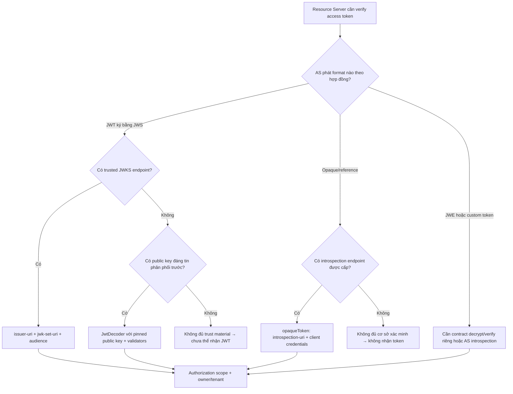
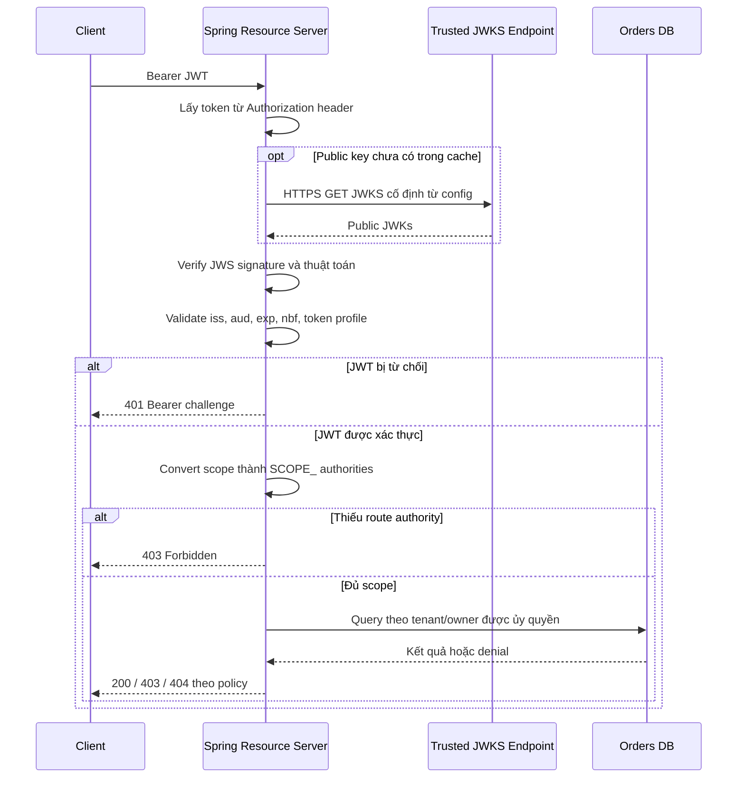
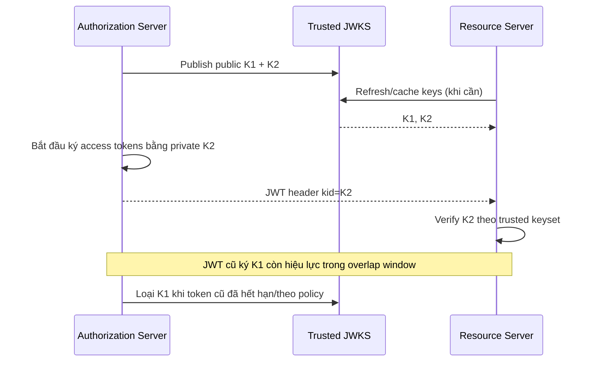

# Nhà phát hành không có discovery và lựa chọn cấu hình tường minh

## 1. Tình huống thực tế: issuer hoạt động nhưng không công bố metadata

Một **Spring Security OAuth 2.0 / OIDC Resource Server** nhận access token từ Authorization Server (AS) rồi quyết định có cho request đi vào API hay không. Trong ví dụ thông thường, cấu hình có thể chỉ cần:

```yaml
spring:
  security:
    oauth2:
      resourceserver:
        jwt:
          issuer-uri: https://id.example.test/realms/orders
```

Khi có metadata discovery tương thích, Spring Security dùng `issuer-uri` để xác định nhà phát hành, tìm địa chỉ JWKS của nhà phát hành và thiết lập decoder phù hợp. Nhưng không phải hệ thống nào cũng công bố metadata:

- Một **Authorization Server cũ** chỉ cấp token và xuất bản JWKS tại URL được tài liệu hóa thủ công.
- Một **Identity Provider nội bộ** có issuer ổn định nhưng không hỗ trợ OIDC Discovery hoặc OAuth 2.0 Authorization Server Metadata.
- Metadata bị chặn qua firewall/reverse proxy, trong khi JWKS endpoint vẫn truy cập được.
- JWKS không được xuất bản qua HTTP mà public signing key được phân phối bằng cấu hình/PKI nội bộ.
- Nhà phát hành chỉ cấp **opaque access token**, Resource Server phải dùng introspection thay vì JWT signature verification.
- Discovery có tồn tại nhưng **không đáng tin hoặc không phù hợp**: trả sai `issuer`, sai `jwks_uri`, thiếu trường bắt buộc hoặc chuyển hướng tới nguồn chưa được phê duyệt.

Một cách sửa lỗi thiếu discovery rất nguy hiểm là **bỏ toàn bộ kiểm tra issuer**, chỉ lấy một public key bất kỳ để giải mã JWT hoặc tin một endpoint do token tự chỉ định. Điều đó có thể khiến API nhận token của issuer/tenant/resource khác hoặc token giả.

**Mục tiêu của bài học:** chọn cấu hình **tường minh nhưng vẫn đầy đủ trust contract** cho Spring Security Resource Server khi issuer không có metadata discovery; hiểu tác động tới khởi động, key rotation, JWT/opaque token, nhiều issuers, kiểm thử và vận hành.

Bối cảnh xuyên suốt:

| Vai trò | Giá trị minh họa |
|---|---|
| Resource Server | `orders-api` |
| Issuer danh nghĩa | `https://id.example.test/realms/orders` |
| JWKS endpoint được đội Identity cung cấp | `https://keys.example.test/orders/jwks.json` |
| Introspection endpoint (nếu dùng opaque) | `https://id.example.test/oauth2/introspect` |
| JWT audience bắt buộc | `orders-api` |
| Scope đọc | `orders:read` |
| Scope ghi | `orders:write` |
| OAuth client ví dụ | `web-portal` |

Tất cả domain/token/credential đều là **ví dụ**, không phải hệ thống đang chạy. Code tham khảo dùng **Java 17+, Spring Boot 3.x và Spring Security 6.x**, chủ yếu trên Servlet/Spring MVC. Phần WebFlux trình bày các thành phần reactive riêng.

> **Thông điệp chính:** *Không có discovery* chỉ có nghĩa Resource Server **không tự tìm metadata qua protocol endpoint**. Nó **không** có nghĩa issuer không tồn tại, không phải kiểm chữ ký, hoặc có thể tin tất cả JWT do client gửi. Chúng ta thay **cơ chế tìm cấu hình** bằng **cấu hình trust được cung cấp trước**.

---

## 2. Discovery là gì và nó không làm gì?

### 2.1. Hai họ metadata thường gặp

**OpenID Connect Discovery 1.0** cho phép OIDC Provider xuất bản tài liệu discovery thường được gọi là:

```text
.well-known/openid-configuration
```

**RFC 8414 — OAuth 2.0 Authorization Server Metadata** định nghĩa metadata cho Authorization Server, thường có đường dẫn `.well-known/oauth-authorization-server` theo quy tắc ghép URL với issuer.

Cú pháp ghép URL phụ thuộc issuer path và chuẩn tương ứng. **Không tự thêm chuỗi `/.well-known/openid-configuration` vào mọi issuer URL** rồi coi đó là địa chỉ chắc chắn đúng: issuer có path, reverse proxy và từng chuẩn có quy tắc cụ thể. Framework hỗ trợ nhiều phương án khám phá theo phiên bản.

Một metadata document ví dụ:

```json
{
  "issuer": "https://id.example.test/realms/orders",
  "authorization_endpoint": "https://id.example.test/oauth2/authorize",
  "token_endpoint": "https://id.example.test/oauth2/token",
  "jwks_uri": "https://keys.example.test/orders/jwks.json"
}
```

Trong đó:

- `issuer` là danh tính nhà phát hành, được so sánh với issuer đã tin.
- `jwks_uri` chỉ **nơi lấy public verification keys**, không chứa private signing key.
- `authorization_endpoint`/`token_endpoint` dành cho OAuth/OIDC clients xin token; **Resource Server chỉ xác minh Bearer token thường không cần gọi những endpoint này**.
- Có thể còn nhiều metadata về algorithms, response types, introspection/revocation và scopes, tùy chuẩn và provider.

Discovery giúp **tìm cấu hình**, nhưng bản thân metadata không thay thế:

1. Xác minh JWT signature.
2. Kiểm `iss` trong JWT có khớp expected issuer.
3. Kiểm `aud` dành cho Resource Server.
4. Kiểm `exp`, `nbf` và profile access token.
5. Kiểm scopes/roles/owner/tenant khi authorization.

### 2.2. Những điều không nên đánh đồng

| Khái niệm | Ý nghĩa | Có bắt buộc phụ thuộc discovery? |
|---|---|---|
| **Issuer** | Tên định danh của nguồn phát hành (`iss`). | **Không.** Có thể cấu hình sẵn. |
| **OIDC/OAuth metadata discovery** | Phương pháp tìm endpoints và các thuộc tính AS. | Không, nếu endpoints/trust được cấu hình đáng tin. |
| **JWKS** | Public keys dùng để verify JWT ký bất đối xứng. | Không; JWKS URL có thể cấu hình tường minh. |
| **Public key cố định** | Một public key phân phối qua cấu hình đáng tin. | Không; thậm chí không cần JWKS HTTP. |
| **Opaque introspection** | AS trả trạng thái `active` và metadata của token. | Không; endpoint + auth method có thể cấu hình trước. |
| **Audience** | Resource/token recipient mà JWT được dùng cho. | Không; Resource Server biết audience của chính mình. |
| **Scope authorization** | Quyền dùng thao tác API. | Không; là chính sách resource. |
| **OIDC login flow** | Client đăng nhập user và nhận ID Token. | Có yêu cầu endpoint/metadata khác với Resource Server; có thể cần cấu hình thủ công rộng hơn. |

Một Authorization Server **không có OIDC discovery** vẫn có thể phát hành **JWT access token**. Ngược lại, provider có discovery không bảo đảm **access token** là JWT; format tùy issuer.

### 2.3. Không có discovery khác với discovery đang lỗi

Cần phân biệt:

- **Không hỗ trợ**: AS xác nhận không triển khai metadata endpoint. Đây có thể là contract lâu dài.
- **Bị chặn/không tới được**: DNS, proxy, TLS, routing, policy mạng hoặc startup dependency đang lỗi.
- **Trả metadata không phù hợp**: `issuer` mismatch, `jwks_uri` không hợp lệ, sai content/schema.
- **Metadata giả mạo**: request bị trỏ tới nguồn chưa được trust hoặc kết nối HTTPS bị can thiệp.

Nếu metadata lẽ ra phải có mà đang lỗi, đừng ngay lập tức **xóa `issuer-uri` và bỏ validation**. Phải xác định nguyên nhân, rồi quyết định có nên dùng **trusted explicit JWKS** hoặc giải pháp vận hành khác.

---

## 3. Cấu hình tường minh cần có những thông tin gì?

Một integration contract đủ dùng nên do **đội Identity/nhà phát hành và đội API** thống nhất, được quản lý version và phê duyệt qua kênh tin cậy.

### 3.1. Hợp đồng tối thiểu cho JWT access token

| Nhóm | Câu hỏi phải trả lời | Ví dụ `orders-api` |
|---|---|---|
| **Expected issuer** | Claim `iss` chính xác là gì? | `https://id.example.test/realms/orders` |
| **Key trust source** | Public keys lấy từ URL hoặc artifact nào? | `https://keys.example.test/orders/jwks.json` |
| **JWS algorithms** | RS256/ES256/... nào được phép? | RS256 |
| **Audience/resource** | `aud` phải chứa giá trị nào? | `orders-api` |
| **Token profile** | Đây là OAuth access token hay ID Token? `typ`/claims ra sao? | JWT access token, profile được phê duyệt |
| **Time policy** | `exp`, `nbf`, clock skew, max lifetime? | Hết hạn theo issuer và API policy |
| **Scopes** | Claim nào chứa scopes, format nào? | `scope="orders:read orders:write"` |
| **Subject/client** | User token khác client credentials ra sao? | `sub`, `client_id` theo profile |
| **Tenancy** | Có `tenant_id`/roles tùy biến không? | Claim được issuer định nghĩa |
| **Rotation** | JWKS cache, `kid` mới, overlap thời gian? | Publish K2 trước cutover |
| **Incident** | Khi signing key bị lộ thì thu hồi thế nào? | Key removal, revocation, response plan |

**Không bắt buộc JWKS URL phải cùng hostname với issuer** theo giao thức, nhưng nó phải là một nguồn đã **được issuer/nhà vận hành xác nhận là tin cậy**. Không tạo trust chỉ bằng cách “domain trông gần giống nhau”.

### 3.2. Hợp đồng tối thiểu cho opaque access token

| Nhóm | Cần làm rõ |
|---|---|
| Introspection endpoint | URL HTTPS cố định được AS xác nhận. |
| Authentication method | Client secret Basic, mTLS, private_key_jwt... tùy AS. |
| Client identity | Resource Server dùng credential nào để gọi introspection? |
| Token applicability | AS chỉ báo active cho đúng resource hay trả `aud` để API tự kiểm? |
| Response schema | `active` boolean; claims tùy chọn nào là bắt buộc theo API contract? |
| Scope mapping | `scope` string hay vendor-defined claims nào được chấp nhận? |
| Status semantics | `active=false` vs AS 401/403/429/5xx, timeout. |
| Cache/revocation | Có cache kết quả introspection không, TTL bao lâu? |
| Secret management | Rotation credential, không log secret, giới hạn quyền requester. |

**Introspection không yêu cầu metadata discovery** nếu Resource Server đã biết endpoint và authentication method qua contract. Nó vẫn yêu cầu kết nối an toàn và xác thực requester.

---

## 4. Quyết định tổng quát: JWT, public key cố định hay introspection?



**Không phân nhánh bằng số dấu chấm trong token.** JWT có thể là JWS ba phần hoặc JWE năm phần; opaque token có thể chứa dấu chấm. Token format là nội dung của **AS–API contract**, không phải bằng chứng do token tự cung cấp.

### 4.1. Bảng ưu tiên cấu hình

| Điều kiện | Lựa chọn | Điều vẫn phải kiểm |
|---|---|---|
| JWT issuer có discovery hoạt động | `issuer-uri`, cộng audience và profile. | Issuer, audience, signature, thời hạn, scopes. |
| JWT issuer **không có discovery**, nhưng có JWKS được tin | **`issuer-uri + jwk-set-uri`**. | Issuer và audience không được bỏ. |
| JWT có JWKS nhưng API muốn điều khiển validator/HTTP client chặt hơn | Custom `JwtDecoder` dùng `withJwkSetUri`. | Tự gắn issuer/time/audience/profile validators. |
| JWT không có JWKS HTTP, có public RSA key tin cậy | Custom `JwtDecoder` dùng public key. | Issuer/aud/alg/time; rotation thủ công. |
| Opaque token, introspection endpoint có sẵn | `opaquetoken.introspection-uri` + credentials. | `active` và resource binding; scopes/tenant. |
| Không có nguồn key/introspection được tin | **Không chấp nhận token**. | Cần hoàn thiện hợp đồng với AS trước. |
| Nhiều issuers không có discovery | Explicit registry/decoder/manager per issuer. | Chỉ issuer allowlist, resource/tenant binding. |

---

## 5. Lựa chọn số một: `issuer-uri` cộng `jwk-set-uri`

Đối với **JWT access tokens đã ký JWS**, đây thường là cách cấu hình đơn giản nhất nếu AS không có discovery nhưng đội Identity đã cung cấp **địa chỉ JWKS tin cậy**.

`application.yml`:

```yaml
spring:
  security:
    oauth2:
      resourceserver:
        jwt:
          issuer-uri: https://id.example.test/realms/orders
          jwk-set-uri: https://keys.example.test/orders/jwks.json
          audiences:
            - orders-api
```

Ý nghĩa:

1. **`issuer-uri`** đặt expected issuer để JWT claim `iss` phải khớp.
2. **`jwk-set-uri`** cung cấp trực tiếp nơi lấy public signing keys; không cần discovery để tìm `jwks_uri`.
3. **`audiences`** yêu cầu JWT dành cho `orders-api`. Thuộc tính này được Spring Boot hỗ trợ trong các dòng phiên bản phù hợp; cần xác nhận Boot version nếu hệ thống cũ hơn.
4. Decoder/validator còn kiểm JWS signature và thời gian theo cấu hình/framework.
5. Spring Security ánh xạ scopes thành authorities, rồi áp authorization rules.

**Điểm khác biệt quan trọng:** Khi cấu hình cả `issuer-uri` và `jwk-set-uri` với auto-configuration hỗ trợ, Resource Server có thể **tránh metadata discovery ở startup để định vị JWKS**, trong khi vẫn giữ **issuer validation**. Điều này không loại bỏ network cần thiết để tải keys khi xác minh token hoặc refresh cache sau rotation.

### 5.1. Vì sao không chỉ dùng `jwk-set-uri`?

Một cấu hình chưa đủ:

```yaml
spring:
  security:
    oauth2:
      resourceserver:
        jwt:
          jwk-set-uri: https://keys.example.test/orders/jwks.json
```

Cấu hình đó cho biết **nơi tìm khóa để verify chữ ký**, nhưng **không tự suy ra expected issuer** khi không có issuer validator. Nếu AS ký token cho nhiều realms/applications bằng cùng keys, một JWT sai `iss` vẫn có thể verify signature.

Ví dụ:

```json
{
  "iss": "https://id.example.test/realms/payments",
  "aud": ["orders-api"],
  "scope": "orders:read"
}
```

Nếu signature verify với keyset chung nhưng `iss` không được kiểm, API có thể nhận nhầm issuer. Đây là **token substitution**.

Bởi vậy **không bỏ issuer validation để né discovery**. Nếu chỉ dùng `jwk-set-uri` vì lý do framework, hãy tạo validator tường minh ở decoder.

### 5.2. Vì sao chỉ `issuer-uri` có thể gặp lỗi?

```yaml
spring:
  security:
    oauth2:
      resourceserver:
        jwt:
          issuer-uri: https://id.example.test/realms/orders
```

Trong đường auto-discovery, Spring Security cần biết `jwks_uri` bằng cách gọi metadata. Nếu AS không hỗ trợ metadata URL hợp lệ, khởi tạo hoặc request xác minh token có thể thất bại tùy phiên bản/cơ chế lazy initialization.

Không sửa bằng:

```yaml
# KHÔNG DÙNG như một cách bỏ qua issuer validation.
spring:
  security:
    oauth2:
      resourceserver:
        jwt:
          jwk-set-uri: https://keys.example.test/orders/jwks.json
# issuer-uri đã bị xóa và không có validator thay thế
```

Thay vào đó, **giữ expected issuer** và cung cấp key source trực tiếp. Kiểm thử chính xác phiên bản Boot/Security trong môi trường thật; startup behavior có thể thay đổi.

### 5.3. Issuer string phải khớp chính xác

AS có thể công bố:

```text
https://id.example.test/realms/orders
```

Các giá trị sau **không mặc nhiên tương đương**:

```text
https://id.example.test/realms/orders/
https://id.example.test/realms/Orders
http://id.example.test/realms/orders
https://id.example.test/realms/payments
```

Cách so sánh issuer thường là theo giá trị chuỗi chính xác trong contract. Không tự bỏ dấu slash, đổi scheme hay thay host để “làm cho token chạy”. Nếu AS phát issuer khác cấu hình, cần đội Identity xác nhận/correct contract.

### 5.4. JWKS có thể ở domain khác issuer

```text
Issuer:
  https://id.example.test/realms/orders

Trusted JWKS:
  https://keys.example.test/orders/jwks.json
```

Điều này có thể hợp lệ khi nhà phát hành công bố và quản lý `keys.example.test`. Nhưng:

- Xác minh TLS certificate/hostname.
- Kiểm soát DNS, egress network và reverse proxy.
- Không follow redirect tới untrusted host theo cách làm thay nguồn khóa.
- Không lấy `jku`/`x5u` từ JWT header làm key source tự động.
- Ghi rõ owner và quy trình rotation của JWKS URL.

**Public key không phải bí mật**, nhưng nếu attacker thay được trusted public key, họ có thể làm Resource Server nhận JWT do private key của họ ký. Tính toàn vẹn của nguồn khóa là yêu cầu an ninh.

---

## 6. Cấu hình Spring Security Servlet cho một JWT Resource Server

### 6.1. Các dependencies

Với Spring Boot parent/BOM quản lý versions:

```xml
<dependencies>
    <dependency>
        <groupId>org.springframework.boot</groupId>
        <artifactId>spring-boot-starter-web</artifactId>
    </dependency>

    <dependency>
        <groupId>org.springframework.boot</groupId>
        <artifactId>spring-boot-starter-security</artifactId>
    </dependency>

    <dependency>
        <groupId>org.springframework.boot</groupId>
        <artifactId>spring-boot-starter-oauth2-resource-server</artifactId>
    </dependency>

    <dependency>
        <groupId>org.springframework.boot</groupId>
        <artifactId>spring-boot-starter-test</artifactId>
        <scope>test</scope>
    </dependency>

    <dependency>
        <groupId>org.springframework.security</groupId>
        <artifactId>spring-security-test</artifactId>
        <scope>test</scope>
    </dependency>
</dependencies>
```

`spring-boot-starter-oauth2-resource-server` hỗ trợ Resource Server; JWT validation sử dụng JOSE/JWT libraries được dependency management kiểm soát. Không trộn lẫn các versions của Spring Security/Nimbus mà không kiểm dependency compatibility.

### 6.2. Một `SecurityFilterChain` đơn giản

```java
package com.example.orders.security;

import org.springframework.context.annotation.Bean;
import org.springframework.context.annotation.Configuration;
import org.springframework.http.HttpMethod;
import org.springframework.security.config.Customizer;
import org.springframework.security.config.annotation.web.builders.HttpSecurity;
import org.springframework.security.config.annotation.web.configurers.AbstractHttpConfigurer;
import org.springframework.security.config.http.SessionCreationPolicy;
import org.springframework.security.web.SecurityFilterChain;

@Configuration
public class OrdersApiSecurity {

    @Bean
    SecurityFilterChain securityFilterChain(HttpSecurity http)
            throws Exception {
        return http
            .csrf(AbstractHttpConfigurer::disable)
            .sessionManagement(session -> session
                .sessionCreationPolicy(SessionCreationPolicy.STATELESS))
            .authorizeHttpRequests(auth -> auth
                .requestMatchers(HttpMethod.GET, "/api/public/ping")
                    .permitAll()
                .requestMatchers(HttpMethod.GET, "/api/orders/**")
                    .hasAuthority("SCOPE_orders:read")
                .requestMatchers(HttpMethod.POST, "/api/orders")
                    .hasAuthority("SCOPE_orders:write")
                .anyRequest().denyAll())
            .oauth2ResourceServer(oauth ->
                oauth.jwt(Customizer.withDefaults()))
            .build();
    }
}
```

Đây là API thuần Bearer header. Tắt CSRF chỉ phù hợp nếu không dùng browser cookie/session làm authentication; với ứng dụng kết hợp web login cần thiết kế CSRF và multiple chains riêng. **`STATELESS` không tự tạo issuer/JWKS trust**: đó là nhiệm vụ của `JwtDecoder`.

### 6.3. Luồng request



Không cần gọi `authorization_endpoint` hoặc `token_endpoint` trong mỗi request API. JWT verification có thể chạy cục bộ sau khi public keys được cache; JWKS fetch chỉ xảy ra khi cần theo chiến lược cache/refresh.

---

## 7. Tự tạo `JwtDecoder`: khi nào và vì sao?

Auto-configuration từ `issuer-uri + jwk-set-uri` phù hợp nhiều trường hợp. Nhưng có thể cần decoder custom để:

- Chỉ cho phép **RS256**, ES256 hoặc tập algorithms đã thống nhất.
- Đặt audience validator trong code.
- Bổ sung token type/profile validator, ví dụ JWT access token RFC 9068.
- Kiểm bắt buộc claims `client_id`, `tenant_id` hoặc custom roles theo hợp đồng.
- Thay HTTP client/cache/timeouts phù hợp.
- Phân phối public key bằng file thay vì JWKS HTTP.
- Tổ chức nhiều issuers theo cấu hình tin cậy.

**Rủi ro quan trọng:** Khi ứng dụng tự đăng ký một `JwtDecoder` bean, Spring Boot thường **back off** khỏi việc tạo decoder mặc định. Khi đó các validators mà bạn tưởng Boot tự gắn từ YAML **không nhất thiết có hiệu lực**. Hãy chủ động bảo đảm issuer/audience/time/token profile.

### 7.1. Ví dụ `NimbusJwtDecoder` từ trusted JWKS

```java
package com.example.orders.security;

import java.util.List;

import org.springframework.beans.factory.annotation.Value;
import org.springframework.context.annotation.Bean;
import org.springframework.context.annotation.Configuration;
import org.springframework.security.oauth2.core.DelegatingOAuth2TokenValidator;
import org.springframework.security.oauth2.core.OAuth2Error;
import org.springframework.security.oauth2.core.OAuth2TokenValidator;
import org.springframework.security.oauth2.core.OAuth2TokenValidatorResult;
import org.springframework.security.oauth2.jose.jws.SignatureAlgorithm;
import org.springframework.security.oauth2.jwt.Jwt;
import org.springframework.security.oauth2.jwt.JwtDecoder;
import org.springframework.security.oauth2.jwt.JwtValidators;
import org.springframework.security.oauth2.jwt.NimbusJwtDecoder;

@Configuration
public class ExplicitJwtDecoderConfig {

    @Bean
    JwtDecoder jwtDecoder(
            @Value("${app.security.issuer}") String issuer,
            @Value("${app.security.jwks-uri}") String jwksUri,
            @Value("${app.security.audience}") String audience) {

        NimbusJwtDecoder decoder =
            NimbusJwtDecoder.withJwkSetUri(jwksUri)
                // AS contract: chỉ chấp nhận RS256.
                .jwsAlgorithm(SignatureAlgorithm.RS256)
                .build();

        OAuth2TokenValidator<Jwt> issuerAndTime =
            JwtValidators.createDefaultWithIssuer(issuer);

        OAuth2TokenValidator<Jwt> audienceValidator = jwt -> {
            if (jwt.getAudience().contains(audience)) {
                return OAuth2TokenValidatorResult.success();
            }

            return OAuth2TokenValidatorResult.failure(
                new OAuth2Error(
                    "invalid_token",
                    "Required audience is missing",
                    null
                )
            );
        };

        decoder.setJwtValidator(
            new DelegatingOAuth2TokenValidator<>(
                issuerAndTime,
                audienceValidator
            )
        );

        return decoder;
    }
}
```

`application.yml` cho decoder này:

```yaml
app:
  security:
    issuer: https://id.example.test/realms/orders
    jwks-uri: https://keys.example.test/orders/jwks.json
    audience: orders-api
```

Giải thích:

1. **`withJwkSetUri(jwksUri)`:** lấy public keys từ địa chỉ đã cấu hình; không discovery động.
2. **`jwsAlgorithm(RS256)`:** chỉ cho phép thuật toán do Resource Server chọn; không chấp nhận mọi `alg` của JWT.
3. **`JwtValidators.createDefaultWithIssuer(issuer)`:** gồm default token validators phù hợp cùng kiểm expected issuer.
4. **Audience validator:** token phải dành cho `orders-api`.
5. **`setJwtValidator`:** mọi điều kiện được áp cùng nhau.
6. **`SecurityFilterChain`:** sau decode còn cần scope, tenant và object authorization.

Đoạn code là mẫu **issuer/time/audience/RS256**, không có ý khẳng định đã triển khai toàn bộ yêu cầu của mọi OAuth JWT access-token profile. Nếu issuer yêu cầu `typ=at+jwt`, actor type, maximum token lifetime hoặc claims riêng, bổ sung validator tương thích **phiên bản Spring Security/Nimbus**. Trong một số phiên bản, Nimbus có kiểm tra JOSE `typ` trước khi Spring validators được gọi; phải thiết kế rõ tránh chồng/mâu thuẫn type policy.

### 7.2. Về `alg` và key type

Header JWT có thể chứa:

```json
{
  "alg": "RS256",
  "kid": "orders-key-2026-11",
  "typ": "at+jwt"
}
```

Header là dữ liệu client gửi trước khi verify, **không phải cấu hình trust**. Decoder phải chỉ dùng JWS algorithm/key type được phép; `kid` chỉ giúp tìm một public key trong **trusted keyset**. Một `jku` hoặc `x5u` trong JWT không được dùng tự động làm URL tải key do attacker chọn.

Không hỗ trợ `alg=none` cho signed access-token contract; không dùng RSA public key như HMAC shared secret (algorithm confusion).

### 7.3. JWT audience có thể là string hoặc list

Theo JWT, `aud` có thể biểu diễn một audience string hoặc mảng strings. Spring `Jwt.getAudience()` thường cung cấp danh sách đã chuẩn hóa; policy nên yêu cầu **exact audience match**:

```text
aud contains "orders-api"
```

Không dùng:

```java
// SAI: có thể match "orders-api-dev" hoặc object toString.
String.valueOf(jwt.getClaim("aud")).contains("orders-api")
```

JWT token của resource khác dùng cùng signing key vẫn không hợp lệ với API này.

---

## 8. JWT không có JWKS HTTP: pin public key đã xác nhận

Một số issuer cũ chỉ cung cấp public signing key bằng file PEM hoặc artifact do đội vận hành phân phối:

```text
-----BEGIN PUBLIC KEY-----
MIIBIjANBgkqhkiG9w0BAQEFAAOCAQ8A...
-----END PUBLIC KEY-----
```

Nếu API dùng **một RSA public key cố định** và issuer cam kết signing algorithm, có thể dùng `NimbusJwtDecoder.withPublicKey(...)`.

### 8.1. Nạp PEM công khai theo định dạng SubjectPublicKeyInfo

Ví dụ helper Java nhận **PEM `BEGIN PUBLIC KEY`** (X.509 SubjectPublicKeyInfo), không hỗ trợ mọi định dạng RSA PEM:

```java
package com.example.orders.security;

import java.nio.charset.StandardCharsets;
import java.security.KeyFactory;
import java.security.interfaces.RSAPublicKey;
import java.security.spec.X509EncodedKeySpec;
import java.util.Base64;

import org.springframework.core.io.Resource;

public final class PublicKeyLoader {

    private PublicKeyLoader() {}

    public static RSAPublicKey loadRsaSpkiPem(Resource resource) {
        try (var input = resource.getInputStream()) {
            String pem = new String(
                input.readAllBytes(),
                StandardCharsets.US_ASCII
            );

            String base64 = pem
                .replace("-----BEGIN PUBLIC KEY-----", "")
                .replace("-----END PUBLIC KEY-----", "")
                .replaceAll("\\s", "");

            byte[] der = Base64.getDecoder().decode(base64);
            var keySpec = new X509EncodedKeySpec(der);

            return (RSAPublicKey) KeyFactory
                .getInstance("RSA")
                .generatePublic(keySpec);
        } catch (Exception ex) {
            // Fail startup: không bỏ qua trust key không thể đọc.
            throw new IllegalStateException(
                "Cannot load configured RSA public key", ex);
        }
    }
}
```

**Định dạng cần chú ý:**

- `BEGIN PUBLIC KEY` chứa cấu trúc SPKI `SubjectPublicKeyInfo`.
- `BEGIN RSA PUBLIC KEY` chứa PKCS#1 riêng, không thể giả định dùng thẳng `X509EncodedKeySpec`.
- `BEGIN CERTIFICATE` là X.509 certificate; muốn dùng public key phải parse certificate rồi lấy `getPublicKey()` sau khi xác định certificate provenance.
- Một PEM bị thay nội dung phải làm ứng dụng **fail startup**, không tự fallback tới “any key”.
- File/key chỉ được cập nhật qua deployment/configuration có kiểm soát và audit.

Public key là dữ liệu công khai nhưng **không được để client HTTP tự chỉ định nó**. Public key của attacker vẫn có thể xác minh token giả do attacker ký.

### 8.2. Decoder với static public RSA key

```java
package com.example.orders.security;

import java.security.interfaces.RSAPublicKey;

import org.springframework.beans.factory.annotation.Value;
import org.springframework.context.annotation.Bean;
import org.springframework.context.annotation.Configuration;
import org.springframework.core.io.Resource;
import org.springframework.security.oauth2.core.DelegatingOAuth2TokenValidator;
import org.springframework.security.oauth2.core.OAuth2Error;
import org.springframework.security.oauth2.core.OAuth2TokenValidator;
import org.springframework.security.oauth2.core.OAuth2TokenValidatorResult;
import org.springframework.security.oauth2.jose.jws.SignatureAlgorithm;
import org.springframework.security.oauth2.jwt.Jwt;
import org.springframework.security.oauth2.jwt.JwtDecoder;
import org.springframework.security.oauth2.jwt.JwtValidators;
import org.springframework.security.oauth2.jwt.NimbusJwtDecoder;

@Configuration
public class StaticPublicKeyJwtConfig {

    @Bean
    JwtDecoder jwtDecoder(
            @Value("${app.security.public-key}") Resource keyPem,
            @Value("${app.security.issuer}") String issuer,
            @Value("${app.security.audience}") String audience) {

        RSAPublicKey key = PublicKeyLoader.loadRsaSpkiPem(keyPem);

        NimbusJwtDecoder decoder =
            NimbusJwtDecoder.withPublicKey(key)
                .signatureAlgorithm(SignatureAlgorithm.RS256)
                .build();

        OAuth2TokenValidator<Jwt> audValidator = jwt ->
            jwt.getAudience().contains(audience)
                ? OAuth2TokenValidatorResult.success()
                : OAuth2TokenValidatorResult.failure(
                    new OAuth2Error(
                        "invalid_token", "Invalid audience", null));

        decoder.setJwtValidator(
            new DelegatingOAuth2TokenValidator<>(
                JwtValidators.createDefaultWithIssuer(issuer),
                audValidator
            )
        );

        return decoder;
    }
}
```

`application.yml`:

```yaml
app:
  security:
    issuer: https://id.example.test/realms/orders
    audience: orders-api
    public-key: classpath:trusted-keys/orders-rsa-public.pem
```

**Đây là phương án thay thế** `ExplicitJwtDecoderConfig`, không phải bean thứ hai cùng được đăng ký không kiểm soát. Đừng dùng đồng thời hai `@Bean JwtDecoder` trùng chức năng rồi hy vọng Spring chọn đúng.

### 8.3. Static key có những trade-offs gì?

| Lợi ích | Rủi ro/giới hạn |
|---|---|
| Không phải fetch JWKS khi verify. | Không tự nhận key mới khi AS rotate. |
| Startup độc lập metadata/JWKS network. | Phải phân phối key qua release/config pipeline. |
| Ít moving parts trong môi trường đóng. | Một key đơn không thuận tiện cho nhiều `kid`. |
| Có thể pin provenance rõ. | Nếu private signing key bị lộ, phải cập nhật trusted key nhanh. |
| Test dễ với test keypair. | Hệ multi-issuer/key rotation phức tạp sẽ khó vận hành hơn. |

Khi AS dùng nhiều signing keys hoặc rotate thường xuyên, **JWKS endpoint ổn định với overlapping keys** thường là lựa chọn tốt hơn.

### 8.4. HMAC `HS256` không tương đương public-key JWT verification

Nếu legacy AS ký JWT bằng **shared secret** (HMAC), Resource Server phải giữ cùng secret để verify. Đây là trust model khác với RS256/ES256:

- Bất kỳ bên nào sở hữu secret HMAC **có thể tạo chữ ký token**, không chỉ verify.
- Secret phải được giữ bằng Secret Manager/KMS/runtime injection, không commit vào mã nguồn.
- Cần giới hạn phạm vi ai nhận secret, rotation và key ID.
- Không “chuyển” RSA public key thành HMAC secret để hỗ trợ cả HS256/RS256; đó là **algorithm confusion**.

Nếu hệ thống chỉ có HMAC legacy, cần cấu hình decoder với **algorithm allowlist và keying policy riêng**, không trộn lẫn vào ví dụ RSA ở trên.

---

## 9. JWT token profile: không nhầm ID Token với access token

Một nhà phát hành không có discovery vẫn có thể cấp JWT loại khác nhau bằng **cùng một RSA key**:

- OAuth 2.0 JWT access token cho API.
- OIDC ID Token cho client đăng nhập.
- Client assertion hoặc private_key_jwt assertion.
- JWT dùng cho email/one-time action.
- Token nội bộ cho một resource khác.

Một token signed đúng **không mặc nhiên là access token của `orders-api`**.

### 9.1. Ví dụ token của frontend

```json
{
  "iss": "https://id.example.test/realms/orders",
  "aud": ["web-portal"],
  "sub": "alice-123",
  "exp": 1890003600,
  "nonce": "login-session-nonce"
}
```

JWT này có thể hợp lệ đối với OIDC Client `web-portal`, nhưng **không dành cho `orders-api`**.

### 9.2. Access token của API

```json
{
  "iss": "https://id.example.test/realms/orders",
  "aud": ["orders-api"],
  "sub": "alice-123",
  "client_id": "web-portal",
  "scope": "orders:read",
  "exp": 1890003600
}
```

Resource Server phải định nghĩa access-token profile và các validation rules **không chấp nhận nhầm** ID Token. RFC 9068 dùng header `typ` như `at+jwt` và yêu cầu các claims theo profile. Tùy issuer thực tế và Spring Security version, cần kiểm/điều chỉnh JOSE typ validation phù hợp.

**Không dựa vào việc token có ba thành phần JWS** hay có `sub`/`email` để suy ra nó là API access token. Token được gửi qua `Authorization: Bearer` cũng không tự làm nó đúng mục đích.

---

## 10. Không discovery nhưng dùng opaque token: introspection được cấu hình thủ công

Khi AS phát **reference/opaque access token**, Resource Server không thể verify bằng public key JWS từ JWKS trừ khi issuer có format/protocol riêng được thỏa thuận. Cơ chế chuẩn là **RFC 7662 Token Introspection**.

### 10.1. Cấu hình Spring Boot

`application.yml`:

```yaml
spring:
  security:
    oauth2:
      resourceserver:
        opaquetoken:
          introspection-uri: https://id.example.test/oauth2/introspect
          client-id: ${INTROSPECTION_CLIENT_ID}
          client-secret: ${INTROSPECTION_CLIENT_SECRET}
```

Resource Server đã có đủ địa chỉ introspection từ **trusted contract**; không cần OIDC/OAuth metadata discovery để tìm URL đó.

Credential ở đây thuộc **introspection client** của Resource Server, dùng để xác thực với AS. Nó **khác** bearer access token của caller và khác `client_id` có thể trả trong response introspection.

Nếu AS yêu cầu mTLS/private_key_jwt hoặc phương thức khác thay Basic, cần cấu hình/customize HTTP client theo **client authentication contract**. Không tự dùng Basic khi issuer không hỗ trợ và không chuyển secret qua query string.

### 10.2. Một request introspection

```http
POST /oauth2/introspect HTTP/1.1
Host: id.example.test
Authorization: Basic <encoded-introspection-client-credentials>
Content-Type: application/x-www-form-urlencoded
Accept: application/json

token=<opaque-access-token>&token_type_hint=access_token
```

`token_type_hint` chỉ là gợi ý cho AS, không phải bằng chứng token đúng loại. Request body phải được form-encode đúng; HTTPS/TLS bắt buộc theo trust policy.

Một response có thể là:

```json
{
  "active": true,
  "iss": "https://id.example.test/realms/orders",
  "aud": ["orders-api"],
  "sub": "alice-123",
  "client_id": "web-portal",
  "scope": "orders:read",
  "exp": 1890003600
}
```

Cần phân biệt:

- **`active`** là **JSON boolean bắt buộc** trong response của RFC 7662.
- `iss`, `aud`, `sub`, `scope` và `exp` là metadata **tùy chọn theo RFC 7662**.
- `orders-api` có thể yêu cầu một số metadata trên **theo contract riêng**, ví dụ audience và issuer.
- Nếu AS có cơ chế ràng buộc introspection client chỉ được introspect token dành cho đúng Resource Server, AS có thể bảo đảm resource binding mà không cần `aud` trong mọi response; điều này phải được tài liệu hóa và kiểm thử.
- **`active=true` không đồng nghĩa đủ scope/quyền sở hữu tài nguyên**.

### 10.3. Response không hợp lệ và lỗi AS

| AS response | Ý nghĩa | Hành vi API |
|---|---|---|
| `200 {"active":true,...}` | Token active; cần kiểm metadata/policy. | Có thể authenticated nếu contract đạt. |
| `200 {"active":false}` | Token inactive/không thể introspect. | Từ chối token. |
| `200 {}` | Thiếu `active`. | Schema failure, fail closed. |
| `200 {"active":"true"}` | Sai kiểu `active`. | Không ép string thành true. |
| `401` hoặc `403` từ AS | Introspection requester chưa được xác thực/cấp phép phù hợp. | Lỗi tích hợp; không cho request qua. |
| `429`/`5xx`/timeout | AS/quota/network lỗi. | Retry có giới hạn nếu transient, sau đó fail closed. |
| HTTP 200 nhưng trả HTML | Response không đúng contract. | Không tạo principal. |

Lỗi kết nối introspection **không phải** là “token active” và cũng không nên bị im lặng biến thành “user đã đăng nhập trước đó”. Nếu AS mất mạng, API chưa có bằng chứng xác minh, phải từ chối thao tác bảo vệ.

### 10.4. Spring Security DSL

```java
@Bean
SecurityFilterChain opaqueSecurity(HttpSecurity http)
        throws Exception {
    return http
        .sessionManagement(session -> session
            .sessionCreationPolicy(SessionCreationPolicy.STATELESS))
        .authorizeHttpRequests(auth -> auth
            .requestMatchers(HttpMethod.GET, "/api/orders/**")
                .hasAuthority("SCOPE_orders:read")
            .anyRequest().denyAll())
        .oauth2ResourceServer(oauth ->
            oauth.opaqueToken(Customizer.withDefaults()))
        .build();
}
```

Đây là **phương án thay thế JWT Resource Server**; không đồng thời dùng cả hai chain không có `securityMatcher`/policy rõ ràng. Với Spring Security, `BearerTokenAuthenticationFilter` trích Bearer token rồi cơ chế được khai báo mới quyết định xử lý, không chọn theo dấu chấm trong token.

---

## 11. Custom `OpaqueTokenIntrospector` để ràng buộc hợp đồng issuer và resource

Nếu Resource Server cần kiểm `iss`/`aud` cụ thể, có thể **bọc introspector chuẩn** và kiểm principal đã nhận.

Ví dụ:

```java
package com.example.orders.security;

import java.net.URI;
import java.net.URL;
import java.util.Collection;

import org.springframework.security.oauth2.core.OAuth2AuthenticatedPrincipal;
import org.springframework.security.oauth2.server.resource.introspection.BadOpaqueTokenException;
import org.springframework.security.oauth2.server.resource.introspection.OpaqueTokenIntrospector;

public final class ResourceBoundIntrospector
        implements OpaqueTokenIntrospector {

    private final OpaqueTokenIntrospector delegate;
    private final String expectedIssuer;
    private final String expectedAudience;

    public ResourceBoundIntrospector(
            OpaqueTokenIntrospector delegate,
            String expectedIssuer,
            String expectedAudience) {
        this.delegate = delegate;
        this.expectedIssuer = expectedIssuer;
        this.expectedAudience = expectedAudience;
    }

    @Override
    public OAuth2AuthenticatedPrincipal introspect(String token) {
        // Delegate thực hiện HTTP request, client auth và active check.
        OAuth2AuthenticatedPrincipal principal =
            delegate.introspect(token);

        if (!sameIssuer(principal.getAttribute("iss"))
                || !containsAudience(principal.getAttribute("aud"))) {
            throw new BadOpaqueTokenException(
                "Token not intended for orders-api");
        }

        return principal;
    }

    private boolean sameIssuer(Object value) {
        if (value instanceof String s) {
            return expectedIssuer.equals(s);
        }
        if (value instanceof URI uri) {
            return expectedIssuer.equals(uri.toString());
        }
        if (value instanceof URL url) {
            return expectedIssuer.equals(url.toString());
        }
        return false;
    }

    private boolean containsAudience(Object value) {
        if (value instanceof String s) {
            return expectedAudience.equals(s);
        }
        if (value instanceof Collection<?> values) {
            return !values.isEmpty()
                && values.stream().allMatch(x -> x instanceof String)
                && values.contains(expectedAudience);
        }
        return false;
    }
}
```

**Chú ý:** wrapper đọc **`OAuth2AuthenticatedPrincipal` sau khi delegate đã parse**, không nhìn JSON raw. Một số libraries chuẩn hóa `aud`, `iss`, `scope` thành kiểu nội bộ; wrapper phải được thiết kế theo **contract của delegate/version đang dùng**. Nếu phải kiểm nghiêm ngặt `active` là JSON boolean hoặc duplicate JSON keys, cần validate **tại HTTP/raw JSON boundary**, không thể kết luận từ principal đã chuẩn hóa.

Bean introspector minh họa cho nhánh Spring Security 6.x hỗ trợ `NimbusOpaqueTokenIntrospector`:

```java
@Bean
OpaqueTokenIntrospector opaqueTokenIntrospector(
        @Value("${spring.security.oauth2.resourceserver.opaquetoken.introspection-uri}")
            String uri,
        @Value("${spring.security.oauth2.resourceserver.opaquetoken.client-id}")
            String clientId,
        @Value("${spring.security.oauth2.resourceserver.opaquetoken.client-secret}")
            String clientSecret) {

    OpaqueTokenIntrospector delegate =
        new NimbusOpaqueTokenIntrospector(
            uri, clientId, clientSecret
        );

    return new ResourceBoundIntrospector(
        delegate,
        "https://id.example.test/realms/orders",
        "orders-api"
    );
}
```

Thêm imports `@Bean`, `@Value` và hai kiểu introspector theo code thực tế. Tùy phiên bản, implementation/builder như `SpringOpaqueTokenIntrospector` hoặc những API thay thế có thể được khuyến nghị; kiểm thư viện của dự án. Đoạn code không có client-secret hardcode; lấy từ runtime secret source.

Nếu AS **không trả `iss` hoặc `aud`** nhưng cam kết resource binding theo introspection requester, phải xây một policy thích hợp với bằng chứng đó; không copy wrapper này rồi “fix” bằng cách cho qua mọi giá trị thiếu. **Không có discovery không phải lý do bỏ contract validation.**

---

## 12. Nhiều issuers không có discovery: dùng registry tin cậy

Hệ thống có thể hỗ trợ:

```text
Tenant Acme:
  issuer = https://id-a.example.test/realms/acme
  jwks   = https://keys-a.example.test/acme/jwks.json

Tenant Beta:
  issuer = https://id-b.example.test/realms/beta
  jwks   = https://keys-b.example.test/beta/jwks.json
```

Nếu cả hai không công bố metadata discovery, một dòng `issuer-uri` đơn lẻ không thể giải quyết tự động. Cần **registry** đã phê duyệt:

| Tenant | Expected issuer | Trusted key source | Required audience |
|---|---|---|---|
| `t-acme` | `https://id-a.example.test/realms/acme` | `https://keys-a.example.test/acme/jwks.json` | `orders-api` |
| `t-beta` | `https://id-b.example.test/realms/beta` | `https://keys-b.example.test/beta/jwks.json` | `orders-api` |

### 12.1. Phân biệt routing hint và trust

Có thể dùng issuer hint từ JWT chưa verify để **chọn trong một allowlist đã có sẵn**, nhưng tuyệt đối không:

```java
// KHÔNG DÙNG: attacker tự khai issuer tùy ý.
String issuer = readUnverifiedJwtClaim(token, "iss");
JwtDecoder decoder = JwtDecoders.fromIssuerLocation(issuer);
return decoder.decode(token);
```

Đoạn code tự động fetch metadata/JWKS từ URL do token tự chỉ định, gây **SSRF và authentication bypass** nếu không có allowlist.

Một cách thiết kế đúng:

```text
extract unverified issuer hint
        ↓
issuer in pre-approved trusted registry?
    ├─ no → deny
    └─ yes → select pre-built JwtDecoder for that issuer
                    ↓
              verify JWS signature using trusted key source
                    ↓
              validate iss == registry expected issuer
                    ↓
              validate audience + time + token profile
                    ↓
              authorize scope/tenant/object
```

Nếu issuer được chọn theo **hostname/path tenant**, host/path cũng là request input; nó chỉ được dùng để chọn **policy đã đăng ký**, không được coi là quyền thuộc tenant. Token phải verify đúng issuer được tenant yêu cầu.

### 12.2. Lý do không nên “thử mọi decoder đến khi có cái nhận”

Giả sử một token có `iss` chưa xác minh thuộc A, nhưng hệ thống lần lượt thử A, B, C rồi nhận token nếu **bất kỳ** decoder nào thành công. Điều này có thể:

- Gây tải JWKS/AS không cần thiết.
- Tạo chính sách không rõ về cùng `kid`/keyset.
- Che mâu thuẫn issuer/audience.
- Biến một issuer yếu hơn thành đường vòng cho resource bảo vệ bởi issuer khác.
- Làm khó audit cơ chế nào quyết định authenticated principal.

Giải pháp tốt hơn là **tạo ánh xạ explicit issuer → decoder**, và sau verify kiểm lại expected issuer, audience và tenant. Nếu token ambiguous, fail closed.

### 12.3. Cùng `sub` chưa chắc cùng user

`sub=alice-123` của issuer A và `sub=alice-123` của issuer B có thể chỉ hai chủ thể khác nhau. Khi lưu owner/identity, cần namespace theo `(issuer, subject)` hoặc ánh xạ internal identity đã kiểm soát.

Không lấy issuer từ URL gần giống nhau rồi gộp identity. Khi một issuer thay signing keys, vẫn phải giữ ranh giới namespace theo issuer và tenant.

---

## 13. Không có discovery và mối quan hệ với OIDC client

Một nhầm lẫn phổ biến là Resource Server và **OIDC login client** cần cùng tập endpoint cấu hình.

### 13.1. Resource Server chỉ xác minh Bearer access token

JWT Resource Server thường cần:

- Expected issuer.
- Trusted JWKS/public signing key.
- Allowed algorithms và token profile.
- Audience/time validators.
- Scope mapping và API authorization.

Nó không nhất thiết cần `authorization_endpoint`, `token_endpoint`, `userinfo_endpoint` hoặc `end_session_endpoint` để xác minh JWT access token trong từng HTTP request.

Opaque Resource Server cần:

- Trusted introspection URI.
- Client authentication tới AS.
- Response metadata/resource binding contract.
- Scope/authorization.

### 13.2. OIDC login client cần thêm nhiều endpoint

Một application sử dụng `oauth2Login()`/OIDC login thường cần redirect tới authorization endpoint và trao đổi code tại token endpoint. OIDC ID Token còn có các quy tắc issuer, audience, nonce, signature và potentially UserInfo checks. **Không có discovery** có thể đòi cấu hình thủ công `ClientRegistration`/provider details ngoài phạm vi Resource Server.

Đừng copy manual JWT Resource Server config rồi nghĩ đã cấu hình thành công toàn bộ OIDC login flow. Và **đừng dùng ID Token từ login client làm access token gửi cho API** chỉ vì nó là JWT ký bởi cùng issuer.

### 13.3. Config thiếu endpoint cần thiết không thể tự suy luận từ issuer URL

Issuer:

```text
https://id.example.test/realms/orders
```

không cho phép suy ra chắc chắn:

```text
/token
/authorize
/userinfo
/jwks
/introspect
```

Mỗi AS có routing khác nhau. Nếu cần một endpoint, phải lấy từ **hợp đồng tài liệu đáng tin** hoặc discovery hợp lệ, không xây bằng nối chuỗi tùy tiện.

---

## 14. JWT không có discovery: kiểm tra hoạt động khởi động

### 14.1. Ba thời điểm có thể phát sinh network call

| Thời điểm | Có thể cần gì? | Hậu quả |
|---|---|---|
| **Application startup** | Discovery metadata nếu dùng issuer-derived decoder; hoặc load key PEM local. | Metadata endpoint lỗi có thể làm startup thất bại tùy version. |
| **Request JWT đầu tiên** | Fetch JWKS nếu chưa có key cache. | Có thể làm request đầu tiên chậm hoặc fail. |
| **Sau key rotation** | Refresh JWKS để tìm `kid` mới. | Nếu JWKS chưa publish K2, JWT mới có thể bị 401. |

Khi chỉ cấu hình `issuer-uri` mà discovery không hoạt động, startup/initialization có thể fail. Khi cấu hình `issuer-uri + jwk-set-uri`, API không cần discovery để tìm keyset; nhưng **không đồng nghĩa hoàn toàn offline**. Phải tính dependency JWKS.

### 14.2. Startup-independent không có nghĩa fail-open

Nếu JWKS endpoint mất mạng:

- Token ký bằng key đã cache có thể còn verify được tùy cache implementation.
- Token có key mới chưa có trong cache không thể verify.
- API không được bỏ bước kiểm chữ ký để giữ availability.
- Không chuyển sang chấp nhận token do client tự khai khi public keys không sẵn.

**Fail closed** giữ an toàn: chưa có bằng chứng hợp lệ thì không có authenticated principal. HTTP status trả client có thể là 401 hoặc 5xx tùy nơi lỗi/handler; operator cần phân biệt invalid token với dependency outage.

### 14.3. Không cho phép network timeout vô hạn

JWKS HTTP fetch và introspection request cần:

- Connect timeout và read/response timeout hữu hạn.
- Bound tổng request deadline phù hợp API SLO.
- Retry có giới hạn chỉ cho transient failures, tránh retry storm.
- Connection pooling/rate limit và circuit breaker nếu cần.
- Egress allowlist, DNS/TLS policy.
- Alert trên JWKS/introspection failures.

Một custom decoder có HTTP client blocking cần bảo đảm không được dùng bừa trong WebFlux event-loop; reactive stack có decoder/WebClient dành riêng.

---

## 15. Key rotation: không có discovery vẫn xoay vòng được

Không có discovery **không có nghĩa** public key không đổi. Với trusted JWKS URI cấu hình sẵn, AS vẫn có thể publish nhiều public JWKs.

Ví dụ ban đầu:

```json
{
  "keys": [
    {
      "kty": "RSA",
      "kid": "orders-key-K1",
      "use": "sig",
      "alg": "RS256",
      "n": "PUBLIC_MODULUS_K1_PLACEHOLDER",
      "e": "AQAB"
    }
  ]
}
```

Sau đó:

```json
{
  "keys": [
    {
      "kty": "RSA",
      "kid": "orders-key-K1",
      "use": "sig",
      "alg": "RS256",
      "n": "PUBLIC_MODULUS_K1_PLACEHOLDER",
      "e": "AQAB"
    },
    {
      "kty": "RSA",
      "kid": "orders-key-K2",
      "use": "sig",
      "alg": "RS256",
      "n": "PUBLIC_MODULUS_K2_PLACEHOLDER",
      "e": "AQAB"
    }
  ]
}
```

`n` placeholder ở trên không phải RSA modulus hợp lệ; chỉ minh họa cấu trúc JWKS.

### 15.1. Quy trình rotation an toàn



Các điểm quan trọng:

1. Publish **public K2 trước khi phát JWT ký K2**.
2. Giữ K1 trong JWKS trong khoảng overlap đủ cho token cũ còn hợp lệ.
3. Bắt đầu phát token mới có `kid=K2`.
4. Cho decoder refresh từ **trusted JWK Set URI**.
5. Theo dõi unknown `kid`, JWKS cache behavior và 401 rates.
6. Chỉ retire K1 khi policy cho phép, hoặc xử lý khác nếu private K1 đã bị lộ.
7. Không cho một JWT header `jku` trỏ tới source khác khi chưa tìm thấy `kid`.

### 15.2. Khi public key được pin tĩnh

Nếu không có JWKS URL, rotation sẽ là thay đổi configuration/deployment:

- Phân phối key mới đúng provenance.
- Hỗ trợ nhiều trusted public keys trong giai đoạn overlap nếu cần; một `withPublicKey` đơn lẻ không tự làm điều đó.
- Bảo đảm mọi replicas có trust material mới trước thời điểm issuer đổi signing key.
- Rollback strategy nếu key mới gây lỗi.
- Emergency revocation plan khi private key bị lộ.

**Không chấp nhận key mới bằng cách “thử tải public key từ URL trong JWT”** để tránh rollout. Đây là trust-boundary violation.

### 15.3. JWKS cache khác token cache

JWKS cache lưu **public keys**, không phải khẳng định “token A được phép truy cập”. JWT verification vẫn cần chạy cho token theo chính sách; cache public key không tự cấp quyền cho user.

Opaque introspection cache lưu **active metadata** có thể làm chậm phản ánh revocation. Hai loại cache này có threat model và TTL khác nhau; đừng coi “JWT tự xử lý revoke tức thì” chỉ vì không cần introspection.

---

## 16. TLS, secret và nguồn cấu hình đáng tin

### 16.1. `jwk-set-uri` không phải URL được token cung cấp

JWT header có thể gửi:

```json
{
  "alg": "RS256",
  "kid": "attacker-key",
  "jku": "https://attacker.example.test/jwks.json"
}
```

Nếu custom code tự tải `jku` rồi verify, attacker có thể ký JWT bằng private key của mình và công bố public key ở website của họ. Resource Server khi ấy đã **để token tự chọn nguồn tin**.

Phải dùng:

```text
Trusted config: expected issuer, JWK source, algorithm allowlist
                        ↓
        JwtDecoder từ configuration đã kiểm duyệt
                        ↓
         Verify token do caller đưa vào
```

Không dùng:

```text
Caller JWT header → arbitrary jku/iss URL → download keys → trust JWT
```

Ngoài authentication bypass, cách sai còn có **SSRF** vào mạng nội bộ.

### 16.2. Pin TLS trust đúng cách

Khi gọi JWKS/introspection qua HTTPS:

- Kiểm certificate chain và hostname.
- Nếu dùng private CA, phân phối CA/truststore có quản lý.
- Không disable SSL validation chỉ để chạy được qua staging.
- Đặt egress restrictions phù hợp.
- Không tự follow redirect sang untrusted host có semantics mới.
- Theo dõi certificate expiration và DNS ownership.
- Không gửi Bearer token của caller tới **JWKS public key endpoint**; JWT verification chỉ cần token local và public keys.

### 16.3. Introspection credential khác signing key

Opaque introspection có thể cần `client-id` và `client-secret`. Signing private key thuộc **AS**, Resource Server **không bao giờ** cần nhận nó để verify RSA/ECDSA JWT.

Một sai lầm nguy hiểm là AS chuyển **private RSA key** cho API để “giải JWT” trong khi chỉ cần public key. Nếu không có yêu cầu decrypt JWE riêng, việc chia sẻ private signing key mở rộng rủi ro ký token giả khi API bị xâm nhập.

### 16.4. Không log token khi debug discovery

Không ghi:

```text
Authorization: Bearer eyJ...
client_secret=...
private_key=...
introspection response body with user PII
```

Dùng reason codes, request correlation ID, issuer configuration ID và HTTP upstream status. `issuer`/`jwk-set-uri` có thể là dữ liệu cấu hình cần bảo vệ operationally; không phải secret theo nghĩa mật mã nhưng không nên cho attacker tự sửa.

---

## 17. Xử lý JWT sai issuer, audience và key trong chế độ manual

Một JWT ví dụ:

```json
{
  "iss": "https://id.example.test/realms/orders",
  "sub": "alice-123",
  "aud": ["payments-api"],
  "scope": "orders:read",
  "exp": 1890003600
}
```

Nếu JWT có chữ ký đúng với public key trong trusted JWKS nhưng `aud=payments-api`, `orders-api` phải **từ chối**. Không vì “không có discovery” mà bỏ audience check.

### 17.1. Một ma trận lỗi thường gặp

| Trường hợp | Decoder / contract | Kết quả thường thấy |
|---|---|---|
| Token không có chữ ký phù hợp | JWS verify thất bại | 401, Bearer invalid_token. |
| Token dùng `alg` ngoài allowlist | JWS algorithm policy thất bại | 401. |
| Token `iss` sai | Expected issuer validator thất bại | 401. |
| Token `aud` khác API | Resource binding validator thất bại | 401. |
| Token `exp` đã hết hạn | Time validator thất bại | 401. |
| Token `nbf` tương lai | Time validator thất bại | 401. |
| Token có `kid` lạ, JWKS không có key | Signature chưa verify được | 401 hoặc dependency error nếu JWKS outage; không cho qua. |
| Token có `typ`/profile sai | Token type validator theo hợp đồng | Từ chối. |
| Token verified đúng nhưng thiếu `SCOPE_orders:read` | Authorization thất bại | 403. |
| Token đủ scope nhưng order thuộc user/tenant khác | Object authorization thất bại | 403/404 theo policy. |

**401 khác 403**: chưa chấp nhận credential là authentication failure; credential đã accepted nhưng quyền thao tác không đủ thường là authorization failure. HTTP response chi tiết phụ thuộc Spring Security handlers và cấu hình.

### 17.2. Không tạo authentication từ payload chưa verify

```java
// KHÔNG DÙNG:
String subject = parseJwtPayloadWithoutSignatureCheck(token)
    .get("sub")
    .toString();

return new UsernamePasswordAuthenticationToken(
    subject, null, List.of(new SimpleGrantedAuthority("ROLE_ADMIN")));
```

Base64URL decoding không phải cryptographic verification. Một token tự khai `iss` đúng, `sub` đúng hoặc `scope=admin` chưa chứng minh được bất cứ quyền nào.

---

## 18. WebFlux khi issuer không có discovery

Trong **Spring WebFlux**, API tương ứng không phải servlet `HttpSecurity`/`JwtDecoder` mà là:

| Spring MVC/Servlet | Spring WebFlux/Reactive |
|---|---|
| `SecurityFilterChain` | **`SecurityWebFilterChain`** |
| `HttpSecurity` | **`ServerHttpSecurity`** |
| `JwtDecoder` | **`ReactiveJwtDecoder`** |
| `NimbusJwtDecoder` | **`NimbusReactiveJwtDecoder`** |
| `OpaqueTokenIntrospector` | **`ReactiveOpaqueTokenIntrospector`** |
| `SecurityContextHolder` | **`ReactiveSecurityContextHolder`** |
| `MockMvc` | **`WebTestClient`** |

### 18.1. Cấu hình Boot vẫn cùng tư duy

```yaml
spring:
  security:
    oauth2:
      resourceserver:
        jwt:
          issuer-uri: https://id.example.test/realms/orders
          jwk-set-uri: https://keys.example.test/orders/jwks.json
          audiences:
            - orders-api
```

Khi app thật sự là WebFlux Resource Server, Boot sẽ sử dụng decoder reactive theo auto-config phù hợp. Việc có dependency Servlet `spring-boot-starter-web` cùng WebFlux có thể khiến application type được chọn khác dự kiến; cần xác định đúng stack.

### 18.2. `SecurityWebFilterChain`

```java
package com.example.orders.security;

import org.springframework.context.annotation.Bean;
import org.springframework.context.annotation.Configuration;
import org.springframework.http.HttpMethod;
import org.springframework.security.config.Customizer;
import org.springframework.security.config.annotation.web.reactive.EnableWebFluxSecurity;
import org.springframework.security.config.web.server.ServerHttpSecurity;
import org.springframework.security.web.server.SecurityWebFilterChain;

@Configuration
@EnableWebFluxSecurity
public class ReactiveOrdersSecurity {

    @Bean
    SecurityWebFilterChain springSecurityFilterChain(
            ServerHttpSecurity http) {
        return http
            .csrf(ServerHttpSecurity.CsrfSpec::disable)
            .authorizeExchange(exchange -> exchange
                .pathMatchers(HttpMethod.GET,
                    "/api/orders/**")
                    .hasAuthority("SCOPE_orders:read")
                .anyExchange().denyAll())
            .oauth2ResourceServer(oauth ->
                oauth.jwt(Customizer.withDefaults()))
            .build();
    }
}
```

Việc tắt CSRF ở đây chỉ phù hợp API không dùng cookie/session authentication. WebFlux security context theo Reactor Context; đừng dùng Servlet `SecurityContextHolder` thread-local như nguồn identity cho các reactive handlers.

### 18.3. Custom `ReactiveJwtDecoder` từ JWKS URL

```java
package com.example.orders.security;

import org.springframework.beans.factory.annotation.Value;
import org.springframework.context.annotation.Bean;
import org.springframework.context.annotation.Configuration;
import org.springframework.security.oauth2.core.DelegatingOAuth2TokenValidator;
import org.springframework.security.oauth2.core.OAuth2Error;
import org.springframework.security.oauth2.core.OAuth2TokenValidator;
import org.springframework.security.oauth2.core.OAuth2TokenValidatorResult;
import org.springframework.security.oauth2.jose.jws.SignatureAlgorithm;
import org.springframework.security.oauth2.jwt.Jwt;
import org.springframework.security.oauth2.jwt.JwtValidators;
import org.springframework.security.oauth2.jwt.NimbusReactiveJwtDecoder;
import org.springframework.security.oauth2.jwt.ReactiveJwtDecoder;

@Configuration
public class ReactiveNoDiscoveryDecoderConfig {

    @Bean
    ReactiveJwtDecoder reactiveJwtDecoder(
        @Value("${app.security.issuer}") String issuer,
        @Value("${app.security.jwks-uri}") String jwksUri,
        @Value("${app.security.audience}") String audience) {

        NimbusReactiveJwtDecoder decoder =
            NimbusReactiveJwtDecoder.withJwkSetUri(jwksUri)
                .jwsAlgorithm(SignatureAlgorithm.RS256)
                .build();

        OAuth2TokenValidator<Jwt> audienceValidator = jwt ->
            jwt.getAudience().contains(audience)
                ? OAuth2TokenValidatorResult.success()
                : OAuth2TokenValidatorResult.failure(
                    new OAuth2Error(
                        "invalid_token", "Invalid audience", null));

        decoder.setJwtValidator(
            new DelegatingOAuth2TokenValidator<>(
                JwtValidators.createDefaultWithIssuer(issuer),
                audienceValidator
            )
        );

        return decoder;
    }
}
```

Đây là **phương án thay thế auto-configuration**. Không đăng ký bean này cùng các cấu hình decoder khác không có chọn lựa rõ; không trông chờ Boot tự gắn thêm audience validator sau khi bạn đã tạo bean.

### 18.4. Tránh blocking I/O trong reactive verification

Không gọi:

```java
// KHÔNG DÙNG trên event-loop reactive:
Mono<Jwt> decode(String token) {
    Jwt jwt = blockingHttpClient.fetchJwksAndVerify(token);
    return Mono.just(jwt);
}
```

Một HTTP client blocking trong event-loop có thể làm tăng latency và gây starvation. Ưu tiên `NimbusReactiveJwtDecoder` và reactive HTTP stack, hoặc thiết kế scheduler phù hợp cho integration thật sự blocking. Không gọi `.block()` bên trong reactive authentication flow.

Với opaque token, dùng reactive introspector/client tương ứng và kết nối đến **introspection URI đã tin**, không tự chuyển qua Servlet introspector có blocking behavior trên event-loop.

---

## 19. Kiểm thử: “không có discovery” phải là một điều kiện chủ động

Một test đơn giản chỉ dùng `.with(jwt())` chưa chứng minh `JwtDecoder` có thể hoạt động khi issuer thiếu discovery, bởi test post-processor **tạo authenticated principal giả** và bỏ qua cryptographic verification.

Cần chia ít nhất hai nhóm:

1. **Authorization tests**: Spring Security Test `jwt()` hoặc `opaqueToken()` để xác nhận scopes, route, tenant/owner.
2. **Real verification tests**: gửi signed JWT hoặc opaque token qua Bearer header, chạy decoder/introspector thật với test JWKS/AS.

### 19.1. Môi trường kiểm thử không metadata

Tạo server local có:

```text
GET /jwks.json               → 200 + valid test JWKS
GET /.well-known/...         → 404 hoặc không được gọi
POST /introspect             → response theo fixture nếu opaque
```

Đảm bảo test cấu hình explicit:

```yaml
spring:
  security:
    oauth2:
      resourceserver:
        jwt:
          issuer-uri: https://issuer-without-metadata.example.test/orders
          jwk-set-uri: http://127.0.0.1:<test-port>/jwks.json
          audiences:
            - orders-api
```

**HTTP local** ở `127.0.0.1` chỉ phục vụ test loopback. Production phải dùng HTTPS/truststore phù hợp; không khuyến khích đưa `http://...` lên môi trường thật. Cấu hình `test-port` phải được tiêm bằng dynamic properties của test harness, không để placeholder nguyên dạng trong YAML sẽ chạy production.

Mục đích của test là chứng minh:

- Khởi tạo Resource Server **không cần gọi discovery endpoint** để tìm JWKS.
- Khi nhận JWT ký bởi test key, decoder fetch đúng **configured JWKS URL**.
- `iss` vẫn được kiểm chính xác bằng value config dù không discovery.
- `aud` vẫn được kiểm.
- `kid` lạ/JWS signature sai bị từ chối.
- Dữ liệu quyền `scope` vẫn phải đi qua authorization.

### 19.2. Ma trận JWT negative tests

| Test | Input | Mong đợi |
|---|---|---|
| Config explicit, discovery 404 | JWKS valid, JWT signed đúng | App có thể verify; không phụ thuộc metadata discovery. |
| JWT signed đúng, issuer đúng, audience đúng | RS256/key trong test JWKS | Authentication thành công, còn scope/business policy. |
| JWT signed đúng nhưng issuer sai | `iss=other` | 401; không bỏ issuer validation. |
| JWT signed đúng nhưng audience sai | `aud=payments-api` | 401. |
| JWT signed đúng, `exp` đã qua | Expired claims | 401. |
| JWT signed đúng, `nbf` tương lai | Not yet valid | 401. |
| JWT sửa payload giữ signature | Signature mismatch | 401. |
| JWT ký bằng private key attacker | Key không trong trusted JWKS | 401. |
| JWT có `jku` trỏ tới attacker | Header untrusted | Không gọi attacker JWKS, không chấp nhận. |
| JWT `alg=none` hoặc HS256 với RSA key | Algorithm không phù hợp | 401. |
| JWT có `kid` mới chưa publish | JWKS unknown key | Không bypass signature; refresh giới hạn. |
| JWT đúng signature nhưng là ID Token | Audience/type/profile không phù hợp | Từ chối theo access-token policy. |
| JWT active/verified nhưng thiếu read scope | `scope=orders:write` | 403 ở GET orders route. |
| JWT đủ read nhưng order thuộc user khác | Cross-object access | 403/404 theo domain policy. |
| JWKS HTTP 503/timeout khi chưa cache | Không lấy được key | Không cho request qua; status phụ thuộc handler. |

Các tests về token type/profile cần chính sách tường minh: nếu implementation không tự kiểm `typ=at+jwt`, phải bổ sung validator hoặc code thích hợp thay vì đặt expected 401 rồi mặc nhiên tin framework sẽ làm điều đó.

### 19.3. Test startup độc lập discovery

Một test đáng giá:

```text
Given:
  expected issuer configured
  explicit jwk-set-uri configured
  metadata discovery endpoint returns 404

When:
  Spring Boot application starts

Then:
  Startup succeeds without needing issuer metadata discovery
  (as supported by selected Boot/Security version)

And:
  First signed JWT request is validated with explicit JWKS
  iss/aud/exp/signature checks are still enforced
```

Dùng HTTP mock server spy để assert **không có metadata requests** trong startup; không chỉ nhìn log “application started”. Hành vi bootstrap/version phải được xác nhận trên đúng dependencies đang chạy.

### 19.4. Opaque introspection integration tests

Với opaque token không discovery, mock AS trả:

```json
{"active":false}
```

và:

```json
{
  "active":true,
  "iss":"https://id.example.test/realms/orders",
  "aud":["orders-api"],
  "scope":"orders:read",
  "sub":"alice-123"
}
```

Test:

1. HTTP `POST` tới đúng URI đã cấu hình, không discovery.
2. `Content-Type: application/x-www-form-urlencoded` và `token` được encode đúng.
3. Request dùng client auth do contract quy định, không đưa secret ra logs.
4. `active=false` luôn bị từ chối.
5. `active=true` đúng issuer/resource/scope có thể vào route đọc.
6. `active=true` audience sai bị từ chối theo API contract.
7. `active` string/null/missing không được coi là active.
8. AS `401` do introspection client credential sai phải phân loại integration failure.
9. AS `503`/timeout không được biến thành principal hợp lệ.
10. Không chuyển token chưa được AS nhận thành JWT chỉ vì nó có dấu chấm.

### 19.5. `MockMvc` authorization test không thay decoder test

```java
import static org.springframework.security.test.web.servlet.request
    .SecurityMockMvcRequestPostProcessors.jwt;

mvc.perform(get("/api/orders/42")
        .with(jwt().authorities(
            new SimpleGrantedAuthority("SCOPE_orders:write"))))
    .andExpect(status().isForbidden());
```

Ví dụ trên kiểm **route authorization**, không kiểm metadata/JWKS/signature. Để kiểm issuer không discovery, cần **Bearer signed JWT thật** và decoder tin test JWKS URL.

Với `MockMvc` có session hoặc custom filters, bảo đảm filter chain thực sự được áp dụng. Không coi đơn thuần HTTP 200 từ controller test là bằng chứng trust root đúng.

---

## 20. Đo kiểm và giám sát trong môi trường production

Khi metadata không có discovery, lỗi cấu hình thủ công có thể chỉ lộ khi signing key rotate hoặc issuer thay domain. Cần đo theo **đường xác minh** thay vì đo mọi 401 như một nhóm.

### 20.1. Metrics gợi ý

| Metric/event | Ý nghĩa |
|---|---|
| `jwt_validation_failure_total{reason=...}` | Signature, issuer, audience, time, token type. |
| `jwks_fetch_failure_total{class=...}` | TLS, DNS, 404, 429, 5xx, timeout. |
| `jwks_cache_refresh_total{result=...}` | Keyset refresh và key rotation. |
| `jwt_unknown_kid_total{issuer_config_id=...}` | Token mới ký key chưa nằm trong cache/AS JWKS. |
| `introspection_request_total{result=...}` | Active, inactive, HTTP error, schema invalid. |
| `introspection_duration_seconds` | Latency p95/p99 của opaque token validation. |
| `oauth_bearer_denied_total{kind=...}` | Authentication vs authorization denial. |
| `jwt_configuration_change_total` | Audit thay nguồn key/issuer policy qua deployment (nếu có). |

Các tên metrics này **không phải Spring Security tự tạo mặc định**; chúng là gợi ý observability. Không dùng raw access token, `sub`, `jti` hoặc untrusted claims làm metric labels do cardinality và privacy risk.

### 20.2. Startup và runtime alerts

Nên có alert cho:

- JWKS endpoint không truy cập được từ một region/pod.
- Unknown `kid` tăng đột biến sau AS rotation.
- Issuer mismatch tăng sau migration.
- Token audience mismatch tăng bất thường.
- Introspection HTTP 401/403 (client credential/permission).
- Introspection HTTP 429/5xx và timeout.
- Các route bắt đầu trả 302 login redirect thay 401 Bearer challenge.
- 403 tăng sau AS đổi scopes/claims converter.

Không alert chỉ dựa vào “JWT có hai dấu chấm hay không”; đó không phải tín hiệu trust.

---

## 21. Runbook khi issuer không có discovery và API trả 401/không khởi động

### Bước 1 — Xác định format của access token theo contract

Đội Identity xác nhận AS cấp **JWT signed JWS**, **opaque reference**, **JWE**, hay format riêng. Không đoán bằng số dấu chấm.

Nếu là JWT, cần JWKS/public key và expected issuer. Nếu opaque, cần introspection URI và authentication method. Nếu AS không thể cung cấp cách xác minh đáng tin, **chưa đủ điều kiện tích hợp**.

### Bước 2 — Phân loại lỗi discovery, key fetch hay validation

Xem internal error codes:

```text
METADATA_DISCOVERY_UNAVAILABLE
JWKS_SOURCE_UNAVAILABLE
JWT_SIGNATURE_INVALID
JWT_ISSUER_MISMATCH
JWT_AUDIENCE_MISMATCH
JWT_TIME_INVALID
TOKEN_PROFILE_INVALID
INTROSPECTION_CLIENT_UNAUTHORIZED
INTROSPECTION_UPSTREAM_UNAVAILABLE
SCOPE_INSUFFICIENT
```

Không ghi raw Bearer token trong logs. Với issuer-only startup fail, xác định AS thật sự không có discovery hay chỉ TLS/proxy/network lỗi.

### Bước 3 — Xác nhận trust material từ nguồn có thẩm quyền

Đội Identity cung cấp chính xác:

```text
expected issuer
trusted JWKS URI hoặc public key fingerprint
allowed JWS algorithms
required audience
token type/profile
rotation plan
```

Không chọn JWKS URL từ header token. Nếu có redirect hoặc domain khác, phải xác nhận đây là URL thuộc quyền quản lý của issuer.

### Bước 4 — Chọn cấu hình explicit đúng

Với JWT + JWKS:

```yaml
jwt:
  issuer-uri: https://id.example.test/realms/orders
  jwk-set-uri: https://keys.example.test/orders/jwks.json
  audiences:
    - orders-api
```

Với JWT + pinned key, dùng custom decoder và đầy đủ validators. Với opaque, dùng `opaquetoken.introspection-uri` + client credentials.

### Bước 5 — Kiểm tra nguồn HTTP/TLS

Kiểm:

- Cert chain, hostname, truststore.
- DNS/egress policy và proxy configuration.
- JWKS JSON hợp lệ, đúng key type/`kid`/alg.
- Cache TTL hoặc CDN JWKS có key mới chưa.
- Introspection method/credentials/quota.
- Không follow redirect sang host không đáng tin.

### Bước 6 — Tái tạo bằng test token

Tạo JWT ký test key hoặc opaque reference token trong staging. Kiểm chữ ký sai, issuer sai, audience sai, expired, inactive, scope thiếu. Không dùng token/secret production trong fixtures hay CI logs.

### Bước 7 — Khôi phục bằng cấu hình/hợp đồng, không nới security

Không làm:

```text
Disable issuer validation
Disable signature verification
Accept any alg
Trust any jku
Treat every active=true as all permissions
Fallback to old web session
Permit all protected routes
```

Lỗi trust material phải được khắc phục tại **provider/configuration**. Nếu cần fail closed trong outage, báo lỗi dependency theo API policy và phối hợp SRE.

### Bước 8 — Sau khi khôi phục

Theo dõi tỷ lệ 401/403, JWKS fetch latency, introspection upstream errors, scopes và object access. Bổ sung regression test cho “discovery 404 but configured JWKS valid”, key rotation và token substitution.

---

## 22. Những hiểu lầm dễ dẫn đến bypass

| Hiểu lầm | Vì sao sai | Hướng đúng |
|---|---|---|
| “AS không có discovery nên không có issuer.” | Issuer là identity claim/contract, không phải endpoint discovery. | Cấu hình expected issuer tường minh. |
| “Có JWKS URL là đủ.” | Chưa chắc kiểm `iss`/`aud`/token type. | Thêm issuer/audience/profile validators. |
| “Chỉ bỏ `issuer-uri` là tránh startup lỗi.” | Có thể mất issuer validation. | `issuer-uri + jwk-set-uri` hoặc custom validator. |
| “`jwks_uri` phải nằm cùng domain issuer.” | Không phải yêu cầu tuyệt đối; nhiều AS dùng key host riêng. | Trusted config/metadata, TLS, ownership. |
| “Public key không bí mật nên source không quan trọng.” | Attacker có thể thay public key để hợp thức token giả. | Bảo vệ provenance và integrity của key source. |
| “JWT có hai dấu chấm nên xác thực bằng JWT.” | Opaque token có thể có dấu chấm; JWS có thể giả. | Policy chọn format, rồi verify thật. |
| “ID Token signed đúng là access token.” | ID Token dành cho OIDC client, audience khác API. | Check access-token type/audience/profile. |
| “JwtDecoder custom sẽ tự nhận mọi validator YAML.” | Auto-config có thể back off khi có bean. | Tự gắn issuer/aud/time/profile. |
| “Không discovery thì phải introspect mọi JWT.” | Không bắt buộc; có thể dùng trusted JWKS/public key. | Chọn theo AS–API contract. |
| “Opaque introspection cần OIDC metadata.” | Endpoint có thể được cấu hình thủ công. | URI + client auth + response contract. |
| “`active=true` nghĩa có mọi quyền.” | Authentication khác authorization. | Kiểm scope/owner/tenant. |
| “`kid` trong JWT đủ để chọn nguồn key.” | `kid` chỉ hint trong trusted keyset. | Pin nguồn JWKS/public key từ config. |
| “Không lấy được key thì tạm bỏ verify.” | Fail open dẫn đến token giả được chấp nhận. | Fail closed và xử lý outage. |
| “Có thể lấy `iss` chưa verify để tự download JWKS tùy ý.” | SSRF/authentication bypass. | Allowlist/pre-built decoders. |
| “Static public key sẽ tự cập nhật khi rotate.” | Không có JWKS refresh. | Deployment/overlap rotation plan. |
| “Một issuer chung nghĩa mọi access token dùng được ở mọi API.” | Resource audience còn phải phân biệt. | Require `aud=orders-api`. |
| “JWT signature đúng là đủ đọc mọi order.” | Cần scope và object-level policy. | Kiểm tenant/owner/ACL. |
| “`jwt()` unit test chứng minh JWT signature an toàn.” | Test post-processor bypass decoder. | Signed JWT + trusted test JWKS. |

---

## 23. Checklist tích hợp nhà phát hành không có discovery

Trước khi triển khai production, hệ thống nên có câu trả lời rõ cho các mục sau:

| Câu hỏi | Cần xác nhận |
|---|---|
| **Token format?** | JWT JWS, opaque, JWE hoặc format riêng; có profile được tài liệu hóa. |
| **Issuer identity?** | `iss` chính xác và nhất quán. |
| **Trust source?** | `jwks-uri`/pinned public key/introspection URI được phê duyệt. |
| **Algorithm/key type?** | RS256/ES256/... đúng issuer; allowlist, không nhận `none` tùy tiện. |
| **Audience?** | `orders-api` phải được kiểm ở mọi cơ chế. |
| **Token type?** | Access token, không nhầm ID Token hoặc client assertion. |
| **Time claims?** | `exp`/`nbf` và clock skew policy. |
| **Scope/authorities?** | Ánh xạ `SCOPE_...` đúng; không có default admin. |
| **Tenant/object policy?** | Không bỏ quyền trên từng bản ghi/resource. |
| **Discovery coupling?** | Startup không gọi endpoint discovery trong cấu hình tường minh được chọn. |
| **JWKS fetch?** | TLS, timeout, cache, refresh, proxy/egress restrictions. |
| **Key rotation?** | Publish overlap, unknown `kid`, emergency revocation. |
| **Opaque client auth?** | Secret/mTLS/private_key_jwt và permission introspection. |
| **Opaque schema?** | `active` boolean, contract các metadata khác. |
| **Multi-issuer?** | Registry allowlist, không trust arbitrary `iss`. |
| **WebFlux vs Servlet?** | Đúng `JwtDecoder`/`ReactiveJwtDecoder` và security chain. |
| **Errors?** | 401 authentication, 403 authorization, upstream fail-closed. |
| **Tests?** | Discovery unavailable, signed JWT, wrong iss/aud, mock AS, rotation. |
| **Observability?** | Không log token/secret, metrics bounded-cardinality. |
| **Operational owner?** | Ai cập nhật JWKS/public key, rollback, rotation và incident response? |

---

## 24. Tóm lược theo ba kịch bản

### Kịch bản A — JWT, không discovery, có JWKS

```yaml
spring:
  security:
    oauth2:
      resourceserver:
        jwt:
          issuer-uri: https://id.example.test/realms/orders
          jwk-set-uri: https://keys.example.test/orders/jwks.json
          audiences:
            - orders-api
```

**Kết quả mong muốn:** Spring Resource Server không cần discovery để biết JWKS URL, vẫn kiểm issuer và audience. Khi có token, verify chữ ký với public key từ trusted JWKS, rồi authorization theo scope/resource.

### Kịch bản B — JWT, không discovery, không JWKS HTTP

```text
Trusted public RSA key → Custom NimbusJwtDecoder.withPublicKey(...)
                       → issuer/time validators
                       → audience validator
                       → token profile checks
                       → scope + object authorization
```

**Kết quả mong muốn:** Không cần metadata/JWKS network, nhưng phải có public key provenance và rotation/deployment plan rõ.

### Kịch bản C — Opaque token, không discovery

```yaml
spring:
  security:
    oauth2:
      resourceserver:
        opaquetoken:
          introspection-uri: https://id.example.test/oauth2/introspect
          client-id: ${INTROSPECTION_CLIENT_ID}
          client-secret: ${INTROSPECTION_CLIENT_SECRET}
```

**Kết quả mong muốn:** Mỗi token được AS xác nhận active/metadata qua introspection theo contract, không cần discovery, nhưng AS/resource binding, scope và tenant/owner vẫn phải kiểm.

---

## 25. Tài liệu tham khảo

- [Spring Security — OAuth 2.0 Resource Server JWT (Servlet)](https://docs.spring.io/spring-security/reference/servlet/oauth2/resource-server/jwt.html): issuer discovery, trusted JWKS URL, `JwtDecoder` và validators.
- [Spring Security — OAuth 2.0 Resource Server Opaque Tokens](https://docs.spring.io/spring-security/reference/servlet/oauth2/resource-server/opaque-token.html): introspection endpoint, principal và authorities.
- [Spring Security — Multitenancy for Resource Servers](https://docs.spring.io/spring-security/reference/servlet/oauth2/resource-server/multitenancy.html): trusted issuers và manager resolution.
- [Spring Security — Reactive JWT Resource Server](https://docs.spring.io/spring-security/reference/reactive/oauth2/resource-server/jwt.html): `ReactiveJwtDecoder`, JWKS và WebFlux security.
- [Spring Security API — NimbusJwtDecoder](https://docs.spring.io/spring-security/site/docs/current/api/org/springframework/security/oauth2/jwt/NimbusJwtDecoder.html): trusted JWK Set URI/public-key decoders.
- [Spring Security API — NimbusReactiveJwtDecoder](https://docs.spring.io/spring-security/site/docs/current/api/org/springframework/security/oauth2/jwt/NimbusReactiveJwtDecoder.html): reactive JWK source và validators.
- [Spring Boot — Security Documentation](https://docs.spring.io/spring-boot/reference/web/spring-security.html): Resource Server auto-configuration, property versioning.
- [RFC 8414 — OAuth 2.0 Authorization Server Metadata](https://www.rfc-editor.org/rfc/rfc8414.html): OAuth metadata `issuer`, `jwks_uri` và endpoints.
- [OpenID Connect Discovery 1.0](https://openid.net/specs/openid-connect-discovery-1_0.html): OIDC provider metadata discovery.
- [RFC 7517 — JSON Web Key (JWK)](https://www.rfc-editor.org/rfc/rfc7517.html): public JWK và JWK Set.
- [RFC 7515 — JSON Web Signature](https://www.rfc-editor.org/rfc/rfc7515.html): JWS headers, signature và key IDs.
- [RFC 7519 — JSON Web Token](https://www.rfc-editor.org/rfc/rfc7519.html): issuer/audience/time claims.
- [RFC 8725 — JWT Best Current Practices](https://www.rfc-editor.org/rfc/rfc8725.html): trusted algorithms, issuer/audience và cross-JWT confusion.
- [RFC 9068 — JWT Profile for OAuth 2.0 Access Tokens](https://www.rfc-editor.org/rfc/rfc9068.html): access-token JWT profile, tránh nhầm ID Token.
- [RFC 7662 — OAuth 2.0 Token Introspection](https://www.rfc-editor.org/rfc/rfc7662.html): request/response và `active` cho opaque access tokens.
- [RFC 6750 — OAuth 2.0 Bearer Token Usage](https://www.rfc-editor.org/rfc/rfc6750.html): Bearer token HTTP authentication và error responses.
- [OWASP — JSON Web Token Cheat Sheet for Java](https://cheatsheetseries.owasp.org/cheatsheets/JSON_Web_Token_for_Java_Cheat_Sheet.html): rủi ro triển khai JWT.
- [OWASP — Authorization Cheat Sheet](https://cheatsheetseries.owasp.org/cheatsheets/Authorization_Cheat_Sheet.html): least privilege, deny-by-default, object-level authorization.

**Kết luận:** Một nhà phát hành **không có discovery** vẫn có thể được tích hợp an toàn với Spring Security OAuth 2.0 Resource Server nếu có **trusted configuration contract**. Với JWT, thường dùng **`issuer-uri + jwk-set-uri + audience`** hoặc một `JwtDecoder` tường minh với public key và các validators đầy đủ; với opaque token, dùng **trusted introspection URI + client authentication + response contract**. **Không hy sinh issuer validation, signature verification, audience, token profile hoặc phân quyền** chỉ để tránh một metadata endpoint không tồn tại. Cấu hình thủ công làm tăng trách nhiệm quản lý trust/rotation và kiểm thử, chứ không hạ chuẩn bảo mật.
