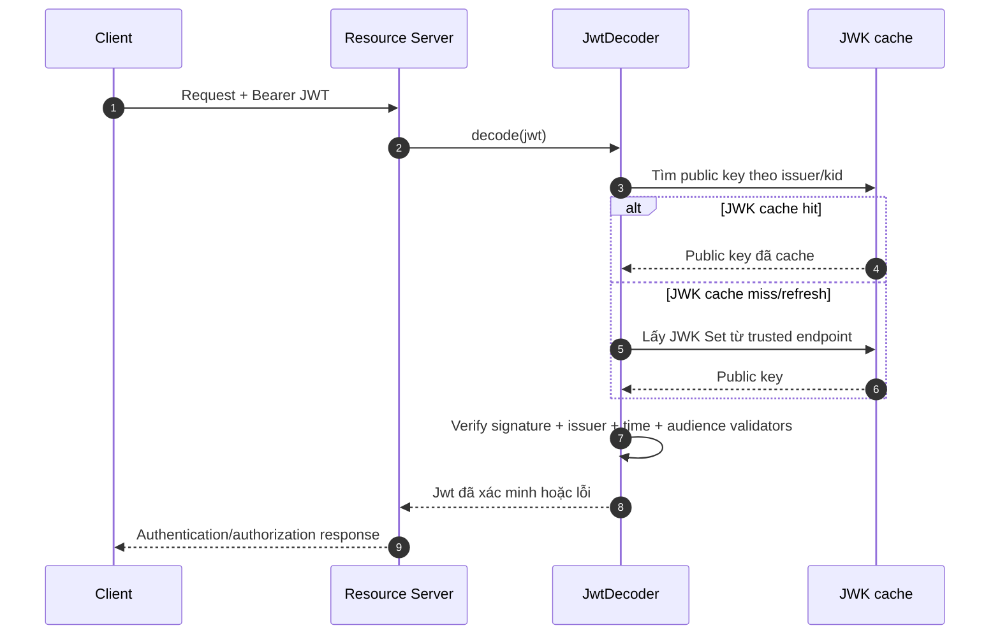
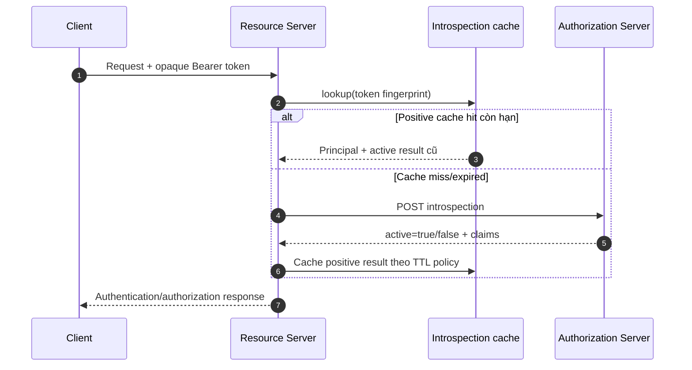

# Cache kết quả xác minh làm thay đổi cửa sổ chấp nhận token như thế nào

Trong một **Spring Security OAuth 2.0 Resource Server**, caching giúp giảm chi phí đọc JWK Set, gọi introspection endpoint và xử lý lặp lại cùng một access token. Nhưng cache bảo mật không chỉ là tối ưu hiệu năng: **nó quyết định trong bao lâu một quyết định “token hợp lệ” cũ còn được sử dụng sau khi trạng thái token, khóa, quyền hoặc chính sách đã thay đổi**.

Ví dụ, một opaque token được introspection trả về `active=true`. Ngay sau đó người dùng bị revoke, nhưng Resource Server vẫn giữ kết quả dương tính trong cache thêm 60 giây. Trong thời gian đó, token có thể tiếp tục được chấp nhận. Với JWT, cache JWK Set chỉ giữ public keys; nó **không đồng nghĩa** Resource Server đã cache kết quả xác minh token. Nếu cache cả Authentication hoặc kết quả validation, ứng dụng có thể vô tình bỏ qua `exp`, key rotation, issuer disable hoặc thay đổi policy.

Bài học phân biệt **JWK cache**, **opaque introspection cache** và **JWT verification-result cache**; tính toán acceptance window khi revoke; thiết kế TTL theo expiry và clock skew; xử lý cache phân tán, invalidation, outage và key rotation; đồng thời trình bày ví dụ Spring Security để cache introspection an toàn hơn. Ví dụ dùng **Spring Boot 3 / Spring Security 6** và Java 17+. Mọi con số TTL trong bài chỉ là ví dụ, không phải giá trị khuyến nghị chung cho mọi hệ thống.

## 1. Cache làm thay đổi quyết định bảo mật như thế nào?

Một cache xác minh thường lưu một kết quả đã được tính ở thời điểm trước:

```text
Request t0:
  token -> verify/introspect -> valid -> cache positive

Request t1:
  token -> cache hit -> valid

Trong khoảng t0..t1:
  token có thể đã bị revoke
  issuer có thể đã disabled
  quyền/membership có thể đã thay đổi
  signing key có thể đã bị loại khỏi JWKS
```

Khi cache trả kết quả cũ, API không hỏi lại nguồn có thẩm quyền trong request hiện tại. **TTL của cache vì thế trở thành một phần của chính sách thời gian chấp nhận credential.**

Nếu không có cache dương tính, API vẫn có thể chấp nhận token theo thời hạn và validators của token. Nếu có cache, token có thể được chấp nhận theo **quyết định cũ** cho đến khi cache hết hạn hoặc được invalidation. Nếu cache còn sống lâu hơn thời hạn token mà cache hit bỏ qua expiry validation, đây là lỗi nghiêm trọng.

## 2. Phân biệt ba loại cache thường bị nhầm

| Loại cache | Nội dung được lưu | Giúp giảm chi phí gì? | Ảnh hưởng revocation |
| --- | --- | --- | --- |
| **JWK Set / public-key cache** | Public keys theo issuer/JWK Set, thường theo `kid`. | Giảm discovery/JWKS network fetch. | Key bị gỡ khỏi JWKS có thể vẫn được dùng khi cache còn stale. |
| **Opaque introspection-result cache** | Principal/claims và kết quả `active=true` từ introspection. | Giảm gọi Authorization Server trên mỗi request. | Positive entry có thể tiếp tục chấp nhận token sau revoke. |
| **JWT verification-result cache** | Kết quả decode/validation hoặc Authentication của token. | Có thể giảm lặp lại signature/claim validation. | Có thể bỏ qua expiry, key removal, issuer disable và policy update nếu cache không được giới hạn/invalidate. |

Ba loại cache này không thay thế nhau. **JWK cache không lưu quyết định rằng một token cụ thể vẫn active**; introspection cache không phải JWK cache; cache Authentication có thể bỏ qua nhiều bước kiểm tra hơn cả hai loại trên.

## 3. Luồng JWT không cache kết quả token

Với JWT Resource Server thông thường:



Ở đường đi này, mỗi request vẫn đi qua decoder và validators; cache chủ yếu giảm việc tải public key. Token bị revoke ở Authorization Server **không tự mất hiệu lực** nếu Resource Server chỉ kiểm tra chữ ký và claims offline. Token vẫn có thể được chấp nhận đến `exp` theo clock-skew policy, trừ khi có denylist, online status check hoặc cơ chế thu hồi khác.

## 4. Luồng opaque token có cache introspection

Opaque token thường cần Resource Server gọi introspection endpoint:



Nếu cache trả principal dương tính, Resource Server có thể không hỏi Authorization Server trong request đó. Token bị revoke ngay sau lần introspection thành công vẫn có thể được chấp nhận trong **phần TTL còn lại**.

## 5. JWT tự chứa không tự có revocation realtime

Một JWT access token:

```json
{
  "iss": "https://identity.example.com/realms/shop",
  "sub": "user-123",
  "aud": ["orders-api"],
  "scope": "orders.read",
  "exp": 1900000000
}
```

Sau khi ký, token có thể được xác minh bằng public key mà không hỏi Authorization Server. Nếu user bị xóa role hoặc logout, Resource Server offline **không tự biết thay đổi đó**.

Với JWT validation offline:
- `exp` xác định giới hạn thời gian của token.
- `nbf` ngăn chấp nhận trước thời điểm token có hiệu lực.
- Clock skew có thể mở rộng một khoảng chấp nhận nhỏ theo cấu hình.
- JWK cache giữ key để xác minh signature.
- Token denylist hoặc online policy mới cung cấp trạng thái revoke bổ sung.

**Không có token-result cache vẫn không đồng nghĩa revocation realtime.** Đó là thuộc tính của mô hình JWT self-contained và cách Resource Server xác minh.

## 6. JWK cache không phải token status cache

JWK Set có thể chứa:

```json
{
  "keys": [
    {
      "kty": "RSA",
      "kid": "signing-key-2026-01",
      "use": "sig",
      "alg": "RS256",
      "n": "...",
      "e": "AQAB"
    }
  ]
}
```

Resource Server cache public key để xác minh nhiều JWT. Khi request đến, decoder vẫn cần:
1. Chọn key phù hợp theo issuer/JWK Set và `kid`.
2. Xác minh chữ ký của chính token.
3. Chạy validators issuer, expiry, not-before, audience và token profile.
4. Tạo Authentication theo claims đã xác minh.

JWK cache **không nên** được diễn giải thành “JWT đã xác minh lần đầu thì mọi request sau không cần kiểm tra `exp`”. Nếu ứng dụng tự thêm token-result cache ở ngoài decoder, đó là một lớp khác cần TTL và invalidation riêng.

## 7. Key rotation làm acceptance window thay đổi ra sao?

Giả sử:

```text
t0: Issuer phát token ký bằng key K1
t1: Resource Server tải JWKS, cache K1
t2: Issuer phát token mới bằng K2 và bắt đầu rotation
t3: Issuer loại K1 khỏi JWKS vì K1 bị compromise
t4: Resource Server mới refresh JWKS và không còn K1
```

Nếu Resource Server còn giữ K1 trong cache, token ký bởi K1 có thể tiếp tục vượt qua chữ ký cho đến khi key cache được refresh/evict, **nếu decoder tiếp tục dùng key cũ**. Tuy nhiên, mỗi request vẫn phải vượt qua `exp`/audience/issuer validators nếu không có token-result cache.

Acceptance window khi key bị revoke phụ thuộc:
- Cache TTL/refresh policy của JWK provider.
- Có force refresh khi `kid` không tìm thấy hay không.
- Có stale-if-error behavior khi IdP/JWKS endpoint unavailable hay không.
- Token `exp` và clock skew.
- Có cache Authentication/verification result khác hay không.

Nếu cache/provider được cấu hình dùng stale key khi refresh lỗi, không được giả định `JWKS TTL` là giới hạn tuyệt đối. Phải xác nhận **hành vi thực tế của thư viện và phiên bản đang chạy**.

## 8. Opaque introspection positive cache tạo stale-acceptance window

Giả sử Resource Server nhận:

```json
{
  "active": true,
  "sub": "user-123",
  "scope": "orders.read",
  "exp": 1900000000
}
```

và cache kết quả positive trong 60 giây.

```text
10:00:00  Introspection trả active=true
10:00:01  Cache lưu positive result, TTL 60s
10:00:10  Admin revoke token tại Authorization Server
10:00:20  Request dùng token -> cache hit -> vẫn được xác thực
10:01:01  Cache entry hết hạn
10:01:02  Request tiếp theo gọi introspection, nhận inactive
```

Trong ví dụ, token còn được chấp nhận khoảng **51 giây sau revoke**. Đây là hành vi đã được đánh đổi để giảm network calls. Nếu yêu cầu revoke nhanh hơn, TTL 60 giây là quá dài hoặc cần invalidation/online check.

## 9. Công thức ước lượng acceptance window

Định nghĩa:
- `r`: thời điểm token bị revoke.
- `t_c`: thời điểm cache positive được tạo hoặc refresh gần nhất.
- `T`: positive-cache TTL.
- `E`: `exp` của token.
- `S`: clock skew được phép trong token validation.
- `P`: độ trễ từ lúc revoke đến khi introspection authority phản ánh trạng thái inactive.

Nếu cache entry **được cap đúng theo thời điểm token hết hạn**, thời điểm cache có thể tiếp tục chấp nhận tối đa là:

\[
t_{\text{accept-end}} = \min(t_c + T,\ E + S)
\]

Nếu token bị revoke sau khi cache được tạo, phần acceptance window còn lại:

\[
W = \max(0,\ t_{\text{accept-end}} - r)
\]

Với positive cache và introspection propagation delay, nếu một lần refresh cuối cùng có thể xảy ra ngay trước khi nguồn introspection phản ánh revoke, ước lượng bảo thủ:

\[
W \lesssim \min(P + T,\ E + S - r)
\]

Đây là **mô hình lý tưởng hóa**: giả định TTL được thực thi đúng, cache không stale-if-error vô hạn, không có một cache dương tính khác lâu hơn, và `E + S` thực sự được kiểm tra. Invalidation delay, stale fallback, clock drift, replication hoặc một cache token-result ở lớp khác có thể làm thời gian thực tế dài hơn.

### Ví dụ

| Tham số | Giá trị |
| --- | ---: |
| Revoke tại `r` | 10:00:10 |
| Cache positive được tạo tại `t_c` | 10:00:00 |
| TTL `T` | 60 giây |
| Introspection propagation `P` | 0 giây |
| Token `exp + skew` | 10:15:00 |

Cache hết hạn lúc 10:01:00. Token có thể được chấp nhận thêm khoảng 50 giây sau revoke. Nếu TTL là 5 giây, phần cửa sổ này giảm còn khoảng 0 giây sau thời điểm revoke nếu cache entry đã hết hạn trước đó.

## 10. Clock skew cũng là một phần acceptance window

JWT validator có thể cho phép clock skew để bù sai lệch đồng hồ giữa issuer và Resource Server. Nếu token có `exp=10:00:00` và policy cho phép skew 30 giây, token có thể vẫn được chấp nhận tới gần `10:00:30` theo thời gian verifier.

Vì vậy, token lifetime, allowed clock skew, stale positive verification cache, source revocation propagation và invalidation/replication delay có thể cùng ảnh hưởng thời điểm chấp nhận cuối cùng. Không cộng tất cả một cách máy móc nếu các giới hạn chồng lấn; hãy xác định **lớp nào đang quyết định acceptance cuối cùng**.

Các máy chủ cần đồng bộ thời gian bằng NTP/chrony hoặc hạ tầng tương đương. Không đặt clock skew quá rộng chỉ để che lỗi đồng hồ. Cache expiry nên dùng cơ chế monotonic/clock đáng tin của cache library; khi so sánh token `exp`, cần hiểu kiểu dữ liệu và timezone.

## 11. Nếu cache JWT Authentication, TTL phải bị cap bởi expiry

Giả sử một ứng dụng custom cache:

```text
JWT -> decode + verify -> JwtAuthenticationToken
                  -> cache Authentication 10 phút
```

Token hết hạn sau 2 phút. Nếu request cache hit ở phút thứ 8 và code không chạy lại expiry validator, Authentication cũ có thể được sử dụng thêm 6 phút.

**TTL cố định không đủ**. Nếu có lý do đặc biệt phải cache kết quả token:
- Cache entry phải hết hạn **không muộn hơn** `exp` cộng đúng clock-skew policy.
- `nbf` và mọi time-based validators phải được tôn trọng ở mỗi cache hit hoặc entry lifetime phải bảo đảm chúng không thể đổi kết quả.
- Cache key phải gắn issuer, audience, token profile và policy version.
- Token/issuer/user revocation phải invalidation hoặc bị giới hạn bởi TTL.
- Mọi policy update có thể ảnh hưởng acceptance cần bump version hoặc xóa entry.
- Không cache `SecurityContext` theo session/thread hoặc chia sẻ Authentication mutable giữa requests.

Trong hầu hết trường hợp, hãy để `JwtDecoder` xác minh mỗi request và chỉ dùng JWK cache. Cache token-result là một tối ưu đặc biệt, cần threat model và kiểm chứng kỹ.

## 12. So sánh cửa sổ chấp nhận của các chiến lược

| Chiến lược | Sau khi revoke token | Yếu tố chi phối |
| --- | --- | --- |
| JWT offline, không token-result cache | Thường còn được chấp nhận đến `exp + skew`. | Lifetime JWT, validators, denylist/online check nếu có. |
| JWT offline + JWK cache | JWK cache chủ yếu ảnh hưởng khả năng biết key đã bị gỡ; token vẫn bị giới hạn bởi time validators nếu chạy mỗi request. | Key cache freshness, stale behavior, token expiry. |
| JWT + positive verification-result cache | Có thể được chấp nhận đến cache expiry hoặc token acceptance deadline, lấy mốc sớm hơn nếu enforcement đúng. | Result TTL, `exp`, skew, invalidation, policy version. |
| Opaque introspection mỗi request | Khi IdP phản ánh revoke, request tiếp theo có thể bị từ chối. | Revocation propagation, network availability. |
| Opaque + positive introspection cache | Token có thể còn được chấp nhận trong phần TTL còn lại sau revoke. | Propagation `P`, positive TTL `T`, expiry cap, invalidation. |
| Token denylist/online revocation check | Có thể từ chối sớm hơn expiry/cache TTL. | Độ tươi của denylist/status source và cache của nó. |

Không có một strategy tối ưu cho mọi hệ thống. Quyết định cần dựa trên **mức độ rủi ro khi token bị revoke nhưng vẫn còn được chấp nhận**, không chỉ số lần gọi IdP.
## 13. `jti` denylist bổ sung revoke cho JWT

Nếu access token có `jti` và issuer/API có cơ chế revoke đáng tin, Resource Server có thể kiểm tra denylist:

```text
verified JWT
  -> validate signature/iss/aud/exp
  -> extract issuer + jti
  -> denylist lookup
  -> if revoked: reject
  -> else authorize
```

Cache denylist cần **fail closed theo policy** khi không thể kiểm tra trạng thái mà hệ thống yêu cầu. Nếu denylist là tùy chọn/best-effort, phải ghi rõ acceptance window có thể tăng khi service lỗi.

Khóa denylist nên namespace:

```text
issuer + jti
```

không dùng `jti` trần vì hai issuers có thể phát cùng identifier. Entry cần tồn tại ít nhất đến lúc token chắc chắn không còn được chấp nhận, thường là `exp + skew` hoặc theo policy.

Nếu JWT không có `jti` hoặc issuer không phát sự kiện revoke đáng tin, cần thiết kế cơ chế khác như short-lived tokens, token version hoặc online status check.

## 14. Revoke signing key khác revoke một access token

| Hành động | Phạm vi | Tác động |
| --- | --- | --- |
| Revoke một token | Một credential/token | JWT offline cần denylist/online check hoặc chờ expiry. |
| Revoke refresh token | Khả năng cấp access token mới theo grant | Access token đã phát hành có thể vẫn còn hiệu lực. |
| Revoke user/session | Một phiên hoặc user theo issuer policy | Không tự thu hồi mọi JWT đã copy nếu API offline. |
| Remove signing key khỏi JWKS | Nhiều token ký bằng key đó | Decoder còn cache key có thể tiếp tục verify trong thời gian stale. |
| Disable issuer | Toàn bộ token từ authority đó | Resolver/registry và caches phải được cập nhật trên mọi pod. |

Revoke một signing key có thể ảnh hưởng nhiều tenants/users hơn revoke một token. Cần quy trình incident riêng, cache invalidation ưu tiên và cân nhắc việc issuer tiếp tục publish key cũ do propagation.

## 15. Positive cache và negative cache không có cùng rủi ro

**Positive cache** giữ kết quả token hợp lệ:
- Giảm introspection/validation cost.
- Có thể chấp nhận token sau revoke.
- TTL và expiry cap trực tiếp quyết định stale acceptance.

**Negative cache** giữ kết quả token không hợp lệ:
- Có thể giảm lặp lại introspection cho token inactive/invalid.
- Nếu cache nhầm timeout/429/5xx thành inactive, caller hợp lệ có thể bị từ chối lâu hơn.
- Nếu cache key không có namespace, token bị từ chối ở authority A có thể ảnh hưởng nhầm authority B.
- Nếu không giới hạn cardinality, attacker có thể tạo vô số token invalid để làm cache phình to.

Thông thường nên **cache positive có TTL ngắn, cache confirmed inactive rất ngắn hoặc không cache**, và không cache dependency errors. Việc cache negative cần lý do rõ ràng và max size.

## 16. Không biến lỗi introspection thành inactive hoặc valid

Ba kết quả khác nhau:

| Kết quả upstream | Ý nghĩa | Cache |
| --- | --- | --- |
| `active=true` và response hợp lệ | Token được introspection chấp nhận tại thời điểm đó. | Có thể positive-cache theo policy. |
| `active=false` | Introspection xác nhận token inactive. | Có thể negative-cache rất ngắn nếu cần. |
| Timeout, 429, 5xx, TLS/client error, malformed response | Không xác minh được trạng thái token. | Không cache như valid hoặc inactive. |

Không làm:

```java
// PHẢN VÍ DỤ: lỗi mạng bị biến thành kết quả positive.
return introspector.introspect(token)
    .onErrorResume(error -> Mono.just(defaultAdminPrincipal));
```

hoặc:

```java
// PHẢN VÍ DỤ: mọi lỗi bị ghi nhớ như token inactive.
catch (Exception ex) {
    negativeCache.put(tokenKey, INVALID);
    throw invalidToken();
}
```

Phải phân biệt **invalid credential** với **authority unavailable**. Cả hai đều không nên cho phép truy cập, nhưng telemetry, retry, HTTP mapping và cache semantics khác nhau.

## 17. Cache key phải gắn với trust context

Không nên dùng raw token làm key trong cache phân tán hoặc log. Nếu cùng một token string được gửi qua hai introspection authorities/client identities, kết quả có thể khác.

Một cache key an toàn hơn về mặt namespace:

```text
namespace =
  issuerAlias
  + introspectionAuthorityId
  + clientIdentityId
  + audiencePolicy
  + tokenProfileVersion

fingerprint = HMAC-SHA256(cacheSecret, rawToken)

cacheKey = namespace + ":" + fingerprint
```

HMAC fingerprint hạn chế việc raw bearer credential xuất hiện trực tiếp trong cache key; secret phải được quản lý an toàn. Không dùng hash thường như một cách công khai token fingerprint nếu có nguy cơ token entropy thấp hoặc bị lộ cache.

Với JWT verification-result cache, namespace cần gắn **issuer/decoder profile, audience, validator version và authority mapping version**. Với cache domain authorization, còn cần tenant/object/subject/policy scope thích hợp. Không dùng một cache entry Authentication chung cho mọi route/tenant.

## 18. Cache principal và cache authorization là hai lớp khác nhau

Một ứng dụng có thể cache:
1. **Authentication result:** issuer/subject/authorities từ token.
2. **Tenant membership:** user có thuộc tenant X hay không.
3. **Object authorization:** user có được đọc order Y hay không.

| Cache | Key tối thiểu cần xem xét | Điều làm stale |
| --- | --- | --- |
| Token principal | issuer + token fingerprint/profile | revoke, exp, key/policy changes |
| Membership | issuer + subject + tenant | user bị remove, tenant suspended |
| Object ACL | tenant + object + principal + policy | owner/ACL thay đổi, object chuyển tenant |
| Role mapping | issuer/profile version + raw role | policy mapping được cập nhật |

Không nên cache một boolean `authorized=true` ở tầng HTTP rồi tái dùng cho một object hoặc tenant khác. **Một token còn hợp lệ không làm membership hay ACL tự còn hợp lệ.**

## 19. TTL nên xuất phát từ yêu cầu revoke

Đừng chọn TTL chỉ vì “60 giây có vẻ hợp lý”. Hãy xác định:
- Nếu token bị revoke ngay sau một cache refresh, ứng dụng có thể chấp nhận thêm tối đa bao lâu?
- Authorization Server cần bao lâu để phản ánh revoke (`P`)?
- Có sự kiện invalidation đáng tin không? Delivery SLO là bao lâu?
- Token expiry có được kiểm tra ở cache hit không?
- Clock skew được cấu hình bao nhiêu?
- Có multi-level caches không?
- Một outage có cho phép dùng stale positive result không?
- Token đại diện quyền truy cập dữ liệu nhạy cảm hay thao tác ít rủi ro?

Ví dụ minh họa:

| Mục tiêu revoke sau khi nguồn phản ánh | Positive TTL tối đa cần cân nhắc |
| --- | ---: |
| Gần realtime, vài giây | 1–3 giây hoặc không cache positive; cần đo network. |
| Trong khoảng 10 giây | TTL và propagation/invalidation phải cùng nằm trong ngân sách đó. |
| Trong khoảng 1 phút | Có thể chọn TTL ngắn hơn 60 giây để còn ngân sách cho propagation/skew. |
| Chỉ cần hiệu lực khi access token hết hạn | Cache có thể dài hơn nhưng phải cap ở token acceptance deadline; cần chấp nhận token lifetime. |

Đây là ví dụ về cách suy luận, **không phải khuyến nghị chung**. Nếu yêu cầu “revoked token không được dùng thêm sau 5 giây” nhưng IdP có propagation 8 giây, không có TTL cache nào tự giải quyết được yêu cầu đó.

## 20. Cap positive cache bằng token expiry

Khi introspection response có `exp`, entry nên hết hạn không muộn hơn thời điểm token được phép chấp nhận. Một policy đơn giản:

```text
cacheValidUntil = min(
    introspectionTime + configuredPositiveTtl,
    tokenExp + allowedClockSkew
)
```

Nếu hệ thống muốn **không chấp nhận quá `exp` dù decoder khác cho phép skew**, có thể cap trực tiếp ở `exp`; đó là policy nghiêm hơn. Cần nhất quán với token validators và yêu cầu vận hành.

Nếu opaque introspection contract không trả expiry và Resource Server không có cách đáng tin để biết thời hạn token, hãy cân nhắc **không cache positive** hoặc dùng TTL rất ngắn được chấp thuận bằng security review. Không suy ra expiry từ thời điểm cache hoặc từ client-provided data.

Không cache principal mà bỏ `exp` rồi hy vọng `NimbusOpaqueTokenIntrospector` hay framework sẽ tự kiểm tra lại trong cache hit: khi cache trả principal, delegate introspector thường không chạy.

## 21. Ví dụ decorator cache `OpaqueTokenIntrospector`

Spring Security cho phép bọc một `OpaqueTokenIntrospector` bằng decorator. Ý tưởng:

```java
public final class CachingOpaqueTokenIntrospector
        implements OpaqueTokenIntrospector {

    private final OpaqueTokenIntrospector delegate;
    private final Cache<String, CacheEntry> cache;
    private final Duration positiveTtl;
    private final String authorityNamespace;
    private final Function<OAuth2AuthenticatedPrincipal,
        Optional<Instant>> acceptedUntilExtractor;

    @Override
    public OAuth2AuthenticatedPrincipal introspect(String token) {
        String key = authorityNamespace + ":" + hmacFingerprint(token);
        Instant now = Instant.now();

        CacheEntry entry = cache.getIfPresent(key);
        if (entry != null && now.isBefore(entry.validUntil())) {
            return entry.principal();
        }
        if (entry != null) {
            cache.invalidate(key);
        }

        // Chỉ cache khi delegate introspection thành công.
        OAuth2AuthenticatedPrincipal principal =
            delegate.introspect(token);

        Optional<Instant> acceptedUntil =
            acceptedUntilExtractor.apply(principal);
        if (acceptedUntil.isEmpty()) {
            return principal; // Không biết expiry an toàn thì không cache.
        }

        Instant checkedAt = Instant.now();
        Instant cacheDeadline = checkedAt.plus(positiveTtl);
        Instant validUntil = cacheDeadline.isBefore(
                acceptedUntil.get())
            ? cacheDeadline
            : acceptedUntil.get();

        if (validUntil.isAfter(checkedAt)) {
            cache.put(key, new CacheEntry(principal, validUntil));
        }
        return principal;
    }

    private record CacheEntry(
        OAuth2AuthenticatedPrincipal principal,
        Instant validUntil) {}
}
```

Đây là **khung triển khai**: cần constructor, imports, cache library, HMAC helper, validation cho `token`, thread-safe cache và cách trích xuất expiry phù hợp với introspection contract. `acceptedUntilExtractor` phải trả **thời điểm muộn nhất policy cho phép chấp nhận principal**, ví dụ `exp` cộng clock skew nếu policy cho phép; nếu không xác định được thì không cache.

Điểm quan trọng:
- Chỉ cache **positive result** khi delegate đã xác nhận token.
- Delegate exception được truyền ra, không ghi thành inactive hay valid.
- Cache deadline là min của TTL và acceptance deadline của token.
- Namespace phân biệt issuer/introspection authority/client/profile.
- `hmacFingerprint` phải là HMAC-SHA-256 với secret được quản lý; không lưu raw token làm key.
- Cache phải có **maximum size/eviction**, không chỉ TTL.

## 22. Caffeine cache cho decorator

Với Caffeine, có thể tạo bounded cache:

```java
import com.github.benmanes.caffeine.cache.Cache;
import com.github.benmanes.caffeine.cache.Caffeine;

Cache<String, CacheEntry> cache =
    Caffeine.newBuilder()
        .maximumSize(50_000)
        .expireAfterWrite(Duration.ofSeconds(30))
        .build();
```

`expireAfterWrite` là **hard upper bound bổ sung**; `CacheEntry.validUntil` trong phần trước còn kiểm tra deadline từng token. Nếu `validUntil` sớm hơn Caffeine TTL, lookup tự invalidate entry khi deadline đã qua. `maximumSize` ngăn token spray tạo cache vô hạn.

Con số 50.000 và 30 giây chỉ minh họa. Hãy chọn capacity theo traffic/heap budget, positive TTL theo revoke SLO và đo hit ratio, eviction, memory và upstream calls. Với distributed cache như Redis, vẫn cần namespace, TTL và policy invalidation; shared cache không tự làm kết quả luôn mới.

## 23. Tính HMAC fingerprint thay cho raw token key

Một helper minh họa:

```java
import java.nio.charset.StandardCharsets;
import java.security.GeneralSecurityException;
import java.util.HexFormat;
import javax.crypto.Mac;
import javax.crypto.spec.SecretKeySpec;

String hmacFingerprint(String token, byte[] cacheSecret) {
    try {
        Mac mac = Mac.getInstance("HmacSHA256");
        mac.init(new SecretKeySpec(cacheSecret, "HmacSHA256"));
        byte[] digest = mac.doFinal(
            token.getBytes(StandardCharsets.UTF_8));
        return HexFormat.of().formatHex(digest);
    } catch (GeneralSecurityException ex) {
        throw new IllegalStateException(
            "Cannot calculate token cache fingerprint", ex);
    }
}
```

Trong code production, `cacheSecret` phải lấy từ secret manager/configuration bảo vệ, không hardcode trong source. Nên giới hạn độ dài token trước khi tính HMAC. Khi rotate HMAC secret, fingerprint namespace thay đổi và cache cũ sẽ miss; đó là hành vi an toàn nhưng cần tính tới tải introspection tăng đột ngột.

HMAC fingerprint vẫn là **dữ liệu nhạy cảm có thể liên kết requests**; không log nó, không dùng làm metric label và giới hạn quyền truy cập cache.

## 24. Negative caching phải có giới hạn riêng

Nếu delegate introspection xác nhận `active=false`, một hệ thống có thể cache negative trong thời gian rất ngắn để giảm việc gọi lại với cùng token. Nhưng:
- Chỉ cache **confirmed inactive** theo đúng exception/result semantics của introspector.
- Không cache timeout, DNS, TLS, client authentication failure, 429, 5xx hay malformed response như inactive.
- TTL negative nên ngắn hơn positive TTL nếu có lý do cần cache.
- Dùng HMAC key, namespace theo introspection authority và bounded capacity.
- Không để token ngẫu nhiên tạo vô hạn negative entries.
- Không chia sẻ negative result giữa hai IdPs/clients khác nhau.

Thông thường nên **cache positive có TTL ngắn, cache confirmed inactive rất ngắn hoặc không cache**, và không cache dependency errors. Việc cache negative cần lý do rõ ràng và max size.
## 25. Không dùng `@Cacheable` mà quên token expiry và security context

Một ví dụ dễ viết nhưng thiếu policy:

```java
@Cacheable("introspection")
public OAuth2AuthenticatedPrincipal introspect(String token) {
    return delegate.introspect(token);
}
```

Chỉ khai báo annotation không giải quyết:
- Cache key đang chứa raw token.
- TTL không bị cap theo `exp`.
- Cache có thể không namespace theo issuer/client/audience.
- Không có invalidation khi token bị revoke.
- Cache có thể lưu exception hoặc không tùy provider/configuration.
- Cache size/cardinality có giới hạn không?
- Multi-pod cache có nhất quán không?

Nếu dùng Spring Cache, phải định nghĩa **key generator, cache TTL, expiry deadline, bounded storage, error semantics và eviction** rõ ràng. Không coi `@Cacheable` là security policy.

## 26. JWK rotation và stale public keys

Issuer có thể:

```text
K1 active -> publish K1
K2 introduced -> publish K1 + K2
Start signing with K2
Retire K1 -> publish K2 only
```

Overlap K1/K2 giúp Resource Server có thời gian tải K2 trước khi token mới được ký. Khi K1 bị compromise, issuer có thể cần loại bỏ K1 nhanh hơn quy trình rotation bình thường.

Nếu Resource Server còn cache K1:
- Token mới dùng K2 có thể fail nếu cache chưa refresh và không xử lý unknown `kid` đúng.
- Token cũ ký K1 có thể tiếp tục verify khi cache vẫn giữ key.
- Nếu JWKS endpoint lỗi và thư viện dùng stale keys, cửa sổ có thể dài hơn TTL dự kiến.

Cần kiểm tra JWK cache lifetime/refresh, unknown `kid`, JWKS outage behavior, token expiry/clock skew và cache token-result khác. Không tự ép refresh JWKS với mọi token sai, vì attacker có thể tạo nhiều `kid` ngẫu nhiên để gây network amplification.

## 27. Disable issuer và cache manager theo issuer

Với multi-issuer Resource Server, việc remove issuer khỏi trusted registry không tự bảo đảm mọi pod ngừng dùng **AuthenticationManager/decoder đã được cache**.

Một registry động phải quản lý:
- Version của issuer policy.
- Manager/decoder đang được dùng.
- Cache JWK/introspection gắn với manager.
- In-flight requests trong thời điểm revoke.
- Event invalidation tới tất cả pods.
- Thời gian tối đa từ admin disable đến khi mọi instance từ chối.

Nếu manager resolver có cache nội bộ, cần hiểu cách clear/rebuild hoặc thay snapshot. Không chỉ xóa một entry trong database rồi giả định runtime đã đổi. **Trust revocation cần end-to-end invalidation**, gồm resolver cache, token-result cache và JWK/opaque state liên quan.

## 28. Local cache và distributed cache có trade-off khác nhau

| Kiểu cache | Ưu điểm | Nhược điểm bảo mật/vận hành |
| --- | --- | --- |
| Local in-memory | Nhanh, không phụ thuộc network. | Mỗi pod có kết quả khác thời điểm; revoke event cần fan-out. |
| Distributed Redis | Có thể chia sẻ entries và invalidation. | Thêm network/dependency; consistency, outage và ACL cần thiết kế. |
| Hybrid local + Redis | Giảm latency khi local hit, chia sẻ giữa pods. | Có nhiều lớp TTL; invalidation và stale window phức tạp hơn. |
| Không cache positive | Revocation từ introspection có thể thấy ở request tiếp theo sau propagation. | Tăng latency, IdP load và phụ thuộc availability. |

Với hybrid cache:

```text
Request -> L1 local cache -> L2 distributed cache -> Introspection
```

Acceptance window bị chi phối bởi **lớp cache dương tính lâu nhất còn có thể trả kết quả stale**, cộng các propagation/stale-fallback behaviors liên quan. TTL của L1 ngắn không giúp nếu L2 có positive entry dài và L1 refresh từ L2 ngay trước khi L2 hết hạn.

Đặt một ngân sách stale tổng thể, không chỉ chọn TTL riêng lẻ mà không tính sự kết hợp.

## 29. Invalidation event không thay TTL fallback

Một hệ thống có thể nhận event:

```text
Authorization Server
  -> token revoked event
  -> message broker
  -> Resource Server pods
  -> evict token fingerprint from positive caches
```

Điều này có thể giảm acceptance window xuống gần thời gian delivery event. Nhưng phải xét:
- Event bị mất hoặc consumer disconnect.
- Pod restart trong lúc xử lý.
- Event duplicate hoặc đến sai thứ tự.
- Cache key namespace không khớp.
- Distributed cache update thất bại.
- Event chỉ revoke token nhưng membership/role cache vẫn stale.

**TTL vẫn là safety bound khi invalidation event không đến**, nếu TTL được thực thi và không có stale fallback khác. Không đặt positive TTL vô hạn chỉ vì “chúng ta có event revoke”.

## 30. Outage: có dùng stale positive cache hay fail closed?

Khi introspection endpoint không sẵn sàng, có hai chính sách thường được thảo luận:

**Fail closed**
- Cache miss hoặc hết hạn thì không xác minh được token và từ chối request.
- Giữ trust boundary chặt.
- Có thể ảnh hưởng availability của API khi IdP outage.

**Stale-if-error**
- Dùng positive result cũ trong một khoảng grace được cấu hình.
- Cải thiện availability tạm thời.
- **Mở rộng acceptance window sau revoke** và làm khó cam kết thu hồi.

Nếu dùng stale-if-error:
- Chỉ áp dụng cho entry đã xác minh thành công trước đó.
- Giới hạn stale grace tuyệt đối.
- Không vượt token expiry/acceptance deadline.
- Chỉ áp dụng cho lỗi upstream phân loại rõ, không áp dụng sai credential.
- Audit/metric số lần dùng stale result.
- Xác định rõ endpoints/data nào được phép dùng.

Không có lựa chọn mặc định phù hợp mọi hệ thống. Với thao tác tài chính, admin, dữ liệu nhạy cảm hoặc yêu cầu revoke nhanh, stale positive có thể không chấp nhận được.

## 31. Cache policy và tenant isolation

Nếu authority mapping hoặc introspection client khác theo tenant, cache key phải phản ánh tenant/trust profile phù hợp. Một entry `active=true` từ issuer A **không được tái sử dụng** như kết quả của issuer B.

Ví dụ:

```text
cache namespace:
  issuerAlias = acme
  audience = orders-api
  introspectionClient = resource-acme
  tokenProfile = v3
  mappingVersion = 12
```

Với shared issuer nhưng nhiều tenant, authentication result có thể chung nếu token contract chung; **tenant membership/object authorization cache phải riêng theo tenant**. Không nhét boolean `tenant=acme authorized` vào cache principal chung rồi dùng ở Beta.

Khi một mapping version thay đổi, cache principal cũ có thể vẫn chứa authorities được tạo theo policy cũ. Có thể bump version trong key hoặc invalidate entries theo issuer/profile. TTL ngắn chỉ là fallback; policy update quan trọng có thể cần invalidation nhanh hơn.

## 32. Cache authority mapping không giống cache kết quả introspection

Một `Map` bất biến:

```text
issuer + raw scope -> canonical authority
```

là **configuration cache**/lookup table, không phải cache token validity. Nếu mapping profile được quản trị và version hóa, tra cứu trong bộ nhớ thường an toàn và nhanh.

Ngược lại, cache:

```text
raw token -> Authentication
```

giữ một quyết định xác minh cho token cụ thể, nên có rủi ro stale acceptance.

Khi policy mapping đổi:
- Mapping lookup mới phải được áp dụng.
- Authentication result cache cũ phải invalidate hoặc versioned.
- Cache authorization tenant/object cần xem lại.
- In-flight requests có thể hoàn tất theo policy cũ; quy định transition window.

Không gọi mọi cache là “token cache” rồi bỏ qua sự khác biệt của dữ liệu, freshness và trust.
## 25. Không dùng `@Cacheable` mà quên token expiry và security context

Một ví dụ dễ viết nhưng thiếu policy:

```java
@Cacheable("introspection")
public OAuth2AuthenticatedPrincipal introspect(String token) {
    return delegate.introspect(token);
}
```

Chỉ khai báo annotation không giải quyết:
- Cache key đang chứa raw token.
- TTL không bị cap theo `exp`.
- Cache có thể không namespace theo issuer/client/audience.
- Không có invalidation khi token bị revoke.
- Cache có thể lưu exception hoặc không tùy provider/configuration.
- Cache size/cardinality có giới hạn không?
- Multi-pod cache có nhất quán không?

Nếu dùng Spring Cache, phải định nghĩa **key generator, cache TTL, expiry deadline, bounded storage, error semantics và eviction** rõ ràng. Không coi `@Cacheable` là security policy.

## 26. JWK rotation và stale public keys

Issuer có thể:

```text
K1 active -> publish K1
K2 introduced -> publish K1 + K2
Start signing with K2
Retire K1 -> publish K2 only
```

Overlap K1/K2 giúp Resource Server có thời gian tải K2 trước khi token mới được ký. Khi K1 bị compromise, issuer có thể cần loại bỏ K1 nhanh hơn quy trình rotation bình thường.

Nếu Resource Server còn cache K1:
- Token mới dùng K2 có thể fail nếu cache chưa refresh và không xử lý unknown `kid` đúng.
- Token cũ ký K1 có thể tiếp tục verify khi cache vẫn giữ key.
- Nếu JWKS endpoint lỗi và thư viện dùng stale keys, cửa sổ có thể dài hơn TTL dự kiến.

Cần kiểm tra JWK cache lifetime/refresh, unknown `kid`, JWKS outage behavior, token expiry/clock skew và cache token-result khác. Không tự ép refresh JWKS với mọi token sai, vì attacker có thể tạo nhiều `kid` ngẫu nhiên để gây network amplification.

## 27. Disable issuer và cache manager theo issuer

Với multi-issuer Resource Server, việc remove issuer khỏi trusted registry không tự bảo đảm mọi pod ngừng dùng **AuthenticationManager/decoder đã được cache**.

Một registry động phải quản lý:
- Version của issuer policy.
- Manager/decoder đang được dùng.
- Cache JWK/introspection gắn với manager.
- In-flight requests trong thời điểm revoke.
- Event invalidation tới tất cả pods.
- Thời gian tối đa từ admin disable đến khi mọi instance từ chối.

Nếu manager resolver có cache nội bộ, cần hiểu cách clear/rebuild hoặc thay snapshot. Không chỉ xóa một entry trong database rồi giả định runtime đã đổi. **Trust revocation cần end-to-end invalidation**, gồm resolver cache, token-result cache và JWK/opaque state liên quan.

## 28. Local cache và distributed cache có trade-off khác nhau

| Kiểu cache | Ưu điểm | Nhược điểm bảo mật/vận hành |
| --- | --- | --- |
| Local in-memory | Nhanh, không phụ thuộc network. | Mỗi pod có kết quả khác thời điểm; revoke event cần fan-out. |
| Distributed Redis | Có thể chia sẻ entries và invalidation. | Thêm network/dependency; consistency, outage và ACL cần thiết kế. |
| Hybrid local + Redis | Giảm latency khi local hit, chia sẻ giữa pods. | Có nhiều lớp TTL; invalidation và stale window phức tạp hơn. |
| Không cache positive | Revocation từ introspection có thể thấy ở request tiếp theo sau propagation. | Tăng latency, IdP load và phụ thuộc availability. |

Với hybrid cache:

```text
Request -> L1 local cache -> L2 distributed cache -> Introspection
```

Acceptance window bị chi phối bởi **lớp cache dương tính lâu nhất còn có thể trả kết quả stale**, cộng các propagation/stale-fallback behaviors liên quan. TTL của L1 ngắn không giúp nếu L2 có positive entry dài và L1 refresh từ L2 ngay trước khi L2 hết hạn.

Đặt một ngân sách stale tổng thể, không chỉ chọn TTL riêng lẻ mà không tính sự kết hợp.

## 29. Invalidation event không thay TTL fallback

Một hệ thống có thể nhận event:

```text
Authorization Server
  -> token revoked event
  -> message broker
  -> Resource Server pods
  -> evict token fingerprint from positive caches
```

Điều này có thể giảm acceptance window xuống gần thời gian delivery event. Nhưng phải xét:
- Event bị mất hoặc consumer disconnect.
- Pod restart trong lúc xử lý.
- Event duplicate hoặc đến sai thứ tự.
- Cache key namespace không khớp.
- Distributed cache update thất bại.
- Event chỉ revoke token nhưng membership/role cache vẫn stale.

**TTL vẫn là safety bound khi invalidation event không đến**, nếu TTL được thực thi và không có stale fallback khác. Không đặt positive TTL vô hạn chỉ vì “chúng ta có event revoke”.

## 30. Outage: có dùng stale positive cache hay fail closed?

Khi introspection endpoint không sẵn sàng, có hai chính sách thường được thảo luận:

**Fail closed**
- Cache miss hoặc hết hạn thì không xác minh được token và từ chối request.
- Giữ trust boundary chặt.
- Có thể ảnh hưởng availability của API khi IdP outage.

**Stale-if-error**
- Dùng positive result cũ trong một khoảng grace được cấu hình.
- Cải thiện availability tạm thời.
- **Mở rộng acceptance window sau revoke** và làm khó cam kết thu hồi.

Nếu dùng stale-if-error:
- Chỉ áp dụng cho entry đã xác minh thành công trước đó.
- Giới hạn stale grace tuyệt đối.
- Không vượt token expiry/acceptance deadline.
- Chỉ áp dụng cho lỗi upstream phân loại rõ, không áp dụng sai credential.
- Audit/metric số lần dùng stale result.
- Xác định rõ endpoints/data nào được phép dùng.

Không có lựa chọn mặc định phù hợp mọi hệ thống. Với thao tác tài chính, admin, dữ liệu nhạy cảm hoặc yêu cầu revoke nhanh, stale positive có thể không chấp nhận được.

## 31. Cache policy và tenant isolation

Nếu authority mapping hoặc introspection client khác theo tenant, cache key phải phản ánh tenant/trust profile phù hợp. Một entry `active=true` từ issuer A **không được tái sử dụng** như kết quả của issuer B.

Ví dụ:

```text
cache namespace:
  issuerAlias = acme
  audience = orders-api
  introspectionClient = resource-acme
  tokenProfile = v3
  mappingVersion = 12
```

Với shared issuer nhưng nhiều tenant, authentication result có thể chung nếu token contract chung; **tenant membership/object authorization cache phải riêng theo tenant**. Không nhét boolean `tenant=acme authorized` vào cache principal chung rồi dùng ở Beta.

Khi một mapping version thay đổi, cache principal cũ có thể vẫn chứa authorities được tạo theo policy cũ. Có thể bump version trong key hoặc invalidate entries theo issuer/profile. TTL ngắn chỉ là fallback; policy update quan trọng có thể cần invalidation nhanh hơn.

## 32. Cache authority mapping không giống cache kết quả introspection

Một `Map` bất biến:

```text
issuer + raw scope -> canonical authority
```

là **configuration cache**/lookup table, không phải cache token validity. Nếu mapping profile được quản trị và version hóa, tra cứu trong bộ nhớ thường an toàn và nhanh.

Ngược lại, cache:

```text
raw token -> Authentication
```

giữ một quyết định xác minh cho token cụ thể, nên có rủi ro stale acceptance.

Khi policy mapping đổi:
- Mapping lookup mới phải được áp dụng.
- Authentication result cache cũ phải invalidate hoặc versioned.
- Cache authorization tenant/object cần xem lại.
- In-flight requests có thể hoàn tất theo policy cũ; quy định transition window.

Không gọi mọi cache là “token cache” rồi bỏ qua sự khác biệt của dữ liệu, freshness và trust.
## 33. `exp` không thay thế revocation, refresh token và logout

Ba lifecycle:

| Thành phần | Vai trò | Khi revoke |
| --- | --- | --- |
| Access token | Credential gọi Resource Server. | JWT offline có thể sống tới expiry; opaque cần introspection/denylist. |
| Refresh token | Dùng ở Authorization Server để cấp access token mới. | Revoke refresh ngăn cấp mới, nhưng access token cũ có thể còn hiệu lực. |
| Browser session | Giữ trạng thái login ở Client/BFF. | Invalidate session không tự revoke bản sao access token đã phát hành. |

Logout web, revoke refresh token và revoke access token là các thao tác khác nhau. Cache không thay thế token lifecycle. Nếu sản phẩm yêu cầu “logout xong token cũ không dùng được ngay”, cần cơ chế revoke/status/denylist hoặc access token ngắn hạn với acceptance window được chấp nhận.

## 34. Short-lived JWT và positive cache

Access token ngắn hạn làm giảm thời gian tối đa một JWT offline có thể được dùng sau revoke. Nhưng nếu một positive token-result cache có TTL dài hơn token lifetime và không cap theo `exp`, token vẫn có thể được chấp nhận sai.

Ví dụ:

```text
JWT lifetime = 5 phút
Authentication cache TTL = 15 phút
```

Nếu cache hit không re-run time validators, cache có thể giữ Authentication lâu hơn token. **TTL cache phải bị cap theo acceptance deadline của token**, dù token lifetime ngắn.

Với JWT offline, nếu không có result cache, thời gian sau revoke chủ yếu bị giới hạn bởi `exp + skew`; short-lived token giúp giới hạn cửa sổ đó. Đổi lại client cần refresh flow phù hợp và Authorization Server có thể chịu tải token issuance lớn hơn.

## 35. Cache không nên giữ `SecurityContext` theo user toàn cục

Không làm:

```java
// PHẢN VÍ DỤ: trạng thái Authentication dùng chung giữa requests.
static Authentication currentAuthentication;
```

hoặc:

```java
// PHẢN VÍ DỤ: cache context của request như session global.
static SecurityContext lastSecurityContext;
```

Các biến dùng chung có thể làm lẫn danh tính, tenant và authorities giữa requests đồng thời. Trong Servlet, `SecurityContextHolder` có lifecycle theo request/thread strategy; trong WebFlux, `ReactiveSecurityContextHolder` dùng Reactor Context theo subscription.

Cache một verified principal theo token fingerprint là một quyết định khác, có thể được triển khai có kiểm soát nhưng cần TTL/expiry/revocation. **Không dùng một field global thay cho cache có key và lifecycle rõ ràng.**

## 36. Kiểm thử acceptance window bằng fake clock

Không nên test TTL bằng `Thread.sleep(60_000)`. Dùng `Clock` có thể điều khiển:

```java
Clock clock = Clock.fixed(
    Instant.parse("2026-11-15T10:00:00Z"),
    ZoneOffset.UTC);
```

Trong implementation, inject `Clock` vào lớp cache để:
1. Introspect token và cache positive lúc `t0`.
2. Đánh dấu token revoked tại fake introspection authority.
3. Kiểm tra request trước `t0 + T` vẫn có thể hit positive cache theo policy.
4. Tiến fake clock đến đúng deadline.
5. Kiểm tra cache miss gọi lại delegate.
6. Delegate trả inactive và request bị từ chối.
7. Kiểm tra token expiry xảy ra **trước** TTL cũng làm cache entry không còn được dùng.

Đây là test hành vi của cache policy; test decoder JWT thật và key rotation cần fixture/JWK server riêng.

## 37. Ma trận kiểm thử cache và revocation

| Tình huống | Kết quả mong đợi |
| --- | --- |
| Opaque token active, cache miss | Gọi introspector, lưu positive nếu policy cho phép. |
| Cùng token, positive entry còn TTL | Cache hit, không gọi IdP. |
| Token bị revoke sau cache write | Chỉ còn được chấp nhận trong stale window đã định nghĩa. |
| Positive TTL hết hạn | Gọi introspector lại. |
| Token `exp` trước cache TTL | Không chấp nhận quá deadline `exp`/skew policy. |
| Introspection timeout | Fail closed, không cache như active hoặc inactive. |
| Introspection `active=false` | Từ chối; negative cache chỉ khi policy cho phép. |
| Hai issuer cùng raw token string trong test | Cache namespace không lẫn kết quả. |
| Hai introspection clients khác nhau | Không chia sẻ principal/active state sai trust boundary. |
| Policy version thay đổi | Entry theo version cũ bị miss/invalidated. |
| Local L1 + Redis L2 | Tổng stale window tuân theo ngân sách đã định. |
| Invalidation event bị mất | TTL vẫn giới hạn stale acceptance. |
| Issuer bị disable | Resolver và caches trên mọi pod từ chối theo SLO. |
| JWT `exp` đã qua, result cache còn entry | Không trả Authentication quá expiry. |
| JWK K1 bị remove | Refresh/stale behavior đúng policy; không xác minh key bị revoke quá thời hạn cho phép. |
| JWKS endpoint outage | Không giả định key stale được dùng vô hạn; kiểm tra behavior thư viện. |

## 38. Test riêng JWT decoder, JWK cache và result cache

Một test JWK cache cần quan sát:
1. Request JWT ký bằng K1 và `kid=K1` khi JWKS có K1.
2. JWKS đổi sang K2 hoặc loại K1.
3. Decoder cache còn K1 bao lâu?
4. Request có `kid` mới có trigger refresh không?
5. JWKS endpoint lỗi thì decoder fail hay dùng stale keys?
6. JWT cũ ký K1 còn `exp` hợp lệ có được chấp nhận?
7. Clock skew có làm token tiếp tục hợp lệ sau `exp` không?

Nếu ứng dụng có thêm cache token result, test phải xác nhận **một key bị loại khỏi JWKS hoặc policy version đổi** cũng không để cache Authentication cũ tiếp tục được chấp nhận vượt ngân sách.

Dùng JWK test server và private keys test; không dựa vào `Jwt.withTokenValue(...)` để chứng minh signature verification. Đối tượng `Jwt` được dựng tay bỏ qua decoder.

## 39. Metrics để hiểu cache có đang kéo dài acceptance window không

Những chỉ số hữu ích:

```text
introspection_cache_hit_total{issuer_alias}
introspection_cache_miss_total{issuer_alias}
introspection_cache_entry_age_seconds{issuer_alias}
introspection_cache_eviction_total{issuer_alias}
introspection_request_duration_seconds{issuer_alias}
introspection_error_total{issuer_alias,reason}
jwk_refresh_total{issuer_alias,result}
jwk_cache_age_seconds{issuer_alias}
revocation_invalidation_lag_seconds{issuer_alias}
stale_positive_used_total{issuer_alias}
token_result_cache_hit_total{issuer_alias,policy_version}
```

Không dùng raw token, `sub`, email hoặc `jti` làm metric labels. `issuer_alias` phải đến từ trusted configuration để giới hạn cardinality. Nếu có stale-if-error, metric `stale_positive_used_total` nên dễ cảnh báo vì nó trực tiếp cho biết API đang chấp nhận quyết định cũ.

Dashboard nên hiển thị **cache age/hit ratio cùng revoke latency**, không chỉ cache hit ratio. Hit ratio cao chưa chắc tốt nếu token bị revoke quá lâu mới mất hiệu lực.

## 40. Runbook khi token đã revoke nhưng vẫn được chấp nhận

1. Xác định credential là JWT offline hay opaque introspection.
2. Kiểm tra có cache token-result/Authentication ngoài framework không.
3. Với opaque, kiểm tra positive cache TTL, entry age, expiry cap và introspection propagation.
4. Kiểm tra L1/L2 caches, invalidation event delivery và stale-if-error.
5. Với JWT, kiểm tra token `exp`, clock skew và decoder validators.
6. Kiểm tra JWK cache: key bị gỡ chưa, cache refresh/unknown `kid` behavior ra sao?
7. Kiểm tra issuer/token/tenant registry version trên mọi pod.
8. Kiểm tra denylist/token status cache và namespace (issuer, jti).
9. Kiểm tra policy mapping/membership cache có giữ quyền cũ không.
10. Xác định acceptance deadline thực tế so với security SLO.
11. Nếu cần incident response, revoke/invalidate đúng cache namespaces, không xóa bừa mọi cache gây overload.
12. Sau xử lý, test lại positive, revoked, expired, upstream outage và multi-pod paths.

Không chỉ nhìn thấy `active=false` trên IdP rồi kết luận Resource Server phải từ chối ngay: có thể một positive cache cũ vẫn còn. Ngược lại, nếu cache hết hạn mà token vẫn được chấp nhận, kiểm tra **một cache/result store khác** hoặc JWT offline validation.

## 41. Thiết kế acceptance budget

Trước production, viết rõ một ngân sách:

| Thành phần | Giá trị cần xác định |
| --- | --- |
| Access token maximum lifetime | `L` |
| Allowed clock skew | `S` |
| IdP revocation propagation | `P` |
| Positive introspection TTL | `T` |
| Invalidation event delivery SLO | `D` |
| Local L1 TTL | `T1` |
| Distributed L2 TTL | `T2` |
| JWKS cache/refresh behavior | `K` và stale-if-error |
| Token-result cache | Có/không, TTL, policy version |
| Membership/ACL cache | TTL, invalidation và tenant scope |

Định nghĩa **max acceptable stale authorization window** theo sản phẩm. Với opaque introspection, ước lượng bắt đầu từ `P + T` rồi xét token expiry, invalidation và multi-level caches. Với JWT offline, bắt đầu từ `exp + S - revokeTime`, rồi xét denylist/online check, key-cache stale behavior và result cache.

Không cộng TTL một cách tùy tiện nếu các lớp nằm trong cùng đường deadline; hãy vẽ timeline để xác định lớp nào có thể refresh stale data và lớp nào chặn acceptance trước.

## 42. Tài liệu tham khảo

- [Spring Security 6.5 — JWT Resource Server](https://docs.spring.io/spring-security/reference/6.5/servlet/oauth2/resource-server/jwt.html): JWT decoder, issuer validation, JWK Set và custom validators.
- [Spring Security 6.5 — Opaque Token Resource Server](https://docs.spring.io/spring-security/reference/6.5/servlet/oauth2/resource-server/opaque-token.html): introspection và `OpaqueTokenIntrospector`.
- [Spring Security — Resource Server Multi-tenancy](https://docs.spring.io/spring-security/reference/6.5/servlet/oauth2/resource-server/multitenancy.html): per-issuer managers/resolvers và ranh giới cache/trust.
- [RFC 7662 — OAuth 2.0 Token Introspection](https://www.rfc-editor.org/rfc/rfc7662.html): `active` và introspection response.
- [RFC 7519 — JSON Web Token](https://www.rfc-editor.org/rfc/rfc7519.html): `exp`, `nbf`, `iss`, `aud`, `jti`.
- [RFC 7009 — OAuth 2.0 Token Revocation](https://www.rfc-editor.org/rfc/rfc7009.html): token revocation endpoint và semantics.
- [RFC 9068 — JWT Profile for OAuth 2.0 Access Tokens](https://www.rfc-editor.org/rfc/rfc9068.html): JWT access-token profile.

## 43. Kết luận

Cache trong Resource Server không chỉ quyết định **nhanh hay chậm**. Nó quyết định **một kết quả xác minh cũ còn được tin trong bao lâu**. Hãy phân biệt:

- **JWK cache** giữ public keys; decoder vẫn cần verify chữ ký và claims mỗi request theo cấu hình.
- **Opaque introspection cache** giữ principal/active result; positive TTL có thể kéo dài acceptance sau revoke.
- **JWT verification-result cache** có thể bỏ qua expiry, key, issuer và policy changes nếu không cap/invalidate đúng.
- **Membership/ACL cache** quyết định quyền trên tenant/object và có stale window riêng với token authentication.

Acceptance window phải được tính từ token expiry, clock skew, revocation propagation, positive-cache TTL, invalidation delay, key refresh và mọi lớp cache thực sự có thể trả stale result. Cache key phải namespace theo issuer, introspection authority/client, audience, token profile và policy version; cache phải bounded, không lưu raw token và không biến lỗi upstream thành quyết định positive/negative.

**Điểm cốt lõi:** *Mỗi positive cache entry là một quyết định bảo mật có hạn dùng. TTL, expiry cap và invalidation của nó phải phản ánh thời gian tối đa mà sản phẩm chấp nhận một token đã bị revoke vẫn còn hoạt động.*
