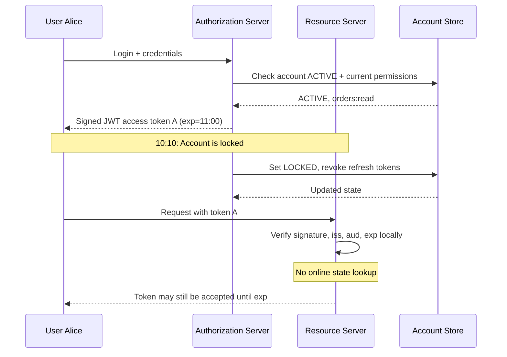
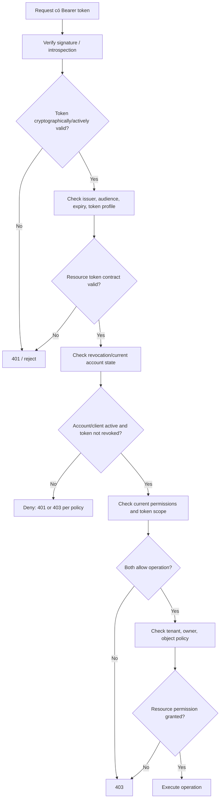

# Khóa tài khoản, thay đổi quyền và token còn sống

## 1. Vì sao khóa tài khoản chưa chắc làm access token ngừng hoạt động?

Một ứng dụng Spring Security OAuth 2.0 Resource Server nhận access token và xác minh nó trước khi cho request đi vào API. Giả sử Alice đăng nhập, nhận JWT có thời hạn một giờ:

```json
{
  "iss": "https://auth.example.test/realms/orders",
  "sub": "alice-123",
  "aud": ["orders-api"],
  "scope": "orders:read orders:write",
  "iat": 1890000000,
  "exp": 1890003600,
  "jti": "access-7f2d",
  "authz_ver": 12
}
```

Mười phút sau, quản trị viên phát hiện tài khoản Alice bị xâm nhập và **khóa tài khoản**. Hoặc Alice bị gỡ quyền đọc đơn, bị xóa khỏi tenant, hoặc bị thu hồi quyền quản trị.

Nếu Resource Server chỉ xác minh chữ ký, issuer, audience và thời hạn JWT, token trên vẫn có thể được chấp nhận tới khi `exp` hết hạn. Chữ ký vẫn hợp lệ; payload vẫn chưa bị thay đổi; token chưa hết hạn. **JWT tự chứa không tự biết trạng thái tài khoản đã thay đổi trong database hoặc Authorization Server.**

Đây là vấn đề **token còn sống nhưng quyền đã cũ**.

Bài học thuộc chương **Vòng đời và thu hồi** của mô-đun **Spring Security OAuth 2.0 OIDC Resource Server**. Nội dung giải thích cách xử lý khi tài khoản bị khóa, quyền bị thay đổi và access token vẫn còn thời hạn; cách phối hợp Authorization Server (AS) với Resource Server (RS); các chiến lược revoke; và cách triển khai/kiểm thử trong Spring Security.

Bối cảnh ví dụ:

- User: Alice, subject `alice-123`.
- Resource Server: `orders-api`.
- Issuer: `https://auth.example.test/realms/orders`.
- Audience: `orders-api`.
- Scope: `orders:read` và `orders:write`.
- Custom authorization version: `authz_ver`.
- JWT ID: `jti`.

Tên miền, token, IDs và thời gian đều là dữ liệu minh họa. Ví dụ code sử dụng Java 17+, Spring Boot 3.x và Spring Security 6.x; một số API có thể khác giữa các minor versions.

> **Điểm cốt lõi:** Khóa tài khoản, thay đổi quyền hoặc thu hồi token là **sự kiện trạng thái**. JWT đã ký chỉ mang snapshot claims tại thời điểm phát hành. Nếu Resource Server không có cơ chế nhận biết thay đổi, nó không thể tự suy ra trạng thái mới chỉ từ chữ ký và `exp`.

---

## 2. Tách bốn trạng thái thường bị gọi chung là “token valid”

Khi API nhận Bearer token, cần phân biệt bốn câu hỏi:

| Lớp | Câu hỏi | Ví dụ |
|---|---|---|
| **Cryptographic validity** | Token có được ký bởi key đáng tin và chưa bị sửa không? | RS256 signature hợp lệ. |
| **Token validity** | Issuer, audience, thời hạn, token type/profile có đúng không? | `iss`/`aud`/`exp` hợp lệ. |
| **Current account/entitlement state** | User/client còn active và còn quyền hiện tại không? | Alice chưa bị khóa, vẫn có `orders:read`. |
| **Resource authorization** | Caller có quyền trên object cụ thể không? | Alice được đọc order 42 thuộc tenant của cô ấy. |

Một access token có thể đạt hai lớp đầu nhưng thất bại ở lớp thứ ba hoặc thứ tư.

### 2.1. Ví dụ theo dòng thời gian

```text
10:00  Alice được cấp access token A:
       sub=alice-123
       scope=orders:read orders:write
       exp=11:00
       authz_ver=12

10:10  Quản trị viên khóa tài khoản Alice:
       account.status=LOCKED
       account.authorization_version=13
       refresh tokens bị revoke

10:11  Alice gửi lại token A:
       JWT signature: valid
       iss/aud/exp: valid
       token authz_ver: 12
       current account version: 13
       Kết quả theo policy: DENY
```

Nếu Resource Server chỉ chạy JWT decoder offline, nó sẽ không biết bước 10:10. Nếu có introspection, denylist, account-state lookup hoặc cơ chế push revocation phù hợp, nó có thể từ chối token trước khi hết hạn.

### 2.2. Token còn hạn không đồng nghĩa còn được phép

```text
exp > now
```

chỉ cho biết token chưa vượt qua thời điểm hết hạn theo claim và clock policy. Nó **không chứng minh**:

- Tài khoản chưa bị khóa.
- Người dùng chưa bị xóa khỏi tenant.
- Role/scope chưa bị gỡ.
- OAuth client chưa bị disable.
- Token chưa bị revoke.
- Phiên đăng nhập gốc chưa bị kết thúc.
- Object vẫn thuộc user đó.
- Chính sách risk/fraud chưa thay đổi.

Thời hạn là một giới hạn quan trọng, nhưng không thay thế revocation và current authorization.

---

## 3. Phân biệt các sự kiện vòng đời

Không phải mọi thay đổi đều cần cùng một hành động.

| Sự kiện | Trạng thái bị thay đổi | Tác động cần xem xét |
|---|---|---|
| **Khóa tài khoản** | User không còn được phép hoạt động. | Chặn token mới, refresh token và access token đang sống theo policy. |
| **Disable tài khoản** | User bị vô hiệu hóa lâu dài hoặc tới khi mở lại. | Tương tự khóa; cần audit và version bump. |
| **Xóa tài khoản** | Identity không còn tồn tại hoặc bị ẩn danh hóa. | Từ chối token cũ, xử lý data retention và subject mapping. |
| **Đổi mật khẩu** | Credential đăng nhập thay đổi. | Có thể revoke refresh tokens/sessions theo policy; không tự động vô hiệu hóa JWT offline. |
| **Bật MFA bắt buộc** | Mức assurance đăng nhập thay đổi. | Token cũ có thể không đạt assurance yêu cầu; cần claim/profile hoặc re-authentication. |
| **Gỡ role** | Entitlements giảm. | Không để role cũ trong JWT tiếp tục cấp quyền tới hết hạn nếu cần thay đổi nhanh. |
| **Thêm role** | Entitlements tăng. | Token cũ có thể chưa chứa quyền mới; thường cần token mới hoặc current-entitlement lookup. |
| **Gỡ user khỏi tenant** | Membership thay đổi. | Chặn access trên tenant đó dù JWT vẫn còn claim tenant/scope cũ. |
| **Thu hồi một token** | Một credential bị vô hiệu hóa. | Denylist theo `(iss,jti)` hoặc introspection `active=false`. |
| **Thu hồi mọi token của user** | Credentials của subject trong phạm vi được chọn. | Version bump, revoke refresh tokens, status check hoặc revocation event. |
| **Disable OAuth client** | Workload/client credentials không còn được phép. | Chặn client token issuance/refresh và token cũ theo policy. |
| **Signing key compromise** | Trust root bị ảnh hưởng. | Emergency key removal/rotation; có thể tác động nhiều users cùng lúc. |

Một hệ thống tốt cần xác định **phạm vi thu hồi** cho từng sự kiện: một access token, một browser session, tất cả token của một user, một tenant membership, một OAuth client hay toàn bộ issuer key.

### 3.1. User account và OAuth client là hai chủ thể khác nhau

Trong Client Credentials flow, access token có thể đại diện workload:

```json
{
  "iss": "https://auth.example.test/realms/orders",
  "sub": "orders-importer",
  "client_id": "orders-importer",
  "aud": ["orders-api"],
  "scope": "orders:import"
}
```

Không có user `alice-123` trong token này. Khóa tài khoản Alice không nhất thiết ảnh hưởng workload; ngược lại, disable OAuth client `orders-importer` phải ảnh hưởng các token của client đó. Cần phân biệt **user status**, **client status**, **actor type** và quyền delegated.

Không suy ra mọi `sub` là user chỉ vì token có claim `sub`.

---

## 4. Vì sao JWT offline không tự thu hồi tức thời?

JWT signed JWS chứa claims và chữ ký. Resource Server có thể xác minh bằng public key từ JWKS đã cache mà không gọi AS ở từng request.



Đây không nhất thiết là bug của JWT. Nó là **trade-off của self-contained token**:

- Ít network calls trên mỗi request.
- RS có thể xác minh khi AS tạm unavailable nếu public key đã cache.
- Claims có thể được kiểm tra cục bộ.
- Nhưng trạng thái tài khoản/entitlements sau thời điểm phát hành không tự được cập nhật.
- JWT bị lộ có thể được sử dụng tới khi hết hạn nếu không có cơ chế revoke bổ sung.

### 4.1. Chữ ký không bị vô hiệu hóa bởi thay đổi database

Giả sử token được ký bằng private key `K1`. Khi Alice bị khóa, AS cập nhật database nhưng không thay đổi token bytes hay signing key. Chữ ký vẫn xác minh được bằng public key `K1`.

Không có một thông điệp chuẩn trong JWT compact tự động nói với mọi Resource Server rằng “Alice vừa bị khóa”. Muốn truyền thay đổi, hệ thống phải thêm **online state check**, **revocation data**, **introspection**, **push event**, hoặc rút ngắn lifetime để giới hạn cửa sổ rủi ro.

### 4.2. Key rotation không phải cách khóa một user

Có thể xóa public key K1 khỏi JWKS để từ chối mọi JWT được ký bằng K1. Nhưng nếu K1 ký token cho hàng nghìn users/clients, hành động đó có thể làm **tất cả** token cùng key mất hiệu lực, bao gồm users vẫn active.

Key rotation/emergency key revocation là biện pháp ở **signing-key trust boundary**, không phải công cụ thu hồi một tài khoản đơn lẻ. Chỉ dùng khi key compromise hoặc incident yêu cầu phạm vi ảnh hưởng đó.

---

## 5. Chiến lược 1: access token ngắn hạn và refresh token có thể thu hồi

Đây là lựa chọn phổ biến cho JWT Resource Server cần hiệu năng cao và chấp nhận một **cửa sổ thu hồi tối đa**.

### 5.1. Cách hoạt động

- Access token có thời hạn ngắn, ví dụ 5–10 phút theo threat model.
- Refresh token có vòng đời dài hơn, nhưng được lưu/tracking ở AS.
- Khi account bị khóa hoặc quyền thay đổi, AS ngừng cấp token mới và revoke refresh token/session liên quan.
- JWT access token đã phát hành vẫn có thể hoạt động đến khi hết hạn nếu RS chỉ xác minh offline.
- Client refresh sẽ bị từ chối và cần xử lý re-authentication hoặc sign-out.

```text
10:00  Issue JWT access token, exp=10:10
10:03  Account locked; refresh token revoked
10:04  Existing JWT may still be accepted by offline RS
10:10  JWT expires
10:11  Refresh attempt -> denied
```

### 5.2. Ưu điểm và giới hạn

| Ưu điểm | Giới hạn |
|---|---|
| Không cần database/introspection call cho mọi API request. | Token cũ vẫn sống đến `exp`. |
| Đơn giản hơn so với global revocation state. | Không phù hợp khi cần revoke trong vài giây. |
| Giảm thời gian token bị lộ có thể bị sử dụng. | Token ngắn làm tăng tần suất refresh và AS load. |
| Có thể dùng JWKS cache offline. | Refresh-token revoke không tự revoke JWT access token đang phát hành. |

**Access token lifetime phải được chọn theo risk và SLA**, không chỉ để “JWT chạy nhanh”. Một thao tác payment/admin có thể cần freshness cao hơn một endpoint đọc dữ liệu ít nhạy cảm.

### 5.3. Account lock phải chặn refresh, không chỉ login

Một lỗi thường gặp là login endpoint từ chối account locked, nhưng refresh token grant vẫn cấp access token mới. AS cần kiểm account status trong **mọi grant/refresh path** có thể tạo token:

- Authorization Code exchange theo policy.
- Refresh Token grant.
- Device Authorization flow.
- Token exchange/delegation.
- Client Credentials khi OAuth client bị disable.
- Custom grants hoặc service token minting.

Đối với user account locked, refresh token cũ phải bị revoke hoặc refresh path phải kiểm trạng thái hiện hành và từ chối. Đối với client disabled, client authentication/token grant phải bị từ chối.

### 5.4. Chọn TTL theo revocation objective

Ví dụ một policy nội bộ:

| API class | Access token TTL minh họa | Cơ chế bổ sung |
|---|---:|---|
| Public catalog/read-only | 10–15 phút | TTL + scope/owner checks |
| User profile/order read | 5–10 phút | TTL + current membership khi cần |
| Sensitive admin | 1–5 phút | Online status/version check |
| Payment/privileged operation | Ngắn theo risk | Online authorization/introspection hoặc transaction-time policy |

Đây chỉ là ví dụ định hướng, không phải giá trị chuẩn bắt buộc. Cần cân bằng AS load, clock skew, client refresh, user experience, offline behavior và incident response.

---

## 6. Chiến lược 2: OAuth 2.0 Token Revocation (RFC 7009)

**RFC 7009 — OAuth 2.0 Token Revocation** định nghĩa endpoint để client yêu cầu Authorization Server thu hồi token. AS có thể revoke access token, refresh token hoặc các token liên quan theo implementation/policy.

Một request điển hình:

```http
POST /oauth2/revoke HTTP/1.1
Host: auth.example.test
Authorization: Basic <client-credentials>
Content-Type: application/x-www-form-urlencoded

token=<refresh-token>&token_type_hint=refresh_token
```

### 6.1. Revocation endpoint làm gì?

- Client gửi token cần revoke qua HTTPS.
- AS xác thực client/request theo policy.
- AS xử lý token và cập nhật trạng thái.
- Response được thiết kế để không làm lộ quá nhiều thông tin về token có tồn tại hay không.
- Việc token liên quan nào cũng bị revoke phụ thuộc AS semantics.

**Không suy ra** rằng mọi Resource Server đang xác minh JWT offline lập tức biết token đã revoke chỉ vì AS trả thành công từ `/revoke`. RFC 7009 mô tả giao thức revocation giữa client và AS; để RS nhận biết, cần introspection, denylist, event propagation hoặc cơ chế khác.

### 6.2. Thu hồi refresh token khác thu hồi access token

Khi account bị khóa:

1. Revoke refresh token để ngăn client xin access token mới.
2. Nếu AS hỗ trợ, revoke access token cụ thể hoặc mọi token trong session/grant.
3. RS phải có cách nhận biết access token cũ không còn được phép nếu cần immediate revocation.
4. Client phải xóa credential theo chính sách và dừng retry refresh vô hạn.

Nếu chỉ revoke refresh token, access JWT đã cấp vẫn có thể còn hiệu lực đến `exp`. Điều này thường bị hiểu nhầm.

### 6.3. Revocation không thay thế account-state checks

Một user có thể bị khóa do fraud/risk trước khi token được revoke. Hoặc refresh token bị revoke nhưng một access token khác vẫn tồn tại. Vì vậy một policy quan trọng có thể là **account status luôn phải active cho request nhạy cảm**, độc lập với việc token cụ thể đã có trong denylist hay chưa.

---

## 7. Chiến lược 3: Token Introspection (RFC 7662)

Nếu Resource Server dùng **opaque/reference token**, nó thường gọi introspection endpoint để biết token có active không. AS có thể trả `active=false` ngay sau khi account/token bị khóa/revoke, tùy semantics và propagation của AS.

```http
POST /oauth2/introspect HTTP/1.1
Host: auth.example.test
Authorization: Basic <resource-server-credentials>
Content-Type: application/x-www-form-urlencoded

token=<access-token>&token_type_hint=access_token
```

Response active:

```json
{
  "active": true,
  "iss": "https://auth.example.test/realms/orders",
  "sub": "alice-123",
  "aud": ["orders-api"],
  "scope": "orders:read",
  "exp": 1890003600,
  "client_id": "web-portal"
}
```

Sau khi Alice bị khóa, AS có thể trả:

```json
{
  "active": false
}
```

### 7.1. Introspection có thể giải quyết token còn sống như thế nào?

Nếu RS hỏi AS ở mỗi request và AS có trạng thái cập nhật, token đã revoke/subject locked có thể bị từ chối dù `exp` chưa tới. Điều này tạo **online validation** thay vì chỉ offline JWT verification.

Một số AS hỗ trợ introspection cho cả JWT access token, nhưng không phải mọi provider đều làm như vậy. Cần contract và quyền của introspection client. Không tự suy luận JWT có thể introspect chỉ vì có endpoint.

### 7.2. Trade-offs

| Lợi ích | Chi phí/rủi ro |
|---|---|
| AS có thể phản ánh trạng thái account/token mới. | Mỗi request thêm network dependency nếu không cache. |
| Có thể revoke một token mà không chờ JWT exp. | Latency và AS throughput. |
| Có thể trả scopes/tenant/actor hiện hành theo contract. | RS phụ thuộc availability và response schema. |
| Token opaque không cần public key distribution. | Cần credential và bảo vệ introspection endpoint. |
| Có thể hỗ trợ centralized token status. | Cache có thể làm chậm revocation propagation. |

### 7.3. `active=true` không có nghĩa quyền thao tác đã đủ

Introspection chỉ trả trạng thái và metadata token theo contract. API vẫn phải kiểm:

- Audience/resource binding.
- Issuer/token type nếu hợp đồng yêu cầu.
- Scope và authorities.
- Tenant membership.
- Object owner/ACL.
- Account status hoặc entitlement hiện hành nếu không được AS bảo đảm trong `active`.

Theo RFC 7662, `active` là boolean bắt buộc; các metadata khác như `iss`, `aud`, `sub`, `scope` và `exp` là tùy chọn của giao thức. Nếu API cần chúng, phải có **contract riêng** hoặc bảo đảm AS giới hạn token cho đúng resource/introspection requester.

### 7.4. Cache introspection làm thay đổi SLA thu hồi

Giả sử RS cache kết quả `active=true` trong 60 giây. Alice bị khóa ở thời điểm 10:00:10, nhưng cache của một pod vừa được refresh ở 10:00:05. Pod đó có thể tiếp tục chấp nhận token cho đến 10:01:05 nếu không có invalidation.

```text
Revocation propagation delay
  ≈ introspection cache TTL
  + event delivery / invalidation delay
  + request in-flight duration
```

Đây là mô hình xấp xỉ để thiết kế SLA; thực tế phụ thuộc cache, network, replica và request concurrency. Nếu yêu cầu revoke trong 5 giây, cache 60 giây không phù hợp dù AS cập nhật ngay.

---

## 8. Chiến lược 4: Denylist theo `jti`

JWT có thể mang claim `jti` — JWT ID — để nhận diện một token cụ thể. RS duy trì **revocation/denylist store** chứa các token đã bị revoke.

Ví dụ JWT:

```json
{
  "iss": "https://auth.example.test/realms/orders",
  "sub": "alice-123",
  "aud": ["orders-api"],
  "jti": "access-7f2d",
  "exp": 1890003600
}
```

Khi token bị revoke, AS/RS ghi:

```text
revoked-token:<issuer-id>:<jti>
TTL = exp - current_time
```

Mỗi request sau khi signature/issuer/audience/time verification thành công sẽ kiểm `(issuer,jti)` có nằm trong denylist không.

### 8.1. Vì sao key phải có issuer?

Hai issuers khác nhau có thể phát hành cùng `jti` do namespace độc lập. Chỉ dùng `jti` có nguy cơ collision hoặc nhầm nguồn. Khóa nên bao gồm một **issuer identifier canonical** hoặc internal issuer ID:

```text
revoked:<trusted-issuer-id>:<jti>
```

Không đưa raw JWT vào key. Không dùng `sub` làm token-specific key nếu chỉ muốn revoke một access token, vì có thể vô tình revoke tất cả token của user.

### 8.2. Pseudocode kiểm tra denylist

```java
public boolean isTokenRevoked(Jwt jwt) {
    String issuer = jwt.getIssuer().toString();
    String jti = jwt.getId();

    if (jti == null || jti.isBlank()) {
        // Token contract yêu cầu jti thì thiếu jti phải bị từ chối.
        return true;
    }

    return revocationStore.contains(issuer, jti);
}
```

Đoạn code là logic minh họa. Một API thực cần xác định rõ:

- Token nào bắt buộc có `jti`.
- Store consistency/availability.
- TTL đến `exp`, có clock skew margin phù hợp.
- Atomic writes và idempotency.
- Multi-region replication.
- Fail-closed behavior nếu store unavailable.
- Không log raw token hoặc token ID nếu chính sách xem `jti` là dữ liệu nhạy cảm.

### 8.3. `jti` không tự làm token revocable

Một JWT có claim `jti` nhưng không có Resource Server nào kiểm denylist vẫn có thể được chấp nhận tới `exp`. Claim chỉ là định danh. **Revocation cần trạng thái và logic enforcement.**

### 8.4. Denylist so với allowlist

- **Denylist:** mặc định token hợp lệ nếu decoder pass và không có trong danh sách revoke. Dễ tích hợp với JWT nhưng phải quản lý state cho token bị revoke.
- **Allowlist:** chỉ token được ghi nhận/active trong store mới được chấp nhận. Có thể cho kiểm soát chặt, nhưng mất nhiều lợi ích stateless và cần đồng bộ issuance/replication.

Không nhầm denylist với introspection cache. Một denylist chỉ chứa revoke events; introspection trả trạng thái token hiện hành theo AS.

---

## 9. Chiến lược 5: Authorization version / security version

Để thu hồi **tất cả token cũ của một user hoặc client**, có thể dùng custom claim version.

Ví dụ account record:

```text
issuer: https://auth.example.test/realms/orders
subject: alice-123
status: ACTIVE
authorization_version: 12
```

Access token được cấp:

```json
{
  "iss": "https://auth.example.test/realms/orders",
  "sub": "alice-123",
  "aud": ["orders-api"],
  "scope": "orders:read orders:write",
  "authz_ver": 12,
  "exp": 1890003600
}
```

Khi Alice bị khóa hoặc role bị gỡ, account service tăng version:

```text
status: LOCKED
authorization_version: 13
```

Resource Server so sánh:

```text
token.authz_ver == currentAccount.authorization_version
```

Token version 12 bị từ chối dù chữ ký còn hợp lệ và `exp` chưa qua.

### 9.1. Version claim là custom contract

`authz_ver` không phải claim bắt buộc của JWT/OAuth/OIDC. AS và RS phải thống nhất:

- Tên claim và kiểu dữ liệu (ví dụ integer).
- Version tăng khi những sự kiện nào.
- Version thuộc user, client, tenant membership hay session.
- Token thiếu claim xử lý thế nào.
- Token mới lấy version ở thời điểm nào.
- Các services cập nhật current version từ nguồn nào.
- Cache invalidation và maximum propagation delay.

Không dùng string `"12"` ở một nơi, number `12` ở nơi khác rồi ép kiểu tùy tiện. Schema không đúng phải bị từ chối.

### 9.2. Version có thể áp dụng ở nhiều phạm vi

| Version scope | Dùng để thu hồi | Ví dụ key |
|---|---|---|
| **User authorization version** | Mọi access tokens của một user trong issuer. | `(iss, sub)` |
| **Client security version** | Tokens của một OAuth client/workload. | `(iss, client_id)` |
| **Tenant membership version** | Tokens/permissions liên quan một user trong một tenant. | `(iss, sub, tenant_id)` |
| **Session/grant version** | Tokens từ một phiên/grant cụ thể. | `(iss, sub, sid)` hoặc grant ID theo contract |
| **Global issuer version** | Một nhóm token lớn khi policy/trust thay đổi. | Internal issuer policy version |

Phải chọn đúng scope. Nếu user có hai tenant và chỉ bị gỡ khỏi Acme, tăng **global user version** có thể vô hiệu hóa token Beta không cần thiết. Nếu quyền thay đổi toàn user, global version có thể là lựa chọn phù hợp.

### 9.3. Version bump khi nào?

Có thể tăng version khi:

- Account bị khóa/disable/delete.
- Password reset hoặc credential compromise theo policy.
- MFA enrollment/assurance policy đổi và token cũ không đạt yêu cầu.
- Role/permission bị gỡ.
- Tenant membership bị thu hồi.
- Admin thu hồi mọi token của user.
- Client secret/private key hoặc workload authorization bị thay đổi.
- Risk engine quyết định revoke session.

Không nhất thiết tăng version cho mọi profile field change (ví dụ display name) nếu không ảnh hưởng authorization. Version là **security invalidation signal**, nên sự kiện nào làm tăng phải được định nghĩa và audit.

### 9.4. Khi quyền được thêm mới

Giả sử Alice có token version 12 với `orders:read`. Admin thêm `orders:export` và tăng version lên 13.

Token cũ version 12 bị từ chối theo strict version equality; client cần lấy token mới. Điều này an toàn nhưng có thể gây gián đoạn.

Một biến thể là không tăng version khi chỉ thêm quyền, nhưng dùng online current-permission intersection; quyền mới chỉ được cấp khi token đã chứa scope cần thiết. Cần chọn semantics nhất quán.

---

## 10. Thay đổi quyền: JWT scopes là snapshot, không phải database live

Một access token thường chứa scopes/roles được cấp tại thời điểm phát hành.

10:00:

```json
{
  "sub": "alice-123",
  "scope": "orders:read orders:write orders:export"
}
```

10:10, quản trị viên gỡ quyền export khỏi Alice. Nếu RS chỉ ánh xạ token claims thành authorities, `SCOPE_orders:export` vẫn nằm trong `Authentication` cho tới khi token hết hạn.

### 10.1. Ba mô hình quyền

| Mô hình | Cách quyết định quyền | Độ mới |
|---|---|---|
| **Token snapshot** | Dùng scopes/roles trong token. | Chỉ cập nhật khi token mới. |
| **Online entitlement** | Query current permissions từ store/service khi request. | Có thể gần thời gian thực. |
| **Hybrid intersection** | Quyền hiệu lực = quyền trong token ∩ quyền hiện tại. | Thu hồi nhanh; cấp mới thường cần token mới. |

### 10.2. Hybrid intersection giúp chặn quyền stale

Ví dụ:

```text
Token scopes:
  orders:read
  orders:write
  orders:export

Current account permissions:
  orders:read
  orders:write

Effective permissions:
  orders:read
  orders:write
```

Nếu token có `orders:read` nhưng database đã gỡ quyền, intersection không còn quyền read. Nếu database mới thêm `orders:admin` mà token chưa có, intersection cũng không tự thêm admin. Đây là **fail-closed** với quyền tăng: client cần token mới chứa quyền mới.

### 10.3. Không dùng current database permissions để vượt token scope cap

Một thiết kế thiếu chặt có thể chỉ query database và cho phép mọi quyền hiện tại, bất kể token có scope gì. Điều đó có thể biến một token được cấp giới hạn thành credential có quyền cao hơn.

Cách an toàn phổ biến:

```text
effectiveAuthority =
    tokenGrantedAuthority
    AND currentEntitlement
    AND resourcePolicy
```

Nếu kiến trúc dùng token như identity-only credential và mọi quyền hoàn toàn được kiểm online, cần một contract khác rõ ràng: token audience/actor/tenant vẫn phải hợp lệ và online policy phải là source-of-truth. Không trộn hai mô hình mà không định nghĩa.

### 10.4. Thêm quyền và gỡ quyền có tính bất đối xứng

- **Gỡ quyền:** muốn có hiệu lực nhanh thì online check/version bump/denylist/introspection.
- **Thêm quyền:** thường có thể đợi client refresh access token để nhận scope mới.
- **Gỡ tenant membership:** cần kiểm membership hiện tại hoặc version theo tenant.
- **Đổi role nhạy cảm:** nên invalidate token/authorization cache theo policy.
- **Thay quyền của client:** kiểm client status/version, không dựa user account.

Một API có thể chấp nhận cấp quyền mới chậm hơn một chút nhưng không nên chấp nhận giữ quyền đã bị gỡ quá lâu nếu risk policy yêu cầu immediate revocation.

---

## 11. Kiểm tra account status và quyền hiện tại trong Spring Security

JWT Resource Server mặc định xác minh token và ánh xạ claims/authorities. Nó **không tự biết** bảng user trong database của ứng dụng có trạng thái `LOCKED` hoặc permission vừa bị thay đổi, trừ khi bạn tích hợp thêm logic.

Có một số điểm để enforce:

1. **Tại token issuance/refresh ở AS:** chặn cấp token mới.
2. **Tại authentication boundary ở RS:** từ chối credential đã bị revoke/account lock nếu có state lookup.
3. **Tại authorization boundary:** kiểm current account status, version và entitlements cho protected operations.
4. **Tại data layer:** query tenant/owner/resource theo chính sách hiện hành.

Với ví dụ, dùng **method security** để minh họa kiểm tra current state ở service boundary.

### 11.1. Cấu hình JWT Resource Server cơ bản

`application.yml`:

```yaml
spring:
  security:
    oauth2:
      resourceserver:
        jwt:
          issuer-uri: https://auth.example.test/realms/orders
          jwk-set-uri: https://auth.example.test/realms/orders/protocol/openid-connect/certs
          audiences:
            - orders-api
```

Cấu hình `issuer-uri` + `jwk-set-uri` có thể tránh metadata discovery để tìm key endpoint trong các phiên bản Boot phù hợp, trong khi giữ expected issuer. Audience validation cần được áp dụng đúng; nếu tự khai báo `JwtDecoder` bean thì tự gắn validators tương ứng.

### 11.2. HTTP security chain

```java
package com.example.orders.security;

import org.springframework.context.annotation.Bean;
import org.springframework.context.annotation.Configuration;
import org.springframework.http.HttpMethod;
import org.springframework.security.config.Customizer;
import org.springframework.security.config.annotation.web.builders.HttpSecurity;
import org.springframework.security.config.annotation.web.configurers.AbstractHttpConfigurer;
import org.springframework.security.config.http.SessionCreationPolicy;
import org.springframework.security.web.SecurityFilterChain;
import org.springframework.security.web.savedrequest.NullRequestCache;

@Configuration
public class OrdersApiSecurityConfig {

    @Bean
    SecurityFilterChain apiSecurity(HttpSecurity http)
            throws Exception {
        return http
            .sessionManagement(session -> session
                .sessionCreationPolicy(SessionCreationPolicy.STATELESS))
            .requestCache(cache ->
                cache.requestCache(new NullRequestCache()))
            .csrf(AbstractHttpConfigurer::disable)
            .authorizeHttpRequests(auth -> auth
                .requestMatchers(HttpMethod.GET, "/api/orders/**")
                    .hasAuthority("SCOPE_orders:read")
                .requestMatchers(HttpMethod.POST, "/api/orders")
                    .hasAuthority("SCOPE_orders:write")
                .anyRequest().denyAll())
            .oauth2ResourceServer(oauth ->
                oauth.jwt(Customizer.withDefaults()))
            .build();
    }
}
```

Đây là API chỉ dùng Bearer header, không dùng cookie/session để xác thực. Nếu ứng dụng còn web login, tách chains và giữ CSRF cho cookie-authenticated routes theo threat model. `STATELESS` không thực hiện current account-state check; method security bên dưới mới làm việc đó.

### 11.3. Enable method security

```java
package com.example.orders.security;

import org.springframework.context.annotation.Configuration;
import org.springframework.security.config.annotation.method.configuration.EnableMethodSecurity;

@Configuration
@EnableMethodSecurity
public class MethodSecurityConfig {
}
```

Method security cho phép đặt policy tại service method, tránh chỉ bảo vệ một controller cụ thể. Tuy vậy mọi entry point cần được gọi qua Spring-managed proxy và cấu hình method security phải được nạp.

### 11.4. Account security state model

Ví dụ domain record:

```java
package com.example.orders.account;

import java.util.Set;

public record AccountSecurityState(
    String issuer,
    String subject,
    AccountStatus status,
    long authorizationVersion,
    Set<String> permissions
) {}
```

Enum:

```java
package com.example.orders.account;

public enum AccountStatus {
    ACTIVE,
    LOCKED,
    DISABLED,
    DELETED,
    PENDING
}
```

Repository contract:

```java
package com.example.orders.account;

import java.util.Optional;

public interface AccountSecurityStateRepository {

    Optional<AccountSecurityState> findByIssuerAndSubject(
        String issuer,
        String subject
    );
}
```

**Issuer phải là một phần identity key.** `sub` chỉ duy nhất trong namespace của issuer; hai issuers có thể cùng phát `sub=123` nhưng là hai principals khác nhau. Với multi-tenant membership, repository có thể cần thêm `tenantId`/membership ID.

### 11.5. Policy kiểm trạng thái và quyền hiện hành

```java
package com.example.orders.security;

import java.util.Objects;

import com.example.orders.account.AccountSecurityState;
import com.example.orders.account.AccountSecurityStateRepository;
import com.example.orders.account.AccountStatus;

import org.springframework.security.core.Authentication;
import org.springframework.security.oauth2.jwt.Jwt;
import org.springframework.stereotype.Component;

@Component("currentAccountPolicy")
public class CurrentAccountPolicy {

    private final AccountSecurityStateRepository repository;

    public CurrentAccountPolicy(
            AccountSecurityStateRepository repository) {
        this.repository = repository;
    }

    public boolean allows(
            Authentication authentication,
            String requiredPermission) {

        if (authentication == null || !authentication.isAuthenticated()) {
            return false;
        }

        if (!(authentication.getPrincipal() instanceof Jwt jwt)) {
            return false;
        }

        if (jwt.getIssuer() == null
                || jwt.getSubject() == null
                || requiredPermission == null
                || requiredPermission.isBlank()) {
            return false;
        }

        String issuer = jwt.getIssuer().toString();
        String subject = jwt.getSubject();

        AccountSecurityState state = repository
            .findByIssuerAndSubject(issuer, subject)
            .orElse(null);

        if (state == null || state.status() != AccountStatus.ACTIVE) {
            return false;
        }

        Object rawVersion = jwt.getClaims().get("authz_ver");
        if (!(rawVersion instanceof Number number)
                || number.longValue() != state.authorizationVersion()) {
            return false;
        }

        // Token scope là giới hạn quyền được cấp.
        boolean tokenAllows = authentication.getAuthorities().stream()
            .anyMatch(authority -> Objects.equals(
                authority.getAuthority(),
                "SCOPE_" + requiredPermission
            ));

        // Current entitlement cho phép thu hồi quyền đã thay đổi.
        boolean currentAccountAllows =
            state.permissions().contains(requiredPermission);

        // Chỉ cho phép khi cả token và trạng thái hiện tại đều đồng ý.
        return tokenAllows && currentAccountAllows;
    }
}
```

Đây là **mẫu đồng bộ cho Spring MVC/Servlet**. Trong production, repository cần query/cache đúng hiệu năng và exception handling. Nếu account-state store không truy cập được, không được tự động trả `true`; operation cần current-state check phải **fail closed** theo policy.

Một số lưu ý:

- `authz_ver` là **custom claim** do issuer phát hành. Thiếu/sai kiểu được từ chối theo contract.
- `permissions` trong record là current entitlements, không phải scope token.
- `issuer + subject` tránh gộp principals từ nhiều issuers.
- `authentication.getAuthorities()` được tạo từ claims đã verify, thường qua scope converter.
- Policy sử dụng **intersection** giữa scope token và current permissions.
- Ví dụ chỉ kiểm account-level permission; owner/tenant/resource checks vẫn phải làm tại domain query.
- Nếu token đại diện client credentials, principal có thể không phải user record; cần policy workload riêng thay vì mặc định từ chối hoặc ép thành user.

### 11.6. Áp dụng policy ở service

```java
package com.example.orders.service;

import com.example.orders.api.OrderDto;
import com.example.orders.account.OrderRepository;

import org.springframework.security.access.prepost.PreAuthorize;
import org.springframework.stereotype.Service;

@Service
public class OrderService {

    private final OrderRepository repository;

    public OrderService(OrderRepository repository) {
        this.repository = repository;
    }

    @PreAuthorize(
        "@currentAccountPolicy.allows(authentication, 'orders:read')"
    )
    public OrderDto readOrder(String orderId) {
        // Query bên dưới vẫn phải tenant/owner-scoped.
        return repository.findVisibleOrderForCurrentActor(orderId)
            .map(OrderDto::from)
            .orElseThrow(OrderNotFoundException::new);
    }

    @PreAuthorize(
        "@currentAccountPolicy.allows(authentication, 'orders:write')"
    )
    public void updateOrder(String orderId, UpdateOrderCommand command) {
        repository.updateVisibleOrderForCurrentActor(orderId, command);
    }
}
```

`findVisibleOrderForCurrentActor` và `updateVisibleOrderForCurrentActor` là **repository methods minh họa**, phải có cách nhận canonical actor/tenant rõ ràng trong ứng dụng thực. Không dựa vào tên method để tự động bảo đảm query an toàn.

Với proxy-based method security, lời gọi nội bộ `this.readOrder(...)` từ cùng bean có thể không đi qua proxy và bỏ qua annotation. Đặt authorization ở public service boundary được gọi từ bean khác, hoặc dùng cấu trúc phù hợp để bảo đảm interceptor thực sự chạy.

### 11.7. Current account policy có thể trả 403 dù JWT còn valid

Trong ví dụ, JWT signature/issuer/audience/time hợp lệ nhưng account status `LOCKED` hoặc version không khớp. `@PreAuthorize` từ chối method invocation; kết quả thường được xử lý như **access denied (403)** theo web security exception handling.

Nếu thiết kế muốn coi token đã bị revoke là credential invalid và trả **401 `invalid_token`**, hãy đặt trạng thái revoke tại authentication boundary/decoder/introspector hoặc custom authentication manager. Cần phân biệt **credential no longer accepted** với **authenticated principal lacks current permission** và giữ error semantics nhất quán.

---

## 12. Current account lookup: đồng bộ, cache và hiệu năng

Kiểm account state trên mỗi request giúp phản ánh lock/permission change nhanh, nhưng thêm phụ thuộc vào database hoặc entitlement service.

### 12.1. Ba lựa chọn

| Lựa chọn | Cách làm | Độ mới | Chi phí |
|---|---|---|---|
| DB lookup mỗi request | Query account status/version/permissions. | Gần nhất theo consistency DB. | DB load và latency. |
| Cache ngắn hạn | Cache state theo `(iss, sub[, tenant])`. | Trễ tối đa theo TTL nếu không invalidate. | Cache memory/network và stale window. |
| Event invalidation + cache | AS phát event; RS cập nhật/xóa cache. | Nhanh nếu event delivery tốt. | Event infrastructure, ordering/recovery phức tạp. |

Có thể kết hợp cache và event invalidation, nhưng cần xác định **maximum stale time** nếu event bị mất.

### 12.2. Cache key đúng namespace

Không cache chỉ theo `sub`:

```text
account-state:alice-123
```

Vì `sub` không nhất thiết duy nhất giữa issuers hoặc tenants. Key có thể là:

```text
account-state:<trusted-issuer-id>:<subject>
membership-state:<issuer-id>:<subject>:<tenant-id>
```

Không dùng raw JWT hoặc token secret làm key. Cần cân nhắc privacy của subject và dùng internal pseudonymous IDs nếu thích hợp.

### 12.3. TTL là một phần của revocation SLA

Giả sử cache account state 30 giây, không có event invalidation. Một user bị khóa ngay sau cache refresh có thể tiếp tục được chấp nhận tới lần refresh kế tiếp.

```text
Approximate maximum stale window
  <= cache TTL + replication lag + request in-flight time
```

Đây là ước lượng thiết kế, không phải guarantee nếu hệ thống có replica lag hoặc cache refresh lỗi kéo dài. Nếu SLA yêu cầu khóa trong 5 giây, TTL 30 giây không đạt. Cần event invalidation, direct lookup, shorter TTL hoặc mechanism khác.

### 12.4. Khi account store bị lỗi

Có ba cách phản ứng thường được cân nhắc:

- **Fail closed:** không cho thao tác cần current state khi không đọc được trạng thái.
- **Use bounded last-known-good state:** chỉ dùng cache cũ trong một giới hạn freshness được phê duyệt, phù hợp endpoint ít rủi ro.
- **Fail open:** cho qua chỉ dựa vào token claims.

Với khóa tài khoản, quyền admin, payment và dữ liệu nhạy cảm, fail-open thường không phù hợp. Nếu có bounded stale mode, phải nêu rõ thời gian, endpoint, risk owner và cách alert. Không bắt exception rồi trả `true` để giữ availability.

### 12.5. Tránh N+1 account checks

Một HTTP request có thể gọi nhiều service/repository. Không query account state lặp lại cho từng dòng order. Có thể:

- Resolve authorization context một lần ở request/service boundary.
- Cache trong scope request bằng cơ chế phù hợp, không phải global ThreadLocal tùy tiện.
- Dùng một query join/transaction để lấy state + data theo policy.
- Dùng batch API cho nhiều subjects khi workload token cần xử lý nhiều actor.
- Cẩn thận với cache sau authorization vì permissions có thể thay đổi.

---

## 13. Event-driven revocation: cập nhật nhanh nhiều Resource Servers

Một hệ microservices có nhiều Resource Servers có thể không muốn mọi request đều gọi AS hoặc identity database. AS có thể phát sự kiện khi trạng thái thay đổi:

```json
{
  "event_type": "account.locked",
  "issuer_id": "orders-idp",
  "subject": "alice-123",
  "authorization_version": 13,
  "occurred_at": "2026-11-15T10:10:00Z",
  "event_id": "evt-8f13"
}
```

Hoặc event thu hồi một token:

```json
{
  "event_type": "token.revoked",
  "issuer_id": "orders-idp",
  "jti": "access-7f2d",
  "expires_at": "2026-11-15T11:00:00Z",
  "event_id": "evt-8f14"
}
```

Đây là **schema nội bộ minh họa**, không phải event format tiêu chuẩn OAuth.

### 13.1. Resource Server nhận event làm gì?

- Xóa cache account/entitlement của subject.
- Cập nhật current authorization version.
- Thêm `(issuer,jti)` vào denylist.
- Invalidate membership cache của một tenant.
- Chặn token/session/grant liên quan theo event scope.
- Ghi audit event đã nhận và thời điểm áp dụng.

### 13.2. Event bus không phải nguồn sự thật duy nhất

Cần xử lý:

| Failure mode | Hướng thiết kế |
|---|---|
| Message bị mất | Durable topic, retry, replay hoặc periodic reconciliation với source-of-truth. |
| Duplicate delivery | Idempotency theo `event_id`/version. |
| Out-of-order | Dùng monotonic version; event cũ không ghi đè trạng thái mới. |
| Consumer outage | Retention/replay và readiness khi consumer catch-up. |
| Một pod nhận, pod khác chưa nhận | Shared store hoặc đảm bảo fan-out tới mọi instance. |
| Multi-region delay | Định nghĩa SLA propagation và fail-closed cho high-risk actions. |
| Poison message | Dead-letter queue, alert và xử lý thủ công an toàn. |
| Event forged | Authenticate producer, authorize topic, TLS/signing và validate schema. |

Không tin event chỉ vì JSON có `event_type=account.locked`. Chỉ nhận từ **producer đã được xác thực** qua channel có integrity và access control.

### 13.3. Monotonic version chống event cũ

Ví dụ:

```text
Event A: authz_ver=13 (LOCKED)
Event B: authz_ver=14 (DISABLED)
Event C: authz_ver=12 (old replay)
```

Consumer chỉ áp dụng state có version mới hơn. Event C không được làm account quay lại version 12 hoặc trạng thái ACTIVE. Version tăng đơn điệu và trạng thái được reconcile với authoritative store.

### 13.4. Outbox pattern

Nếu account DB update thành công nhưng publish event thất bại, RS không nhận thay đổi. Một cách phổ biến là **transactional outbox**:

1. Trong cùng database transaction, update account status/version.
2. Cùng transaction ghi một outbox record.
3. Background publisher đọc outbox và publish event.
4. Đánh dấu record đã phát hoặc dùng idempotency.
5. Consumer xử lý at-least-once và deduplicate.
6. Reconciliation kiểm tra event lag.

Đây là pattern kiến trúc, không phải tính năng tự động của Spring Security. Cần bảo đảm account change và event record không bị lệch.

---

## 14. Thu hồi một token hay tất cả token?

### 14.1. Một token cụ thể

Dùng `jti` denylist hoặc AS introspection/revocation state. Phù hợp khi:

- Một access token bị lộ.
- User sign-out một device/session nhưng vẫn giữ các sessions khác.
- Admin thu hồi một grant cụ thể.
- Một token có risk signal riêng.

### 14.2. Tất cả token của một user

Dùng account status/version hoặc revoke toàn bộ sessions/refresh tokens. Phù hợp khi:

- Account lock/disable.
- Credential compromise.
- User bị xóa khỏi organization.
- Admin “sign out all devices”.
- Password/MFA reset theo policy.

### 14.3. Một tenant membership

Dùng membership-specific version/state:

```text
(issuer, subject, tenant=t-acme) -> membership_version=8, status=REVOKED
```

Khi user bị gỡ khỏi Acme, token cho Beta có thể vẫn hoạt động nếu policy cho phép. Nhưng request Acme phải bị từ chối ngay khi current membership state được cập nhật/propagate.

### 14.4. Một OAuth client/workload

Dùng `client_id`/internal client ID và client security version. Khi workload bị disable:

- Chặn client authentication.
- Ngừng cấp client credentials token.
- Revoke refresh/long-lived credentials nếu có.
- Introspection hoặc online version check chặn access token cũ.
- Rotate client secret/private key theo incident plan.

Không dùng user account status để quản lý workload token nếu principal thực sự là client.

### 14.5. Toàn bộ issuer/signing key

Chỉ khi trust root bị compromise hoặc cần emergency key removal. Phạm vi ảnh hưởng lớn; phối hợp rollout, key overlap, cache refresh và thông báo API owners. Không dùng để xử lý một user bị khóa bình thường.

---

## 15. Logout, revocation và account lock không phải một thao tác

Các khái niệm này thường bị gộp trong giao diện “Đăng xuất”.

| Hành động | Ý nghĩa | Có tự vô hiệu hóa JWT offline không? |
|---|---|---|
| **Clear client token storage** | Client xóa token khỏi browser/device. | Không. Token đã bị copy vẫn có thể dùng. |
| **Browser logout** | Kết thúc local app session hoặc OIDC RP session. | Không nhất thiết. |
| **OIDC provider logout** | Kết thúc session tại OP theo protocol/implementation. | Không tự đảm bảo mọi access JWT đã phát hành bị revoke. |
| **Refresh token revoke** | Ngăn lấy access token mới từ refresh credential. | Không nhất thiết ảnh hưởng access JWT đang sống. |
| **Access token revoke** | AS đánh dấu token bị revoke theo cơ chế hỗ trợ. | Chỉ RS biết nếu có online/push/denylist mechanism. |
| **Account lock** | Tài khoản không còn được phép đăng nhập/hoạt động. | Không với RS chỉ xác minh JWT offline. |
| **Permission removal** | Entitlement thay đổi. | Token snapshot có thể giữ quyền cũ đến exp. |

### 15.1. “Logout thành công” không đồng nghĩa “mọi token đã chết”

Client xóa token chỉ làm **client đó** không gửi lại. Nếu token đã bị exfiltrate, attacker vẫn có thể sử dụng tới khi hết hạn hoặc bị revoke và được RS nhận biết.

Một logout flow cần mô tả:

- Token nào được xóa ở client?
- Browser session có bị kết thúc tại OP không?
- Refresh token có bị revoke không?
- Access token có được revoke không?
- RS biết revocation qua introspection, denylist hay version check?
- Các replicas/cache mất bao lâu để cập nhật?
- Các request đang chạy có bị cancel không?

Không đưa ra cam kết “logout tức thời trên mọi service” nếu hệ thống chỉ xóa local storage và dùng JWT offline.

---

## 16. Account lock ở Authorization Server và Resource Server

### 16.1. AS kiểm account khi cấp token

AS cần kiểm trạng thái hiện tại ở các đường tạo token:

```text
User login:
  authenticate credential
  -> account status ACTIVE?
  -> assurance/MFA policy satisfied?
  -> issue access + refresh token

Refresh:
  validate refresh token
  -> refresh token not revoked?
  -> account status ACTIVE?
  -> grant/consent still valid?
  -> issue new access token

Client Credentials:
  authenticate OAuth client
  -> client status ACTIVE?
  -> client grant/scope still allowed?
  -> issue workload access token
```

Không chỉ chặn password login rồi bỏ qua refresh grant. Nếu user locked nhưng refresh token vẫn cấp access token mới, lock policy chưa hoàn chỉnh.

### 16.2. RS không nhất thiết dùng chung user database với AS

Trong microservices, RS có thể không truy cập identity DB. Khi ấy cần một **contract trạng thái**:

- Introspection.
- Revocation events.
- Version/state API.
- Denylist service.
- Gateway authorization service.
- Access token TTL ngắn theo risk.

Không nên mỗi microservice tự truy cập database nội bộ của AS hoặc copy toàn bộ identity data nếu chưa có ownership/availability contract.

### 16.3. Chặn ở AS chưa đủ nếu RS offline

```text
AS:
  account LOCKED
  refresh revoked
  new token issuance denied

RS:
  cached public key
  validates old JWT locally
  no state lookup
  -> still accepts until exp
```

Đây là hành vi có thể xảy ra và cần được chấp nhận hoặc giải quyết bằng thiết kế. Tuyên bố “account lock immediate” chỉ đúng nếu **mọi Resource Server có cách nhận biết trạng thái đủ nhanh**.

---

## 17. Multi-tenant và thay đổi quyền

Trong ứng dụng multi-tenant, user có thể là member của nhiều tổ chức. Token có thể mang một tenant hoặc một danh sách entitlements.

Ví dụ:

```json
{
  "iss": "https://auth.example.test/realms/orders",
  "sub": "alice-123",
  "aud": ["orders-api"],
  "tenant_id": "t-acme",
  "scope": "orders:read",
  "authz_ver": 12
}
```

Nếu Alice bị gỡ khỏi Acme nhưng vẫn thuộc Beta:

- Token Acme cũ cần bị từ chối theo membership/version check.
- Token Beta có thể vẫn hợp lệ nếu version/membership model tách theo tenant.
- Database query phải lọc `tenant_id`.
- Cache key phải namespace theo tenant.
- `sub` cần namespace theo issuer.
- Event `membership.revoked` nên có subject + tenant ID + membership version.

### 17.1. Membership version riêng

Ví dụ store:

```text
(issuer, subject, tenant=t-acme) -> membership_version=8, status=REVOKED
(issuer, subject, tenant=t-beta) -> membership_version=3, status=ACTIVE
```

Token cho Acme có claim `membership_ver=7`; token Beta có claim `membership_ver=3`. Khi Acme bị revoke, chỉ token Acme mismatch. Đây là cách giảm blast radius so với global account version nếu user vẫn hoạt động ở tenants khác.

### 17.2. Đừng để scope union vượt tenant-specific grants

Nếu token có `orders:read` tổng quát nhưng quyền hiện tại chỉ read Beta, request Acme không được phép. Quyền hiệu lực phải ràng buộc tenant cụ thể:

```text
token scope permits operation
AND current membership for requested tenant is ACTIVE
AND current permission for tenant includes operation
AND object belongs to requested tenant
```

Không dùng một `roles` list tổng hợp từ tất cả tenants làm quyền toàn cục.

---

## 18. Spring Security với opaque token: AS có thể phản ánh lock nhanh hơn

Nếu API dùng opaque tokens, `OpaqueTokenIntrospector` có thể trả active status theo AS. Khi account bị khóa, AS có thể trả `active=false` cho các token liên quan.

`application.yml`:

```yaml
spring:
  security:
    oauth2:
      resourceserver:
        opaquetoken:
          introspection-uri: https://auth.example.test/oauth2/introspect
          client-id: ${INTROSPECTION_CLIENT_ID}
          client-secret: ${INTROSPECTION_CLIENT_SECRET}
```

Và chain:

```java
@Bean
SecurityFilterChain apiSecurity(HttpSecurity http)
        throws Exception {
    return http
        .sessionManagement(session -> session
            .sessionCreationPolicy(SessionCreationPolicy.STATELESS))
        .authorizeHttpRequests(auth -> auth
            .requestMatchers(HttpMethod.GET, "/api/orders/**")
                .hasAuthority("SCOPE_orders:read")
            .anyRequest().denyAll())
        .oauth2ResourceServer(oauth ->
            oauth.opaqueToken(Customizer.withDefaults()))
        .build();
}
```

### 18.1. Đừng cache `active=true` quá lâu

Nếu introspection result được cache 5 phút, account lock có thể bị trì hoãn tới 5 phút ở RS. Cache TTL cần gắn với revocation SLA. Có thể cache active metadata ngắn hơn hoặc invalidation bằng event, tùy AS và scale.

### 18.2. AS outage

Nếu introspection endpoint unavailable, RS không có bằng chứng current token active. Với protected routes, fail closed. Có thể trả 503 nếu phân loại dependency outage; không nhất thiết trả 401 `invalid_token` cho mọi upstream failure, vì token có thể không sai mà AS tạm không truy cập được.

### 18.3. Introspection requester phải được bảo vệ

- Dùng credential riêng cho Resource Server.
- Chỉ cấp quyền introspect token/resource cần thiết.
- Rotate secret/certificate.
- TLS verify đúng.
- Không log token body hoặc client secret.
- Rate-limit và monitor endpoint.
- Không gửi token tới URL do request/JWT tự chỉ định.

---

## 19. Token revocation với JWT: mẫu denylist và version check

Có thể kết hợp nhiều cơ chế:

```text
JWT signature + issuer + audience + time
       AND jti not in denylist
       AND account status ACTIVE
       AND authz_ver == current version
       AND token scope contains required authority
       AND current permission still allows
       AND object/tenant policy allows
```

Không phải API nào cũng cần tất cả. Chọn theo risk, nhưng xác định rõ cơ chế nào đáp ứng yêu cầu revoke từng token, từng user hay từng tenant.

### 19.1. Service quản lý account changes

Pseudo-service khi khóa tài khoản:

```java
@Transactional
public void lockAccount(String issuer, String subject, String reason) {
    AccountSecurityState state =
        repository.findByIssuerAndSubjectForUpdate(issuer, subject)
            .orElseThrow(AccountNotFoundException::new);

    state.lock();
    state.incrementAuthorizationVersion();

    refreshTokenRepository.revokeAllForSubject(issuer, subject);

    outboxRepository.append(
        AccountLockedEvent.of(
            issuer,
            subject,
            state.authorizationVersion(),
            reason
        )
    );
}
```

Đây là code minh họa domain API. `lock()`, `incrementAuthorizationVersion()` và repository methods cần triển khai trong model thực. Transaction nên ghi state change và outbox record cùng nhau; **không gọi message broker rồi giả định database transaction rollback được message**.

### 19.2. Permission removal

```java
@Transactional
public void removePermission(
        String issuer,
        String subject,
        String permission) {

    AccountSecurityState state =
        repository.findByIssuerAndSubjectForUpdate(issuer, subject)
            .orElseThrow(AccountNotFoundException::new);

    state.removePermission(permission);
    state.incrementAuthorizationVersion();

    refreshTokenRepository.revokeAllForSubject(issuer, subject);

    outboxRepository.append(
        PermissionsChangedEvent.of(
            issuer,
            subject,
            state.authorizationVersion()
        )
    );
}
```

Nếu version được tăng trên mọi permission change, token cũ có thể bị invalid toàn bộ, kể cả scope không liên quan. Đây là lựa chọn strict và đơn giản; có thể tinh chỉnh theo permission/tenant version nếu yêu cầu availability.

### 19.3. Không revoke refresh token trong mọi thay đổi hiển thị

Ví dụ đổi avatar hoặc display name không nhất thiết phải invalidate tất cả tokens. Chỉ bump authorization/security version cho thay đổi **ảnh hưởng trust hoặc access policy**. Cần phân biệt profile update với security event.

---

## 20. 401, 403 và phản hồi khi token còn sống nhưng account bị khóa

HTTP status phụ thuộc điểm phát hiện và API contract.

| Tình huống | Authentication | Authorization | Phản hồi thường dùng |
|---|---|---|---|
| JWT chữ ký sai | Không đạt | Chưa xét | 401 |
| JWT hết hạn | Không đạt | Chưa xét | 401 |
| AS introspection `active=false` | Không đạt | Chưa xét | 401 |
| Token bị denylist và coi là credential revoked | Không đạt | Chưa xét | 401 `invalid_token` |
| JWT hợp lệ, account hiện `LOCKED` tại service policy | Token cryptographic vẫn hợp lệ | Không được hoạt động | Thường 403 hoặc 404 theo policy |
| JWT hợp lệ, version mismatch và policy coi token stale | Có thể coi credential không còn accepted | Không đạt | 401 hoặc 403 theo nơi enforce |
| Token hợp lệ, scope thiếu | Đạt | Không đạt | 403, có thể `insufficient_scope` |
| Token hợp lệ, scope đủ nhưng owner mismatch | Đạt | Không đạt | 403/404 |
| Current-state store unavailable | Không đủ thông tin hiện hành | Không nên permit | 503 hoặc deny theo handler/policy |
| Token audience sai API | Không được chấp nhận cho resource | Chưa xét | 401 |

Không nên ép mọi hệ thống phải dùng cùng một status cho account lock; cần nhất quán với semantics:

- Nếu AS/decoder tuyên bố credential không còn hợp lệ, 401 là hợp lý.
- Nếu RS đã xác thực principal nhưng policy hiện hành cấm hoạt động, 403/404 có thể phù hợp.
- Nếu dependency cần để xác minh trạng thái bị outage, 503 có thể mô tả chính xác hơn 401.
- Không tiết lộ lý do nhạy cảm (ví dụ account bị điều tra) trong error body.

### 20.1. Bearer challenge

Một token bị từ chối như invalid/revoked có thể dùng:

```http
HTTP/1.1 401 Unauthorized
WWW-Authenticate: Bearer error="invalid_token"
```

Thiếu scope có thể dùng:

```http
HTTP/1.1 403 Forbidden
WWW-Authenticate: Bearer error="insufficient_scope"
```

Theo RFC 6750, error parameters/challenge phụ thuộc tình huống. Không trả raw account state hoặc internal risk reason cho client.

---

## 21. Kiểm thử: token cũ phải bị từ chối sau khi tài khoản bị khóa

Một test chỉ kiểm `exp` hoặc JWT signature không chứng minh revocation. Cần kiểm **cùng một token** trước và sau thay đổi trạng thái.

### 21.1. Scenario quan trọng nhất

```text
Given:
  Alice account ACTIVE, authorization_version=12
  access token A has authz_ver=12, exp in future
  token has orders:read

When:
  GET /api/orders/42 with token A

Then:
  permitted (if owner/tenant policy also passes)

When:
  admin locks Alice
  account status=LOCKED
  authorization_version=13

Then:
  GET /api/orders/42 with the SAME token A
  denied even though JWT exp is still in the future
```

Test này chứng minh current state/version check có tác dụng. Nếu test tạo token mới sau khi lock, nó chỉ chứng minh AS chặn cấp token mới, **không chứng minh token cũ bị thu hồi**.

### 21.2. Scenario thay đổi permission

```text
Initial:
  token scope = orders:read orders:export
  current permissions = orders:read orders:export

Change:
  remove orders:export
  current permissions = orders:read
  token remains unexpired

Expected:
  GET/read remains permitted
  export is denied
```

Nếu hệ thống strict-bump global authorization version trên permission change, token cũ có thể bị từ chối hoàn toàn; khi ấy test kỳ vọng read cũng bị yêu cầu refresh. Chọn và tài liệu hóa semantics versioning.

### 21.3. MockMvc với current-state policy

Ví dụ test dùng `jwt()` có thể kiểm method authorization nhưng bỏ qua JWT decoder. Để tập trung vào **current state**, có thể mock repository:

```java
@SpringBootTest
@AutoConfigureMockMvc
class AccountRevocationAuthorizationTest {

    @Autowired
    MockMvc mvc;

    @MockBean
    AccountSecurityStateRepository accountRepository;

    @Test
    void lockedAccountCannotUseStillLiveJwt() throws Exception {
        var state = new AccountSecurityState(
            "https://auth.example.test/realms/orders",
            "alice-123",
            AccountStatus.LOCKED,
            13,
            Set.of("orders:read")
        );

        when(accountRepository.findByIssuerAndSubject(
            "https://auth.example.test/realms/orders",
            "alice-123"
        )).thenReturn(Optional.of(state));

        mvc.perform(get("/api/orders/42")
                .with(jwt().jwt(j -> j
                    .issuer(URI.create(
                        "https://auth.example.test/realms/orders"))
                    .subject("alice-123")
                    .claim("aud", List.of("orders-api"))
                    .claim("authz_ver", 12))
                    .authorities(new SimpleGrantedAuthority(
                        "SCOPE_orders:read"))))
            .andExpect(status().isForbidden());
    }
}
```

Đây là **skeleton minh họa**: cần imports JUnit/Mockito/Spring Security Test, endpoint/service có `@PreAuthorize` như phần trước, và phiên bản Spring Boot phù hợp với `@MockBean`. Test tạo `Jwt` mock qua `jwt()` nên **không kiểm chữ ký, JWKS, issuer validator hoặc expiry**. Nó chỉ kiểm logic current-account-state. Nếu endpoint dùng handler concealment có thể expected 404 thay 403.

### 21.4. Test version mismatch

```java
@Test
void staleAuthorizationVersionIsDenied() throws Exception {
    when(accountRepository.findByIssuerAndSubject(
        "https://auth.example.test/realms/orders",
        "alice-123"
    )).thenReturn(Optional.of(new AccountSecurityState(
        "https://auth.example.test/realms/orders",
        "alice-123",
        AccountStatus.ACTIVE,
        13,
        Set.of("orders:read")
    )));

    mvc.perform(get("/api/orders/42")
            .with(jwt().jwt(j -> j
                .issuer(URI.create(
                    "https://auth.example.test/realms/orders"))
                .subject("alice-123")
                .claim("authz_ver", 12)
                .claim("aud", List.of("orders-api")))
                .authorities(new SimpleGrantedAuthority(
                    "SCOPE_orders:read"))))
        .andExpect(status().isForbidden());
}
```

Token version 12, current version 13. Dù account status active và scope vẫn còn, token bị từ chối theo strict version policy.

### 21.5. Test permission removal với intersection

```java
@Test
void removedPermissionIsDeniedEvenWhenTokenStillContainsScope()
        throws Exception {
    when(accountRepository.findByIssuerAndSubject(
        "https://auth.example.test/realms/orders",
        "alice-123"
    )).thenReturn(Optional.of(new AccountSecurityState(
        "https://auth.example.test/realms/orders",
        "alice-123",
        AccountStatus.ACTIVE,
        12,
        Set.of("orders:read")
    )));

    mvc.perform(post("/api/orders/42/export")
            .with(jwt().jwt(j -> j
                .issuer(URI.create(
                    "https://auth.example.test/realms/orders"))
                .subject("alice-123")
                .claim("authz_ver", 12)
                .claim("aud", List.of("orders-api")))
                .authorities(new SimpleGrantedAuthority(
                    "SCOPE_orders:export"))))
        .andExpect(status().isForbidden());
}
```

Test này giả định endpoint export được bảo vệ bởi policy `orders:export` và current state không còn permission đó. Cùng token còn scope nhưng quyền hiện tại đã bị gỡ, nên intersection trả false.

### 21.6. Test decoder thật là một nhóm riêng

Để chứng minh token được ký hợp lệ và còn hạn:

- Tạo RSA test keypair.
- Dùng private key ký JWT access token có `exp` trong tương lai.
- Public key test được cung cấp qua trusted JWKS.
- Cấu hình issuer/audience validators.
- Gửi raw Bearer token qua MockMvc/embedded server.
- Lock account ở repository sau request đầu.
- Gửi **cùng raw token** lần thứ hai.
- Assert request thứ hai bị từ chối.

Test `jwt()` chỉ kiểm policy với Authentication mock; signed-token integration test mới chứng minh decoder thật cũng chạy.

### 21.7. Ma trận test vòng đời

| # | Trạng thái ban đầu | Thay đổi | Token/request | Kỳ vọng |
|---:|---|---|---|---|
| 1 | Alice ACTIVE, version 12 | Không đổi | JWT v12, read scope | Cho phép nếu owner/tenant đúng. |
| 2 | Alice ACTIVE, version 12 | LOCKED, version 13 | Cùng JWT v12 | Từ chối. |
| 3 | Alice ACTIVE, version 12 | DISABLED | Cùng JWT v12 | Từ chối. |
| 4 | Alice ACTIVE, version 12 | DELETE/identity unavailable | Cùng JWT v12 | Từ chối. |
| 5 | Alice ACTIVE, version 12 | Gỡ read, version không đổi | Token còn read | Current permission check từ chối read. |
| 6 | Alice ACTIVE, version 12 | Gỡ export | Token còn export | Export bị từ chối; read có thể vẫn được phép nếu policy không bump global version. |
| 7 | Alice ACTIVE | Thêm export | Token cũ thiếu export | Không tự cấp; cần token mới nếu token scope là ceiling. |
| 8 | Alice ACTIVE | Revoke refresh token | JWT access token còn hạn | Token offline có thể còn sống; refresh mới bị từ chối. |
| 9 | Alice ACTIVE | Revoke access token `jti=A` | Token A | Denylist/introspection phải từ chối. |
| 10 | Alice có hai sessions | Revoke session A | Token session B | B tiếp tục nếu policy revoke theo session. |
| 11 | Alice bị gỡ khỏi Acme | Membership version tăng | Token Acme cũ | Từ chối Acme. |
| 12 | Alice bị gỡ khỏi Acme | Beta membership vẫn active | Token Beta | Có thể tiếp tục Beta theo policy. |
| 13 | OAuth client active | Client bị disable | Client Credentials token cũ | Từ chối theo client status/version/introspection. |
| 14 | Key K1 active | K1 bị compromise/remove | Token ký K1 | Từ chối theo emergency key policy; có thể ảnh hưởng nhiều users. |
| 15 | Introspection active | Account locked | Cùng opaque token | AS trả inactive theo contract; RS từ chối. |
| 16 | Introspection cache active | Account locked | Cache chưa invalidated | Bị từ chối trong SLA hoặc đo được stale window. |
| 17 | Revocation event nhận | Duplicate event | Cùng version/event ID | Idempotent, không gây trạng thái sai. |
| 18 | Version 14 đã áp dụng | Event cũ version 13 đến muộn | Old event | Không rollback state. |
| 19 | Account store unavailable | JWT còn hạn | Protected action | Fail closed/503 theo policy. |
| 20 | Token thiếu authz_ver | Contract yêu cầu version | Request protected | Từ chối. |
| 21 | Token có version sai kiểu | `"12"` thay number | Request protected | Từ chối theo schema. |
| 22 | Token scope đủ | Order thuộc user khác | Request read | 403/404 theo object policy. |
| 23 | Account active nhưng tenant membership revoked | Token còn tenant claim | Request tenant route | Từ chối tenant. |
| 24 | User active | Permission cache stale | Request sau revoke | Event/TTL phải đáp ứng SLA. |

---

## 22. Test với opaque token và introspection

Đối với opaque token, có thể mock introspection server.

### 22.1. Trước khi khóa

```json
{
  "active": true,
  "iss": "https://auth.example.test/realms/orders",
  "sub": "alice-123",
  "aud": ["orders-api"],
  "scope": "orders:read"
}
```

### 22.2. Sau khi khóa

```json
{
  "active": false
}
```

Test nên:

1. Gửi opaque token qua Authorization header.
2. Đảm bảo Resource Server gọi đúng introspection URI.
3. Xác nhận request đầu trả 200 khi active và có scope.
4. Cập nhật AS mock để trả `active=false`.
5. Gửi **cùng token** lần nữa.
6. Xác nhận request bị từ chối.
7. Kiểm tra cache: nếu bật, đo thời gian tới lúc `active=false` có hiệu lực.
8. Đảm bảo AS 503/timeout không làm request được permit.

Nếu introspection cache có TTL, test cần chủ động kiểm stale period hoặc event invalidation. Không chỉ mock `active=false` ngay từ đầu rồi kết luận account lock thu hồi token cũ.

---

## 23. Test event propagation và concurrency

### 23.1. Event delivery

Kiểm:

- Account DB và outbox được commit.
- Event có `event_id`/version và đúng subject/issuer.
- Consumer xác thực producer và schema.
- Duplicate event không gây side effect sai.
- Event cũ không ghi đè version mới.
- Consumer restart có replay/catch-up.
- Tất cả pods/regions có trạng thái mới trong SLA.
- Khi event không tới, reconciliation hoặc TTL vẫn giới hạn stale window.

### 23.2. Nhiều Resource Server replicas

Ví dụ ba pods:

```text
orders-api pod A: cache authz_ver=12
orders-api pod B: cache authz_ver=12
orders-api pod C: cache authz_ver=12

Account lock -> version=13

Event delivery:
  pod A receives event -> 13
  pod B receives event -> 13
  pod C offline -> still 12 until replay/reconcile
```

Nếu pod C tiếp tục phục vụ request, SLA revoke bị vi phạm. Cần consumer readiness/lag monitoring, shared revocation store hoặc không nhận traffic từ pod chưa đồng bộ theo policy.

### 23.3. Request đang chạy lúc account bị khóa

Một request có thể đã qua authorization check trước khi lock event tới, nhưng transaction/response hoàn tất sau đó. Không thể luôn “hủy tức thì” mọi request đang in-flight chỉ bằng token revocation.

Với thao tác nhạy cảm như payment, cần **kiểm tra quyền tại điểm commit/transaction boundary** hoặc dùng optimistic version check trong transaction:

```text
check account version before operation
perform domain work
verify version/authorization still current at commit boundary
commit only if policy remains valid
```

Đây là quyết định nghiệp vụ/consistency. Không nên hứa revoke ngay lập tức nếu operation đã được commit trước khi sự kiện khóa tới.

---

## 24. Thay đổi quyền trong một giao dịch nghiệp vụ

Giả sử Alice có quyền export lúc 10:00. Admin gỡ quyền lúc 10:01. Một export job đã được enqueue lúc 10:00:30 và chạy lúc 10:02.

Cần quyết định job được đánh giá theo:

- **Quyền tại thời điểm enqueue:** job được ủy quyền hợp lệ khi tạo; có thể chạy tiếp.
- **Quyền tại thời điểm thực thi:** job phải kiểm lại current permission; quyền đã gỡ thì dừng.
- **Cả hai:** job lưu actor/version lúc enqueue và khi chạy so với current version; mismatch thì yêu cầu approval hoặc cancel.

Với export dữ liệu nhạy cảm, kiểm lại lúc thực thi thường an toàn hơn. Với workflow đã được phê duyệt/financial operation, có thể cần một authorization snapshot/audit record và policy về việc thay đổi quyền sau khi commit.

Không để background worker đọc principal từ HTTP `SecurityContextHolder` còn sót hoặc tự dùng JWT hết hạn. Truyền actor context rõ ràng, xác thực job provenance và kiểm lại policy phù hợp.

---

## 25. OIDC session, refresh tokens và logout

Trong hệ OIDC, có thể tồn tại nhiều lớp session:

- Session ở **Relying Party (RP)**/ứng dụng web.
- Session ở **OpenID Provider (OP)**/Authorization Server.
- Refresh token grant/session.
- Access token.
- Browser cookie.
- Native/mobile app token storage.

Kết thúc một session không tự đảm bảo mọi token ở mọi lớp đã bị vô hiệu hóa.

### 25.1. RP logout

Ứng dụng xóa local session/cookie. Nếu access JWT đã được client copy hoặc lưu ở nơi khác, RS vẫn có thể nhận token đó.

### 25.2. OP logout

OP có thể kết thúc browser SSO session. Các token đã phát hành vẫn có semantics riêng; cần token revocation/introspection/back-channel notification hoặc lifetime policy.

### 25.3. Back-channel logout

OIDC Back-Channel Logout có thể thông báo RP về session logout. Đây là một protocol liên quan đến **OIDC RP sessions**, không tự động là một hệ thống thu hồi JWT access token cho mọi Resource Server. Nếu muốn RS chặn access token, phải ánh xạ logout event tới revocation state/subject/session policy rõ ràng.

### 25.4. Refresh token rotation

Refresh token rotation cấp token mới mỗi lần refresh và có thể phát hiện reuse của token cũ. Khi account bị khóa hoặc reuse bị phát hiện, AS có thể revoke token family/grant theo policy. Tuy nhiên access token đã phát hành vẫn cần TTL hoặc RS revocation mechanism.

---

## 26. Bảo mật và privacy của revocation state

Revocation systems thường xử lý identifiers nhạy cảm:

- `sub`, `jti`, session ID.
- Tenant ID và membership.
- Client ID.
- Account lock reason.
- Device/session metadata.
- Thời gian và người thực hiện admin action.

### 26.1. Không lưu raw access token trong denylist

JWT có thể chứa PII; opaque token là bearer credential. Lưu raw token làm tăng rủi ro khi database/cache/log bị lộ.

Ưu tiên:

- `(trusted issuer ID, jti)` nếu token có unique `jti`.
- Token hash keyed theo server secret nếu cần nhận diện opaque token cụ thể, với key management rõ.
- Internal subject IDs/pseudonyms.
- TTL theo token expiry và retention policy.

### 26.2. Audit account lock

Một event nội bộ có thể có:

```text
event_id
actor_admin_id
target_issuer_id
target_subject_id
action=ACCOUNT_LOCKED
reason_code
authorization_version_before
authorization_version_after
occurred_at
correlation_id
```

Không nhất thiết ghi nội dung điều tra/PII đầy đủ vào event bus hoặc metrics. Giới hạn ai có quyền đọc/consume account lock events.

### 26.3. Chống replay/out-of-order

- `event_id` duy nhất.
- Monotonic authorization version.
- Consumer idempotency.
- Timestamp chỉ hỗ trợ quan sát; không thay version ordering.
- Signed/authenticated producer channel.
- Durable retention/replay.
- Dead-letter and reconciliation.

Không dùng thời gian máy đơn lẻ làm source of truth cho ordering nếu clocks giữa services có thể lệch.

---

## 27. Lựa chọn chiến lược theo mức độ nhạy cảm

Không có một cơ chế revoke phù hợp mọi API. Có thể dùng kết hợp:

| Nhu cầu | Chiến lược phù hợp | Lưu ý |
|---|---|---|
| Chấp nhận token cũ còn sống vài phút | JWT ngắn hạn + revoke refresh | Đơn giản, dễ scale. |
| Thu hồi một token cụ thể nhanh | `jti` denylist hoặc introspection | Cần state lookup ở RS. |
| Khóa user trên nhiều services | Account status/version + event propagation | Cần cache freshness/reconciliation. |
| Thay đổi scope phải có hiệu lực nhanh | Current entitlement intersection hoặc version bump | Thêm lookup/cache; cấp quyền mới có thể cần token mới. |
| Opaque token cần trạng thái tập trung | Introspection | AS availability/latency là dependency. |
| Mỗi tenant membership thay đổi độc lập | Membership version/state theo tenant | Namespace theo issuer/subject/tenant. |
| Workload client bị disable | Client status/version + credential revoke | Không dựa user account. |
| Signing key bị compromise | Emergency key rotation/removal | Ảnh hưởng nhiều token cùng key. |
| Payment/admin transaction | Online authorization tại request/commit | Xem xét race với in-flight transactions. |

### 27.1. Định nghĩa SLA revoke

Một policy nên ghi rõ, ví dụ:

```text
Account lock:
  - stop new token issuance: immediate at AS
  - revoke refresh tokens: within transaction
  - RS denial: within 5 seconds
  - in-flight transactions: checked at commit for privileged actions

Permission removal:
  - admin/API role removal: within 10 seconds
  - new grants: require new access token
  - stale cache: maximum 5 seconds

Single token revoke:
  - jti denylist propagation: within 2 seconds
```

Đây chỉ là **ví dụ SLA**, không phải mặc định framework. Mỗi giá trị phải được thống nhất với SRE/security/product, đo bằng integration tests và production telemetry.

### 27.2. Đừng tuyên bố “immediate” nếu chỉ có TTL

Nếu JWT có TTL 15 phút và không có online state check, maximum exposure window có thể gần 15 phút (cộng clock/request behavior). Hãy mô tả đúng: **“revocation effective by access-token expiry”**, không phải “revoked immediately”.

---

## 28. Checklist triển khai

Trước khi bật account lock/permission revocation trong production:

| Hạng mục | Cần xác nhận |
|---|---|
| **Account state source** | Một nguồn authoritative cho ACTIVE/LOCKED/DISABLED/DELETED. |
| **Token issuance** | Tất cả grant/refresh/token exchange paths kiểm account/client status. |
| **Refresh revocation** | Refresh token/session/grant được revoke đúng phạm vi. |
| **Access token strategy** | TTL, introspection, denylist, version check hoặc event. |
| **JWT claims** | `iss`, `aud`, `exp`, `nbf`, `sub`, `jti`, custom version theo contract. |
| **Current permissions** | Có cách thu hồi scope/role stale khi cần. |
| **Versioning scope** | Global user, client, session, tenant membership được phân biệt. |
| **Cache TTL** | Không vượt SLA revoke; event invalidation/reconciliation. |
| **Failure mode** | Account/revocation store unavailable thì fail closed hoặc bounded stale policy. |
| **Multi-issuer** | Identity key gồm issuer + subject. |
| **Workload token** | Client status/version riêng với user account. |
| **Data access** | Tenant/owner/object checks ở service/repository. |
| **In-flight operations** | Quyền được kiểm tại commit boundary khi cần. |
| **Event delivery** | Authenticated producer, durable outbox, idempotency, monotonic version. |
| **Logout semantics** | RP/OP logout, refresh revoke, access revoke được phân biệt. |
| **HTTP errors** | 401 invalid/revoked credential, 403 permission denial, 503 dependency outage theo contract. |
| **Audit/privacy** | Không log raw token/secret; event access có kiểm soát. |
| **Tests** | Same token before/after lock, permission removal, cache/event lag, replicas, concurrency. |
| **Monitoring** | Revoke propagation lag, stale cache, introspection failures, denied requests. |

---

## 29. Runbook: user bị khóa nhưng API vẫn trả 200

Nếu admin khóa Alice nhưng Alice tiếp tục truy cập API bằng token cũ, điều tra theo thứ tự:

1. **Xác nhận token:** đúng issuer, subject, audience, `jti`, `exp`; không ghi raw token.
2. **Xác nhận lock transaction:** account status đã commit chưa? Version có tăng không?
3. **Xác nhận AS issuance:** refresh token có bị revoke? Có grant/token exchange path nào vẫn cấp access token không?
4. **Xác định RS strategy:** chỉ verify JWT offline, introspection, denylist, version lookup hay event cache?
5. **Kiểm stale state:** pod/region nào chưa nhận event? Cache TTL/replication lag là bao nhiêu?
6. **Kiểm route coverage:** endpoint nào bỏ qua method security hoặc policy check? Có alternate route/gateway path không?
7. **Kiểm object/data layer:** repository có query theo tenant/owner và current permission không?
8. **Kiểm client credentials:** token thực ra đại diện workload hay user?
9. **Thu hồi phù hợp:** denylist token cụ thể, bump user version, revoke refresh family hoặc update account status.
10. **Xác nhận sau thay đổi:** gửi lại **cùng token cũ** tới mọi RS replicas/regions và kiểm bị từ chối trong SLA.
11. **Kiểm in-flight operations:** transaction đã commit trước lock hay vẫn đang xử lý?
12. **Ghi audit và regression tests:** không chỉ đổi TTL rồi kết luận incident đã hết.

Nếu không có cơ chế current-state check và JWT còn hạn, 200 có thể là **đúng theo thiết kế offline hiện tại** nhưng không đáp ứng kỳ vọng business “lock tức thời”. Khi ấy cần thay đổi architecture/policy, không chỉ sửa status code.

---

## 30. Các hiểu lầm thường gặp

| Hiểu lầm | Cách hiểu đúng |
|---|---|
| “Account đã LOCKED thì JWT tự invalid.” | JWT offline không tự đọc database; token còn có thể verify đến `exp`. |
| “Revoke refresh token là revoke access token.” | Refresh revoke ngăn token mới; access JWT cũ có thể còn sống. |
| “Logout ở browser là mọi token bị xóa.” | Client local storage/session khác với token copy ở nơi khác. |
| “Chữ ký hợp lệ nghĩa account còn active.” | Chữ ký chứng minh token được ký, không chứng minh trạng thái hiện tại. |
| “JWT scope luôn phản ánh quyền mới nhất.” | Scope là snapshot tại thời điểm issue. |
| “Thêm role vào database làm token cũ có role mới.” | Token cũ không tự cập nhật; thường cần refresh/new token. |
| “Gỡ role thì JWT mất role ngay.” | Cần current permission check, version, introspection hoặc denylist. |
| “Có `jti` là đã có revocation.” | `jti` chỉ là identifier; RS phải kiểm revocation store. |
| “RFC 7009 đảm bảo mọi RS offline biết token revoked.” | RS cần introspection, denylist, event hoặc cơ chế khác. |
| “Introspection `active=true` là được phép mọi endpoint.” | Còn audience, scope, tenant và object policy. |
| “Cache active response 5 phút vẫn immediate revoke.” | Cache TTL tạo stale window tối đa theo cấu hình. |
| “Xóa signing public key là cách khóa một user.” | Có thể từ chối tất cả tokens cùng key, blast radius lớn. |
| “Một subject là duy nhất toàn hệ thống.” | `sub` nằm trong namespace issuer; dùng `(iss, sub)`. |
| “Account lock của user cũng khóa client credentials.” | Workload/client có lifecycle riêng. |
| “Mọi service phải truy cập trực tiếp AS database.” | Dùng introspection/state API/event contract phù hợp ownership. |
| “Event publish thành công nghĩa mọi pod đã revoke.” | Cần delivery, consumer lag, replay và reconciliation. |
| “Request đã qua auth check chắc chắn được cancel khi lock.” | In-flight work có thể đã chạy; sensitive transactions cần commit-time checks. |
| “Fail-open khi state store lỗi để API luôn available.” | Có thể cho token stale tiếp tục dùng; chọn fail behavior theo risk/SLA. |
| “403 và 401 giống nhau.” | 401 là credential chưa được chấp nhận; 403 thường là principal không đủ quyền. |
| “Tất cả permission change phải revoke mọi token.” | Chọn scope versioning phù hợp; profile update không nhất thiết là security change. |

---

## 31. Bản đồ quyết định cho token còn sống



Một JWT có thể vượt bước signature nhưng bị từ chối ở account state. Một opaque token có thể `active=true` nhưng thiếu scope. Một token có scope đúng vẫn không đọc được order của người khác. Đây là các bước khác nhau và nên có tests/telemetry tương ứng.

---

## 32. Tài liệu kỹ thuật tham khảo

- [Spring Security — OAuth 2.0 Resource Server JWT (Servlet)](https://docs.spring.io/spring-security/reference/servlet/oauth2/resource-server/jwt.html): JWT validation, decoder, issuer và authorities.
- [Spring Security — OAuth 2.0 Resource Server Opaque Token](https://docs.spring.io/spring-security/reference/servlet/oauth2/resource-server/opaque-token.html): introspection và active metadata.
- [Spring Security — Method Security](https://docs.spring.io/spring-security/reference/servlet/authorization/method-security.html): `@PreAuthorize` và method-level authorization.
- [Spring Security — Authorize HTTP Requests](https://docs.spring.io/spring-security/reference/servlet/authorization/authorize-http-requests.html): route-level policy và deny-by-default.
- [Spring Security — Reactive Resource Server JWT](https://docs.spring.io/spring-security/reference/reactive/oauth2/resource-server/jwt.html): decoder và reactive authentication.
- [RFC 7009 — OAuth 2.0 Token Revocation](https://www.rfc-editor.org/rfc/rfc7009.html): revocation endpoint và semantics.
- [RFC 7662 — OAuth 2.0 Token Introspection](https://www.rfc-editor.org/rfc/rfc7662.html): `active` status và introspection metadata.
- [RFC 6750 — OAuth 2.0 Bearer Token Usage](https://www.rfc-editor.org/rfc/rfc6750.html): Bearer challenge, `invalid_token`, `insufficient_scope`.
- [RFC 7519 — JSON Web Token (JWT)](https://www.rfc-editor.org/rfc/rfc7519.html): `exp`, `iat`, `jti`, `iss`, `sub` claims.
- [RFC 9068 — JWT Profile for OAuth 2.0 Access Tokens](https://www.rfc-editor.org/rfc/rfc9068.html): access token profile và claims.
- [OpenID Connect Back-Channel Logout 1.0](https://openid.net/specs/openid-connect-backchannel-1_0.html): thông báo logout session tới RP.
- [OWASP — Session Management Cheat Sheet](https://cheatsheetseries.owasp.org/cheatsheets/Session_Management_Cheat_Sheet.html): session lifecycle và invalidation.
- [OWASP — Authorization Cheat Sheet](https://cheatsheetseries.owasp.org/cheatsheets/Authorization_Cheat_Sheet.html): least privilege, deny-by-default, authorization mỗi request.
- [OWASP — JSON Web Token Cheat Sheet for Java](https://cheatsheetseries.owasp.org/cheatsheets/JSON_Web_Token_for_Java_Cheat_Sheet.html): JWT lifecycle và rủi ro triển khai.

**Kết luận:** Khóa tài khoản hoặc gỡ quyền không tự sửa nội dung của access token đã phát hành. Với JWT offline, chữ ký vẫn hợp lệ cho tới khi token hết hạn hoặc Resource Server có thêm thông tin thu hồi. Để đáp ứng yêu cầu thu hồi nhanh, hãy kết hợp **ngăn token mới/refresh ở Authorization Server** với một cơ chế mà Resource Server thực sự kiểm tra: **introspection, `jti` denylist, authorization-version/current-account lookup hoặc event-driven revocation**. Khi quyền thay đổi, áp dụng current entitlement và giới hạn quyền bằng scopes đã cấp; tiếp tục kiểm tenant/owner ở tầng dữ liệu. Cuối cùng, định nghĩa và đo **SLA revoke**, vì cache, event propagation và request đang chạy quyết định thời điểm thay đổi thực sự có hiệu lực.
