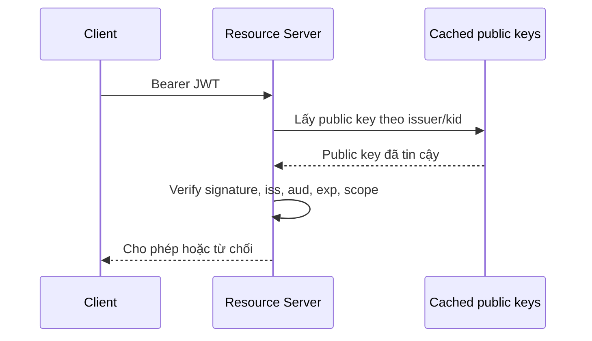
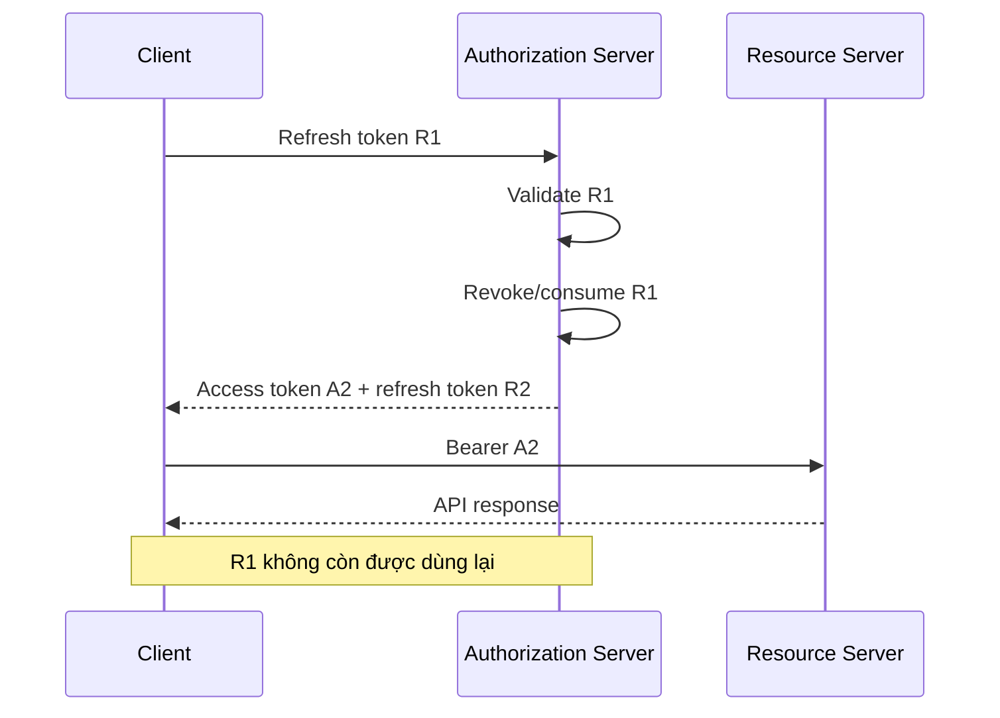

# Token ngắn hạn, danh sách thu hồi và đánh đổi trạng thái của Resource Server

## 1. Bài toán: JWT đã được ký hợp lệ nhưng người dùng vừa bị thu hồi quyền

Một ứng dụng Spring Security OAuth 2.0 Resource Server nhận access token dạng JWT:

```http
GET /api/orders/42 HTTP/1.1
Host: orders.example.com
Authorization: Bearer <access-token>
```

Resource Server xác minh chữ ký bằng public key của Authorization Server, kiểm tra `iss`, `aud`, `exp` và các điều kiện token khác. Khi token hợp lệ và có `SCOPE_orders.read`, API cho phép request đi tiếp.

Nhưng sau đó có một sự kiện:

- Người dùng bị khóa tài khoản.
- Quản trị viên thu hồi phiên đăng nhập.
- Nhân viên rời khỏi tenant.
- Thiết bị bị mất hoặc access token bị lộ.
- Client bị vô hiệu hóa.
- Một khóa ký bị nghi ngờ compromise.

Authorization Server có thể đã thu hồi token hoặc refresh-token family. Tuy nhiên, **một JWT tự chứa vẫn có thể được Resource Server xác minh chữ ký cục bộ cho đến khi token hết hạn**, nếu API không kiểm tra thêm trạng thái thu hồi.

Đây là đánh đổi cốt lõi:

- **JWT ngắn hạn, xác minh cục bộ:** ít phụ thuộc mạng và dễ mở rộng, nhưng quyền bị thu hồi có thể còn hiệu lực đến khi token hết hạn.
- **Danh sách thu hồi hoặc trạng thái phiên:** có thể chặn token trước hạn, nhưng Resource Server phải duy trì hoặc truy vấn trạng thái.
- **Opaque token với introspection:** Authorization Server có thể quyết định token còn active ở thời điểm kiểm tra, nhưng API phụ thuộc vào AS và độ mới của cache.
- **Kết hợp nhiều chiến lược:** giới hạn thời gian phơi nhiễm bằng token ngắn hạn, quản lý refresh token chặt chẽ và dùng trạng thái thu hồi cho những tình huống cần phản ứng nhanh.

Không có một lifetime hoặc cơ chế thu hồi phù hợp cho mọi API. Thiết kế phải dựa trên mức độ nhạy cảm của dữ liệu, thời gian phản ứng thu hồi mong muốn, tải hệ thống và khả năng chấp nhận phụ thuộc hạ tầng.

### Mục tiêu học tập

Sau bài học, bạn có thể:

1. Giải thích vì sao thu hồi JWT tại Authorization Server không tự động khiến mọi Resource Server ngừng chấp nhận token ngay lập tức.
2. Phân biệt access-token lifetime, refresh-token lifetime, token revocation, session logout và key rotation.
3. Hiểu vai trò của RFC 7009 (revocation) và RFC 7662 (introspection).
4. Thiết kế access token ngắn hạn và refresh-token rotation để giới hạn thời gian lộ token.
5. Xây denylist theo `(iss, jti)`, đặt TTL đến khi token hết hiệu lực và tránh lưu raw Bearer token.
6. So sánh denylist, token version, per-user/tenant revocation epoch, introspection và signing-key rotation.
7. Hiểu chi phí stateful lookup, cache, replication, consistency và fail-closed behavior.
8. Tích hợp kiểm tra thu hồi vào Spring Security Servlet và WebFlux đúng mô hình thực thi.
9. Viết kiểm thử cho token hết hạn, bị thu hồi, refresh-token reuse, cache propagation và sự cố revocation store.
10. Chọn giải pháp cân bằng giữa khả năng thu hồi nhanh và tính sẵn sàng của Resource Server.

## 2. Những khái niệm phải tách biệt

### 2.1. Access token

Access token là credential Client trình cho Resource Server để truy cập API. Token có thể là:

- **JWT access token:** chứa claims, được ký; Resource Server có thể xác minh cục bộ bằng khóa công khai.
- **Opaque access token:** chuỗi tham chiếu; Resource Server thường hỏi Authorization Server qua introspection.

Access token nên có audience và scope phù hợp với API. Không dùng ID token OIDC thay access token.

### 2.2. Refresh token

Refresh token được Client dùng với Authorization Server để xin access token mới theo grant/flow được cấp. Nó thường có vòng đời dài hơn access token và cần được bảo vệ nghiêm ngặt.

Refresh token **không phải credential để gọi Resource Server**. Không gửi refresh token tới `/api/orders/**` hoặc lưu nó trong log/API response không cần thiết.

Nếu refresh token bị lộ, kẻ tấn công có thể tiếp tục xin access token mới cho đến khi token bị thu hồi, hết hạn hoặc bị vô hiệu hóa theo policy AS.

### 2.3. Token expiration

Claim `exp` xác định thời điểm JWT không còn hợp lệ theo validator. Khi token hết hạn, Resource Server phải từ chối, kể cả chữ ký vẫn đúng.

Expiration là **giới hạn thời gian tự nhiên** của token. Nó không phải một thao tác thu hồi chủ động.

### 2.4. Token revocation

Revocation là hành động khiến token hoặc một nhóm credential không còn được chấp nhận trước khi hết hạn tự nhiên.

Tùy Authorization Server và token model, revocation có thể ảnh hưởng:

- Token được chỉ định.
- Refresh token và các access token liên quan.
- Cả token family/authorization grant.
- Phiên hoặc consent tương ứng.

Không giả định mọi AS đều thu hồi mọi access token liên quan theo cùng một cách. Cần kiểm tra hợp đồng của nhà cung cấp và loại token.

### 2.5. Logout

Logout có thể chỉ kết thúc session ở website hoặc OIDC Provider. Nó không mặc nhiên thu hồi mọi access token đã được phát hành.

Một ứng dụng có thể có các trạng thái riêng:

```text
Web session active?
OIDC Provider session active?
Refresh token active?
Access token active?
Resource Server denylist contains token?
```

Những trạng thái này có quan hệ nhưng không đồng nhất.

### 2.6. Signing-key rotation

Rotation thay khóa ký JWT. Khi Resource Server không còn tin khóa cũ sau khi JWKS/cache được cập nhật, mọi token ký bằng khóa đó có thể bị từ chối.

Đây là biện pháp ở **phạm vi khóa**, thường có blast radius lớn hơn thu hồi một token hoặc một user. Không dùng rotation khóa định kỳ như phương pháp thu hồi một access token đơn lẻ.

## 3. Vì sao JWT stateless khó thu hồi ngay lập tức?

### 3.1. Resource Server xác minh JWT tại chỗ

Luồng thường gặp:



Nếu chữ ký hợp lệ và các claims đạt yêu cầu, Resource Server có thể không cần gọi Authorization Server trong mỗi request.

Điều đó tạo ra hiệu năng và khả năng phục vụ tốt khi AS tạm thời không sẵn sàng. Nhưng Resource Server **không tự biết** rằng AS vừa đánh dấu token là revoked, trừ khi có thêm một cơ chế truyền trạng thái hoặc kiểm tra online.

### 3.2. Sự kiện thu hồi không tự sửa JWT đã phát hành

Giả sử:

```text
10:00  AS phát hành JWT:
       sub=user-417
       jti=token-abc
       exp=10:30

10:05  Admin thu hồi token-abc tại AS

10:06  Client gửi lại JWT token-abc tới orders-api
```

Nếu `orders-api` chỉ kiểm tra chữ ký và `exp`, token vẫn có thể hợp lệ đến 10:30. Việc AS ghi nhận token đã bị thu hồi không làm thay đổi payload hoặc chữ ký của bản JWT mà Client đang giữ.

Đây là khác biệt quan trọng giữa **thu hồi ở nơi phát hành** và **khả năng nhận biết thu hồi ở nơi tiêu thụ**.

### 3.3. Stateless là một lựa chọn kiến trúc, không phải thuộc tính tuyệt đối

Một JWT Resource Server có thể không lưu session nhưng vẫn có trạng thái thông qua:

- Denylist token.
- Token version của user.
- Tenant/user revocation epoch.
- Introspection.
- Cache entitlement.
- Chính sách signing key.
- Một authorization database.

Khi thêm bất kỳ kiểm tra nào như vậy, quyết định xác thực đã phụ thuộc một phần vào trạng thái bên ngoài. Điều đó có thể đúng với yêu cầu bảo mật; quan trọng là phải hiểu chi phí và failure behavior.

## 4. Access token ngắn hạn: giảm thời gian phơi nhiễm

### 4.1. Nguyên lý

Nếu access token chỉ sống trong khoảng thời gian ngắn, một token bị đánh cắp sẽ có cửa sổ sử dụng bị giới hạn bởi thời điểm hết hạn, kể cả khi không có denylist.

Ví dụ minh họa:

```text
Access token A:
  issued_at = 10:00
  expires_at = 10:10

Token bị lộ lúc 10:04:
  nếu không có cơ chế thu hồi online,
  token có thể còn được dùng đến 10:10
```

Token ngắn hạn giúp giảm **maximum exposure window**. Nó không ngăn kẻ tấn công sử dụng token ngay sau khi đánh cắp, và cũng không thay thế kiểm tra audience/scope/tenant.

### 4.2. Không có một con số lifetime chuẩn cho mọi hệ thống

Thời hạn cần cân nhắc:

- Mức độ nhạy cảm của API và dữ liệu.
- Thời gian tối đa tổ chức chấp nhận token bị lộ còn hoạt động.
- Khả năng AS cấp token mới.
- Tải token endpoint và trải nghiệm người dùng.
- Mobile/offline client có thể refresh thường xuyên không.
- Độ trễ đồng hồ và clock skew giữa AS/RS.
- Thời gian request đang chạy và tác động của expiry giữa chừng.

Có thể dùng một khoảng thời gian ngắn trong lab để minh họa, nhưng **không coi một giá trị phút cố định là tiêu chuẩn bắt buộc**. Tổ chức phải chọn lifetime dựa trên threat model và vận hành.

### 4.3. Token ngắn hạn có chi phí

Nếu access token quá ngắn:

- Client phải refresh thường xuyên hơn.
- Authorization Server chịu nhiều token requests hơn.
- Mobile app có thể gặp nhiều lỗi khi offline.
- Nhiều request đồng thời có thể cùng refresh một credential, tạo race.
- Refresh-token rotation có thể phát hiện reuse giả nếu Client không đồng bộ refresh.
- Người dùng có thể thấy trải nghiệm gián đoạn khi AS không sẵn sàng.

Do đó, ngắn hơn không phải lúc nào cũng tốt hơn. Chọn lifetime phải cân bằng với refresh flow và khả năng phục hồi.

### 4.4. Kiểm tra thời gian tại Resource Server

Với JWT, Resource Server cần xác minh `exp` và có thể kiểm tra `nbf`. Một số triển khai cho phép clock skew để bù sai lệch đồng hồ.

Clock skew có nghĩa token có thể được chấp nhận thêm một khoảng nhỏ quanh biên thời gian theo cấu hình. Khi tính TTL denylist, cache hoặc thời điểm xóa entry, cần tính đến **khoảng chấp nhận thời gian này**.

Không dùng clock skew quá lớn để bù cho hạ tầng đồng hồ không được đồng bộ.

### 4.5. Access token không nên chứa dữ liệu nhạy cảm dư thừa

Token ngắn hạn vẫn có thể bị đọc nếu là JWT ký nhưng không mã hóa. Tránh đưa mật khẩu, refresh token, secret, dữ liệu cá nhân không cần thiết hoặc toàn bộ quyền nghiệp vụ phức tạp vào claims.

Token lifetime ngắn không biến payload thành bí mật.

## 5. Refresh token và rotation: quản lý credential dài hạn

### 5.1. Tại sao refresh token cần bảo vệ khác access token?

Access token được gửi tới Resource Server. Refresh token được gửi tới Authorization Server/token endpoint. Refresh token có thể cho phép Client xin access token mới, nên thường có giá trị lâu dài và cần bảo vệ cao hơn.

Không:

- Gửi refresh token tới API nghiệp vụ.
- Ghi refresh token vào log.
- Đưa refresh token vào URL.
- Lưu refresh token ở nơi dễ bị script hoặc ứng dụng khác đọc nếu có lựa chọn an toàn hơn.
- Dùng một refresh token cho nhiều Client/thiết bị nếu AS không hỗ trợ rõ ràng.

### 5.2. Refresh-token rotation

Với rotation, khi Client sử dụng refresh token hiện tại để lấy access token mới, AS phát hành refresh token kế tiếp và vô hiệu hóa token cũ theo policy.



Nếu kẻ tấn công đã sao chép `R1` và thử dùng lại sau khi Client đã đổi sang `R2`, AS có thể phát hiện **refresh-token reuse** và thu hồi cả token family/authorization grant tùy implementation.

### 5.3. Refresh-token reuse detection

Một ví dụ:

```text
R1 → dùng hợp lệ → R2
R1 → xuất hiện lần nữa
       ↓
AS nhận diện reuse
       ↓
Có thể revoke token family và yêu cầu re-authentication
```

Đây là một biện pháp phát hiện credential bị sao chép. Nhưng Client phải xử lý refresh concurrency đúng cách: nếu hai request đồng thời dùng R1, một request có thể thành công còn request kia bị xem như reuse.

Client cần single-flight refresh hoặc đồng bộ việc đổi refresh token, và lưu token mới một cách nguyên tử trước khi các request tiếp theo dùng nó.

### 5.4. Rotation không tự thu hồi mọi JWT cũ ngay lập tức

AS có thể vô hiệu hóa refresh token cũ, nhưng access token đã được phát hành trước đó có thể tiếp tục hợp lệ tới `exp` nếu Resource Server chỉ xác minh JWT cục bộ.

Muốn access token cũ bị chặn sớm, cần introspection, denylist, version/epoch check hoặc một cơ chế trạng thái tương đương.

### 5.5. Token family và phạm vi thu hồi

Nếu AS hỗ trợ token family:

- Một refresh token là thành viên của một family/grant.
- Rotation tạo token mới trong family.
- Reuse có thể làm thu hồi token hiện tại và các token liên quan.
- Việc revoke family có thể ảnh hưởng nhiều phiên/thiết bị tùy policy.

Không tự suy ra mọi AS đều hỗ trợ family reuse detection. Kiểm tra tài liệu AS và test hành vi thật.

## 6. RFC 7009: Token Revocation Endpoint

### 6.1. Mục đích

RFC 7009 định nghĩa OAuth 2.0 Token Revocation. Client gửi token tới **Authorization Server** để yêu cầu thu hồi credential.

Ví dụ:

```http
POST /oauth2/revoke HTTP/1.1
Host: id.example.com
Authorization: Basic <client-authentication>
Content-Type: application/x-www-form-urlencoded

token=<refresh-token>&token_type_hint=refresh_token
```

Trong ví dụ, Client đang yêu cầu AS thu hồi refresh token. Có thể có cách xác thực Client khác như private-key JWT hoặc mTLS tùy hợp đồng.

### 6.2. `token_type_hint` chỉ là gợi ý

`token_type_hint` giúp AS biết Client nghĩ token thuộc loại nào, ví dụ `access_token` hoặc `refresh_token`. Đây là **hint**, không phải bằng chứng token có đúng loại đó.

AS vẫn phải xác định token theo cơ chế của nó và áp dụng chính sách revocation.

### 6.3. Vì sao response có thể là HTTP 200 cả khi token không hợp lệ?

RFC 7009 định nghĩa response thành công cho yêu cầu revoke; AS có thể trả HTTP 200 khi token đã được thu hồi hoặc token không hợp lệ/không tồn tại. Cách phản hồi này giúp tránh tạo một endpoint để Client dò xem token nào đang tồn tại.

Ví dụ:

```http
HTTP/1.1 200 OK
```

Client không nên dựa vào body response để suy luận chi tiết token có tồn tại trước đó hay không.

Nếu AS không thể xử lý yêu cầu revocation vì lỗi hạ tầng, response lỗi dịch vụ phù hợp có thể được trả về; Client phải phân biệt **yêu cầu revoke được xử lý** với **không xác định được kết quả vì server unavailable** theo hợp đồng AS.

### 6.4. Revocation endpoint không phải introspection endpoint

Hai luồng khác nhau:

```text
RFC 7009 — Revocation:
  Client → Authorization Server
  "Hãy thu hồi token này"

RFC 7662 — Introspection:
  Resource Server → Authorization Server
  "Token này hiện có active không?"
```

Revocation thay đổi trạng thái ở AS. Introspection hỏi trạng thái đó để Resource Server đưa ra quyết định ở thời điểm request.

### 6.5. Revocation có bảo đảm mọi Resource Server nhận biết tức thì không?

Không mặc nhiên. Với opaque token, introspection tiếp theo có thể trả `active=false` khi AS đã áp dụng revocation. Với JWT self-contained, Resource Server có thể không hỏi AS nên vẫn chấp nhận token cũ tới `exp` nếu không có trạng thái thu hồi bổ sung.

Một hệ thống nhiều Resource Server cần xác định rõ cách revocation lan truyền và thời gian hội tụ.

## 7. RFC 7662: Introspection và trạng thái active

### 7.1. Resource Server hỏi Authorization Server

Với opaque token:

```http
POST /oauth2/introspect HTTP/1.1
Host: id.example.com
Authorization: Basic <resource-server-client-auth>
Content-Type: application/x-www-form-urlencoded

token=<opaque-access-token>
```

AS có thể trả:

```json
{
  "active": true,
  "scope": "orders.read",
  "client_id": "shop-web",
  "sub": "user-417",
  "aud": ["orders-api"],
  "exp": 1893456000
}
```

Sau khi token bị thu hồi:

```json
{
  "active": false
}
```

Resource Server chỉ nên chấp nhận token khi introspection và các policy bổ sung đều đạt.

### 7.2. Introspection có thể cung cấp revocation gần thời gian thực

Nếu Resource Server hỏi AS ở mỗi request và AS cập nhật trạng thái revoke ngay, request tiếp theo có thể nhận `active=false`. Tuy nhiên, “gần thời gian thực” phụ thuộc:

- Thời gian AS cập nhật trạng thái.
- Replication giữa các node AS.
- Cache introspection ở Resource Server.
- Network latency.
- Những request đang chạy trước khi revocation hoàn tất.

Nếu API cache `active=true` trong một khoảng thời gian, token đã thu hồi vẫn có thể được chấp nhận đến khi cache hết hạn.

### 7.3. Introspection mỗi request có chi phí

- Mỗi API request có thêm outbound HTTP call.
- AS trở thành dependency trên đường xử lý.
- Tăng latency và connection usage.
- AS outage có thể ảnh hưởng toàn bộ protected traffic.
- Cần timeout, rate limit, connection pool và concurrency limits.
- Cần bảo vệ introspection credential và access token.

Đây là đánh đổi giữa **khả năng quan sát trạng thái token mới** và **tính độc lập/hiệu năng của Resource Server**.

### 7.4. Không hiểu nhầm HTTP 200

Introspection endpoint có thể trả HTTP 200 với `{"active":false}`. HTTP 200 chỉ cho biết AS xử lý request introspection, không có nghĩa token được chấp nhận.

### 7.5. Audience và scope vẫn phải kiểm tra

`active=true` không tự có nghĩa token dành cho API hiện tại hoặc đủ quyền.

Ví dụ:

```json
{
  "active": true,
  "aud": ["billing-api"],
  "scope": "orders.read"
}
```

Nếu API yêu cầu `orders-api`, token phải bị từ chối theo audience contract. Scope và audience là hai điều kiện độc lập.

## 8. Các chiến lược thu hồi JWT phổ biến

### 8.1. Bảng so sánh

| Chiến lược | Thu hồi trước `exp` | Trạng thái tại RS | Chi phí mỗi request | Phạm vi tác động |
|---|---|---|---|---|
| Chỉ JWT ngắn hạn | Không tức thì | Không cần denylist | Thấp | Một token hết hạn tự nhiên |
| Denylist theo `jti` | Có | Có | Lookup trạng thái | Một token |
| Token version theo user | Có | Có | Lookup/version cache | Nhiều token của một user |
| Revocation epoch theo tenant | Có | Có | Lookup/version cache | Token cũ của tenant |
| Introspection | Có theo trạng thái AS | AS là nguồn trạng thái | Network call hoặc cache | Token theo policy AS |
| Opaque token + introspection | Có theo trạng thái AS | Stateful online | Network call hoặc cache | Token theo AS |
| Signing-key rotation | Có sau khi RS cập nhật key trust | JWKS/cache state | Thường không cần per-token lookup | Tất cả token ký bằng key bị loại |
| Refresh-token rotation | Chặn refresh token cũ/reuse | Chủ yếu tại AS | Token endpoint | Refresh family/grant |
| Kết hợp nhiều chiến lược | Theo từng lớp | Có chọn lọc | Trung bình đến cao | Có thể chi tiết và linh hoạt |

Không có chiến lược nào miễn phí. Hãy chọn theo **đơn vị cần thu hồi**: một token, một user, một tenant, một Client, một grant hay cả issuer signing key.

## 9. Denylist theo `jti`: thu hồi một JWT cụ thể

### 9.1. `jti` là gì?

JWT có thể chứa `jti` (JWT ID), một định danh token:

```json
{
  "iss": "https://id.example.com/realms/shop",
  "sub": "user-417",
  "aud": ["orders-api"],
  "jti": "9d1d3a6e-7c8f-4d15-8c4a-2e9f01d91a72",
  "iat": 1893455100,
  "exp": 1893456000
}
```

Nếu token contract yêu cầu revoke theo token, AS cần phát hành `jti` đủ duy nhất trong phạm vi issuer. Resource Server có thể lưu một entry denylist để từ chối đúng token đó.

**Không phải mọi JWT đều có `jti`.** Nếu kiến trúc dựa vào `jti` denylist, hãy đưa claim này thành điều kiện trong token contract; không âm thầm bỏ qua khi thiếu.

### 9.2. Key denylist nên gồm issuer và token ID

Không nên lưu:

```text
denylist["token-123"] = revoked
```

vì hai issuer có thể phát hành cùng một `jti`. Một key logic phù hợp hơn:

```text
revocation key = (issuer, jti)
```

Có thể thêm namespace môi trường/tenant nếu mô hình lưu trữ yêu cầu. `iss` phải là issuer đã xác minh, `jti` phải đến từ JWT đã xác minh.

### 9.3. Không lưu raw Bearer token

Raw access token là credential có thể bị replay. Denylist chỉ cần một định danh đủ để tìm token:

- `(iss, jti)` nếu issuer đảm bảo `jti` duy nhất.
- Một hash/HMAC của token nếu contract không có `jti` và cần nhận diện chuỗi token.
- Một token reference ID do AS cấp.

Không đưa token nguyên văn vào Redis key, DB row, log hoặc metric. Nếu dùng hash/HMAC, cần quản lý key của HMAC và versioning; không coi hash thay thế mọi kiểm soát quyền truy cập vào dữ liệu denylist.

### 9.4. TTL đến khi token hết hiệu lực

Nếu token hết hạn lúc `exp`, denylist entry không cần tồn tại mãi mãi. Có thể đặt TTL đến `exp` cộng khoảng clock skew mà Resource Server cho phép.

Ví dụ:

```text
token exp:             10:30:00
accepted clock skew:   00:00:30
denylist TTL until:    10:30:30
```

Sau thời điểm đó, token đã không còn được validator chấp nhận; entry có thể được xóa tự động.

Nếu token không có `exp` hoặc không có lifetime hữu hạn trong một hệ thống yêu cầu denylist TTL, cần định nghĩa policy khác và cân nhắc từ chối token đó.

### 9.5. Tăng trưởng denylist

Denylist có thể tăng theo số token bị thu hồi. TTL giúp tự dọn entry đã hết tác dụng, nhưng hệ thống vẫn cần:

- Dung lượng và eviction policy rõ.
- Index/key schema phù hợp.
- TTL chính xác.
- Giới hạn tốc độ revoke.
- Monitoring số entry/throughput/latency.
- Replication và persistence theo mức độ cần thiết.

Không dùng cache có eviction tùy tiện nếu eviction có thể xóa một revocation entry còn hiệu lực và làm token bị chấp nhận lại.

## 10. Token version và revocation epoch: thu hồi theo nhóm

### 10.1. Token version theo user

Một user record có:

```text
user_id = user-417
token_version = 7
```

Khi AS phát hành JWT, nó thêm claim:

```json
{
  "sub": "user-417",
  "token_version": 7
}
```

Khi admin muốn vô hiệu hóa tất cả token cũ của user, hệ thống tăng:

```text
token_version = 8
```

Resource Server so sánh claim trong token với giá trị hiện tại. Token có version 7 bị từ chối; token mới được phát hành với version 8.

### 10.2. Ưu và nhược điểm

Ưu điểm:

- Không cần lưu một entry cho từng token.
- Thu hồi tất cả token cũ của user bằng một thay đổi.
- Hữu ích cho password reset, account disable hoặc security event.

Nhược điểm:

- Phải tra cứu version hiện tại hoặc cache nó.
- Có thể thu hồi cả thiết bị/session hợp lệ khác của user.
- Cache stale khiến token cũ tiếp tục được chấp nhận.
- Token mới cần được phát hành với version mới.
- Cần phân biệt subject giữa nhiều issuer.

### 10.3. Tenant revocation epoch

Có thể áp dụng tương tự ở tenant:

```text
tenant alpha:
  revocation_epoch = 12
```

JWT chứa `tenant_epoch=12`. Khi cần thu hồi mọi token trước một sự kiện, tăng epoch lên 13. Token cũ mang epoch 12 bị từ chối.

Cách này có thể thu hồi một nhóm token rộng, nhưng không phù hợp để revoke riêng một token. Nó cũng cần một lookup/cached state và chính sách cập nhật giữa các Resource Server.

### 10.4. Claim version không tự tạo trạng thái hiện hành

Nếu Resource Server chỉ đọc `token_version` trong JWT mà không so với nguồn hiện tại, nó không biết version đã tăng. **Version claim chỉ có tác dụng thu hồi khi có một nguồn trạng thái authoritative để đối chiếu.**

## 11. Denylist và token-state lookup trong Spring Security Servlet

### 11.1. Hợp đồng lưu trạng thái

Ví dụ interface đơn giản:

```java
package com.example.orders.security;

public interface RevocationStore {

    boolean isRevoked(String issuer, String tokenId);
}
```

Implementation thực tế có thể dùng Redis, database hoặc một service nội bộ. Đoạn dưới giả định lookup là **nhanh và đồng bộ**; không dùng trực tiếp một Redis call chặn lâu trong event loop WebFlux.

### 11.2. Validator kiểm tra `jti`

```java
package com.example.orders.security;

import org.springframework.security.oauth2.core.OAuth2Error;
import org.springframework.security.oauth2.core.OAuth2TokenValidator;
import org.springframework.security.oauth2.core.OAuth2TokenValidatorResult;
import org.springframework.security.oauth2.jwt.Jwt;

public final class RevokedJwtValidator
        implements OAuth2TokenValidator<Jwt> {

    private final RevocationStore store;

    public RevokedJwtValidator(RevocationStore store) {
        this.store = store;
    }

    @Override
    public OAuth2TokenValidatorResult validate(Jwt jwt) {
        String issuer = jwt.getIssuer() == null
            ? null : jwt.getIssuer().toString();
        String tokenId = jwt.getId();

        if (issuer == null || issuer.isBlank()
                || tokenId == null || tokenId.isBlank()) {
            return OAuth2TokenValidatorResult.failure(
                new OAuth2Error(
                    "invalid_token",
                    "Required token identifiers are missing",
                    null));
        }

        if (store.isRevoked(issuer, tokenId)) {
            return OAuth2TokenValidatorResult.failure(
                new OAuth2Error(
                    "invalid_token",
                    "Token has been revoked",
                    null));
        }

        return OAuth2TokenValidatorResult.success();
    }
}
```

Validator này chỉ kiểm tra token ID đã bị thu hồi. Nó không thay thế signature, issuer, expiry, audience hoặc scope validation.

### 11.3. Kết hợp với validator mặc định

Ví dụ tạo decoder dùng explicit JWKS URI:

```java
package com.example.orders.security;

import org.springframework.context.annotation.Bean;
import org.springframework.context.annotation.Configuration;
import org.springframework.security.oauth2.core.DelegatingOAuth2TokenValidator;
import org.springframework.security.oauth2.jwt.JwtDecoder;
import org.springframework.security.oauth2.jwt.JwtValidators;
import org.springframework.security.oauth2.jwt.NimbusJwtDecoder;

@Configuration
public class JwtDecoderConfig {

    @Bean
    JwtDecoder jwtDecoder(RevocationStore revocationStore) {
        String issuer =
            "https://id.example.com/realms/shop";
        String jwksUri =
            "https://id.example.com/realms/shop/protocol/openid-connect/certs";

        NimbusJwtDecoder decoder =
            NimbusJwtDecoder.withJwkSetUri(jwksUri).build();

        decoder.setJwtValidator(
            new DelegatingOAuth2TokenValidator<>(
                JwtValidators.createDefaultWithIssuer(issuer),
                new RevokedJwtValidator(revocationStore)));

        return decoder;
    }
}
```

Đây là ví dụ Servlet/JWT. Cần bổ sung audience validator và các điều kiện token profile theo hợp đồng API. Nếu dùng `issuer-uri` auto-discovery thay explicit JWKS, vẫn phải gắn validator thu hồi vào decoder phù hợp.

### 11.4. Giới hạn quan trọng của validator đồng bộ

`OAuth2TokenValidator<Jwt>` là API đồng bộ. Một `ConcurrentHashMap` hoặc local in-memory store có thể được kiểm tra nhanh; nhưng nếu `RevocationStore` gọi Redis/HTTP đồng bộ, thread đang decode token sẽ phải đợi.

Trong Servlet, blocking lookup vẫn tiêu thụ request thread và connection pool; cần timeout, bulkhead, connection limits và đo tải. Trong WebFlux, không gọi một lookup blocking trực tiếp từ validator chạy trên event loop. Mục 13 trình bày cách tích hợp reactive.

### 11.5. Vì sao không chỉ kiểm tra `jti` trong Controller?

Nếu mỗi Controller tự kiểm tra denylist, endpoint mới có thể quên bước này. Token bị thu hồi vẫn có thể đi qua những route không có kiểm tra.

Đặt token-level revocation ở authentication pipeline giúp **mọi protected endpoint dùng cùng một điều kiện**. Các quyền nghiệp vụ như tenant/owner vẫn cần kiểm tra ở authorization/service.

## 12. In-memory denylist và distributed denylist

### 12.1. In-memory store phù hợp khi nào?

Ví dụ:

```java
package com.example.orders.security;

import java.util.Set;
import java.util.concurrent.ConcurrentHashMap;

public final class InMemoryRevocationStore
        implements RevocationStore {

    private final Set<String> revoked = ConcurrentHashMap.newKeySet();

    @Override
    public boolean isRevoked(String issuer, String tokenId) {
        return revoked.contains(issuer + "|" + tokenId);
    }

    public void revoke(String issuer, String tokenId) {
        revoked.add(issuer + "|" + tokenId);
    }
}
```

Đây là minh họa cho **một process**. Nó không đủ cho hệ thống nhiều pod:

- Token bị revoke trên node A nhưng node B không biết.
- Restart có thể làm mất trạng thái nếu không persist.
- Scale-out tạo nhiều denylist độc lập.
- Một node bị stale có thể tiếp tục chấp nhận token.

Không dùng in-memory set làm revocation source authoritative trong production cluster nếu không có replication/consistency mechanism phù hợp.

### 12.2. Distributed store

Redis hoặc database dùng chung có thể giúp nhiều Resource Server nhìn thấy cùng trạng thái. Cần thiết kế:

- Namespace theo môi trường/issuer.
- Key gồm issuer + jti hoặc token hash.
- TTL theo exp/clock skew.
- Persistence/replication phù hợp.
- Access control riêng cho revoke/read.
- Network TLS và credential.
- Backup/recovery nếu yêu cầu.
- Metrics latency/error/entry count.

Distributed store giải quyết việc chia sẻ trạng thái nhưng tạo dependency mới trong đường authentication.

### 12.3. Multi-region consistency

Nếu các Resource Server ở nhiều region, sự kiện revoke có thể lan truyền chậm. Hãy định nghĩa **revocation propagation SLA**:

```text
Revocation accepted at AS
  → publish event
  → regional store update
  → Resource Server cache invalidation
  → all regions reject token
```

Nếu policy yêu cầu chặn gần như tức thì, eventual consistency với propagation không giới hạn có thể không đủ. Cần một nguồn lookup mạnh hơn hoặc đường xác nhận/acknowledgment rõ ràng.

### 12.4. Không để eviction xóa revocation còn hiệu lực

Nếu dùng cache có giới hạn dung lượng, chính sách eviction kiểu LRU có thể xóa một entry revoke trước `exp`. Token sau đó lại được chấp nhận.

Denylist cần store semantics bảo đảm entry không bị mất sớm, hoặc một nguồn authoritative khác vẫn có thể kiểm tra. Không đánh đồng cache thuần hiệu năng với store trạng thái bảo mật.

## 13. Kiểm tra revocation trong WebFlux mà không chặn event loop

### 13.1. Vì sao không dùng validator đồng bộ với Redis reactive?

Trong WebFlux, nếu dùng `OAuth2TokenValidator<Jwt>` rồi gọi JDBC/Redis đồng bộ, event loop có thể bị chặn. Chuyển return type sang `Mono` không đủ nếu thao tác bên trong vẫn synchronous.

Nếu cần tra revocation state bằng reactive store, có thể đặt kiểm tra trong một **ReactiveAuthenticationManager** bao quanh manager xác thực JWT.

### 13.2. Reactive store contract

```java
package com.example.orders.security;

import reactor.core.publisher.Mono;

public interface ReactiveRevocationStore {

    Mono<Boolean> isRevoked(String issuer, String tokenId);
}
```

Implementation nên dùng client reactive thực sự (ví dụ reactive Redis) và trả `Mono<Boolean>`. Không bọc JDBC bằng `Mono.just(...)`.

### 13.3. ReactiveAuthenticationManager wrapper

```java
package com.example.orders.security;

import org.springframework.security.authentication.ReactiveAuthenticationManager;
import org.springframework.security.core.Authentication;
import org.springframework.security.oauth2.core.OAuth2AuthenticationException;
import org.springframework.security.oauth2.core.OAuth2Error;
import org.springframework.security.oauth2.server.resource.authentication.JwtAuthenticationToken;
import reactor.core.publisher.Mono;

public final class RevocationCheckingAuthenticationManager
        implements ReactiveAuthenticationManager {

    private final ReactiveAuthenticationManager delegate;
    private final ReactiveRevocationStore revocations;

    public RevocationCheckingAuthenticationManager(
            ReactiveAuthenticationManager delegate,
            ReactiveRevocationStore revocations) {
        this.delegate = delegate;
        this.revocations = revocations;
    }

    @Override
    public Mono<Authentication> authenticate(
            Authentication authentication) {

        return delegate.authenticate(authentication)
            .flatMap(authenticated -> {
                if (!(authenticated instanceof JwtAuthenticationToken jwtAuth)) {
                    return Mono.just(authenticated);
                }

                String issuer =
                    jwtAuth.getToken().getIssuer().toString();
                String tokenId = jwtAuth.getToken().getId();

                if (tokenId == null || tokenId.isBlank()) {
                    return Mono.error(
                        new OAuth2AuthenticationException(
                            new OAuth2Error(
                                "invalid_token",
                                "Token identifier is missing",
                                null)));
                }

                return revocations.isRevoked(issuer, tokenId)
                    .flatMap(revoked -> {
                        if (revoked) {
                            return Mono.error(
                                new OAuth2AuthenticationException(
                                    new OAuth2Error(
                                        "invalid_token",
                                        "Token has been revoked",
                                        null)));
                        }
                        return Mono.just(authenticated);
                    });
            });
    }
}
```

`delegate` thực hiện JWT authentication thật (ReactiveJwtDecoder, signature và claims validation). Wrapper chỉ bổ sung revocation check sau khi token đã được xác minh. Nếu revocation store lỗi, lỗi phải được truyền theo chính sách fail-closed; không chuyển thành `false`.

### 13.4. Wiring vào WebFlux Security

Ví dụ cấu hình manager:

```java
@Bean
ReactiveAuthenticationManager jwtAuthenticationManager(
        ReactiveJwtDecoder decoder,
        ReactiveRevocationStore revocations) {

    ReactiveAuthenticationManager jwtManager =
        new JwtReactiveAuthenticationManager(decoder);

    return new RevocationCheckingAuthenticationManager(
        jwtManager, revocations);
}
```

Gắn vào WebFlux chain:

```java
@Bean
SecurityWebFilterChain apiSecurity(
        ServerHttpSecurity http,
        ReactiveAuthenticationManager jwtAuthenticationManager) {

    return http
        .authorizeExchange(exchanges -> exchanges
            .pathMatchers("/api/public/**").permitAll()
            .pathMatchers(HttpMethod.GET, "/api/orders/**")
                .hasAuthority("SCOPE_orders.read")
            .anyExchange().denyAll())
        .oauth2ResourceServer(oauth2 -> oauth2
            .jwt(jwt -> jwt
                .authenticationManager(jwtAuthenticationManager)))
        .build();
}
```

Đây là cấu hình WebFlux minh họa; cần imports và API tương thích phiên bản Spring Security của dự án. Decoder phải được cấu hình issuer/audience/time/algorithm validators trước khi được truyền vào manager.

### 13.5. Timeout và failure semantics

Với reactive revocation store:

- Đặt timeout cho lookup.
- Không retry vô hạn.
- Giới hạn concurrency.
- Theo dõi latency và lỗi.
- Khi store không thể xác minh trạng thái, không cấp Authentication theo mặc định.

Nếu revocation lookup là điều kiện bắt buộc để chấp nhận token, store unavailable phải làm request **không được đi tiếp**. API có thể trả lỗi dịch vụ phù hợp (chẳng hạn 503) thay vì giả vờ token chắc chắn invalid; mapping cụ thể phụ thuộc exception handling của ứng dụng.

## 14. Opaque token và denylist: có cần lưu thêm trạng thái ở Resource Server?

### 14.1. Introspection đã là một dạng online state check

Với opaque token, Resource Server hỏi AS:

```json
{"active": true, "scope": "orders.read"}
```

Sau khi revoke:

```json
{"active": false}
```

Nếu mỗi request đều introspect và không cache kết quả positive quá lâu, AS có thể là nguồn trạng thái chính. Resource Server thường không cần một denylist riêng cho cùng token, trừ khi có policy nội bộ khác.

### 14.2. Cache làm thay đổi revocation delay

Giả sử Resource Server cache `active=true` trong một khoảng thời gian. Token bị thu hồi ngay sau khi cache entry được tạo, nhưng API vẫn có thể chấp nhận token đến khi entry hết hạn.

Do đó:

```text
Revocation delay ≈ AS propagation delay
                 + positive-cache remaining TTL
                 + Resource Server cache propagation
```

Đây là mô hình ước lượng để phân tích, không phải công thức thời gian tuyệt đối trong mọi implementation.

### 14.3. Caching negative và positive khác nhau

- **Positive result** (`active=true`): cache quá lâu làm token đã revoke tiếp tục được chấp nhận.
- **Negative result** (`active=false`): có thể cache đến khi token chắc chắn hết hạn để giảm call lặp, nhưng cần cân nhắc nếu AS cho phép reactivation/khác biệt semantics.
- **AS error/timeout:** không cache như `active=true`; lỗi hạ tầng không phải bằng chứng token hoạt động.

Nếu yêu cầu revoke nhanh, giảm positive TTL hoặc không cache positive result. Nếu tải AS là ưu tiên cao hơn, chấp nhận TTL dài hơn nhưng phải ghi rõ SLA thu hồi.

### 14.4. Introspection credential và token confidentiality

Resource Server phải xác thực với introspection endpoint theo hợp đồng. Không gửi access token đến URL do Client tự chọn và không log raw token, Basic header hoặc Client secret.

Với nhiều issuer, không thử gửi cùng một opaque token tới mọi AS để tìm nơi trả `active=true`. Cần cơ chế định tuyến trusted trước.

## 15. Token version, denylist và key rotation: chọn đúng phạm vi thu hồi

### 15.1. So sánh theo mục tiêu

| Sự kiện | Cơ chế thường phù hợp |
|---|---|
| Một access token bị lộ | Denylist `(iss, jti)` hoặc introspection/revoke token |
| Người dùng reset password, cần chặn các token cũ | User token version hoặc revoke token family |
| Một thiết bị bị mất | Revoke session/refresh-token family hoặc token set của thiết bị |
| User rời một tenant | Thu hồi membership/tenant entitlement; không nhất thiết revoke token của mọi tenant |
| Client application bị compromise | Disable Client, revoke grants/refresh tokens, kiểm tra access-token status |
| Signing key bị lộ | Khẩn cấp loại bỏ key khỏi trust, refresh cache và xử lý token đã ký bằng key đó |
| Tenant bị offboard | Disable tenant authorization và revoke theo phạm vi tenant |
| API cần trạng thái online gần thời gian thực | Opaque introspection hoặc state check phù hợp |

### 15.2. Key rotation có blast radius lớn

Nếu loại một key khỏi JWKS, tất cả JWT còn được ký bằng key đó có thể bị từ chối sau khi Resource Server nhận cập nhật. Đây có thể là biện pháp cần thiết khi key compromise, nhưng ảnh hưởng cả token hợp lệ khác.

Nếu chỉ một token bị lộ, revoke `jti` thường chính xác hơn rotation khóa.

### 15.3. Token version có blast radius theo user/tenant

Tăng version user có thể thu hồi mọi token cũ của user trên nhiều thiết bị. Tăng tenant epoch có thể thu hồi một nhóm token của tenant.

Đây là cách đơn giản khi policy thực sự muốn **revoke cả nhóm**, nhưng không nên dùng để thu hồi một token đơn lẻ nếu không muốn đăng xuất những phiên khác.

### 15.4. User/tenant membership có thể là trạng thái độc lập

Một token vẫn có thể active và chưa bị revoke nhưng user đã rời tenant. Resource Server cần kiểm tra membership/entitlement theo policy, không chỉ denylist token.

Điều này cho thấy revocation không thay thế object-level authorization. Token có thể hợp lệ về credential nhưng không còn quyền trên dữ liệu.

## 16. Cache và propagation: giới hạn thời gian thu hồi thực tế

### 16.1. Các lớp trạng thái có thể bị stale

Một request có thể đi qua nhiều cache:

```text
Authorization Server token state
       ↓
Revocation event bus
       ↓
Distributed denylist / token-version store
       ↓
Local Resource Server cache
       ↓
Authentication/authorization result
```

Mỗi lớp có thể có độ trễ riêng. Nếu một node chưa nhận event, node đó có thể vẫn chấp nhận token.

### 16.2. Cache negative lookup

Nếu Resource Server cache kết quả `not revoked`, một token vừa bị revoke có thể còn được chấp nhận cho tới khi negative-cache entry hết hạn.

Ví dụ:

```text
10:00:00  RS cache: token-abc is not revoked
10:00:10  AS/admin revokes token-abc
10:00:25  RS cache entry expires
10:00:26  RS reads revocation store and rejects
```

Trong ví dụ, propagation/negative cache tạo ra khoảng trễ. TTL phải được chọn theo **revocation SLA**, không chỉ theo hiệu năng.

### 16.3. Cache positive revocation

Một khi đã xác nhận token revoked, cache positive result đến `exp` thường an toàn hơn cache negative lâu dài, vì kết quả “đã thu hồi” không nên tự biến mất trước khi token hết hiệu lực.

Nếu có cơ chế reactivation (thường không nên có cho cùng token), cần hợp đồng rõ. Phổ biến hơn là không tái kích hoạt token đã revoke mà cấp token mới.

### 16.4. Event-driven invalidation

AS hoặc control plane có thể phát event:

```json
{
  "event": "token.revoked",
  "issuer": "https://id.example.com/realms/shop",
  "jti": "token-abc",
  "occurred_at": "2026-11-15T10:00:00Z"
}
```

Resource Server consumers cập nhật local cache/denylist. Event payload phải được xác thực nguồn, chống replay, có version/sequence phù hợp và không chứa raw access token.

Event bus giúp lan truyền nhanh nhưng vẫn có thể mất event, trễ hoặc xử lý trùng. Cần idempotency, reconciliation định kỳ hoặc nguồn authoritative để khôi phục trạng thái.

### 16.5. Không chỉ dựa vào pub/sub best-effort

Nếu event revoke bị mất và không có reconciliation, local cache có thể tiếp tục cho phép token lâu hơn SLA. Cần quyết định:

- Event delivery có durable không?
- Có sequence/version để phát hiện gap không?
- Consumer có retry/dead-letter không?
- Node restart có reload state không?
- Có full sync hoặc periodic reconciliation không?
- Khi bus outage, API xử lý thế nào?

Một hệ thống cần revocation mạnh phải kiểm soát cả **event propagation và trạng thái authoritative**.

## 17. Fail-open hay fail-closed khi revocation store không khả dụng?

### 17.1. Fail-open

Fail-open nghĩa là nếu không thể hỏi revocation store, Resource Server cho token đi qua như thể nó chưa bị revoke.

Ưu điểm:

- Duy trì availability.
- Không làm toàn API ngừng hoạt động khi Redis/AS lỗi.

Rủi ro:

- Token đã bị revoke vẫn được chấp nhận.
- Kẻ tấn công có thể tận dụng outage để tiếp tục truy cập.
- SLA revocation không còn được bảo đảm.

### 17.2. Fail-closed

Fail-closed nghĩa là nếu revocation check bắt buộc không thể hoàn tất, request không được cấp quyền.

Ưu điểm:

- Không chấp nhận token khi trạng thái bảo mật chưa được xác minh.
- Phù hợp với thao tác nhạy cảm hoặc hệ thống yêu cầu thu hồi chặt.

Chi phí:

- Redis/AS outage có thể làm protected API unavailable.
- Cần thiết kế HA, timeout, capacity và incident response.

### 17.3. Chính sách theo mức độ rủi ro

Không nhất thiết mọi endpoint có cùng yêu cầu:

| API | Chính sách có thể cân nhắc |
|---|---|
| Đọc nội dung công khai | Không cần revocation lookup |
| Đọc dữ liệu nhạy cảm | Fail-closed khi trạng thái revoke là bắt buộc |
| Chuyển tiền/thay đổi quyền | Kiểm tra trạng thái mạnh, không dựa cache stale |
| Báo cáo không nhạy cảm | Có thể chấp nhận một khoảng propagation đã được phê duyệt |
| Admin/security operations | Ưu tiên xác minh trạng thái mới nhất |

Nếu một hệ thống có policy khác nhau, phải triển khai rõ theo endpoint/operation. Không viết một global `onErrorResume(... -> allow)`.

### 17.4. Phân biệt “token revoked” với “không thể kiểm tra”

- **Đã xác nhận revoked:** token không hợp lệ, thường trả `401` với Bearer error phù hợp.
- **Không thể truy cập store/AS:** không biết token có revoked hay không; đây là lỗi hạ tầng/trạng thái chưa xác định. Có thể trả `503 Service Unavailable` hoặc phản hồi theo error mapping đã thiết kế.
- **Token hợp lệ nhưng thiếu scope:** thường `403`.

Đừng báo `invalid_token` một cách sai lệch khi thực tế AS timeout, nếu điều đó khiến vận hành không thể phân biệt credential problem và service outage.

## 18. Multi-tenant revocation: không để trạng thái tenant này ảnh hưởng tenant khác

### 18.1. Namespacing denylist

Với nhiều issuer, key cần phân biệt issuer:

```text
revoked:{issuer-id}:{jti}
```

Không dùng `jti` đơn độc nếu issuer có thể trùng ID token.

Nếu cùng issuer phục vụ nhiều tenant, `jti` vẫn có thể đủ định danh token, nhưng policy tenant/user có thể cần thêm namespace để tra cứu nhóm revoke. Đừng thay thế issuer xác minh bằng tenant ID từ URL.

### 18.2. Revocation theo tenant

Khi tenant Beta bị offboard, các lựa chọn:

- Disable Beta ở trusted tenant registry.
- Từ chối tenant claim/entitlement của Beta.
- Tăng tenant revocation epoch.
- Revoke refresh-token grants thuộc Beta nếu AS hỗ trợ.
- Invalidate cache tenant membership.
- Chặn truy cập dữ liệu Beta ở Repository.

Nếu nhiều tenant cùng issuer, không nên xóa trust của cả issuer chỉ để disable một tenant; điều đó có thể làm ảnh hưởng Alpha/Gamma.

### 18.3. User thuộc nhiều tenant

User có thể có:

```text
user-417:
  alpha: ADMIN
  beta: VIEWER
```

Nếu user rời Alpha nhưng còn ở Beta, tăng **global token version** có thể thu hồi cả token phục vụ Beta. Có thể cần tenant-scoped membership version/epoch để giới hạn tác động.

### 18.4. Subject phải có issuer context

Trong multi-issuer, định danh user an toàn thường cần `(iss, sub)` hoặc internal user ID đã được liên kết. Không dùng `sub` đơn độc để revoke mọi token cùng chuỗi subject ở các issuer khác nhau.

### 18.5. Data access vẫn cần predicate tenant

Ngay cả khi token chưa bị revoke, API vẫn phải query theo tenant/owner:

```sql
SELECT id, order_no, total_amount
FROM orders
WHERE id = :order_id
  AND tenant_id = :verified_tenant_id
  AND owner_subject = :verified_subject;
```

Revocation check trả lời token còn được chấp nhận không. Predicate tenant/owner trả lời caller có quyền với bản ghi không. Hai lớp không thay nhau.

## 19. Các giới hạn của signing-key rotation như một biện pháp thu hồi

### 19.1. Loại khóa khỏi JWKS

Khi AS loại public key cũ khỏi JWKS, Resource Server có thể tiếp tục giữ key trong cache một khoảng thời gian. Vì vậy token ký bằng key cũ có thể còn được xác minh cho tới khi cache refresh/expire theo implementation.

### 19.2. Cache key và key compromise

Nếu key bị compromise, cần:

- Ngừng ký token bằng key đó.
- Gỡ key khỏi nguồn tin cậy theo incident policy.
- Thúc đẩy refresh/invalidation JWKS cache ở các Resource Server.
- Xem xét denylist/token-version/introspection bổ sung.
- Đánh giá token đã phát hành bằng key đó và dữ liệu đã truy cập.
- Theo dõi các node còn stale key.

### 19.3. Không dựa vào cache TTL để xử lý sự cố khẩn cấp

TTL thông thường có thể quá dài cho key compromise. Cần có cơ chế khẩn cấp để invalidation/propagation tới các node.

Ngược lại, giảm TTL JWKS quá thấp thường xuyên có thể tạo tải AS lớn. Hãy tách **routine rotation** khỏi **emergency key revocation**.

### 19.4. Không dùng chung một signing key cho mọi tenant nếu cần cô lập compromise

Dùng chung signing key có thể giảm vận hành, nhưng compromise ảnh hưởng rộng. Nếu ranh giới tin cậy tenant yêu cầu cô lập mạnh, cân nhắc key riêng theo issuer/tenant hoặc profile phù hợp.

Dù dùng khóa riêng, Resource Server vẫn phải kiểm tra issuer/audience/tenant. Khóa riêng không thay thế policy.

## 20. Cấu hình Spring Security: kết hợp JWT, expiry và denylist

### 20.1. Cấu hình Resource Server cơ bản

Ví dụ Servlet:

```java
@Bean
SecurityFilterChain apiSecurity(HttpSecurity http) throws Exception {
    return http
        .csrf(csrf -> csrf.disable())
        .sessionManagement(session -> session
            .sessionCreationPolicy(SessionCreationPolicy.STATELESS))
        .authorizeHttpRequests(auth -> auth
            .requestMatchers("/api/public/**").permitAll()
            .requestMatchers(HttpMethod.GET, "/api/orders/**")
                .hasAuthority("SCOPE_orders.read")
            .anyRequest().denyAll())
        .oauth2ResourceServer(oauth2 ->
            oauth2.jwt(Customizer.withDefaults()))
        .build();
}
```

`STATELESS` phù hợp với API thuần Bearer header trong ví dụ. Tắt CSRF chỉ phù hợp khi browser không tự gửi credential kiểu cookie/session để xác thực API; nếu dùng cookie, cần đánh giá CSRF riêng.

### 20.2. Gắn validator mặc định và denylist

Ở mục 11 đã có ví dụ `NimbusJwtDecoder` với `RevokedJwtValidator`. Cần bổ sung audience validator và giữ default issuer/time validators:

```java
OAuth2TokenValidator<Jwt> audience = jwt ->
    jwt.getAudience().contains("orders-api")
        ? OAuth2TokenValidatorResult.success()
        : OAuth2TokenValidatorResult.failure(
            new OAuth2Error(
                "invalid_token",
                "Invalid audience",
                null));

decoder.setJwtValidator(
    new DelegatingOAuth2TokenValidator<>(
        JwtValidators.createDefaultWithIssuer(issuer),
        audience,
        new RevokedJwtValidator(revocationStore)));
```

Đây là **cùng decoder bean**, phần minh họa audience được ghép thêm vào validator ở mục 11. Không tạo hai `JwtDecoder` bean cùng kiểu cạnh tranh.

### 20.3. Denylist lookup cần đúng thời điểm

Denylist validator được gọi khi JWT được decode. Nếu một request đã xác thực xong rồi token bị revoke ngay sau đó, request đang thực thi có thể vẫn tiếp tục. Revocation không tự hủy một business transaction đã chạy.

Với thao tác nhạy cảm cần quyết định trạng thái mới nhất ngay trước khi commit, có thể cần thêm **business authorization check trong transaction** hoặc một cơ chế locking/version phù hợp. Không thể đảm bảo thu hồi giữa request bằng một kiểm tra duy nhất ở đầu filter chain.

### 20.4. Một request có thể đã bắt đầu trước sự kiện revoke

```text
T0  API xác thực token thành công
T1  Admin revoke token
T2  API đang thực hiện query/transaction
T3  API trả response
```

Hệ thống phải định nghĩa semantics: revocation ngăn **request mới** sau thời điểm trạng thái được cập nhật hay phải hủy cả request/transaction đang chạy? Thường token revocation không tự động hủy request đã được xác thực và đang thực thi. Với hành động tài chính/quan trọng, có thể cần kiểm tra entitlement ở điểm commit.

## 21. Cache denylist và thiết kế SLA thu hồi

### 21.1. Xác định mục tiêu trước khi chọn TTL

Một số câu hỏi:

- Từ lúc admin bấm revoke, tối đa bao lâu mọi node phải từ chối token?
- Có chấp nhận một node stale trong thời gian replication không?
- Token nào cần revoke tức thì: user admin, payment, export hay mọi API?
- Khi Redis/AS lỗi, endpoint nào phải fail-closed?
- Có yêu cầu audit bằng chứng token đã bị từ chối không?

Ví dụ SLA minh họa:

```text
High-risk operation:
  revocation propagation target = near real-time
  positive authorization cache = disabled or very short

General read API:
  bounded propagation delay may be acceptable
  if approved by risk policy
```

Đây là chính sách thiết kế của tổ chức, không phải con số mặc định của OAuth.

### 21.2. Ước lượng thời gian thu hồi

Có thể phân rã:

```text
Total revocation delay =
    AS revoke processing
  + event/replication propagation
  + local cache remaining TTL
  + any in-flight request/transaction duration
```

Nếu dùng introspection không cache, phần cache có thể gần 0 nhưng vẫn còn AS propagation và network/request timing. Nếu dùng JWT local validation không state lookup, độ trễ revoke có thể gần thời gian còn lại của access token.

### 21.3. Tách cache policy khỏi token lifetime

Token có `exp` ngắn nhưng denylist cache negative quá lâu vẫn có thể làm revoke delay lớn hơn dự kiến. Ngược lại, token dài nhưng state lookup online và nhất quán có thể được revoke nhanh.

**Token lifetime và revocation cache TTL là hai nút điều khiển khác nhau.**

### 21.4. Không cache kết quả authorization toàn cục

Nếu cache key chỉ là `/api/orders/42`, một request của Alpha có thể làm kết quả cache được dùng cho Beta.

Cache authorization/data phải phân vùng theo những thuộc tính liên quan: issuer, subject, tenant, scope/policy version và các filter/query cần thiết. Không đưa raw token vào cache key hoặc log.

## 22. Logout, OIDC session và back-channel events

### 22.1. Logout local

Ứng dụng web có thể invalidate `HttpSession` khi user logout. Điều đó chặn session cookie dùng tiếp với web chain, nhưng **không tự revoke access token JWT** mà Client đã nhận trước đó.

### 22.2. OIDC logout

OIDC RP-Initiated Logout hoặc các cơ chế logout khác có thể kết thúc phiên ở OpenID Provider theo hợp đồng. Tuy nhiên, trạng thái access token/refresh token vẫn cần xem xét riêng.

### 22.3. Back-channel logout

Một số hệ thống dùng OIDC Back-Channel Logout để thông báo cho relying party rằng một phiên đã kết thúc. Ứng dụng có thể map logout event tới session/token-family state hoặc denylist của mình.

Không mặc định back-channel logout tự làm mọi Resource Server chặn JWT nếu Resource Server không nhận hoặc xử lý event đó.

### 22.4. Session identifier trong token

Một số token có claim `sid` hoặc session identifier theo profile. Nó có thể giúp liên kết token với session và thu hồi theo session. Nhưng chỉ dùng khi AS phát hành claim đáng tin, semantics được định nghĩa và Resource Server có nguồn trạng thái để kiểm tra.

Không tự coi `sid` là một claim chuẩn có mặt trong mọi OAuth access token.

## 23. Sender-constrained tokens giảm rủi ro replay nhưng không thay revocation

### 23.1. Bearer token

Bearer token có tính chất: ai nắm giữ token có thể thử dùng token. Nếu token bị copy, kẻ tấn công có thể replay trong thời gian token còn được chấp nhận.

### 23.2. mTLS-bound access token

Với OAuth mTLS certificate-bound access token, AS gắn token với chứng thư Client. Resource Server phải kiểm tra certificate binding theo contract. Kẻ lấy token nhưng không có private key tương ứng khó dùng token ở nơi khác.

### 23.3. DPoP

DPoP dùng proof gắn request với khóa của Client theo profile hỗ trợ. Resource Server kiểm tra proof, token binding, method/URI và các điều kiện liên quan.

### 23.4. Không thay thế lifetime/revocation

Sender-constraining giảm khả năng sử dụng token bị đánh cắp đơn thuần, nhưng:

- Private key/client device vẫn có thể bị compromise.
- Token vẫn có thể hết hạn hoặc cần thu hồi.
- User/tenant permission vẫn có thể bị thay đổi.
- Resource Server vẫn cần audience/scope/owner checks.

Nó là một lớp giảm replay risk, không phải cơ chế thay thế revocation.

## 24. Cách chọn kiến trúc theo nhu cầu

### 24.1. Bốn mẫu thường gặp

**Mẫu A — JWT ngắn hạn, không denylist**

- RS xác minh JWT cục bộ.
- Access token có lifetime ngắn.
- Refresh token được quản lý chặt tại AS.
- Phù hợp khi có thể chấp nhận token cũ hoạt động đến `exp`.

**Mẫu B — JWT + `jti` denylist**

- RS xác minh JWT rồi kiểm tra `(iss, jti)`.
- Revoke một token cụ thể.
- Phù hợp khi cần chặn trước hạn và có hạ tầng trạng thái đáng tin.
- Tăng lookup latency/availability dependency.

**Mẫu C — Opaque token + introspection**

- AS quyết định token active.
- RS có thể nhận revocation sớm qua introspection.
- Phù hợp khi AS hỗ trợ và chấp nhận online dependency.
- Cache phải tuân thủ revocation SLA.

**Mẫu D — JWT ngắn hạn + refresh rotation + selective state check**

- JWT cục bộ cho phần lớn request.
- Refresh token rotation/reuse detection ở AS.
- Denylist hoặc user/tenant version cho các sự kiện rủi ro cao.
- Phù hợp khi cần cân bằng throughput và khả năng thu hồi có chọn lọc.

### 24.2. Bảng quyết định

| Yêu cầu sản phẩm | Hướng ưu tiên để đánh giá |
|---|---|
| Throughput cao, API đọc thông thường | JWT ngắn hạn và refresh lifecycle tốt |
| Chặn ngay một token bị lộ | Denylist hoặc introspection không cache lâu |
| Thu hồi toàn bộ phiên user | Token family/user version/session state |
| Thu hồi quyền trong một tenant | Tenant membership/epoch và data authorization |
| AS có trạng thái token authoritative | Opaque introspection hoặc JWT state check |
| Không chấp nhận AS trên mỗi request | JWT local verification, TTL ngắn, revoke window được chấp nhận |
| Khả năng hoạt động khi AS offline quan trọng | JWT local verification với trade-off revoke window |
| Rủi ro rất cao khi store trạng thái không truy cập được | Fail-closed cho operation nhạy cảm |

### 24.3. Câu hỏi quyết định

Trước khi triển khai, trả lời:

1. Đơn vị thu hồi là token, session, user, Client, tenant hay key?
2. Từ khi revoke đến khi tất cả node phải từ chối tối đa bao lâu?
3. Có chấp nhận request đang chạy tiếp tục hoàn tất không?
4. Khi trạng thái revoke không đọc được, API có fail-closed không?
5. Có bao nhiêu Resource Server/pod/region cần nhận event?
6. Có refresh token và rotation/reuse detection không?
7. Có cần offline/mobile access khi AS unavailable không?
8. Cache positive/negative được phép stale bao lâu?
9. Ai có quyền revoke và mọi sự kiện có audit không?
10. Có cần sender-constrained token cho Client nhạy cảm không?

## 25. Kiểm thử revocation: không chỉ test token hết hạn

### 25.1. Test JWT hợp lệ

Tạo JWT bằng khóa test, có:

```json
{
  "iss": "https://id.example.test/issuer",
  "aud": ["orders-api"],
  "sub": "user-417",
  "jti": "token-001",
  "scope": "orders.read",
  "iat": 1893455100,
  "exp": 1893456000
}
```

Gửi token vào API và xác nhận được chấp nhận nếu mọi policy khác đều đạt.

### 25.2. Test denylist hit

Sau đó thêm `(iss, jti)` vào revocation store. Gửi lại cùng token:

- Signature vẫn đúng.
- Issuer/audience/time vẫn đúng.
- Denylist trả revoked.
- API phải từ chối request mới.
- Controller/Service không được thực hiện side effect.

Thông thường authentication failure trả `401` với Bearer error `invalid_token`.

### 25.3. Test token không có `jti`

Nếu policy yêu cầu `jti`, token thiếu claim phải bị từ chối ngay trong token validation. Không để token không có ID lặng lẽ đi qua và không thể revoke riêng.

### 25.4. Test nhiều issuer trùng `jti`

Tạo:

```text
Issuer A: jti=token-001
Issuer B: jti=token-001
```

Revoke `(issuer A, token-001)`. Token B không được bị đánh dấu revoked chỉ vì `jti` trùng, trừ khi policy chủ ý revoke cả hai.

### 25.5. Test TTL

- Entry denylist được tạo với TTL tới `exp` + clock skew.
- Token đã hết hạn vẫn bị decoder từ chối kể cả entry được xóa.
- Entry không bị eviction sớm khi token còn hiệu lực.
- Không tồn tại entry vĩnh viễn không cần thiết.

### 25.6. Test multi-node propagation

- Gửi request token qua node A và B.
- Revoke token qua control plane.
- Xác nhận thời gian node A/B nhận state theo SLA.
- Restart một node và xác nhận state không mất.
- Mô phỏng event bus delay/drop và reconciliation.

### 25.7. Test introspection cache

- Introspection trả `active=true`.
- Cache positive result.
- AS revoke token.
- Request kế tiếp trong TTL có thể còn dùng cache cũ — ghi nhận chính xác.
- Sau cache expiry hoặc invalidation, request bị từ chối.
- AS timeout không được biến thành active=true.

### 25.8. Test refresh-token rotation/reuse

- R1 đổi thành R2.
- Dùng lại R1.
- Xác nhận AS thực hiện reuse policy.
- Xác nhận Client không gửi R1 song song ngoài ý muốn.
- Xác nhận token family/session bị xử lý theo hợp đồng.
- Kiểm tra access token cũ có cần denylist/introspection riêng không.

### 25.9. Test outage

Mô phỏng revocation store không khả dụng:

- High-risk endpoint không cấp quyền khi không thể kiểm tra.
- API phản hồi theo error mapping được thiết kế.
- Không ghi raw token.
- Không retry vô hạn.
- Không dùng node khác/issuer khác như fallback tin cậy.

### 25.10. Bảng tổng hợp

| Test | Kết quả mong đợi |
|---|---|
| JWT hợp lệ, chưa revoke | Được xác thực |
| JWT hết hạn | 401 |
| JWT bị revoke theo `jti` | 401 |
| JWT thiếu `jti` khi contract bắt buộc | 401 |
| Cùng `jti` khác issuer | Không cross-revoke ngoài ý muốn |
| Token sai audience | 401 |
| Token đúng audience nhưng thiếu scope | 403 |
| Token đúng scope nhưng sai tenant/owner | 403/404 theo policy |
| Denylist store timeout | Fail-closed theo operation policy |
| Revocation entry hết TTL sau `exp` | Token vẫn bị exp validator từ chối |
| AS revoke opaque token | Introspection sau cập nhật trả inactive |
| Cache positive stale | Độ trễ đúng SLA đã công bố |
| Refresh token reuse | AS áp dụng reuse/family policy |
| User version tăng | Token version cũ bị từ chối |
| Tenant epoch tăng | Token epoch cũ trong tenant bị từ chối |
| Signing key bị loại | Token dùng key đó bị từ chối sau cache update |
| Web session logout | Web session kết thúc; không suy ra JWT đã revoke |
| Một request đang chạy khi revoke | Hành vi theo transaction/revocation semantics |

## 26. Logging, audit và quyền thực hiện revocation

### 26.1. Audit event cần thông tin gì?

Một event có thể lưu:

```json
{
  "event": "access_token.revoked",
  "issuer_id": "shop-idp",
  "jti": "token-001",
  "subject_ref": "user-417",
  "client_id": "shop-web",
  "reason_code": "device_compromised",
  "actor_id": "security-admin-12",
  "occurred_at": "2026-11-15T10:00:00Z"
}
```

Đây là schema minh họa. Chỉ lưu những trường cần thiết, theo chính sách privacy/retention. Không ghi raw token, refresh token, Client secret hoặc toàn bộ payload JWT vào audit.

### 26.2. Ai được revoke?

Revocation có thể ảnh hưởng người dùng và Client đang hoạt động. Endpoint/admin action cần:

- Authentication mạnh cho actor.
- Authorization theo phạm vi tenant/Client.
- Audit actor, thời gian, reason.
- Chống CSRF nếu thao tác qua browser session.
- Rate limit và xác nhận cho hành động hàng loạt.
- Quy trình khẩn cấp cho key compromise.
- Idempotency để retry không tạo trạng thái khó hiểu.

Không để một endpoint public cho phép revoke token chỉ bằng cách gửi `jti` bất kỳ.

### 26.3. Revocation event phải chống giả mạo

Nếu Resource Server nhận event qua message broker:

- Xác thực producer/connection.
- Phân quyền publish topic.
- Bảo vệ integrity payload.
- Kiểm tra timestamp/sequence/replay.
- Xử lý event trùng idempotently.
- Có dead-letter/retry và reconciliation.
- Không cho tenant tự phát event ảnh hưởng tenant khác.

### 26.4. Không lộ lý do thu hồi cho người không có quyền

API thường chỉ cần trả một lỗi Bearer phù hợp. Chi tiết “account disabled”, “refresh token reused”, “admin revoked due to incident” có thể là thông tin nhạy cảm. Ghi vào audit/monitoring có kiểm soát thay vì response công khai.

## 27. Các lỗi thiết kế thường gặp

| Sai lầm | Hệ quả | Cách xử lý |
|---|---|---|
| Nghĩ revoke JWT tại AS làm RS từ chối ngay | Token local vẫn hợp lệ tới `exp` | Introspection/denylist/version hoặc lifetime ngắn |
| Token lifetime quá dài | Cửa sổ replay lớn | Chọn lifetime theo threat model |
| Token quá ngắn nhưng không có refresh strategy | Client lỗi/refresh storm | Refresh lifecycle và rotation phù hợp |
| Không rotate refresh token | Refresh credential bị copy có thể dùng lâu | Rotation/reuse detection nếu AS hỗ trợ |
| Lưu raw JWT trong denylist | Credential leakage | `(iss, jti)` hoặc hash/reference |
| Key denylist chỉ có `jti` | Collision giữa issuer | Namespace issuer |
| Không có `jti` nhưng kỳ vọng revoke từng token | Không xác định token chính xác | Bổ sung jti/token reference trong contract |
| TTL denylist quá ngắn | Entry mất trước khi token hết hạn | TTL tới exp + clock skew |
| In-memory denylist trên nhiều pod | Node khác không biết revoke | Distributed authoritative store/event propagation |
| Eviction xóa revoke còn hiệu lực | Token bị revoke lại được nhận | Store semantics không eviction sớm |
| Cache `active=true` quá lâu | Revocation delay tăng | TTL theo SLA hoặc no positive cache |
| AS timeout được coi như active | Fail-open | Fail-closed cho check bắt buộc |
| User version cache stale | Token cũ tiếp tục hoạt động | Version propagation/invalidation |
| Xóa JWKS key nhưng cache chưa refresh | Token ký key cũ vẫn được nhận | Emergency cache invalidation và đo convergence |
| Rotate key để revoke một token | Blast radius lớn | Denylist/token-level revoke |
| Logout web chỉ xóa session | Access token vẫn còn hiệu lực | Revocation/lifetime riêng |
| Test chỉ token expired | Không kiểm tra revocation thật | Test denylist/introspection/cache/outage |
| Kiểm tra denylist trong Controller | Route mới có thể quên | Đặt ở authentication pipeline |
| Validator sync gọi Redis blocking trên event loop | WebFlux bị nghẽn | Reactive manager/store |
| Revoke event không có audit | Khó điều tra/khôi phục | Event schema, actor và correlation |
| Dùng cùng `sub` giữa issuer mà không namespace | Thu hồi nhầm principal | Dùng `(iss, sub)` |
| Scope đúng được coi là đủ quyền | BOLA/tenant leakage | Object-level authorization |

## 28. Gợi ý chọn giải pháp theo từng tình huống

### Tình huống A: API đọc dữ liệu thông thường, throughput cao

Có thể dùng JWT access token ngắn hạn, audience/scope chính xác, refresh token được bảo vệ và rotation theo khả năng AS. Chấp nhận rõ khoảng thời gian token cũ còn hoạt động đến `exp` nếu chưa có state lookup.

### Tình huống B: Một access token bị lộ và cần chặn riêng

Dùng `jti` denylist hoặc introspection/revoke token theo AS. Store phải phân biệt issuer, giữ entry tới expiry và truyền trạng thái tới mọi Resource Server liên quan.

### Tình huống C: User bị disable hoặc reset password

Có thể revoke refresh-token grants, tăng user token version hoặc invalidates session/authorization state. Cần xác định các thiết bị/tenant nào bị ảnh hưởng; đừng vô tình thu hồi mọi phiên nếu policy chỉ yêu cầu một thiết bị.

### Tình huống D: User rời một tenant nhưng vẫn thuộc tenant khác

Thu hồi membership/entitlement trong tenant tương ứng, có thể tăng tenant-scoped epoch hoặc revoke token/grant gắn tenant đó. Giữ authorization predicate tenant ở mỗi query.

### Tình huống E: Authorization Server bị compromise hoặc signing key lộ

Thực hiện incident response: dừng phát hành bằng key đó, loại bỏ trust và cập nhật cache trên các Resource Servers, đánh giá token đã phát hành, thu hồi grants liên quan và theo dõi. Đây là sự cố diện rộng, không phải trường hợp dùng denylist một token.

### Tình huống F: API yêu cầu biết trạng thái token gần thời gian thực

Opaque token + introspection hoặc JWT + distributed state check có thể phù hợp. Đổi lại, phải chấp nhận phụ thuộc AS/store, timeout, HA, consistency và fail-closed policy.

## 29. Câu hỏi tự kiểm tra

**Câu 1.** Vì sao thu hồi JWT tại Authorization Server không tự động khiến Resource Server từ chối ngay?

**Trả lời:** Nếu Resource Server chỉ xác minh chữ ký và claims cục bộ, nó không biết trạng thái revoke mới ở AS. Token có thể còn được chấp nhận tới `exp`.

**Câu 2.** Access token ngắn hạn có thay thế refresh-token rotation không?

**Trả lời:** Không. Access token ngắn hạn giới hạn thời gian sử dụng token; refresh-token rotation quản lý credential dài hạn và có thể phát hiện reuse.

**Câu 3.** RFC 7009 và RFC 7662 khác nhau thế nào?

**Trả lời:** RFC 7009 định nghĩa Client yêu cầu AS thu hồi token; RFC 7662 định nghĩa Resource Server hỏi AS token hiện có active không.

**Câu 4.** Introspection trả HTTP 200 có nghĩa token active không?

**Trả lời:** Không. Body có thể là `{"active":false}`; phải đọc kết quả introspection.

**Câu 5.** Vì sao denylist key nên gồm issuer và `jti`?

**Trả lời:** Nhiều issuer có thể phát hành cùng một `jti`. Namespace issuer tránh thu hồi nhầm token của trust domain khác.

**Câu 6.** Vì sao không lưu raw Bearer token trong Redis denylist?

**Trả lời:** Raw token là credential có thể replay nếu bị lộ. Dùng `(iss, jti)` hoặc định danh/hash phù hợp để tra cứu.

**Câu 7.** TTL denylist nên kết thúc lúc nào?

**Trả lời:** Thường tại `exp` cộng clock skew mà Resource Server chấp nhận. Sau đó token đã bị expiry validator từ chối.

**Câu 8.** Cache kết quả `not revoked` có ảnh hưởng gì?

**Trả lời:** Nếu token bị revoke sau cache lookup, Resource Server có thể vẫn chấp nhận đến khi negative-cache entry hết hạn hoặc bị invalidated.

**Câu 9.** Khi revocation store timeout, có nên coi token chưa bị revoke không?

**Trả lời:** Không nếu lookup là điều kiện bắt buộc. Phải fail-closed theo operation policy và phân biệt lỗi hạ tầng với token đã được xác nhận revoked.

**Câu 10.** Tăng token version user có thể ảnh hưởng ai?

**Trả lời:** Tất cả token cũ của user có version thấp hơn, có thể bao gồm nhiều thiết bị hoặc tenant nếu version là global.

**Câu 11.** Signing-key rotation có phù hợp để revoke một token không?

**Trả lời:** Thường không; nó có thể làm vô hiệu nhiều token ký bằng key đó. Dùng denylist hoặc cơ chế revoke hẹp hơn nếu chỉ một token bị lộ.

**Câu 12.** Web logout có tự revoke access token JWT không?

**Trả lời:** Không. Logout session web và revoke access/refresh token là các trạng thái riêng.

**Câu 13.** Vì sao `jti` denylist phải được kiểm tra trước khi Controller chạy?

**Trả lời:** Nếu mỗi Controller tự nhớ kiểm tra, route mới có thể quên. Token-level revocation nên nằm trong authentication pipeline dùng chung.

**Câu 14.** Có thể dùng `OAuth2TokenValidator<Jwt>` để gọi Redis reactive trong WebFlux không?

**Trả lời:** Không theo cách trực tiếp. Validator là đồng bộ; cần tích hợp lookup trong reactive authentication/authorization pipeline hoặc dùng một nguồn local nhanh không chặn.

**Câu 15.** Token có `orders.read` và chưa revoke có chắc xem được order của tenant khác không?

**Trả lời:** Không. Vẫn cần tenant membership, owner và object-level authorization.

**Câu 16.** Refresh token reuse detection có thể false-positive khi nào?

**Trả lời:** Khi Client dùng cùng refresh token đồng thời từ nhiều request/device hoặc lưu token mới không nguyên tử. Client cần serialize/single-flight refresh theo hợp đồng.

**Câu 17.** Một request đã xác thực xong trước khi token bị revoke có tự động bị hủy không?

**Trả lời:** Không mặc nhiên. Nếu nghiệp vụ cần kiểm tra tại điểm commit, cần authorization/transaction check bổ sung.

**Câu 18.** Nếu cache introspection positive trong một khoảng thời gian, revocation SLA có thể bị ảnh hưởng ra sao?

**Trả lời:** Token đã revoke có thể còn được chấp nhận đến khi cache positive hết hạn hoặc được invalidate, cộng thêm độ trễ propagation từ AS.

## 30. Ghi nhớ

**Token ngắn hạn giới hạn thời gian rủi ro; revocation chủ động cần một cách để Resource Server biết trạng thái đã thay đổi.** Với JWT self-contained, chữ ký hợp lệ và `exp` chưa qua không chứng minh token chưa bị thu hồi. Nếu không có denylist, version/epoch hoặc online introspection, token cũ có thể tiếp tục hoạt động tới thời điểm hết hạn.

Hãy chọn theo phạm vi thu hồi:

- **Một token:** denylist `(iss, jti)` hoặc introspection/revocation theo AS.
- **Một user/session/grant:** refresh-token family, user token version hoặc session state.
- **Một tenant:** tenant entitlement/epoch và data authorization.
- **Một signing key bị compromise:** key rotation khẩn cấp cùng cache invalidation trên mọi Resource Server.

Mỗi lựa chọn có chi phí về trạng thái, network, cache, replication, latency và availability. Denylist cần TTL đến `exp` + clock skew, key namespaced theo issuer và store không được eviction sớm. Introspection cần timeout, cache TTL theo revocation SLA và không fail-open. Refresh token cần được bảo vệ, rotation/reuse detection và xử lý concurrency đúng.

Trong Spring Security, đặt kiểm tra thu hồi token ở authentication pipeline; giữ issuer, signature, audience, thời hạn và scope validation; với WebFlux dùng reactive store/manager, không block event loop. Sau đó vẫn kiểm tra tenant, owner và quyền của từng tài nguyên. **Một token chưa hết hạn hoặc chưa nằm trong denylist không tự tạo quyền truy cập dữ liệu.**
