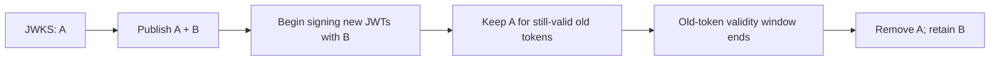

# Kiểm thử token cũ sau thu hồi, đổi quyền hoặc thay khóa

Trong **Spring Security OAuth 2.0/OIDC Resource Server**, access token có thể tiếp tục được gửi tới API sau khi người dùng logout, quyền bị giảm, tenant membership bị thu hồi hoặc Authorization Server (AS) đã chuyển sang signing key mới. Vì vậy, kiểm thử vòng đời token phải trả lời được ba câu hỏi: **token cũ còn được chấp nhận trong điều kiện nào, thay đổi nào khiến nó bị từ chối, và mọi Resource Server instance quan sát thay đổi trong bao lâu?**

Ba sự kiện thường bị gọi chung là “revoke token”, nhưng có phạm vi khác nhau:

1. **Thu hồi token cụ thể:** vô hiệu hóa một access token hoặc token family trước thời điểm hết hạn.
2. **Thay đổi quyền/danh tính:** user mất scope, role, tenant membership hoặc account bị disable; claims trong token đã phát hành có thể vẫn còn nguyên.
3. **Thay signing key:** AS ngừng ký bằng key cũ hoặc gỡ public key cũ khỏi JWKS; thay đổi này có thể ảnh hưởng nhiều tokens đã được ký bằng key đó.

Với **JWT self-contained**, Resource Server thường xác minh chữ ký và claims offline. JWT cũ **không tự biến mất** khỏi mọi API chỉ vì user logout hoặc admin đổi quyền. Với **opaque token**, Resource Server thường hỏi introspection endpoint và AS có thể trả `active=false` sau khi token bị thu hồi. Cache ở AS, API gateway, Resource Server hoặc policy store vẫn có thể tạo độ trễ trước khi mọi nơi quan sát được trạng thái mới.

Bài này trình bày cách thiết kế và kiểm thử các vòng đời đó trong Spring Security, gồm JWT/opaque token, scopes, membership, `jti` denylist, token version, JWKS cache, key rotation bình thường và khẩn cấp, nhiều Resource Server instances, test với fake AS/JWKS và cách phân biệt mock authorization tests với decoder/introspection integration tests.

> **Nguyên tắc:** Token expiry, token revocation, permission freshness và signing-key rotation là những điều kiện khác nhau. Test phải chỉ rõ điều kiện nào được thay đổi, Resource Server nào phải quan sát thay đổi, độ trễ cho phép là bao lâu và kết quả HTTP mong đợi là gì.

## 1. Phân biệt các loại thay đổi trong vòng đời token

| Sự kiện | Thứ gì thay đổi? | JWT cũ có tự bị vô hiệu hóa? | Opaque token có thể bị vô hiệu hóa qua introspection? |
|---|---|---|---|
| Người dùng logout khỏi SPA | Trạng thái phiên/client-side | Không, trừ khi có cơ chế bổ sung | Có thể, nếu AS revoke token và introspection phản ánh |
| Refresh token bị thu hồi | Quyền xin access token mới | Access token cũ không tự mất hiệu lực | Chỉ inactive nếu AS cũng thu hồi access token |
| Access token cụ thể bị revoke | Trạng thái token cụ thể | Không tự động với validation offline | AS thường có thể trả `active=false` |
| User bị disable | Trạng thái account | JWT đã ký vẫn có thể còn hạn | AS có thể trả inactive hoặc API cần policy check |
| Scope/role bị giảm | Quyền hiện hành | Claims cũ trong JWT không đổi | Có thể phản ánh qua introspection theo contract |
| Tenant membership bị revoke | Quan hệ user–tenant | Claim cũ vẫn nằm trong JWT | Có thể phản ánh qua introspection hoặc membership lookup |
| Signing key được rotate bình thường | Khóa ký mới được đưa vào sử dụng | Token cũ vẫn hợp lệ nếu old public key còn trusted | Không ảnh hưởng trực tiếp opaque token thông thường |
| Public key cũ bị gỡ khỏi JWKS | Tập key Resource Server tin cậy | Token ký bằng key cũ bị từ chối sau khi cache cập nhật | Không ảnh hưởng trực tiếp opaque introspection |
| Private signing key bị compromise | Trust vào một key bị phá vỡ | Tokens ký bằng key đó có thể phải bị từ chối | Chỉ ảnh hưởng opaque nếu AS dùng key đó trong cơ chế liên quan |

### 1.1. Expiration không phải revocation

Một JWT:

```json
{
  "iss": "https://login.example.test/realms/shop",
  "sub": "user-123",
  "aud": ["orders-api"],
  "scope": "orders.read",
  "exp": 1900000000,
  "jti": "token-123"
}
```

có thể có chữ ký hợp lệ và `exp` vẫn ở tương lai. Nếu Resource Server chỉ xác minh signature, issuer, audience và timestamps, token vẫn được chấp nhận. User logout khỏi browser hoặc AS đánh dấu refresh token revoked không thay đổi bytes của access token này.

Revocation đòi hỏi một cơ chế mà Resource Server có thể quan sát: introspection, denylist, token-version/status lookup, policy service, key removal (ở phạm vi key) hoặc chờ token hết hạn.

### 1.2. Thay khóa không giống thu hồi một token

Nếu AS rotate từ key A sang key B và vẫn công bố public key A trong JWKS, tokens cũ ký bằng A vẫn xác minh được. Đây là hành vi bình thường để tránh làm hỏng access tokens còn hạn.

Nếu AS gỡ public key A, tất cả JWT cần key A có thể bị từ chối sau khi Resource Server refresh JWKS. Đây là thay đổi **ở cấp key**, có thể ảnh hưởng nhiều users, clients và tokens cùng lúc.

### 1.3. Thay quyền không tự sửa claims đã phát hành

Một JWT có:

```json
{"scope": "orders.read orders.write"}
```

không tự đổi thành:

```json
{"scope": "orders.read"}
```

khi admin xóa quyền write trong database. Claims đã được ký là bất biến. Cần chờ token hết hạn, revoke bằng cơ chế hỗ trợ, kiểm tra permission hiện hành server-side hoặc dùng access token reference/introspection theo contract.

## 2. Xác định mục tiêu kiểm thử trước khi chọn token format

| Tiêu chí | JWT self-contained | Opaque/reference token |
|---|---|---|
| Kiểm tra mỗi request | Thường verify chữ ký/claims cục bộ | Thường gọi introspection hoặc dùng cache |
| Revocation một token cụ thể | Cần cơ chế bổ sung hoặc chờ `exp` | AS có thể đánh dấu inactive |
| Thay đổi scope hiện hành | Claims trong token cũ không đổi | AS có thể trả state/claims mới theo contract |
| Phụ thuộc network AS | Discovery/JWKS và rotation; validation thường offline | Thường phụ thuộc introspection |
| Cache | JWKS/public key; có thể thêm denylist/policy cache | Introspection-result cache |
| Revocation latency | Do TTL, denylist/status lookup hoặc policy freshness | Do AS propagation, introspection cache và RS cache |

Chọn JWT vì throughput hoặc opaque vì revocation là quyết định kiến trúc. Không có token format nào tự giải quyết account disable, membership và object-level authorization.

### 2.1. Viết rõ SLO cho revocation

Thay vì ghi “logout phải revoke ngay”, hãy định nghĩa mục tiêu có thể đo:

```text
Token type: JWT access token
Maximum access-token lifetime: 5 minutes
Permission removal propagation: <= 30 seconds
Emergency signing-key compromise response: <= 2 minutes
Opaque token revocation visibility: <= 5 seconds
```

Các con số trên chỉ là ví dụ minh họa, không phải mặc định Spring Security hay khuyến nghị chung. Tổ chức cần đặt giá trị dựa trên dữ liệu nhạy cảm, tải, khả năng AS và chi phí kiểm tra online.

Một test chỉ có thể kết luận đúng khi biết **độ trễ cho phép**, điểm bắt đầu tính thời gian và cách xác định mọi Resource Server instances đã nhận trạng thái mới.

## 3. JWT sau khi user logout

Access token bearer là credential có thể được dùng bởi bất kỳ bên nào còn giữ token tới khi token hết hạn hoặc policy bổ sung từ chối nó.

Ví dụ:

```text
10:00:00  User nhận access token JWT, exp=10:05:00
10:01:00  User logout khỏi SPA
10:01:05  Attacker vẫn giữ bản sao access token
10:02:00  Attacker gửi token đến Orders API
```

Nếu API chỉ verify chữ ký, issuer, audience, expiration và scope, request lúc 10:02 có thể vẫn thành công. Xóa token khỏi browser storage chỉ ngăn browser đó dùng tiếp; nó không xóa bản sao ở nơi khác.

### 3.1. Logout khỏi client không phải server-side token revocation

Logout có thể bao gồm một hoặc nhiều hành động:

- Xóa access token khỏi memory/storage của client.
- Revoke refresh token hoặc token family tại AS.
- Kết thúc SSO session/cookie tại OP.
- Gọi OAuth token revocation endpoint nếu token type và AS hỗ trợ.
- Thu hồi access token cụ thể.
- Đưa token `jti` vào denylist ở Resource Server.
- Vô hiệu hóa session/account hoặc membership theo policy.

Cần xác định rõ logout flow thực hiện bước nào. Redirect tới OIDC end-session endpoint không tự bảo đảm mọi JWT đã cấp cho mọi APIs lập tức không còn dùng được.

### 3.2. Kiểm thử sau logout với JWT

Nếu thiết kế chỉ dùng JWT offline và không có denylist/status check, kết quả đúng theo thiết kế có thể là:

| Thời điểm | JWT signature/time | Expected |
|---|---|---|
| Trước logout | Hợp lệ | Cho phép nếu đủ scope/object permission |
| Ngay sau logout | Vẫn hợp lệ, chưa hết hạn | Có thể vẫn được chấp nhận |
| Sau khi token hết hạn | Timestamp invalid | Từ chối |
| Token mới sau logout | AS không cấp được token mới nếu session/refresh đã revoke | Không có token mới hợp lệ |

Test này không phải lỗi tự động nếu contract chấp nhận access token còn hạn sau logout. Nếu yêu cầu logout vô hiệu hóa access token ngay, kiến trúc phải có cơ chế để Resource Server nhận biết.

## 4. JWT revocation bằng denylist theo `jti`

Một cách triển khai là mỗi JWT có `jti` (JWT ID) duy nhất và Resource Server kiểm tra denylist trước khi cấp quyền.

Ví dụ claim:

```json
{
  "iss": "https://login.example.test/realms/shop",
  "sub": "user-123",
  "aud": ["orders-api"],
  "jti": "jti-8f1c",
  "exp": 1900000000
}
```

Khi token bị revoke, server lưu định danh phù hợp:

```text
issuer + jti
revoked_until = token.exp
reason = logout / incident / admin_action
```

Nên namespace theo issuer để tránh trùng `jti` giữa các issuers. Không dùng raw bearer token làm key nếu có thể dùng digest/identifier an toàn hơn.

### 4.1. `jti` không tự tạo revocation

Claim `jti` chỉ là identifier. JWT specification không tự tạo registry revoked tokens và Spring Security JWT decoder không tự biết token nào nằm trong denylist.

Ứng dụng cần:

1. Yêu cầu issuer cấp `jti` nếu policy dùng denylist.
2. Xác minh token trước khi tin `jti`.
3. Tra trạng thái revoke bằng nguồn server-side đáng tin.
4. Từ chối token nếu `(iss, jti)` đã bị revoke.
5. Giữ entry ít nhất tới khi token hết hạn cộng khoảng thời gian an toàn cần thiết.
6. Xử lý cache propagation và database outage theo fail-closed policy.

### 4.2. Không đặt blocking database lookup trong JWT validator một cách tùy tiện

`OAuth2TokenValidator<Jwt>` trong Spring Security thường là contract validation đồng bộ. Không nhét JDBC/HTTP blocking call vào validator rồi chạy trên request path, đặc biệt trong WebFlux.

Các lựa chọn kiến trúc:

- Dùng opaque introspection nếu cần online status cho mỗi token.
- Dùng custom authentication manager/provider phù hợp stack để kết hợp decoder với async status lookup.
- Dùng authorization layer/policy check reactive nếu revocation là một phần của permission hiện hành.
- Dùng denylist cache/store có latency và failure policy đã xác định.
- Giữ token lifetime ngắn nếu mức độ rủi ro và UX cho phép.

Với Servlet stack, online lookup cũng có latency/availability cost; cần timeout, cache, connection pooling và fail-closed behavior. Với WebFlux, dùng reactive store/client, không gọi `block()`.

### 4.3. Pseudocode cho token-status check

```text
verifiedJwt = decodeAndValidateSignatureIssuerAudienceTime(token)

status = tokenStatusStore.find(verifiedJwt.iss, verifiedJwt.jti)

if status == REVOKED:
    reject authentication

if status == UNKNOWN and policy requires online confirmation:
    fail closed or use explicitly documented bounded fallback

otherwise:
    continue to scope and object authorization
```

Giá trị UNKNOWN không nên mặc định là ACTIVE nếu policy yêu cầu xác nhận trạng thái revoke. Cần phân biệt “không có record revoked” với “không truy cập được status store”.

## 5. Token version hoặc security stamp

Một cách khác là lưu version/security stamp hiện hành cho user hoặc client.

JWT:

```json
{
  "sub": "user-123",
  "token_version": 7,
  "exp": 1900000000
}
```

Server-side account state:

```text
user-123.token_version = 8
```

Khi token có version 7 nhưng hiện hành là 8, API từ chối theo policy.

### 5.1. Token version giải quyết loại sự kiện nào?

Có thể tăng version khi user logout all sessions, account bị compromise, password/security credentials thay đổi, admin muốn revoke toàn bộ access tokens, user bị disable hoặc membership/permission thay đổi nếu version được thiết kế theo tenant/permission domain.

Version check chỉ có tác dụng khi Resource Server thực sự kiểm tra nó. JWT decoder offline không tự truy vấn account database.

### 5.2. Version toàn user hay theo tenant?

Nếu một user thuộc shop-a và shop-b, tăng version toàn user có thể revoke token ở cả hai tenants. Đôi khi đó là chủ ý; đôi khi cần granular hơn:

```text
user security version:
  (issuer, subject) -> 8

tenant membership version:
  (issuer, subject, tenant) -> 14
```

Token/actor có thể chứa version theo contract, hoặc server-side policy store cung cấp version hiện hành. Đừng đưa quá nhiều mutable permissions vào JWT rồi mong chúng tự cập nhật.

### 5.3. Version lookup cũng có cache window

Nếu Resource Server cache token version 30 giây, quyền revoke có thể tiếp tục tồn tại trong khoảng cache đó. Test phải xác định cache TTL, invalidation event behavior, mất event có được phát hiện không, instance mới có tải version hiện tại không, cache backend down thì cho phép hay từ chối, và version được cập nhật atomically với account/membership change không.

## 6. Opaque token và introspection sau revocation

Với opaque token, Resource Server hỏi AS:

```http
POST /oauth2/introspect HTTP/1.1
Host: login.example.test
Authorization: Basic <RESOURCE_SERVER_CREDENTIALS>
Content-Type: application/x-www-form-urlencoded

token=<OPAQUE_ACCESS_TOKEN>
```

Token còn active:

```json
{
  "active": true,
  "sub": "user-123",
  "scope": "orders.read",
  "aud": ["orders-api"],
  "exp": 1900000000
}
```

Sau khi AS revoke token:

```json
{"active": false}
```

Spring Security opaque-token support dùng introspector để chuyển response active thành principal/Authentication. Token inactive thường dẫn tới Bearer authentication failure (401).

### 6.1. Kiểm thử phải gửi bearer token thật qua filter chain

Một HTTP integration test cần:

1. Cấu hình `ReactiveOpaqueTokenIntrospector` hoặc `OpaqueTokenIntrospector` thật của Spring.
2. Trỏ introspection URI tới fake AS test server.
3. Gửi `Authorization: Bearer test-opaque-token`.
4. Fake AS trả `active=true`.
5. Xác nhận API xử lý request.
6. Thay trạng thái fake AS thành `active=false`.
7. Gửi lại cùng token.
8. Xác nhận introspection được gọi lại theo cache policy và API từ chối.

Không dùng `mockOpaqueToken()` trong test này vì nó đưa Authentication giả lập vào test chain và **bỏ qua introspection HTTP**.

### 6.2. Introspection không bảo đảm immediate revocation nếu có cache

Giả sử:

```text
12:00:00  AS trả active=true
12:00:01  Resource Server cache result trong 60 seconds
12:00:05  Admin revoke token tại AS
12:00:06  Resource Server nhận lại cùng token, cache hit active=true
12:01:01  Cache hết hạn, Resource Server hỏi AS
12:01:02  AS trả active=false
```

Revocation xảy ra ở AS lúc 12:00:05 nhưng API vẫn có thể chấp nhận token tới khi cache entry hết hạn hoặc bị invalidate. Nếu yêu cầu propagation 5 giây, cache TTL 60 giây không đáp ứng.

### 6.3. Không nhầm AS response với cache Resource Server

Có thể có nhiều tầng cache: AS/internal token-state cache, API gateway cache, Resource Server introspection-result cache, distributed application cache và custom principal/authentication cache.

Test chỉ stub AS trả active=false chưa đủ nếu request không chạm AS. Cần quan sát số lần introspection hoặc kiểm soát cache để biết layer nào trả kết quả.

## 7. Thay đổi quyền trong khi token cũ còn hạn

Giả sử user ban đầu có:

```text
SCOPE_orders.read
SCOPE_orders.write
```

Sau đó admin bỏ quyền write:

```text
Current permission:
  orders.read = true
  orders.write = false
```

JWT cũ vẫn có claim:

```json
{"scope": "orders.read orders.write"}
```

Nếu Resource Server chỉ dùng claims trong JWT, token cũ vẫn có authority write tới khi hết hạn. Đây là **permission freshness** problem, không phải chữ ký hay JWKS problem.

### 7.1. Các chiến lược cập nhật quyền

| Chiến lược | Khi nào API thấy thay đổi? | Đánh đổi |
|---|---|---|
| Access token TTL ngắn | Khi token cũ hết hạn và token mới được cấp | Có cửa sổ stale permission bằng TTL còn lại |
| Revoke token + denylist | Khi tất cả RS thấy denylist update | Cần online/distributed status lookup |
| Opaque introspection | Khi AS trả scope/state mới hoặc inactive | Network dependency và cache window |
| Permission lookup server-side | Theo freshness/cache policy của permission store | Thêm I/O cho authorization |
| Tenant membership version | Khi version hiện hành khác claim/cache | Cần quản lý version và propagation |
| Token exchange/new token | Khi client lấy token mới với scopes mới | Không tự vô hiệu hóa token cũ |
| Signing key rotation | Khi gỡ key cũ, ảnh hưởng mọi token ký bằng key | Quá rộng cho một user permission change |

Không dùng **key rotation** để thu hồi quyền của một user thông thường. Key rotation tác động tới tất cả tokens đã ký bằng key đó, không phân biệt user/scope.

### 7.2. Kiểm thử quyền thay đổi

Một bài test nên có hai tokens:

```text
Old token:
  sub=user-123
  scope=orders.read orders.write
  exp=10:05

New token:
  sub=user-123
  scope=orders.read
  exp=10:10
```

Kiểm tra old token có còn write được theo chiến lược đã chọn, new token có read được không, new token có bị từ chối khi POST write không, permission store có chặn old token sau khi thu hồi write không, và mọi Resource Server instances có quan sát cùng version/policy không.

Không viết test giả định old JWT tự mất orders.write ngay khi AS phát hành new token. Hai tokens là hai credentials độc lập.

### 7.3. Permission removal và token issuance là hai assertions riêng

Khi admin bỏ quyền write, việc AS cấp token mới chỉ có read là một assertion. Việc **token cũ** không còn được dùng write là assertion khác. Một test chỉ xin token mới rồi thấy POST 403 chưa chứng minh token cũ đã bị vô hiệu hóa.

## 8. Membership/tenant change và quyền trên đối tượng

Thay đổi quyền có thể là user bị xóa khỏi tenant, tenant bị suspend, user chuyển từ admin xuống read-only, user bị gỡ khỏi project/branch, owner của một record thay đổi, share/ACL bị thu hồi hoặc service account bị giới hạn tenant.

JWT có tenant_id=shop-a và scope=orders.read, nhưng quyền đọc order cụ thể vẫn phụ thuộc membership/ACL hiện hành.

### 8.1. Token claims không thay database authorization

Một query có thể ràng buộc:

```sql
SELECT *
FROM orders
WHERE id = :orderId
  AND tenant_id = :authorizedTenant
  AND owner_subject = :verifiedSubject;
```

Nếu user mất membership, tenant resolver/policy phải từ chối trước query hoặc query phải kết hợp current membership/ACL. Không lấy tenant từ URL rồi dùng nó làm query parameter mà không kiểm tra.

### 8.2. Kiểm thử quyền cũ sau khi membership bị revoke

Fixtures:

```text
Before:
  user-123 is ACTIVE member of shop-a
  token has orders.read
  order-1 belongs to shop-a

Change:
  membership.status = REVOKED

After:
  same JWT is still unexpired
  request GET /api/tenants/shop-a/orders/order-1
```

Expected behavior tùy contract:

- Nếu membership được kiểm tra online mỗi request hoặc cache trong 5 giây, request sau propagation window phải bị từ chối.
- Nếu membership chỉ được snapshot vào JWT, token cũ có thể còn quyền tới expiry; điều đó phải được ghi rõ trong threat model.
- Nếu AS introspection cập nhật claims, phải test response mới và cache của RS.
- Nếu tenant version thay đổi, token version cũ phải fail theo policy.

### 8.3. 403 hay 404?

Một token hợp lệ nhưng user mất membership thường là authorization failure (403). Nếu API muốn tránh tiết lộ order có tồn tại trong tenant khác, có thể trả 404 cho object không visible. Giữ semantics nhất quán giữa detail, search, count và export.

## 9. Signing-key rotation bình thường

AS dùng private signing key để ký JWT. Resource Server lấy public keys từ trusted JWKS URI. Rotation bình thường cần overlap giữa key cũ và key mới.

```text
T0:
  JWKS = [key-A]
  AS signs with key-A

T1:
  JWKS = [key-A, key-B]
  AS still signs with key-A

T2:
  JWKS = [key-A, key-B]
  AS starts signing new tokens with key-B

T3:
  Old key-A tokens are still within maximum lifetime
  JWKS keeps key-A and key-B

T4:
  All key-A tokens have expired + clock/cache safety window
  JWKS removes key-A
```



### 9.1. Vì sao phải publish key mới trước khi ký bằng nó?

Resource Server có thể cache JWKS. Nếu AS bắt đầu ký bằng key B trước khi public key B được công bố/được fetch, API không tìm được key phù hợp và trả authentication failure.

Quy trình an toàn:

1. Công bố public key B.
2. Cho Resource Servers có cơ hội refresh JWKS.
3. Bắt đầu ký bằng B.
4. Giữ A trong JWKS đủ lâu để xác minh tokens cũ còn hạn.
5. Chỉ gỡ A sau khi cửa sổ token cũ kết thúc.

Thời gian overlap phải xét maximum access-token lifetime, clock skew, propagation và cache behavior.

### 9.2. Token ký bằng key cũ vẫn hợp lệ khi key cũ còn trong JWKS

Sau khi AS bắt đầu ký bằng B, token cũ có kid=key-A vẫn có thể xác minh nếu key A vẫn được công bố trong trusted JWKS, Resource Server truy cập/cache được public key A, signature và claims khác đều hợp lệ, và token chưa hết hạn hoặc bị revoke theo cơ chế riêng.

Đây là **expected behavior của rotation bình thường**, không phải decoder lỗi khi nó chấp nhận token cũ.

### 9.3. Gỡ key cũ không nhất thiết có hiệu lực tức thì

Resource Server có thể đang cache JWKS chứa A. Khi AS gỡ A, một instance vẫn có thể dùng cached key A tới khi cache refresh/expire hoặc cơ chế refresh khác được kích hoạt.

Vì vậy “JWKS không còn A” và “mọi API instance lập tức từ chối token ký bằng A” là hai điều khác nhau. Phải kiểm tra cache TTL, refresh triggers, gateway/CDN cache và instance rollout.

## 10. Emergency key compromise khác normal rotation

Nếu private signing key A bị lộ, AS/security team có thể cần loại bỏ trust vào A ngay cả khi tokens ký bằng A chưa hết hạn.

Đây là **incident response** có tác động rộng:

- Tất cả JWT ký bằng A có thể bị từ chối, kể cả users không liên quan.
- AS cần ngừng ký bằng A và bảo vệ/rotate private key.
- Public key A cần được gỡ khỏi trusted JWKS.
- Resource Server JWKS caches phải được refresh/invalidate theo cơ chế hỗ trợ.
- CDN/proxy caches cần được xét.
- Client có thể cần xin token mới ký bằng B.
- Monitoring phải theo dõi tỷ lệ 401 và key lookup failures.

### 10.1. Không dùng normal overlap trong sự cố compromise

Trong rotation bình thường, giữ key cũ giúp token cũ tiếp tục hoạt động. Trong key compromise, giữ public key A trong JWKS có thể tiếp tục cho phép attacker dùng token giả ký bằng private key bị lộ.

Chính sách incident có thể yêu cầu **gỡ A khẩn cấp**, chấp nhận invalidate tất cả tokens dùng A. Đây là quyết định theo threat model/incident severity, không phải mặc định mỗi lần rotate key.

### 10.2. JWKS cache có thể tạo revocation window

Nếu Resource Server giữ public key A trong cache sau khi AS gỡ nó, tokens ký bằng A có thể vẫn được chấp nhận. Muốn emergency response nhanh, cần biết cache TTL/max-age, có hỗ trợ refresh/invalidate ngay không, CDN/proxy cache bao lâu và bao lâu để mọi instance áp dụng key set mới.

Không khẳng định một API Spring Security cụ thể luôn tự refresh tức thì khi JWKS thay đổi. Hành vi phụ thuộc Nimbus/Spring Security version, cache configuration và HTTP caching.

### 10.3. Key compromise test phải kiểm tra cả token giả

Một test quan trọng:

1. Tạo key A và public JWK A.
2. Ký token test bằng private key A.
3. Resource Server chấp nhận token trước incident.
4. Gỡ public JWK A khỏi JWKS, công bố B.
5. Ép/đợi cache refresh theo chiến lược đã cấu hình.
6. Gửi lại token cũ ký bằng A.
7. Xác nhận token bị từ chối.
8. Tạo token ký bằng B và xác nhận token mới hoạt động.
9. Xác nhận không có fallback sang parse payload hoặc chấp nhận key tùy ý.

Nếu test chỉ xóa key khỏi fake JWKS nhưng decoder còn cached A, kết quả ban đầu có thể vẫn thành công. Đó chính là điều test cần quan sát và định lượng.

## 11. Spring Security JWT decoder và validators

Một decoder Servlet điển hình:

```java
@Bean
JwtDecoder jwtDecoder() {
    String issuer =
        "https://login.example.test/realms/shop";
    String jwks =
        "https://login.example.test/realms/shop/protocol/openid-connect/certs";

    NimbusJwtDecoder decoder =
        NimbusJwtDecoder.withJwkSetUri(jwks)
            .jwsAlgorithm(SignatureAlgorithm.RS256)
            .build();

    OAuth2TokenValidator<Jwt> defaults =
        JwtValidators.createDefaultWithIssuer(issuer);

    OAuth2TokenValidator<Jwt> audience = jwt ->
        jwt.getAudience().contains("orders-api")
            ? OAuth2TokenValidatorResult.success()
            : OAuth2TokenValidatorResult.failure(
                new OAuth2Error(
                    "invalid_token",
                    "Wrong audience",
                    null
                )
            );

    decoder.setJwtValidator(
        new DelegatingOAuth2TokenValidator<>(
            defaults, audience
        )
    );

    return decoder;
}
```

Imports:

```java
import org.springframework.context.annotation.Bean;
import org.springframework.security.oauth2.core.DelegatingOAuth2TokenValidator;
import org.springframework.security.oauth2.core.OAuth2Error;
import org.springframework.security.oauth2.core.OAuth2TokenValidator;
import org.springframework.security.oauth2.core.OAuth2TokenValidatorResult;
import org.springframework.security.oauth2.jose.jws.SignatureAlgorithm;
import org.springframework.security.oauth2.jwt.Jwt;
import org.springframework.security.oauth2.jwt.JwtDecoder;
import org.springframework.security.oauth2.jwt.JwtValidators;
import org.springframework.security.oauth2.jwt.NimbusJwtDecoder;
```

Đây là ví dụ Servlet. WebFlux sử dụng ReactiveJwtDecoder/NimbusReactiveJwtDecoder với API tương ứng.

Các validators issuer/audience/time không thay key rotation. Decoder lấy public key từ JWKS và xác minh signature; claims validators kiểm tra token claims. Khi key bị gỡ khỏi JWKS và cache cập nhật, signature verification của tokens dùng key đó phải thất bại.

### 11.1. Đừng hardcode một public key duy nhất nếu AS có rotation

Nếu application tạo decoder từ public key cố định và không có quy trình cập nhật key, AS rotate có thể làm toàn bộ tokens mới bị 401. Ngược lại, chấp nhận một key tùy ý để tránh 401 sẽ phá trust boundary.

### 11.2. Key algorithm phải theo hợp đồng

Nếu contract chỉ chấp nhận RS256, cấu hình allowlist phù hợp. Không tự động cho phép mọi thuật toán vì key mới dùng algorithm khác. Thay đổi algorithm cần phối hợp AS và Resource Server, test tương thích và rollout có overlap an toàn.

## 12. Spring Security opaque introspection và test revocation

Một cấu hình Servlet:

```yaml
spring:
  security:
    oauth2:
      resourceserver:
        opaquetoken:
          introspection-uri: https://login.example.test/oauth2/introspect
          client-id: orders-api
          client-secret: §{INTROSPECTION_CLIENT_SECRET}
```

Filter chain:

```java
.oauth2ResourceServer(oauth2 ->
    oauth2.opaqueToken(Customizer.withDefaults())
)
```

Resource Server gọi introspection theo implementation/configuration. Nếu AS đánh dấu token inactive, authentication thất bại.

### 12.1. Fake introspection endpoint

Trong integration test, fake server có thể trả lần đầu:

```json
{
  "active": true,
  "sub": "user-123",
  "scope": "orders.read",
  "aud": ["orders-api"]
}
```

Sau đó cùng token:

```json
{"active": false}
```

Test cần kiểm tra request thứ hai **thực sự hỏi lại AS** nếu kiến trúc không cache, hoặc chỉ thấy inactive sau cache expiry/invalidation nếu có cache.

### 12.2. Phân biệt inactive với AS outage

- active=false: AS đã trả lời và xác nhận token inactive.
- Timeout/DNS/TLS/5xx: Resource Server không thể xác minh trạng thái.
- 401 từ introspection endpoint: có thể Resource Server credentials sai hoặc AS không chấp nhận client.
- Malformed JSON: contract/protocol error.

Tất cả trường hợp không xác minh được đều phải **fail closed**, nhưng metrics/runbook nên phân biệt để vận hành không hiểu nhầm mọi lỗi là token revoked.

### 12.3. Reactive opaque token

Với WebFlux, dùng ReactiveOpaqueTokenIntrospector và implementation reactive phù hợp. Test bằng WebTestClient với bearer header thật và fake AS. Không dùng blocking introspection client trong event-loop.

## 13. Kiểm thử permission change với token cũ

Một test theo thời gian:

```text
T0:
  user has orders.read + orders.write
  issue old JWT

T1:
  admin removes orders.write

T2:
  issue new JWT with orders.read only

T3:
  send old JWT to POST /api/orders

T4:
  send new JWT to POST /api/orders
```

Expected phụ thuộc chiến lược:

| Strategy | Old JWT POST | New JWT POST |
|---|---|---|
| JWT snapshot + short TTL | Có thể vẫn success tới expiry | 403 |
| JWT + current permission lookup | 403 sau khi permission store cập nhật | 403 |
| JWT + token version increment | Authentication denied theo contract | 403 nếu token mới vẫn không có write |
| Opaque introspection fresh | 403 nếu active với read-only authorities; hoặc 401 nếu AS revoke token | 403 |
| Opaque introspection cached | Có thể còn write tới cache expiry | Theo response/cache của token mới |

### 13.1. Test current permission store

Nếu authorization phụ thuộc DB, dùng test transaction hoặc fake policy service để cấp quyền write, xác thực user/token, gọi POST thành công, thu hồi quyền trong store, gọi lại với cùng token, xác nhận từ chối trong propagation window và kiểm tra store outage không vô tình cho phép write.

Không chỉ mock Authentication đã có SCOPE_orders.write rồi mong Spring Security tự biết database đã đổi.

### 13.2. Membership/tenant change

Một user có thể mất quyền shop-a nhưng vẫn còn quyền shop-b. Nếu policy dùng token version toàn user, thay đổi có thể revoke quá rộng. Test cần xác nhận đúng granularity:

| Change | Token/actor | Expected |
|---|---|---|
| Disable account | user-123 ở mọi tenants | Từ chối protected operations |
| Revoke shop-a membership | user-123/shop-a | Từ chối shop-a |
| Revoke shop-a membership | user-123/shop-b | Có thể vẫn cho phép nếu shop-b membership còn active |
| Remove orders.write ở shop-a | user-123/shop-a write | Từ chối write; read có thể còn |
| Revoke one token jti | token-1 | Từ chối token-1; token-2 cùng user có thể còn |

## 14. Kiểm thử JWT thật: đừng nhầm với mockJwt

Spring Security Test hỗ trợ:

```java
mockMvc.perform(get("/api/orders")
    .with(jwt().authorities(
        new SimpleGrantedAuthority("SCOPE_orders.read")
    )))
    .andExpect(status().isOk());
```

Hoặc WebFlux:

```java
webTestClient
    .mutateWith(mockJwt().authorities(
        new SimpleGrantedAuthority("SCOPE_orders.read")
    ))
    .get()
    .uri("/api/orders")
    .exchange()
    .expectStatus().isOk();
```

Các helpers này hữu ích để test **authorization** với Authentication giả lập. Chúng thường bỏ qua decoder signature/JWKS validation.

**Không thể dùng mockJwt để chứng minh** token cũ bị revoke, JWT signature sai, JWKS key A đã bị gỡ và cache đã refresh, kid mới được tải, audience/issuer validator chạy đúng hoặc token ký bằng private key compromised bị từ chối.

Để kiểm tra những điều đó, phải gửi **JWT compact được ký thật** qua decoder/filter chain đang dùng.

### 14.1. Test decoder trực tiếp

Một test decoder nên tạo RSA/EC test key pair riêng, fake JWKS endpoint trả public JWK, JWT được ký bằng test private key, claims issuer/audience/exp có kiểm soát và các tokens dùng key A/key B. Sau đó gọi decoder.decode(token) hoặc gửi bearer header tới API. Token signature/claims thực được xử lý bởi decoder thật.

### 14.2. Pseudocode test sau khi old key bị gỡ

```java
@Test
void rejectsOldTokenAfterOldKeyIsRemovedAndCacheRefreshed() {
    String oldToken = signedJwt(
        oldPrivateKey,
        "key-A",
        Map.of(
            "iss", ISSUER,
            "aud", List.of("orders-api"),
            "sub", "user-123",
            "exp", futureExpiration()
        )
    );

    jwksStub.publish(oldPublicJwk);
    assertThat(decoder.decode(oldToken)).isNotNull();

    jwksStub.replaceKeys(newPublicJwk);
    expireOrRefreshJwksCacheForTest();

    assertThatThrownBy(() -> decoder.decode(oldToken))
        .isInstanceOf(JwtException.class);
}
```

Đây là pseudocode mô tả test strategy; jwksStub, expireOrRefreshJwksCacheForTest và signedJwt là test helpers cần triển khai theo HTTP stub và decoder version. Không có API chung expireOrRefreshJwksCacheForTest của Spring Security; test phải điều khiển cache thực tế bằng cấu hình/test server hoặc khởi tạo decoder mới nếu mục tiêu chỉ là behavior sau refresh.

### 14.3. Test token hết hạn và token bị revoke là hai tests khác nhau

JWT hết hạn bị từ chối bởi timestamp validator. JWT bị revoke nhưng chưa hết hạn chỉ bị từ chối nếu có denylist/status/policy hoặc key-level revocation. Đừng dùng expired token để tuyên bố revocation mechanism hoạt động.

## 15. Kiểm thử JWKS rotation với fake server

Một fake JWKS server có thể thay đổi response theo test phase.

**Phase 1 — Chỉ key A**

```json
{"keys": [{"kid": "key-A", "kty": "RSA", "...": "..."}]}
```

- Token A được chấp nhận.
- Token B bị từ chối khi key B chưa được công bố.

**Phase 2 — Publish A và B**

```json
{"keys": [
  {"kid": "key-A", "kty": "RSA", "...": "..."},
  {"kid": "key-B", "kty": "RSA", "...": "..."}
]}
```

- Token A còn hạn vẫn được chấp nhận.
- Token B được chấp nhận sau khi decoder nhận key B.
- AS bắt đầu ký mới bằng B.

**Phase 3 — Remove A sau overlap**

```json
{"keys": [{"kid": "key-B", "kty": "RSA", "...": "..."}]}
```

- Token B tiếp tục được chấp nhận.
- Token A bị từ chối sau khi decoder refresh cache.
- Test ghi nhận khoảng thời gian từ khi fake JWKS đổi tới khi các decoder instances quan sát thay đổi.

### 15.1. Điều khiển cache trong test

Có thể dùng fake JWKS server có response headers/cache behavior xác định, cấu hình HTTP/JWK cache theo API của dependency version, tạo decoder riêng cho mỗi phase nếu chỉ kiểm tra key-set semantics, dùng test hook để chờ/kích hoạt refresh nếu thư viện hỗ trợ và kiểm tra số lần GET JWKS.

Tránh Thread.sleep tùy tiện; dùng polling có deadline hoặc test clock khi phù hợp.

Nếu dùng decoder mới cho Phase 3, test chứng minh “decoder mới không chấp nhận key đã gỡ”, nhưng **không chứng minh cache của decoder đang chạy đã refresh**. Cần test riêng cho cache propagation.

### 15.2. Kiểm thử nhiều Resource Server instances

Một hệ thống có thể có:

```text
orders-api-1 -> JWKS cache A
orders-api-2 -> JWKS cache B
orders-api-3 -> JWKS cache C
gateway/CDN -> metadata/JWKS cache D
```

Sau key removal, một instance có thể vẫn tin A trong khi instance khác đã refresh. Test/observability nên kiểm tra nhiều instances hoặc nhiều decoder instances có cache lifecycle độc lập.

### 15.3. Không ép production cache TTL quá thấp chỉ để test

Test có thể dùng cache TTL ngắn trong profile riêng. Không chỉnh production cache settings để unit tests chạy nhanh; production TTL phải dựa trên rotation/revocation SLO và capacity.

## 16. Kiểm thử opaque token revocation với fake introspection server

Fake AS có thể giữ trạng thái:

```text
token-1 -> active=true
token-2 -> active=false
```

Khi test revocation:

1. Gửi token-1 qua WebTestClient/MockMvc với bearer header thật.
2. Fake AS trả active=true.
3. Xác nhận endpoint success nếu scope/tenant/object permission đạt.
4. Đổi token-1 sang active=false ở fake AS.
5. Gửi lại cùng token-1.
6. Xác nhận API từ chối sau khi cache policy cho phép nhìn thấy thay đổi.
7. Xác nhận fake server nhận số lần introspection đúng kỳ vọng.

Response active:

```json
{
  "active": true,
  "sub": "user-123",
  "scope": "orders.read",
  "aud": ["orders-api"]
}
```

Response revoked:

```json
{"active": false}
```

### 16.1. Không dùng mockOpaqueToken cho integration introspection test

Ví dụ:

```java
webTestClient
    .mutateWith(mockOpaqueToken())
    .get()
    .uri("/api/orders")
    .exchange();
```

được dùng cho authorization test; nó không buộc ứng dụng gửi HTTP introspection request tới AS. Để test revocation thực, gửi Authorization Bearer header và để Spring Resource Server dùng introspector thật.

### 16.2. Kiểm tra introspection client authentication

Fake AS nên xác nhận Resource Server gọi endpoint bằng authentication method đã thỏa thuận, chẳng hạn client_secret_basic, private key JWT hoặc mTLS. Không log secret/token; test chỉ assert method/identity đúng.

### 16.3. Phân biệt token inactive với introspection client invalid

Nếu Resource Server gửi sai client credentials, AS có thể trả 401/403 ở lời gọi introspection. Đây là integration/configuration failure, không có nghĩa end-user token bị revoke.

## 17. Kiểm thử cache và propagation

Một test revocation thực tế cần đo:

```text
t_revoke:
  thời điểm trạng thái bị thu hồi ở nguồn authoritative

t_seen:
  thời điểm Resource Server cuối cùng từ chối token cũ

propagation_delay = t_seen - t_revoke
```

Nếu có nhiều instances, t_seen nên là thời điểm **instance chậm nhất** trong tập instances cần bảo vệ đã quan sát thay đổi.

Quy trình:

1. Tất cả instances xác thực token cũ thành công.
2. Revoke token hoặc gỡ key tại nguồn.
3. Ghi timestamp của thay đổi.
4. Gửi cùng token tới từng instance.
5. Ghi timestamp instance đầu tiên và cuối cùng từ chối.
6. So với SLO.
7. Xác nhận cache invalidation event bị mất vẫn có TTL fallback.
8. Xác nhận instance mới khởi động không nạp stale state.

Một unit test cache đơn lẻ không mô phỏng Redis pub/sub, CDN, gateway hay nhiều pods. Nó hữu ích để kiểm tra TTL, nhưng kết luận distributed propagation cần integration/load tests trong môi trường gần production.

## 18. Outage và fail-closed policy

| Failure | Điều Resource Server biết | Xử lý an toàn |
|---|---|---|
| AS trả active=false | Token inactive | Từ chối |
| Introspection timeout | Không xác minh được | Không cấp Authentication |
| JWKS timeout nhưng key đã cache | Có thể verify bằng trusted cached key | Theo cache/trust policy; claims vẫn phải valid |
| JWKS timeout và không có key | Không xác minh được signature | Từ chối |
| Denylist store timeout | Không biết token có bị revoke | Fail closed nếu lookup bắt buộc; hoặc bounded fallback được phê duyệt |
| Permission service timeout | Không biết quyền hiện hành | Từ chối hoặc policy degradation đã định nghĩa |
| Cache invalidation event mất | Instance có thể giữ state cũ | TTL bound, reconciliation/refresh |
| Metadata đổi issuer bất ngờ | Trust configuration mismatch | Không tự tin issuer mới |

**Fail closed** nghĩa là không coi credential chưa xác minh là hợp lệ. Nó không bắt buộc mọi lỗi hạ tầng phải trả cùng HTTP status; status và observability phải phân biệt lỗi token với lỗi dependency.

### 18.1. Degraded mode cần có giới hạn

Một số hệ thống có thể tiếp tục dùng cached positive introspection khi AS tạm down. Đây là quyết định đánh đổi availability/security. Nếu có, phải quy định cache entry tối đa bao lâu được dùng offline, có tôn trọng token exp không, token đã revoke có thể được chấp nhận thêm bao lâu, APIs nào không được phép degraded mode và khi hết TTL thì behavior là gì.

Không tự thêm fallback trong exception handler để biến mọi AS error thành authenticated success.

## 19. Token revocation endpoint và OIDC logout

OAuth token revocation endpoint theo RFC 7009 cho phép client yêu cầu AS thu hồi token theo cơ chế được hỗ trợ. Cần phân biệt:

- Client gửi token tới revocation endpoint theo authentication/authorization contract.
- AS có thể thu hồi token và các token liên quan theo policy.
- Refresh token revocation ngăn việc xin access tokens mới qua refresh flow.
- Access token cũ có thể vẫn được Resource Server chấp nhận nếu JWT offline và không có status lookup.
- AS có thể hỗ trợ cascade revocation giữa refresh/access token family, nhưng behavior phải được xác nhận theo provider contract.

Test revocation endpoint trả 200 OK chỉ chứng minh AS chấp nhận request theo protocol. Cần test tiếp **Resource Server thực sự từ chối token cũ** theo kiến trúc đã chọn. Với JWT offline, 200 từ revocation endpoint không tự chứng minh API đã biết token bị revoke.

RP-Initiated Logout và Back-Channel Logout liên quan đến kết thúc phiên OIDC tại client/RP. Chúng không tự biến mọi OAuth access token thành revoked tại mọi Resource Server. Nếu kiến trúc muốn logout event vô hiệu hóa API access, cần event contract, mapping giữa session/user/token family, shared status/version service hoặc denylist, delivery/retry/idempotency và test propagation.

## 20. Key rotation và access-token lifetime phải phối hợp

Một công thức lập kế hoạch overlap:

```text
old-key retention window
  >= maximum lifetime of tokens signed by old key
   + allowed clock skew
   + propagation/cache safety margin
```

Ví dụ minh họa:

```text
Maximum access-token lifetime: 10 minutes
Allowed clock skew:             1 minute
JWKS/cache propagation margin:  2 minutes

Old key retention after last old-key token issuance:
  at least 13 minutes, plus operational safety as required
```

Đây là phép tính sơ bộ, không thay test thực tế. Nếu AS vẫn có thể phát token bằng key A sau thời điểm bắt đầu tính retention, phải tính từ **token cuối cùng ký bằng A**, không phải thời điểm bắt đầu rotate.

### 20.1. Đừng gỡ key dựa trên token đầu tiên ký bằng key mới

Có thể nhiều AS nodes chưa đổi signer đồng thời. Cần xác nhận không còn node nào ký bằng key cũ và biết thời điểm token cuối cùng dùng key A được cấp.

### 20.2. Emergency removal là ngoại lệ

Khi key compromise, không giữ key theo normal retention. Cần incident decision rõ: gỡ key ngay, invalidate caches, chấp nhận 401 diện rộng, issue tokens mới bằng key an toàn và xử lý downstream clients.

## 21. Cache và HTTP infrastructure

JWKS/metadata có thể đi qua:

```text
Authorization Server
  -> reverse proxy
  -> CDN
  -> Resource Server HTTP client
  -> Nimbus/JWK cache
```

Một Cache-Control max-age ở tầng HTTP có thể ảnh hưởng khi Resource Server thấy key set mới. Custom proxy/cache có thể kéo dài stale data nếu cấu hình sai.

Fake JWKS server nên thử Cache-Control, ETag/conditional requests nếu client sử dụng, 304 response, stale response từ proxy, network timeout trong refresh và key mới chưa xuất hiện/sau đó xuất hiện. Không giả định decoder luôn tôn trọng mọi HTTP cache header giống browser; kiểm tra behavior của Nimbus/Spring Security version và HTTP client đang dùng.

Không cache Authentication hoặc introspection principal lâu hơn token expiry/revocation SLA. Nếu có cache, key/TTL/invalidation phải tính theo token, issuer, client, tenant và permission freshness cần thiết.

## 22. Audit và observability cho vòng đời token

Một log an toàn có thể ghi:

```text
request_id=req-123
issuer_alias=shop
subject_ref=user-123
token_id_hash=sha256:...
token_status=REVOKED
authn_decision=DENY
reason=TOKEN_STATUS_REVOKED
resource=orders-api
instance=orders-api-2
```

Không log raw bearer token, refresh token, client secret hoặc private JWK.

Metrics nên phân biệt JWT signature validation failures, unknown kid/JWKS refresh errors, issuer/audience/timestamp failures, opaque active=false, introspection HTTP timeouts/5xx/invalid client, denylist hits, token-version mismatch, permission/membership denial, 401 vs 403, cache hit/miss/stale decisions, revocation propagation delay và key rotation old/new key acceptance counts.

Không dùng raw token string hoặc raw jti làm metric label nếu nó tạo cardinality lớn hoặc lộ dữ liệu.

## 23. Test matrix tổng hợp

| Test | Token/state trước | Thay đổi | Expected |
|---|---|---|---|
| JWT logout không có revocation | JWT valid, unexpired | Xóa token khỏi browser | Token vẫn có thể được API chấp nhận |
| JWT logout với jti denylist | JWT valid, jti chưa revoke | Add (iss,jti) vào denylist | Token cũ bị từ chối sau propagation |
| Opaque revoke | active=true | AS đổi thành active=false | Cùng token bị từ chối sau introspection/cache window |
| Refresh token revoked | Access JWT còn hạn | Revoke refresh token | Không cấp token mới; access token cũ có thể còn hạn |
| Permission removed, JWT snapshot | Old token có read+write | Remove write trong DB | Old token còn write tới expiry nếu không có online check |
| Permission removed, current policy | Old token có read+write | Permission store bỏ write | Old token POST bị 403 sau propagation |
| Tenant membership revoked | JWT tenant claim cũ | Membership inactive | Tenant request bị từ chối theo current policy |
| Normal key rotation | Token A ký key A | Publish B, sign new by B, keep A | A và B hợp lệ trong overlap |
| Remove old key | Token A còn hạn | Remove A và refresh JWKS | A bị từ chối sau cache refresh; B vẫn hợp lệ |
| Emergency key compromise | Tokens signed A | Revoke A khẩn cấp | A bị từ chối sau invalidation; B được chấp nhận |
| Unknown kid | JWT kid không có trong trusted JWKS | JWKS không cung cấp key | Fail closed |
| JWKS outage | Token cần key chưa cache | Endpoint timeout | Không xác minh được thì từ chối |
| Introspection outage | Opaque token | AS timeout | Không cấp Authentication |
| Stale cache | Cached positive | Source revoke | Đo stale window và giới hạn SLO |
| Two instances | Both accept old token | Revoke/rotate | Cả hai từ chối trong propagation SLA |
| Cross-tenant | Actor shop-a | Request shop-b | Không truy vấn/trả data shop-b |

## 24. Fixture strategy: giữ token cũ và mới có kiểm soát

Một test fixture hữu ích nên tạo tokens theo thời gian và key:

```text
Token A:
  kid = key-A
  jti = jti-A
  sub = user-123
  aud = orders-api
  scope = orders.read orders.write
  exp = T0 + 5 minutes

Token B:
  kid = key-B
  jti = jti-B
  sub = user-123
  aud = orders-api
  scope = orders.read
  exp = T1 + 5 minutes
```

Giữ nguyên token A qua các giai đoạn test, không tạo token A mới mỗi lần. Nếu tạo token mới sau mỗi change, test không kiểm tra được **old token behavior**.

Test tokens nên được ký bằng private test key không dùng production. Không commit access token/refresh token thật, client secret hoặc private signing key của AS.

Dùng clock abstraction/test clock nếu component hỗ trợ, hoặc tạo JWT có expiration tương đối với thời điểm test. Tránh hardcode exp đã ở quá khứ khi test chạy trong tương lai. Tách case token valid, expired, future nbf, biên clock skew và vừa qua expiry. Không dùng Thread.sleep để đợi token hết hạn nếu có thể điều khiển clock/fixtures.

## 25. Test bằng MockMvc với signed JWT thực

Đối với Servlet Resource Server, integration test có thể khởi tạo ứng dụng với JwtDecoder thật trỏ tới fake JWKS server rồi gửi:

```java
mockMvc.perform(get("/api/orders")
        .header(
            HttpHeaders.AUTHORIZATION,
            "Bearer " + signedOldToken
        ))
    .andExpect(status().isOk());
```

Sau khi revoke jti hoặc thay đổi policy, gửi **cùng signedOldToken** lần nữa và kiểm tra kết quả.

Nếu dùng MockMvc với jwt() request post-processor:

```java
mockMvc.perform(get("/api/orders")
        .with(jwt()))
```

thì Spring Security Test đã tạo Authentication giả lập; decoder không cần xác minh token compact. Dùng jwt() cho authorization unit/HTTP tests, dùng real bearer header cho decoder integration tests.

### 25.1. Ví dụ token-status check

Một application có thể tách kiểm tra status thành service:

```java
public interface RevokedTokenStore {
    boolean isRevoked(String issuer, String jti);
}
```

Trong authorization/use-case layer:

```java
public OrderDto readOrder(
        Jwt jwt,
        UUID orderId) {

    String issuer = jwt.getIssuer().toString();
    String jti = jwt.getId();

    if (jti == null || revokedTokenStore.isRevoked(issuer, jti)) {
        throw new AccessDeniedException("Token revoked");
    }

    return orderService.readVisibleOrder(orderId, jwt);
}
```

Đây là ví dụ Servlet/blocking service để minh họa policy; RevokedTokenStore có thể thực thi DB I/O và cần thiết kế timeout/cache. Không bê nguyên synchronous lookup vào WebFlux event loop. Trong implementation thực tế, authentication failure nên được xử lý ở đúng security boundary và status mapping theo contract, không chỉ throw tùy ý từ controller.

## 26. Test WebFlux với JWT/opaque token

WebFlux dùng ReactiveJwtDecoder cho JWT, ReactiveOpaqueTokenIntrospector cho opaque token, SecurityWebFilterChain/ServerHttpSecurity, WebTestClient cho HTTP tests và mockJwt/mockOpaqueToken cho Authentication giả lập trong test authorization.

### 26.1. Test JWT thật qua WebTestClient

```java
webTestClient.get()
    .uri("/api/orders")
    .headers(headers ->
        headers.setBearerAuth(signedOldToken))
    .exchange()
    .expectStatus().isOk();
```

Cấu hình test phải dùng decoder thật và fake JWKS endpoint. Không gọi mutateWith(mockJwt()) trong test này.

### 26.2. Test opaque thật qua WebTestClient

```java
webTestClient.get()
    .uri("/api/orders")
    .headers(headers ->
        headers.setBearerAuth("opaque-token-1"))
    .exchange()
    .expectStatus().isOk();
```

Cấu hình introspector thật trỏ tới fake AS. Khi fake AS đổi active=false, gửi lại token giống hệt và xác nhận request bị từ chối theo cache policy.

### 26.3. Test helpers đúng mục đích

mockJwt và mockOpaqueToken rất tốt để kiểm tra route scope, principal injection, tenant/object authorization, reactive security context và service calls.

Nhưng chúng không kiểm tra revocation tại AS, JWK refresh, signature verification hoặc cache behavior.

## 27. 401, 403 và lỗi hạ tầng

| Tình huống | HTTP thường gặp | Ý nghĩa |
|---|---|---|
| Không có bearer token tại endpoint protected | 401 | Chưa xác thực |
| JWT signature/issuer/audience/time invalid | 401 | Token không được chấp nhận |
| JWT bị denylist | 401 invalid_token theo Bearer semantics | Credential bị thu hồi |
| Opaque token introspection active=false | 401 invalid_token | AS xác nhận token inactive |
| Token hợp lệ nhưng thiếu scope | 403 insufficient_scope hoặc response 403 phù hợp | Đã xác thực nhưng thiếu quyền |
| Token hợp lệ nhưng tenant membership bị revoke | 403 hoặc 404 theo policy | Không có quyền trong tenant |
| Order không visible | 404 hoặc 403 theo anti-enumeration policy | Không tiết lộ object |
| JWKS/introspection network failure | Fail closed; status phụ thuộc exception handling | Không xác minh được credential |
| Introspection client credentials sai | Lỗi hạ tầng tích hợp | AS call không được xác thực |

Một số exception handlers/custom entry points có thể ánh xạ lỗi hạ tầng khác nhau. Điều cần giữ là **không cho request tiếp tục như authenticated** khi không thể xác minh token.

Đừng refresh vô hạn khi thấy 401: lỗi có thể do token revoked, issuer/audience/signature sai, key rotation hoặc introspection outage. 403 thường là token hợp lệ nhưng thiếu quyền; không tự xóa session/refresh token của user chỉ vì một endpoint trả 403.

## 28. Quy trình triển khai và kiểm thử theo bước

**Bước 1 — Ghi token contract.** Xác định JWT/opaque, issuer, audience, scopes, exp, jti, tenant claims, introspection và key profile.

**Bước 2 — Xác định sự kiện cần revoke.** Logout một token, refresh-token family, account, tenant membership, scope hay signing key? Không gom thành một action chung.

**Bước 3 — Đặt propagation SLO.** Xác định thời gian tối đa từ revoke/change tới lúc tất cả Resource Server instances từ chối hoặc cập nhật quyền.

**Bước 4 — Chọn cơ chế.** JWT TTL, jti denylist, token version, opaque introspection, current permission lookup hoặc emergency key removal.

**Bước 5 — Cấu hình Spring Security.** Giữ signature, issuer, audience, algorithm và timestamp validation; custom checks phải fail closed.

**Bước 6 — Tạo test keys/tokens.** Dùng private keys test riêng; giữ old/new token fixtures và kiểm soát kid, jti, scopes, expiry.

**Bước 7 — Tạo fake JWKS/introspection server.** Điều khiển active state, key set, cache headers, delay và error responses.

**Bước 8 — Test old token sau change.** Gửi đúng cùng token trước và sau revoke/permission/key change.

**Bước 9 — Test negative cases.** Unknown kid, wrong audience, expired, inactive, missing status store, AS timeout, stale cache.

**Bước 10 — Test nhiều instances/concurrency.** Kiểm tra cache propagation và không có request được xử lý bởi instance giữ state cũ quá SLA.

**Bước 11 — Test authorization riêng.** mockJwt/mockOpaqueToken cho scope/role/object policy; không dùng mocks để kết luận revocation/crypto hoạt động.

**Bước 12 — Chuẩn bị incident runbook.** Key compromise, AS outage, revoke propagation failure, client refresh storm và rollback.

## 29. Những lỗi thiết kế thường gặp

1. **Nghĩ logout đã làm JWT cũ vô hiệu.** Logout UI chỉ xóa credential ở client; JWT cũ còn hạn vẫn có thể dùng nếu API không kiểm tra revocation/status.
2. **Revoke refresh token nhưng quên access token.** Refresh token bị revoke ngăn cấp access token mới, nhưng access JWT cũ có thể còn hiệu lực.
3. **Nghĩ admin xóa scope sẽ sửa JWT cũ.** Claims được ký không thay đổi; cần TTL, introspection, permission lookup hoặc version/revocation mechanism.
4. **Dùng key rotation để revoke một user.** Gỡ key có thể từ chối hàng loạt tokens của mọi users/client đã dùng key.
5. **Giữ old key quá lâu sau compromise.** Normal overlap không áp dụng cho incident compromise.
6. **Gỡ old key ngay trong normal rotation.** Có thể làm tokens hợp lệ cũ bị 401.
7. **Giả định JWKS update có hiệu lực ngay.** Decoder/cache/CDN/instances có thể giữ key cũ.
8. **Dùng mockJwt để test signature.** Mock helper không chứng minh JWS verification.
9. **Dùng mockOpaqueToken để test revocation.** Mock Authentication bypasses introspection.
10. **Không phân biệt AS outage với token inactive.** Timeout không phải bằng chứng token revoked.
11. **Cache positive introspection quá lâu.** Có thể vi phạm revocation SLO.
12. **Fail open khi denylist/status store down.** Nếu policy bắt buộc lookup, không mặc định token active.
13. **Không test token cũ thực sự.** Tạo token mới sau permission change không kiểm tra old-token behavior.
14. **Chỉ test một Resource Server instance.** Một pod có thể đã refresh key/status, pod khác chưa.
15. **Nhầm 403 với revoked token.** Token hợp lệ thiếu scope thường 403; credential bị revoke thường 401.
16. **Dùng một global token version cho thay đổi tenant nhỏ.** Có thể revoke quá rộng.
17. **Log raw tokens để truy tìm incident.** Dùng hash/identifier được bảo vệ, issuer alias và reason codes.

## 30. Checklist trước khi phát hành

- [ ] Đã phân biệt JWT offline và opaque introspection.
- [ ] Đã định nghĩa logout có revoke access token hay chỉ refresh/session.
- [ ] Đã có access-token maximum lifetime và clock-skew policy.
- [ ] Đã xác định permission freshness và membership revocation behavior.
- [ ] Đã quyết định có jti denylist hoặc token-version lookup không.
- [ ] Cache TTL/invalidation phù hợp propagation SLO.
- [ ] Key rotation bình thường có overlap old/new keys.
- [ ] Key compromise có emergency removal/cache invalidation runbook.
- [ ] Resource Server giữ issuer, audience, algorithm và timestamp validation.
- [ ] Test JWT dùng signed token fixtures và decoder thật.
- [ ] Test opaque dùng real bearer header và fake introspection HTTP server.
- [ ] mockJwt/mockOpaqueToken chỉ dùng cho authorization tests.
- [ ] Có tests cho old token sau logout/revoke/permission change.
- [ ] Có tests cho key A/B rotation, unknown kid và stale JWKS cache.
- [ ] Có tests cho AS/JWKS/status-store outage và fail-closed behavior.
- [ ] Có multi-instance propagation tests hoặc operational validation tương đương.
- [ ] 401/403/404 được xử lý đúng semantics.
- [ ] Không log access token, refresh token, client secret hoặc private key.
- [ ] Metrics phân biệt inactive token, invalid signature, wrong audience, timeout và permission denial.

## 31. Tài liệu tham khảo

- [Spring Security Reference — JWT Resource Server](https://docs.spring.io/spring-security/reference/servlet/oauth2/resource-server/jwt.html): JWT decoder, issuer/JWKS, validation và authority mapping.
- [Spring Security Reference — Opaque Token Resource Server](https://docs.spring.io/spring-security/reference/servlet/oauth2/resource-server/opaque-token.html): introspection, active token và custom introspector.
- [Spring Security Reference — Reactive JWT Resource Server](https://docs.spring.io/spring-security/reference/reactive/oauth2/resource-server/jwt.html): JWT trong WebFlux.
- [Spring Security Reference — Reactive Opaque Token Resource Server](https://docs.spring.io/spring-security/reference/reactive/oauth2/resource-server/opaque-token.html): reactive introspection.
- [Spring Security Reference — Testing OAuth 2.0](https://docs.spring.io/spring-security/reference/servlet/test/index.html): jwt()/opaqueToken() và giới hạn test helpers.
- [RFC 7009 — OAuth 2.0 Token Revocation](https://www.rfc-editor.org/rfc/rfc7009): revocation endpoint và token revocation semantics.
- [RFC 7662 — OAuth 2.0 Token Introspection](https://www.rfc-editor.org/rfc/rfc7662): active và introspection response.
- [RFC 7519 — JSON Web Token](https://www.rfc-editor.org/rfc/rfc7519): exp, jti, issuer và JWT claims.
- [RFC 7517 — JSON Web Key](https://www.rfc-editor.org/rfc/rfc7517): JWK/JWKS và public key representation.
- [RFC 7515 — JSON Web Signature](https://www.rfc-editor.org/rfc/rfc7515): JWS signature/header.
- [RFC 8725 — JWT Best Current Practices](https://www.rfc-editor.org/rfc/rfc8725): algorithm/key validation và JWT security.
- [OpenID Connect RP-Initiated Logout](https://openid.net/specs/openid-connect-rpinitiated-1_0.html): logout từ relying party.
- [OpenID Connect Back-Channel Logout](https://openid.net/specs/openid-connect-backchannel-1_0.html): logout event giữa OP và RP.
- [OWASP JSON Web Token Cheat Sheet](https://cheatsheetseries.owasp.org/cheatsheets/JSON_Web_Token_for_Java_Cheat_Sheet.html): JWT lifecycle và revocation considerations.

**Kết luận:** Kiểm thử vòng đời token phải giữ nguyên **token cũ** qua các sự kiện thay đổi và quan sát chính xác Resource Server còn chấp nhận nó tới khi nào. JWT offline không tự bị revoke khi logout hoặc scope/membership đổi; opaque introspection có thể phản ánh active=false, nhưng cache và propagation quyết định độ trễ. Rotation bình thường phải giữ old key đủ lâu cho tokens hợp lệ cũ, còn key compromise cần emergency removal và cache invalidation. Hãy kiểm tra bằng signed JWT và fake JWKS thực, bearer token thật với fake introspection endpoint, permission store hiện hành và nhiều Resource Server instances; mockJwt/mockOpaqueToken chỉ chứng minh authorization với Authentication giả lập. **Mọi đường xử lý phải fail closed khi không xác minh được credential, và phải giữ đúng ranh giới giữa 401 authentication failure với 403 authorization denial.**
