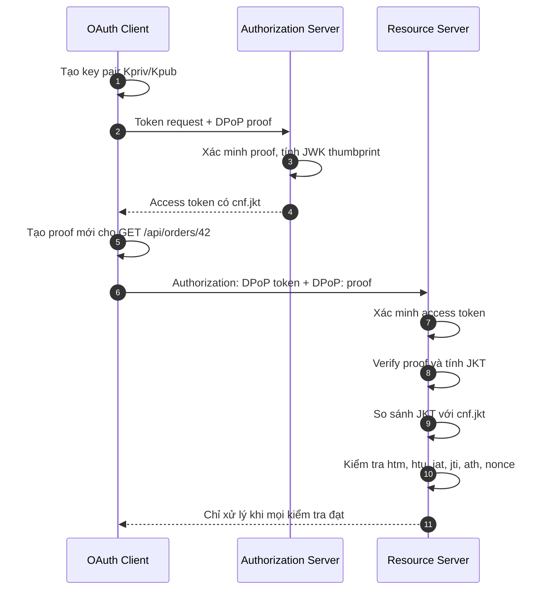

# cnf, jkt và kiểm tra khóa trong proof khớp liên kết của access token

Trong OAuth 2.0, một **Bearer access token** có thể được sử dụng bởi bất kỳ bên nào lấy được chuỗi token. Nếu token bị lộ qua log, browser storage, proxy hoặc một máy bị xâm nhập, kẻ lấy được token có thể replay nó từ một thiết bị khác trong thời gian token còn hiệu lực.

**DPoP (Demonstrating Proof of Possession)** giảm rủi ro replay bằng cách ràng buộc access token với một khóa công khai của client. Authorization Server đưa thông tin ràng buộc vào claim **`cnf`** của access token. Với DPoP, trường con **`cnf.jkt`** chứa JWK thumbprint của public key. Mỗi request tới Resource Server mang thêm một **DPoP proof JWT** được ký bằng private key tương ứng. Resource Server xác minh proof, tính thumbprint của public JWK trong proof rồi so sánh với `cnf.jkt` trong access token đã xác thực.

Điểm quyết định là:

```text
JWK thumbprint trong DPoP proof
             |
             | phải bằng
             v
cnf.jkt trong access token đã được xác minh
```

Nếu hai giá trị không khớp, client không chứng minh được quyền sở hữu khóa đã ràng buộc với token. Resource Server phải từ chối request, ngay cả khi chữ ký access token hợp lệ và scope có vẻ đủ.

Bài học thuộc chương **Token ràng buộc khóa**, tập trung vào claim `cnf`, `jkt`, cấu trúc proof, cách tính JWK thumbprint, kiểm tra chữ ký và request binding, replay protection, cũng như cách tích hợp nguyên tắc này với Spring Security Resource Server.

> **Ngữ cảnh minh họa:** Orders API chạy Spring Security và nhận DPoP-bound access token dành cho audience `orders-api`. Client tạo cặp khóa bất đối xứng riêng. Authorization Server ràng buộc access token với public key đó bằng `cnf.jkt`. Client gửi token qua `Authorization: DPoP ...` và proof qua header `DPoP`. Các token, issuer và giá trị khóa trong bài là ví dụ; API DPoP cụ thể có thể khác theo phiên bản Spring Security.

## 1. Vì sao cần ràng buộc access token với khóa?

### 1.1. Bearer token cho phép người cầm token sử dụng

Một request Bearer thông thường:

```http
GET /api/orders/42 HTTP/1.1
Host: api.example.com
Authorization: Bearer ACCESS_TOKEN
```

Resource Server kiểm tra token. Nếu token hợp lệ và có quyền, request được xử lý. Vấn đề của mô hình Bearer là **người gửi không cần chứng minh họ là client ban đầu**. Ai lấy được token có thể gửi cùng chuỗi đó.

Các nguồn rò rỉ có thể gồm log HTTP/tracing, browser storage, proxy/gateway cấu hình sai, crash dump, debug output, hệ thống support hoặc malware trên thiết bị client. Access token có audience, scope và thời hạn ngắn giúp giảm phạm vi thiệt hại, nhưng token Bearer bị đánh cắp vẫn có thể bị replay.

### 1.2. DPoP thêm bằng chứng sở hữu khóa

Với DPoP, client tạo một cặp khóa:

- **Private key:** giữ tại client, dùng để ký proof.
- **Public key:** được đưa vào header của DPoP proof dưới dạng JWK.

Khi cấp token, client chứng minh sở hữu private key và Authorization Server ràng buộc token với public key. Khi gọi Resource Server, client tạo proof mới cho request đó.



Kẻ tấn công chỉ có access token nhưng không có private key không thể tạo proof mới hợp lệ cho request của họ.

### 1.3. DPoP không thay đổi quyền trong access token

DPoP bổ sung **proof of possession**, không thay đổi ý nghĩa scope và audience:

- Access token vẫn xác định resource, issuer, thời hạn và quyền.
- `cnf.jkt` ràng buộc token với public key.
- DPoP proof chứng minh client có private key và proof dành cho request cụ thể.
- Resource Server vẫn phải kiểm tra scope, tenant, ownership và business policy.

Token có `SCOPE_orders.read` nhưng không có proof đúng vẫn phải bị từ chối. Proof đúng nhưng token thiếu scope cũng không được phép đọc đơn hàng.

## 2. Claim cnf là gì?

`cnf` là viết tắt của **confirmation** claim. Claim này biểu diễn thông tin về key material hoặc cách xác nhận mà client phải chứng minh khi sử dụng token. Ngữ nghĩa chung được mô tả trong RFC 7800 và các profile/token-binding specification liên quan.

Với DPoP, access token thường chứa:

```json
{
  "iss": "https://login.example.com",
  "sub": "customer-42",
  "aud": ["orders-api"],
  "scope": "orders.read",
  "exp": 2000000000,
  "cnf": {
    "jkt": "BASE64URL_SHA256_JWK_THUMBPRINT"
  }
}
```

Trong đó:

- `cnf` là object confirmation.
- `jkt` là JWK SHA-256 thumbprint của public key được dùng để tạo DPoP proof.
- Giá trị `jkt` là chuỗi base64url không padding.
- Resource Server lấy `cnf.jkt` từ **access token đã được xác minh**, không lấy từ request header hoặc payload chưa xác minh.

### 2.1. cnf.jkt không phải kid

| Giá trị | Vai trò |
|---|---|
| `kid` | Key identifier do issuer/JWK set sử dụng để chọn một key |
| `cnf.jkt` | Thumbprint định danh public JWK mà token được ràng buộc |
| `jti` của DPoP proof | Identifier duy nhất của proof để chống replay |
| `ath` | Hash của access token được proof gắn với |
| `sub` | Subject của access token |
| `aud` | Resource/audience được phép sử dụng token |

`kid` có thể do issuer đặt tên tùy ý và không nhất thiết duy nhất toàn hệ thống. `jkt` được tính từ những thành phần public key theo thuật toán chuẩn hóa, nên không phụ thuộc tên do nhà phát hành tự đặt.

**Không so sánh `cnf.jkt` với `kid`.** Hai giá trị không cùng ngữ nghĩa hoặc định dạng.

### 2.2. cnf.jkt không phải hash của toàn bộ proof

Một DPoP proof thay đổi theo từng request: `jti`, `htm`, `htu`, `iat` và `ath` có thể khác nhau. Nếu `cnf.jkt` được tính từ toàn bộ proof JWT, nó sẽ đổi ở mỗi request và không thể ràng buộc token với một key ổn định.

`jkt` được tính từ **public JWK** nằm trong protected header của proof. Các proof khác nhau được ký bằng cùng key sẽ cho cùng JWK thumbprint.

### 2.3. cnf có thể có nhiều dạng

Ví dụ với certificate-bound access token dùng mTLS:

```json
{
  "cnf": {
    "x5t#S256": "BASE64URL_CERTIFICATE_THUMBPRINT"
  }
}
```

Đây là cơ chế khác với DPoP:

- `cnf.jkt`: ràng buộc với public JWK của DPoP.
- `cnf.x5t#S256`: ràng buộc với thumbprint của client certificate trong mTLS.

Không lấy certificate thumbprint đem so với JWK thumbprint. Không tự coi token có một trường `cnf` bất kỳ là DPoP token; phải kiểm tra đúng confirmation method theo token profile và policy.

## 3. DPoP proof JWT gồm những gì?

DPoP proof là JWT có cấu trúc riêng. Một ví dụ protected header:

```json
{
  "typ": "dpop+jwt",
  "alg": "ES256",
  "jwk": {
    "kty": "EC",
    "crv": "P-256",
    "x": "PUBLIC_X_COORDINATE",
    "y": "PUBLIC_Y_COORDINATE"
  }
}
```

Payload khi gửi request tới Resource Server:

```json
{
  "jti": "proof-id-8d7c2",
  "htm": "GET",
  "htu": "https://api.example.com/api/orders/42",
  "iat": 1999999990,
  "ath": "BASE64URL_SHA256_OF_ACCESS_TOKEN"
}
```

Proof còn có thể chứa claim `nonce` nếu server yêu cầu nonce.

| Thành phần | Ý nghĩa | Kiểm tra |
|---|---|---|
| Header `typ` | Loại proof JWT | Phải là `dpop+jwt` theo profile |
| Header `alg` | Thuật toán chữ ký | Phải là thuật toán bất đối xứng được policy cho phép |
| Header `jwk` | Public key dùng để verify proof | JWK hợp lệ, không chứa private key |
| Payload `jti` | Identifier duy nhất của proof | Không được replay trong cửa sổ chấp nhận |
| Payload `htm` | HTTP method | Phải khớp method của request |
| Payload `htu` | HTTP target URI không gồm query/fragment | Phải khớp URI theo quy tắc DPoP |
| Payload `iat` | Thời điểm tạo proof | Phải nằm trong cửa sổ thời gian cho phép |
| Payload `ath` | Hash access token | Bắt buộc trong proof dùng ở Resource Server |
| Payload `nonce` | Nonce do server cung cấp nếu áp dụng | Phải khớp nonce server yêu cầu |

### 3.1. Header JWK chỉ được chứa public key

DPoP proof mang public JWK để Resource Server có thể kiểm tra chữ ký proof. Ví dụ EC public JWK chỉ có `kty`, `crv`, `x` và `y`.

Không chấp nhận private parameters như `d` của EC/RSA private key, `p`/`q`/`dp`/`dq`/`qi` của RSA private key, hoặc symmetric secret `k` trong trường hợp không được phép. Private key không được gửi trong proof.

### 3.2. Proof phải được ký

Một payload JSON đúng định dạng nhưng không có chữ ký hợp lệ không phải bằng chứng sở hữu khóa. Resource Server cần:

1. Parse protected header theo giới hạn kích thước.
2. Kiểm tra `typ` và `alg`.
3. Đọc public JWK.
4. Xác minh chữ ký DPoP proof bằng chính public JWK đó.
5. Tính JWK thumbprint.
6. So sánh thumbprint với `cnf.jkt` trong access token đã xác thực.
7. Kiểm tra claims gắn proof với request.

Việc proof tự mang public key không làm key đó đáng tin ngay lập tức. **Sự liên kết với access token đã được issuer tin cậy ký** mới xác nhận key này là key được token yêu cầu.

## 4. JWK thumbprint và cnf.jkt được tính như thế nào?

DPoP sử dụng **JWK Thumbprint** theo RFC 7638. Không hash JSON JWK tùy ý, vì thứ tự field, whitespace hoặc metadata như `kid`/`use` có thể thay đổi dù public key giống nhau.

Thuật toán tổng quát:

1. Xác định key type và tập thành viên bắt buộc để nhận diện public key.
2. Tạo JSON canonical chỉ gồm các thành viên bắt buộc theo RFC 7638.
3. Sắp xếp tên thành viên theo quy tắc chuẩn.
4. Mã hóa chuỗi canonical bằng UTF-8.
5. Tính SHA-256.
6. Mã hóa kết quả theo Base64URL **không có padding**.

### 4.1. Ví dụ EC P-256

Public JWK:

```json
{
  "kty": "EC",
  "crv": "P-256",
  "x": "f83OJ3D2xF4...",
  "y": "x_FEzRu9M..."
}
```

Chuỗi canonical theo RFC 7638 chỉ gồm các thành viên bắt buộc:

```json
{"crv":"P-256","kty":"EC","x":"f83OJ3D2xF4...","y":"x_FEzRu9M..."}
```

Các giá trị tọa độ đã được rút gọn để minh họa, không phải key thực. SHA-256 của bytes UTF-8 canonical JSON sau đó được Base64URL encode không padding.

### 4.2. Ví dụ RSA

Public RSA JWK:

```json
{
  "kty": "RSA",
  "n": "PUBLIC_MODULUS",
  "e": "AQAB",
  "kid": "signing-key-1",
  "use": "sig",
  "alg": "RS256"
}
```

Các thành viên bắt buộc trong canonical JSON cho RSA là `e`, `kty` và `n`:

```json
{"e":"AQAB","kty":"RSA","n":"PUBLIC_MODULUS"}
```

`kid`, `use` và `alg` không tham gia JWK thumbprint theo tập thành viên bắt buộc của RFC 7638 cho RSA.

### 4.3. Tại sao không hash nguyên header jwk?

Hai JSON có thể biểu diễn cùng một public key dù thứ tự field và metadata khác nhau. Nếu hash nguyên JSON, kết quả có thể khác. JWK thumbprint chuẩn hóa dựa trên **các thành viên công khai cần thiết**, nhờ vậy nhận diện key ổn định.

### 4.4. Pseudocode tính thumbprint

```text
jwkThumbprint(jwk):
    if jwk.kty == "EC":
        canonical = JSON with only:
            crv, kty, x, y
        in canonical member order
    else if jwk.kty == "RSA":
        canonical = JSON with only:
            e, kty, n
    else:
        reject unless this key type is explicitly supported

    digest = SHA-256(UTF8(canonical))
    return BASE64URL_ENCODE_WITHOUT_PADDING(digest)
```

Không tự hỗ trợ mọi key type bằng cách hash toàn bộ object. Nếu hệ thống cần OKP/EdDSA, phải triển khai đúng tập thành viên bắt buộc theo RFC 7638 và giới hạn thuật toán phù hợp. Không nhận JWK lạ chỉ vì thư viện có thể parse được.

## 5. Kiểm tra proof key khớp cnf.jkt của access token

Giả sử access token sau khi xác minh có:

```json
{
  "iss": "https://login.example.com",
  "aud": ["orders-api"],
  "scope": "orders.read",
  "cnf": {
    "jkt": "THUMBPRINT_A"
  }
}
```

DPoP proof gửi kèm có public JWK mà thumbprint tính ra là `THUMBPRINT_A`. Khi đó proof key khớp binding.

Nếu attacker dùng key khác, thumbprint là `THUMBPRINT_B`:

```text
Access token:
    cnf.jkt = THUMBPRINT_A

DPoP proof:
    thumbprint(header.jwk) = THUMBPRINT_B

THUMBPRINT_A != THUMBPRINT_B
    => reject request
```

### 5.1. Thứ tự kiểm tra

Một quy trình rõ ràng:

1. Xác thực access token theo cơ chế Resource Server đã cấu hình.
2. Đọc `cnf.jkt` từ claims/metadata của token đã xác minh.
3. Xác minh chữ ký DPoP proof bằng public JWK trong proof.
4. Tính JWK thumbprint từ đúng public JWK đã dùng để verify proof.
5. So sánh thumbprint với `cnf.jkt`.
6. Kiểm tra `htm`, `htu`, `iat`, `jti`, `ath` và `nonce`.
7. Ghi nhận proof ID vào replay cache một cách atomic.
8. Chỉ sau đó mới đưa request vào authorization và controller.

Có thể parse/kiểm tra một số trường proof trước để từ chối input malformed sớm, nhưng **không được coi request authenticated** cho tới khi toàn bộ kiểm tra access token và proof hoàn tất.

### 5.2. Không đọc cnf từ token chưa xác minh

Một JWT payload có thể được decode mà không verify. Kẻ tấn công có thể sửa claim `cnf` để trỏ tới key của chính họ. Nếu Resource Server lấy `cnf.jkt` từ payload chưa xác minh, attacker có thể thay cả access token claims và proof key theo ý họ.

- JWT: chỉ dùng `cnf` sau khi signature, issuer, audience, thời hạn và validators khác thành công.
- Opaque token: chỉ dùng `cnf` từ introspection response đáng tin cậy và token phải `active=true`.
- Không dùng header/query parameter do caller gửi để thay confirmation claim.
- Không tin metadata `cnf` từ endpoint ngoài AS trust configuration.

### 5.3. Constant-time comparison

Thumbprint không phải secret như password, nhưng phép so sánh binding nên dùng utility so sánh constant-time phù hợp. Có thể decode Base64URL thành bytes và dùng constant-time equality utility.

Không so sánh chuỗi sau khi tự trim, lower-case hoặc normalize ngoài chuẩn. Base64URL thumbprint phải được xử lý theo encoding đã định nghĩa.

## 6. Kiểm tra htm và htu để proof dành cho đúng request

Chỉ chứng minh sở hữu private key chưa đủ. Proof phải gắn với **HTTP request cụ thể**.

### 6.1. htm: HTTP method

Nếu request thực tế là:

```http
GET /api/orders/42 HTTP/1.1
```

proof cần chứa:

```json
{
  "htm": "GET"
}
```

Nếu attacker lấy proof của một GET rồi dùng lại cho POST, method không khớp và proof bị từ chối.

### 6.2. htu: HTTP target URI

Proof phải chứa target URI theo DPoP, loại bỏ query và fragment. Ví dụ request:

```text
https://api.example.com/api/orders/42?expand=items#section
```

giá trị `htu` tương ứng bỏ query và fragment:

```text
https://api.example.com/api/orders/42
```

Không tự bỏ scheme, host hoặc path. Resource Server phải xây target URI đúng theo request mà nó thực sự nhận và quy tắc DPoP.

### 6.3. Reverse proxy có thể làm sai htu

Một hệ thống triển khai:

```text
Client
  -> https://api.example.com/api/orders/42
  -> ingress terminates TLS
  -> http://orders-service:8080/internal/orders/42
```

Backend nhìn thấy URI nội bộ khác URI client đã dùng. Nếu backend lấy trực tiếp local scheme/host/path để so với `htu`, proof hợp lệ có thể bị từ chối. Nguy hiểm hơn, nếu backend tin `X-Forwarded-Host` hoặc `Forwarded` do client tự gửi, attacker có thể điều khiển URI dùng để kiểm tra.

Cần:

- Xác định URI public/external mà DPoP client thực sự gọi.
- Chỉ tin forwarded headers từ proxy đã được xác thực và cấu hình là trusted.
- Ingress phải strip forwarded headers do client tự gửi rồi tự tạo lại.
- Đồng bộ path rewrite và URI reconstruction giữa gateway/backend.
- Không dùng hostname bất kỳ trong header để tạo URI xác minh.
- Test DPoP qua đúng proxy/ingress production.

### 6.4. Không chuẩn hóa URI tùy tiện

Scheme HTTP so với HTTPS, hostname/port, path encoding, context path, reverse-proxy prefix và redirect đều có thể ảnh hưởng so khớp. Hãy thực hiện phép so khớp theo quy tắc DPoP và cách framework xây external request URI. Không dùng hàm “remove slash, lowercase everything” tùy tiện để làm proof khớp.

## 7. ath: proof phải gắn với đúng access token

Khi DPoP proof được dùng ở **Resource Server**, payload cần có `ath`, là hash của access token được gửi trong request.

Ví dụ request:

```http
GET /api/orders/42 HTTP/1.1
Authorization: DPoP ACCESS_TOKEN
DPoP: DPOP_PROOF_JWT
```

Client tính:

```text
ath = BASE64URL_NO_PADDING(
        SHA-256(
            ASCII(access_token)
      ))
```

Resource Server tính lại từ **chính access token trong Authorization header** rồi so sánh với `ath` trong proof.

### 7.1. Tại sao cần ath?

Nếu proof chỉ gắn với key, method và URI mà không gắn với token, proof chưa được ràng buộc với exact access token của request. `ath` giúp ngăn việc dùng proof đó cùng một access token khác.

### 7.2. Cách tính trong Java

```java
import java.nio.charset.StandardCharsets;
import java.security.MessageDigest;
import java.security.NoSuchAlgorithmException;
import java.util.Base64;

public final class DpopAccessTokenHash {

    private DpopAccessTokenHash() {
    }

    public static String calculate(String accessToken) {
        try {
            MessageDigest sha256 =
                MessageDigest.getInstance("SHA-256");

            byte[] digest = sha256.digest(
                accessToken.getBytes(StandardCharsets.US_ASCII)
            );

            return Base64.getUrlEncoder()
                .withoutPadding()
                .encodeToString(digest);
        } catch (NoSuchAlgorithmException ex) {
            throw new IllegalStateException(
                "SHA-256 is unavailable",
                ex
            );
        }
    }
}
```

Mã trên minh họa cách tính `ath`; không tự nó xác minh proof hoặc access token. Không hash chuỗi đã trim, decode JWT payload hoặc chỉ hash phần payload.

### 7.3. Không nhầm ath với jkt

| Claim | Hash của gì? | Mục đích |
|---|---|---|
| `ath` | Exact access token string | Gắn proof với token trong request |
| `jkt` | Public JWK theo RFC 7638 | Gắn token với key pair |
| `jti` | Identifier proof | Chống replay |

Cả `ath` và `jkt` đều có thể trông như base64url string, nhưng dữ liệu đầu vào và ngữ nghĩa hoàn toàn khác.

### 7.4. Token endpoint và Resource Server khác nhau

Ở token endpoint, client có thể gửi DPoP proof để chứng minh sở hữu key khi xin token. Lúc đó chưa có access token vừa được cấp để đưa vào `ath` như khi gọi Resource Server. Khi sử dụng DPoP-bound access token ở Resource Server, proof phải gắn với access token bằng `ath` theo RFC 9449.

Không dùng một mẫu proof chung cho mọi endpoint mà bỏ qua yêu cầu claim theo từng giai đoạn protocol.

## 8. iat, jti và replay protection

### 8.1. iat: thời điểm tạo proof

Resource Server cần giới hạn tuổi proof. Nếu chấp nhận proof cũ vô hạn, attacker có thể lưu proof đã lấy được và thử replay về sau.

```text
now = current server time
iat = proof issuance time

accept only if:
    now - allowed_past_skew <= iat
    iat <= now + allowed_future_skew
```

Khoảng thời gian chính xác phụ thuộc hệ thống, clock synchronization và policy; không chọn cửa sổ quá rộng chỉ để giảm lỗi client.

### 8.2. jti: định danh duy nhất của proof

Mỗi proof cần một `jti` duy nhất. Resource Server lưu proof ID đã dùng trong replay cache có TTL tương ứng với cửa sổ chấp nhận.

Key cache nên namespace theo key thumbprint:

```text
replay-cache-key = (jkt, jti)
```

Nếu chỉ dùng `jti`, có thể có collision giữa các client độc lập. Nếu không lưu/kiểm tra jti, attacker có thể replay cùng proof trong thời gian proof còn hợp lệ.

### 8.3. Atomic insert là bắt buộc

Logic không an toàn:

```text
if cache does not contain jti:
    process request
    cache.put(jti)
```

Hai request đồng thời có thể cùng kiểm tra cache trước khi một request ghi vào. Cả hai được chấp nhận.

Cần thao tác atomic kiểu **put-if-absent**:

```text
if atomicPutIfAbsent((jkt, jti), expiresAt):
    accept proof
else:
    reject replay
```

Trong cluster nhiều pods, replay cache phải chia sẻ/đồng bộ hoặc có cơ chế chống replay phân tán phù hợp. Cache in-memory của từng pod không ngăn attacker gửi cùng proof tới pod khác.

### 8.4. Ghi jti đúng thời điểm

Một pipeline có thể:

1. Kiểm tra cấu trúc proof và giới hạn kích thước.
2. Verify chữ ký proof.
3. Kiểm tra `htm`/`htu`/`iat`/`ath`/`nonce`.
4. Kiểm tra thumbprint khớp `cnf.jkt`.
5. Atomic claim `jti` trong replay store.
6. Tiếp tục authorization.

Nếu ghi cache quá sớm, proof sai có thể chiếm ID hoặc tạo denial-of-service. Nếu ghi quá muộn sau khi controller chạy, cùng proof có thể được dùng đồng thời. Đặt replay claim tại bước authentication trước authorization/controller.

### 8.5. Replay cache cần giới hạn tài nguyên

TTL không vượt quá thời gian proof có thể được chấp nhận; giới hạn kích thước và eviction; không cho attacker tạo key cache vô hạn bằng jti dài bất thường; giới hạn kích thước proof/JWK; theo dõi replay rate bằng metric low-cardinality. Nếu replay store unavailable và hệ thống không thể đảm bảo chống replay, policy cần fail closed cho endpoint DPoP-bound.

## 9. Nonce: chống proof được chuẩn bị trước

DPoP có thể dùng server-provided nonce. Resource Server/Authorization Server trả nonce trong response header, client phải đưa nonce đó vào proof tiếp theo.

Ví dụ response:

```http
HTTP/1.1 401 Unauthorized
WWW-Authenticate: DPoP error="use_dpop_nonce"
DPoP-Nonce: SERVER_NONCE_VALUE
```

Client tạo proof mới:

```json
{
  "jti": "new-proof-id",
  "htm": "GET",
  "htu": "https://api.example.com/api/orders/42",
  "iat": 2000000000,
  "ath": "ACCESS_TOKEN_HASH",
  "nonce": "SERVER_NONCE_VALUE"
}
```

### 9.1. Nonce không thay chữ ký hoặc jkt

Nonce là challenge để server kiểm soát freshness/request creation. Nó không chứng minh một mình client sở hữu key. Resource Server vẫn phải verify proof signature, tính và so khớp `jkt`, kiểm tra `ath`, `htm`/`htu`, `iat` và `jti`.

### 9.2. Nonce cần gắn với server context

Nếu server cấp nonce, cần xác định nonce dùng một lần hay nhiều lần trong TTL, gắn với resource/server nào, có gắn với key thumbprint hoặc session context không, thời hạn bao lâu và cách đồng bộ giữa nhiều instances.

Không chấp nhận nonce từ host khác hoặc dùng nonce do caller tự khai làm challenge đáng tin. Không dùng một nonce global vô hạn.

### 9.3. Client cần tạo proof mới khi retry

Khi nhận `use_dpop_nonce`, client không nên gửi lại nguyên proof cũ. Nó phải tạo proof mới với `jti` mới, `iat` hiện tại và nonce server cung cấp; các claim request/token phải khớp với lần gọi mới.

## 10. Token response và cách client sử dụng DPoP

Khi Authorization Server chấp nhận DPoP proof ở token endpoint và phát token bound với key, response có thể chứa:

```http
HTTP/1.1 200 OK
Content-Type: application/json
Cache-Control: no-store
Pragma: no-cache

{
  "access_token": "ACCESS_TOKEN_BOUND_TO_KEY",
  "token_type": "DPoP",
  "expires_in": 600,
  "scope": "orders.read"
}
```

Client phải xử lý `token_type` là `DPoP` theo hợp đồng. Khi gọi Resource Server:

```http
GET /api/orders/42 HTTP/1.1
Host: api.example.com
Authorization: DPoP ACCESS_TOKEN_BOUND_TO_KEY
DPoP: SIGNED_DPOP_PROOF
```

Không gửi DPoP-bound access token theo Bearer scheme rồi kỳ vọng server tự suy ra proof. Authorization scheme và proof header là một phần của protocol.

### 10.1. Client tạo proof riêng cho mỗi request

Mỗi HTTP request cần proof gắn đúng method, target URI, access token, thời điểm, proof ID và nonce nếu yêu cầu. Không cache một DPoP proof để dùng lại cho nhiều request. Proof cũ có thể sai method/URI/token hoặc bị replay detection từ chối.

### 10.2. Client phải giữ private key an toàn

Native app có thể dùng OS keystore/keychain; BFF/server-side client có thể dùng HSM/KMS hoặc secure key store; browser app cần threat model cho XSS và signing API. Không serialize private JWK vào logs hoặc local files không bảo vệ. Có quy trình key rotation và token re-issuance.

## 11. JWT access token: lấy cnf.jkt từ claims đã xác minh

Với JWT access token, Resource Server thường có decoder kiểm tra chữ ký, issuer, audience và thời gian. Sau đó mới đọc:

```json
{
  "cnf": {
    "jkt": "EXPECTED_THUMBPRINT"
  }
}
```

Luồng:

```text
Incoming DPoP access token
    |
    v
JWT decoder
    |
    +-- signature invalid -> reject
    +-- issuer invalid -> reject
    +-- audience invalid -> reject
    +-- exp/nbf invalid -> reject
    |
    v
Verified Jwt
    |
    v
Read cnf.jkt
    |
    v
Verify DPoP proof and compare proof JWK thumbprint
    |
    v
Authentication accepted
```

### 11.1. Không để proof thay thế access-token verification

Proof signature có thể đúng nhưng access token vẫn có thể do issuer không đáng tin phát hành, hết hạn, có audience sai, scope không phù hợp hoặc bị thu hồi theo policy. DPoP không xác minh những điều này thay decoder.

### 11.2. Token không có cnf.jkt

Nếu endpoint được cấu hình **chỉ chấp nhận DPoP-bound tokens**, token thiếu `cnf.jkt` phải bị từ chối. Không tự coi nó là Bearer token.

| Access token | Authorization scheme | Proof | Hành vi |
|---|---|---|---|
| Bearer token không có `cnf` | Bearer | Không | Có thể xác thực theo Bearer policy |
| DPoP-bound token có `cnf.jkt` | DPoP | Khớp | Xác thực nếu mọi checks đạt |
| DPoP-bound token có `cnf.jkt` | DPoP | Thiếu | Từ chối |
| DPoP-bound token có `cnf.jkt` | DPoP | JKT khác | Từ chối |
| DPoP-bound token | Bearer | Bất kỳ | Từ chối theo DPoP binding |
| Token không có binding | DPoP | Proof bất kỳ | Không tự nâng thành DPoP-bound |
| Token sai signature | DPoP | Proof đúng | Từ chối |
| Token hợp lệ nhưng thiếu scope | DPoP | Proof đúng | Authentication có thể thành công, authorization từ chối |

## 12. Opaque access token: cnf có thể đến từ introspection

Với opaque token, Resource Server hỏi Authorization Server qua introspection. Response theo provider contract có thể gồm:

```json
{
  "active": true,
  "scope": "orders.read",
  "client_id": "orders-client",
  "sub": "customer-42",
  "aud": ["orders-api"],
  "cnf": {
    "jkt": "EXPECTED_THUMBPRINT"
  }
}
```

Ở đây `cnf.jkt` phải đến từ **introspection response đáng tin**. Resource Server chỉ sử dụng nó sau khi response được xử lý và `active` được xác nhận.

### 12.1. Flow opaque + DPoP

```text
Authorization: DPoP opaque-access-token
DPoP: proof JWT
        |
        v
Extract token and proof
        |
        v
Opaque token introspection
        |
        +-- active=false/error -> reject
        |
        v
Trusted principal + cnf.jkt
        |
        v
Verify DPoP proof, calculate jkt
        |
        v
Compare jkt + request claims + replay
        |
        v
Authorization
```

Không lấy `cnf` từ chuỗi opaque token hoặc custom request header. Nếu AS không trả confirmation metadata và hợp đồng không có cách lấy binding đáng tin khác, Resource Server không thể xác minh DPoP binding đúng cách.

### 12.2. Introspection cache ảnh hưởng revocation và binding

Nếu Resource Server cache introspection result, nó có thể giữ `cnf.jkt` cũ trong TTL. Cache active result chỉ trong TTL phù hợp với revocation policy; không trộn metadata giữa issuer/client/audience khác nhau; giữ replay cache DPoP tách biệt với introspection cache; đảm bảo invalidation/TTL phản ánh SLA thu hồi.

## 13. DPoP và mTLS: hai dạng proof-of-possession khác nhau

| Đặc điểm | DPoP | mTLS certificate-bound token |
|---|---|---|
| Key material | Asymmetric JWK phía client | Client TLS certificate/private key |
| Binding claim | `cnf.jkt` | Thường `cnf.x5t#S256` |
| Proof | JWT DPoP riêng cho request | TLS client certificate trong handshake |
| Request header | `DPoP` + Authorization scheme DPoP | Không cần DPoP proof header |
| Binding validation | Proof JWK thumbprint khớp jkt | Certificate thumbprint khớp cnf |
| Tầng xử lý | Application/protocol layer | TLS/mTLS layer và token validation |

Không dùng `cnf.jkt` để kiểm tra certificate. Không coi một TLS connection có client certificate là bằng chứng DPoP proof đã hợp lệ.

### 13.1. DPoP vẫn cần TLS

DPoP không thay thế HTTPS. TLS vẫn bảo vệ confidentiality/integrity của token và proof trên đường truyền, đồng thời xác thực server. DPoP bổ sung sender constraint ở tầng ứng dụng; nó không cho phép truyền access token plaintext.

### 13.2. DPoP không thay authorization

Ngay cả khi key proof khớp, scope có thể thiếu, audience có thể sai, tenant có thể không khớp, user không sở hữu tài nguyên hoặc business state có thể cấm thao tác. Proof of possession chứng minh **khả năng sử dụng private key tương ứng**, không chứng minh người giữ key có quyền nghiệp vụ.

## 14. Xử lý token/proof trong nhiều tenant

Một Resource Server nhiều tenant có thể nhận token được ràng buộc với key khác nhau theo từng issuer/client:

```text
Tenant Acme:
  issuer = https://id.acme.example
  token.cnf.jkt = JKT_A

Tenant Beta:
  issuer = https://id.beta.example
  token.cnf.jkt = JKT_B
```

Resource Server phải chọn issuer manager từ trusted registry, xác minh access token đúng issuer/audience, lấy `cnf.jkt` từ token đã xác minh, xác minh proof public key và tính thumbprint, so sánh binding, rồi kiểm tra tenant claim/membership và object policy.

Không chọn issuer, JWKS URL hoặc tenant trust chỉ từ `jkt`. JKT là key thumbprint, không phải tenant identity hoặc issuer URL.

### 14.1. Cùng key dùng cho nhiều tenant có thể làm mờ ranh giới

Nếu cùng một public key được dùng cho nhiều tenant, `jkt` có thể giống nhau giữa các token. Điều đó không tự tạo quyền cross-tenant, nhưng làm cho key possession không phân biệt tenant.

Nếu policy cần tách thiết bị/tenant, AS/client có thể tạo key pair riêng theo tenant hoặc authorization context. Dù key có dùng chung, Resource Server vẫn phải kiểm tra issuer, audience và tenant binding.

## 15. Spring Security Resource Server: vị trí tích hợp DPoP

Spring Security cung cấp nền tảng xác thực access token, nhưng **khả năng DPoP built-in và tên API phụ thuộc phiên bản cụ thể**. Không nên giả định mọi phiên bản Spring Security 6.x chỉ cần bật `oauth2ResourceServer().jwt()` là đã kiểm tra đầy đủ DPoP proof.

Khi dùng phiên bản có hỗ trợ DPoP Resource Server chính thức, ưu tiên cấu hình và API của đúng phiên bản đó. Khi version hiện tại chưa cung cấp đầy đủ, tích hợp một thành phần DPoP chuyên biệt trong security chain, bảo đảm nó chạy trước authorization/controller và kết hợp đúng với access-token authentication.

### 15.1. Không chỉ thêm controller interceptor

Một interceptor ở controller có thể bỏ sót functional WebFlux routes, một số error/async dispatch, handlers không đi qua controller thông thường hoặc những request được xử lý trước khi interceptor chạy.

DPoP là authentication requirement của request, nên cần được thực thi tại **security filter/authentication layer** hoặc native Resource Server support, không rải kiểm tra thủ công trong từng controller.

### 15.2. Mô hình tích hợp khái niệm

```text
HTTP request
  |
  +-- Extract DPoP Authorization token + DPoP proof
  |
  v
Standard access-token authentication
  |
  +-- JwtDecoder / OpaqueTokenIntrospector
  |
  v
Verified principal with cnf.jkt
  |
  v
DPoP proof validator
  |
  +-- typ / alg / public jwk
  +-- proof signature
  +-- JWK thumbprint == cnf.jkt
  +-- htm / htu / iat / jti / ath / nonce
  +-- replay cache atomic claim
  |
  v
Authentication accepted
  |
  v
Authorization (scope, tenant, resource)
  |
  v
Controller / Handler
```

Đây là kiến trúc logic, không phải tên API cố định. Khi dùng built-in support, xác nhận implementation thực sự kiểm tra **cả token binding lẫn proof request claims/replay**, chứ không chỉ parse header `DPoP`.

### 15.3. Authentication request nên mang đủ dữ liệu

Một request model khái niệm:

```java
public record DpopRequestCredentials(
    String accessToken,
    String dpopProof,
    String httpMethod,
    String externalRequestUri
) {}
```

Đây là DTO minh họa, không phải class Spring Security có sẵn. Cần giới hạn kích thước token/proof và chỉ lấy external URI từ request/proxy context đáng tin.

### 15.4. Validator nhận access token đã xác thực

```java
public interface DpopProofValidator {

    Mono<DpopProofResult> validate(
        VerifiedAccessToken accessToken,
        String proofJwt,
        HttpRequestBinding request
    );
}
```

Các type `VerifiedAccessToken`, `DpopProofResult` và `HttpRequestBinding` là model ứng dụng minh họa. Validator **nhận token đã xác thực** và request context, rồi trả kết quả proof; không dùng claims chưa verify.

## 16. Pseudocode xác minh DPoP proof

```text
validateDpop(accessToken, proofJwt, request):

    verifiedToken = authenticateAccessToken(accessToken)

    expectedJkt = verifiedToken.claim("cnf").claim("jkt")
    if expectedJkt is absent:
        reject if endpoint requires DPoP-bound tokens

    proof = parseJwtWithSizeLimit(proofJwt)

    require proof.header.typ == "dpop+jwt"
    require proof.header.alg is asymmetric and allowed
    require proof.header.jwk is valid public JWK
    reject private key parameters

    verify proof signature using proof.header.jwk

    actualJkt = RFC7638Thumbprint(proof.header.jwk)
    require constantTimeEqual(actualJkt, expectedJkt)

    require proof.htm == request.method
    require proof.htu == externalTargetUriWithoutQueryOrFragment
    require proof.iat within allowed time window
    require proof.jti is present and bounded
    require proof.ath == BASE64URL(SHA256(ASCII(accessToken)))

    if server requires nonce:
        require proof.nonce is valid for this server/context

    require atomicReplayStore.putIfAbsent(actualJkt, proof.jti)

    return authenticated request
```

**Thứ tự có thể được tối ưu**, nhưng không được bỏ validation bắt buộc. Token authentication và proof validation phải cùng thành công trước khi request được xem là authenticated.

### 16.1. Không dùng public JWK trước khi kiểm tra loại key

Một parser có thể nhận JWK hợp lệ về JSON nhưng không phù hợp DPoP policy. Cần kiểm tra `kty` được cho phép, `alg` bất đối xứng trong allowlist, JWK có đủ public parameters, không chứa private parameters, kích thước key/curve phù hợp và signature verify được.

Không cho token header tự chọn thuật toán bất kỳ ngoài allowlist.

### 16.2. Không chỉ so khớp jkt

Proof có đúng public key nhưng `htm` là POST trong khi request là GET, `htu` trỏ endpoint khác, `ath` hash token khác, `iat` quá cũ, `jti` đã dùng hoặc `nonce` sai thì request vẫn phải bị từ chối. JKT match là điều kiện quan trọng nhưng không phải toàn bộ DPoP validation.

## 17. Ví dụ cấu trúc code Java cho proof validation

Các đoạn sau là **khung thiết kế**, không phải implementation hoàn chỉnh để copy vào production. Chúng minh họa cách tách logic thumbprint, request binding, replay store và token binding. Việc parse/verify JWT nên dùng thư viện JOSE đã được kiểm chứng và API phù hợp version.

### 17.1. Model proof đã parse và xác minh chữ ký

```java
import java.time.Instant;
import java.util.Map;

public record VerifiedDpopProof(
    String thumbprint,
    String jti,
    String httpMethod,
    String httpUri,
    Instant issuedAt,
    String accessTokenHash,
    String nonce,
    Map<String, Object> publicJwk
) {}
```

Tên `VerifiedDpopProof` biểu thị object mà parser/JOSE verifier đã xác minh chữ ký proof. Không tạo object này chỉ bằng cách decode JWT payload.

### 17.2. Request binding

```java
public record HttpRequestBinding(
    String method,
    String externalUriWithoutQueryAndFragment
) {}
```

`externalUriWithoutQueryAndFragment` phải được tạo từ request URI mà client thực sự gọi, theo DPoP rules và trusted proxy configuration. Không nhận trực tiếp từ một header tùy ý.

### 17.3. Replay store contract

```java
import java.time.Instant;

public interface DpopReplayStore {

    /**
     * Atomically records (jkt, jti) if it has not been seen.
     *
     * @return true only for the first successful claim
     */
    boolean claimOnce(
        String jkt,
        String jti,
        Instant expiresAt
    );
}
```

Production implementation có thể dùng Redis hoặc datastore hỗ trợ atomic set-if-absent với TTL. Interface phải đảm bảo **atomicity trên toàn bộ Resource Server cluster**, không chỉ một JVM.

### 17.4. Validator logic khái niệm

```java
import java.time.Clock;
import java.time.Duration;
import java.time.Instant;
import java.util.Objects;

public final class DpopBindingPolicy {

    private final Clock clock;
    private final Duration maxProofAge;
    private final Duration allowedFutureSkew;
    private final DpopReplayStore replayStore;

    public DpopBindingPolicy(
            Clock clock,
            Duration maxProofAge,
            Duration allowedFutureSkew,
            DpopReplayStore replayStore) {
        this.clock = clock;
        this.maxProofAge = maxProofAge;
        this.allowedFutureSkew = allowedFutureSkew;
        this.replayStore = replayStore;
    }

    public void validate(
            String expectedJkt,
            String expectedAth,
            HttpRequestBinding request,
            VerifiedDpopProof proof) {

        if (expectedJkt == null || expectedJkt.isBlank()) {
            throw new DpopValidationException(
                "Access token is not DPoP-bound"
            );
        }

        if (!constantTimeTextEquals(
                expectedJkt,
                proof.thumbprint())) {
            throw new DpopValidationException(
                "DPoP key does not match token binding"
            );
        }

        if (!Objects.equals(
                request.method(),
                proof.httpMethod())) {
            throw new DpopValidationException(
                "DPoP htm does not match request method"
            );
        }

        if (!Objects.equals(
                request.externalUriWithoutQueryAndFragment(),
                proof.httpUri())) {
            throw new DpopValidationException(
                "DPoP htu does not match request URI"
            );
        }

        if (!Objects.equals(
                expectedAth,
                proof.accessTokenHash())) {
            throw new DpopValidationException(
                "DPoP ath does not match access token"
            );
        }

        Instant now = clock.instant();
        Instant earliest = now.minus(maxProofAge);
        Instant latest = now.plus(allowedFutureSkew);

        if (proof.issuedAt().isBefore(earliest)
                || proof.issuedAt().isAfter(latest)) {
            throw new DpopValidationException(
                "DPoP proof is outside the accepted time window"
            );
        }

        Instant expiresAt =
            proof.issuedAt().plus(maxProofAge);

        if (!replayStore.claimOnce(
                proof.thumbprint(),
                proof.jti(),
                expiresAt)) {
            throw new DpopValidationException(
                "DPoP proof replay detected"
            );
        }
    }

    private static boolean constantTimeTextEquals(
            String left,
            String right) {
        if (left == null || right == null) {
            return false;
        }

        byte[] a = left.getBytes(java.nio.charset.StandardCharsets.US_ASCII);
        byte[] b = right.getBytes(java.nio.charset.StandardCharsets.US_ASCII);

        return java.security.MessageDigest.isEqual(a, b);
    }
}
```

`DpopValidationException` là exception của ứng dụng cần được định nghĩa và map đúng sang DPoP authentication error. Ví dụ trên giả định `VerifiedDpopProof` đã qua JOSE signature, header, JWK và nonce validation. Nó **không thay thế** các bước đó.

### 17.5. Các kiểm tra còn phải nằm trong parser/JOSE layer

Trước khi gọi `DpopBindingPolicy`, implementation cần parse protected header với giới hạn kích thước, bắt buộc `typ=dpop+jwt`, kiểm tra thuật toán asymmetric, xác minh JWK public-only, verify proof signature, tính thumbprint đúng RFC 7638, kiểm tra `jti` và `iat`, xác thực nonce nếu bật, từ chối duplicate DPoP headers và map lỗi parser đúng semantics.

## 18. Spring Security Servlet: giữ token authentication và bổ sung DPoP proof

Trong Servlet stack, Resource Server thường dùng `BearerTokenResolver`, `BearerTokenAuthenticationFilter`, `AuthenticationManager`/provider và `JwtDecoder` hoặc `OpaqueTokenIntrospector`.

DPoP-bound access token cần một đường xử lý nhận **cả access token và proof**. Chỉ dùng resolver trích token rồi bỏ header `DPoP` sẽ không đủ.

### 18.1. Authentication request cần mang hai credential liên quan

Một request converter/filter chuyên biệt có thể đọc:

```http
Authorization: DPoP ACCESS_TOKEN
DPoP: PROOF_JWT
```

Nó cần giữ raw access token và proof trong một authentication request chưa xác thực. Không đưa principal/authorities vào request này.

### 18.2. Authentication provider phối hợp hai validator

```text
DpopAuthenticationProvider
    |
    +-- delegate access token authentication
    |      +-- JwtDecoder / Opaque introspector
    |      +-- issuer, audience, exp, active, scope metadata
    |
    +-- DPoP proof validation
           +-- verify proof signature
           +-- compute JKT
           +-- compare token cnf.jkt
           +-- htm / htu / iat / jti / ath / nonce
           +-- replay store
    |
    v
Authenticated principal
```

Provider chỉ trả Authentication khi **cả access token và proof đều hợp lệ**. Nếu delegate access-token provider thất bại, không tiếp tục như token Bearer không ràng buộc.

### 18.3. Không tự thêm một Bearer filter thứ hai

Một custom DPoP filter đặt cạnh Resource Server filter mặc định có thể làm token được xác minh hai lần, filter này chấp nhận Bearer trong khi filter kia yêu cầu DPoP, SecurityContext bị ghi đè hoặc authorization chạy trước khi proof được kiểm tra.

Thiết kế cần một đường authentication thống nhất cho DPoP-bound token hoặc native DPoP support của phiên bản Spring Security tương ứng.

### 18.4. API built-in thay đổi theo version

Trước khi viết custom provider, kiểm tra chính xác Spring Security version đang dùng có hỗ trợ DPoP Resource Server hay không. Nếu có, ưu tiên cấu hình native. Nếu không, custom integration phải được review và test theo RFC 9449. **Không giả định** cấu hình JWT Resource Server mặc định tự thực hiện `cnf.jkt`/DPoP proof matching.

## 19. Spring Security WebFlux: xử lý proof trong reactive chain

Với WebFlux, các thành phần chính gồm `SecurityWebFilterChain`, `ServerAuthenticationConverter`, `AuthenticationWebFilter`, `ReactiveAuthenticationManager`, `ReactiveJwtDecoder` hoặc `ReactiveOpaqueTokenIntrospector` và `ReactiveSecurityContextHolder`.

DPoP validation phải chạy trong reactive pipeline trước authorization.

### 19.1. Luồng reactive khái niệm

```text
ServerWebExchange
    |
    v
DPoP authentication converter
    +-- Authorization: DPoP token
    +-- DPoP: proof
    +-- method + trusted external URI
    |
    v
ReactiveAuthenticationManager
    +-- authenticate access token
    +-- verify DPoP proof
    +-- compare proof JKT with cnf.jkt
    +-- replay store (nonblocking)
    |
    v
Mono<Authentication>
    |
    v
Reactor SecurityContext
    |
    v
authorizeExchange / reactive method security
```

### 19.2. Reactive replay store phải nonblocking

Không gọi Redis/JDBC blocking trực tiếp trong Netty event loop. Dùng reactive datastore hoặc integration có scheduling/concurrency được thiết kế rõ. Nếu replay store unavailable và hệ thống không thể bảo đảm anti-replay, policy cần fail closed cho endpoint DPoP-bound.

Không dùng `Mono.just(replayStore.claimOnce(...))` nếu `claimOnce` thực hiện blocking network call trước khi tạo Mono; thao tác đã xảy ra đồng bộ ngay khi method được gọi.

### 19.3. Không dùng ThreadLocal để giữ proof state

Proof, access token và request binding phải được truyền trong object/pipeline theo request. Không đặt chúng vào static field, singleton mutable field hoặc ThreadLocal dùng chung; điều đó có thể gây lẫn request và lộ credential.

## 20. Các lỗi phản hồi và challenge DPoP

DPoP có error semantics riêng. Một số tình huống có thể trả lỗi token/proof, replay, nonce cần cập nhật hoặc token không được trình bày theo scheme DPoP.

Ví dụ nonce challenge:

```http
HTTP/1.1 401 Unauthorized
WWW-Authenticate: DPoP error="use_dpop_nonce"
DPoP-Nonce: NEXT_NONCE
Cache-Control: no-store
```

Một proof không hợp lệ có thể tạo challenge:

```http
HTTP/1.1 401 Unauthorized
WWW-Authenticate: DPoP error="invalid_dpop_proof"
```

Cấu trúc chính xác phụ thuộc error condition và RFC 9449. Không biến mọi lỗi DPoP thành `403 insufficient_scope`, vì lỗi proof thuộc authentication.

| Tình huống | Tầng | Kết quả thường gặp |
|---|---|---|
| Access token sai chữ ký/hết hạn | Access token authentication | 401 invalid_token |
| Thiếu DPoP proof cho token bound | DPoP authentication | 401/proof error |
| Proof signature sai | DPoP authentication | 401 invalid_dpop_proof |
| JKT khác cnf.jkt | DPoP binding | Từ chối authentication |
| `htm`/`htu` không khớp | Request binding | Từ chối proof |
| `ath` hash sai | Token-proof binding | Từ chối proof |
| `jti` replay | Anti-replay | Từ chối proof |
| Nonce cần cập nhật | Nonce policy | use_dpop_nonce challenge |
| Token/proof hợp lệ nhưng thiếu scope | Authorization | 403 insufficient_scope |
| Token/proof hợp lệ nhưng sai tenant/owner | Domain authorization | 403/404 theo policy |

DPoP là cơ chế xác thực API. Resource Server không nên biến lỗi proof thành `302 /login`. Client cần hiểu challenge DPoP và tạo proof mới hoặc xử lý access-token state theo OAuth client policy.

## 21. Key lifecycle: tạo, lưu, xoay và mất khóa

### 21.1. Key phải được tạo ở phía client

Client tạo key pair bằng thuật toán được AS chấp nhận. Public key được gửi qua DPoP proof; private key ở lại client.

Không để Resource Server tự tạo key thay client hoặc gán `cnf.jkt` vào token sau khi token đã phát hành. Binding phải được AS cấp trong token response theo protocol.

### 21.2. Private key bị mất

Nếu client mất private key, nó không thể tạo proof khớp `cnf.jkt` của access token hiện tại. Token đó không nên được sử dụng như Bearer token để “cứu” phiên.

Client cần thực hiện flow cấp token mới bằng key mới theo AS policy. Nếu refresh token cũng bị ràng buộc với key cũ, refresh bằng key mới có thể bị từ chối; cần reauthorization hoặc quy trình key recovery được AS hỗ trợ.

### 21.3. Key rotation

Nếu đổi từ key A sang key B:

```text
Token T1:
  cnf.jkt = JKT_A

Proof signed by key B:
  proof.jkt = JKT_B

JKT_A != JKT_B
  => T1 không còn dùng được với key B
```

Client cần lấy token mới được ràng buộc với key B. Không sửa claim `cnf` phía client hoặc thay public key trong proof để khớp tùy ý.

### 21.4. Token renewal/refresh

Nếu AS hỗ trợ refresh token ràng buộc với DPoP key, client cần chứng minh sở hữu key theo policy khi refresh. Cách giữ key và refresh token phải nhất quán. Việc đổi DPoP key có thể yêu cầu grant mới hoặc cơ chế re-binding được AS hỗ trợ; không tự giả định refresh token có thể chuyển sang key mới.

### 21.5. Một key cho mỗi user, device hay session?

Per-device key giúp cô lập mất thiết bị; per-installation key giúp revoke một installation; per-session key giảm phạm vi token binding nhưng tăng chi phí quản lý. Không dùng một private key chung nhúng trong mobile/SPA bundle cho mọi người dùng. Nếu tất cả cài đặt chia sẻ cùng key, attacker lấy được key từ một cài đặt có thể giả proof cho nhiều token cùng binding.

## 22. DPoP và các loại client

### 22.1. Native mobile

Tạo key pair riêng cho app installation/device, dùng OS keystore/keychain khi phù hợp, không export private key nếu không cần, gửi proof mới cho mỗi request và có quy trình khi app restore backup sang device khác. Refresh token rotation và DPoP key binding phải được xử lý nhất quán.

### 22.2. Browser SPA

DPoP có thể giảm replay token bị lấy khỏi browser storage, nhưng không ngăn hoàn toàn XSS. Nếu malicious script chạy trong origin, nó có thể gọi signing API hoặc dùng ứng dụng để tạo proof dù private key không exportable.

Cần kết hợp CSP, output encoding, dependency hygiene, BFF architecture khi phù hợp, secure storage và session protections. Không tuyên bố DPoP loại bỏ XSS.

### 22.3. BFF/server-side client

BFF có thể giữ private key trong server-side key store và tạo proof cho outbound requests. Phải ràng buộc key/authorized-client theo đúng user/session/client context. Không dùng một DPoP key chung để thay identity của nhiều người nếu policy yêu cầu tách.

### 22.4. Service-to-service

Workload có thể giữ private key trong HSM/KMS hoặc workload identity environment. DPoP có thể giảm replay của token trong một số kiến trúc; mTLS-bound token cũng là lựa chọn. Chọn một cơ chế được cả AS và Resource Server hỗ trợ, không trộn hai loại `cnf`.

## 23. DPoP không bảo vệ những gì?

DPoP giúp chứng minh possession của key và ràng buộc proof với request/token, nhưng không giải quyết mọi threat. Nó không tự bảo vệ khỏi XSS hoặc malware có thể sử dụng signing capability, private key bị đánh cắp, client process bị compromise, authorization sai/BOLA, token cấp sai audience/scope, Resource Server tin sai issuer/JWKS, request body bị sửa, replay khi thiếu jti cache, sai external URI reconstruction hoặc denial of service bằng proof/token cực lớn.

### 23.1. DPoP proof không mặc định hash request body

Các claim cốt lõi `htm`/`htu`/`ath` ràng buộc method, URI và access token. Chúng không tự hash toàn bộ HTTP body. Nếu API cần integrity của payload, cần cơ chế riêng được thiết kế theo protocol; không tự thêm claim rồi giả định mọi bên xác minh.

### 23.2. DPoP không chứng minh người dùng thật đang thao tác

Private key có thể thuộc một device/app/service. Nó chứng minh possession của key, không chứng minh con người cụ thể đang ngồi trước thiết bị. Authentication user, consent và business authorization vẫn là các lớp khác.

## 24. Kiểm thử DPoP: bao phủ key binding và request binding

Một test chỉ tạo JWT access token có `cnf.jkt` và trả 200 không đủ. Cần test chữ ký access token, proof signature, JKT, method/URI, ath, time, replay và nonce.

### 24.1. Ma trận test chính

| Trường hợp | Input | Kỳ vọng |
|---|---|---|
| Token và proof cùng key | `cnf.jkt = thumbprint(K1)`, proof K1 | Binding đạt nếu claims khác đúng |
| Proof key khác | Token JKT K1, proof JKT K2 | Từ chối |
| Token không có cnf.jkt trên DPoP-only route | Không có binding | Từ chối |
| Access token sai signature | Token không đáng tin | Từ chối trước authorization |
| Proof signature sai | JWK không verify được proof | Từ chối |
| Proof không có `typ=dpop+jwt` | Header sai profile | Từ chối |
| `alg=none` | Thuật toán không được phép | Từ chối |
| Symmetric algorithm | HS* khi policy chỉ asymmetric | Từ chối |
| Proof chứa private JWK params | Có `d`/private fields | Từ chối |
| `htm` sai | GET proof, POST request | Từ chối |
| `htu` sai host/path | Proof cho URI khác | Từ chối |
| `htu` chứa query/fragment | Proof không theo profile | Từ chối |
| `ath` sai | Hash token khác | Từ chối |
| `iat` quá cũ | Proof hết cửa sổ | Từ chối |
| `iat` tương lai quá xa | Clock skew vượt policy | Từ chối |
| `jti` đã dùng | Replay | Từ chối |
| Hai request đồng thời cùng proof | Race | Chỉ một request claim thành công |
| Nonce thiếu khi server yêu cầu | Proof không có nonce | Challenge nonce |
| Nonce sai | Không khớp server nonce | Từ chối |
| Nonce hợp lệ | Proof mới, nonce đúng | Tiếp tục |
| Proxy URI reconstruction sai | htu khác external URI | Từ chối |
| Forwarded header do client giả | Không đến trusted proxy | Không dùng để xác định htu |
| Token đủ proof nhưng thiếu scope | Authentication đạt | 403 |
| Token/proof đủ nhưng sai tenant | Domain policy fail | 403/404 |
| mTLS cnf token gửi DPoP proof | Sai confirmation method | Từ chối |
| DPoP token gửi Bearer scheme | Sai presentation | Từ chối |

### 24.2. Test JWK thumbprint độc lập

Cần test vectors theo RFC 7638:

- EC P-256 public JWK → thumbprint xác định.
- RSA public JWK → thumbprint xác định.
- Thay thứ tự JSON members → thumbprint không đổi.
- Thêm `kid`/`use` metadata → thumbprint không đổi.
- Thay `x`/`y` hoặc `n`/`e` → thumbprint thay đổi.
- JWK thiếu required member → lỗi.
- Private key parameter → reject theo DPoP policy.
- Key type không được hỗ trợ → reject.

Không dùng một test tự tạo cả expected và actual bằng cùng một hàm implementation; cần vector độc lập từ RFC/thư viện tin cậy để tránh test lặp lại cùng lỗi.

### 24.3. Test replay phải chạy concurrent

Một test replay nên tạo proof hợp lệ với `jti` duy nhất, gửi cùng proof đồng thời tới hai instance/worker, xác nhận chỉ một lần claim thành công, gửi lại proof và xác nhận bị từ chối, rồi kiểm tra behavior sau TTL và khi cache outage.

Một cache local đơn lẻ không chứng minh cluster-wide replay protection.

## 25. Kiểm thử tích hợp với Spring Security

### 25.1. Test access-token validation và proof validation riêng

Nên chia test:

- JWT decoder: issuer/audience/exp/signature.
- Introspection: active và `cnf` metadata.
- DPoP proof: signature, JKT, htm/htu/iat/jti/ath/nonce.
- Filter chain: DPoP auth thành công mới tạo Authentication.
- Authorization: scope/tenant/ownership.
- Proxy integration: external URI reconstruction và trusted forwarded headers.

### 25.2. Không coi mockJwt() là DPoP integration test

Spring Security test helper có thể tạo Authentication JWT giả để kiểm tra authorization. Nó không nhất thiết đi qua DPoP proof parsing, signature, JKT matching hoặc replay cache.

Muốn kiểm thử DPoP end-to-end:

1. Tạo test key pair.
2. Ký access token bằng test issuer hoặc dùng fake decoder có kiểm soát cho test riêng.
3. Đặt `cnf.jkt` bằng thumbprint của test public key.
4. Tạo DPoP proof ký bằng private key tương ứng.
5. Gửi `Authorization: DPoP` và `DPoP` header thật qua security chain.
6. Kiểm tra response và replay store.
7. Thử proof bằng key khác và các claim bị sửa.
8. Không dùng private key production trong test.

### 25.3. Test negative path không chỉ kiểm tra status

Ngoài HTTP 401, xác nhận controller không được gọi, domain service không chạy, replay store chỉ ghi proof hợp lệ theo policy, không có outbound call không mong đợi, không log access token/proof/private key và request sai không tạo Authentication trong SecurityContext.

## 26. Các lỗi triển khai thường gặp

1. **So sánh cnf.jkt với kid:** sai vì `kid` là identifier, `jkt` là thumbprint theo RFC 7638.
2. **Hash nguyên JSON JWK:** sai vì metadata và thứ tự member có thể làm hash khác.
3. **Lấy cnf từ JWT payload chưa verify:** attacker có thể sửa payload.
4. **Verify proof nhưng không so JKT với token:** proof có thể được ký bởi bất kỳ key nào.
5. **So JKT nhưng không verify proof signature:** biết public key không chứng minh sender sở hữu private key.
6. **Không kiểm tra ath:** proof chưa gắn với exact access token.
7. **Bỏ htm/htu:** proof có thể được dùng sai method hoặc endpoint.
8. **Không có replay cache:** proof hợp lệ có thể bị replay.
9. **Replay cache chỉ local trong một pod:** attacker có thể gửi cùng proof sang pod khác.
10. **Tin X-Forwarded-Host do client gửi:** attacker có thể điều khiển URI dùng để kiểm tra htu.
11. **Dùng một proof cho nhiều request:** vi phạm request binding và replay policy.
12. **Coi DPoP thay TLS:** DPoP không mã hóa traffic hoặc xác thực server.
13. **Coi DPoP thay scope/tenant authorization:** proof chỉ xác nhận possession của key.
14. **Fallback DPoP-bound token sang Bearer:** làm mất sender constraint.
15. **Dùng mTLS certificate thumbprint như jkt:** `x5t#S256` và `jkt` là confirmation methods khác nhau.

## 27. Vận hành và quan sát

Metrics gợi ý:

| Metric | Ý nghĩa |
|---|---|
| `dpop.proof.validation.success` | Proof hợp lệ |
| `dpop.proof.validation.failure` | Proof không hợp lệ |
| `dpop.jkt.mismatch` | Proof key không khớp access token |
| `dpop.ath.mismatch` | Proof gắn token khác |
| `dpop.htm.htu.mismatch` | Request binding sai |
| `dpop.replay.detected` | Proof đã được sử dụng |
| `dpop.nonce.challenge` | Server yêu cầu nonce |
| `dpop.replay.store.failure` | Replay storage không sẵn sàng |
| `dpop.proof.age` | Độ trễ proof |
| `dpop.jwt.parse.failure` | Proof malformed |
| `security.access_token.invalid` | Access token không hợp lệ |

Đây là tên metric gợi ý; không phải mọi metric đều được Spring Security tạo sẵn. Không dùng raw token, proof JWT, `jti` hoặc `sub` làm metric labels có cardinality cao.

### 27.1. Log an toàn

Có thể log:

```text
event=dpop_validation_failed
reason=jkt_mismatch
requestId=...
routeGroup=orders
issuerRegistryId=login-primary
```

Không log raw `Authorization`, `DPoP` proof, private JWK parameters hoặc full token claims chứa PII. Proof chứa public JWK, nhưng raw proof và token vẫn là dữ liệu bảo mật có thể gây replay/correlation.

### 27.2. Replay cache outage

Nếu replay store không hoạt động, hệ thống cần quyết định rõ. Với endpoint yêu cầu anti-replay, **không thể chứng minh proof chưa dùng** thì không nên tiếp tục chấp nhận request như bình thường.

Có thể trả lỗi dependency/temporarily unavailable theo API contract, nhưng không bỏ replay check âm thầm. Theo dõi cache latency, errors, eviction và replication consistency.

## 28. Checklist trước khi bật DPoP-bound access tokens

| Câu hỏi | Yêu cầu |
|---|---|
| AS có hỗ trợ DPoP và cấp token type DPoP? | Có |
| Access token có `cnf.jkt`? | Có, từ nguồn tin cậy |
| Resource Server xác minh access token trước khi dùng cnf? | Có |
| Proof header có `typ=dpop+jwt`? | Kiểm tra |
| `alg` bất đối xứng trong allowlist? | Kiểm tra |
| JWK chỉ chứa public key? | Kiểm tra |
| Proof signature được verify? | Có |
| Thumbprint dùng RFC 7638? | Có |
| Proof JKT bằng token cnf.jkt? | Bắt buộc |
| `htm` khớp HTTP method? | Bắt buộc |
| `htu` khớp external URI? | Bắt buộc |
| `ath` khớp exact access token? | Bắt buộc tại Resource Server |
| `iat` nằm trong time window? | Bắt buộc |
| `jti` được replay-protect? | Bắt buộc |
| Replay store atomic và cluster-aware? | Có |
| Nonce policy được định nghĩa? | Khi áp dụng |
| Duplicate Authorization/DPoP headers được xử lý? | Có |
| Reverse proxy headers chỉ được tin từ proxy? | Có |
| DPoP-bound token không fallback sang Bearer? | Có |
| Scope/audience/tenant/ownership vẫn được kiểm tra? | Có |
| TLS vẫn bắt buộc? | Có |
| Client key lifecycle/rotation được định nghĩa? | Có |
| Test negative JKT/ath/htu/replay/nonce? | Có |
| Logs/metrics không chứa raw tokens/proofs? | Có |
| Spring Security version hỗ trợ DPoP ở mức nào đã được xác minh? | Có |

## 29. Tài liệu tham khảo

- [RFC 9449 — OAuth 2.0 Demonstrating Proof of Possession (DPoP)](https://www.rfc-editor.org/rfc/rfc9449): DPoP proof JWT, token binding, `jkt`, `ath`, `htm`, `htu`, nonce và error semantics.
- [RFC 7800 — Proof-of-Possession Key Semantics for JWTs](https://www.rfc-editor.org/rfc/rfc7800): confirmation claim `cnf` và key binding trong JWT.
- [RFC 7638 — JSON Web Key (JWK) Thumbprint](https://www.rfc-editor.org/rfc/rfc7638): canonical JWK thumbprint.
- [RFC 7515 — JSON Web Signature (JWS)](https://www.rfc-editor.org/rfc/rfc7515): JWT/JWS signature structure và protected header.
- [RFC 7517 — JSON Web Key (JWK)](https://www.rfc-editor.org/rfc/rfc7517): public JWK, key types và parameters.
- [RFC 7519 — JSON Web Token (JWT)](https://www.rfc-editor.org/rfc/rfc7519): JWT claims và NumericDate.
- [RFC 9068 — JWT Profile for OAuth 2.0 Access Tokens](https://www.rfc-editor.org/rfc/rfc9068): access token profile và Resource Server validation.
- [RFC 8705 — OAuth 2.0 Mutual-TLS Client Authentication and Certificate-Bound Access Tokens](https://www.rfc-editor.org/rfc/rfc8705): phân biệt certificate-bound token và DPoP.
- [Spring Security — OAuth2 Resource Server](https://docs.spring.io/spring-security/reference/servlet/oauth2/resource-server/index.html): access token authentication và decoder.
- [Spring Security — Reactive OAuth2 Resource Server](https://docs.spring.io/spring-security/reference/reactive/oauth2/resource-server/index.html): reactive access token authentication.
- [Project Reactor — Context](https://projectreactor.io/docs/core/release/reference/advancedFeatures/context.html): context propagation nếu triển khai DPoP trên WebFlux.

**Kết luận:** `cnf.jkt` trong access token đã xác minh là thumbprint của public key mà Authorization Server đã ràng buộc với token. DPoP proof mang public JWK và được ký bằng private key tương ứng. Resource Server phải **xác minh chữ ký proof, tính JWK thumbprint theo RFC 7638, so khớp với cnf.jkt**, rồi kiểm tra `htm`, `htu`, `iat`, `jti`, `ath`, nonce và replay policy. Chỉ khi access token, proof và authorization đều đạt, request mới được phép đi tiếp. Ranh giới này giúp token bị đánh cắp khó bị replay từ client không sở hữu private key, đồng thời giữ nguyên các kiểm tra issuer, audience, scope và quyền tài nguyên của OAuth Resource Server.
