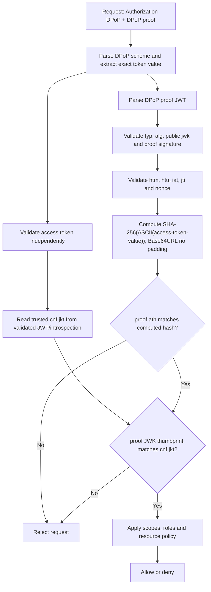

# ath và đối chiếu proof với đúng access token được trình

## 1. Vấn đề cần giải quyết

Trong OAuth 2.0, một **Bearer access token** có thể được sử dụng bởi bất kỳ bên nào đang nắm giữ token. Nếu token bị lộ, người lấy được token có thể thử dùng nó để gọi API cho tới khi token hết hạn hoặc bị thu hồi.

**DPoP (Demonstrating Proof of Possession)** theo RFC 9449 bổ sung một bằng chứng mật mã để ràng buộc access token với khóa công khai của client. Khi gọi Resource Server, client gửi:

- Access token được ràng buộc với khóa DPoP.
- Một DPoP proof JWT được ký bằng private key tương ứng.

Trong DPoP proof, claim **`ath`** chứa hash của **đúng access token đang được gửi trong request**. Resource Server tự tính lại hash từ token nhận được rồi so sánh với claim `ath` đã nằm trong proof có chữ ký.

Điều này giải quyết một tình huống quan trọng: một client có thể có nhiều access token được ràng buộc với cùng một DPoP key. Nếu proof chỉ chứng minh client nắm private key mà không ràng buộc giá trị token, proof bị chụp lại có thể bị ghép với access token khác. `ath` ngăn việc thay token như vậy.

> **Quy tắc cốt lõi:** Với protected-resource request dùng DPoP-bound access token, `ath` phải là Base64URL không padding của SHA-256 trên **ASCII bytes của chính access-token value được trình trong Authorization header**. Không hash payload JWT, không hash DPoP proof và không hash toàn bộ header.

## 2. DPoP proof và access token là hai JWT/credential khác nhau

Một điểm dễ nhầm là cả access token và DPoP proof đều có thể có cấu trúc JWT. Chúng có vai trò khác nhau:

| Thành phần | Vai trò | Dữ liệu quan trọng |
| --- | --- | --- |
| **Access token** | Credential được Resource Server xác minh để quyết định quyền truy cập. | `iss`, `sub`, `aud`, `exp`, scope; DPoP binding có thể nằm trong `cnf.jkt`. |
| **DPoP proof JWT** | Bằng chứng client sở hữu private key và proof được tạo cho request hiện tại. | JOSE `typ=dpop+jwt`, `alg`, public `jwk`; `jti`, `htm`, `htu`, `iat`, `ath` khi gửi access token. |
| **`ath`** | Ràng buộc proof với giá trị access token đang gửi. | Hash của access-token value theo công thức RFC 9449. |
| **`cnf.jkt`** | Ràng buộc access token với DPoP public key. | JWK SHA-256 thumbprint của public key. |

`ath` thuộc **payload của DPoP proof**, không phải claim thay thế cho `cnf.jkt` trong access token. Resource Server cần kiểm tra cả hai ràng buộc:

1. `ath` khớp chính xác với access token nhận được.
2. Public key trong DPoP proof khớp với public key đã được ràng buộc vào access token.

Ngoài ra, Resource Server còn xác minh chữ ký proof, HTTP method/URI, thời gian, replay identifier và nonce nếu được yêu cầu.

## 3. Vị trí của ath trong một request DPoP

Ví dụ một client gọi API:

```http
GET /resource HTTP/1.1
Host: resource.example.org
Authorization: DPoP <access-token-value>
DPoP: <signed-dpop-proof-jwt>
```

Trong đó:

- Scheme của `Authorization` là **`DPoP`**, không phải `Bearer`.
- `Authorization` chứa **access token**.
- Header `DPoP` chứa **proof JWT**.
- Payload proof chứa `ath` được tính từ access-token value ở header `Authorization`.

Một DPoP proof có thể có dạng khái niệm:

```json
{
  "typ": "dpop+jwt",
  "alg": "ES256",
  "jwk": {
    "kty": "EC",
    "crv": "P-256",
    "x": "<public-x>",
    "y": "<public-y>"
  }
}

{
  "jti": "unique-proof-id",
  "htm": "GET",
  "htu": "https://resource.example.org/resource",
  "iat": 1893452400,
  "ath": "<base64url-sha256-of-presented-access-token>"
}
```

Đây là payload minh họa, không phải proof có chữ ký hợp lệ. Header `jwk` chỉ được chứa **public key**, tuyệt đối không chứa private key.

## 4. Công thức ath chính xác

RFC 9449 định nghĩa `ath` là:

```text
ath = BASE64URL-ENCODE(SHA-256(ASCII(access_token_value)))
```

Các bước:

1. Lấy **giá trị access token** sau khi đã parse scheme và credential từ `Authorization: DPoP ...`.
2. Mã hóa chuỗi token thành **ASCII bytes**.
3. Tính digest bằng **SHA-256**.
4. Mã hóa digest bằng **Base64URL**.
5. Bỏ dấu padding `=` ở cuối.
6. Ghi kết quả vào claim `ath` của DPoP proof JWT.

Không dùng SHA-512, không dùng Base64 thông thường, không giữ padding, và không hash chuỗi `DPoP` đứng trước access token.

### 4.1. Ví dụ với Java

Một hàm tính `ath` độc lập:

```java
import java.nio.charset.StandardCharsets;
import java.security.MessageDigest;
import java.security.NoSuchAlgorithmException;
import java.util.Base64;

public final class DPoPProofHashes {

    private DPoPProofHashes() {
    }

    public static String accessTokenHash(String accessToken) {
        if (accessToken == null || accessToken.isEmpty()) {
            throw new IllegalArgumentException(
                    "Access token must not be empty");
        }

        // RFC 9449 hashes the ASCII encoding of the token value.
        for (int i = 0; i < accessToken.length(); i++) {
            if (accessToken.charAt(i) > 0x7f) {
                throw new IllegalArgumentException(
                        "Access token value must be ASCII");
            }
        }

        try {
            byte[] tokenBytes =
                    accessToken.getBytes(StandardCharsets.US_ASCII);

            byte[] digest = MessageDigest
                    .getInstance("SHA-256")
                    .digest(tokenBytes);

            return Base64.getUrlEncoder()
                    .withoutPadding()
                    .encodeToString(digest);
        }
        catch (NoSuchAlgorithmException ex) {
            // SHA-256 is required by the Java platform.
            throw new IllegalStateException(
                    "SHA-256 is unavailable", ex);
        }
    }
}
```

Hàm trên chỉ tính hash; nó **không xác minh chữ ký DPoP proof**, không kiểm tra access token và không cấp quyền.

### 4.2. Đối chiếu theo cách không phụ thuộc nội dung chuỗi

Sau khi proof đã được parse và xác minh chữ ký, Resource Server so sánh `ath`:

```java
import java.nio.charset.StandardCharsets;
import java.security.MessageDigest;

public final class DPoPAthVerifier {

    private DPoPAthVerifier() {
    }

    public static boolean matches(
            String presentedAccessToken,
            String proofAth) {

        if (presentedAccessToken == null
                || presentedAccessToken.isEmpty()
                || proofAth == null
                || proofAth.isEmpty()) {
            return false;
        }

        final String expected;
        try {
            expected = DPoPProofHashes.accessTokenHash(
                    presentedAccessToken);
        }
        catch (IllegalArgumentException ex) {
            return false;
        }

        byte[] expectedBytes =
                expected.getBytes(StandardCharsets.US_ASCII);
        byte[] actualBytes =
                proofAth.getBytes(StandardCharsets.US_ASCII);

        return MessageDigest.isEqual(
                expectedBytes, actualBytes);
    }
}
```

`MessageDigest.isEqual` được dùng để tránh so sánh chuỗi bằng logic dừng ngay ở ký tự khác đầu tiên. Trước khi gọi hàm này, ứng dụng vẫn cần xác nhận claim `ath` có đúng kiểu string và proof là JWT đã qua kiểm tra chữ ký.

**Không được chỉ kiểm tra `ath` rồi bỏ qua các kiểm tra DPoP còn lại.** Hash đúng chỉ chứng minh proof gắn với đúng giá trị token; nó không chứng minh token được cấp bởi issuer đáng tin hoặc proof được tạo cho request hiện tại.

## 5. Tại sao phải hash đúng token value được trình?

Giả sử client dùng cùng DPoP key để nhận hai access tokens:

```text
AT1 = access token dành cho resource owner / quyền A
AT2 = access token dành cho resource owner / quyền B

Proof P1 được ký bằng private key K:
  ath = H(AT1)
```

Nếu client gửi:

```http
Authorization: DPoP AT1
DPoP: P1
```

thì `ath` đúng.

Nhưng nếu ai đó thay access token:

```http
Authorization: DPoP AT2
DPoP: P1
```

thì Resource Server tính `H(AT2)`, trong khi proof đã ký chứa `H(AT1)`. Hai giá trị không khớp và request bị từ chối.

Đây là **token substitution protection**. Nếu không có `ath`, proof ký bằng cùng một key có thể bị ghép với access token khác cũng được ràng buộc với key đó, làm thay đổi quyền/resource owner của request.

### 5.1. ath ràng buộc giá trị token, cnf.jkt ràng buộc khóa

Hai phép kiểm tra bổ sung cho nhau:

| Kiểm tra | Câu hỏi | Nếu thất bại |
| --- | --- | --- |
| `ath` | Proof này được tạo cho **đúng access-token value** đang được trình không? | Proof không khớp token; từ chối. |
| `cnf.jkt` | DPoP proof có được ký bởi key đã gắn với access token không? | Người gửi không chứng minh được key binding; từ chối. |

Ví dụ:

```json
{
  "iss": "https://login.example.test",
  "sub": "user-123",
  "aud": ["orders-api"],
  "exp": 1893456000,
  "cnf": {
    "jkt": "base64url-jwk-sha256-thumbprint"
  }
}
```

Với JWT access token, `cnf.jkt` chứa JWK SHA-256 thumbprint của DPoP public key. Resource Server tính thumbprint theo RFC 7638 từ public JWK trong proof rồi đối chiếu. Với opaque token, AS có thể trả `cnf.jkt` trong introspection response; Resource Server tự kiểm tra key binding.

**Không được thay thế `cnf.jkt` bằng `ath` hoặc ngược lại.** Token hash và public-key thumbprint là hai giá trị khác nhau.

## 6. Phải hash chuỗi nào?

Đây là phần dễ gây lỗi interoperability nhất. Resource Server phải hash **credential value chính xác được trình**, sau khi HTTP authentication parser đã tách scheme.

| Giá trị | Có dùng làm input `ath` không? | Lý do |
| --- | --- | --- |
| `Kz~8mX...` (token value) | **Có** | Đây là access-token value. |
| `DPoP Kz~8mX...` | Không | Có thêm authentication scheme. |
| `Authorization: DPoP Kz~8mX...` | Không | Có tên header và scheme. |
| `Bearer Kz~8mX...` | Không | Đây không phải cách gửi DPoP-bound token. |
| JWT payload sau Base64URL decode | Không | Hash phải tính trên chuỗi token gốc, không phải payload JSON. |
| JWT header + payload | Không | Không phải access-token value đầy đủ. |
| DPoP proof JWT | Không | `ath` không hash proof. |
| Refresh token | Không | `ath` ràng buộc access token trong protected-resource request. |
| `cnf.jkt` | Không | Đây là thumbprint của public key. |

### 6.1. Không parse rồi serialize lại JWT

Ví dụ token JWT:

```text
eyJhbGciOiJSUzI1NiJ9.eyJzdWIiOiJ1c2VyLTEyMyJ9.signature
```

Hash phải tính trên **toàn bộ chuỗi compact token đúng như đã nhận**, gồm header segment, payload segment và signature segment, ngăn cách bởi dấu chấm.

Không được:

- Decode payload thành JSON rồi serialize lại.
- Sắp xếp lại JSON properties.
- Decode Base64URL từng segment rồi nối lại.
- Bỏ signature segment.
- Hash claim `sub` hoặc `jti`.
- Chuẩn hóa chữ hoa/thường.

Hai JWT có cùng payload nhưng khác header, signature, key hoặc byte representation vẫn là **hai token values khác nhau** và phải có `ath` khác nhau.

### 6.2. Không trim hoặc URL-decode token

HTTP parser phải tách đúng credential theo cú pháp authentication scheme. Sau khi đã lấy token value:

- Không tự gọi `trim()` để sửa token malformed.
- Không URL-decode `%xx`.
- Không đổi encoding.
- Không lower-case.
- Không loại ký tự ở đầu/cuối để cố làm hash khớp.

Nếu request có nhiều `Authorization` headers hoặc credential mơ hồ, hãy từ chối theo request parsing policy. Không tự chọn một token bất kỳ rồi bỏ qua phần còn lại.

### 6.3. Token opaque cũng phải được hash nguyên giá trị

`ath` không yêu cầu access token phải là JWT. Với opaque DPoP-bound token:

```text
Authorization: DPoP 8NsP2s0Y43randomopaque
DPoP: <proof with ath=H("8NsP2s0Y43randomopaque")>
```

Resource Server vẫn hash **ASCII bytes của chuỗi opaque token**. Không gọi introspection để “decode” opaque token trước khi tính `ath`.

## 7. Khi nào ath bắt buộc?

Theo RFC 9449, DPoP proof phải có `ath` khi được dùng cùng với **access token trong protected-resource access**.

| Request | Có access token được trình cùng proof? | `ath` |
| --- | --- | --- |
| Client gọi Resource Server bằng DPoP-bound access token | Có | **Bắt buộc**. |
| Client gọi Token Endpoint để đổi authorization code | Chưa có access token trong request | Không phải hash authorization code; không yêu cầu `ath` vì chưa trình access token. |
| Client gọi Token Endpoint với `grant_type=refresh_token` | Có refresh token, không phải access token | Không hash refresh token vào `ath`. |
| Client gọi Token Endpoint với client credentials grant | Chưa có access token được trình | Không có `ath` cho một access token chưa được cấp. |
| Client gọi Resource Server nhưng thiếu `ath` trong proof | Có access token | Proof không hợp lệ; từ chối. |

DPoP proof ở Token Endpoint vẫn phải có các claim cần thiết như `jti`, `htm`, `htu`, `iat`, chữ ký và nonce nếu AS yêu cầu. Chỉ riêng `ath` không được thêm vào để hash authorization code hoặc refresh token.

Khi refresh token cũng được sender-constrain bằng DPoP cho public client, client phải chứng minh cùng key theo policy của AS. Đó là kiểm tra key binding của refresh grant, không biến refresh token thành access token cho claim `ath`.

## 8. Các kiểm tra DPoP phải thực hiện cùng với ath

Một Resource Server không thể chấp nhận request chỉ vì `ath` khớp. Theo RFC 9449, việc kiểm tra proof gồm nhiều phần.

| Thành phần | Kiểm tra |
| --- | --- |
| Header `DPoP` | Chỉ có một header proof, value là một JWT hợp lệ. |
| JOSE `typ` | Phải là `dpop+jwt`. |
| JOSE `alg` | Phải là thuật toán chữ ký bất đối xứng được hỗ trợ/chấp nhận; không dùng `none` hoặc MAC symmetric. |
| JOSE `jwk` | Public key dùng xác minh chữ ký; không chứa private key. |
| JWS signature | Chữ ký proof xác minh được bằng public key trong `jwk`. |
| `htm` | Khớp HTTP method của request hiện tại. |
| `htu` | Khớp target URI của request theo quy tắc normalization của RFC; bỏ query và fragment. |
| `iat` | Proof được tạo trong cửa sổ thời gian chấp nhận được. |
| `jti` | Unique identifier; server có thể dùng để phát hiện replay và phải có chính sách replay phù hợp. |
| `nonce` | Nếu server đã cung cấp nonce, proof phải dùng nonce tương ứng. |
| `ath` | Khớp hash của đúng access token được trình. |
| `cnf.jkt` | Public key trong proof khớp key đã gắn với access token. |
| Access token | Bản thân token vẫn phải hợp lệ: issuer, audience, thời hạn, trạng thái, scope và policy khác. |

### 8.1. ath không thay thế htm và htu

Giả sử proof chứa:

```json
{
  "htm": "GET",
  "htu": "https://api.example.test/orders",
  "ath": "hash-of-access-token"
}
```

Nếu token đúng nhưng client dùng proof đó cho:

```http
DELETE /admin/users/123
```

thì `ath` vẫn có thể khớp token, nhưng `htm`/`htu` không khớp request. Request phải bị từ chối.

### 8.2. ath không tự chống replay

`ath` ràng buộc proof với access-token value, nhưng **không tự ngăn cùng proof bị gửi lại** cho cùng token. Resource Server vẫn phải kiểm tra:

- `jti` duy nhất trong cửa sổ hợp lệ và có replay cache/policy phù hợp.
- `iat` nằm trong thời gian cho phép.
- `htm`/`htu` khớp request hiện tại.
- `nonce` nếu server yêu cầu.

Mỗi HTTP request cần một DPoP proof mới. Khi retry request, client tạo proof mới với `jti` mới và `iat` mới; `ath` được tính lại từ access token đang dùng.

## 9. Quy trình xác minh ở Resource Server

Một luồng khái niệm:



Các bước có thể được thực hiện theo thứ tự tối ưu khác nhau, nhưng **không tạo Authentication đã xác thực và không cấp quyền trước khi mọi kiểm tra bắt buộc hoàn tất**.

### 9.1. JWT access token

Với JWT access token:

1. Xác minh chữ ký bằng key/issuer tin cậy.
2. Kiểm tra `iss`, `aud`, `exp`, `nbf` và token profile.
3. Đọc `cnf.jkt` từ claims **đã xác minh**.
4. Xác minh DPoP proof và `ath`.
5. Tính JWK thumbprint của public key trong proof, so sánh với `cnf.jkt`.
6. Áp dụng authorization.

Không đọc `cnf.jkt` từ JWT payload chưa xác minh rồi coi đó là trust data.

### 9.2. Opaque access token

Với opaque DPoP-bound token:

1. Resource Server introspect token qua endpoint đã cấu hình.
2. AS trả `active` và metadata token, bao gồm `cnf.jkt` theo DPoP contract.
3. Resource Server xác nhận token active và các metadata cần thiết.
4. Resource Server tự xác minh DPoP proof, `ath` và key thumbprint.

Theo RFC 9449, Resource Server **không gửi DPoP proof trong introspection request**. AS trả metadata key binding; Resource Server tự kiểm tra proof/key binding tại protected-resource request.

## 10. Tạo DPoP proof có ath bằng Java và Nimbus

Ví dụ sau minh họa phía client dùng RSA key để ký proof. Trong production, key phải được giữ an toàn và không export nếu nền tảng hỗ trợ non-exportable key.

```java
import java.time.Instant;
import java.util.UUID;

import com.nimbusds.jose.jwk.JWKSet;
import com.nimbusds.jose.jwk.RSAKey;
import com.nimbusds.jose.jwk.source.JWKSource;
import com.nimbusds.jose.proc.SecurityContext;

import org.springframework.security.oauth2.jose.jws.SignatureAlgorithm;
import org.springframework.security.oauth2.jwt.Jwt;
import org.springframework.security.oauth2.jwt.JwtClaimsSet;
import org.springframework.security.oauth2.jwt.JwtEncoderParameters;
import org.springframework.security.oauth2.jwt.JwsHeader;
import org.springframework.security.oauth2.jwt.NimbusJwtEncoder;

public final class DPoPProofFactory {

    private final NimbusJwtEncoder encoder;

    public DPoPProofFactory(RSAKey dpopKey) {
        JWKSource<SecurityContext> jwkSource =
                (selector, context) ->
                        selector.select(new JWKSet(dpopKey));

        this.encoder = new NimbusJwtEncoder(jwkSource);
    }

    public String createForResourceRequest(
            String accessToken,
            String method,
            String targetUri,
            String nonce) {

        Instant now = Instant.now();

        JwsHeader header = JwsHeader
                .with(SignatureAlgorithm.RS256)
                .type("dpop+jwt")
                .jwk(dpopKey.toPublicJWK().toJSONObject())
                .build();

        JwtClaimsSet.Builder claims = JwtClaimsSet.builder()
                .issuedAt(now)
                .id(UUID.randomUUID().toString())
                .claim("htm", method)
                .claim("htu", targetUri)
                .claim("ath",
                        DPoPProofHashes.accessTokenHash(accessToken));

        if (nonce != null && !nonce.isBlank()) {
            claims.claim("nonce", nonce);
        }

        Jwt proof = this.encoder.encode(
                JwtEncoderParameters.from(header, claims.build()));

        return proof.getTokenValue();
    }
}
```

`.jwk(...)` cần nhận public JWK tương ứng với private key đang ký, ví dụ `dpopKey.toPublicJWK().toJSONObject()`. Trong code thực tế, tạo header với:

```java
.jwk(dpopKey.toPublicJWK().toJSONObject())
```

**Lưu ý quan trọng:**

- `accessToken` phải là đúng token value sẽ được đặt sau scheme `DPoP` trong request.
- `method` và `targetUri` phải phản ánh request thực tế.
- `nonce` chỉ thêm khi server yêu cầu/đang áp dụng nonce policy; nếu server đã gửi nonce, client phải đưa đúng nonce vào proof tiếp theo.
- `jti` phải mới cho từng request proof.
- Header `jwk` chỉ chứa public JWK.
- `RSAKey` ở ví dụ chứa private key để ký ở client; không gửi private key tới Resource Server.

Đây là code minh họa tạo proof; production cần thêm xử lý URI normalization, key lifecycle, clock, nonce cache và error handling.

## 11. Ví dụ request hoàn chỉnh

Client gửi access token `AT1` và proof `P1`:

```http
GET /api/orders HTTP/1.1
Host: api.example.test
Authorization: DPoP AT1
DPoP: P1
```

Trong proof `P1`:

```json
{
  "htm": "GET",
  "htu": "https://api.example.test/api/orders",
  "iat": 1893452400,
  "jti": "proof-unique-001",
  "ath": "BASE64URL_SHA256_OF_AT1"
}
```

Resource Server:

1. Parse đúng `AT1` từ header `Authorization`.
2. Tính `H(AT1)`.
3. So sánh với `P1.ath`.
4. Xác minh proof signature và key binding.
5. Xác minh access token theo JWT decoder hoặc introspector.
6. Kiểm tra method, URI, timestamp, replay và nonce.
7. Chỉ khi tất cả đạt mới áp dụng scope/authorization.

Nếu client thay token thành `AT2` nhưng vẫn gửi `P1`:

```http
GET /api/orders HTTP/1.1
Host: api.example.test
Authorization: DPoP AT2
DPoP: P1
```

thì:

```text
Expected ath = H(AT2)
Received proof ath = H(AT1)
Expected ath != Received proof ath
Result = reject
```

Ngay cả khi `AT1` và `AT2` cùng được ràng buộc với một public key, proof vẫn không thể được chuyển sang token khác.

## 12. DPoP token request và refresh request không hash refresh token vào ath

DPoP cũng được dùng tại Token Endpoint. Ví dụ client đổi authorization code:

```http
POST /oauth2/token HTTP/1.1
Host: login.example.test
Content-Type: application/x-www-form-urlencoded
DPoP: <proof-for-token-endpoint>

grant_type=authorization_code&code=<authorization-code>&code_verifier=<pkce-verifier>
```

Proof cho Token Endpoint phải có `htm`/`htu` phù hợp với token request, `jti`/`iat` và nonce nếu AS yêu cầu. Vì request chưa trình access token, không tính `ath` từ authorization code.

Với refresh request:

```http
POST /oauth2/token HTTP/1.1
Host: login.example.test
Content-Type: application/x-www-form-urlencoded
DPoP: <fresh-proof-for-token-endpoint>

grant_type=refresh_token&refresh_token=<refresh-token>
```

`ath` không phải hash của refresh token. DPoP key binding của refresh token (nếu AS cấp refresh token ràng buộc khóa) được kiểm tra theo refresh-token grant policy riêng.

Khi AS cấp access token mới, token value đã thay đổi. Request tới Resource Server phải tạo proof mới và tính **`ath` mới từ access token mới**.

## 13. Access token rotation làm ath thay đổi

Giả sử:

```text
Access token cũ: AT1
Access token mới: AT2
DPoP key: K (không đổi)
```

Mặc dù cùng key K, hash:

```text
ath1 = H(AT1)
ath2 = H(AT2)
```

khác nhau với xác suất va chạm không đáng kể của SHA-256. Client không được dùng proof cũ cho token mới.

| Tình huống | Proof | Kết quả |
| --- | --- | --- |
| AT1 + proof có `ath=H(AT1)` | Đúng token | Có thể qua bước ath nếu các kiểm tra khác đạt. |
| AT2 + proof cũ có `ath=H(AT1)` | Sai token | Từ chối. |
| AT2 + proof mới có `ath=H(AT2)` | Đúng token | Có thể qua bước ath nếu các kiểm tra khác đạt. |
| AT2 + proof mới nhưng dùng key khác với `cnf.jkt` | Token đúng, key sai | Từ chối key binding. |

Điều này cũng giúp client tránh vô tình tái sử dụng một proof sau khi authorized-client manager vừa refresh access token.

## 14. Xử lý lỗi ath và DPoP proof

Resource Server cần phân loại lỗi để client biết cách tạo proof mới hoặc thay token.

| Lỗi | Nguyên nhân | Hành động phía server |
| --- | --- | --- |
| Thiếu `DPoP` header | Client không gửi proof. | Từ chối DPoP authentication; trả DPoP challenge. |
| Thiếu `ath` khi trình access token | Proof không theo contract protected-resource access. | Từ chối proof, thường `invalid_dpop_proof`. |
| `ath` không khớp token | Proof được tạo cho token khác hoặc client tính hash sai. | Từ chối; không gọi business handler. |
| Proof signature sai | Proof không chứng minh được private-key possession. | Từ chối proof. |
| `cnf.jkt` mismatch | Proof key không phải key ràng buộc vào token. | Từ chối token/key binding. |
| `htm` hoặc `htu` mismatch | Proof không dành cho request hiện tại. | Từ chối proof. |
| `iat` quá cũ/quá xa tương lai | Proof nằm ngoài time window. | Từ chối proof. |
| `jti` đã dùng | Proof bị replay theo replay policy. | Từ chối proof. |
| Nonce thiếu/sai | Server yêu cầu nonce mới. | Trả `use_dpop_nonce` cùng `DPoP-Nonce` khi phù hợp. |
| Access token hết hạn/revoked | Credential không còn hợp lệ. | Từ chối token bằng lỗi token phù hợp. |

Ví dụ proof không hợp lệ:

```http
HTTP/1.1 401 Unauthorized
WWW-Authenticate: DPoP error="invalid_dpop_proof"
```

Ví dụ access token hoặc key binding không hợp lệ:

```http
HTTP/1.1 401 Unauthorized
WWW-Authenticate: DPoP error="invalid_token"
```

Ví dụ server yêu cầu nonce:

```http
HTTP/1.1 401 Unauthorized
WWW-Authenticate: DPoP error="use_dpop_nonce"
DPoP-Nonce: <server-generated-nonce>
```

Client cần tạo **proof mới** chứa nonce, `jti` mới và `ath` của access token đang dùng. Không sửa payload của JWT proof cũ sau khi ký; mọi thay đổi đều làm chữ ký không còn hợp lệ.

## 15. DPoP và Bearer không được downgrade lẫn nhau

DPoP-bound access token được gửi với:

```http
Authorization: DPoP <access-token>
DPoP: <proof>
```

Không gửi token đó như:

```http
Authorization: Bearer <access-token>
```

Resource Server hỗ trợ đồng thời Bearer và DPoP phải **từ chối DPoP-bound access token nếu nó được trình dưới Bearer scheme**. Nếu không, attacker có thể bỏ proof và quay lại đặc tính bearer: ai có token cũng dùng được.

Một hệ thống có thể hỗ trợ hai scheme cho **hai loại token khác nhau**, nhưng phải phân biệt token nào được sender-constrain. Không chỉ nhìn header scheme rồi cho phép mọi token qua.

### 15.1. Duplicate hoặc ambiguous credentials

Không chấp nhận một request mơ hồ như:

```http
Authorization: Bearer AT1
Authorization: DPoP AT2
DPoP: proof-for-AT2
```

RFC 9449 khuyến nghị Resource Server phát hiện trường hợp gửi nhiều phương thức credential và từ chối `invalid_request`. Parser/proxy không được âm thầm chọn một header khác với header mà application sử dụng.

## 16. ath khác at_hash trong OpenID Connect

Tên hai claim gần nhau nhưng chúng thuộc hai ngữ cảnh:

| Claim | Nằm ở đâu? | Mục đích |
| --- | --- | --- |
| `ath` | Payload DPoP proof JWT. | Ràng buộc DPoP proof với access token được trình tại Resource Server. |
| `at_hash` | OIDC ID token trong một số flow. | Ràng buộc ID token với access token theo quy tắc OpenID Connect. |

Không dùng `at_hash` thay `ath`, và không lấy `ath` làm kiểm tra OIDC ID token. Dù cùng liên quan đến access token và hash, chúng có vị trí, quy tắc tính và mục đích giao thức khác nhau.

## 17. DPoP với opaque token introspection

DPoP không chỉ dùng cho JWT access token. Với opaque token, Resource Server có thể nhận thông tin key binding qua introspection.

Ví dụ response:

```json
{
  "active": true,
  "sub": "user-123",
  "scope": "orders:read",
  "cnf": {
    "jkt": "base64url-jwk-sha256-thumbprint"
  }
}
```

Resource Server:

1. Gửi opaque access token tới introspection endpoint đã cấu hình.
2. Kiểm tra `active=true` và các metadata cần thiết.
3. Đọc `cnf.jkt` từ response đã xác thực qua channel tin cậy.
4. Xác minh DPoP proof signature và các claim.
5. Tính `ath` từ chính opaque token string nhận trong Authorization header.
6. So sánh proof public-key thumbprint với `cnf.jkt`.

Introspection request không cần DPoP proof của protected-resource request. Resource Server thực hiện xác minh DPoP binding tại chỗ dựa trên metadata từ AS.

## 18. Spring Security: cấu hình và giới hạn theo phiên bản/stack

### 18.1. Servlet Resource Server trong Spring Security 7.1+

Spring Security có hỗ trợ DPoP cho **Servlet-based Resource Server**. Trong các bản có DPoP configurer, có thể cấu hình:

```java
@Bean
SecurityFilterChain api(HttpSecurity http) throws Exception {
    return http
            .authorizeHttpRequests(authorize -> authorize
                    .anyRequest().authenticated())
            .oauth2ResourceServer(oauth2 -> oauth2
                    .jwt(Customizer.withDefaults())
                    .dPoP(Customizer.withDefaults()))
            .build();
}
```

`dPoP(...)` của `OAuth2ResourceServerConfigurer` được đánh dấu từ **Spring Security 7.1**. `DPoPAuthenticationProvider` xuất hiện từ 6.5, nhưng cần phân biệt API provider với DSL cấu hình đầy đủ. Kiểm tra đúng Javadoc của version dự án trước khi copy cấu hình.

Với cấu hình chuẩn, DPoP support tích hợp xác minh proof và key binding với token authentication manager. Không cần tự viết một claim validator cho access token để “kiểm tra ath”: `ath` thuộc proof JWT và cần được kiểm tra trong DPoP authentication flow.

### 18.2. Không nhầm DPoP proof decoder với access-token decoder

Resource Server có hai đối tượng cần xác minh:

- **Access-token decoder/introspector**: xác minh access token theo issuer, signature/active state, audience và claims.
- **DPoP proof verifier**: xác minh proof JWT theo `typ`, `alg`, `jwk`, `htm`, `htu`, `iat`, `jti`, `nonce` và `ath`.

Chỉ cấu hình:

```java
.oauth2ResourceServer(oauth2 ->
        oauth2.jwt(Customizer.withDefaults()))
```

thì không nên mặc định rằng proof JWT đã được xác minh. JWT decoder thông thường được cấu hình cho **access token**, không tự động hiểu một JWT header riêng `DPoP`.

### 18.3. WebFlux cần kiểm tra khả năng hỗ trợ riêng

Trong tài liệu Spring Security hiện hành, DPoP Resource Server configurer được mô tả trong **Servlet stack** (`HttpSecurity`/`SecurityFilterChain`). Tài liệu OAuth2 WebFlux mô tả `ReactiveJwtDecoder` và `ReactiveOpaqueTokenIntrospector`, nhưng không nên suy ra rằng:

```java
.oauth2ResourceServer(oauth2 ->
        oauth2.jwt(Customizer.withDefaults()))
```

tự kiểm tra `DPoP` header hoặc `ath`.

Nếu ứng dụng WebFlux cần DPoP, phải xác nhận version có reactive DPoP API tương ứng. Nếu không có, cần thiết kế custom reactive authentication/filter pipeline hoặc triển khai tại gateway tin cậy, bảo đảm đầy đủ RFC 9449 và không dùng `block()` trên event-loop. Đừng đưa Servlet `DPoPAuthenticationProvider` hoặc Servlet filter vào `SecurityWebFilterChain` rồi coi đó là reactive integration.

### 18.4. Không dùng OAuth2TokenValidator để thay thế DPoP proof verifier

`OAuth2TokenValidator<Jwt>` thường được gắn vào access-token decoder để kiểm tra claim access token. `ath` là claim trong **proof JWT**; nó cần access-token value của request để so sánh. Validator access token không có đủ ngữ cảnh HTTP để tự xác minh proof signature, `htm`, `htu` và replay state.

Tách trách nhiệm:

| Thành phần | Việc cần làm |
| --- | --- |
| Access-token decoder/introspector | Xác minh token và lấy `cnf.jkt` đáng tin. |
| DPoP proof verifier | Xác minh proof JWT, `ath`, request binding, key binding, nonce và replay. |
| Authorization layer | Kiểm tra scope, role, tenant và quyền trên resource. |

## 19. Kiểm thử ath

Một bộ test tốt cần có positive và negative cases, không chỉ test proof đúng.

| Case | Access token được gửi | `ath` trong proof | Kết quả |
| --- | --- | --- | --- |
| ATH-01 | `AT1` | `H(AT1)` | Qua bước ath nếu các kiểm tra khác đạt. |
| ATH-02 | `AT1` | `H(AT2)` | Từ chối. |
| ATH-03 | `AT2` | Proof cũ `H(AT1)` | Từ chối. |
| ATH-04 | Opaque token `O1` | `H(O1)` | Qua bước ath; introspection/key binding còn phải đạt. |
| ATH-05 | `AT1` | Thiếu `ath` | Từ chối. |
| ATH-06 | `AT1` | Chuỗi rỗng hoặc sai format | Từ chối. |
| ATH-07 | `AT1` | Hash dùng Base64 có padding | Từ chối nếu không bằng Base64URL no-padding expected value. |
| ATH-08 | `AT1` | Hash SHA-512 | Từ chối. |
| ATH-09 | `AT1` | Hash payload JWT thay vì token compact | Từ chối. |
| ATH-10 | `AT1` | Hash chuỗi `DPoP AT1` | Từ chối. |
| ATH-11 | `AT1` | Hash đúng nhưng proof signature sai | Từ chối. |
| ATH-12 | `AT1` | Hash đúng, `cnf.jkt` khác proof key | Từ chối. |
| ATH-13 | `AT1` | Hash đúng nhưng `htm` sai | Từ chối. |
| ATH-14 | `AT1` | Hash đúng nhưng `htu` sai | Từ chối. |
| ATH-15 | `AT1` | Hash đúng nhưng `jti` đã replay | Từ chối theo replay policy. |
| ATH-16 | `AT1` | Hash đúng nhưng nonce sai/thiếu khi bắt buộc | Từ chối và challenge nonce phù hợp. |
| ATH-17 | `AT1` gửi bằng Bearer scheme | Proof không có/không xử lý | DPoP-bound token không được downgrade thành Bearer. |
| ATH-18 | `AT1` | Proof tạo cho Token Endpoint | Từ chối vì `htu`/request binding không khớp; không yêu cầu `ath` ở token endpoint. |

### 19.1. Unit test tính hash với vector cố định

RFC 9449 cung cấp ví dụ access token và `ath`. Có thể dùng vector đã công bố để kiểm tra implementation:

```java
import static org.junit.jupiter.api.Assertions.assertEquals;
import static org.junit.jupiter.api.Assertions.assertNotEquals;

import org.junit.jupiter.api.Test;

class DPoPProofHashesTest {

    @Test
    void computesRfc9449AccessTokenHash() {
        String accessToken =
                "Kz~8mXK1EalYznwH-LC-1fBAo."
              + "4Ljp~zsPE_NeO.gxU";

        assertEquals(
                "fUHyO2r2Z3DZ53EsNrWBb0xWXoaNy59IiKCAqksmQEo",
                DPoPProofHashes.accessTokenHash(accessToken));
    }

    @Test
    void changingOneTokenCharacterChangesAth() {
        String first =
                "Kz~8mXK1EalYznwH-LC-1fBAo."
              + "4Ljp~zsPE_NeO.gxU";
        String second =
                "Kz~8mXK1EalYznwH-LC-1fBAo."
              + "4Ljp~zsPE_NeO.gxV";

        assertNotEquals(
                DPoPProofHashes.accessTokenHash(first),
                DPoPProofHashes.accessTokenHash(second));
    }
}
```

Test thứ hai cần import thêm `assertNotEquals`. Vector cố định giúp phát hiện lỗi dùng SHA-512, Base64 sai alphabet hoặc giữ padding.

### 19.2. Test so sánh token với proof

```java
@Test
void proofMustMatchThePresentedAccessToken() {
    String token1 = "access-token-one";
    String token2 = "access-token-two";

    String proofAth = DPoPProofHashes.accessTokenHash(token1);

    assertTrue(DPoPAthVerifier.matches(token1, proofAth));
    assertFalse(DPoPAthVerifier.matches(token2, proofAth));
}
```

Đây là unit test hàm so sánh, không phải integration test DPoP. Nó không xác minh proof JWT signature hoặc key binding.

### 19.3. Integration test qua Resource Server

Dùng test key pair riêng, tạo access token và DPoP proof có chữ ký thật:

1. Access token JWT chứa `cnf.jkt` đúng public key thumbprint.
2. DPoP proof có `typ=dpop+jwt`, asymmetric `alg`, public `jwk`, `htm`, `htu`, `iat`, `jti` và `ath` đúng.
3. Gửi `Authorization: DPoP <token>` và `DPoP: <proof>` qua HTTP test client.
4. Assert request hợp lệ đi qua authentication và tới endpoint.
5. Thay access token nhưng giữ proof cũ; assert bị từ chối và controller không được gọi.
6. Giữ token, đổi `ath` rồi ký proof bằng test key; assert bị từ chối.
7. Giữ `ath` đúng nhưng đổi `cnf.jkt` hoặc proof key; assert bị từ chối.
8. Giữ `ath` đúng nhưng thay `htm`/`htu`; assert bị từ chối.
9. Gửi lại cùng `jti` trong replay window; assert bị từ chối nếu replay detection được bật.
10. Test nonce challenge và proof mới có nonce.

Đây mới là bằng chứng cho **toàn bộ DPoP authentication path**. Mock một `Jwt` hoặc gọi controller trực tiếp không chứng minh DPoP proof đã được xác minh.

### 19.4. Test opaque token

Mock introspection server trả:

```json
{
  "active": true,
  "cnf": {
    "jkt": "<test-key-thumbprint>"
  }
}
```

Sau đó gửi opaque token và proof:

- `ath` đúng opaque token, key đúng → có thể authenticated.
- `ath` của opaque token khác → từ chối.
- `cnf.jkt` khác proof key → từ chối.
- `active=false` → token bị từ chối dù `ath` đúng.

Điều này chứng minh `ath` không phụ thuộc token là JWT hay opaque; nó phụ thuộc đúng **token value** được trình.

## 20. Lỗi thường gặp khi triển khai

### Lỗi 1 — Hash decoded JWT payload

`ath` hash compact access-token value. Hash JSON payload làm sai protocol và có thể cho cùng payload nhưng token/signature khác vẫn có hash giống nhau.

### Lỗi 2 — Hash cả chuỗi Authorization

`Authorization: DPoP` là cú pháp HTTP, không phải token value. Phải tách scheme và hash credential.

### Lỗi 3 — Hash DPoP proof thay vì access token

`ath` liên kết proof với access token. Không hash proof JWT hoặc public JWK.

### Lỗi 4 — Dùng Base64 thường hoặc giữ padding

RFC yêu cầu Base64URL encoding không padding. Chuỗi khác encoding dù cùng digest vẫn không match.

### Lỗi 5 — Dùng SHA-512 hoặc thuật toán lấy từ header

RFC 9449 định nghĩa SHA-256 cho `ath`. Không cho client tự chọn thuật toán hash từ proof header.

### Lỗi 6 — So sánh ath mà không xác minh proof signature

Attacker có thể tự tạo payload có `ath` đúng. Chỉ proof có chữ ký hợp lệ bằng private key tương ứng mới chứng minh possession.

### Lỗi 7 — So sánh ath mà không kiểm tra cnf.jkt

Hash token đúng không chứng minh key dùng ký proof là key đã được AS ràng buộc vào token.

### Lỗi 8 — Nghĩ ath chống replay

Một proof có ath đúng vẫn có thể bị replay với cùng token. Cần `jti`, `iat`, nonce và replay cache/policy.

### Lỗi 9 — Dùng proof cũ sau khi refresh token

Access token mới có giá trị khác, nên `ath` cũ không khớp. Tạo proof mới cho token mới.

### Lỗi 10 — Yêu cầu ath ở Token Endpoint

Khi request tới Token Endpoint chưa trình access token, không hash authorization code hoặc refresh token vào `ath`.

### Lỗi 11 — Nhầm ath với at_hash

Hai claim thuộc hai giao thức/ngữ cảnh khác nhau. Không thay thế cho nhau.

### Lỗi 12 — Cho phép DPoP-bound token dùng Bearer scheme

Điều này làm mất sender constraint. Resource Server hỗ trợ DPoP phải từ chối token DPoP-bound nếu client trình như Bearer.

### Lỗi 13 — Coi DPoP proof là access token

Proof chỉ chứng minh key possession/request binding; nó không tự cấp quyền. Access token vẫn phải được xác minh độc lập.

### Lỗi 14 — Cho rằng .jwt() trong WebFlux tự xác minh DPoP

Reactive JWT decoder xử lý access token JWT; DPoP proof là một JWT riêng với request context riêng. Phải xác nhận reactive DPoP support của version hoặc tự xây integration đầy đủ.

## 21. Bảo mật key, token và log

DPoP giảm tác động khi access token bị đánh cắp riêng lẻ, nhưng không thay thế bảo vệ client và TLS.

### 21.1. Bảo vệ private key

- Dùng secure keystore/platform key store khi có thể.
- Không đưa private key vào `jwk` trong proof.
- Không log private JWK, key material hoặc proof signing secret.
- Xác định lifecycle và rotation của DPoP key.
- Nếu đổi key, token đang ràng buộc với key cũ không tự chuyển sang key mới; cần cấp token mới theo authorization flow.

### 21.2. Không log token/proof thô

Không ghi:

```java
log.debug("Authorization={}, DPoP={}", authorization, dpopProof);
```

Token và proof có thể bị dùng lại trong thời gian hợp lệ nếu bị lộ. Log chỉ nên chứa correlation ID, route, kết quả phân loại và internal metrics đã giảm cardinality.

### 21.3. DPoP không thay HTTPS

DPoP là cơ chế application-level sender constraint. Nó không thay thế TLS, không đảm bảo integrity cho toàn bộ request body/header và không loại bỏ XSS. Resource Server và client vẫn phải sử dụng HTTPS, kiểm soát proxy/URI reconstruction và bảo vệ client execution context.

## 22. Kết hợp DPoP với nonce và replay detection

Resource Server có thể yêu cầu nonce để hạn chế proof được tạo trước quá xa:

```http
HTTP/1.1 401 Unauthorized
WWW-Authenticate: DPoP error="use_dpop_nonce"
DPoP-Nonce: <nonce-issued-by-resource-server>
```

Client cần:

1. Lưu nonce gắn với đúng Resource Server đã phát nó.
2. Tạo proof mới với `jti` mới.
3. Thêm claim `nonce` đúng giá trị.
4. Giữ `htm`/`htu` theo request hiện tại.
5. Tính lại `ath` từ access token đang trình.
6. Ký proof mới bằng cùng DPoP key được ràng buộc với token.

Nonce từ Authorization Server không được dùng thay nonce của Resource Server và ngược lại. Mỗi nonce chỉ được sử dụng với server đã cấp nó.

### 22.1. Replay cache

Một replay cache có thể lưu cặp:

```text
(proof-key-thumbprint, jti) -> expiry-time
```

hoặc một key định danh proof tương đương theo policy. Khi nhận proof mới:

- Nếu `jti` đã tồn tại trong thời gian hợp lệ, từ chối.
- Nếu chưa tồn tại, ghi nhận atomically trước khi cho request đi tiếp.
- TTL phải bao phủ proof acceptance window.
- Trong cluster, replay detection cần state dùng chung hoặc chiến lược đảm bảo mọi node không chấp nhận cùng proof.

Không chỉ cache `ath`: cùng access token có thể được dùng cho nhiều request hợp lệ với proof mới. Cache theo access token sẽ vô tình chặn client sử dụng token bình thường.

## 23. Ma trận kiểm thử tổng hợp

| Nhóm | Đầu vào | Kết quả mong đợi |
| --- | --- | --- |
| Access token | JWT hợp lệ, đúng issuer/audience/exp | Token layer pass. |
| Access token | JWT hết hạn hoặc sai signature | Reject token. |
| Access token | Opaque token `active=false` | Reject token. |
| DPoP header | Không có proof | Reject DPoP request. |
| DPoP header | Nhiều proof headers hoặc JWT malformed | Reject. |
| Proof header | `typ` khác `dpop+jwt` | Reject proof. |
| Proof header | `alg=none` hoặc symmetric algorithm | Reject proof. |
| Proof key | JWK có private parameters | Reject proof. |
| Proof signature | Chữ ký sai | Reject proof. |
| Request binding | `htm`/`htu` sai | Reject proof. |
| Proof time | `iat` quá cũ/tương lai ngoài policy | Reject proof. |
| Replay | `jti` đã dùng | Reject proof. |
| Nonce | Server yêu cầu nhưng proof thiếu/sai | Challenge `use_dpop_nonce`. |
| ath | Thiếu `ath` | Reject proof. |
| ath | `ath` = hash token khác | Reject proof. |
| ath | `ath` = hash đúng access token value | Qua bước ath. |
| Key binding | `cnf.jkt` khác proof JWK thumbprint | Reject token binding. |
| Authentication scheme | DPoP-bound token gửi bằng Bearer | Reject downgrade. |
| Authorization | Token/proof hợp lệ nhưng thiếu scope | 403 theo policy. |
| Domain | Token/proof/scope hợp lệ nhưng sai tenant/owner | 403/404 theo policy. |

### 23.1. Ma trận thay token

| Request | Access token | Proof ath | Kết quả |
| --- | --- | --- | --- |
| R1 | AT1 | H(AT1) | Pass ath. |
| R2 | AT1 | H(AT2) | Fail ath. |
| R3 | AT2 | H(AT1) | Fail ath. |
| R4 | AT2 | H(AT2) | Pass ath. |
| R5 | AT2 | H(AT2), nhưng key sai | Fail `cnf.jkt`. |
| R6 | AT2 | H(AT2), proof replay | Fail replay policy. |

Ma trận này cho thấy **ath chỉ là một lớp ràng buộc**, không thay thế các bước xác thực khác.

## 24. Câu hỏi tự kiểm tra

**1. `ath` là gì?** Claim trong DPoP proof JWT, chứa hash của access token được trình cùng proof.

**2. Công thức `ath` là gì?** Base64URL không padding của SHA-256 trên ASCII bytes của access-token value.

**3. `ath` nằm trong access token hay DPoP proof?** Nằm trong payload của DPoP proof.

**4. Resource Server hash chuỗi nào?** Giá trị token sau khi parse từ `Authorization: DPoP <token>`, không gồm scheme/header.

**5. Có hash payload JWT thay vì compact token được không?** Không.

**6. Opaque access token có dùng `ath` không?** Có. Hash chuỗi opaque token value theo cùng công thức.

**7. `ath` khác `cnf.jkt` thế nào?** `ath` ràng buộc proof với token value; `cnf.jkt` ràng buộc token với proof public key.

**8. `ath` có thay thế kiểm tra chữ ký DPoP proof không?** Không.

**9. `ath` có tự ngăn replay không?** Không. Cần `jti`, `iat`, nonce và replay policy.

**10. Khi refresh tạo access token mới, có dùng proof cũ không?** Không. Phải tính `ath` mới và tạo proof mới.

**11. Có cần `ath` ở token endpoint khi đổi authorization code không?** Không, vì request chưa trình access token.

**12. Có hash refresh token vào `ath` không?** Không.

**13. DPoP-bound token có thể gửi bằng Bearer scheme không?** Resource Server hỗ trợ DPoP phải từ chối downgrade đó.

**14. Nếu `ath` đúng nhưng `htu` sai thì sao?** Từ chối proof vì proof không dành cho request hiện tại.

**15. Nếu `ath` đúng nhưng `cnf.jkt` sai thì sao?** Từ chối vì client không chứng minh đúng key đã ràng buộc với token.

**16. `at_hash` trong OIDC có thay `ath` không?** Không; chúng thuộc các giao thức/ngữ cảnh khác nhau.

**17. `.oauth2ResourceServer().jwt()` có tự xác minh DPoP proof không?** Không nên giả định. Cần DPoP support cụ thể của framework/stack.

**18. Vì sao phải tạo proof mới khi retry?** Mỗi HTTP request cần proof riêng; `jti`/`iat`/`htm`/`htu` và nonce phải phù hợp request mới.

## 25. Tài liệu tham khảo chính thức

- **RFC 9449 — OAuth 2.0 Demonstrating Proof of Possession (DPoP):** định nghĩa `ath`, cấu trúc proof, protected-resource validation, key binding, nonce và replay considerations. https://www.rfc-editor.org/rfc/rfc9449
- **RFC 7515 — JSON Web Signature (JWS):** chữ ký proof JWT và Base64URL encoding. https://www.rfc-editor.org/rfc/rfc7515
- **RFC 7517 — JSON Web Key (JWK):** biểu diễn public key trong DPoP proof. https://www.rfc-editor.org/rfc/rfc7517
- **RFC 7638 — JSON Web Key (JWK) Thumbprint:** tính `cnf.jkt` từ public JWK. https://www.rfc-editor.org/rfc/rfc7638
- **RFC 7662 — OAuth 2.0 Token Introspection:** metadata token và active state cho opaque access token. https://www.rfc-editor.org/rfc/rfc7662
- **RFC 6750 — OAuth 2.0 Bearer Token Usage:** đối chiếu sự khác nhau giữa Bearer và DPoP authentication schemes. https://www.rfc-editor.org/rfc/rfc6750
- **Spring Security Reference — OAuth 2.0 DPoP-bound Access Tokens (Servlet):** https://docs.spring.io/spring-security/reference/servlet/oauth2/resource-server/dpop-tokens.html
- **Spring Security API — DPoPAuthenticationProvider:** https://docs.spring.io/spring-security/reference/api/java/org/springframework/security/oauth2/server/resource/authentication/DPoPAuthenticationProvider.html
- **Spring Security API — OAuth2ResourceServerConfigurer.DPoPConfigurer:** https://docs.spring.io/spring-security/reference/api/java/org/springframework/security/config/annotation/web/configurers/oauth2/server/resource/OAuth2ResourceServerConfigurer.DPoPConfigurer.html
- **Spring Security Reference — Reactive OAuth2 Resource Server:** https://docs.spring.io/spring-security/reference/reactive/oauth2/

## 26. Kết luận

`ath` là claim ràng buộc DPoP proof với **đúng access-token value đang được trình**. Resource Server tính:

```java
String expectedAth = Base64.getUrlEncoder()
        .withoutPadding()
        .encodeToString(
                MessageDigest.getInstance("SHA-256")
                        .digest(accessToken.getBytes(StandardCharsets.US_ASCII)));
```

rồi so sánh với `ath` trong proof đã xác minh chữ ký. Cách này ngăn proof được ghép với một access token khác, kể cả khi hai token dùng cùng DPoP key.

Tuy nhiên, `ath` chỉ giải quyết **proof-to-token binding**. Resource Server vẫn phải kiểm tra `cnf.jkt` để xác nhận proof key đúng, `htm`/`htu` để xác nhận request, `iat`/`jti`/nonce để hạn chế replay, và xác minh access token theo issuer/resource policy. Khi tất cả điều kiện đạt, API mới tiếp tục kiểm tra scope, tenant và quyền trên dữ liệu.

Trong Spring Security, cần dùng DPoP integration đúng **version và application stack**; Servlet DPoP configurer không thể tự động áp dụng cho WebFlux. Một test quan trọng nhất của bài là gửi **AT2 cùng proof có `ath=H(AT1)`** và chứng minh Resource Server từ chối trước khi chạy nghiệp vụ. Đây là cách kiểm tra trực tiếp rằng proof luôn được đối chiếu với đúng access token được trình.
