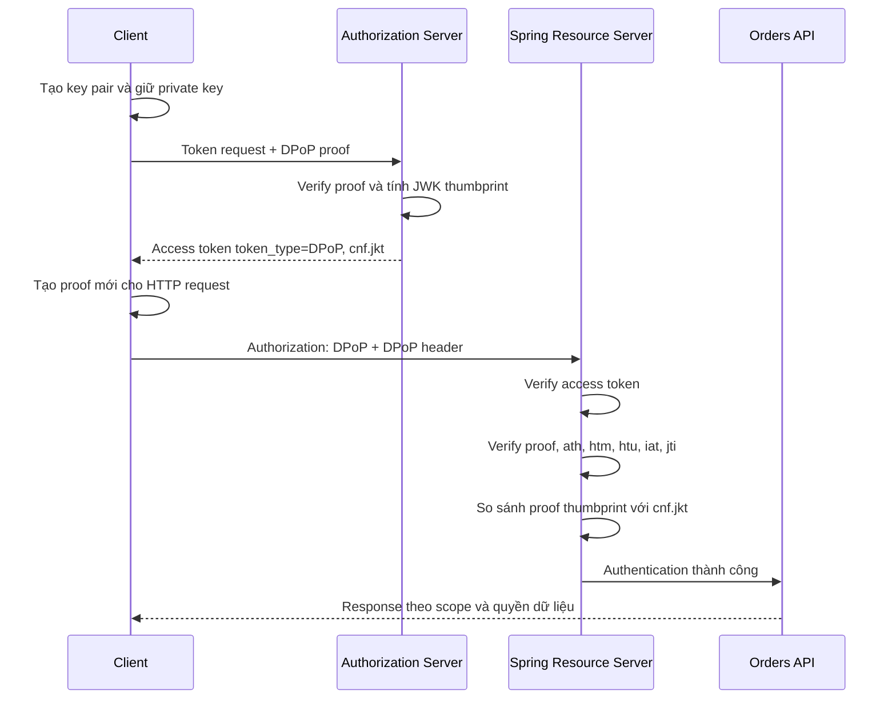

# Cấu hình xử lý DPoP trong Servlet và kiểm chứng giới hạn ở các stack khác

## 1. DPoP giải quyết vấn đề gì?

Với Bearer access token, bất kỳ ai lấy được chuỗi token đều có thể thử gọi API trong thời gian token còn hiệu lực:

```http
GET /api/orders/42 HTTP/1.1
Host: api.example.com
Authorization: Bearer <access-token>
```

DPoP (Demonstrating Proof of Possession) bổ sung bằng chứng sở hữu khóa cho OAuth 2.0 access token. Client tạo một cặp khóa bất đối xứng, giữ private key và ký một DPoP Proof JWT cho từng request. Authorization Server (AS) ràng buộc access token với public key; Resource Server (RS) yêu cầu Client chứng minh đang giữ private key tương ứng khi dùng token.

```http
GET /api/orders/42 HTTP/1.1
Host: api.example.com
Authorization: DPoP <dpop-bound-access-token>
DPoP: <signed-dpop-proof-jwt>
```

Nếu attacker chỉ lấy được access token mà không có private key, họ không thể tự tạo proof mới hợp lệ cho request. Đây là cơ chế sender-constraining ở tầng ứng dụng, được chuẩn hóa trong RFC 9449.

DPoP không thay TLS, audience, scope hay phân quyền nghiệp vụ. Nó không ký toàn bộ request body/headers và không chống được mọi trường hợp private key hoặc execution context của Client bị chiếm quyền.

### Mục tiêu học tập

Sau bài này, bạn có thể:

1. Phân biệt Bearer token và DPoP-bound access token.
2. Giải thích cách Client tạo proof, AS gắn claim **cnf.jkt**, và RS kiểm tra proof.
3. Đọc các trường **typ**, **alg**, **jwk**, **htm**, **htu**, **iat**, **jti**, **ath**, **nonce** và **cnf.jkt**.
4. Cấu hình DPoP cho Spring Security Servlet Resource Server từ Spring Security 7.1.
5. Hiểu vai trò của DPoPAuthenticationConverter, DPoPAuthenticationProvider, DPoPProofJwtDecoderFactory và DPoPAuthenticationEntryPoint.
6. Tránh downgrade khi API chấp nhận cả Bearer và DPoP.
7. Thiết kế replay protection, nonce, proxy URI và CORS đúng.
8. Phân biệt hỗ trợ Servlet với giới hạn WebFlux/reactive ở các phiên bản Spring Security hiện hành.
9. Kiểm thử DPoP bằng access token và proof JWT được ký thật.

## 2. Luồng cấp token và gọi API

### 2.1. Client tạo cặp khóa

Client tạo public/private key pair. Private key được giữ trong vùng lưu trữ bảo vệ phù hợp với nền tảng: Android Keystore, iOS Keychain/Secure Enclave, Web Crypto API với key không exportable khi phù hợp, hoặc HSM/key store cho ứng dụng server-to-server.

Client đưa public JWK vào JOSE header của DPoP Proof. Private key dùng để ký proof nhưng không được đưa vào request.

| Thành phần | Mục đích |
|---|---|
| Access token | Quyền truy cập API do AS cấp |
| DPoP Proof JWT | Chứng minh Client giữ private key và ràng buộc proof với HTTP request |
| Public JWK | Khóa công khai để xác minh proof |
| **cnf.jkt** | Dấu vân tay public key được gắn với access token |

### 2.2. Token endpoint nhận proof và ràng buộc access token

Client gửi proof trong header DPoP khi gọi token endpoint:

```http
POST /oauth2/token HTTP/1.1
Host: id.example.com
Content-Type: application/x-www-form-urlencoded
DPoP: <proof-for-token-endpoint>

grant_type=authorization_code&
client_id=shop-mobile&
code=<authorization-code>&
redirect_uri=https%3A%2F%2Fclient.example.com%2Fcallback&
code_verifier=<pkce-verifier>
```

AS xác minh proof. Nếu hợp lệ, AS gắn access token với public key đã chứng minh. Với JWT access token, binding thường được thể hiện bằng claim cnf.jkt:

```json
{
  "iss": "https://id.example.com",
  "sub": "user-417",
  "aud": ["orders-api"],
  "scope": "orders.read",
  "exp": 1893456000,
  "cnf": {
    "jkt": "<JWK-SHA256-THUMBPRINT>"
  }
}
```

cnf.jkt là SHA-256 JWK Thumbprint của public key theo RFC 7638, được mã hóa base64url. Response token cho biết token_type là DPoP:

```http
HTTP/1.1 200 OK
Content-Type: application/json
Cache-Control: no-store

{
  "access_token": "<dpop-bound-access-token>",
  "token_type": "DPoP",
  "expires_in": 600
}
```

### 2.3. Mỗi resource request có proof mới

Client gửi access token bằng authentication scheme DPoP và gửi proof JWT trong header DPoP:

```http
GET /api/orders/42 HTTP/1.1
Host: api.example.com
Authorization: DPoP <dpop-bound-access-token>
DPoP: <new-proof-for-this-request>
```

Proof phải gắn với request hiện tại. Client cần tạo proof mới khi retry request, kể cả khi method và URL không đổi, vì jti phải duy nhất trong khoảng thời gian server chấp nhận proof.



DPoP có thể dùng với JWT access token hoặc opaque access token. Với JWT, RS đọc cnf.jkt từ token đã xác minh. Với opaque token, AS có thể trả cnf.jkt trong introspection response. RS vẫn phải tự kiểm tra binding giữa access token và proof.

## 3. Cấu trúc DPoP Proof JWT

### 3.1. JOSE header

Một proof JWT có dạng minh họa:

```json
{
  "typ": "dpop+jwt",
  "alg": "ES256",
  "jwk": {
    "kty": "EC",
    "crv": "P-256",
    "x": "<PUBLIC-X>",
    "y": "<PUBLIC-Y>"
  }
}
```

- typ bắt buộc có giá trị dpop+jwt.
- alg phải là thuật toán chữ ký bất đối xứng được hỗ trợ và cho phép theo policy. Không chấp nhận none.
- jwk chứa public key để xác minh proof.
- JWK trong header không được chứa private key material.

Server phải giới hạn thuật toán được phép. Không dùng thuật toán hoặc key URL tùy ý do Client gửi để mở rộng trust.

### 3.2. Claims của proof

Đối với protected resource request:

```json
{
  "jti": "proof-unique-id-001",
  "htm": "GET",
  "htu": "https://api.example.com/api/orders/42",
  "iat": 1893455700,
  "ath": "<BASE64URL-SHA256-OF-ACCESS-TOKEN>"
}
```

| Claim | Ý nghĩa | Kiểm tra tại Resource Server |
|---|---|---|
| jti | ID duy nhất của proof | Bắt buộc có và chống sử dụng lại |
| htm | HTTP method | Khớp method request, ví dụ GET |
| htu | HTTP target URI | Khớp URI request, bỏ query và fragment |
| iat | Thời điểm tạo proof | Nằm trong cửa sổ thời gian chấp nhận |
| ath | Hash access token | Khớp hash token đang gửi |
| nonce | Nonce do AS/RS cấp nếu được yêu cầu | Khớp nonce gần đây từ đúng server cấp |

ath là base64url encoding của SHA-256 trên ASCII bytes của access token. Nó ràng buộc proof với đúng token đang được trình; proof tạo cho token A không thể được thay bằng token B.

### 3.3. Proof ở token endpoint khác proof ở resource endpoint

Khi xin access token, Client chưa có access token mới để hash nên proof token-endpoint không cần claim ath. Khi gọi protected resource, proof phải có ath.

Proof cho token endpoint:

```json
{
  "jti": "token-request-proof-001",
  "htm": "POST",
  "htu": "https://id.example.com/oauth2/token",
  "iat": 1893455700
}
```

Proof cho resource request:

```json
{
  "jti": "resource-proof-001",
  "htm": "GET",
  "htu": "https://api.example.com/api/orders/42",
  "iat": 1893455710,
  "ath": "<BASE64URL-SHA256-OF-ACCESS-TOKEN>"
}
```

Không copy proof của token endpoint để gọi API. htu, htm, ath và jti phải phù hợp với request tương ứng.

### 3.4. htu bỏ query và fragment

Theo RFC 9449, htu biểu diễn HTTP target URI nhưng bỏ query và fragment:

```text
Actual request:
https://api.example.com/api/orders/42?include=items#details

htu:
https://api.example.com/api/orders/42
```

Server cần chuẩn hóa URI theo quy tắc RFC trước khi so sánh để tránh false mismatch. Không chuẩn hóa tùy tiện tới mức hai URL khác nhau trở thành cùng một tài nguyên.

htu nhạy cảm khi ứng dụng đứng sau reverse proxy hoặc API gateway. Resource Server phải so sánh theo URI public mà Client nhìn thấy, không vô tình dùng URL nội bộ trong khi Client ký URL public.

### 3.5. Proof không ký toàn bộ request

DPoP proof chuẩn ràng buộc HTTP method, HTTP target URI, access token đang trình, thời gian/ID và khóa sở hữu. Proof không tự ký request body hoặc mọi HTTP headers. TLS vẫn cần thiết để bảo vệ dữ liệu truyền tải. Nếu API cần integrity của body hoặc headers đặc biệt, phải có cơ chế riêng theo threat model.

## 4. Các bước Resource Server phải xác minh

### 4.1. Xác minh access token trước

Với JWT access token, Resource Server vẫn phải xác minh:

- Chữ ký bằng key từ issuer tin cậy.
- iss chính xác.
- aud dành cho API hiện tại.
- exp, nbf và các claim thời gian.
- Token type/profile phù hợp.
- Scope/authority theo endpoint.
- Claim cnf.jkt tồn tại khi token được ràng buộc DPoP.

DPoP không thay thế các kiểm tra OAuth Resource Server thông thường.

### 4.2. Xác minh proof JWT

Resource Server cần kiểm tra:

1. Request có đúng một DPoP proof header với giá trị JWT hợp lệ.
2. JOSE typ bằng dpop+jwt.
3. alg là asymmetric signature algorithm được cho phép.
4. jwk có public key và không có private key.
5. Chữ ký proof hợp lệ với public JWK trong header.
6. htm khớp HTTP method.
7. htu khớp request URI sau chuẩn hóa hợp lệ, bỏ query/fragment.
8. iat nằm trong cửa sổ thời gian chấp nhận.
9. jti chưa được sử dụng trong cửa sổ replay protection.
10. Nếu server yêu cầu nonce, claim nonce khớp nonce server đã cấp.
11. ath bằng hash access token đang gửi.

### 4.3. Xác minh binding giữa token và proof

Sau khi proof đã được xác minh, Resource Server tính JWK SHA-256 Thumbprint của public key trong proof rồi so sánh với cnf.jkt của access token.

```text
access token:
  cnf.jkt = thumbprint(public-key-A)

DPoP proof:
  jwk = public-key-A

=> binding match

Nếu proof dùng public-key-B:
  thumbprint(public-key-B) != cnf.jkt

=> reject
```

Một proof có chữ ký hợp lệ vẫn không đủ nếu nó được ký bằng key khác key đã gắn với access token.

### 4.4. Kiểm tra quyền API sau DPoP

DPoP chỉ chứng minh Client đang giữ khóa được ràng buộc với token. Nó không tự cấp quyền nghiệp vụ.

- Token cần có SCOPE_orders.read mới được đọc đơn hàng.
- User phải thuộc tenant của đơn hàng.
- Client phải có quyền trên API resource.
- Repository phải giới hạn dữ liệu theo tenant/owner.

Một request có DPoP proof hoàn hảo nhưng thiếu scope vẫn phải bị từ chối 403 Forbidden.

## 5. Cấu hình Spring Security Servlet từ 7.1

### 5.1. Hỗ trợ theo phiên bản

DPoP được bổ sung dần trong Spring Security, không phải mọi API đều xuất hiện cùng lúc.

| API | Phiên bản giới thiệu | Vai trò |
|---|---:|---|
| DPoPAuthenticationToken | 6.5 | Authentication request chứa access token và DPoP proof |
| DPoPProofContext | 6.5 | Context cho việc decode/validate proof |
| DPoPProofJwtDecoderFactory | 6.5 | Tạo decoder cho proof JWT |
| DPoPAuthenticationProvider | 6.5 | Xác thực DPoP-bound access token |
| DPoPProofReplayValidator | 6.5.12 | Kiểm tra iat và việc sử dụng lại jti |
| DPoPProofReplayValidator.InMemoryCache | 6.5.12 | Cache replay đơn node |
| DPoPAuthenticationConverter | 7.1 | Chuyển Servlet request thành DPoPAuthenticationToken |
| DPoPAuthenticationEntryPoint | 7.1 | Tạo DPoP authentication challenge |
| OAuth2ResourceServerConfigurer.dPoP(...) | 7.1 | Bật DPoP bằng DSL HttpSecurity |

**Khuyến nghị:** Với ứng dụng Servlet mới, dùng Spring Security 7.1+ để có DSL tích hợp. Trong Spring Security 6.5 đã có một số provider/context/decoder primitives nhưng chưa có oauth2ResourceServer(...).dPoP(...) và converter Servlet mặc định như 7.1.

Không copy .dPoP(...) vào project 6.5 hoặc thấp hơn rồi chỉ đổi import. Hãy kiểm tra version thực tế của spring-security-config và spring-security-oauth2-resource-server.

### 5.2. Dependency

Ví dụ Gradle cho Servlet Resource Server:

```groovy
dependencies {
    implementation 'org.springframework.boot:spring-boot-starter-web'
    implementation 'org.springframework.boot:spring-boot-starter-security'
    implementation 'org.springframework.boot:spring-boot-starter-oauth2-resource-server'

    testImplementation 'org.springframework.boot:spring-boot-starter-test'
    testImplementation 'org.springframework.security:spring-security-test'
}
```

Ví dụ này giả định ứng dụng đang dùng Spring Boot/Spring Security version tương thích với Spring Security 7.1. Không thêm một module Security version khác lẻ để lấy API DPoP; dùng BOM/dependency management đồng bộ.

### 5.3. Cấu hình issuer

Ví dụ application.yml:

```yaml
spring:
  security:
    oauth2:
      resourceserver:
        jwt:
          issuer-uri: https://id.example.com/realms/shop
```

issuer-uri là issuer tin cậy của Authorization Server. Resource Server phải xác minh issuer và chữ ký token. Cấu hình này không tự tạo DPoP-bound access token; Authorization Server phải cấp token với token_type=DPoP và binding cnf.jkt.

### 5.4. Cấu hình SecurityFilterChain

Ví dụ tối thiểu:

```java
package com.example.orders.security;

import org.springframework.context.annotation.Bean;
import org.springframework.context.annotation.Configuration;
import org.springframework.http.HttpMethod;
import org.springframework.security.config.Customizer;
import org.springframework.security.config.annotation.web.configuration.EnableWebSecurity;
import org.springframework.security.config.annotation.web.builders.HttpSecurity;
import org.springframework.security.web.SecurityFilterChain;

@Configuration
@EnableWebSecurity
public class SecurityConfig {

    @Bean
    SecurityFilterChain apiSecurity(HttpSecurity http)
            throws Exception {

        return http
            .authorizeHttpRequests(auth -> auth
                .requestMatchers("/api/public/**").permitAll()
                .requestMatchers(
                    HttpMethod.GET, "/api/orders/**")
                    .hasAuthority("SCOPE_orders.read")
                .requestMatchers(
                    HttpMethod.POST, "/api/orders/**")
                    .hasAuthority("SCOPE_orders.write")
                .anyRequest().denyAll()
            )
            .oauth2ResourceServer(oauth2 -> oauth2
                .jwt(Customizer.withDefaults())
                .dPoP(Customizer.withDefaults())
            )
            .build();
    }
}
```

Điểm chính:

- HttpSecurity và SecurityFilterChain là Servlet stack.
- jwt(...) cấu hình AuthenticationManager dùng để xác minh access token JWT.
- dPoP(...) bật xử lý request có authentication scheme DPoP.
- DPoP configurer thêm các thành phần xử lý proof vào security chain.
- Scope vẫn được kiểm tra bởi authorizeHttpRequests.
- anyRequest().denyAll() giữ default policy chặt; thêm rule thực tế theo API.

DPoP configurer mặc định nhận request có Authorization bắt đầu bằng scheme DPoP. Nó sử dụng DPoPAuthenticationConverter để lấy access token và proof, rồi dùng DPoPAuthenticationProvider để xác minh token binding.

### 5.5. Cấu hình JWT decoder với audience validator

Nếu API cần audience rõ ràng, có thể cung cấp JwtDecoder bean tùy chỉnh:

```java
package com.example.orders.security;

import org.springframework.context.annotation.Bean;
import org.springframework.context.annotation.Configuration;
import org.springframework.security.oauth2.core.DelegatingOAuth2TokenValidator;
import org.springframework.security.oauth2.core.OAuth2Error;
import org.springframework.security.oauth2.core.OAuth2TokenValidator;
import org.springframework.security.oauth2.core.OAuth2TokenValidatorResult;
import org.springframework.security.oauth2.jwt.Jwt;
import org.springframework.security.oauth2.jwt.JwtDecoder;
import org.springframework.security.oauth2.jwt.JwtValidators;
import org.springframework.security.oauth2.jwt.NimbusJwtDecoder;

@Configuration
public class JwtDecoderConfig {

    @Bean
    JwtDecoder jwtDecoder() {
        String issuer =
            "https://id.example.com/realms/shop";
        String jwksUri =
            "https://id.example.com/realms/shop/protocol/openid-connect/certs";

        NimbusJwtDecoder decoder =
            NimbusJwtDecoder.withJwkSetUri(jwksUri).build();

        OAuth2TokenValidator<Jwt> audience = jwt ->
            jwt.getAudience().contains("orders-api")
                ? OAuth2TokenValidatorResult.success()
                : OAuth2TokenValidatorResult.failure(
                    new OAuth2Error(
                        "invalid_token",
                        "Token audience is not orders-api",
                        null));

        decoder.setJwtValidator(
            new DelegatingOAuth2TokenValidator<>(
                JwtValidators.createDefaultWithIssuer(issuer),
                audience));

        return decoder;
    }
}
```

Bean trên xác minh issuer, thời gian và audience. Nó không tự kiểm tra DPoP proof; dPoP(...) và provider thực hiện phần binding. Hãy đảm bảo AS phát hành cnf.jkt và Resource Server có đúng token format/validator cho access token.

### 5.6. Không nhầm DPoP với bật JWT

Cấu hình oauth2ResourceServer(...).jwt(...) chỉ bật JWT Resource Server. Nó không tự xác minh header DPoP, ath, htm, htu hay cnf.jkt.

DPoP configurer bật xử lý proof; token manager vẫn phải xác thực access token phù hợp. Với JWT example, cấu hình jwt(...) cùng dPoP(...).

## 6. Không để DPoP-bound token bị downgrade thành Bearer

### 6.1. Rủi ro

Một API có thể vô tình hỗ trợ cả hai luồng:

```text
Authorization: Bearer <token>
Authorization: DPoP <token> + DPoP header
```

Nếu Resource Server xử lý DPoP scheme bằng provider nhưng vẫn chấp nhận một DPoP-bound token qua Bearer filter, attacker có thể bỏ proof và sử dụng token theo kiểu Bearer.

RFC 9449 quy định: Resource Server đồng thời hỗ trợ Bearer và DPoP phải từ chối DPoP-bound access token nếu token được trình bằng Bearer scheme.

### 6.2. Nếu API chỉ chấp nhận DPoP

Có thể cấu hình một chain dành riêng cho DPoP và từ chối Bearer scheme bằng BearerTokenResolver tùy chỉnh:

```java
package com.example.orders.security;

import org.springframework.http.HttpHeaders;
import org.springframework.security.oauth2.core.OAuth2AuthenticationException;
import org.springframework.security.oauth2.core.OAuth2Error;
import org.springframework.security.oauth2.server.resource.web.BearerTokenResolver;
import org.springframework.stereotype.Component;

@Component
public class DPoPOnlyBearerTokenResolver
        implements BearerTokenResolver {

    @Override
    public String resolve(
            jakarta.servlet.http.HttpServletRequest request) {

        String authorization =
            request.getHeader(HttpHeaders.AUTHORIZATION);

        if (authorization != null
                && authorization.regionMatches(
                    true, 0, "Bearer ", 0, 7)) {

            throw new OAuth2AuthenticationException(
                new OAuth2Error(
                    "invalid_token",
                    "This endpoint requires DPoP authentication",
                    null));
        }

        // DPoP scheme được DPoPAuthenticationConverter xử lý riêng.
        return null;
    }
}
```

Gắn vào chain chỉ dành cho DPoP:

```java
@Bean
SecurityFilterChain dpopOnlyApi(
        HttpSecurity http,
        DPoPOnlyBearerTokenResolver bearerTokenResolver)
        throws Exception {

    return http
        .securityMatcher("/api/dpop/**")
        .authorizeHttpRequests(auth -> auth
            .anyRequest().authenticated())
        .oauth2ResourceServer(oauth2 -> oauth2
            .bearerTokenResolver(bearerTokenResolver)
            .jwt(Customizer.withDefaults())
            .dPoP(Customizer.withDefaults()))
        .build();
}
```

Resolver trả null cho scheme DPoP để DPoP filter xử lý header riêng. Nếu nhận Bearer, resolver từ chối để tránh đường xác thực Bearer đi vòng qua proof validation.

Ví dụ này minh họa một chain DPoP-only. Cần đặt @Order và securityMatcher phù hợp nếu ứng dụng còn chain Bearer hoặc web login khác. Với nhiều scheme trên cùng API surface, cần thiết kế rõ cách nhận diện token DPoP-bound và từ chối token đó khi Client cố gửi Bearer.

### 6.3. Nếu API cần hỗ trợ cả Bearer và DPoP

Một API có thể hỗ trợ Client cũ dùng Bearer và Client mới dùng DPoP. Khi đó phải kiểm tra cnf.jkt của access token trong đường Bearer:

- Token không có DPoP binding có thể tiếp tục theo policy Bearer.
- Token có cnf.jkt không được chấp nhận bằng Bearer.
- Token DPoP-bound chỉ được chấp nhận khi proof hợp lệ và thumbprint khớp.
- Không coi một request có header DPoP bất kỳ là đã chứng minh sở hữu khóa.

Có thể tách route/API version thành hai chain hoặc viết logic kiểm tra Bearer token binding rõ ràng. Đừng chỉ bật cả hai filter và giả định chúng tự xử lý downgrade theo ý định ứng dụng.

## 7. Spring Security xử lý những phần nào?

| Thành phần | Vai trò |
|---|---|
| DPoPAuthenticationConverter | Đọc Authorization: DPoP và proof từ HttpServletRequest |
| DPoPAuthenticationToken | Mang access token, proof JWT, HTTP method và resource URI |
| DPoPAuthenticationProvider | Điều phối xác minh access token và DPoP proof |
| DPoPProofContext | Cung cấp request context cho proof decoder |
| DPoPProofJwtDecoderFactory | Tạo JwtDecoder để xác minh DPoP proof |
| DPoPProofReplayValidator | Kiểm tra thời gian và việc sử dụng lại jti |
| DPoPAuthenticationEntryPoint | Tạo DPoP challenge khi authentication thất bại |
| OAuth2ResourceServerConfigurer.DPoPConfigurer | DSL Servlet bật và tùy chỉnh DPoP filter |

### 7.1. DPoPAuthenticationProvider

DPoPAuthenticationProvider nhận một AuthenticationManager dùng để xác thực access token. Provider này kết hợp token authentication với việc xác minh proof và public-key binding.

Nó là AuthenticationProvider đồng bộ của Servlet stack. Không gọi nó trực tiếp trong WebFlux event loop hoặc giả định nó là ReactiveAuthenticationManager.

### 7.2. DPoPProofJwtDecoderFactory

Factory tạo decoder cho proof dựa trên DPoPProofContext, trong đó có proof JWT, HTTP method, target URI và access token nếu đang xử lý protected resource request.

Default validator factory của Spring Security xác minh các claim quan trọng như htm, htu, iat, jkt, ath và jti theo API version. Việc kiểm tra proof phải đi kèm xác minh chữ ký bằng public JWK và algorithm policy phù hợp.

Không thay default proof validation bằng một validator tự viết chỉ kiểm tra jti hoặc iat; phải giữ toàn bộ điều kiện RFC.

### 7.3. DPoPAuthenticationEntryPoint

Entry point dành cho DPoP request, dùng authentication challenge theo scheme DPoP. Khi request không xác thực được, Resource Server thường phản hồi 401 Unauthorized với WWW-Authenticate: DPoP.

Khi Client dùng browser fetch, cần cấu hình CORS để Client đọc các response headers mà protocol yêu cầu, chẳng hạn WWW-Authenticate hoặc DPoP-Nonce.

### 7.4. DPoP configurer của 7.1

Trong Spring Security 7.1, DPoPConfigurer cung cấp các extension points:

- requestMatcher(...)
- authenticationConverter(...)
- authenticationSuccessHandler(...)
- authenticationFailureHandler(...)

Nó dùng AuthenticationFilter và mặc định chọn request có Authorization scheme DPoP. Đây là API Servlet, có tham số HttpServletRequest.

Một số hook tùy chỉnh proof verifier được bổ sung ở nhánh phiên bản sau. Không dùng method chỉ có trong 7.2 khi project đang chạy 7.1.x; hãy kiểm tra Javadoc đúng artifact đã resolve.

## 8. Replay protection: jti phải được dùng một lần

### 8.1. Chữ ký hợp lệ không ngăn replay

Giả sử attacker ghi lại được request:

```http
GET /api/orders/42 HTTP/1.1
Authorization: DPoP <access-token>
DPoP: <captured-proof>
```

Proof vẫn có chữ ký hợp lệ. Nếu server chỉ kiểm tra chữ ký, htm, htu và iat mà không ghi nhận proof đã dùng, attacker có thể gửi lại proof trong cửa sổ thời gian được chấp nhận.

DPoP proof cần iat trong cửa sổ ngắn và jti duy nhất. Server ghi nhận jti đã sử dụng và từ chối lần xuất hiện tiếp theo trong thời gian proof còn được chấp nhận.

### 8.2. DPoPProofReplayValidator

Spring Security cung cấp DPoPProofReplayValidator từ **6.5.12**. Validator này kiểm tra proof có iat, iat nằm trong cửa sổ chấp nhận, có jti và jti chưa được sử dụng trước đó.

Ví dụ khởi tạo validator:

```java
Cache replayCache = ...; // Cache có semantics put-if-absent phù hợp

DPoPProofReplayValidator replayValidator =
    new DPoPProofReplayValidator(replayCache);

replayValidator.setClockSkew(Duration.ofSeconds(30));
```

Đây là cách tạo validator; để đưa nó vào đường xử lý, cần cấu hình đúng proof decoder factory/provider theo phiên bản Spring Security. Không chỉ tạo bean validator mà giả định Spring tự động sử dụng nó.

### 8.3. In-memory cache chỉ phù hợp một node

DPoPProofReplayValidator.InMemoryCache dùng ConcurrentHashMap và có giới hạn dung lượng. Tài liệu Spring Security ghi rõ nó chỉ hoạt động trong thiết lập single-node; môi trường cluster nên dùng distributed cache như Redis hoặc Hazelcast.

Nếu có ba Resource Server node:

```text
Request proof P1 → Node A → cache A ghi jti-1
Replay P1        → Node B → cache B chưa có jti-1
```

Nếu cache không được chia sẻ hoặc đồng bộ đúng, Node B có thể không biết proof đã được Node A sử dụng. Điều này làm suy yếu replay protection trên toàn cụm.

Distributed cache cần thao tác nguyên tử kiểu put-if-absent/compare-and-set để hai node không cùng chấp nhận một jti đồng thời. TTL phải bao phủ toàn bộ cửa sổ proof còn được chấp nhận.

### 8.4. Giới hạn hook theo phiên bản

- DPoPProofReplayValidator và InMemoryCache có từ 6.5.12.
- DPoPAuthenticationProvider có setter setDPoPProofVerifierFactory(...).
- DSL DPoPConfigurer trong 7.1 không công bố fluent hook dPoPProofVerifierFactory(...).
- Hook fluent này được đánh dấu từ 7.2 trong API preview tại thời điểm tài liệu tham khảo.

Vì vậy, trên 7.1.x nếu cần custom distributed replay cache, cần kiểm tra cách post-process/customize provider hoặc tự wiring các thành phần phù hợp. Đừng copy method 7.2 vào code 7.1. Hãy test bằng hai node và cùng một proof để xác nhận cache replay thật sự được chia sẻ.

## 9. Nonce: giới hạn proof được tạo trước

### 9.1. Vì sao cần nonce?

Client có thể tạo proof JWT với iat trong tương lai rồi lưu proof để dùng sau. Nếu server chỉ dựa vào timestamp client và cho phép cửa sổ rộng, proof có thể bị chuẩn bị trước và đánh cắp.

Server có thể yêu cầu một nonce khó đoán, rồi Client phải đưa nonce đó vào claim nonce của proof tiếp theo. Nonce giúp server kiểm soát thời điểm proof được tạo và giảm rủi ro proof pre-generation.

### 9.2. Authorization Server nonce và Resource Server nonce khác nhau

- Authorization Server cấp nonce cho DPoP proof dùng tại token endpoint.
- Resource Server cấp nonce cho DPoP proof dùng tại protected resource.

Nonce chỉ có hiệu lực tại server cấp nó. Không dùng nonce nhận từ AS để gửi tới RS, hoặc ngược lại.

### 9.3. Resource Server challenge

Khi RS yêu cầu nonce, response có thể là:

```http
HTTP/1.1 401 Unauthorized
WWW-Authenticate: DPoP error="use_dpop_nonce"
DPoP-Nonce: <opaque-random-nonce>
Cache-Control: no-store
```

Client nhận nonce và tạo proof mới có claim:

```json
{
  "jti": "new-proof-id",
  "htm": "GET",
  "htu": "https://api.example.com/api/orders/42",
  "iat": 1893455710,
  "ath": "<BASE64URL-SHA256-OF-ACCESS-TOKEN>",
  "nonce": "<opaque-random-nonce>"
}
```

Server phải xác minh nonce đúng với giá trị gần đây mà chính server đã cấp. Không chấp nhận proof không có nonce sau khi đã yêu cầu nonce; nếu làm vậy sẽ tạo nonce downgrade.

### 9.4. CORS với nonce

Browser JavaScript không được đọc mọi response headers mặc định. Nếu Client cần lấy DPoP-Nonce, cấu hình:

```http
Access-Control-Expose-Headers: DPoP-Nonce, WWW-Authenticate
```

Request cũng cần được phép gửi header Authorization và DPoP qua CORS preflight.

### 9.5. Giới hạn cấu hình ở Spring Security 7.1

DPoP configurer 7.1 cung cấp failure handler và proof verifier mặc định nhưng không có một DSL nonce-specific hoàn chỉnh trong các method công khai được liệt kê. Nếu hệ thống yêu cầu Resource Server nonce, cần xây cơ chế cấp nonce, lưu trạng thái nonce, validate claim và xử lý response challenge bằng extension phù hợp.

Không kết luận rằng bật dPoP(Customizer.withDefaults()) đồng nghĩa đã triển khai toàn bộ nonce policy mà tổ chức mong muốn.

## 10. Reverse proxy, URI và forwarded headers

### 10.1. htu phải là URI mà Client thực sự gọi

Client có thể ký:

```text
https://api.example.com/api/orders/42
```

Nhưng Servlet container phía trong chỉ nhìn thấy:

```text
http://orders-service:8080/api/orders/42
```

Nếu Resource Server so sánh trực tiếp URI nội bộ với htu public, proof hợp lệ sẽ bị từ chối.

### 10.2. Forwarded headers phải có trust boundary

Một số ứng dụng dùng Forwarded hoặc X-Forwarded-* để khôi phục scheme/host public. Chỉ tin những header này khi chúng được ghi/chuẩn hóa bởi reverse proxy đáng tin cậy.

Nếu chấp nhận forwarded headers trực tiếp từ Internet Client, attacker có thể giả mạo host/scheme để ảnh hưởng việc xây dựng target URI.

Hãy kiểm tra proxy được phép ghi forwarded headers, proxy xóa header do Client tự gửi trước khi ghi lại, Servlet container/Spring Framework xử lý forwarded headers ở lớp nào, và URI mà DPoP context nhìn thấy có đúng URL public không.

### 10.3. Path rewrite

Nếu gateway đổi:

```text
Client URL:  /api/orders/42
Internal:    /orders/42
```

thì DPoP verifier cần đối chiếu với URI theo semantics RFC mà Client đã ký. Không tự ghép path nội bộ và path public theo heuristic. Cấu hình proxy/path transformation phải nhất quán và được kiểm thử.

## 11. Tích hợp với opaque access token

### 11.1. DPoP không bắt buộc access token là JWT

RFC 9449 cho phép Resource Server lấy public-key binding từ JWT cnf.jkt hoặc từ token introspection response.

Ví dụ introspection response:

```json
{
  "active": true,
  "sub": "user-417",
  "scope": "orders.read",
  "token_type": "DPoP",
  "cnf": {
    "jkt": "<JWK-SHA256-THUMBPRINT>"
  }
}
```

Resource Server không gửi DPoP proof cùng introspection request. AS trả thông tin binding, rồi RS tự xác minh proof cục bộ.

### 11.2. Spring Security

Spring Security Servlet có OpaqueTokenConfigurer và OpaqueTokenIntrospector để xác thực opaque token. DPoPAuthenticationProvider nhận AuthenticationManager cho access token, vì vậy manager cần trả metadata binding cnf.jkt.

Không suy ra mọi introspector tùy biến tự động cung cấp DPoP binding. Phải xác nhận principal/attributes có cnf.jkt, token type được kiểm tra đúng và DPoP provider của version đang dùng thực hiện đúng policy.

Ví dụ trong bài dùng JWT để làm rõ cnf.jkt. Nếu triển khai opaque token, cần integration test với AS thật hoặc stub trả đúng introspection claims.

## 12. DPoP khác mTLS và PKCE như thế nào?

| Cơ chế | Ràng buộc | Chống lại điều gì | Giới hạn |
|---|---|---|---|
| Bearer token | Người giữ token có thể dùng | Không tự sender-constrain | Token bị copy có thể replay |
| DPoP | Access token gắn với public key; proof cho từng request | Giảm nguy cơ token bị đánh cắp rồi dùng trên máy khác | Private key/client context bị chiếm thì attacker có thể tạo proof |
| OAuth mTLS | Token gắn với client certificate ở TLS layer | Token bị copy không đủ nếu thiếu private key của certificate | Client TLS certificate management phức tạp |
| PKCE | Authorization code gắn với verifier | Code interception/injection | Không ràng buộc access token với key cho từng API request |
| OIDC nonce | ID token gắn với login request | Replay/substitution trong OIDC authentication | Không thay DPoP proof cho API |

DPoP và PKCE có thể được dùng cùng nhau. RFC 9449 cũng định nghĩa tham số dpop_jkt tùy chọn để gắn authorization code với DPoP key. PKCE vẫn được khuyến nghị cho Authorization Code Flow.

DPoP không thay TLS. Nó cũng không bảo vệ khỏi XSS hoặc malicious code đang chạy trong execution context của Client; code đó có thể gọi private key để tạo proof mới, ngay cả khi key không exportable.

## 13. Giới hạn ở WebFlux và các stack khác

### 13.1. Servlet và WebFlux có contract khác nhau

| Thành phần | Servlet | WebFlux |
|---|---|---|
| HTTP security DSL | HttpSecurity | ServerHttpSecurity |
| Filter chain | SecurityFilterChain | SecurityWebFilterChain |
| Request abstraction | HttpServletRequest | ServerWebExchange |
| Authentication manager | AuthenticationManager | ReactiveAuthenticationManager |
| JWT decoder | JwtDecoder | ReactiveJwtDecoder |
| Opaque introspector | OpaqueTokenIntrospector | ReactiveOpaqueTokenIntrospector |
| DPoP configurer tích hợp | Có từ Spring Security 7.1 | Không có DSL reactive tương đương trong reference 7.1.2 |

### 13.2. Vì sao không dùng trực tiếp Servlet DPoP provider trong WebFlux?

Các thành phần DPoP tích hợp Servlet được thiết kế quanh HttpServletRequest, HttpServletResponse, AuthenticationFilter, AuthenticationProvider, AuthenticationManager và Servlet-specific AuthenticationConverter.

WebFlux sử dụng ServerWebExchange, Reactor Publisher và ReactiveAuthenticationManager. Dùng Servlet provider trong event loop không biến nó thành reactive; nó có thể không biên dịch hoặc làm sai kiến trúc thực thi.

### 13.3. Trạng thái hỗ trợ ở Spring Security 7.1.2

Tài liệu OAuth2 WebFlux 7.1.2 mô tả reactive JWT (ReactiveJwtDecoder) và opaque token (ReactiveOpaqueTokenIntrospector), nhưng không công bố API tương đương:

```java
http.oauth2ResourceServer(oauth2 ->
    oauth2.dPoP(Customizer.withDefaults()))
```

cho ServerHttpSecurity.

Do đó:

- Không copy .dPoP(...) từ HttpSecurity vào ServerHttpSecurity.
- Không coi JwtReactiveAuthenticationManager là DPoP verifier.
- Không chỉ kiểm tra access token JWT rồi kết luận sender-constrained.
- Nếu dùng WebFlux, phải triển khai/customize một reactive pipeline thực sự hoặc dùng một gateway/Servlet Resource Server hỗ trợ DPoP ở phía trước theo kiến trúc được kiểm soát.

Đây là giới hạn của API Spring Security được tài liệu hóa ở phiên bản tham chiếu, không phải khẳng định rằng không framework nào có thể triển khai DPoP trên reactive stack.

### 13.4. Những gì một reactive implementation phải làm

Một custom WebFlux DPoP authentication flow phải:

1. Trích Authorization: DPoP và DPoP proof từ ServerWebExchange.
2. Xác minh access token qua ReactiveJwtDecoder hoặc ReactiveOpaqueTokenIntrospector.
3. Lấy cnf.jkt từ token đã xác minh/introspection.
4. Xác minh chữ ký proof bằng public JWK và thuật toán allowlist.
5. Kiểm tra typ, htm, htu, iat, jti, ath, nonce.
6. So sánh thumbprint proof key với cnf.jkt.
7. Kiểm tra replay bằng reactive/distributed store với thao tác nguyên tử.
8. Trả Mono<Authentication> chỉ sau khi mọi kiểm tra hoàn tất.
9. Từ chối Bearer downgrade đối với DPoP-bound token.
10. Giữ đúng Reactor Context và không gọi blocking I/O trên event loop.

Không nên tự viết một filter chỉ so sánh cnf.jkt với một claim do Client gửi. Proof JWT phải được xác minh đầy đủ theo RFC.

### 13.5. Spring Cloud Gateway và gateway reactive

Nếu gateway chạy WebFlux, không thể giả định DPoP được bật chỉ vì downstream API dùng Spring Security Servlet. Có hai lựa chọn kiến trúc phổ biến:

- Gateway thực thi đầy đủ DPoP trước khi chuyển tiếp request; downstream tin gateway theo trust contract riêng và không để Client bypass gateway.
- Gateway chuyển nguyên vẹn access token/proof tới một Resource Server Servlet có DPoP support, đồng thời bảo vệ đường mạng nội bộ và đảm bảo htu/proxy semantics không bị sai.

Không để gateway xóa header DPoP, đổi Authorization scheme thành Bearer, hoặc rewrite URI mà không tính tới proof validation.

### 13.6. Authorization Server là một vai trò riêng

Resource Server .dPoP(...) chỉ xử lý request gọi API. Authorization Server còn phải nhận DPoP proof tại token endpoint, xác minh proof/nonce, gắn access token với public key, trả token_type=DPoP, cung cấp cnf.jkt trong JWT hoặc introspection response và xử lý refresh-token request với proof/key binding phù hợp.

Tài liệu Resource Server không chứng minh Authorization Server của bạn đã hỗ trợ issuance DPoP. Kiểm tra khả năng của AS/IdP hoặc extension của token endpoint riêng.

## 14. CORS, headers và HTTP error semantics

### 14.1. Request headers cần được cho phép

Browser Client thường cần preflight cho Authorization, DPoP và các headers ứng dụng khác.

Ví dụ policy khái niệm:

```text
Access-Control-Allow-Headers:
  Authorization, DPoP, Content-Type

Access-Control-Expose-Headers:
  WWW-Authenticate, DPoP-Nonce
```

Chỉ cho phép origin, method và headers mà ứng dụng cần. Không dùng wildcard origin với credentialed browser requests nếu chính sách CORS không cho phép.

### 14.2. Các lỗi thường gặp

| Trường hợp | Phản hồi thường gặp |
|---|---|
| Không có token | 401 Unauthorized, DPoP challenge |
| Token không hợp lệ/hết hạn | 401, invalid_token |
| Proof thiếu/sai chữ ký | 401, invalid_dpop_proof |
| htm hoặc htu không khớp | 401, proof invalid |
| ath không khớp token | 401, proof invalid |
| cnf.jkt không khớp proof key | 401, token/proof binding invalid |
| Proof bị replay | 401, proof invalid/replay |
| Thiếu nonce khi RS yêu cầu | 401, use_dpop_nonce + DPoP-Nonce |
| Authentication đúng nhưng thiếu scope | 403 Forbidden |
| Có scope nhưng không có quyền trên bản ghi | 403 hoặc 404 theo policy |

Không biến mọi lỗi thành 403. Lỗi xác thực token/proof thường là 401; lỗi authorization sau khi Authentication thành công thường là 403.

## 15. Kiểm thử DPoP với Spring Security Servlet

### 15.1. Không dùng mock Authentication để chứng minh DPoP

@WithMockUser, jwt() hoặc các helper tạo Authentication có thể bỏ qua quá trình decode token/proof. Chúng hữu ích để test authorization rule nhưng không chứng minh proof signature, ath, cnf.jkt, jti replay hoặc htu hoạt động đúng.

Để test DPoP end-to-end, hãy tạo access token và proof JWT được ký thật bằng key test.

### 15.2. Test fixture

Chuẩn bị:

- Một Authorization Server test hoặc stub.
- Một signing key cho JWT access token.
- Một DPoP key pair cho Client.
- Access token có cnf.jkt bằng thumbprint của DPoP public key.
- Proof JWT có typ=dpop+jwt, public jwk, htm, htu, iat, jti, ath.
- Replay cache test có thể kiểm tra trạng thái.
- Clock cố định hoặc injectable nếu cần test biên thời gian.

Không dùng private key production trong test.

### 15.3. Request mẫu trong MockMvc

Khi fixture đã tạo token/proof hợp lệ:

```java
mockMvc.perform(get("/api/orders/42")
        .header(
            HttpHeaders.AUTHORIZATION,
            "DPoP " + dpopBoundAccessToken)
        .header("DPoP", dpopProofJwt))
    .andExpect(status().isOk());
```

dpopBoundAccessToken và dpopProofJwt phải là giá trị được tạo và ký từ fixture thật, không phải chuỗi placeholder. htu trong proof phải khớp URL mà MockMvc/Servlet request thể hiện theo cấu hình test.

### 15.4. Ma trận test

| Test | Kết quả mong đợi |
|---|---|
| Token + proof đúng, key binding đúng | Request được xác thực |
| Không có DPoP proof | 401 |
| Header typ không phải dpop+jwt | 401 |
| Thuật toán none hoặc symmetric ngoài policy | 401 |
| JWK chứa private key | 401 |
| Chữ ký proof sai | 401 |
| htm khác HTTP method | 401 |
| htu khác URI request | 401 |
| iat quá cũ hoặc quá xa tương lai | 401 |
| Thiếu jti | 401 |
| Gửi lại cùng proof jti | 401 |
| ath không khớp access token | 401 |
| cnf.jkt khác thumbprint proof key | 401 |
| Token hết hạn hoặc sai audience | 401 |
| Token thiếu scope | 403 |
| Bearer scheme với DPoP-bound token | Từ chối theo RFC 9449 |
| Nonce thiếu/sai khi server yêu cầu | 401 + DPoP-Nonce |
| Replay qua hai node | Node thứ hai cũng từ chối |
| URI public sau proxy | htu được đối chiếu đúng |
| Browser Client đọc nonce | CORS expose DPoP-Nonce |
| Opaque introspection trả sai cnf.jkt | 401 |

### 15.5. Test replay trên cluster

Một test chỉ chạy trong một JVM không chứng minh replay protection giữa nhiều node. Cần gửi proof P1 tới node A, xác nhận node A chấp nhận, gửi lại chính P1 tới node B và xác nhận node B từ chối. Lặp lại khi distributed cache bị timeout và xác nhận failure behavior đúng policy.

### 15.6. Test downgrade

Gửi cùng DPoP-bound access token theo scheme:

```http
Authorization: Bearer <dpop-bound-access-token>
```

Resource Server hỗ trợ cả Bearer và DPoP phải từ chối token này theo RFC 9449 `7.2. Đừng chỉ test trường hợp scheme DPoP đúng.

## 16. Lỗi triển khai thường gặp

| Sai lầm | Hệ quả | Cách xử lý |
|---|---|---|
| Bật jwt() và nghĩ đã có DPoP | Token vẫn chỉ là Bearer | Bật dPoP(...) và xác minh proof |
| Chỉ kiểm tra proof signature | Proof có thể dùng sai method/URI/token | Kiểm tra htm, htu, ath, iat, jti, binding |
| Không kiểm tra cnf.jkt | Bất kỳ proof key nào cũng có thể được dùng | So thumbprint proof key với token binding |
| Gửi token DPoP bằng Bearer | Downgrade sender constraint | Từ chối DPoP-bound token theo Bearer |
| Tái sử dụng cùng proof khi retry | Replay protection từ chối request | Sinh proof mới, jti mới |
| Cache replay chỉ local trong cluster | Node khác có thể chấp nhận replay | Distributed cache atomic |
| Cache jti không có TTL | Tăng memory vô hạn | TTL theo proof acceptance window |
| Dùng htu internal URL | Proof hợp lệ bị từ chối hoặc so khớp sai | Khôi phục URI public từ trusted proxy |
| Tin X-Forwarded-Host từ Internet | Host spoofing ảnh hưởng htu | Chỉ tin proxy được kiểm soát |
| Bỏ qua nonce | Không đáp ứng policy RS/AS yêu cầu nonce | Implement nonce challenge và validation |
| Dùng nonce AS cho RS | Nonce không đúng trust context | Namespace nonce theo server cấp |
| Nghĩ DPoP ký request body | Body vẫn có thể bị thay đổi ngoài proof | Dùng TLS và integrity control phù hợp |
| Đưa private JWK vào proof header | Rò rỉ private key | Chỉ đưa public JWK |
| Chấp nhận alg=none | Proof không được xác minh chữ ký | Allowlist asymmetric algorithms |
| Test bằng jwt() rồi kết luận DPoP hoạt động | Bỏ qua proof provider | Signed proof + signed token integration test |
| Copy dPoP(...) vào WebFlux | API không tương thích stack | Dùng custom reactive implementation hoặc Servlet |
| Dùng Servlet AuthenticationProvider trong event loop | Sai execution model | Reactive authentication pipeline |
| Nghĩ Resource Server config làm AS tự cấp DPoP token | AS vẫn có thể cấp Bearer token | Cấu hình/kiểm chứng issuance riêng |
| Coi DPoP chống mọi XSS | Malicious code có thể gọi private key | Bảo vệ execution context, CSP và key storage |
| CORS không expose DPoP-Nonce | Browser không lấy được nonce | Access-Control-Expose-Headers |

## 17. Lộ trình triển khai

### Bước 1: Kiểm tra support của Authorization Server và Client

Xác nhận AS nhận DPoP proof ở token endpoint, phát hành token_type=DPoP, gắn cnf.jkt trong JWT hoặc introspection response, hỗ trợ nonce theo policy và xử lý refresh-token request với DPoP key đúng hợp đồng.

Xác nhận Client có thể lưu private key an toàn, tạo proof mới cho mỗi request và xử lý nonce/retry.

### Bước 2: Chọn Spring Security version và stack

- Servlet: ưu tiên Spring Security 7.1+ với dPoP(...).
- Spring Security 6.5: đánh giá các DPoP provider/decoder primitives và mức custom code cần thiết.
- WebFlux: chuẩn bị custom reactive implementation nếu cần DPoP ở chính reactive Resource Server.
- Gateway: xác định rõ DPoP được kiểm tra ở gateway hay downstream Servlet service.

### Bước 3: Cấu hình access-token validation

Giữ issuer, signature, audience, expiry, token type và scope validators. Đảm bảo token được phát hành với cnf.jkt và đúng resource audience.

### Bước 4: Bật DPoP filter và chặn downgrade

Cấu hình dPoP(...), xác định API chỉ DPoP hay hỗ trợ cả Bearer. Nếu hỗ trợ cả hai, bắt buộc từ chối DPoP-bound token khi nhận bằng Bearer scheme.

### Bước 5: Chọn replay/nonce policy

- Cửa sổ iat ngắn.
- jti one-time.
- Shared replay cache nếu chạy nhiều node.
- Nonce từ AS/RS nếu threat model yêu cầu.
- Timeout và failure semantics rõ ràng.

### Bước 6: Kiểm tra proxy và CORS

Xác minh htu theo public URI, trust forwarded headers đúng proxy và expose response headers cho browser Client.

### Bước 7: Kiểm thử thật

Dùng signed access token/proof, test replay giữa node, wrong thumbprint, wrong URI/method, Bearer downgrade, nonce, AS outage và token audience/scope.

### Bước 8: Quan sát vận hành

Theo dõi proof validation failures, unknown/unsupported algorithm, replay jti hits, nonce challenge frequency, replay cache latency/error/size, JWT/introspection latency, Bearer downgrade attempts, URI mismatch sau proxy và 401/403 theo loại lỗi.

Không log raw access token, private key, full DPoP proof hoặc dữ liệu nhạy cảm không cần thiết.

## 18. Câu hỏi tự kiểm tra

**Câu 1.** DPoP khác Bearer token ở điểm nào?

**Trả lời:** DPoP-bound access token được gắn với public key và Client phải gửi proof ký bằng private key tương ứng cho protected resource request. Bearer token có thể được sử dụng bởi bất kỳ ai giữ chuỗi token.

**Câu 2.** Vì sao proof phải có ath ở resource request?

**Trả lời:** ath là SHA-256 hash của access token đang trình, được base64url encode. Nó ràng buộc proof với đúng access token và ngăn proof bị dùng thay token khác.

**Câu 3.** cnf.jkt là gì?

**Trả lời:** JWK SHA-256 Thumbprint của DPoP public key được gắn với access token. Resource Server so sánh nó với public key trong proof.

**Câu 4.** Vì sao htu không bao gồm query và fragment?

**Trả lời:** RFC 9449 định nghĩa HTTP target URI trong proof bỏ query và fragment. Server phải so sánh đúng theo quy tắc URI của RFC.

**Câu 5.** Có thể tái sử dụng cùng proof khi retry GET không?

**Trả lời:** Không nên. Mỗi request/retry cần proof mới với jti mới để tránh replay detection từ chối và giảm khả năng replay.

**Câu 6.** DPoP proof có ký request body không?

**Trả lời:** Không. Proof chuẩn ràng buộc method, URI, access token và thời gian/ID. TLS vẫn cần để bảo vệ request body và headers.

**Câu 7.** Có thể gửi DPoP-bound token bằng scheme Bearer không?

**Trả lời:** Không. Resource Server hỗ trợ cả Bearer và DPoP phải từ chối DPoP-bound token khi nhận bằng Bearer scheme theo RFC 9449 `7.2.

**Câu 8.** DPoPProofReplayValidator.InMemoryCache có phù hợp cluster không?

**Trả lời:** Không. Tài liệu Spring ghi rõ cache này chỉ phù hợp single-node; cluster cần distributed cache có thao tác atomic để chia sẻ jti đã dùng.

**Câu 9.** Nonce của Authorization Server và Resource Server có thể dùng thay nhau không?

**Trả lời:** Không. Nonce chỉ được dùng với server đã cấp nó.

**Câu 10.** Spring Security 7.1 có DSL DPoP cho WebFlux không?

**Trả lời:** Tài liệu 7.1.2 có DSL dPoP(...) cho Servlet HttpSecurity; không có DSL reactive tương đương trong WebFlux reference. Cần custom reactive implementation nếu muốn xử lý DPoP ở WebFlux.

**Câu 11.** Bật oauth2ResourceServer().jwt() đã đủ chưa?

**Trả lời:** Chưa. Nó xác thực JWT access token. DPoP còn cần proof validation và key binding, nên phải bật DPoP support và cấu hình AS cấp token đúng.

**Câu 12.** Vì sao phải quan tâm reverse proxy?

**Trả lời:** htu được Client ký theo URI public. Nếu server so với URI internal hoặc tin forwarded headers giả mạo, proof hợp lệ có thể bị từ chối hoặc URI binding bị sai.

**Câu 13.** DPoP có thay PKCE không?

**Trả lời:** Không. PKCE bảo vệ authorization code exchange; DPoP ràng buộc access token với key và proof cho request API. Có thể dùng cả hai.

**Câu 14.** DPoP có ngăn XSS hoàn toàn không?

**Trả lời:** Không. Code độc hại chạy trong Client context có thể yêu cầu key ký proof ngay trên thiết bị. Key không exportable giúp giảm exfiltration nhưng không ngăn mọi hành vi lạm dụng.

**Câu 15.** DPoP provider đã xác thực thì user có quyền đọc mọi order không?

**Trả lời:** Không. Vẫn cần scope, tenant membership, owner và object-level authorization cho từng tài nguyên.

## 19. Tài liệu tham khảo chính thức

- [RFC 9449 — OAuth 2.0 Demonstrating Proof of Possession (DPoP)](https://www.rfc-editor.org/rfc/rfc9449.html): cấu trúc proof, token binding, resource access, nonce, replay và security considerations.
- [Spring Security 7.1 — OAuth 2.0 DPoP-bound Access Tokens](https://docs.spring.io/spring-security/reference/7.1/servlet/oauth2/resource-server/dpop-tokens.html): luồng DPoP token request và protected resource request.
- [Spring Security 7.1 — OAuth2ResourceServerConfigurer](https://docs.spring.io/spring-security/reference/7.1/api/java/org/springframework/security/config/annotation/web/configurers/oauth2/server/resource/OAuth2ResourceServerConfigurer.html): DSL dPoP(...).
- [Spring Security 7.1 — DPoPConfigurer](https://docs.spring.io/spring-security/reference/7.1/api/java/org/springframework/security/config/annotation/web/configurers/oauth2/server/resource/OAuth2ResourceServerConfigurer.DPoPConfigurer.html): request matcher, converter và handlers.
- [Spring Security — DPoPAuthenticationProvider](https://docs.spring.io/spring-security/reference/api/java/org/springframework/security/oauth2/server/resource/authentication/DPoPAuthenticationProvider.html): provider xác thực DPoP-bound access token.
- [Spring Security — DPoPProofJwtDecoderFactory](https://docs.spring.io/spring-security/reference/api/java/org/springframework/security/oauth2/jwt/DPoPProofJwtDecoderFactory.html): proof JWT decoder và validator factory.
- [Spring Security — DPoPProofReplayValidator](https://docs.spring.io/spring-security/reference/api/java/org/springframework/security/oauth2/jwt/DPoPProofReplayValidator.html): kiểm tra iat, jti và cache chống replay.
- [Spring Security — WebFlux OAuth2](https://docs.spring.io/spring-security/reference/7.1/reactive/oauth2/index.html): reactive JWT decoder và opaque-token introspector; đối chiếu giới hạn DPoP API reactive.

Tài liệu API có thể thay đổi giữa minor/patch version. Luôn kiểm tra Javadoc của version Spring Security đã resolve trong project, đặc biệt với replay cache, nonce và custom proof verifier factory.

## 20. Ghi nhớ

**DPoP ràng buộc access token với một public key và yêu cầu Client chứng minh đang giữ private key cho từng request.** Một Resource Server phải xác minh cả access token lẫn DPoP proof, bao gồm htm, htu, iat, jti, ath, nonce nếu được yêu cầu và binding cnf.jkt.

Với Spring Security:

- **Servlet:** oauth2ResourceServer(...).dPoP(...) có từ Spring Security 7.1; kết hợp với JWT/opaque token manager phù hợp.
- **Replay:** dùng jti one-time và cache chia sẻ khi chạy nhiều node; in-memory cache chỉ phù hợp một node.
- **Bearer compatibility:** từ chối DPoP-bound token khi được gửi bằng Bearer scheme.
- **Nonce/proxy/CORS:** phải thiết kế theo RFC và hạ tầng thật; không giả định bật DSL mặc định đã giải quyết mọi policy.
- **WebFlux:** reference 7.1.2 chưa có DPoP DSL reactive tương đương; cần custom reactive authentication pipeline hoặc xác minh DPoP ở một thành phần Servlet/gateway được kiểm soát.

DPoP giảm nguy cơ access token bị đánh cắp rồi replay từ một máy khác, nhưng không thay TLS, PKCE, audience/scope validation, bảo vệ Client execution context và authorization trên dữ liệu.
