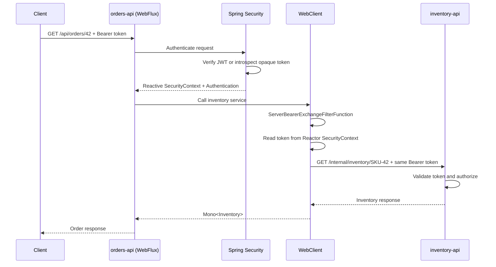
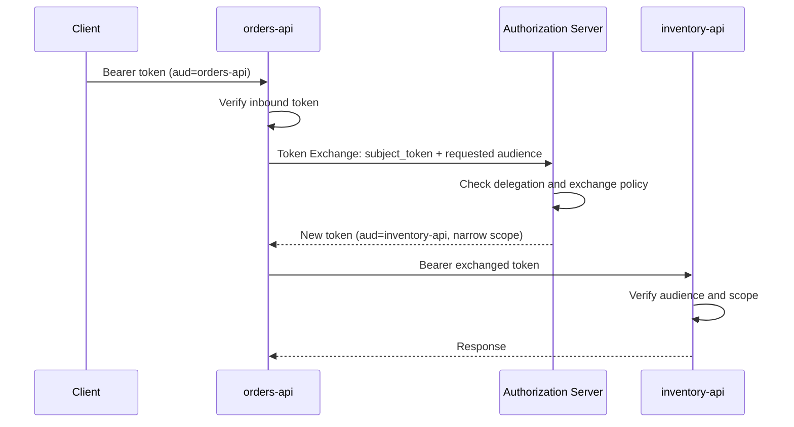

# ServerBearerExchangeFilterFunction và truyền token trong WebFlux

## 1. Bài toán: một request đã xác thực gọi tiếp service khác

Trong hệ thống Spring Security OAuth 2.0 Resource Server dùng WebFlux, một request có thể đi qua nhiều service:

- Client gọi **orders-api** bằng access token.
- **orders-api** xác minh Bearer token và tạo Authentication.
- **orders-api** gọi tiếp **inventory-api** để kiểm tra tồn kho.
- **inventory-api** cần biết danh tính hoặc quyền được ủy quyền của caller ban đầu để áp dụng policy.

Request đi vào:

```http
GET /api/orders/42 HTTP/1.1
Host: orders.example.test
Authorization: Bearer <alice-access-token>
```

Sau khi token được xác minh, service có thể dùng WebClient để gọi downstream. Một lựa chọn là **truyền tiếp access token hiện tại**:

```http
GET /internal/inventory/SKU-42 HTTP/1.1
Host: inventory.internal
Authorization: Bearer <alice-access-token>
```

Spring Security cung cấp **ServerBearerExchangeFilterFunction** để thực hiện token relay trong ứng dụng reactive. Filter đọc Authentication từ **Reactor Security Context**, lấy access token từ authentication tương ứng và gắn Bearer Authorization header vào outbound request.

Bài học thuộc chương **Chuyển tiếp token** của mô-đun **Spring Security OAuth 2.0 OIDC Resource Server**. Mục tiêu là hiểu filter này, cách kết nối nó với WebClient, cách giữ reactive context trong luồng xử lý, và các ranh giới an toàn khi gửi access token sang service khác.

| Thành phần | Vai trò |
|---|---|
| **orders-api** | WebFlux Resource Server nhận token từ client. |
| **inventory-api** | Downstream API cần xác minh caller hoặc quyền được ủy quyền. |
| **WebClient** | HTTP client reactive dùng để gọi downstream. |
| **ServerBearerExchangeFilterFunction** | ExchangeFilterFunction chuyển tiếp token hiện tại. |
| **ReactiveSecurityContextHolder** | Truy xuất SecurityContext từ Reactor Context. |

> **Nguyên tắc quan trọng:** ServerBearerExchangeFilterFunction thực hiện **token relay** — gửi lại access token đang được sử dụng trong request hiện tại. Nó không tự thực hiện OAuth 2.0 Token Exchange, không xin token mới, không đổi audience và không refresh token.

---

## 2. Token relay trong WebFlux là gì?

**Token relay** là việc một service chuyển tiếp Bearer access token của request hiện tại tới một service downstream. Downstream nhận token đó và tự xác minh/authorize theo chính sách của nó.



Token relay phù hợp khi downstream được thiết kế để **nhận cùng user/delegated access token** và token đó có audience/scope cho downstream.

### 2.1. Những gì filter thực hiện

Trong một request reactive có authentication phù hợp:

1. Đọc reactive SecurityContext.
2. Lấy Authentication hiện tại.
3. Nếu authentication đại diện OAuth2 access token, lấy token value.
4. Tạo outbound ClientRequest có Authorization Bearer header.
5. Chuyển request cho ExchangeFunction kế tiếp.

Token được chuyển tiếp là token hiện tại, nguyên vẹn theo giá trị token. Filter không decode lại JWT để cấp quyền; nó dựa vào authentication đã được tạo bởi Spring Security trong request inbound.

### 2.2. Những gì filter không thực hiện

ServerBearerExchangeFilterFunction không:

- Xác minh token lần thứ hai trước khi gửi.
- Đổi audience/resource của token.
- Tạo token mới từ Authorization Server.
- Chuyển user token thành service token.
- Thực hiện RFC 8693 Token Exchange.
- Refresh access token khi sắp hết hạn.
- Revoke token khi downstream trả 401.
- Tự quyết downstream có được phép nhận token hay không.
- Thay thế authorization checks của downstream.

Do đó, cấu hình filter chỉ là một phần của kiến trúc. API vẫn cần xác định **service nào được nhận token nào**, và downstream vẫn phải xác minh credential theo trust policy của chính nó.

---

## 3. Token đi qua Reactor Context, không phải ThreadLocal

WebFlux sử dụng Reactor để xử lý asynchronous/non-blocking request. Một request có thể chuyển qua nhiều threads trong quá trình thực thi. Vì vậy không nên xem SecurityContextHolder kiểu Servlet ThreadLocal là nguồn identity cho reactive pipeline.

Spring Security reactive lưu context trong **Reactor Context**. ReactiveSecurityContextHolder cung cấp API để đọc context hiện tại từ publisher.

```java
Mono<Authentication> authentication =
    ReactiveSecurityContextHolder.getContext()
        .map(SecurityContext::getAuthentication);
```

ServerBearerExchangeFilterFunction dựa trên cơ chế reactive này. Nó có thể tìm token của request hiện tại khi WebClient được gọi bên trong cùng reactive chain.

### 3.1. Context theo subscriber

Ví dụ:

```java
return orderService.loadOrder(orderId)
    .flatMap(order -> inventoryClient.getInventory(order.sku()))
    .map(inventory -> toOrderResponse(orderId, inventory));
```

Nếu publisher được thực thi trong reactive request chain có Security Context, filter có thể truy xuất authentication trong context đó.

Reactor Context gắn với subscription, không gắn cố định vào một thread. Việc publishOn/subscribeOn đổi scheduler thông thường không làm mất Reactor Context. Tuy nhiên, tự tạo một subscription độc lập, chuyển công việc sang một hệ thống async khác hoặc thoát khỏi reactive chain có thể làm mất ngữ cảnh security nếu không truyền context đúng cách.

### 3.2. Không gọi subscribe() lồng trong service

Anti-pattern:

```java
public Mono<OrderResponse> getOrder(String orderId) {
    inventoryClient.getInventory("SKU-42")
        .subscribe(); // Subscription độc lập, detached khỏi request chain

    return orderRepository.findById(orderId)
        .map(this::toResponse);
}
```

Hậu quả:

- Caller không chờ kết quả inventory.
- Error có thể bị tách khỏi error handling của request.
- Security Context có thể không có trong subscription độc lập.
- Cancellation/deadline không được truyền đúng.
- Request có thể kết thúc trong khi outbound call vẫn chạy.

Dùng composition:

```java
public Mono<OrderResponse> getOrder(String orderId) {
    return orderRepository.findById(orderId)
        .flatMap(order ->
            inventoryClient.getInventory(order.sku())
                .map(inventory -> toResponse(order, inventory))
        );
}
```

Giữ Mono/Flux trong cùng pipeline giúp context, cancellation và lỗi được quản lý theo subscription của request.

### 3.3. Không gọi block() trong reactive request

Anti-pattern:

```java
Inventory inventory = inventoryClient.getInventory("SKU-42").block();
```

block() có thể làm nghẽn event-loop, phá vỡ non-blocking flow và khiến latency tăng. Dùng flatMap, map, zip hoặc operators phù hợp để compose publisher.

### 3.4. Trường hợp background job

Một background job được enqueue để chạy sau khi HTTP request kết thúc không nên mặc nhiên kỳ vọng có Security Context của request cũ. Hãy quyết định rõ job chạy với:

- Workload/service identity riêng.
- Một delegated token có lifetime/audience phù hợp được cấp an toàn.
- Actor metadata được lưu để audit, kèm authorization check khi job thực thi.
- Một cơ chế delegation/token exchange được hỗ trợ.

Không lưu raw access token trong message queue/log chỉ để “khôi phục Security Context” sau này. Nếu job cần đại diện user, hãy thiết kế credential lifecycle riêng, có expiry/revocation và quyền giới hạn.

---

## 4. Cấu hình WebFlux Resource Server

Trước khi relay, inbound request phải được xác thực. Ví dụ dưới đây sử dụng JWT access token.

### 4.1. Dependencies

Với Spring Boot BOM quản lý phiên bản:

```xml
<dependencies>
    <dependency>
        <groupId>org.springframework.boot</groupId>
        <artifactId>spring-boot-starter-webflux</artifactId>
    </dependency>

    <dependency>
        <groupId>org.springframework.boot</groupId>
        <artifactId>spring-boot-starter-security</artifactId>
    </dependency>

    <dependency>
        <groupId>org.springframework.boot</groupId>
        <artifactId>spring-boot-starter-oauth2-resource-server</artifactId>
    </dependency>

    <dependency>
        <groupId>org.springframework.boot</groupId>
        <artifactId>spring-boot-starter-test</artifactId>
        <scope>test</scope>
    </dependency>

    <dependency>
        <groupId>org.springframework.security</groupId>
        <artifactId>spring-security-test</artifactId>
        <scope>test</scope>
    </dependency>
</dependencies>
```

Không thêm đồng thời spring-boot-starter-web nếu ứng dụng dự kiến chạy WebFlux thuần mà không có lý do rõ ràng; Spring Boot có thể chọn application type Servlet khi cả hai web stacks cùng hiện diện. Cần kiểm tra dependency graph của ứng dụng thực tế.

### 4.2. JWT issuer và audience

Ví dụ application.yml:

```yaml
spring:
  security:
    oauth2:
      resourceserver:
        jwt:
          issuer-uri: https://auth.example.test/realms/orders
          jwk-set-uri: https://auth.example.test/realms/orders/protocol/openid-connect/certs
          audiences:
            - orders-api
```

Đây là ví dụ cấu hình issuer/JWKS/audience cho Spring Boot version hỗ trợ các properties tương ứng. Nếu tự khai báo ReactiveJwtDecoder bean, cần gắn validators issuer/time/audience/token profile tường minh; không giả định auto-configuration tiếp tục áp validators sau khi bạn thay decoder.

### 4.3. SecurityWebFilterChain

```java
package com.example.orders.security;

import org.springframework.context.annotation.Bean;
import org.springframework.context.annotation.Configuration;
import org.springframework.http.HttpMethod;
import org.springframework.security.config.Customizer;
import org.springframework.security.config.annotation.web.reactive.EnableWebFluxSecurity;
import org.springframework.security.config.web.server.ServerHttpSecurity;
import org.springframework.security.web.server.SecurityWebFilterChain;

@Configuration
@EnableWebFluxSecurity
public class OrdersResourceServerSecurity {

    @Bean
    SecurityWebFilterChain apiSecurity(ServerHttpSecurity http) {
        return http
            .csrf(ServerHttpSecurity.CsrfSpec::disable)
            .authorizeExchange(exchange -> exchange
                .pathMatchers(HttpMethod.GET, "/api/orders/**")
                    .hasAuthority("SCOPE_orders:read")
                .pathMatchers(HttpMethod.POST, "/api/orders/**")
                    .hasAuthority("SCOPE_orders:write")
                .anyExchange().denyAll())
            .oauth2ResourceServer(oauth ->
                oauth.jwt(Customizer.withDefaults()))
            .build();
    }
}
```

Đây là API stateless dùng Bearer header. Tắt CSRF chỉ phù hợp nếu API không sử dụng cookie/session authentication; ứng dụng browser kết hợp session cần thiết kế CSRF và security chains phù hợp. SecurityWebFilterChain xác minh token inbound và đặt Authentication trong reactive security context.

### 4.4. Opaque token cũng có thể được relay

Nếu inbound API dùng opaque token, cấu hình Resource Server bằng introspection:

```yaml
spring:
  security:
    oauth2:
      resourceserver:
        opaquetoken:
          introspection-uri: https://auth.example.test/oauth2/introspect
          client-id: ${INTROSPECTION_CLIENT_ID}
          client-secret: ${INTROSPECTION_CLIENT_SECRET}
```

Và:

```java
.oauth2ResourceServer(oauth ->
    oauth.opaqueToken(Customizer.withDefaults()))
```

Sau khi opaque token được introspect và Spring Security tạo authentication phù hợp, token relay có thể chuyển tiếp access token hiện tại. Không phải token nào có dạng chuỗi opaque cũng được tự động chấp nhận; inbound introspection phải thành công trước.

---

## 5. Tạo WebClient với ServerBearerExchangeFilterFunction

Đây là cấu hình chính của bài học.

```java
package com.example.orders.config;

import org.springframework.context.annotation.Bean;
import org.springframework.context.annotation.Configuration;
import org.springframework.security.oauth2.server.resource.web.reactive.function.client.ServerBearerExchangeFilterFunction;
import org.springframework.web.reactive.function.client.WebClient;

@Configuration
public class DownstreamWebClientConfig {

    @Bean
    WebClient inventoryWebClient(WebClient.Builder builder) {
        return builder
            .baseUrl("https://inventory.internal")
            .filter(new ServerBearerExchangeFilterFunction())
            .build();
    }
}
```

Spring Boot có thể cung cấp WebClient.Builder đã được tùy biến theo application context. Trong ứng dụng không dùng Boot auto-configuration, có thể tạo builder bằng WebClient.builder().

### 5.1. Ý nghĩa từng thành phần

- baseUrl: endpoint gốc của downstream đã được cấu hình.
- filter: đăng ký ServerBearerExchangeFilterFunction vào pipeline outbound.
- build: tạo WebClient dùng filter cho các request được tạo từ client này.

Khi một request inbound đã có OAuth2 Bearer Authentication, filter lấy token từ reactive Security Context và đặt header tương ứng cho outbound request.

### 5.2. Gọi downstream bằng WebClient

```java
package com.example.orders.client;

import com.example.orders.api.InventoryResponse;

import org.springframework.stereotype.Component;
import org.springframework.web.reactive.function.client.WebClient;

import reactor.core.publisher.Mono;

@Component
public class InventoryClient {

    private final WebClient inventoryWebClient;

    public InventoryClient(WebClient inventoryWebClient) {
        this.inventoryWebClient = inventoryWebClient;
    }

    public Mono<InventoryResponse> getInventory(String sku) {
        return inventoryWebClient.get()
            .uri("/internal/inventory/{sku}", sku)
            .retrieve()
            .bodyToMono(InventoryResponse.class);
    }
}
```

### 5.3. Gọi downstream từ service reactive

```java
package com.example.orders.service;

import com.example.orders.api.OrderResponse;
import com.example.orders.client.InventoryClient;
import com.example.orders.repository.OrderRepository;

import org.springframework.stereotype.Service;

import reactor.core.publisher.Mono;

@Service
public class OrderQueryService {

    private final OrderRepository orderRepository;
    private final InventoryClient inventoryClient;

    public OrderQueryService(
            OrderRepository orderRepository,
            InventoryClient inventoryClient) {
        this.orderRepository = orderRepository;
        this.inventoryClient = inventoryClient;
    }

    public Mono<OrderResponse> getOrder(String orderId) {
        return orderRepository.findById(orderId)
            .switchIfEmpty(Mono.error(
                new OrderNotFoundException(orderId)))
            .flatMap(order ->
                inventoryClient.getInventory(order.sku())
                    .map(inventory ->
                        OrderResponse.from(order, inventory))
            );
    }
}
```

OrderRepository ở đây là reactive repository trả Mono<Order>. Trong pipeline trên, request giữ cùng subscription; filter có thể đọc Security Context khi WebClient thực hiện exchange.

### 5.4. Nếu không có Security Context thì sao?

ServerBearerExchangeFilterFunction không tự tạo credential mới. Nếu không tìm thấy authentication/token phù hợp trong reactive context, outbound request được chuyển tiếp mà không có token relay. Downstream có thể trả 401 nếu endpoint yêu cầu Bearer token.

Nếu một outbound call **bắt buộc** phải có user token, đừng dựa vào việc downstream tình cờ trả 401 để phát hiện context bị mất. Có thể kiểm tra authentication ở service boundary hoặc viết policy rõ ràng cho use case đó.

---

## 6. Token relay hỗ trợ loại Authentication nào?

Trong Resource Server, hai kiểu authentication phổ biến là:

| Inbound token | Authentication thường gặp | Token relay |
|---|---|---|
| JWT access token | JwtAuthenticationToken | Lấy access token từ JWT authentication. |
| Opaque access token | BearerTokenAuthentication | Lấy access token đã được introspection. |
| Form login username/password | UsernamePasswordAuthenticationToken | Không phải OAuth2 access-token authentication để relay theo filter này. |
| Anonymous request | Anonymous authentication/không có token | Không có Bearer token để relay. |
| Service-specific custom authentication | Tùy implementation | Chỉ hoạt động nếu được biểu diễn theo loại OAuth2 token authentication mà filter hỗ trợ hoặc có filter custom rõ ràng. |

Filter không nên được xem như API tổng quát để chuyển bất kỳ string nào trong principal thành Bearer credential. Token phải đến từ authentication đã được Spring Security xác minh.

### 6.1. Không đọc token từ claim sub

sub là subject identifier, không phải access token:

```java
// SAI: subject không phải bearer credential.
String token = jwt.getSubject();
headers.setBearerAuth(token);
```

Token value là credential gốc trong OAuth2 token authentication. Không dùng sub, email, preferred_username hay custom claim làm Bearer token.

### 6.2. Không relay ID Token như access token

OIDC ID Token có thể là JWT signed nhưng mục đích là xác thực user cho OIDC client. API downstream cần access token có đúng audience/resource và scope. Đừng lấy ID Token từ login session rồi đặt vào Authorization Bearer cho Resource Server.

---

## 7. Token relay khác OAuth 2.0 Token Exchange

Đây là khác biệt quan trọng nhất khi thiết kế microservices.

### 7.1. Relay: gửi lại đúng token hiện tại

```text
Inbound token:
  aud = orders-api
  scope = orders:read

orders-api -> inventory-api:
  Authorization: Bearer <same-token>
```

Không có token mới được phát hành. Token vẫn giữ claims, audience, scope, lifetime và issuer ban đầu.

### 7.2. Token Exchange: xin token mới cho downstream

Giả sử token inbound chỉ dành cho orders-api, nhưng inventory-api yêu cầu audience inventory-api.

Một flow token exchange có thể là:



RFC 8693 định nghĩa OAuth 2.0 Token Exchange. Nó yêu cầu Authorization Server hỗ trợ và policy cho phép việc exchange/delegation. ServerBearerExchangeFilterFunction **không thực hiện flow này**.

### 7.3. So sánh

| Tiêu chí | Token relay | Token exchange |
|---|---|---|
| Token outbound | Cùng token inbound | Token mới do AS phát hành |
| Audience | Không đổi | Có thể được cấp cho downstream |
| Scope | Không tự thu hẹp/mở rộng | AS có thể cấp tập quyền phù hợp |
| Network call tới AS | Không cần chỉ để relay | Có, theo token exchange protocol |
| Lifetime | Giữ expiry của token gốc | Theo token mới |
| Revocation | Phụ thuộc cơ chế token gốc | Theo semantics của token mới/AS |
| Delegation | Chuyển tiếp identity/authority hiện có | AS đánh giá subject/actor/delegation |
| Spring API | ServerBearerExchangeFilterFunction | OAuth2 client/token-exchange support hoặc custom authorized flow phù hợp |

### 7.4. Khi nào dùng relay?

Relay phù hợp nếu:

- Token có audience chấp nhận downstream.
- Downstream tin cùng issuer và xác minh token theo đúng profile.
- Scopes trong token đủ và đúng phạm vi.
- User delegation cần được giữ nguyên.
- Chính sách cho phép downstream nhận token này.
- Token lifetime còn đủ cho outbound operation.

### 7.5. Khi nào cần token exchange hoặc service credential?

Dùng token exchange hoặc OAuth2 client credential flow khi:

- Token inbound chỉ dành cho API hiện tại.
- Downstream yêu cầu audience khác.
- Cần thu hẹp scopes trước khi gọi downstream.
- Cần phân biệt user subject và service actor.
- Downstream chỉ chấp nhận workload identity.
- Không muốn gửi token user gốc tới mọi microservice.
- Cần delegation chain/audit rõ ràng.

Không tự thay audience trong JWT payload. Chỉ AS mới có thể phát hành token mới được ký với claims phù hợp.

---

## 8. Audience và scope quyết định downstream có chấp nhận token không

Giả sử access token inbound:

```json
{
  "iss": "https://auth.example.test/realms/orders",
  "sub": "alice-123",
  "aud": ["orders-api"],
  "scope": "orders:read",
  "exp": 1890003600
}
```

orders-api relay nguyên token tới inventory-api. Downstream kiểm aud và yêu cầu inventory-api, nên từ chối.

Đây là hành vi đúng. Việc token được xác minh ở orders-api không có nghĩa token được phép dùng ở mọi service.

### 8.1. Audience phải mô tả resource server đích

Một token có thể được cấp:

```json
{
  "aud": ["inventory-api"],
  "scope": "inventory:read"
}
```

hoặc trong hệ thống có contract multi-audience:

```json
{
  "aud": ["orders-api", "inventory-api"],
  "scope": "orders:read inventory:read"
}
```

Token multi-audience làm tăng phạm vi nơi credential có thể được sử dụng. Chỉ chấp nhận nếu AS/resource owners thiết kế rõ và có threat model phù hợp. Không thêm tất cả microservices vào aud để “relay cho tiện”.

### 8.2. Scope inbound có thể không đủ cho downstream

orders:read không nhất thiết bao gồm inventory:read. Downstream phải tự kiểm scope/authority của nó:

```java
.authorizeExchange(exchange -> exchange
    .pathMatchers(HttpMethod.GET, "/internal/inventory/**")
        .hasAuthority("SCOPE_inventory:read")
    .anyExchange().denyAll())
```

Không để downstream chỉ kiểm authenticated nếu nghiệp vụ yêu cầu quyền cụ thể. Token relay không nâng scope và cũng không đảm bảo scope phù hợp.

### 8.3. Audience và scope không thay object authorization

Ngay cả khi token có inventory:read, downstream vẫn cần kiểm tenant/owner/resource. Scope là quyền ở mức API/action; không tự cho phép đọc mọi record.

---

## 9. Giới hạn token leakage: không dùng một WebClient relay cho mọi host

ServerBearerExchangeFilterFunction gắn Bearer token vào outbound request khi có authentication phù hợp. Vì vậy **mọi destination của WebClient gắn filter cần được xem là có thể nhận credential người dùng hiện tại**.

Đây là rủi ro lớn nếu một WebClient dùng chung cho:

- inventory.internal — downstream nội bộ đã được phép.
- analytics.vendor.example — dịch vụ bên ngoài.
- URL lấy từ request parameter.
- Webhook URL do user cấu hình.
- Arbitrary URL có thể gây SSRF.

Nếu token được gửi nhầm host, bearer credential có thể bị lộ và bị sử dụng ở nơi khác.

### 9.1. Tách WebClient theo trust boundary

Một thiết kế an toàn:

```java
@Configuration
public class WebClientConfig {

    @Bean
    WebClient inventoryWebClient(WebClient.Builder builder) {
        return builder
            .baseUrl("https://inventory.internal")
            .filter(new ServerBearerExchangeFilterFunction())
            .build();
    }

    @Bean
    WebClient publicCatalogWebClient(WebClient.Builder builder) {
        // Không relay user token tới external/public service.
        return builder
            .baseUrl("https://catalog.vendor.example")
            .build();
    }
}
```

Mỗi client có mục đích và destination được cấu hình riêng. Không gắn token relay vào một global builder dùng cho tất cả outbound HTTP calls nếu không thể chứng minh mọi destination đều được phép nhận credential.

### 9.2. Không để client chọn URL đích tùy ý

Rủi ro:

```java
// KHÔNG DÙNG: URL do caller điều khiển, WebClient có token relay.
public Mono<String> fetch(String userSuppliedUrl) {
    return relayWebClient.get()
        .uri(userSuppliedUrl)
        .retrieve()
        .bodyToMono(String.class);
}
```

Nếu attacker cung cấp host của họ, request có thể gửi token đến host đó. Đây là credential exfiltration và có thể đi kèm SSRF.

Thay vào đó:

- Dùng base URL cố định trong configuration.
- Map downstream service ID sang destination allowlist.
- Validate scheme/host/port theo policy.
- Không follow redirect sang origin không tin cậy khi credential có thể được forward.
- Egress firewall/network policy giới hạn destination.
- Không đưa token vào query string hoặc URL.
- Không ghi token vào logs/traces.

### 9.3. Redirect và retry cần được xem xét

Một outbound request có thể gặp redirect hoặc retry. Cần hiểu behavior của HTTP connector/client đang dùng:

- Redirect sang origin khác có thể tạo rủi ro credential forwarding tùy connector/configuration.
- Retry request có thể gửi lại cùng bearer token nhiều lần.
- Một retry không làm token hết hạn lâu hơn hoặc refresh nó.
- Không retry vô hạn khi downstream trả 401/403.
- Không tự gửi token tới URL Location chưa được kiểm tra.
- Với non-idempotent operations, retry còn có thể lặp side effects.

Đặt timeout, retry budget và redirect policy rõ. Với call có token relay, an toàn destination quan trọng ngang với TLS.

---

## 10. Không log hoặc expose token

Access token là bearer credential: ai sở hữu token có thể sử dụng nó trong phạm vi quyền và thời hạn của token.

Không ghi:

```text
Authorization: Bearer eyJ...
request.headers.Authorization
token.getTokenValue()
```

Tránh đưa token vào:

- Application logs.
- Exception messages.
- WebClient wiretap logs.
- HTTP tracing/baggage.
- Metrics labels.
- Distributed trace attributes.
- Error response gửi client.
- Queue messages hoặc persistent job records nếu không có credential-storage design riêng.

Nếu cần trace outbound call, log correlation ID, downstream service ID, route, status và latency. Không log token, full Authorization header hoặc payload nhạy cảm.

### 10.1. Redact Authorization header

Nếu bật wiretap/debug logging, phải kiểm tra logger và HTTP connector không ghi request headers chứa Bearer token. Không chỉ dựa vào việc log level production thường thấp; sự cố debug có thể bật log chi tiết.

### 10.2. Không trả token về frontend

Controller không nên đưa access token relay vào response body. Token chỉ cần đi trong outbound Authorization header tới downstream được phép.

---

## 11. Downstream cần xác minh token như một Resource Server độc lập

inventory-api không nên tin rằng request đến từ orders-api là đủ. Nó cần xác minh Bearer token theo trust policy của mình.

Ví dụ downstream WebFlux security:

```java
@Configuration
@EnableWebFluxSecurity
public class InventorySecurity {

    @Bean
    SecurityWebFilterChain inventoryChain(ServerHttpSecurity http) {
        return http
            .csrf(ServerHttpSecurity.CsrfSpec::disable)
            .authorizeExchange(exchange -> exchange
                .pathMatchers(HttpMethod.GET, "/internal/inventory/**")
                    .hasAuthority("SCOPE_inventory:read")
                .anyExchange().denyAll())
            .oauth2ResourceServer(oauth ->
                oauth.jwt(Customizer.withDefaults()))
            .build();
    }
}
```

Trong thực tế, inventory-api phải cấu hình issuer, audience inventory-api, validators và scopes theo contract. Nếu token chỉ có audience orders-api, downstream sẽ từ chối. Điều đó báo hiệu cần thiết kế token exchange hoặc service credential.

### 11.1. Không trust header do upstream tự thêm

Không dùng một header như:

```http
X-Authenticated-User: alice-123
X-User-Roles: ADMIN
```

làm bằng chứng độc lập nếu client có thể gọi thẳng downstream hoặc spoof headers. Nếu dùng gateway/service identity và trusted identity headers, cần:

- Network path chỉ cho trusted proxy/gateway.
- Proxy strip các header từ client rồi overwrite.
- Downstream xác thực proxy/service identity.
- Integrity và policy rõ.
- Không có direct ingress bypass.

Bearer token relay giữ credential có thể được downstream verify; nó không làm các header tùy biến trở nên đáng tin.

---

## 12. Dùng ServerBearerExchangeFilterFunction với JWT và opaque token

### 12.1. JWT inbound

Flow:

1. Bearer token được trích từ inbound request.
2. ReactiveJwtDecoder xác minh signature và claims.
3. Spring Security tạo JwtAuthenticationToken.
4. ServerBearerExchangeFilterFunction đọc token từ authentication.
5. WebClient gửi cùng token tới downstream.

JWT token không được re-sign hoặc biến đổi. iss, aud, scope, exp, jti vẫn giữ nguyên.

### 12.2. Opaque inbound

Flow:

1. Bearer token được trích từ inbound request.
2. ReactiveOpaqueTokenIntrospector gọi introspection endpoint.
3. AS xác nhận token và trả principal/attributes.
4. Spring Security tạo Bearer token authentication.
5. Filter có thể relay token value ban đầu.
6. Downstream introspects/validates theo policy riêng.

Opaque token không được decode thành JWT chỉ để relay. Filter chỉ cần token value trong authentication phù hợp.

### 12.3. Nếu inbound authentication không phải Bearer OAuth2

Ví dụ ứng dụng dùng form login và UsernamePasswordAuthenticationToken. ServerBearerExchangeFilterFunction không có OAuth2 access token tương ứng để lấy. Không tự biến username/password/session ID thành Bearer token.

Nếu downstream cần service identity trong use case này, dùng một OAuth2 client credential flow được cấu hình rõ.

---

## 13. Service identity thay vì user token relay

Không phải mọi outbound request đều nên đại diện user. Một service có thể cần gọi downstream bằng **client credentials**:

```text
orders-api (service identity)
  -> inventory-api
  Authorization: Bearer <orders-api service token>
```

Đây là workload-to-workload authorization. Downstream thấy client/service principal thay vì Alice. Điều này phù hợp cho scheduled job, internal maintenance hoặc tác vụ không cần user delegation.

Spring Security OAuth2 Client có thể quản lý authorized clients và lấy access token theo client registration. Một cấu hình client credentials minh họa:

```yaml
spring:
  security:
    oauth2:
      client:
        registration:
          inventory-service:
            provider: internal-idp
            client-id: ${INVENTORY_CLIENT_ID}
            client-secret: ${INVENTORY_CLIENT_SECRET}
            authorization-grant-type: client_credentials
            scope:
              - inventory:read
        provider:
          internal-idp:
            token-uri: https://auth.example.test/oauth2/token
```

Đây là cấu hình OAuth2 Client, khác với Resource Server inbound config. Việc dùng client_credentials cần một client registration/authorized-client manager và WebClient filter phù hợp để lấy token. ServerBearerExchangeFilterFunction không thay thế OAuth2 Client filter.

### 13.1. So sánh user delegation và service identity

| Câu hỏi | User token relay | Client credentials |
|---|---|---|
| Downstream thấy ai? | User/delegated principal | Service/client |
| Token lấy từ đâu? | Inbound Security Context | Authorization Server qua OAuth2 Client |
| Cần user scopes? | Có, token phải có scope phù hợp | Không; dùng client scopes/grants |
| Dùng cho background job? | Chỉ khi có delegation lifecycle rõ | Thường phù hợp hơn |
| Audit | Có thể ghi nhận user subject và client | Ghi nhận workload/client |
| Revocation | Phụ thuộc user token lifecycle | Phụ thuộc client credential/token lifecycle |

### 13.2. Không gộp user và service authority

Nếu orders-api dùng client credentials, downstream không nên giả định service token đại diện Alice. Nếu cần cả user và actor, dùng delegation/token exchange hoặc protocol claim được issuer hỗ trợ. Không tự nhét X-User-Id vào request để giả lập user authority.

---

## 14. Token exchange và delegated actor

Trong một số hệ thống, downstream cần biết cả:

- **Subject:** user Alice đang được đại diện.
- **Actor:** orders-api đang thay mặt Alice gọi downstream.

RFC 8693 Token Exchange có mô hình subject token/actor token và token mới do AS cấp theo policy. Token mới có thể biểu diễn delegation chain phù hợp.

Ví dụ khái niệm:

```json
{
  "iss": "https://auth.example.test/realms/orders",
  "sub": "alice-123",
  "aud": ["inventory-api"],
  "scope": "inventory:read",
  "act": {
    "sub": "orders-api"
  }
}
```

Đây chỉ là ví dụ claim minh họa; profile/actor claim thực tế phải theo contract của AS. Không tự sửa JWT để thêm act hoặc đổi aud.

ServerBearerExchangeFilterFunction không tạo delegated token như vậy. Nó relay token hiện có. Nếu downstream cần audience-specific token hoặc actor chain, triển khai token exchange/authorized client flow được AS hỗ trợ.

---

## 15. Error handling khi downstream từ chối token

Khi downstream trả:

- **401 Unauthorized:** token không được chấp nhận, sai audience/issuer, hết hạn, signature/introspection thất bại hoặc thiếu credential.
- **403 Forbidden:** token được chấp nhận nhưng principal thiếu scope/permission.
- **5xx:** downstream hoặc dependency lỗi.
- **Timeout:** không biết kết quả xử lý nếu request đã được gửi.

Không tự động xem 401 downstream là bằng chứng token inbound invalid đối với orders-api. Có thể token hợp lệ cho orders-api nhưng không hợp lệ cho inventory-api vì audience khác.

### 15.1. Không retry bằng cách relay token vô hạn

Một filter chỉ gắn token, không refresh. Nếu token hết hạn, retry cùng token sẽ tiếp tục thất bại. Cần xử lý theo policy:

- Trả lỗi phù hợp cho client.
- Dùng token exchange/authorized client nếu kiến trúc cần token khác.
- Nếu có refresh flow ở OAuth2 Client, dùng cơ chế client quản lý refresh phù hợp; không tự refresh user token bằng cách lấy refresh token từ claim.
- Không retry non-idempotent operations một cách mù quáng.

### 15.2. Không expose lỗi downstream quá chi tiết

Không trả về client:

- Raw downstream Authorization header.
- Token payload hoặc introspection response.
- Host nội bộ và stack trace.
- Secret/client credential.
- Internal policy/risk reason.

Có thể map downstream 401/403 thành lỗi nghiệp vụ/API phù hợp và ghi reason code nội bộ.

---

## 16. Kiểm thử token relay với WebClient

Một test nên chứng minh filter thật sự đọc reactive Security Context và gắn header, không chỉ mock controller trả response.

### 16.1. Unit test dùng ExchangeFunction

Có thể kiểm outbound ClientRequest bằng custom ExchangeFunction:

```java
import static org.assertj.core.api.Assertions.assertThat;

import java.time.Instant;
import java.util.List;
import java.util.concurrent.atomic.AtomicReference;

import org.junit.jupiter.api.Test;
import org.springframework.http.HttpHeaders;
import org.springframework.http.HttpStatus;
import org.springframework.security.oauth2.jwt.Jwt;
import org.springframework.security.oauth2.server.resource.authentication.JwtAuthenticationToken;
import org.springframework.security.oauth2.server.resource.web.reactive.function.client.ServerBearerExchangeFilterFunction;
import org.springframework.security.core.context.ReactiveSecurityContextHolder;
import org.springframework.web.reactive.function.client.ClientRequest;
import org.springframework.web.reactive.function.client.ClientResponse;
import org.springframework.web.reactive.function.client.ExchangeFunction;
import org.springframework.web.reactive.function.client.WebClient;

import reactor.core.publisher.Mono;
import reactor.test.StepVerifier;

class ServerBearerRelayTest {

    @Test
    void forwardsCurrentJwtAsBearerHeader() {
        String tokenValue = "test-access-token";
        AtomicReference<ClientRequest> captured =
            new AtomicReference<>();

        ExchangeFunction exchange = request -> {
            captured.set(request);
            return Mono.just(
                ClientResponse.create(HttpStatus.OK).build());
        };

        WebClient client = WebClient.builder()
            .exchangeFunction(exchange)
            .filter(new ServerBearerExchangeFilterFunction())
            .build();

        Jwt jwt = Jwt.withTokenValue(tokenValue)
            .header("alg", "RS256")
            .subject("alice-123")
            .issuer("https://auth.example.test/realms/orders")
            .audience(List.of("orders-api"))
            .issuedAt(Instant.now())
            .expiresAt(Instant.now().plusSeconds(300))
            .build();

        JwtAuthenticationToken authentication =
            new JwtAuthenticationToken(jwt);

        Mono<Void> call = client.get()
            .uri("https://inventory.internal/internal/inventory/SKU-42")
            .retrieve()
            .bodyToMono(Void.class)
            .contextWrite(
                ReactiveSecurityContextHolder.withAuthentication(
                    authentication));

        StepVerifier.create(call).verifyComplete();

        assertThat(captured.get()).isNotNull();
        assertThat(captured.get().headers().getFirst(
            HttpHeaders.AUTHORIZATION))
            .isEqualTo("Bearer " + tokenValue);
    }
}
```

Test này kiểm **token relay và Reactor Context**. Nó không kiểm chữ ký JWT, JWKS, issuer/audience validators của inbound Resource Server vì Jwt/JwtAuthenticationToken được dựng trực tiếp.

### 16.2. Test không có authentication

Một test khác nên gọi WebClient mà không ghi ReactiveSecurityContextHolder.withAuthentication(...) và xác nhận filter không tự tạo Bearer credential. Nếu downstream endpoint bắt buộc authentication, nó sẽ từ chối request.

### 16.3. Test opaque token

Tạo BearerTokenAuthentication từ fixture introspection trong test, đưa authentication vào Reactor Context, rồi kiểm Authorization header chứa token value đúng. Test này chứng minh relay opaque authentication theo loại được hỗ trợ ở version Spring Security đang dùng.

### 16.4. Test context propagation trong service chain

Kiểm request đi qua:

```text
controller
  -> reactive service
  -> flatMap
  -> WebClient
  -> ServerBearerExchangeFilterFunction
```

Assert outbound header vẫn có token. Thêm test qua publishOn/subscribeOn nếu ứng dụng có scheduler boundaries đáng kể. Tránh chỉ test filter standalone nếu bug thực tế nằm ở việc code tách subscription hoặc mất context.

### 16.5. Test không gửi token tới external client

Tạo hai WebClient:

- inventoryWebClient có relay filter.
- publicCatalogWebClient không có relay filter.

Gửi cùng reactive authentication context qua cả hai, assert chỉ request tới inventory có Authorization Bearer header. Đây là regression test hữu ích để bảo vệ trust boundary.

---

## 17. Tích hợp test với WebTestClient

WebTestClient có thể test inbound WebFlux security. Ví dụ:

```java
webTestClient
    .mutateWith(mockJwt()
        .jwt(jwt -> jwt
            .subject("alice-123")
            .claim("aud", List.of("orders-api")))
        .authorities(
            new SimpleGrantedAuthority("SCOPE_orders:read")))
    .get()
    .uri("/api/orders/42")
    .exchange()
    .expectStatus().isOk();
```

Đây là test authorization với mocked JWT authentication. Để kiểm token relay, downstream HTTP exchange cũng phải được capture/mock như phần trước. Để kiểm JWT verification thật, cần signed JWT test key và trusted test JWKS.

Một bộ integration test có thể bao gồm:

1. Inbound JWT hợp lệ, scope đúng → outbound WebClient có cùng Bearer token.
2. Inbound JWT thiếu scope → request bị chặn trước khi gọi downstream.
3. Inbound token sai signature → không gọi controller/downstream.
4. Inbound JWT có audience chỉ orders-api → relay vẫn gửi cùng token; downstream inventory-api từ chối audience mismatch.
5. Inbound token có audience/scope phù hợp downstream → downstream chấp nhận theo policy.
6. Không có Security Context → filter không tự tạo token.
7. Public WebClient không có relay filter → không có Authorization header.
8. Downstream trả 401 → lỗi được map đúng, không retry vô hạn.
9. User-supplied URL không thể khiến token được gửi tới external host.
10. Async/background work không vô tình tái sử dụng request token cũ.

---

## 18. Những lỗi thường gặp khi triển khai

| Lỗi | Hậu quả | Cách xử lý |
|---|---|---|
| Gắn filter vào WebClient dùng cho mọi host | Bearer token có thể rò tới external service. | Tạo WebClient riêng theo trust boundary. |
| Nghĩ filter tự exchange token | Downstream sai audience vẫn trả 401. | Dùng token exchange hoặc service credential. |
| Dùng SecurityContextHolder ThreadLocal trong WebFlux | Không tìm thấy identity đúng trong reactive flow. | Dùng Reactor Security Context/ReactiveSecurityContextHolder. |
| Gọi subscribe() bên trong service | Detached subscription, lỗi/context bị tách. | Compose bằng flatMap/map. |
| Gọi block() trên event-loop | Chặn thread, giảm throughput. | Dùng reactive composition. |
| Relay ID Token | Downstream nhận token sai mục đích. | Dùng OAuth access token đúng audience. |
| Lấy sub làm token | Downstream nhận subject string, không phải credential. | Relay token value từ OAuth2 authentication. |
| Tin downstream vì request đến từ service nội bộ | Bỏ qua token verification/authorization. | Downstream tự xác minh token hoặc workload identity. |
| Token chỉ có audience API đầu tiên | API downstream từ chối đúng. | Token exchange hoặc token có resource audience phù hợp theo policy. |
| Token thiếu scope downstream | 403. | Xin scope phù hợp qua AS; không tự thêm authority. |
| Log Authorization header | Bearer credential bị lộ trong logs/traces. | Redact headers và log metadata không nhạy cảm. |
| URL outbound do caller điều khiển | Credential exfiltration/SSRF. | Destination allowlist và WebClient cố định. |
| Dùng filter cho background job | Context không tồn tại hoặc dùng sai user. | Service identity/delegation rõ ràng. |
| Nhầm downstream 401 là inbound token invalid | Xử lý sai error boundary. | Phân biệt audience/resource policy của downstream. |
| Không kiểm redirect behavior | Token có thể đi sai origin tùy client configuration. | Giới hạn redirect và egress. |

---

## 19. Cân nhắc hiệu năng và vận hành

### 19.1. Relay không gọi AS để cấp token mới

So với token exchange, ServerBearerExchangeFilterFunction không cần round trip tới token endpoint chỉ để gắn token hiện tại. Nó là một bước xử lý outbound request trong WebClient pipeline.

Điều này không có nghĩa outbound call không có chi phí: vẫn có DNS/TLS/network/downstream latency, và token vẫn cần được downstream xác minh.

### 19.2. Connection pooling và timeout

Cấu hình HTTP connector/WebClient cần timeout và connection pool phù hợp. Đối với downstream call có Bearer token:

- Timeout phải nằm trong request deadline.
- Retry phải có budget và xét idempotency.
- Không giữ request/token trong queue vô thời hạn.
- Không retry 401/403 như lỗi transient.
- Monitor latency/status theo downstream service ID.
- Không log raw request headers.

### 19.3. Token sắp hết hạn

Filter relay token hiện tại dù token gần exp. Nó không tự kiểm token còn đủ thời gian cho downstream call và không tự refresh. Downstream có thể nhận token đã hết hạn khi request tới.

Nếu workflow cần access token mới, dùng OAuth2 Client/authorized-client lifecycle hoặc token exchange phù hợp. Không viết custom logic đọc refresh token từ JWT (refresh token không phải claim access token chuẩn) hoặc tự tạo JWT mới.

### 19.4. Clock skew và downstream validation

Mỗi Resource Server cần có time validation policy phù hợp. Token hợp lệ ở API đầu có thể bị downstream từ chối nếu clocks/clock skew hoặc audience/profile policies khác nhau. Đồng bộ thời gian và issuer contract là trách nhiệm hệ thống.

---

## 20. Checklist thiết kế token relay

Trước khi bật ServerBearerExchangeFilterFunction trong production:

| Câu hỏi | Điều cần xác nhận |
|---|---|
| **Inbound authentication** | Token được Spring Security xác minh/introspect trước khi relay. |
| **Reactive context** | WebClient call nằm trong đúng Reactor subscription có Security Context. |
| **Token type** | Authentication là OAuth2 access-token authentication phù hợp. |
| **Downstream destination** | Base URL/host/port thuộc allowlist đã duyệt. |
| **Audience** | Token có audience mà downstream yêu cầu. |
| **Scope** | Token chứa quyền cần cho downstream; downstream vẫn tự authorize. |
| **Token exchange** | Nếu cần audience mới/giới hạn scope, dùng AS exchange/client flow. |
| **WebClient separation** | Không gắn relay filter cho client gọi external/public URLs. |
| **Redirect** | Redirect sang origin khác được kiểm soát. |
| **TLS** | Outbound HTTPS và certificate validation đúng. |
| **Header handling** | Không trộn Authorization header thủ công với relay một cách mơ hồ. |
| **Logging** | Authorization header được redact trong logs/traces/wiretap. |
| **Background work** | Không phụ thuộc request Security Context sau khi request kết thúc. |
| **Failure handling** | 401/403/5xx/timeout được phân loại đúng; không retry vô hạn. |
| **Testing** | Có test header relay, missing context, external client, audience/scope mismatch. |
| **Lifecycle** | Token expiry/revocation phù hợp với thời gian downstream call. |

---

## 21. Runbook: downstream không nhận được Bearer token

Khi inventory-api trả 401 hoặc không thấy Authorization header, điều tra theo thứ tự:

1. **Inbound request:** client có gửi Authorization Bearer không?
2. **Inbound authentication:** Resource Server đã tạo JwtAuthenticationToken/Bearer authentication chưa?
3. **Reactive context:** WebClient được gọi trong cùng publisher chain không?
4. **Filter registration:** đúng WebClient bean có gắn ServerBearerExchangeFilterFunction không?
5. **Subscription:** code có gọi subscribe() độc lập hoặc chạy background không?
6. **Outbound capture:** request thực tế có Authorization header không? Chỉ kiểm trong test/debug an toàn, không in giá trị token.
7. **Authentication type:** authentication có chứa OAuth2 access token không?
8. **Audience:** token có audience downstream yêu cầu không?
9. **Scope:** token có scope/authority downstream yêu cầu không?
10. **Expiry:** token có hết hạn trước khi downstream xử lý không?
11. **Issuer/JWKS:** downstream có trust issuer/key tương ứng không?
12. **Redirect/proxy:** outbound request có bị đổi origin hoặc strip header không?
13. **Security policy:** downstream có route matcher/authority mapping đúng không?
14. **Token exchange:** nếu audience khác, AS có hỗ trợ exchange không?
15. **Logging:** không bật raw Authorization header trong quá trình debug.

Nếu header không được gắn, kiểm tra context/filter. Nếu header đã được gắn nhưng downstream từ chối, kiểm token contract (audience, scope, issuer, expiry) và downstream authorization.

---

## 22. Tài liệu kỹ thuật tham khảo

- [Spring Security — Reactive OAuth 2.0 Resource Server JWT](https://docs.spring.io/spring-security/reference/reactive/oauth2/resource-server/jwt.html): xác thực JWT inbound trong WebFlux.
- [Spring Security — Reactive OAuth 2.0 Resource Server Opaque Token](https://docs.spring.io/spring-security/reference/reactive/oauth2/resource-server/opaque-token.html): introspection trong reactive Resource Server.
- [Spring Security API — ServerBearerExchangeFilterFunction](https://docs.spring.io/spring-security/site/docs/current/api/org/springframework/security/oauth2/server/resource/web/reactive/function/client/ServerBearerExchangeFilterFunction.html): filter relay access token từ reactive security context.
- [Spring Security — Reactive Security Context](https://docs.spring.io/spring-security/reference/reactive/authorization/method.html): reactive method authorization và context integration.
- [Spring Framework — WebClient](https://docs.spring.io/spring-framework/reference/web/webflux-webclient.html): reactive HTTP client, filters và exchange.
- [Project Reactor — Context](https://projectreactor.io/docs/core/release/reference/advancedFeatures/context.html): subscriber context và propagation trong reactive pipelines.
- [RFC 6750 — OAuth 2.0 Bearer Token Usage](https://www.rfc-editor.org/rfc/rfc6750.html): Bearer token trong Authorization header và security considerations.
- [RFC 8693 — OAuth 2.0 Token Exchange](https://www.rfc-editor.org/rfc/rfc8693.html): exchange subject/actor tokens cho resource/audience khác.
- [RFC 9068 — JWT Profile for OAuth 2.0 Access Tokens](https://www.rfc-editor.org/rfc/rfc9068.html): access-token JWT profile và audience/type validation.
- [OWASP — OAuth 2.0 Cheat Sheet](https://cheatsheetseries.owasp.org/cheatsheets/OAuth2_Cheat_Sheet.html): audience restriction, token handling và security recommendations.
- [OWASP — Server Side Request Forgery Prevention Cheat Sheet](https://cheatsheetseries.owasp.org/cheatsheets/Server_Side_Request_Forgery_Prevention_Cheat_Sheet.html): allowlist destinations và kiểm soát outbound URL.

**Kết luận:** ServerBearerExchangeFilterFunction giúp WebFlux WebClient **chuyển tiếp access token hiện tại** từ reactive Security Context sang downstream bằng Bearer Authorization header. Nó hữu ích khi downstream được phép nhận chính token đó và audience/scope phù hợp. Nó không cấp token mới, không refresh, không đổi audience và không thực hiện Token Exchange. Hãy giữ WebClient relay tách khỏi các client gọi external services, giữ request trong cùng reactive pipeline, không log token, và để downstream tự xác minh token cũng như kiểm tra quyền. Nếu downstream cần audience hoặc delegation khác, dùng OAuth2 Token Exchange hoặc workload credential theo contract của Authorization Server.
