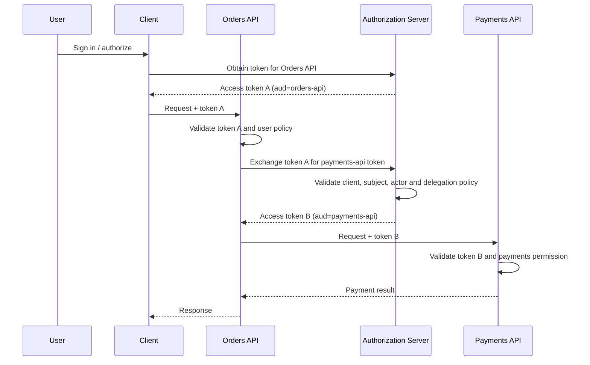

# Khi cần token riêng cho dịch vụ đích hoặc cơ chế token exchange

Trong **Spring Security OAuth 2.0/OIDC Resource Server**, một request thường đi qua nhiều APIs. Ví dụ, Orders API nhận yêu cầu từ web client rồi gọi Payments API, Inventory API hoặc Shipping API. Token mà Orders API nhận được **không mặc nhiên có thể dùng tại mọi dịch vụ phía sau**. Access token được cấp cho một resource server cụ thể, với audience, scopes, thời hạn và quyền sử dụng theo hợp đồng giữa Authorization Server (AS), client và dịch vụ đích.

Khi Orders API gọi Payments API, có ba lựa chọn thường gặp:

1. **Forward token hiện tại:** chỉ chuyển tiếp access token inbound khi token thực sự được cấp cho Payments API (hoặc audience set được Payments API chấp nhận) và quyền trong token đủ cho hành động.
2. **Lấy token bằng Client Credentials:** Orders API gọi Payments API dưới danh tính service account của chính nó. Cách này phù hợp khi downstream action là quyền của service, không cần đại diện user.
3. **Token exchange / On-Behalf-Of (OBO):** Orders API dùng token đại diện user hiện tại làm subject token, xác thực mình với AS và xin một access token mới dành cho Payments API. Token mới có thể mang quyền delegation đã được AS cho phép.

Điểm quyết định không phải số lượng HTTP hops, mà là **ai đang hành động, hành động thay mặt ai, token dành cho resource nào và AS đã cho phép delegation tới đâu**.

Bài này trình bày cách lựa chọn giữa forwarding, service credentials và RFC 8693 token exchange; phân tích audience/resource, scopes, subject/actor/delegation claims; tích hợp Spring Security OAuth2 Client với WebClient; bảo vệ downstream trust boundary; và kiểm thử toàn bộ luồng từ API đầu vào tới dịch vụ đích.

> **Nguyên tắc:** Mỗi Resource Server phải xác minh token dành cho chính nó. Token exchange tạo credential mới theo policy của AS; nó không phải thao tác đổi chuỗi token, copy header hoặc tự thêm một audience vào JWT.

## 1. Bài toán: một request, nhiều Resource Servers

Giả sử kiến trúc:

```text
Browser / Mobile Client
        |
        | access token for orders-api
        v
   Orders API
        |
        | call to Payments API
        v
   Payments API
        |
        | call to Fraud API
        v
    Fraud API
```

Token inbound có thể chứa:

```json
{
  "iss": "https://login.example.test/realms/shop",
  "sub": "user-123",
  "aud": ["orders-api"],
  "scope": "orders.read orders.pay",
  "exp": 1900000000
}
```

Orders API xác minh token theo issuer/audience của mình. Khi cần gọi Payments API, việc token có chữ ký hợp lệ **không tự chứng minh** nó là credential hợp lệ cho Payments API.

Payments API có thể yêu cầu:

```text
audience = payments-api
scope = payments.create
issuer = trusted shop issuer
subject = user-123 (nếu thao tác delegated)
actor = orders-service (nếu có delegation)
tenant = shop-a (theo contract)
```

Nếu Orders API gửi token chỉ có audience orders-api tới Payments API, downstream nên từ chối token đó. Đây là hành vi đúng: token được cấp cho một resource không nên được sử dụng ở resource khác.

### 1.1. Ví dụ request thực tế

Client gửi:

```http
POST /api/orders/order-42/pay
Host: orders.example.test
Authorization: Bearer <TOKEN_FOR_ORDERS_API>
Content-Type: application/json

{"paymentMethodId": "card-7"}
```

Orders API có thể phải:

1. Xác minh token inbound dành cho Orders API.
2. Kiểm tra user được thanh toán order-42 trong tenant hiện hành.
3. Gọi Payments API với credential dành cho Payments API.
4. Xử lý response và trả kết quả cho client.

Bước 3 cần lựa chọn credential strategy. Không mặc định forward nguyên Authorization header của request inbound.

## 2. Phân biệt issuer, client, subject, actor và audience

| Thành phần | Ý nghĩa | Ví dụ |
|---|---|---|
| **Issuer** | AS đã phát hành token | https://login.example.test/realms/shop |
| **Client** | OAuth client đang xin/gửi token | shop-web, orders-service |
| **Subject** | Người dùng hoặc principal mà token nói tới | user-123 |
| **Actor** | Thành phần đang thực hiện hành động thay mặt subject, nếu có delegation | orders-service |
| **Audience/resource** | API được phép nhận access token | orders-api, payments-api |
| **Scope** | Quyền được cấp trong phạm vi token | orders.read, payments.create |
| **Tenant** | Phạm vi dữ liệu/organization theo contract | shop-a |

Một request có thể có subject là user-123, actor là orders-service và audience là payments-api. Điều đó có nghĩa Orders service đang gọi Payments thay mặt user-123, nếu AS đã cấp quyền delegation tương ứng.

Không suy ra actor chỉ từ client_id, không suy ra audience từ host header và không suy ra user authority từ service account scope.

### 2.1. Token đại diện service khác token đại diện user

Token Client Credentials:

```json
{
  "iss": "https://login.example.test/realms/shop",
  "sub": "orders-service",
  "aud": ["payments-api"],
  "scope": "payments.create"
}
```

Token delegated:

```json
{
  "iss": "https://login.example.test/realms/shop",
  "sub": "user-123",
  "aud": ["payments-api"],
  "scope": "payments.create",
  "act": {
    "sub": "orders-service"
  }
}
```

Đây là ví dụ claims minh họa. Cấu trúc chính xác phụ thuộc token profile và AS contract. Token đầu tiên nói service là principal; token thứ hai biểu diễn subject là user và actor là service theo mô hình delegation phù hợp.

## 3. Ba chiến lược truyền credential

| Chiến lược | Credential gửi downstream | Đại diện cho ai? | Khi phù hợp |
|---|---|---|---|
| **Forward inbound token** | Token client đã gửi tới API hiện tại | Subject/client theo token gốc | Token đã được cấp cho downstream hoặc audience set cho phép |
| **Client Credentials** | Token mới do AS cấp cho service client | Chính service | Tác vụ backend thuộc quyền service, không cần user delegation |
| **Token exchange / OBO** | Token mới đổi từ token inbound | Subject/user và actor/service theo policy | Service gọi downstream thay mặt user với audience/scope mới |

### 3.1. Forward token không phải token exchange

Forwarding giữ nguyên access token. Không có lần cấp token mới, không có thay đổi audience hoặc scope. Nếu token không dành cho Payments API, forwarding không sửa được điều đó.

### 3.2. Client Credentials không phải OBO

Client Credentials cấp token cho service client. Nó không tự mang quyền của end user đang gọi Orders API. Nếu Orders API dùng service token để thực hiện mọi hành động của mọi users, quyền service có thể rộng hơn quyền từng user và làm mất attribution/delegation semantics.

### 3.3. Token exchange tạo token mới

Token exchange là một grant tại AS. Service gửi subject token (và có thể actor token), xác thực client của mình, chỉ định token type/resource/audience/scope theo contract. AS kiểm tra policy rồi cấp token mới. Resource Server downstream xác minh token mới độc lập.

## 4. Khi nào được forward access token hiện tại?

Forwarding có thể đúng khi token inbound đã được cấp để dùng ở nhiều resource servers theo hợp đồng. Ví dụ token có:

```json
{
  "aud": ["orders-api", "payments-api"],
  "scope": "orders.read payments.create"
}
```

Nếu Payments API chấp nhận audience set đó và policy cho phép, Orders API có thể forward nguyên bearer token.

Tuy nhiên, token đa audience mở rộng phạm vi credential. Nếu token bị lộ tại một service, nó có thể được dùng ở nhiều services. Least privilege thường ưu tiên token audience hẹp và token riêng cho từng downstream resource.

### 4.1. Checklist trước khi forward

Chỉ forward nếu tất cả điều kiện phù hợp đều đạt:

- Token được phát hành bởi issuer mà downstream tin cậy.
- Audience chứa đúng resource identifier của downstream theo contract.
- Token type/profile là access token downstream chấp nhận.
- Scope/permissions đủ cho hành động.
- Token chưa hết hạn và không bị ràng buộc sender theo cách mà request mới không đáp ứng.
- Tenant/delegation context phù hợp với downstream policy.
- Việc forward token qua service trung gian được kiến trúc cho phép.
- Không có yêu cầu token exchange để giảm audience hoặc ghi nhận actor.

Không tự decode payload của token inbound rồi đoán rằng nó dùng được ở downstream. Việc quyết định phải dựa trên token đã xác thực và hợp đồng đã thống nhất; downstream vẫn tự validate.

### 4.2. Không forward ID token

OIDC ID token dành cho OIDC client để xác nhận authentication event. Nó không phải access token cho Payments API. Không dùng ID token trong Authorization Bearer tới downstream chỉ vì nó chứa subject hoặc email.

### 4.3. Không forward refresh token

Refresh token dùng tại AS để xin token mới theo grant tương ứng. Nó không phải bearer credential để gọi business API. Không gửi refresh token tới Payments API, không đưa nó vào message/event hoặc log.

### 4.4. Sender-constrained tokens

Nếu inbound token bị ràng buộc với DPoP key hoặc mTLS certificate, copy chuỗi access token sang một service khác có thể không đủ. Proof/certificate binding phải được thực hiện theo contract. Không biến sender-constrained token thành Bearer token thông thường bằng cách bỏ qua kiểm tra.

## 5. Audience là ranh giới chính của token downstream

Giả sử:

```text
Orders API:
  resource identifier = orders-api

Payments API:
  resource identifier = payments-api
```

Token inbound:

```json
{"aud": ["orders-api"]}
```

Token này không nên được chấp nhận tại Payments API nếu expected audience là payments-api.

### 5.1. Scope không thay audience

Một token có:

```json
{
  "aud": ["orders-api"],
  "scope": "payments.create"
}
```

vẫn có thể không hợp lệ ở Payments API. Scope tên payments.create không tự chứng minh token được cấp cho Payments resource.

### 5.2. Audience không thay scope

Ngược lại:

```json
{
  "aud": ["payments-api"],
  "scope": "orders.read"
}
```

được phát hành cho Payments API nhưng không đủ quyền tạo payment. Downstream phải kiểm tra cả audience lẫn action permission.

### 5.3. Không tự sửa audience

Sai:

```java
Map<String, Object> claims = decodeWithoutVerification(inboundToken);
claims.put("aud", List.of("payments-api"));
return serialize(claims);
```

Thay payload sẽ phá chữ ký; nếu ký lại bằng một key không thuộc AS, Payments API không thể tin token. Chỉ AS hoặc một issuer được downstream tin cậy mới được phát hành credential có audience mới.

### 5.4. Audience string và array

JWT audience có thể là string hoặc array theo JWT specification. Spring Security cung cấp Jwt.getAudience() để kiểm tra danh sách. Mỗi API cần expected resource identifier cụ thể; không chỉ kiểm tra audience tồn tại.

## 6. Client Credentials: service gọi downstream dưới danh tính của chính nó

Client Credentials phù hợp khi Orders service có quyền backend riêng, ví dụ gửi settlement batch theo lịch, đồng bộ danh mục hệ thống, kiểm tra health/status của Payments API, thực hiện workflow nội bộ được service policy cho phép hoặc xử lý tác vụ không đại diện một end user cụ thể.

AS cấp token cho client đã xác thực:

```text
client_id = orders-service
aud       = payments-api
scope     = payments.create
sub       = orders-service (theo token profile)
```

Payments API biết caller là Orders service. Nếu cần audit end user khởi tạo workflow, Orders service có thể ghi attribution trong business audit hoặc dùng delegated token theo contract; không giả vờ rằng service token chính là token của user.

### 6.1. Cấu hình Client Registration

Ví dụ Spring Boot:

```yaml
spring:
  security:
    oauth2:
      client:
        registration:
          payments-service:
            provider: shop-issuer
            client-id: orders-service
            client-secret: ${ORDERS_SERVICE_CLIENT_SECRET}
            authorization-grant-type: client_credentials
            scope:
              - payments.create
        provider:
          shop-issuer:
            token-uri: https://login.example.test/realms/shop/protocol/openid-connect/token
```

Đây là cấu hình OAuth2 Client outbound. Nó không thay cấu hình Resource Server inbound. Secret nên đến từ secret manager/environment injection phù hợp, không commit vào source control hoặc ghi log.

Một số AS yêu cầu client_secret_basic, private_key_jwt, mTLS hoặc phương thức client authentication khác. Cấu hình phải khớp AS contract; không giả định client secret luôn là phương thức duy nhất.

### 6.2. Tạo OAuth2AuthorizedClientManager cho service credentials

Trong Servlet application, service-layer code có thể dùng AuthorizedClientServiceOAuth2AuthorizedClientManager:

```java
@Configuration
public class PaymentsOAuthClientConfiguration {

    @Bean
    OAuth2AuthorizedClientManager paymentsAuthorizedClientManager(
            ClientRegistrationRepository registrations,
            OAuth2AuthorizedClientService authorizedClients) {

        OAuth2AuthorizedClientProvider provider =
            OAuth2AuthorizedClientProviderBuilder.builder()
                .clientCredentials()
                .build();

        AuthorizedClientServiceOAuth2AuthorizedClientManager manager =
            new AuthorizedClientServiceOAuth2AuthorizedClientManager(
                registrations,
                authorizedClients
            );

        manager.setAuthorizedClientProvider(provider);
        return manager;
    }
}
```

Imports:

```java
import org.springframework.context.annotation.Bean;
import org.springframework.context.annotation.Configuration;
import org.springframework.security.oauth2.client.AuthorizedClientServiceOAuth2AuthorizedClientManager;
import org.springframework.security.oauth2.client.OAuth2AuthorizedClientManager;
import org.springframework.security.oauth2.client.OAuth2AuthorizedClientProvider;
import org.springframework.security.oauth2.client.OAuth2AuthorizedClientProviderBuilder;
import org.springframework.security.oauth2.client.OAuth2AuthorizedClientService;
import org.springframework.security.oauth2.client.registration.ClientRegistrationRepository;
```

AuthorizedClientServiceOAuth2AuthorizedClientManager phù hợp cho service-tier authorization không gắn với một HttpServletRequest cụ thể. Với flow gắn trực tiếp vào servlet request/session, DefaultOAuth2AuthorizedClientManager và OAuth2AuthorizedClientRepository có thể phù hợp hơn.

### 6.3. Lấy access token theo registration

```java
@Service
public class PaymentsServiceTokenProvider {

    private final OAuth2AuthorizedClientManager manager;

    public PaymentsServiceTokenProvider(
            OAuth2AuthorizedClientManager manager) {
        this.manager = manager;
    }

    public String accessToken() {
        OAuth2AuthorizeRequest request =
            OAuth2AuthorizeRequest
                .withClientRegistrationId("payments-service")
                .principal("orders-service")
                .build();

        OAuth2AuthorizedClient client = manager.authorize(request);

        if (client == null) {
            throw new IllegalStateException(
                "Could not authorize payments-service client"
            );
        }

        return client.getAccessToken().getTokenValue();
    }
}
```

Imports:

```java
import org.springframework.security.oauth2.client.OAuth2AuthorizeRequest;
import org.springframework.security.oauth2.client.OAuth2AuthorizedClient;
import org.springframework.stereotype.Service;
```

Manager/provider chịu trách nhiệm xin token và quản lý authorized-client lifecycle theo cấu hình. Không tự giữ token vô thời hạn trong static field; token có expiration và manager có thể cấp mới khi cần.

### 6.4. Gọi Payments API với token service

```java
@Service
public class PaymentsGateway {

    private final WebClient paymentsWebClient;
    private final PaymentsServiceTokenProvider tokenProvider;

    public PaymentsGateway(
            WebClient paymentsWebClient,
            PaymentsServiceTokenProvider tokenProvider) {
        this.paymentsWebClient = paymentsWebClient;
        this.tokenProvider = tokenProvider;
    }

    public Mono<PaymentResponse> createPayment(
            PaymentCommand command) {

        String token = tokenProvider.accessToken();

        return paymentsWebClient.post()
            .uri("/api/payments")
            .headers(headers -> headers.setBearerAuth(token))
            .bodyValue(command)
            .retrieve()
            .bodyToMono(PaymentResponse.class)
            .block();
    }
}
```

Đây là ví dụ Servlet/blocking service. Nếu dùng WebFlux, không gọi block(); phần reactive ở dưới trình bày cách dùng Mono và reactive authorized client manager.

**Quan trọng:** Token ở ví dụ này đại diện orders-service. Payments API phải kiểm tra quyền service client, scope, audience, tenant/object policy và business state. Nếu payment cần được authorize theo user đang thao tác, Client Credentials đơn thuần có thể không đủ.

## 7. Spring Security OAuth2 Client với WebClient

Spring Security cung cấp filter function để gắn OAuth2 authorized client vào outbound WebClient. Cách này giúp tránh tự quản lý Bearer header ở nhiều nơi.

Ví dụ Servlet:

```java
@Bean
WebClient paymentsWebClient(
        OAuth2AuthorizedClientManager authorizedClientManager) {

    ServletOAuth2AuthorizedClientExchangeFilterFunction oauth2 =
        new ServletOAuth2AuthorizedClientExchangeFilterFunction(
            authorizedClientManager
        );

    oauth2.setDefaultClientRegistrationId("payments-service");

    return WebClient.builder()
        .baseUrl("https://payments.example.test")
        .apply(oauth2.oauth2Configuration())
        .build();
}
```

Imports:

```java
import org.springframework.context.annotation.Bean;
import org.springframework.security.oauth2.client.OAuth2AuthorizedClientManager;
import org.springframework.security.oauth2.client.web.reactive.function.client.ServletOAuth2AuthorizedClientExchangeFilterFunction;
import org.springframework.web.reactive.function.client.WebClient;
```

Package/import cụ thể cần khớp Spring Security version; class filter function của Servlet stack nằm trong integration package tương ứng. Khi dùng default registration, mỗi request qua WebClient filter sẽ tìm/cấp authorized client theo manager.

Một cách gọi:

```java
public Mono<PaymentResponse> createPayment(PaymentCommand command) {
    return paymentsWebClient.post()
        .uri("/api/payments")
        .bodyValue(command)
        .retrieve()
        .bodyToMono(PaymentResponse.class);
}
```

Cấu hình registration và manager phải tồn tại; nếu API cần một OAuth client cụ thể cho từng downstream, dùng registration rõ ràng thay vì một global default không phân biệt resource.

### 7.1. Không dùng cùng registration cho mọi downstream

Orders API và Payments API có audience/scope khác nhau. Tạo registrations riêng hoặc cấu hình client provider phù hợp:

```text
payments-service:
  audience/resource = payments-api
  scope = payments.create

inventory-service:
  audience/resource = inventory-api
  scope = inventory.reserve

shipping-service:
  audience/resource = shipping-api
  scope = shipping.create
```

Nếu AS dùng resource parameter hoặc audience-specific token endpoint policy, cấu hình client request phải gửi thông tin resource theo contract. Chỉ đặt scope không đảm bảo AS cấp đúng audience.

## 8. WebFlux: reactive OAuth2 client và WebClient

Trong WebFlux, dùng reactive authorized-client manager:

- ReactiveClientRegistrationRepository
- ReactiveOAuth2AuthorizedClientService
- ReactiveOAuth2AuthorizedClientManager
- AuthorizedClientServiceReactiveOAuth2AuthorizedClientManager
- ServerOAuth2AuthorizedClientExchangeFilterFunction

Ví dụ manager cho Client Credentials:

```java
@Bean
ReactiveOAuth2AuthorizedClientManager paymentsReactiveAuthorizedClientManager(
        ReactiveClientRegistrationRepository registrations,
        ReactiveOAuth2AuthorizedClientService authorizedClients) {

    ReactiveOAuth2AuthorizedClientProvider provider =
        ReactiveOAuth2AuthorizedClientProviderBuilder.builder()
            .clientCredentials()
            .build();

    AuthorizedClientServiceReactiveOAuth2AuthorizedClientManager manager =
        new AuthorizedClientServiceReactiveOAuth2AuthorizedClientManager(
            registrations,
            authorizedClients
        );

    manager.setAuthorizedClientProvider(provider);
    return manager;
}
```

Imports:

```java
import org.springframework.context.annotation.Bean;
import org.springframework.security.oauth2.client.AuthorizedClientServiceReactiveOAuth2AuthorizedClientManager;
import org.springframework.security.oauth2.client.ReactiveOAuth2AuthorizedClientManager;
import org.springframework.security.oauth2.client.ReactiveOAuth2AuthorizedClientProvider;
import org.springframework.security.oauth2.client.ReactiveOAuth2AuthorizedClientProviderBuilder;
import org.springframework.security.oauth2.client.ReactiveOAuth2AuthorizedClientService;
import org.springframework.security.oauth2.client.registration.ReactiveClientRegistrationRepository;
```

WebClient:

```java
@Bean
WebClient paymentsWebClient(
        ReactiveOAuth2AuthorizedClientManager manager) {

    ServerOAuth2AuthorizedClientExchangeFilterFunction oauth2 =
        new ServerOAuth2AuthorizedClientExchangeFilterFunction(
            manager
        );

    oauth2.setDefaultClientRegistrationId("payments-service");

    return WebClient.builder()
        .baseUrl("https://payments.example.test")
        .filter(oauth2)
        .build();
}
```

Imports:

```java
import org.springframework.security.oauth2.client.web.reactive.function.client.ServerOAuth2AuthorizedClientExchangeFilterFunction;
import org.springframework.web.reactive.function.client.WebClient;
```

Gọi downstream:

```java
public Mono<PaymentResponse> createPayment(
        PaymentCommand command) {

    return paymentsWebClient.post()
        .uri("/api/payments")
        .bodyValue(command)
        .retrieve()
        .bodyToMono(PaymentResponse.class);
}
```

Không dùng block() trong reactive request path. Token acquisition và outbound HTTP request cần giữ reactive chain, timeout và error propagation.

### 8.1. Reactive context không phải nơi cất token tùy tiện

Spring Security có thể dùng Reactor Context để liên kết authentication/authorized-client context. Không tự copy raw token vào global mutable state hoặc ThreadLocal. Nếu dùng delegated token theo từng user request, phải gắn đúng request/principal context để không dùng nhầm token giữa hai concurrent users.

## 9. Token Exchange theo RFC 8693

OAuth 2.0 Token Exchange (RFC 8693) định nghĩa grant để một client đổi một security token lấy token khác theo policy của AS.

Use case:

```text
Client -> Orders API:
  access token for orders-api
  subject = user-123

Orders API -> Authorization Server:
  authenticated client = orders-service
  subject_token = inbound user token
  audience = payments-api
  scope = payments.create

Authorization Server:
  validates subject token
  validates orders-service client
  checks delegation policy
  issues a new token for payments-api

Orders API -> Payments API:
  new access token for payments-api
```

Token exchange không phải API tự ký JWT mới. AS là bên quyết định và phát hành token mới.

### 9.1. Các tham số cốt lõi

RFC 8693 định nghĩa grant type:

```text
urn:ietf:params:oauth:grant-type:token-exchange
```

Một request có thể chứa:

| Parameter | Ý nghĩa |
|---|---|
| grant_type | Token exchange grant identifier |
| subject_token | Token đại diện subject mà client muốn đổi |
| subject_token_type | Loại token của subject token |
| actor_token | Token đại diện actor đang thực hiện exchange, nếu cần |
| actor_token_type | Loại actor token |
| requested_token_type | Loại token muốn AS cấp, thường access token |
| audience | Resource server/audience mục tiêu |
| scope | Scope mong muốn cho token mới |
| resource | Resource indicator theo RFC 8707 nếu AS hỗ trợ |
| client authentication | Client xác thực tại token endpoint theo phương thức đã đăng ký |

Một subject token access token thường có type:

```text
urn:ietf:params:oauth:token-type:access_token
```

Requested access token type cũng thường là:

```text
urn:ietf:params:oauth:token-type:access_token
```

Các giá trị và extensions cụ thể phải theo RFC/AS contract. Không phải mọi provider hỗ trợ mọi parameter.

### 9.2. Request token exchange minh họa

```http
POST /realms/shop/protocol/openid-connect/token HTTP/1.1
Host: login.example.test
Authorization: Basic <ORDERS_SERVICE_CLIENT_CREDENTIALS>
Content-Type: application/x-www-form-urlencoded

grant_type=urn%3Aietf%3Aparams%3Aoauth%3Agrant-type%3Atoken-exchange&
subject_token=<INBOUND_ACCESS_TOKEN>&
subject_token_type=urn%3Aietf%3Aparams%3Aoauth%3Atoken-type%3Aaccess_token&
requested_token_type=urn%3Aietf%3Aparams%3Aoauth%3Atoken-type%3Aaccess_token&
audience=payments-api&
scope=payments.create
```

Đây là ví dụ form request. Client authentication có thể là client_secret_basic, private_key_jwt, mTLS hoặc phương thức AS hỗ trợ. Không đưa client secret literal vào code hoặc log.

### 9.3. Response token exchange minh họa

```json
{
  "access_token": "<NEW_ACCESS_TOKEN>",
  "issued_token_type": "urn:ietf:params:oauth:token-type:access_token",
  "token_type": "Bearer",
  "expires_in": 300,
  "scope": "payments.create"
}
```

Token mới phải được xem như một credential độc lập. Payments API xác minh issuer, signature/introspection, audience, expiration, scope và delegation policy như mọi access token khác.

### 9.4. AS có thể từ chối exchange

AS cần kiểm tra:

- Subject token có hợp lệ, còn hạn và được phép dùng làm input không?
- Orders service có được phép exchange token đó không?
- Target audience/resource có được phép không?
- Scope yêu cầu có nằm trong quyền được delegate không?
- Tenant/user có bị suspend hoặc revoke không?
- Có actor/delegation policy phù hợp không?
- Token type/profile có được hỗ trợ không?

Nếu client xin payments.admin nhưng subject chỉ có quyền payments.create, AS phải từ chối hoặc giảm scope theo contract. Resource Server không được tự giả định requested scope đã được cấp; phải đọc scope thực tế của token response/claims.

## 10. Subject token và actor token

Token exchange phân biệt subject với actor.

- **Subject:** principal mà hành động hướng tới/được thực hiện thay mặt.
- **Actor:** client/service đang thực hiện exchange hoặc hành động delegated.

Ví dụ:

```text
subject = user-123
actor   = orders-service
target  = payments-api
action  = payments.create
```

### 10.1. Claim act

Một access token delegated có thể biểu diễn actor bằng claim act theo RFC 8693, ví dụ:

```json
{
  "iss": "https://login.example.test/realms/shop",
  "sub": "user-123",
  "aud": ["payments-api"],
  "scope": "payments.create",
  "act": {
    "sub": "orders-service"
  },
  "exp": 1900000000
}
```

Đây là ví dụ minh họa theo actor claim model. AS có thể có profile riêng, claim khác hoặc không hỗ trợ actor representation. Downstream chỉ nên dựa vào claims đã được xác thực và được ghi trong contract.

### 10.2. Claim may_act

Subject token có thể mang claim may_act để diễn tả actor nào được phép hành động thay mặt subject theo policy. Claim này không tự cấp quyền nếu AS không xác minh và thực thi semantics tương ứng.

Không tự thêm act hoặc may_act vào JWT. Chúng phải đến từ AS hoặc một issuer được downstream tin cậy.

### 10.3. Không nhầm act.sub với sub

Trong delegated token:

- sub có thể là user.
- act.sub có thể là service.
- aud là downstream API.

Nếu audit chỉ ghi sub, có thể thiếu actor service. Nếu audit chỉ ghi client ID, có thể mất user attribution. Hãy ghi cả subject và actor theo token contract, cùng request/correlation ID.

## 11. On-Behalf-Of (OBO) là pattern delegation

OBO thường mô tả service nhận token của user, rồi xin token khác để gọi downstream thay mặt user. Nhiều identity providers có triển khai riêng của pattern này; một số dựa trên RFC 8693, một số có protocol/parameter riêng.



### 11.1. OBO khác user login tại downstream

Orders API không nhất thiết chuyển browser session hoặc ID token sang Payments API. Nó xin credential mới dành cho Payments API. Payments API không cần nhận token của Orders API nếu contract yêu cầu token audience của chính Payments.

### 11.2. OBO không phải impersonation tùy ý

AS phải kiểm tra Orders service có được delegate quyền của user tới Payments hay không. Service không thể tự chọn subject bất kỳ như admin-1 rồi yêu cầu token có quyền admin.

### 11.3. OBO vẫn cần business authorization tại downstream

Ngay cả khi token exchange thành công, Payments API vẫn kiểm tra payment target, tenant, payment state, limit, fraud policy và object ownership. AS cấp token scope không thay mọi quy tắc nghiệp vụ.

## 12. Client Credentials hay token exchange?

Dùng câu hỏi: **Hành động downstream thuộc về ai?**

| Câu hỏi | Nếu câu trả lời là service | Nếu câu trả lời là user |
|---|---|---|
| Principal cần audit | orders-service | user-123, actor có thể là orders-service |
| Credential phù hợp | Client Credentials | Token exchange/OBO theo policy |
| Scope | Quyền service | Quyền được delegate từ user/service |
| Downstream object policy | Service-level authorization | User + actor + object/tenant policy |
| User permission change | Không tự ảnh hưởng service token | Có thể ảnh hưởng token mới/online policy |
| Attribution | Service principal | Subject + actor + correlation ID |

### 12.1. Ví dụ dùng Client Credentials đúng

Orders service chạy nightly settlement, không có user request hiện hành. Nó cần quyền payments.settlement.run. Client Credentials cho orders-service là lựa chọn phù hợp nếu AS/Payments API cho phép.

### 12.2. Ví dụ cần token exchange

User-123 bấm “Thanh toán đơn hàng”. Orders API cần gọi Payments API thay mặt user đó, và Payments API phải áp dụng user-specific payment permission. Token exchange/OBO phù hợp hơn nếu AS hỗ trợ delegation.

### 12.3. Không dùng service token rộng để thay mọi user

Một service token có payments.admin có thể làm mọi request từ Orders API thành admin tại Payments API. Nếu Orders API chỉ xác minh user có orders.read rồi dùng service token admin để hoàn tất mọi thao tác, nó tạo privilege escalation/confused-deputy.

Service phải enforce policy tương ứng trước downstream call, và Payments API cần biết service principal được phép tới đâu. Với hành động user-specific, token exchange thường giữ được delegated identity rõ hơn.

## 13. Spring Security inbound Resource Server và outbound OAuth2 Client là hai phía

Một ứng dụng có thể đồng thời là:

- **Resource Server inbound:** xác minh token client gửi tới Orders API.
- **OAuth2 Client outbound:** xin token để gọi Payments API.

Cấu hình inbound:

```yaml
spring:
  security:
    oauth2:
      resourceserver:
        jwt:
          issuer-uri: https://login.example.test/realms/shop
```

Cấu hình outbound client:

```yaml
spring:
  security:
    oauth2:
      client:
        registration:
          payments-service:
            provider: shop-issuer
            client-id: orders-service
            client-secret: ${ORDERS_SERVICE_CLIENT_SECRET}
            authorization-grant-type: client_credentials
            scope:
              - payments.create
        provider:
          shop-issuer:
            token-uri: https://login.example.test/realms/shop/protocol/openid-connect/token
```

Đây là hai bộ cấu hình có mục đích khác nhau. issuer-uri của Resource Server xác định trust cho inbound token; token-uri của OAuth2 Client dùng để lấy token outbound. Không lấy access token outbound làm Authentication cho user inbound.

### 13.1. Security filter chain

```java
@Bean
SecurityFilterChain ordersSecurity(HttpSecurity http) throws Exception {
    return http
        .authorizeHttpRequests(auth -> auth
            .requestMatchers(HttpMethod.POST, "/api/orders/**")
                .hasAuthority("SCOPE_orders.pay")
            .anyRequest().authenticated()
        )
        .oauth2ResourceServer(oauth2 ->
            oauth2.jwt(Customizer.withDefaults())
        )
        .build();
}
```

Imports:

```java
import org.springframework.context.annotation.Bean;
import org.springframework.http.HttpMethod;
import org.springframework.security.config.Customizer;
import org.springframework.security.config.annotation.web.builders.HttpSecurity;
import org.springframework.security.web.SecurityFilterChain;
```

Inbound filter chain xác thực token của client. Outbound OAuth2 Client manager thực hiện token acquisition riêng khi service gọi Payments.

### 13.2. Không đưa outbound token vào SecurityContext của inbound user

SecurityContext mô tả Authentication của request hiện tại. OAuth2AuthorizedClient là credential outbound gắn với client registration/principal. Đừng thay user Authentication bằng service Authentication chỉ để WebClient có token; điều đó làm sai attribution và có thể phá method authorization.

## 14. Token exchange trong Spring Security: phân biệt framework với AS capability

Spring Security cung cấp OAuth2 Client abstractions để quản lý authorized clients, token acquisition, refresh và outbound requests. Tuy nhiên **khả năng token exchange grant phụ thuộc phiên bản Spring Security, provider và cách cấu hình**.

Trước khi triển khai, xác định:

1. AS có hỗ trợ RFC 8693 hoặc OBO profile cụ thể không?
2. Phiên bản Spring Security đang dùng có provider/grant support phù hợp không?
3. Nếu có, subject_token, actor_token, audience/resource và scopes được truyền bằng API nào?
4. Nếu không có built-in provider phù hợp, ứng dụng có token-exchange adapter/custom provider được kiểm thử không?
5. Token mới được lưu/cached theo user, subject token, target resource, scopes và expiry ra sao?

Không giả định bật oauth2ResourceServer().jwt() tự động bật token exchange. Resource Server inbound chỉ xác minh token nhận được.

### 14.1. Mô hình tích hợp bằng adapter

Có thể đặt một abstraction domain:

```java
public interface DownstreamTokenProvider {

    Mono<AccessTokenValue> tokenForPayments(
        Authentication inboundAuthentication,
        String tenantId,
        Set<String> requestedScopes
    );
}
```

AccessTokenValue là kiểu value object của ứng dụng, ví dụ chỉ giữ token value và expiry; không đưa raw token vào logs. Implementation có thể dùng OAuth2AuthorizedClientManager/provider built-in nếu version/AS hỗ trợ, hoặc custom token exchange client.

Lợi ích:

- Service nghiệp vụ không cần biết RFC 8693 form parameters.
- Có thể thay AS/provider mà không thay business code.
- Dễ test requested audience/scope.
- Dễ áp dụng timeout, metrics, cache và error mapping.
- Có thể từ chối token exchange nếu subject/tenant context không đầy đủ.

### 14.2. Pseudocode cho exchange adapter

```java
public Mono<AccessTokenValue> exchangeForPayments(
        String subjectToken,
        String tenantId,
        Set<String> requestedScopes) {

    return tokenExchangeClient.exchange(
        new TokenExchangeRequest(
            subjectToken,
            ACCESS_TOKEN_TYPE,
            "payments-api",
            requestedScopes,
            tenantId
        )
    );
}
```

Đây là abstraction minh họa, không phải API chuẩn có sẵn trong Spring Security. TokenExchangeClient là implementation riêng. tenantId chỉ được gửi nếu AS contract dùng nó làm delegation context; nó phải đến từ tenant đã được xác minh ở Orders API. AS phải tự kiểm tra claim/relationship/policy, không tin giá trị tùy ý.

### 14.3. Custom token-exchange provider cần xử lý điều gì?

Nếu tự triển khai provider/client, cần:

- Xác thực OAuth client với token endpoint bằng method được AS hỗ trợ.
- Gửi subject token/type đúng contract.
- Gửi actor token/type nếu policy yêu cầu.
- Gửi audience/resource và scopes mong muốn.
- Validate HTTP/TLS, timeout và response schema.
- Kiểm tra access_token, token_type, expires_in, issued_token_type và scope thực tế.
- Không log raw tokens hoặc credentials.
- Cache token mới đúng phạm vi.
- Không fallback sang service admin token khi exchange thất bại.
- Xử lý revoke/expiry của subject token và token mới.
- Dùng HTTPS và kiểm soát redirect/network egress.

## 15. Xin token cho đúng resource bằng Resource Indicators

RFC 8707 định nghĩa Resource Indicators cho OAuth 2.0. Client có thể chỉ định resource khi xin token nếu AS hỗ trợ.

Ví dụ token request:

```http
POST /oauth2/token HTTP/1.1
Host: login.example.test
Content-Type: application/x-www-form-urlencoded
Authorization: Basic <CLIENT_CREDENTIALS>

grant_type=client_credentials&
resource=https%3A%2F%2Fpayments.example.test&
scope=payments.create
```

AS có thể ánh xạ resource URI sang audience identifier:

```text
resource = https://payments.example.test
aud      = payments-api
```

Không mặc định resource parameter luôn xuất hiện như aud y hệt trong JWT. Cần kiểm tra token thực tế và contract AS.

### 15.1. Audience theo tên hay URI?

Một số hệ thống dùng payments-api, https://payments.example.test, api://payments hoặc resource identifier do AS quản lý. Downstream expected audience phải đúng với giá trị AS phát hành. Không tự normalize hoặc so sánh hostname nếu contract yêu cầu exact identifier.

### 15.2. Mỗi downstream nên có resource identifier riêng

Nếu Orders, Payments và Inventory dùng cùng audience chung như all-internal-apis, token bị lộ ở một API có thể dùng ở nhiều APIs. Nếu kiến trúc cần shared audience, phải đánh giá blast radius và có scopes/authorization riêng tại từng service.

## 16. Scope trong token exchange

Orders API có token inbound:

```json
{
  "aud": ["orders-api"],
  "scope": "orders.pay"
}
```

Nó xin token downstream:

```text
audience = payments-api
scope = payments.create
```

AS không nên cấp requested scope chỉ vì service đã gửi nó. Policy có thể yêu cầu:

```text
subject user-123 is allowed to pay
AND orders-service may act for user-123
AND payments.create is delegable to payments-api
AND tenant shop-a is active
```

Token mới chỉ nên chứa quyền cần thiết. Không xin payments.admin nếu use case chỉ tạo payment.

### 16.1. Scope requested khác scope granted

Response token exchange có thể cấp scope thấp hơn hoặc từ chối request theo policy. Service phải đọc scope thực tế được cấp theo response/token contract, không assume requested scope đã được cấp.

Nếu downstream API cần payments.create nhưng token chỉ có payments.read, request sẽ bị 403. Có thể phát hiện sớm qua response scope hoặc để downstream authorization từ chối; không tự nâng scope.

### 16.2. Tenant-specific permissions

Nếu quyền phụ thuộc tenant, AS có thể đưa tenant claim hoặc permission claim trong token mới theo contract. Downstream vẫn cần validate tenant và object access. Không truyền một tenant header tự do rồi coi nó là authorization.

## 17. Token exchange, subject token và delegation chain

Một request có thể đi qua nhiều services:

```text
user-123
  -> Orders API
      -> Payments API
          -> Fraud API
```

Có thể có actor chain:

```json
{
  "sub": "user-123",
  "act": {
    "sub": "payments-service",
    "act": {
      "sub": "orders-service"
    }
  },
  "aud": ["fraud-api"]
}
```

Ví dụ này minh họa delegation chain lồng nhau; không phải mọi AS/downstream triển khai hoặc cần chain sâu. Càng nhiều tầng delegation, audit và policy càng phức tạp.

### 17.1. Chỉ giữ chain cần thiết

Downstream thường cần biết subject và actor trực tiếp; không nhất thiết mọi token phải chứa toàn bộ lịch sử gọi service. Xác định dữ liệu audit cần lưu ở log/event riêng và claims cần cho authorization.

### 17.2. Không tự giả mạo actor chain

Orders API không được tự thêm act.sub=payments-service hoặc khai một actor khác. AS phải xác thực client hiện tại và xây dựng delegation claims theo policy. Payments API tin actor claim chỉ sau khi xác minh token từ trusted issuer.

### 17.3. Actor token khi nào cần?

RFC 8693 cho phép actor_token khi cần biểu diễn actor credential riêng. Một AS có thể yêu cầu actor token để chứng minh service identity/delegation, hoặc xác định actor từ client authentication. Không phải flow nào cũng cần actor token; làm theo contract AS.

## 18. Trust boundary của downstream API

Payments API phải xác thực token nhận được:

```text
iss = trusted issuer
aud includes payments-api
signature/introspection valid
exp/nbf valid
scope includes payments.create
actor/delegation policy valid (if required)
tenant/resource belongs to authorized scope
business rule permits operation
```

Không tin Orders API chỉ vì nó ở private network. Internal network, service mesh hoặc API gateway không thay authentication/authorization của service đích.

### 18.1. Không dùng header làm bằng chứng delegation

Các headers:

```http
X-User-Id: user-123
X-Tenant-Id: shop-a
X-Actor-Service: orders-service
```

có thể hữu ích cho tracing/metadata trong trust boundary được kiểm soát, nhưng **không tự chứng minh** user/actor có quyền. Client bên ngoài có thể tự gửi headers tương tự nếu gateway không strip/overwrite.

Downstream nên lấy subject/actor/tenant từ token đã xác thực hoặc kiểm tra delegation context qua policy service.

### 18.2. mTLS và service identity

mTLS/service mesh có thể chứng minh network caller là orders-service. Nhưng mTLS identity không tự chứng minh end user user-123 được quyền tạo payment. Nếu dùng cả mTLS và OAuth token, xác định mỗi lớp chứng minh điều gì và cách bind service identity với token client_id/actor.

### 18.3. Confused deputy

Một service có quyền rộng có thể bị caller lừa thực hiện hành động vượt quyền caller. Ví dụ user chỉ có orders.read, nhưng Orders API dùng service token payments.admin để tạo payment theo dữ liệu caller gửi. Đây là confused-deputy/privilege escalation risk.

Biện pháp:

- Xác minh user permission ở API đầu vào.
- Dùng token exchange với scope delegation hẹp khi cần user authority.
- Giới hạn service credentials theo nhiệm vụ.
- Downstream kiểm tra object/tenant/business policy.
- Không cho client điều khiển target resource/scope ngoài allowlist.
- Audit subject và actor.

## 19. Token exchange và multi-tenant context

Giả sử user thuộc nhiều tenants:

```text
user-123:
  shop-a: orders.pay
  shop-b: orders.read
```

Request tới Orders API:

```http
POST /api/tenants/shop-a/orders/order-42/pay
Authorization: Bearer <TOKEN_FOR_ORDERS_API>
```

Orders API cần xác định active tenant shop-a từ verified context/membership. Khi xin token Payments, AS phải biết delegation áp dụng cho shop-a nếu tenant-scoped permissions là một phần contract.

Không gửi shop-a từ path mà chưa authorize. Không dùng token exchange để lách membership check tại Orders API. AS cũng không nên chỉ tin tenant request parameter mà không xác minh subject/actor policy.

### 19.1. Token downstream có tenant claim

Ví dụ:

```json
{
  "sub": "user-123",
  "act": {"sub": "orders-service"},
  "aud": ["payments-api"],
  "scope": "payments.create",
  "tenant_id": "shop-a"
}
```

Payments API có thể yêu cầu tenant_id=shop-a và kiểm tra payment record thuộc shop-a. Nếu AS không hỗ trợ tenant claim, downstream có thể dùng membership/policy service server-side.

### 19.2. Tenant ID là context, không phải quyền

Một token có tenant claim chỉ cho biết contract phát hành claim đó có ý nghĩa tenant. Nó không tự chứng minh mọi object trong tenant được phép truy cập. Payments API vẫn kiểm tra object-level authorization.

## 20. Cache token exchange đúng cách

Token exchange có thể tốn một network round trip tới AS. Có thể cache authorized client/token mới, nhưng cache key phải phân biệt đúng authority context.

Không cache chỉ theo một key chung payments-api vì token user-123 có thể khác token user-456, tenant shop-a có thể khác shop-b, scope create có thể khác refund.

Cache key có thể cần các yếu tố:

```text
issuer
subject identity
actor/client identity
target audience/resource
normalized requested scopes
tenant/delegation context
token binding context, if sender-constrained
```

Không đưa raw access token vào cache key/log. Có thể dùng stable identity IDs hoặc secure digest theo thiết kế.

### 20.1. Token cache TTL

Cache token exchange tới trước thời điểm hết hạn một khoảng an toàn. Không dùng token sau exp, kể cả khi AS hoặc cache store vẫn giữ entry.

Nếu subject token bị revoke, token exchange result đã cache có thể vẫn dùng được nếu không có revocation propagation. Cache policy cần phản ánh threat model và token lifetime.

### 20.2. Không cache token của user vào global singleton field

Một singleton service có field currentAccessToken dùng chung cho mọi requests có thể gửi token user A sang request user B. Authorized client store phải partition theo principal/client registration và được Spring Security quản lý đúng; custom cache phải có key/TTL/invalidation an toàn.

### 20.3. Token exchange và token reuse

Nếu AS cho phép token mới dùng trong một khoảng thời gian, service có thể reuse token cho nhiều requests cùng subject/actor/audience/scope. Nhưng không mở rộng token reuse sang một subject/tenant khác chỉ để giảm token endpoint traffic.

## 21. Error handling khi token exchange thất bại

| Failure | Nguyên nhân | Xử lý |
|---|---|---|
| invalid_grant | Subject token invalid/expired/revoked hoặc không đủ điều kiện | Không gọi downstream bằng token cũ sai audience |
| unauthorized_client | Orders service không được phép dùng grant | Cấu hình/AS policy cần sửa |
| invalid_target | Audience/resource không được AS chấp nhận | Kiểm tra resource identifier/allowlist |
| invalid_scope | Scope yêu cầu không được phép | Giảm scope hoặc điều chỉnh delegation policy |
| Client authentication failure | Secret/private_key_jwt/mTLS sai | Xử lý integration incident |
| AS timeout/5xx | Không xin được token mới | Fail closed cho delegated operation |
| Malformed token response | Contract/provider error | Không dùng token không parse/validate được |
| Downstream 401 | Token mới sai issuer/audience/expiry/signature | Kiểm tra exchange response và downstream trust |
| Downstream 403 | Token hợp lệ nhưng thiếu permission | Kiểm tra granted scopes/delegation/object policy |

### 21.1. Không fallback sang token inbound khi exchange lỗi

Nếu token inbound chỉ có audience Orders API, khi token exchange thất bại không gửi nó sang Payments API như fallback. Điều đó bỏ qua ranh giới audience.

### 21.2. Không fallback sang service admin token

Nếu delegated exchange thất bại, không tự chuyển sang Client Credentials token có quyền admin để hoàn thành hành động thay user. Fallback như vậy có thể tạo privilege escalation và phá audit semantics.

### 21.3. Không retry token exchange vô hạn

Retry có thể hữu ích với lỗi mạng tạm thời, nhưng phải có timeout, backoff, retry budget và idempotency cho downstream business operation. Không retry invalid_grant/invalid_scope như lỗi transient.

### 21.4. Refresh inbound token không phải luôn giải pháp

Nếu subject token hết hạn, client có thể cần xin token mới theo OAuth flow ban đầu. Orders API không nên cầm refresh token của browser để tự refresh trừ khi kiến trúc và AS contract được thiết kế rõ. Token exchange không tự biến subject token expired thành hợp lệ.

## 22. Token exchange với WebClient: luồng minh họa

Một service có thể gọi adapter trước, sau đó gửi token mới:

```java
public Mono<PaymentResponse> payOrder(
        PaymentCommand command,
        Authentication inboundAuthentication,
        AuthenticatedActor actor) {

    return downstreamTokenProvider.tokenForPayments(
            inboundAuthentication,
            actor.tenantId(),
            Set.of("payments.create")
        )
        .flatMap(token ->
            paymentsWebClient.post()
                .uri("/api/payments")
                .headers(headers ->
                    headers.setBearerAuth(token.value())
                )
                .bodyValue(command)
                .retrieve()
                .bodyToMono(PaymentResponse.class)
        );
}
```

Đây là ví dụ WebFlux minh họa. DownstreamTokenProvider phải xác thực inbound principal đã được Spring Security tạo, lấy subject token từ credential context theo contract, gọi AS token exchange và trả token mới dành cho Payments API. Không tự lấy Authorization header từ bất kỳ request object nào ở service layer mà không có trust boundary rõ.

### 22.1. Đừng để business DTO chứa bearer token

PaymentCommand chỉ nên chứa business fields như amount, currency, order reference. Token là transport/security credential, không phải dữ liệu nghiệp vụ. Đặt nó ở headers của WebClient sau khi authorized-client/token provider hoàn tất.

### 22.2. Tạo correlation ID riêng

Dùng trace/correlation ID để nối logs giữa Orders, AS và Payments. Không dùng access token làm correlation ID. Token có thể xuất hiện trong traces nếu instrumentation ghi headers; cấu hình redaction cho Authorization.

## 23. Token exchange và downstream idempotency

Một payment call có thể thất bại sau khi Payments đã xử lý request nhưng response bị mất. Retry có thể tạo payment trùng. Token exchange không giải quyết idempotency business.

Dùng idempotency key hoặc command ID phù hợp:

```http
POST /api/payments
Authorization: Bearer <PAYMENTS_ACCESS_TOKEN>
Idempotency-Key: payment-command-42
Content-Type: application/json
```

Idempotency key không phải token và không chứng minh quyền; nó giúp downstream xử lý retries an toàn. Payment API vẫn xác thực token và kiểm tra command ownership/state.

## 24. Delegation, audit và trách nhiệm giữa services

Một audit event có thể ghi:

```json
{
  "requestId": "req-42",
  "resource": "payments-api",
  "action": "payments.create",
  "subject": {
    "issuer": "https://login.example.test/realms/shop",
    "id": "user-123"
  },
  "actor": {
    "clientId": "orders-service"
  },
  "tenant": "shop-a",
  "decision": "ALLOW"
}
```

Không ghi raw subject token, exchanged access token hoặc client secret.

### 24.1. Subject và actor cần được lưu đúng

Nếu chỉ log orders-service, khó biết user nào đã yêu cầu payment. Nếu chỉ log user-123, khó biết service nào đã thực hiện delegation. Audit nên giữ cả hai khi token contract hỗ trợ và business policy yêu cầu.

### 24.2. Delegation không xóa trách nhiệm của service

Orders API vẫn phải xác minh user được phép thực hiện use case và chỉ xin scopes cần thiết. Payments API vẫn phải tự bảo vệ tài nguyên và kiểm tra payment state. AS chịu trách nhiệm cấp token theo delegation policy đã cấu hình.

## 25. Kiểm thử forwarding và token exchange

Một bộ test cần tách các luồng.

### 25.1. Test forwarding đúng audience

Fixtures:

```text
Inbound token:
  aud = [orders-api, payments-api]
  scope = payments.create
```

Assertions:

- Orders API xác minh inbound token.
- Payments API chấp nhận token nếu trust/contract của nó cho phép.
- Token bytes được forward nguyên vẹn.
- Không thêm claims/đổi audience.
- Nếu downstream audience không match, API từ chối.

Một test khác với aud=[orders-api] phải xác nhận Orders không forward token đó để gọi Payments.

### 25.2. Test Client Credentials

- AS fake token endpoint xác nhận Orders service client authentication.
- Token request có đúng grant_type=client_credentials.
- Requested scope/resource đúng cấu hình.
- Response token audience là Payments API theo contract.
- Orders API gọi Payments với token service.
- Downstream nhận subject/service principal như dự kiến.
- User-specific permissions không bị giả định từ service token.

### 25.3. Test RFC 8693 token exchange

- Subject token hợp lệ, còn hạn, dành cho Orders API.
- Orders service client được AS cho phép exchange.
- Request có subject_token_type đúng.
- Requested audience/resource là Payments API.
- Scope requested nằm trong delegation policy.
- AS trả token mới có audience/subject/actor/scope đúng contract.
- Orders API không gửi subject token thay token mới.
- Payments API xác minh token mới và authorize action.
- Exchange bị từ chối khi subject token revoked, client không được phép hoặc scope quá rộng.

### 25.4. Test act/subject claims

Nếu token contract có act:

- sub phải là user/subject dự kiến.
- act.sub phải là orders-service hoặc actor được AS cho phép.
- Token không có actor claim phải bị từ chối nếu downstream policy bắt buộc delegation identity.
- Actor giả mạo trong request/header không được thay actor trong token.
- Multi-hop chain được parse theo đúng profile nếu được sử dụng.

### 25.5. Test tenant isolation

- User thuộc shop-a exchange token cho shop-a.
- Cùng user không exchange được token shop-b nếu membership không cho phép.
- Orders API không lấy tenant raw từ URL rồi gửi AS như bằng chứng.
- Payments API kiểm tra tenant/object trong dữ liệu.
- Cache token exchange không trả token shop-a cho request shop-b.

## 26. Kiểm thử bằng Spring Security Test và fake Authorization Server

jwt()/mockJwt() hữu ích để test authorization inbound với Authentication giả lập:

```java
mockMvc.perform(post("/api/orders/order-42/pay")
        .with(jwt().jwt(jwt ->
            jwt.subject("user-123")
               .claim("scope", "orders.pay")
        ).authorities(
            new SimpleGrantedAuthority("SCOPE_orders.pay")
        )))
    .andExpect(status().isOk());
```

Nhưng test này không chứng minh JWT signature hoặc token exchange thật hoạt động.

### 26.1. Test outbound token endpoint

Dùng WireMock/MockWebServer/fake AS để xác nhận:

- Token endpoint URL đúng.
- Client authentication method đúng.
- Grant type đúng.
- subject_token, token type, audience/resource, scopes đúng.
- AS response được parse đúng.
- Error responses không làm app fallback sang credential sai.

Không gửi production secrets/tokens tới test logs.

### 26.2. Test downstream thực sự validate token mới

Fake Payments API hoặc integration test có Resource Server config riêng:

- Token audience payments-api được chấp nhận.
- Token audience orders-api bị từ chối.
- Token thiếu payments.create bị 403.
- Token expired/invalid signature bị 401.
- Actor/tenant claim sai bị từ chối theo policy.

Nếu test chỉ mock WebClient response thành 200, nó không chứng minh Payments API xác minh token mới.

### 26.3. Test mockOpaqueToken không phải token exchange

mockOpaqueToken() tạo Authentication giả lập cho endpoint đang test. Nó không gọi AS token endpoint để exchange subject token, cũng không gọi introspection của downstream. Cần test riêng từng network boundary hoặc chạy integration test end-to-end với fake AS và downstream server.

## 27. Kiểm thử concurrency và token cache

Hai users gọi cùng lúc:

```text
Request A:
  subject=user-123
  tenant=shop-a
  target=payments-api
  scope=payments.create

Request B:
  subject=user-456
  tenant=shop-b
  target=payments-api
  scope=payments.create
```

Assertions:

- Token A không được gửi trong request B.
- Cache key có subject/actor/tenant/resource/scopes phù hợp.
- Không có mutable singleton field lưu current token.
- Concurrent token refresh không trả authorized client sai principal.
- Token expiry được tôn trọng.
- Nếu exchange A thất bại, không fallback sang token B hoặc service admin.
- Tracing/logging không ghi raw tokens.

Một token Client Credentials có thể được chia sẻ giữa requests của cùng service principal theo authorized-client lifecycle. Delegated tokens theo user/tenant không được chia sẻ bừa bãi giữa principals.

## 28. Security controls khi triển khai token exchange

### 28.1. Least privilege

Xin đúng target audience và scopes. Không xin token có nhiều quyền hơn hành động downstream cần.

### 28.2. AS phải xác thực cả client và subject token

AS cần biết service nào đang exchange và token nào đại diện subject. Chỉ có subject token không đủ chứng minh service được phép delegate.

### 28.3. Giới hạn target resources

Orders service chỉ nên exchange tới resource allowlist, ví dụ Payments API. Không cho caller gửi URL tùy ý để service xin token cho internal host bất kỳ.

### 28.4. Bảo vệ token endpoint credentials

Client secret/private key/mTLS credentials phải được quản lý trong secret manager, rotate và không ghi log.

### 28.5. Kiểm soát replay và token theft

Access token bearer có thể bị replay nếu bị lộ. Dùng TLS, giới hạn token lifetime, sender-constrained tokens nếu hệ thống hỗ trợ và redaction logs/traces. Không truyền token qua query string.

### 28.6. Không đưa token vào message payload không cần thiết

Nếu cần async workflow, cân nhắc lưu actor/subject/delegation reference và để worker lấy token mới theo service policy, thay vì đẩy raw bearer token qua queue. Nếu phải truyền credential, cần thiết kế expiry, audience, encryption, access control và replay handling rõ ràng.

### 28.7. Không dùng ID token để token exchange như access token nếu contract không cho phép

subject_token_type phải mô tả loại token thực tế và AS phải hỗ trợ loại đó. Không thay access token bằng ID token chỉ vì có cùng subject.

## 29. Bảng quyết định

| Tình huống | Cách thường phù hợp | Lý do |
|---|---|---|
| Token inbound đã có audience của downstream và đủ scope | Forward có kiểm soát | Không cần đổi credential |
| Token inbound chỉ dành cho API hiện tại | Token exchange/OBO hoặc Client Credentials theo semantics | Downstream cần token riêng |
| Job backend chạy độc lập user | Client Credentials | Service là principal |
| User khởi tạo thao tác cần downstream enforce quyền user | Token exchange/OBO | Giữ subject và delegation context |
| Downstream chỉ cần biết service được phép gọi | Client Credentials | Không cần user delegation |
| Cần giảm scopes hoặc đổi audience | Token exchange | AS cấp token mới theo target |
| AS không hỗ trợ exchange, nhưng service có quyền độc lập | Client Credentials nếu business policy cho phép | Không giả user delegation |
| AS không hỗ trợ exchange và user-specific delegation bắt buộc | Thay đổi AS/integration design | Không thể tự tạo delegated token an toàn |
| Sender-constrained token inbound | Exchange hoặc protocol-specific forwarding | Cần giữ đúng proof/key binding |

## 30. Troubleshooting

| Triệu chứng | Nguyên nhân có thể | Kiểm tra |
|---|---|---|
| Payments API trả 401 khi forward token | Audience chỉ có orders-api | Kiểm tra aud, issuer, signature, token type |
| Payments API trả 403 | Token thiếu payments.create | Kiểm tra granted scopes/authorities |
| Token exchange invalid_grant | Subject token expired/revoked/sai type | Kiểm tra token inbound và AS contract |
| unauthorized_client | Orders service không được phép dùng exchange grant | Client registration/AS policy |
| invalid_target | Audience/resource identifier sai hoặc không allowlist | Kiểm tra target resource |
| Exchange response không có scope yêu cầu | AS giảm scope hoặc policy không cho phép | Đọc scope thực tế |
| Token service gọi được nhưng user không được phép | Dùng Client Credentials cho use case delegated | Thiết kế lại authorization/actor model |
| Token exchange thành công nhưng downstream từ chối actor | Claim/profile delegation không đúng | Kiểm tra sub, act, actor policy |
| Hai users dùng nhầm token | Cache key/principal isolation sai | Kiểm tra authorized-client storage |
| WebFlux treo/timeout | Blocking token exchange hoặc block() | Dùng reactive manager/client |
| AS outage làm service gọi downstream với token inbound | Fallback sai audience | Loại bỏ fallback; fail closed |
| Token mới dùng sai tenant | Tenant context lấy từ request chưa authorize hoặc cache collision | Kiểm tra actor/tenant resolution |
| Logs chứa bearer token | HTTP tracing/header logging chưa redacted | Redact Authorization/token fields |

## 31. Checklist triển khai

- [ ] Xác định inbound token audience và downstream resource identifier.
- [ ] Quyết định forward, Client Credentials hay token exchange dựa trên principal thực hiện hành động.
- [ ] Không forward ID token hoặc refresh token tới business API.
- [ ] Không sửa payload/audience của JWT.
- [ ] Client Credentials chỉ dùng khi service principal có quyền nghiệp vụ phù hợp.
- [ ] User-specific delegation dùng token exchange/OBO nếu AS hỗ trợ và policy cho phép.
- [ ] AS xác thực client, subject token, actor/delegation và target resource.
- [ ] Token mới có audience và scope hẹp cho downstream.
- [ ] Downstream tự validate token, actor và object/tenant authorization.
- [ ] Spring Security inbound Resource Server và outbound OAuth2 Client được cấu hình tách biệt.
- [ ] OAuth2AuthorizedClient lifecycle/expiry/cache được quản lý đúng.
- [ ] Token exchange support được xác nhận theo Spring Security version và AS provider.
- [ ] Không có fallback sang token sai audience hoặc service admin token.
- [ ] WebFlux không dùng blocking token acquisition.
- [ ] Cache key phân biệt subject, actor, tenant, audience và scope khi cần.
- [ ] Fake AS tests xác nhận grant parameters/client authentication.
- [ ] Downstream integration tests xác nhận audience/scope/actor.
- [ ] Concurrency tests không trộn token giữa users/tenants.
- [ ] Logs/traces redact bearer tokens và client secrets.
- [ ] Timeout, retry, idempotency và fail-closed behavior đã được định nghĩa.

## 32. Tài liệu tham khảo

- [RFC 8693 — OAuth 2.0 Token Exchange](https://www.rfc-editor.org/rfc/rfc8693): subject token, actor token, requested token type, audience, scope và delegation.
- [RFC 8707 — Resource Indicators for OAuth 2.0](https://www.rfc-editor.org/rfc/rfc8707): xác định resource mục tiêu khi xin access token.
- [RFC 6749 — OAuth 2.0 Authorization Framework](https://www.rfc-editor.org/rfc/rfc6749): Client Credentials, access tokens và OAuth client roles.
- [RFC 6750 — OAuth 2.0 Bearer Token Usage](https://www.rfc-editor.org/rfc/rfc6750): sử dụng bearer token qua Authorization header.
- [RFC 9068 — JWT Profile for OAuth 2.0 Access Tokens](https://www.rfc-editor.org/rfc/rfc9068): profile JWT access token và claims.
- [RFC 7662 — OAuth 2.0 Token Introspection](https://www.rfc-editor.org/rfc/rfc7662): xác minh opaque/reference tokens.
- [RFC 8725 — JSON Web Token Best Current Practices](https://www.rfc-editor.org/rfc/rfc8725): token validation, audience và cross-JWT confusion.
- [Spring Security — OAuth2 Client Core](https://docs.spring.io/spring-security/reference/servlet/oauth2/client/core.html): client registrations và authorized-client management.
- [Spring Security — OAuth2 Client Authorized Clients](https://docs.spring.io/spring-security/reference/servlet/oauth2/client/authorized-clients.html): OAuth2AuthorizedClientManager và provider lifecycle.
- [Spring Security — Reactive OAuth2 Client](https://docs.spring.io/spring-security/reference/reactive/oauth2/client/index.html): reactive authorized-client management.
- [Spring Security — Resource Server JWT](https://docs.spring.io/spring-security/reference/servlet/oauth2/resource-server/jwt.html): inbound JWT validation.
- [OWASP OAuth 2.0 Cheat Sheet](https://cheatsheetseries.owasp.org/cheatsheets/OAuth2_Cheat_Sheet.html): OAuth security controls, audience restriction and token handling.

**Kết luận:** Khi Orders API gọi Payments API, token inbound chỉ được forward nếu nó đã được cấp cho Payments resource và đủ quyền. Nếu downstream cần quyền của chính Orders service, Client Credentials tạo service token. Nếu cần thực hiện thao tác thay mặt user với audience/scope riêng, token exchange/OBO cho AS kiểm tra subject, actor, delegation và phát hành token mới. Spring Security Resource Server xác minh token inbound; OAuth2 Client quản lý credential outbound. Payments API vẫn phải xác minh token dành cho chính nó và thực thi quyền trên payment/tenant. **Không đổi audience bằng cách sửa JWT, không dùng service admin token thay user delegation và không fallback sang token sai audience khi exchange thất bại.**
