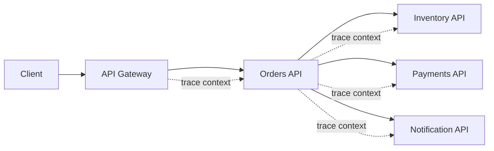
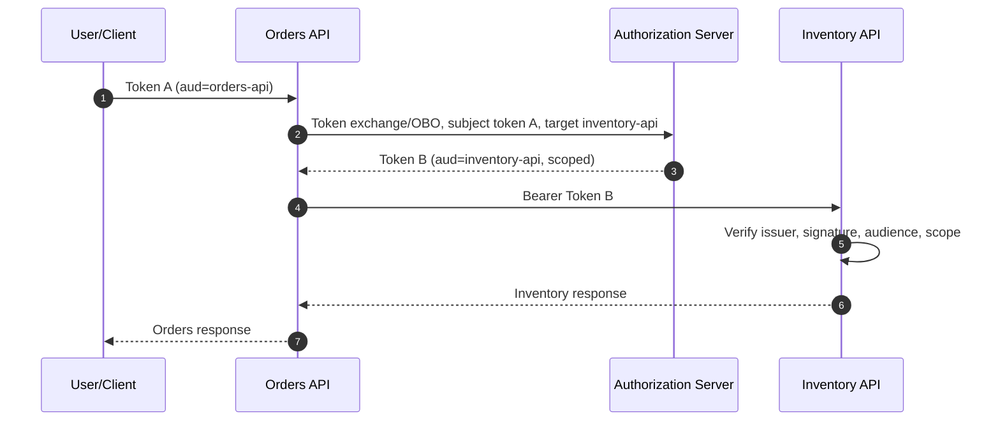
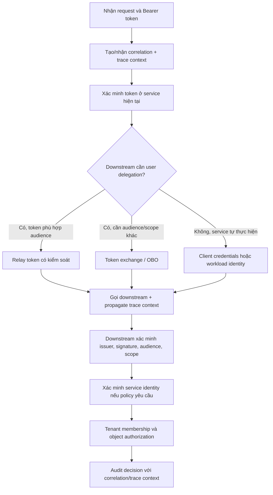

# Thông tin tương quan, phạm vi quyền và kiểm chứng lời gọi phía sau

Trong kiến trúc nhiều dịch vụ, một request có thể đi qua API Gateway, Resource Server, service nghiệp vụ và một hoặc nhiều downstream APIs. Khi chuyển tiếp token, mỗi service cần trả lời ba câu hỏi riêng: **request này liên quan đến trace/correlation nào**, **caller được phép làm gì ở resource hiện tại và resource kế tiếp**, và **service phía sau có xác minh đúng danh tính cùng quyền của lời gọi hay không**.

Ba câu hỏi này thường bị trộn lẫn. Một **X-Correlation-ID** giúp nối log nhưng **không chứng minh caller đã xác thực**. Một **traceparent** giúp theo dõi distributed trace nhưng **không cấp quyền**. Một access token có scope **orders.read** dành cho API A không tự có quyền gọi API B. Một header **X-User-Id** do service trước truyền xuống cũng không thay thế được access token hoặc cơ chế xác thực service.

Bài học thuộc chương **Chuyển tiếp token** của Spring Security OAuth 2.0 / OIDC Resource Server. Nội dung đi từ correlation metadata, trace context, token relay, token exchange/on-behalf-of (OBO), client credentials, audience và scope đến cách downstream xác minh caller. Các ví dụ dùng **Spring Boot 3 / Spring Security 6, Servlet và WebFlux**. Tên host, client registration và scope là giả định minh họa; production phải dùng issuer, resource identifiers và policy đã được phê duyệt.

## 1. Ba lớp thông tin trong một lời gọi liên dịch vụ

| Lớp | Câu hỏi | Ví dụ | Được dùng để |
| --- | --- | --- | --- |
| **Correlation / trace context** | Request này liên quan đến hoạt động nào? | X-Correlation-ID, traceparent | Nối logs, spans, events và troubleshooting. |
| **Authorization context** | Caller được phép làm gì trên resource nào? | Access token, aud, scope, roles/permissions | Xác thực token và quyết định quyền. |
| **Service identity / transport identity** | Service nào đang kết nối đến downstream? | OAuth client credentials, mTLS client certificate | Xác thực workload/service caller. |

Một request có thể mang cả ba:

```http
GET /api/inventory/items/42 HTTP/1.1
Authorization: Bearer <access-token-for-inventory-api>
X-Correlation-ID: 5e5d3f9a-4a14-4ad5-9d37-0e39d48e21f0
traceparent: 00-4bf92f3577b34da6a3ce929d0e0e4736-00f067aa0ba902b7-01
```

- Authorization chứa credential để downstream xác minh.
- X-Correlation-ID là mã ứng dụng dùng nối các log.
- traceparent mô tả distributed trace context theo W3C Trace Context.

**Không dùng correlation ID, trace ID hoặc baggage làm bằng chứng authentication/authorization.** Chúng có thể đến từ client, proxy hoặc instrumentation và không phải credential.

## 2. Một request đi qua nhiều service



Mỗi service tạo span riêng, nhưng các spans có thể cùng thuộc một trace. Correlation ID nghiệp vụ có thể đi xuyên suốt request để đội vận hành tìm được toàn bộ hoạt động. Trong khi đó, token gửi đến từng API cần được **chọn theo audience và quyền của API đích**.

Ví dụ, Orders API nhận access token dành cho orders-api. Khi gọi Inventory API, nó cần token mà Inventory API tin cậy và chấp nhận cho resource inventory-api. Việc sao chép nguyên Bearer token từ request đầu vào sang mọi downstream không bảo đảm điều này.

## 3. Phân biệt request ID, correlation ID, trace ID và span ID

| Identifier | Phạm vi | Vòng đời | Vai trò |
| --- | --- | --- | --- |
| **Request ID** | Một HTTP request cụ thể | Thường được tạo ở ingress cho request đó | Tra cứu request và response. |
| **Correlation ID** | Một hoạt động nghiệp vụ hoặc chuỗi request liên quan | Có thể tồn tại qua nhiều HTTP requests | Gom log/event của một workflow. |
| **Trace ID** | Một distributed trace | Bao trùm nhiều spans và services | Theo dõi quan hệ thời gian giữa các bước. |
| **Span ID** | Một operation/span trong trace | Một span | Xác định một bước cụ thể. |
| **Idempotency key** | Một lệnh ghi cần chống thực hiện lặp | Theo thời gian lưu idempotency record | Ngăn tạo trùng kết quả nghiệp vụ. |

Không mặc định các ID này là một. Một trace có thể có nhiều HTTP requests; một correlation ID có thể liên kết nhiều traces; một request có thể được retry và tạo nhiều attempts.

**Correlation ID không phải Idempotency Key.** Nếu client gửi lại POST /orders hai lần với cùng correlation ID, server không được suy luận hai request là cùng một lệnh. Idempotency cần contract, storage và semantics riêng.

## 4. W3C Trace Context: traceparent và tracestate

W3C Trace Context chuẩn hóa hai header chính:

- **traceparent:** chứa version, trace ID, parent span ID và trace flags.
- **tracestate:** chứa vendor-specific trace state theo định dạng chuẩn.

Ví dụ:

```http
traceparent: 00-4bf92f3577b34da6a3ce929d0e0e4736-00f067aa0ba902b7-01
tracestate: vendor=value
```

Một distributed tracing library đọc context của request, tạo child span cho outbound call và inject context mới vào downstream request. Downstream tiếp tục trace từ parent span tương ứng.

Không nên tự nối chuỗi traceparent bằng cách thay span ID thủ công. Hãy dùng OpenTelemetry hoặc Micrometer Tracing propagator/instrumentation để validate, tạo spans và inject headers đúng chuẩn.

traceparent có thể bị client bên ngoài cung cấp. Nó giúp correlation, không chứng minh request đáng tin. Tại trust boundary, hệ thống có thể quyết định tiếp tục trace context hợp lệ hoặc bắt đầu trace mới/link trace cũ theo policy.

## 5. Baggage không phải nơi chứa quyền hoặc bí mật

Baggage cho phép mang metadata nhỏ xuyên trace, ví dụ một mã workflow hoặc tenant alias phục vụ quan sát. Nhưng baggage có thể được propagate qua nhiều service và vendor.

Không đưa vào baggage:
- Access token, refresh token, client secret hoặc session cookie.
- PII như email, số điện thoại, địa chỉ hoặc dữ liệu nhạy cảm.
- Raw roles/scopes để downstream tự cấp quyền.
- Claims được dùng làm căn cứ authorization.
- Dữ liệu lớn hoặc giá trị do client tùy ý tạo khiến cardinality/log volume tăng cao.

Nếu cần tenant alias trong trace, hãy giới hạn giá trị theo allowlist, xem xét dữ liệu có nhạy cảm hay không và chỉ dùng để **quan sát**. Downstream vẫn phải lấy tenant context có thẩm quyền từ token đã xác minh hoặc domain policy.

## 6. Tạo correlation ID ở trust boundary

Một API edge có thể tạo ID mới cho request và trả nó về client:

```java
import java.io.IOException;
import java.util.UUID;

import jakarta.servlet.FilterChain;
import jakarta.servlet.ServletException;
import jakarta.servlet.http.HttpServletRequest;
import jakarta.servlet.http.HttpServletResponse;

import org.slf4j.MDC;
import org.springframework.web.filter.OncePerRequestFilter;

public final class CorrelationIdFilter extends OncePerRequestFilter {

    public static final String ATTRIBUTE =
        CorrelationIdFilter.class.getName() + ".correlationId";

    @Override
    protected void doFilterInternal(
            HttpServletRequest request,
            HttpServletResponse response,
            FilterChain chain)
            throws ServletException, IOException {

        String correlationId = UUID.randomUUID().toString();
        request.setAttribute(ATTRIBUTE, correlationId);
        response.setHeader("X-Correlation-ID", correlationId);

        String previous = MDC.get("correlationId");
        MDC.put("correlationId", correlationId);
        try {
            chain.doFilter(request, response);
        } finally {
            if (previous == null) {
                MDC.remove("correlationId");
            } else {
                MDC.put("correlationId", previous);
            }
        }
    }
}
```

Ví dụ này **luôn tạo ID mới ở edge**. Nếu hệ thống có trusted gateway muốn truyền correlation ID xuyên nhiều boundary, chỉ chấp nhận header từ gateway đã xác thực trên network path phù hợp, kiểm tra định dạng/độ dài, và không coi giá trị đó là chứng cứ bảo mật. Header do Internet client gửi trực tiếp không nên được tin vô điều kiện làm audit identity.

MDC là thread-local logging context trong mô hình Servlet truyền thống. Phải xóa hoặc khôi phục giá trị trong finally, tránh request tiếp theo trên cùng thread nhận nhầm ID. Với async dispatch hoặc WebFlux, cần context propagation tương ứng; không giả định MDC tự đi qua mọi thread.

## 7. Trả correlation ID và ghi log có cấu trúc

Filter có thể lưu correlation ID trong request attribute; controller/service đọc nó qua một accessor hoặc truyền vào request context:

```java
String correlationId =
    (String) request.getAttribute(CorrelationIdFilter.ATTRIBUTE);
```

Log có cấu trúc có thể ghi:

```json
{
  "event": "inventory_lookup_completed",
  "correlationId": "5e5d3f9a-4a14-4ad5-9d37-0e39d48e21f0",
  "traceId": "4bf92f3577b34da6a3ce929d0e0e4736",
  "service": "orders-api",
  "downstream": "inventory-api",
  "status": 200,
  "durationMs": 28
}
```

Chỉ ghi dữ liệu cần cho troubleshooting và audit. **Không ghi Authorization header, raw token, refresh token, cookie hoặc toàn bộ claims**. Nếu cần ghi subject, dùng identity có namespace issuer và áp dụng chính sách bảo vệ/pseudonymization cho log.

Correlation ID do client kiểm soát có thể được dùng để làm log injection, gây high-cardinality metrics hoặc tạo nhầm lẫn trong điều tra. Validate charset/length, encode log fields và dùng server-generated request ID khi không có trusted upstream.

## 8. Truyền correlation metadata sang downstream

Có thể truyền một correlation ID ứng dụng như header riêng:

```java
public Mono<InventoryItem> getItem(
        WebClient inventoryClient,
        String itemId,
        String correlationId) {

    return inventoryClient.get()
        .uri("/items/{id}", itemId)
        .header("X-Correlation-ID", correlationId)
        .retrieve()
        .bodyToMono(InventoryItem.class);
}
```

Phương thức nhận ID tường minh để không phụ thuộc MDC/thread-local khi WebClient chuyển execution sang thread khác. Trong một ứng dụng lớn, có thể đóng gói metadata này trong một request context đã được kiểm soát.

Nếu dùng Micrometer Tracing/OpenTelemetry với WebClient đã được instrument, traceparent/tracestate thường được propagate tự động. **Không cần tự copy traceparent bằng chuỗi header** khi tracing instrumentation đang quản lý span lifecycle.

Một downstream nên:
- Nhận và ghi correlation ID đã được kiểm tra.
- Tạo span/service log riêng.
- Trả correlation ID hoặc request ID theo API contract nếu cần.
- Không dùng ID đó để quyết định quyền.
- Không ghi token vào log chỉ để tiện liên kết request.

## 9. Token relay là gì?

**Token relay** chuyển tiếp access token hiện tại từ request vào một lời gọi downstream:

```text
Client -- Bearer token T --> Orders API
Orders API -- Bearer token T --> Inventory API
```

Spring Security có filter cho WebClient ở Servlet Resource Server:

```java
import org.springframework.context.annotation.Bean;
import org.springframework.security.oauth2.server.resource.web.reactive.function.client.ServletBearerExchangeFilterFunction;
import org.springframework.web.reactive.function.client.WebClient;

@Bean
WebClient inventoryWebClient(WebClient.Builder builder) {
    return builder
        .baseUrl("https://inventory.internal")
        .filter(new ServletBearerExchangeFilterFunction())
        .build();
}
```

ServletBearerExchangeFilterFunction lấy access token từ Authentication hiện tại khi có token Authentication phù hợp và thêm Bearer header cho outbound request. Ví dụ này dành cho một client chuyên gọi **một downstream cố định**.

Filter relay không:
- Đổi audience.
- Xin scope mới.
- Đổi issuer.
- Thực hiện token exchange.
- Tạo service identity độc lập.
- Bảo đảm downstream chấp nhận token.

Vì filter có thể gắn token hiện tại vào các request dùng WebClient đó, hãy giới hạn client ở destination được tin cậy. Không gắn filter relay vào một WebClient dùng để gọi URL tùy ý do người dùng nhập.

## 10. Điều kiện để relay token hoạt động

Giả sử token đầu vào:

```json
{
  "iss": "https://idp.example/realms/shop",
  "sub": "user-42",
  "aud": ["orders-api"],
  "scope": "orders.read"
}
```

Orders API chuyển nguyên token sang Inventory API. Nếu Inventory API yêu cầu:

```json
{
  "aud": ["inventory-api"],
  "scope": "inventory.read"
}
```

thì token ban đầu **không đáp ứng audience và scope của resource đích**. Inventory API phải từ chối, dù token được ký hợp lệ và Orders API đã chấp nhận.

Relay chỉ phù hợp khi access token đã được phát hành cho downstream hoặc có audience/resource contract bao gồm downstream theo thiết kế được phê duyệt. Tránh phát một token có audience quá rộng chỉ để relay tiện lợi; mỗi resource nên kiểm tra đúng audience và quyền của mình.

## 11. Vì sao không nên relay mọi token một cách mù quáng?

Các rủi ro:

1. **Audience mismatch:** token dành cho API A bị gửi đến API B.
2. **Over-privilege:** token có quyền rộng hơn mức downstream cần.
3. **Credential leakage:** token bị gửi nhầm host, proxy, redirect hoặc log.
4. **Issuer mismatch:** downstream không trust issuer đã cấp token.
5. **Token lifetime:** downstream nhận token gần hết hạn hoặc đã hết hạn.
6. **Confused deputy:** service A dùng quyền caller theo cách caller không dự định, để truy cập tài nguyên của B.
7. **Service identity missing:** downstream không phân biệt được user caller và workload đang thực hiện kết nối nếu token contract không biểu diễn actor.

Relay phải là quyết định có chủ đích theo **destination, audience, issuer, scope và caller semantics**.

## 12. Token exchange và On-Behalf-Of khác token relay

Nếu token đầu vào dành cho Orders API nhưng Inventory API cần token riêng, service có thể dùng **OAuth 2.0 Token Exchange** (RFC 8693) hoặc flow **On-Behalf-Of (OBO)** do Authorization Server hỗ trợ.



Token B có thể biểu diễn user delegation và actor/service tùy hợp đồng Authorization Server. Downstream vẫn phải xác minh token B độc lập. Không giả định mọi IdP hỗ trợ RFC 8693 hoặc OBO giống nhau; Entra OBO và các implementation khác có cấu hình, grant và claims cụ thể.

Token exchange thường phù hợp hơn khi cần:
- Token audience-specific cho API đích.
- Giảm quyền xuống scope tối thiểu cần thiết.
- Giữ user context để downstream thực hiện authorization theo user.
- Biểu diễn service đang hành động thay mặt user theo contract hỗ trợ.

Không tự tạo JWT mới bằng cách copy claims và ký bằng private key của service để giả làm token issuer. Token phải do Authorization Server hoặc authority được tin cậy phát hành theo protocol đã thống nhất.

## 13. Client Credentials khi downstream chỉ cần biết service caller

Không phải mọi lời gọi phía sau đều cần user delegation. Nếu Orders API gọi Inventory API để đồng bộ tồn kho theo quyền của **workload Orders API**, có thể dùng Client Credentials:

```text
Orders API -- client credentials token --> Inventory API
```

Token thường đại diện OAuth client/service, không phải user đang gửi request đầu tiên. Inventory API xác minh client/service principal và chỉ cấp những quyền M2M cần thiết.

Cấu hình client registration minh họa:

```yaml
spring:
  security:
    oauth2:
      client:
        registration:
          inventory-service:
            provider: internal-idp
            client-id: orders-api
            client-secret: ORDERS_API_CLIENT_SECRET_FROM_SECRET_MANAGER
            authorization-grant-type: client_credentials
            scope:
              - inventory.read
        provider:
          internal-idp:
            token-uri: https://identity.internal.example/oauth2/token
```

Không commit client secret. Production cần secret manager, rotation, TLS, issuer/resource configuration và quyền registration giới hạn.

## 14. Lấy Client Credentials token bằng OAuth2AuthorizedClientManager

Ví dụ Servlet/service-tier dùng AuthorizedClientServiceOAuth2AuthorizedClientManager:

```java
import org.springframework.context.annotation.Bean;
import org.springframework.security.oauth2.client.AuthorizedClientServiceOAuth2AuthorizedClientManager;
import org.springframework.security.oauth2.client.OAuth2AuthorizedClientManager;
import org.springframework.security.oauth2.client.OAuth2AuthorizedClientProviderBuilder;
import org.springframework.security.oauth2.client.OAuth2AuthorizeRequest;
import org.springframework.security.oauth2.client.OAuth2AuthorizedClient;
import org.springframework.security.oauth2.client.registration.ClientRegistrationRepository;
import org.springframework.security.oauth2.client.OAuth2AuthorizedClientService;

@Bean
OAuth2AuthorizedClientManager authorizedClientManager(
        ClientRegistrationRepository registrations,
        OAuth2AuthorizedClientService authorizedClients) {

    var manager =
        new AuthorizedClientServiceOAuth2AuthorizedClientManager(
            registrations, authorizedClients);

    manager.setAuthorizedClientProvider(
        OAuth2AuthorizedClientProviderBuilder.builder()
            .clientCredentials()
            .build());

    return manager;
}
```

Dùng trong service:

```java
OAuth2AuthorizeRequest request =
    OAuth2AuthorizeRequest
        .withClientRegistrationId("inventory-service")
        .principal("orders-api")
        .build();

OAuth2AuthorizedClient client = authorizedClientManager.authorize(request);

if (client == null) {
    throw new IllegalStateException(
        "Could not obtain inventory service access token");
}

String accessToken =
    client.getAccessToken().getTokenValue();
```

Sau đó gắn token vào request chỉ gửi tới Inventory API:

```java
return inventoryWebClient.get()
    .uri("/internal/items/{id}", itemId)
    .headers(headers -> headers.setBearerAuth(accessToken))
    .retrieve()
    .bodyToMono(InventoryItem.class);
```

Ví dụ cho thấy token được xin theo registration inventory-service. Cần bảo đảm WebClient này có base URL cố định, không log token và downstream chỉ cấp inventory.read cho đúng service principal. OAuth2AuthorizedClientManager quản lý authorized client/token lifecycle theo provider; nó không tự quyết định quyền nghiệp vụ trên từng item.

## 15. User delegation và service identity có thể cùng quan trọng

Trong một lời gọi, downstream đôi khi cần biết cả:

- **Ai là người dùng gốc?** Để kiểm tra ownership, tenant membership hoặc consent.
- **Service nào đang gọi?** Để kiểm soát workload, network trust và audit.

Một user access token được relay có thể biểu diễn subject user và client/authorized party theo token contract. Một client credentials token biểu diễn service principal nhưng không mang đầy đủ quyền của user. Một token exchange có thể biểu diễn subject user và actor service theo contract.

Không tự ghép hai thông tin bằng headers không được bảo vệ:

```http
X-User-Id: user-42
X-User-Role: admin
X-Calling-Service: orders-api
```

Các headers trên có thể bị giả mạo nếu client gửi trực tiếp hoặc proxy không strip/overwrite đúng. Nếu downstream cần user delegation, dùng access token/OBO/token exchange có chữ ký và claims được xác minh. Nếu cần workload identity, dùng client credentials, mTLS hoặc cơ chế workload identity được tin cậy. Nếu cần cả hai, thiết kế rõ actor/subject semantics.

## 16. Actor và subject trong delegated token

RFC 8693 mô tả token exchange và các actor-related claims như act trong mô hình delegation. Một token minh họa có thể thể hiện subject và actor:

```json
{
  "iss": "https://identity.example",
  "sub": "user-42",
  "aud": ["inventory-api"],
  "scope": "inventory.read",
  "act": {
    "sub": "orders-api"
  }
}
```

Đây là ví dụ khái niệm; không phải mọi Authorization Server đều phát act hoặc cùng cấu trúc. Downstream chỉ tin claim actor khi token được issuer tin cậy ký và profile/semantics đã được thống nhất.

Phân biệt:
- sub: subject mà token đại diện trong profile.
- act: actor đang hành động thay mặt subject theo token-exchange model.
- client_id/azp: OAuth client hoặc authorized party theo provider/token profile.
- mTLS identity: workload certificate ở tầng kết nối.

Không suy luận actor chỉ từ X-Calling-Service do request gửi lên. Không suy luận sub là human nếu token là app-only.

## 17. Downstream phải xác minh token độc lập

Inventory API không được tin rằng Orders API đã xác minh token rồi nên có thể bỏ Resource Server security. Mỗi protected resource phải xác minh token được gửi tới nó:

1. Issuer nằm trong trust registry.
2. Chữ ký hợp lệ theo JWK/algorithm policy.
3. exp, nbf và các time validators hợp lệ.
4. Audience đúng với Inventory API.
5. Token là access token đúng profile.
6. Scope/permission đủ cho operation.
7. Tenant, ownership và domain ACL đúng.
8. Nếu yêu cầu, service/workload identity cũng được xác thực.

Lời gọi nội bộ vẫn đi qua network, có thể bị misroute, retry, cấu hình nhầm hoặc bị một workload khác gọi. **Network nội bộ không tự là bằng chứng authorization.**

## 18. Cấu hình Resource Server phía downstream

Một API downstream có thể cấu hình JWT Resource Server với issuer và JWK Set được quản trị. Ví dụ validator audience cho Inventory API:

```java
import org.springframework.context.annotation.Bean;
import org.springframework.context.annotation.Configuration;
import org.springframework.http.HttpMethod;
import org.springframework.security.config.Customizer;
import org.springframework.security.config.annotation.web.builders.HttpSecurity;
import org.springframework.security.oauth2.core.DelegatingOAuth2TokenValidator;
import org.springframework.security.oauth2.core.OAuth2Error;
import org.springframework.security.oauth2.core.OAuth2TokenValidator;
import org.springframework.security.oauth2.core.OAuth2TokenValidatorResult;
import org.springframework.security.oauth2.jwt.Jwt;
import org.springframework.security.oauth2.jwt.JwtValidators;
import org.springframework.security.oauth2.jwt.NimbusJwtDecoder;
import org.springframework.security.web.SecurityFilterChain;

@Configuration
class InventoryResourceServerConfig {

    private static final String ISSUER =
        "https://identity.internal.example/realms/platform";
    private static final String JWK_SET_URI =
        "https://identity.internal.example/realms/platform/protocol/openid-connect/certs";

    @Bean
    NimbusJwtDecoder inventoryJwtDecoder() {
        NimbusJwtDecoder decoder =
            NimbusJwtDecoder.withJwkSetUri(JWK_SET_URI).build();

        OAuth2TokenValidator<Jwt> audienceValidator = jwt ->
            jwt.getAudience().contains("inventory-api")
                ? OAuth2TokenValidatorResult.success()
                : OAuth2TokenValidatorResult.failure(
                    new OAuth2Error(
                        "invalid_token", "Wrong audience", null));

        decoder.setJwtValidator(
            new DelegatingOAuth2TokenValidator<>(
                JwtValidators.createDefaultWithIssuer(ISSUER),
                audienceValidator));

        return decoder;
    }

    @Bean
    SecurityFilterChain inventorySecurity(HttpSecurity http)
            throws Exception {
        return http
            .authorizeHttpRequests(auth -> auth
                .requestMatchers(
                    HttpMethod.GET, "/internal/items/**")
                    .hasAuthority("SCOPE_inventory.read")
                .anyRequest().denyAll())
            .oauth2ResourceServer(oauth2 -> oauth2
                .jwt(Customizer.withDefaults()))
            .build();
    }
}
```

Ví dụ dùng một NimbusJwtDecoder bean có issuer/time validators và audience validator. JWK Set URI phải là endpoint tin cậy lấy từ cấu hình, không từ token header. Spring Security dùng decoder bean này trong Resource Server chain. Trong production còn phải cấu hình algorithm allowlist, token type/profile và HTTP client timeout/cache theo policy.

HTTP rule kiểm tra scope; decoder kiểm tra chữ ký, issuer, thời gian và audience. Sau đó service vẫn cần tenant/object policy. Nếu downstream dùng nhiều issuers, mỗi manager/decoder phải có đúng validator và audience tương ứng.

## 19. Scope phải dành cho API đích

Giả sử Orders API nhận:

```json
{
  "aud": ["orders-api"],
  "scope": "orders.read orders.write"
}
```

Nó gọi Inventory API. Downstream yêu cầu:

```json
{
  "aud": ["inventory-api"],
  "scope": "inventory.read"
}
```

Việc orders.write nghe có vẻ mạnh không làm nó tương đương inventory.read. Scope là quyền theo resource server và authorization contract. Mỗi API cần đặt tên/meaning rõ ràng.

Không:
- Cấp mọi scope của toàn bộ hệ thống cho một access token.
- Map orders.admin thành inventory.admin vì đều có chữ admin.
- Dùng scope của Orders API làm chứng cứ rằng caller được đọc Inventory.
- Bỏ audience validator để token relay hoạt động.

Nếu downstream cần quyền đọc tồn kho, Authorization Server phải cấp đúng inventory.read cho user delegation hoặc service client theo policy.

## 20. Scope, roles và permission ở downstream

Spring Security thường ánh xạ OAuth scopes thành SCOPE_ authorities. Ví dụ:

```text
scope = "inventory.read inventory.reserve"

Authorities:
  SCOPE_inventory.read
  SCOPE_inventory.reserve
```

Rule:

```java
.authorizeHttpRequests(auth -> auth
    .requestMatchers(HttpMethod.GET, "/internal/items/**")
        .hasAuthority("SCOPE_inventory.read")
    .requestMatchers(HttpMethod.POST, "/internal/reservations/**")
        .hasAuthority("SCOPE_inventory.reserve")
    .anyRequest().denyAll())
```

Nếu IdP phát permissions/roles khác schema, downstream cần converter theo issuer/token profile và allowlist mapping. Không tự map role admin từ bất kỳ issuer nào thành quyền quản trị Inventory. Sau scope, domain service vẫn kiểm tra tenant và object.

## 21. Xác minh workload bằng mTLS hoặc service token

Hai cơ chế có thể bổ sung nhau:

| Cơ chế | Xác minh | Giới hạn |
| --- | --- | --- |
| OAuth client credentials | Service có token từ Authorization Server, có audience/scope. | Token cần quản lý lifecycle; không tự mang user delegation. |
| mTLS | Peer có certificate chain/identity được tin cậy trong TLS handshake. | Cần quản lý cert issuance/rotation và mapping workload. |
| mTLS-bound access token | Token được ràng buộc với certificate theo profile hỗ trợ. | Resource Server và Authorization Server phải hỗ trợ đúng chuẩn. |
| Network policy | Workload được phép kết nối đến endpoint. | Không thay authentication/authorization ở application. |

Với mTLS, downstream cần xác minh certificate chain, validity, EKU/SAN hoặc workload identity mapping và rotation. Chỉ kiểm tra một header X-Client-Cert do proxy truyền là chưa đủ nếu proxy không strip input giả mạo và thiết lập trust boundary đúng.

Có thể yêu cầu cả mTLS service identity lẫn bearer user-delegated token: mTLS xác thực workload kết nối; token xác thực user/delegation và scope cho resource. Policy phải nói rõ **hai identity kết hợp như thế nào**.

## 22. WebFlux: relay token qua WebClient

Trong WebFlux Resource Server, Spring Security có filter tương ứng:

```java
import org.springframework.context.annotation.Bean;
import org.springframework.security.oauth2.server.resource.web.reactive.function.client.ServerBearerExchangeFilterFunction;
import org.springframework.web.reactive.function.client.WebClient;

@Bean
WebClient inventoryWebClient(WebClient.Builder builder) {
    return builder
        .baseUrl("https://inventory.internal")
        .filter(new ServerBearerExchangeFilterFunction())
        .build();
}
```

ServerBearerExchangeFilterFunction relay bearer token của SecurityContext reactive sang WebClient request. Nó vẫn **không đổi audience/scope** và không biến token dành cho API hiện tại thành token dành cho Inventory API. Dùng một client chuyên biệt cho host được tin cậy; không gắn filter vào WebClient có thể gọi arbitrary URLs.

WebFlux lưu security context trong Reactor Context. Không lấy Authentication bằng SecurityContextHolder imperative hoặc dùng MDC ThreadLocal để suy ra token trong reactive pipeline. Hãy dùng các reactive security/context APIs và tracing instrumentation.

## 23. Correlation propagation trong WebFlux và async code

Một WebClient request có thể đổi thread nhiều lần. ThreadLocal MDC không tự đảm bảo correlation ID được giữ đúng. Có ba hướng:

- Dùng Micrometer Observation/Tracing với context propagation được cấu hình.
- Truyền correlation metadata tường minh như tham số/request context.
- Dùng Reactor Context và bridge logging context được thư viện hỗ trợ.

Ví dụ truyền metadata tường minh:

```java
public Mono<Item> loadItem(
        String itemId,
        String correlationId) {

    return inventoryWebClient.get()
        .uri("/items/{id}", itemId)
        .header("X-Correlation-ID", correlationId)
        .retrieve()
        .bodyToMono(Item.class);
}
```

Không dùng static mutable variable để giữ request ID; nhiều requests đồng thời sẽ ghi đè lẫn nhau. Không lấy correlation ID từ MDC rồi giả định nó luôn đúng sau publishOn, subscribeOn hoặc async boundary nếu chưa cấu hình propagation.

## 24. Truyền cả correlation ID và trace context đúng cách

Một service có thể có:

```text
X-Correlation-ID -> business/request correlation
traceparent      -> distributed trace parent
tracestate       -> vendor trace metadata
baggage          -> small approved contextual metadata
Authorization    -> downstream credential
```

Với Spring Boot, dùng WebClient.Builder do Boot cung cấp cùng Micrometer Observation/Tracing và tracing bridge đã cấu hình để có instrumentation. Một WebClient tự tạo không qua builder/instrumentation có thể không tự tạo hoặc propagate spans như mong đợi.

Không sao chép trace headers từ một request bất kỳ sang một request khác nếu hai operation không cùng trace. Tracing instrumentation phải tạo child span cho outbound call và inject context phù hợp.

## 25. Không tin các forwarded identity headers như credential

Các headers dễ gây nhầm:

```http
X-User-Id: user-42
X-Authenticated-User: alice
X-User-Roles: admin
X-Tenant-Id: acme
X-Calling-Service: orders-api
```

Nếu downstream dựa vào chúng để cấp quyền, caller có thể spoof. Nếu kiến trúc gateway có dùng identity headers:

1. Gateway phải xác thực caller bằng credential đáng tin.
2. Ingress phải strip các headers cùng tên do client gửi.
3. Gateway phải tự ghi đè giá trị dựa trên verified identity.
4. Kết nối gateway-downstream phải được bảo vệ và chỉ chấp nhận gateway identity.
5. Downstream phải xác minh gateway/service và có contract rõ.
6. Không cho các headers này vượt qua trust boundary khác mà không tái xác minh.

Ngay cả khi các điều kiện trên có mặt, bearer token hoặc token exchange có chữ ký thường biểu diễn identity/authorization end-to-end rõ ràng hơn. **Correlation headers luôn chỉ là metadata**, dù gateway đã tạo chúng.

## 26. Chuyển tiếp tenant context

Một route:

```http
GET /api/tenants/acme/inventory/items/42
```

có thể chọn tenant mà user muốn thao tác, nhưng path không chứng minh membership. Downstream cần xác minh:

- Token/audience/scope dành cho Inventory API.
- Issuer và subject đã được xác minh.
- Tenant acme có được caller/service sử dụng không.
- User hoặc service có membership/grant trong tenant đó không.
- Item 42 thuộc tenant acme và caller được phép đọc không.

Nếu dùng shared issuer cho nhiều tenants, không giả định iss quyết định tenant. Nếu token có claim tenant_id, chỉ tin sau signature/issuer/audience validation và kiểm tra semantics theo IdP contract. Domain policy có thể cần database membership mới nhất.

## 27. Delegation chain và quyền bị mở rộng ngoài ý muốn

Ví dụ:

```text
User -> Orders API -> Inventory API -> Warehouse API
```

Nếu Orders API có inventory.write và chuyển tiếp token user có scope rộng, Inventory API có thể thực hiện nhiều hơn yêu cầu ban đầu. Nếu Inventory API lại dùng service token có quyền warehouse admin, quyền thực tế có thể bị mở rộng thêm.

Mỗi bước nên áp dụng:

1. **Least privilege:** chỉ xin scope cần cho operation cụ thể.
2. **Audience restriction:** token chỉ dành cho resource đích.
3. **Actor accountability:** downstream xác định service đang hành động nếu cần.
4. **User delegation:** giữ subject user qua token exchange/OBO khi nghiệp vụ cần.
5. **Domain checks:** tenant/object ownership tại service sở hữu dữ liệu.
6. **Audit chain:** ghi caller, actor, target resource và correlation/trace ID.

Không dùng quyền của service để lách một từ chối quyền của user nếu business operation được định nghĩa là user-delegated. Nếu operation thực sự là background/system task, hãy thể hiện rõ caller kind và policy khác.

## 28. Timeout, retry và idempotency khi gọi downstream

Correlation ID giúp gom các lần thử trong cùng một workflow, nhưng không đảm bảo một lệnh chỉ chạy một lần.

Ví dụ:

```text
Orders API gửi POST reserve stock
Inventory xử lý thành công
Response bị mất trên mạng
Orders retry POST
```

Nếu không có idempotency contract, stock có thể bị reserve hai lần. Dùng Idempotency-Key cho command có side effect, lưu kết quả theo principal/tenant/operation và thời hạn hợp lý. Correlation ID có thể giữ nguyên để nối logs; mỗi attempt có thể có request/span ID riêng.

Khi retry:
- Không retry vô hạn với 401/403.
- Refresh/re-authorize token theo OAuth client manager khi hợp lệ, không lặp vô hạn token cũ.
- Tôn trọng Retry-After, deadline và backoff cho 429/5xx.
- Không retry non-idempotent writes nếu chưa có idempotency semantics.
- Không log Bearer token trong retry diagnostics.

## 29. Redirect và destination phải được kiểm soát khi có bearer token

Một WebClient gắn bearer relay có thể vô tình gửi credential tới một destination ngoài dự kiến nếu URL được tạo từ user input hoặc redirect policy không phù hợp.

- Dùng base URL cố định hoặc allowlist host/scheme.
- Không ghép URL từ input caller nếu không validate.
- Kiểm tra hành vi redirect và đảm bảo Authorization header không bị chuyển đến host khác.
- Không relay token qua HTTP không mã hóa.
- Không đưa token vào query string hoặc path.
- Giới hạn outbound network destinations theo network policy.

Một service có thể là **confused deputy** nếu nó có token/quyền truy cập resource nhưng để caller điều khiển host nhận credential.

## 30. Audit: ai gọi ai, thay mặt ai và trong request nào?

Audit event cho lời gọi downstream nên phân biệt:

| Trường | Ý nghĩa |
| --- | --- |
| correlationId | Liên kết workflow/request logs. |
| traceId | Liên kết distributed spans. |
| callingService | Workload đã gửi lời gọi, từ identity đã xác minh. |
| subjectIssuer | Issuer của subject token nếu có delegation. |
| subjectId | Subject đã xác minh, được bảo vệ/pseudonymize theo policy. |
| targetResource | API/resource nhận request. |
| audience | Resource token được cấp cho. |
| grantedScopes | Scope/permission liên quan theo policy. |
| operation | Hành động nghiệp vụ được thực hiện. |
| decision | Allow/deny và reason code. |

Không ghi raw access token, refresh token, client secret, cookie hoặc full JWT claims. Với user PII, áp dụng retention/access controls. Correlation ID giúp tìm audit event; **nó không chứng minh audit event thuộc user nào nếu không gắn với identity đã xác minh**.

## 31. Kiểm thử correlation và tracing

Các ca nên có:

| Tình huống | Kỳ vọng |
| --- | --- |
| Request không có correlation ID | Edge tạo ID mới và trả header theo contract. |
| Client gửi ID sai định dạng/quá dài | Từ chối hoặc thay bằng ID server-generated theo policy. |
| Trusted gateway gửi correlation ID | Chỉ accept nếu source/trust boundary được xác minh. |
| Hai requests đồng thời | MDC/context không lẫn ID. |
| WebClient đổi thread | Correlation/trace context vẫn đúng theo instrumentation hoặc explicit propagation. |
| Outbound call | Downstream nhận correlation metadata và span parent hợp lệ. |
| Correlation ID bị giả mạo | Không ảnh hưởng Authentication hoặc authorization. |
| Baggage có dữ liệu nhạy cảm | Không propagate hoặc bị lọc theo policy. |

Test không nên chỉ kiểm tra header có tồn tại; hãy xác nhận **một request khác không nhận ID của request trước**, đặc biệt khi dùng thread pool/async execution.

## 32. Kiểm thử token relay và downstream authorization

| Tình huống | Kỳ vọng |
| --- | --- |
| Token audience đúng Inventory API, scope đúng | Inventory xác thực và cho phép nếu domain policy đúng. |
| Token chỉ có audience Orders API | Inventory từ chối. |
| Token đúng audience nhưng thiếu inventory.read | Từ chối authorization. |
| Token issuer không được Inventory trust | Authentication failure. |
| Token hết hạn | Từ chối. |
| Orders relay token đến Payments API | Chỉ hoạt động nếu token được phát cho Payments theo contract; nếu không phải từ chối. |
| Caller gửi X-User-Roles: admin | Không thay đổi authorities đã xác minh. |
| Correlation ID là chuỗi bất kỳ | Không cấp quyền. |
| Token exchange trả token audience Inventory | Inventory xác minh token mới và scope đúng. |
| Client credentials token | Inventory xác thực service principal theo policy M2M. |
| User không thuộc tenant yêu cầu | Domain authorization từ chối dù scope đúng. |
| Token valid nhưng item thuộc tenant khác | Không trả dữ liệu cross-tenant. |

Có test dương chứng minh lời gọi hợp lệ chạy được và test âm cho audience/scope/issuer mismatch. Một downstream permitAll không phải bằng chứng token relay hoạt động an toàn.

## 33. Các lỗi thiết kế thường gặp

| Lỗi | Hậu quả | Cách xử lý |
| --- | --- | --- |
| Dùng trace ID làm authorization key | Caller có thể tự tạo ID để giả danh | Tách trace context khỏi security principal. |
| Relay mọi Bearer token tới mọi downstream | Token leak/audience mismatch | Client cố định theo destination, token exchange khi cần. |
| Tin X-User-Id hoặc X-Roles | Header spoofing, privilege escalation | Token/identity được xác minh và trust boundary rõ. |
| Dùng client credentials nhưng mong có user identity | Mất user delegation/owner semantics | Token exchange/OBO hoặc thiết kế service-only operation. |
| Dùng user token cho mọi background job | Credential lifetime/context không phù hợp | Workload identity/service credentials. |
| Downstream tin gateway đã verify | Bypass khi route/network thay đổi | Mỗi resource server xác minh credential của chính nó. |
| Bỏ audience validation | Token substitution giữa APIs | Audience validator riêng cho downstream. |
| Dùng MDC trong WebFlux như ThreadLocal | Correlation bị mất hoặc lẫn | Reactor Context/Micrometer propagation. |
| Dùng correlation ID thay idempotency key | Side effect bị lặp khi retry | Idempotency contract và persistence. |
| Log Authorization để debug | Lộ bearer credential | Log request ID, issuer alias, decision và reason. |

## 34. Lộ trình thiết kế một lời gọi phía sau



Thứ tự thực hiện:

1. Xác định downstream là resource nào và audience chính xác.
2. Xác định operation cần scope/permission nào.
3. Quyết định user delegation, service identity hay cả hai.
4. Chọn relay, token exchange/OBO hoặc client credentials.
5. Cấu hình WebClient riêng cho destination được tin cậy.
6. Propagate trace context/correlation metadata bằng instrumentation hoặc context tường minh.
7. Bắt downstream tự xác minh token và workload identity.
8. Kiểm tra tenant, owner và domain ACL tại service sở hữu dữ liệu.
9. Thiết kế timeout, retry, idempotency và audit.
10. Kiểm thử audience mismatch, scope mismatch, spoofed headers và context propagation.

## 35. Tài liệu tham khảo

- [Spring Security 6.5 — Bearer Token Propagation](https://docs.spring.io/spring-security/reference/6.5/servlet/oauth2/resource-server/bearer-tokens.html): chuyển tiếp Bearer token bằng ServletBearerExchangeFilterFunction.
- [Spring Security 6.5 — Reactive Bearer Token Propagation](https://docs.spring.io/spring-security/reference/6.5/reactive/oauth2/resource-server/bearer-tokens.html): ServerBearerExchangeFilterFunction trong WebFlux.
- [Spring Security 6.5 — OAuth2 Client](https://docs.spring.io/spring-security/reference/6.5/servlet/oauth2/client/index.html): OAuth2AuthorizedClientManager và client credentials.
- [RFC 8693 — OAuth 2.0 Token Exchange](https://www.rfc-editor.org/rfc/rfc8693.html): subject token, actor token, delegation và token exchange.
- [RFC 6750 — OAuth 2.0 Bearer Token Usage](https://www.rfc-editor.org/rfc/rfc6750.html): sử dụng Bearer token trong HTTP.
- [RFC 8705 — OAuth 2.0 Mutual-TLS Client Authentication and Certificate-Bound Access Tokens](https://www.rfc-editor.org/rfc/rfc8705.html): mTLS client identity và certificate-bound tokens.
- [W3C Trace Context](https://www.w3.org/TR/trace-context/): traceparent, tracestate và distributed trace propagation.
- [OpenTelemetry Context Propagation](https://opentelemetry.io/docs/concepts/context-propagation/): truyền trace context giữa services.
- [Spring Boot — Observability](https://docs.spring.io/spring-boot/reference/actuator/observability.html): Micrometer Observation và tracing integration.

## 36. Kết luận

Trong lời gọi liên dịch vụ, **correlation**, **authorization** và **service identity** bổ sung cho nhau nhưng không thay thế nhau. Correlation ID/trace context giúp tìm ra request đi qua những service nào. Access token và scope xác định resource đích cùng quyền được cấp. Service identity xác định workload đang kết nối và có thể được bảo vệ thêm bằng client credentials hoặc mTLS.

Token relay chỉ chuyển tiếp token hiện tại; nó không đổi audience hay mở rộng scope. Khi downstream cần token dành riêng cho resource đó, hãy dùng token exchange/OBO nếu Authorization Server hỗ trợ. Khi downstream chỉ cần quyền của workload, client credentials hoặc workload identity phù hợp hơn. Dù chọn cách nào, downstream vẫn phải xác minh issuer, chữ ký, audience, thời gian, scope và tenant/object policy của chính nó.

**Điểm cốt lõi:** *Dùng correlation metadata để theo dấu lời gọi, dùng access token có audience và scope phù hợp để chứng minh quyền, và để downstream xác minh caller trước khi thực hiện nghiệp vụ.*
