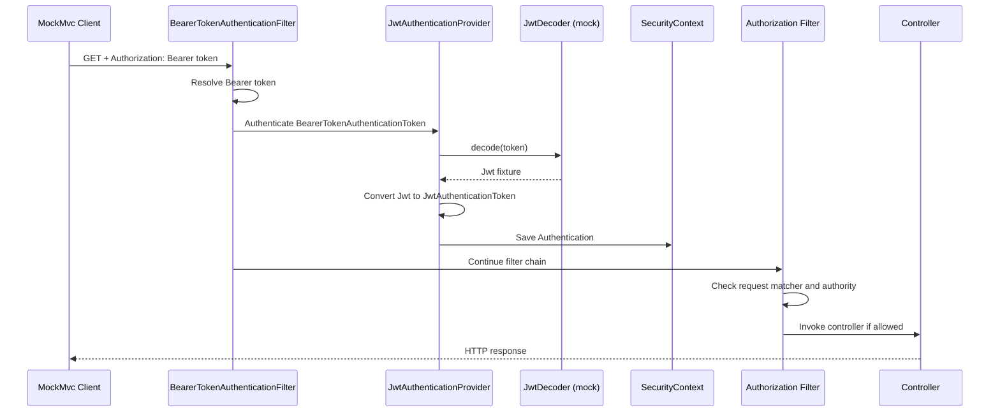
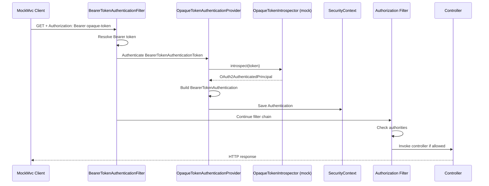

# Mock JwtDecoder hoặc OpaqueTokenIntrospector để kiểm tra luồng filter

## 1. Mục tiêu của bài kiểm thử

Một Spring Security OAuth 2.0 Resource Server trên Servlet stack thường nhận access token trong header:

```http
GET /api/orders/42 HTTP/1.1
Host: orders.example.test
Authorization: Bearer test-access-token
```

Request đi qua Spring Security filter chain. Filter trích xuất Bearer token, xác thực token qua cơ chế được cấu hình, tạo Authentication, đặt nó vào SecurityContext rồi mới cho request đi tới controller.

Với JWT, phần xác minh token sử dụng `JwtDecoder`. Với opaque token, Resource Server sử dụng `OpaqueTokenIntrospector`. Trong kiểm thử filter chain, ta có thể **mock dependency xác minh token** để tập trung kiểm tra request đi qua các filter và được authorize như thế nào.

Bài học thuộc chương **Kiểm thử Servlet** của mô-đun **Spring Security OAuth 2.0 OIDC Resource Server**. Nội dung tập trung vào cách thay decoder/introspector bằng Mockito test double, gửi Bearer header thật qua MockMvc, quan sát Authentication/authorities, kiểm tra lỗi 401/403 và xác định phần nào đã được kiểm thử.

| Thành phần | Vai trò |
|---|---|
| `BearerTokenAuthenticationFilter` | Trích Bearer token từ HTTP request và khởi chạy authentication. |
| `JwtDecoder` | Chuyển JWT compact string thành `Jwt` đã được xác minh theo decoder thực tế. |
| `OpaqueTokenIntrospector` | Gửi opaque token tới introspection service và trả principal. |
| `JwtAuthenticationProvider` | Dùng `JwtDecoder` để xác thực JWT. |
| `OpaqueTokenAuthenticationProvider` | Dùng `OpaqueTokenIntrospector` để xác thực opaque token. |
| `SecurityFilterChain` | Kết nối authentication và authorization rules cho HTTP request. |
| `MockMvc` | Gửi request qua Servlet filter chain trong test mà không cần mở cổng HTTP thật. |

> **Điểm cốt lõi:** Mock `JwtDecoder` hoặc `OpaqueTokenIntrospector` giúp kiểm tra **Bearer authentication filter flow** mà không cần gọi Authorization Server hoặc verify chữ ký thật. Nó không thay thế integration test cho chữ ký, JWKS, introspection HTTP, issuer/audience validators hay token profile.

---

## 2. Luồng Servlet Resource Server cần kiểm tra

Khi request có Bearer header, luồng JWT thường là:



Với opaque token, phần provider thay đổi:



Điểm quan trọng của test là request phải chứa header `Authorization: Bearer ...` và phải đi qua filter chain thật. Mock dependency ở cuối authentication provider, không mock toàn bộ filter chain.

### 2.1. Vai trò của từng thành phần

- `BearerTokenAuthenticationFilter` đọc Bearer credential từ request.
- `JwtAuthenticationProvider` gọi `JwtDecoder.decode(token)`.
- `OpaqueTokenAuthenticationProvider` gọi `OpaqueTokenIntrospector.introspect(token)`.
- Provider tạo Authentication sau khi dependency trả kết quả hợp lệ.
- Authorization filter kiểm tra authority, role và request matcher.
- `ExceptionTranslationFilter` phối hợp xử lý authentication/authorization exception theo filter chain.
- `BearerTokenAuthenticationEntryPoint` thường tạo response 401 cho lỗi Bearer authentication.
- `BearerTokenAccessDeniedHandler` xử lý access denied, thường là 403.

### 2.2. Vì sao mock decoder/introspector là điểm thay thế phù hợp?

Nếu mục tiêu là kiểm tra filter flow, không cần mỗi test phải:

- Khởi động Authorization Server.
- Tạo RSA keypair và ký JWT.
- Publish JWKS.
- Gửi HTTP tới introspection endpoint.
- Quản lý client secret cho introspection.

Ta chỉ cần quy định test double sẽ trả `Jwt` hoặc principal nào khi nhận token cụ thể. Spring Security vẫn chạy các bước còn lại trong filter chain.

---

## 3. Phân biệt filter-flow test và authorization-only test

Có hai nhóm test dễ bị nhầm.

### 3.1. Authorization-only test

Spring Security Test cung cấp request post-processor như `jwt()` và `opaqueToken()`. Chúng giúp đặt một Authentication giả vào request/security context để kiểm tra authorization rules.

Ví dụ:

```java
mvc.perform(get("/api/orders/42")
        .with(jwt().authorities(
            new SimpleGrantedAuthority("SCOPE_orders:read"))))
    .andExpect(status().isOk());
```

Test này rất hữu ích để kiểm tra:

- Route có yêu cầu authority đúng không.
- `@PreAuthorize` có từ chối thiếu scope không.
- Controller/service có xử lý Authentication đúng không.

Nhưng `jwt()` **không gọi `BearerTokenAuthenticationFilter` để trích token từ Authorization header**, và cũng không gọi `JwtDecoder`. Tương tự, `opaqueToken()` không gọi `OpaqueTokenIntrospector` như luồng introspection thực tế.

### 3.2. Filter-flow test

Nếu muốn kiểm tra filter, gửi Bearer header:

```java
mvc.perform(get("/api/orders/42")
        .header(HttpHeaders.AUTHORIZATION, "Bearer " + TOKEN))
    .andExpect(status().isOk());
```

Trong test này:

1. `BearerTokenAuthenticationFilter` đọc header.
2. Provider gọi mock decoder hoặc introspector.
3. Provider tạo Authentication.
4. Authorization filter kiểm tra quyền.
5. Controller chỉ được gọi nếu request được phép.

Đây là mục tiêu chính của bài.

### 3.3. Bảng chọn công cụ

| Mục tiêu | Cách test phù hợp |
|---|---|
| Chỉ kiểm route yêu cầu `SCOPE_orders:read` | `jwt()` hoặc `opaqueToken()` |
| Kiểm `BearerTokenAuthenticationFilter` đọc header | Mock `JwtDecoder`/`OpaqueTokenIntrospector` + Bearer header |
| Kiểm decoder được gọi đúng token | Mockito `verify(...)` |
| Kiểm chữ ký RSA/JWKS thật | Real `NimbusJwtDecoder` + signed JWT + test JWKS |
| Kiểm HTTP introspection request thật | Real introspector + mock HTTP server |
| Kiểm issuer/audience/time validators | Real decoder/validator test |
| Kiểm 401 khi token invalid | Mock decoder/introspector ném authentication exception |
| Kiểm 403 khi token hợp lệ nhưng thiếu authority | Mock trả principal/JWT hợp lệ với scope khác |
| Kiểm nhiều `SecurityFilterChain` | MockMvc request vào từng matcher/chain thực tế |

---

## 4. Cấu hình Servlet Resource Server dùng JWT

Ví dụ security configuration:

```java
package com.example.orders.security;

import org.springframework.context.annotation.Bean;
import org.springframework.context.annotation.Configuration;
import org.springframework.http.HttpMethod;
import org.springframework.security.config.Customizer;
import org.springframework.security.config.annotation.web.builders.HttpSecurity;
import org.springframework.security.web.SecurityFilterChain;

@Configuration
public class OrdersSecurityConfig {

    @Bean
    SecurityFilterChain ordersSecurityFilterChain(HttpSecurity http)
            throws Exception {
        return http
            .authorizeHttpRequests(auth -> auth
                .requestMatchers(HttpMethod.GET, "/api/orders/**")
                    .hasAuthority("SCOPE_orders:read")
                .requestMatchers(HttpMethod.POST, "/api/orders/**")
                    .hasAuthority("SCOPE_orders:write")
                .anyRequest().denyAll())
            .oauth2ResourceServer(oauth ->
                oauth.jwt(Customizer.withDefaults()))
            .build();
    }
}
```

Cấu hình trên giữ CSRF mặc định. Nếu API chỉ nhận Bearer token trong Authorization header và không sử dụng cookie/session authentication, có thể cấu hình CSRF theo threat model của ứng dụng. Trong test POST khi CSRF đang bật, phải gửi CSRF token bằng `csrf()`.

### 4.1. Controller minh họa

```java
package com.example.orders.api;

import org.springframework.security.core.annotation.AuthenticationPrincipal;
import org.springframework.security.oauth2.jwt.Jwt;
import org.springframework.web.bind.annotation.GetMapping;
import org.springframework.web.bind.annotation.PathVariable;
import org.springframework.web.bind.annotation.RequestMapping;
import org.springframework.web.bind.annotation.RestController;

@RestController
@RequestMapping("/api/orders")
public class OrderController {

    @GetMapping("/{orderId}")
    public String getOrder(
            @PathVariable String orderId,
            @AuthenticationPrincipal Jwt jwt) {
        return "order=" + orderId + ", subject=" + jwt.getSubject();
    }
}
```

Controller chỉ minh họa việc nhận JWT principal sau authentication. Trong ứng dụng thực, business service vẫn cần kiểm tra tenant, owner và quyền trên từng order.

### 4.2. Dependencies kiểm thử

Dùng Spring Boot BOM để quản lý versions:

```xml
<dependencies>
    <dependency>
        <groupId>org.springframework.boot</groupId>
        <artifactId>spring-boot-starter-web</artifactId>
    </dependency>

    <dependency>
        <groupId>org.springframework.boot</groupId>
        <artifactId>spring-boot-starter-security</artifactId>
    </dependency>

    <dependency>
        <groupId>org.springframework.boot</groupId>
        <artifactId>spring-boot-starter-oauth2-resource-server</artifactId>
    </dependency>

    <dependency>
        <groupId>org.springframework.boot</groupId>
        <artifactId>spring-boot-starter-test</artifactId>
        <scope>test</scope>
    </dependency>

    <dependency>
        <groupId>org.springframework.security</groupId>
        <artifactId>spring-security-test</artifactId>
        <scope>test</scope>
    </dependency>
</dependencies>
```

Không cần thêm một JWT test library chỉ để dựng `Jwt` object. `Jwt.withTokenValue(...)` thuộc Spring Security API.

---

## 5. Mock JwtDecoder với Mockito

`JwtDecoder` là interface có phương thức `decode(String token)`. Trong test, mock interface này và cho nó trả về một `Jwt` fixture đã dựng sẵn.

### 5.1. Dựng Jwt fixture

```java
package com.example.orders.security;

import java.time.Instant;
import java.util.List;

import org.springframework.security.oauth2.jwt.Jwt;

final class JwtFixtures {

    static final String TOKEN = "test-access-token";
    static final String ISSUER =
        "https://auth.example.test/realms/orders";

    private JwtFixtures() {
    }

    static Jwt ordersReadToken() {
        Instant now = Instant.now();

        return Jwt.withTokenValue(TOKEN)
            .header("alg", "RS256")
            .issuer(ISSUER)
            .subject("alice-123")
            .audience(List.of("orders-api"))
            .issuedAt(now)
            .expiresAt(now.plusSeconds(300))
            .claim("scope", "orders:read")
            .claim("client_id", "web-portal")
            .build();
    }

    static Jwt ordersWriteToken() {
        Instant now = Instant.now();

        return Jwt.withTokenValue(TOKEN)
            .header("alg", "RS256")
            .issuer(ISSUER)
            .subject("alice-123")
            .audience(List.of("orders-api"))
            .issuedAt(now)
            .expiresAt(now.plusSeconds(300))
            .claim("scope", "orders:write")
            .claim("client_id", "web-portal")
            .build();
    }
}
```

`Jwt` fixture là object đã được decoder trả về. `Jwt.withTokenValue(...)` không tạo chữ ký JWS và không xác minh signature. Header `alg` trong fixture chỉ là metadata cho object test, không chứng minh token string đã được ký RS256.

### 5.2. Mock bean trong Spring Boot test

Với Spring Boot 3.x, có thể dùng `@MockBean` để thay bean `JwtDecoder` trong application context:

```java
package com.example.orders.security;

import static org.mockito.Mockito.verify;
import static org.mockito.Mockito.when;
import static org.springframework.test.web.servlet.request.MockMvcRequestBuilders.get;
import static org.springframework.test.web.servlet.result.MockMvcResultMatchers.content;
import static org.springframework.test.web.servlet.result.MockMvcResultMatchers.status;

import org.junit.jupiter.api.Test;
import org.springframework.beans.factory.annotation.Autowired;
import org.springframework.boot.test.autoconfigure.web.servlet.AutoConfigureMockMvc;
import org.springframework.boot.test.context.SpringBootTest;
import org.springframework.boot.test.mock.mockito.MockBean;
import org.springframework.http.HttpHeaders;
import org.springframework.security.oauth2.jwt.JwtDecoder;
import org.springframework.test.web.servlet.MockMvc;

@SpringBootTest
@AutoConfigureMockMvc
class JwtResourceServerFilterTest {

    @Autowired
    MockMvc mvc;

    @MockBean
    JwtDecoder jwtDecoder;

    @Test
    void bearerHeaderIsDecodedAndRequestReachesController()
            throws Exception {
        when(jwtDecoder.decode(JwtFixtures.TOKEN))
            .thenReturn(JwtFixtures.ordersReadToken());

        mvc.perform(get("/api/orders/42")
                .header(
                    HttpHeaders.AUTHORIZATION,
                    "Bearer " + JwtFixtures.TOKEN))
            .andExpect(status().isOk())
            .andExpect(content().string(
                "order=42, subject=alice-123"));

        verify(jwtDecoder).decode(JwtFixtures.TOKEN);
    }
}
```

Đoạn test giữ **SecurityFilterChain thật** trong Spring context và chỉ thay `JwtDecoder`. Khi MockMvc gửi Authorization header, filter phải resolve token rồi provider mới gọi decoder.

Với các phiên bản Spring Framework mới có `@MockitoBean`, có thể dùng annotation đó để đăng ký Mockito mock trong context. Chọn annotation tương ứng với phiên bản Spring Boot/Spring Framework của dự án; không khai báo đồng thời hai mock cho cùng bean.

### 5.3. Vì sao cần verify?

Assertion HTTP 200 cho biết request đã thành công, nhưng `verify(jwtDecoder).decode(TOKEN)` xác nhận decoder mock thực sự được gọi với token đã gửi.

Nếu test vô tình dùng `jwt()` post-processor hoặc bỏ filter chain, response có thể vẫn 200 nhưng decoder không được gọi. Verification giúp test chứng minh nó đang đi qua đúng boundary cần kiểm tra.

### 5.4. Kiểm tra token được trích đúng

Có thể gửi token có giá trị riêng trong từng test:

```java
@Test
void passesExtractedBearerValueToDecoder() throws Exception {
    String token = "another-test-token";

    Jwt jwt = Jwt.withTokenValue(token)
        .header("alg", "RS256")
        .subject("bob-456")
        .claim("scope", "orders:read")
        .build();

    when(jwtDecoder.decode(token)).thenReturn(jwt);

    mvc.perform(get("/api/orders/42")
            .header(HttpHeaders.AUTHORIZATION, "Bearer " + token))
        .andExpect(status().isOk());

    verify(jwtDecoder).decode(token);
}
```

Trong test thực tế, fixture cần chứa các claims mà controller, converter và validators được cấu hình yêu cầu. Nếu custom validator chạy bên ngoài mock decoder, cần lưu ý mock bean có thể thay thế cả decoder chứa validators đó; xem phần giới hạn bên dưới.

---

## 6. Kiểm tra JWT hợp lệ nhưng thiếu scope: 403

Một token có thể được decode thành công nhưng không có authority cần thiết. Ví dụ GET order yêu cầu `SCOPE_orders:read`, còn JWT fixture chỉ có `orders:write`.

```java
@Test
void validJwtWithoutReadScopeIsForbidden() throws Exception {
    when(jwtDecoder.decode(JwtFixtures.TOKEN))
        .thenReturn(JwtFixtures.ordersWriteToken());

    mvc.perform(get("/api/orders/42")
            .header(
                HttpHeaders.AUTHORIZATION,
                "Bearer " + JwtFixtures.TOKEN))
        .andExpect(status().isForbidden());

    verify(jwtDecoder).decode(JwtFixtures.TOKEN);
}
```

Điều test này chứng minh:

1. Bearer header được đọc.
2. Decoder trả JWT.
3. Spring Security tạo authentication.
4. Scope converter ánh xạ `orders:write` thành authority `SCOPE_orders:write`.
5. GET matcher yêu cầu `SCOPE_orders:read`.
6. Authorization từ chối request với 403.

Mặc định `JwtGrantedAuthoritiesConverter` đọc claim `scope` hoặc `scp` theo convention Spring Security và tạo authority có prefix `SCOPE_`. Nếu ứng dụng dùng claim riêng như `permissions` hoặc `roles`, test phải phản ánh converter tùy chỉnh thực tế.

### 6.1. Kiểm tra POST với write scope

Nếu CSRF đang bật:

```java
import static org.springframework.security.test.web.servlet.request
    .SecurityMockMvcRequestPostProcessors.csrf;

@Test
void writeScopeCanAccessWriteEndpoint() throws Exception {
    when(jwtDecoder.decode(JwtFixtures.TOKEN))
        .thenReturn(JwtFixtures.ordersWriteToken());

    mvc.perform(post("/api/orders/42")
            .with(csrf())
            .header(
                HttpHeaders.AUTHORIZATION,
                "Bearer " + JwtFixtures.TOKEN))
        .andExpect(status().isOk());
}
```

Ví dụ này giả định ứng dụng có POST mapping tương ứng. Nếu endpoint không tồn tại, kết quả có thể là 404 sau khi request vượt security; test cần dùng endpoint thực tế của dự án.

CSRF token trong test chỉ giải quyết CSRF protection của request POST. Nó không thay Bearer token và không xác thực user.

---

## 7. Kiểm tra thiếu token và token không hợp lệ

Một filter-flow test cần cả nhánh thất bại.

### 7.1. Không gửi Authorization header

```java
import static org.mockito.Mockito.verifyNoInteractions;

@Test
void requestWithoutBearerTokenIsUnauthorized() throws Exception {
    mvc.perform(get("/api/orders/42"))
        .andExpect(status().isUnauthorized());

    verifyNoInteractions(jwtDecoder);
}
```

Endpoint yêu cầu authority nên request anonymous không được phép. Decoder không được gọi vì không có Bearer token để decode.

### 7.2. Decoder báo token không hợp lệ

```java
import org.springframework.security.oauth2.jwt.BadJwtException;

@Test
void invalidJwtIsRejectedByAuthenticationFilter() throws Exception {
    when(jwtDecoder.decode(JwtFixtures.TOKEN))
        .thenThrow(new BadJwtException("Invalid test token"));

    mvc.perform(get("/api/orders/42")
            .header(
                HttpHeaders.AUTHORIZATION,
                "Bearer " + JwtFixtures.TOKEN))
        .andExpect(status().isUnauthorized());

    verify(jwtDecoder).decode(JwtFixtures.TOKEN);
}
```

`JwtAuthenticationProvider` xử lý `JwtException` từ decoder như lỗi xác thực. Bearer authentication entry point thường trả 401 và `WWW-Authenticate` challenge.

Có thể kiểm challenge:

```java
.andExpect(header().string(
    HttpHeaders.WWW_AUTHENTICATE,
    org.hamcrest.Matchers.containsString("Bearer")));
```

Đừng assert toàn bộ chuỗi error message nếu message có thể thay đổi theo phiên bản hoặc error handler. Thường chỉ cần status và loại challenge phù hợp.

### 7.3. Token malformed khác token invalid

Một số trường hợp header malformed, thiếu token value hoặc có nhiều cách gửi credential có thể bị `BearerTokenResolver` từ chối trước khi decoder được gọi. Error status/details có thể khác giữa `invalid_request` và `invalid_token` theo Bearer protocol.

Tách các test theo mục tiêu:

- Header không có Bearer credential.
- Header có Bearer token nhưng decoder từ chối.
- Header sai cú pháp hoặc gửi credential theo nhiều cách.
- Token hợp lệ nhưng thiếu authority.

Không gom tất cả thành một test “bad token” vì chúng đi qua các nhánh khác nhau.

---

## 8. Mock OpaqueTokenIntrospector

Với opaque token, Resource Server không dùng `JwtDecoder`. `OpaqueTokenIntrospector` nhận token string và trả `OAuth2AuthenticatedPrincipal`.

### 8.1. Cấu hình security chain cho opaque token

Đây là **phương án thay thế** JWT chain, không cần khai báo cả hai trên cùng một chain nếu ứng dụng chỉ hỗ trợ một loại token:

```java
package com.example.orders.security;

import org.springframework.context.annotation.Bean;
import org.springframework.context.annotation.Configuration;
import org.springframework.http.HttpMethod;
import org.springframework.security.config.Customizer;
import org.springframework.security.config.annotation.web.builders.HttpSecurity;
import org.springframework.security.web.SecurityFilterChain;

@Configuration
public class OpaqueOrdersSecurityConfig {

    @Bean
    SecurityFilterChain opaqueOrdersSecurityFilterChain(
            HttpSecurity http) throws Exception {
        return http
            .authorizeHttpRequests(auth -> auth
                .requestMatchers(HttpMethod.GET, "/api/orders/**")
                    .hasAuthority("SCOPE_orders:read")
                .anyRequest().denyAll())
            .oauth2ResourceServer(oauth ->
                oauth.opaqueToken(Customizer.withDefaults()))
            .build();
    }
}
```

Khi dùng Spring Boot auto-configuration, có thể cấu hình introspection URI và client credentials bằng properties. Trong test filter-flow, ta thay `OpaqueTokenIntrospector` bean bằng mock nên không cần gọi endpoint AS thật.

### 8.2. Tạo principal fixture

```java
package com.example.orders.security;

import java.util.Map;

import org.springframework.security.core.authority.AuthorityUtils;
import org.springframework.security.oauth2.core.DefaultOAuth2AuthenticatedPrincipal;
import org.springframework.security.oauth2.core.OAuth2AuthenticatedPrincipal;

final class OpaquePrincipalFixtures {

    private OpaquePrincipalFixtures() {
    }

    static OAuth2AuthenticatedPrincipal ordersReadPrincipal() {
        return new DefaultOAuth2AuthenticatedPrincipal(
            "alice-123",
            Map.of(
                "sub", "alice-123",
                "scope", "orders:read",
                "client_id", "web-portal"
            ),
            AuthorityUtils.createAuthorityList("SCOPE_orders:read")
        );
    }

    static OAuth2AuthenticatedPrincipal ordersWritePrincipal() {
        return new DefaultOAuth2AuthenticatedPrincipal(
            "alice-123",
            Map.of(
                "sub", "alice-123",
                "scope", "orders:write",
                "client_id", "web-portal"
            ),
            AuthorityUtils.createAuthorityList("SCOPE_orders:write")
        );
    }
}
```

Khác với JWT flow, `OpaqueTokenIntrospector` trả principal đã có authorities. Một mock introspector cần trả authorities đúng với contract của test. Nếu trả principal không có `SCOPE_orders:read`, request GET sẽ bị 403 dù introspector trả về thành công.

### 8.3. Mock introspector trong Spring Boot test

```java
package com.example.orders.security;

import static org.mockito.Mockito.verify;
import static org.mockito.Mockito.when;
import static org.springframework.test.web.servlet.request.MockMvcRequestBuilders.get;
import static org.springframework.test.web.servlet.result.MockMvcResultMatchers.content;
import static org.springframework.test.web.servlet.result.MockMvcResultMatchers.status;

import org.junit.jupiter.api.Test;
import org.springframework.beans.factory.annotation.Autowired;
import org.springframework.boot.test.autoconfigure.web.servlet.AutoConfigureMockMvc;
import org.springframework.boot.test.context.SpringBootTest;
import org.springframework.boot.test.mock.mockito.MockBean;
import org.springframework.http.HttpHeaders;
import org.springframework.security.oauth2.server.resource.introspection.OpaqueTokenIntrospector;
import org.springframework.test.web.servlet.MockMvc;

@SpringBootTest
@AutoConfigureMockMvc
class OpaqueResourceServerFilterTest {

    @Autowired
    MockMvc mvc;

    @MockBean
    OpaqueTokenIntrospector introspector;

    @Test
    void bearerHeaderIsPassedToIntrospectorAndAuthenticated()
            throws Exception {
        String token = "opaque-test-token";

        when(introspector.introspect(token))
            .thenReturn(
                OpaquePrincipalFixtures.ordersReadPrincipal());

        mvc.perform(get("/api/orders/42")
                .header(
                    HttpHeaders.AUTHORIZATION,
                    "Bearer " + token))
            .andExpect(status().isOk())
            .andExpect(content().string(
                "order=42, subject=alice-123"));

        verify(introspector).introspect(token);
    }
}
```

Giống JWT test, request đi qua filter chain thật. Filter resolve Bearer token; `OpaqueTokenAuthenticationProvider` gọi mock introspector; principal được chuyển thành `BearerTokenAuthentication`; authorization kiểm authorities trước khi vào controller.

### 8.4. Opaque token thiếu scope

```java
@Test
void activeOpaqueTokenWithoutReadAuthorityIsForbidden()
        throws Exception {
    String token = "opaque-write-token";

    when(introspector.introspect(token))
        .thenReturn(
            OpaquePrincipalFixtures.ordersWritePrincipal());

    mvc.perform(get("/api/orders/42")
            .header(
                HttpHeaders.AUTHORIZATION,
                "Bearer " + token))
        .andExpect(status().isForbidden());

    verify(introspector).introspect(token);
}
```

Test này mô phỏng token đã được introspection chấp nhận nhưng không có quyền đọc. Đây là **authorization failure**, thường trả 403.

### 8.5. Opaque token inactive/invalid

Mock introspector có thể ném `BadOpaqueTokenException`:

```java
import org.springframework.security.oauth2.server.resource.introspection.BadOpaqueTokenException;

@Test
void inactiveOpaqueTokenIsUnauthorized() throws Exception {
    String token = "inactive-opaque-token";

    when(introspector.introspect(token))
        .thenThrow(new BadOpaqueTokenException("Inactive test token"));

    mvc.perform(get("/api/orders/42")
            .header(
                HttpHeaders.AUTHORIZATION,
                "Bearer " + token))
        .andExpect(status().isUnauthorized());

    verify(introspector).introspect(token);
}
```

Provider xem đây là lỗi authentication và request không tới controller.

---

## 9. So sánh mock JwtDecoder và mock OpaqueTokenIntrospector

| Khía cạnh | Mock `JwtDecoder` | Mock `OpaqueTokenIntrospector` |
|---|---|---|
| Đầu vào | Compact JWT token string | Opaque/reference token string |
| Phương thức | `decode(token)` | `introspect(token)` |
| Kết quả | `Jwt` | `OAuth2AuthenticatedPrincipal` |
| Provider | `JwtAuthenticationProvider` | `OpaqueTokenAuthenticationProvider` |
| Authentication thường tạo | `JwtAuthenticationToken` | `BearerTokenAuthentication` |
| Authority mặc định | Converter đọc `scope`/`scp` | Principal trả authorities |
| Có kiểm chữ ký thật? | Không | Không |
| Có gọi AS thật? | Không | Không |
| Phù hợp kiểm | Bearer filter + JWT provider + converter + authorization | Bearer filter + opaque provider + principal authorities + authorization |

Cả hai đều cho phép kiểm thử HTTP request và security filters mà không phụ thuộc external identity provider.

---

## 10. Kiểm tra filter chain thực sự được bật trong MockMvc

Một lỗi phổ biến là tạo MockMvc không áp dụng Spring Security filters.

### 10.1. Spring Boot auto-configured MockMvc

Mẫu thường dùng:

```java
@SpringBootTest
@AutoConfigureMockMvc
class ResourceServerFilterTest {
    // @Autowired MockMvc
}
```

`@AutoConfigureMockMvc` mặc định đăng ký filter beans trong MockMvc. Đừng đặt `addFilters = false` trong test cần xác minh Resource Server filter flow.

### 10.2. Dùng MockMvcBuilders thủ công

Nếu tự dựng MockMvc từ WebApplicationContext, phải áp dụng Spring Security:

```java
@BeforeEach
void setUp() {
    mvc = MockMvcBuilders
        .webAppContextSetup(context)
        .apply(springSecurity())
        .build();
}
```

Nếu thiếu `springSecurity()`, request có thể không chạy qua `FilterChainProxy` như ứng dụng thật. Khi đó test có thể kiểm controller nhưng không kiểm authentication filters.

### 10.3. Kiểm tra nhiều SecurityFilterChain

Một ứng dụng có thể có nhiều chain với `securityMatcher` và `@Order`. Test cần gửi request khớp đúng matcher của chain cần kiểm.

Ví dụ:

```java
@Bean
@Order(1)
SecurityFilterChain apiChain(HttpSecurity http) throws Exception {
    return http
        .securityMatcher("/api/**")
        .authorizeHttpRequests(auth -> auth
            .anyRequest().authenticated())
        .oauth2ResourceServer(oauth ->
            oauth.jwt(Customizer.withDefaults()))
        .build();
}
```

Một chain khác có thể phục vụ `/admin/**` hoặc browser login. Nếu request vô tình match chain khác, việc mock decoder đúng bean vẫn không chứng minh API chain đang chạy.

Test nên có request đại diện cho từng vùng URL và assert status/decoder invocation phù hợp. Không dùng một endpoint chung rồi suy ra mọi chain đều đúng.

### 10.4. Không chỉ assert status code

Một test filter-flow nên kết hợp:

- HTTP status/body.
- `verify(decoder).decode(token)` hoặc `verify(introspector).introspect(token)`.
- Controller/service invocation nếu cần.
- `verifyNoInteractions(...)` khi không có Bearer token.
- Authority-specific allow/deny case.

Status một mình có thể bị ảnh hưởng bởi routing, CSRF, exception handler hoặc controller mapping. Verification giúp xác nhận đúng dependency đã được gọi.

---

## 11. Kiểm tra custom JwtAuthenticationConverter

Nhiều dự án không dùng claim `scope` mặc định. Ví dụ issuer phát:

```json
{
  "sub": "alice-123",
  "permissions": [
    "orders:read",
    "orders:export"
  ]
}
```

Ứng dụng có thể dùng custom converter:

```java
@Bean
Converter<Jwt, ? extends AbstractAuthenticationToken>
jwtAuthenticationConverter() {
    JwtGrantedAuthoritiesConverter authoritiesConverter =
        new JwtGrantedAuthoritiesConverter();

    authoritiesConverter.setAuthoritiesClaimName("permissions");
    authoritiesConverter.setAuthorityPrefix("SCOPE_");

    JwtAuthenticationConverter converter =
        new JwtAuthenticationConverter();
    converter.setJwtGrantedAuthoritiesConverter(authoritiesConverter);

    return converter;
}
```

Và cấu hình:

```java
.oauth2ResourceServer(oauth -> oauth
    .jwt(jwt -> jwt
        .jwtAuthenticationConverter(jwtAuthenticationConverter())))
```

Test với mock decoder phải trả `Jwt` có claim `permissions` đúng:

```java
Jwt jwt = Jwt.withTokenValue(TOKEN)
    .header("alg", "RS256")
    .subject("alice-123")
    .claim("permissions", List.of("orders:read"))
    .build();

when(jwtDecoder.decode(TOKEN)).thenReturn(jwt);
```

Sau đó request GET cần được permit với `SCOPE_orders:read`. Nếu converter mapping sai, test sẽ nhận 403. Đây là cách kiểm tra tích hợp **decoder output → authentication converter → authorization**.

Đối với opaque token, principal authorities do introspector trả về. Nếu có custom introspector wrapper/converter, hãy kiểm tra chính mapping đó trong test.

---

## 12. Test 401, 403 và WWW-Authenticate

Hai status này đại diện hai loại lỗi khác nhau:

| Kết quả | Ý nghĩa | Test case |
|---|---|---|
| **401 Unauthorized** | Credential thiếu hoặc không được chấp nhận. | Không Bearer header, JWT decode lỗi, opaque inactive. |
| **403 Forbidden** | Authentication thành công nhưng không đủ authority. | JWT hợp lệ thiếu read scope, opaque principal thiếu read authority. |
| **404 Not Found** | Có thể được dùng để che giấu resource tồn tại theo policy. | Object-level authorization handler tùy ứng dụng. |

### 12.1. 401 với invalid token

Có thể kiểm tra `WWW-Authenticate` chứa Bearer challenge:

```java
mvc.perform(get("/api/orders/42")
        .header(HttpHeaders.AUTHORIZATION, "Bearer " + TOKEN))
    .andExpect(status().isUnauthorized())
    .andExpect(header().string(
        HttpHeaders.WWW_AUTHENTICATE,
        containsString("Bearer")));
```

### 12.2. 403 với insufficient scope

Nếu cấu hình Bearer access denied handler mặc định, response thường chứa Bearer challenge với `insufficient_scope` khi phù hợp. Nội dung header có thể phụ thuộc cách handler nhận biết required scope và phiên bản. Trong test authorization cơ bản, assert 403 là đủ; chỉ assert error parameter cụ thể khi ứng dụng đã định nghĩa contract rõ.

### 12.3. Đừng biến lỗi infrastructure thành token invalid

Với opaque introspection thật, AS timeout hoặc HTTP 503 khác với `active=false`. Mock `OpaqueTokenIntrospector` ném `BadOpaqueTokenException` để mô phỏng token inactive. Nếu muốn kiểm upstream outage, hãy dùng exception/status mô tả dependency failure và test error mapping riêng; không coi mọi exception là bằng chứng token sai.

---

## 13. Cách tổ chức test để không trộn JWT và opaque

Một filter chain chỉ nên có authentication mechanism theo thiết kế. Nếu ứng dụng hỗ trợ cả JWT lẫn opaque, có thể có chain riêng hoặc một cơ chế được chọn theo contract. Không tự tạo hai cấu hình cùng bắt mọi request rồi kỳ vọng Spring Security tự đoán token type.

### 13.1. Tách test class và application context

Ví dụ:

- `JwtResourceServerFilterTest`: cấu hình JWT chain, mock `JwtDecoder`.
- `OpaqueResourceServerFilterTest`: cấu hình opaque chain, mock `OpaqueTokenIntrospector`.
- `ResourceServerAuthorizationTest`: kiểm authorities/route rules.
- `JwtDecoderIntegrationTest`: real decoder, signed JWT và JWKS test.
- `OpaqueIntrospectionIntegrationTest`: real introspector với mock HTTP server.

Tách context giúp tránh bean mock của JWT vô tình thay bean trong opaque test hoặc ngược lại.

### 13.2. Nếu cùng application hỗ trợ nhiều chain

Dùng matcher rõ:

```java
@Bean
@Order(1)
SecurityFilterChain jwtApiChain(HttpSecurity http) throws Exception {
    return http
        .securityMatcher("/api/jwt/**")
        .authorizeHttpRequests(auth -> auth
            .anyRequest().authenticated())
        .oauth2ResourceServer(oauth ->
            oauth.jwt(Customizer.withDefaults()))
        .build();
}

@Bean
@Order(2)
SecurityFilterChain opaqueApiChain(HttpSecurity http) throws Exception {
    return http
        .securityMatcher("/api/opaque/**")
        .authorizeHttpRequests(auth -> auth
            .anyRequest().authenticated())
        .oauth2ResourceServer(oauth ->
            oauth.opaqueToken(Customizer.withDefaults()))
        .build();
}
```

Đây là minh họa cho routing theo URL. Trong cấu hình thực, cần bảo đảm không có chain catch-all đứng trước làm các matcher phía sau không bao giờ được dùng. Test URL `/api/jwt/...` phải verify decoder; `/api/opaque/...` phải verify introspector.

---

## 14. Test scope mapping và principal data

### 14.1. JWT scope dạng chuỗi

Default converter thường hiểu:

```json
{
  "scope": "orders:read orders:write"
}
```

và ánh xạ thành:

```text
SCOPE_orders:read
SCOPE_orders:write
```

Mock decoder phải trả claims đúng dạng mà converter mong đợi. Nếu test chỉ tạo authority bằng post-processor `jwt().authorities(...)`, nó không kiểm converter.

### 14.2. JWT scp dạng collection

Một số issuer dùng:

```json
{
  "scp": ["orders:read", "orders:write"]
}
```

Spring Security default converter hỗ trợ các convention scope/authorities phù hợp. Nếu issuer dùng cấu trúc nested hoặc tên claim khác, cấu hình converter và test đúng schema thực tế.

### 14.3. Opaque principal authorities

Với opaque token, principal từ introspector mang attributes và authorities. Mock introspector nên mô phỏng cả hai:

```java
new DefaultOAuth2AuthenticatedPrincipal(
    "alice-123",
    Map.of(
        "sub", "alice-123",
        "scope", "orders:read"
    ),
    AuthorityUtils.createAuthorityList("SCOPE_orders:read")
);
```

Không chỉ trả attribute `scope` rồi giả định mock principal tự biến nó thành authority. `NimbusOpaqueTokenIntrospector` thật có logic mapping riêng; mock interface không chạy logic đó. Nếu muốn test mapping introspection response thành authorities, cần test implementation thật hoặc custom converter/wrapper đang dùng.

---

## 15. Những giới hạn cần biết khi mock JwtDecoder

Đây là phần quan trọng để tránh kết luận sai về mức độ bảo mật.

Khi mock:

```java
when(jwtDecoder.decode(TOKEN))
    .thenReturn(JwtFixtures.ordersReadToken());
```

test **không xác minh**:

- JWT compact serialization có hợp lệ.
- JWS signature có đúng.
- Public key có nằm trong trusted JWKS.
- Algorithm có nằm trong allowlist.
- `kid` có được chọn đúng.
- `iss` có khớp expected issuer.
- `aud` có chứa resource API.
- `exp`/`nbf` có hợp lệ.
- Token type là access token chứ không phải ID Token.
- Custom validators có chạy.
- JWKS cache/refresh/rotation hoạt động.

Lý do: mock thay toàn bộ `JwtDecoder` bean. Provider nhận object `Jwt` đã dựng sẵn, không biết nó đến từ chữ ký thật hay test fixture.

### 15.1. Kiểm validator riêng

Có thể unit test custom `OAuth2TokenValidator<Jwt>` bằng cách gọi `validate(jwt)` với các fixtures issuer/audience/time khác nhau. Điều này kiểm validator logic nhưng chưa kiểm HTTP filter flow.

### 15.2. Kiểm decoder thật

Dùng `NimbusJwtDecoder` thật, test RSA keypair và JWKS endpoint local/mocked HTTP server. Ký JWT bằng private test key rồi để decoder verify bằng public test key. Khi đó có thể kiểm:

- Signature hợp lệ/không hợp lệ.
- Algorithm allowlist.
- Issuer validator.
- Audience validator.
- Expiry/not-before.
- Key ID và JWKS selection.

Có thể vẫn dùng MockMvc cho HTTP filter flow, nhưng không mock decoder trong integration test đó.

### 15.3. Hai lớp test bổ sung cho nhau

| Filter-flow test với mock decoder | Integration test với real decoder |
|---|---|
| Nhanh, ít phụ thuộc. | Chậm và cần key/JWKS fixture. |
| Kiểm Bearer extraction/provider/authorization. | Kiểm cryptographic/token validation thật. |
| Dễ tạo token claims bất kỳ. | Chỉ chấp nhận token được ký và thỏa validators. |
| Không chứng minh trust configuration. | Chứng minh decoder/trust configuration. |
| Phù hợp nhiều route/authority cases. | Phù hợp các trust boundary/security regression cases. |

Không nên chọn một loại và bỏ loại còn lại nếu hệ thống cần cả filter behavior lẫn cryptographic assurance.

---

## 16. Những giới hạn cần biết khi mock OpaqueTokenIntrospector

Khi mock:

```java
when(introspector.introspect(TOKEN))
    .thenReturn(OpaquePrincipalFixtures.ordersReadPrincipal());
```

test không xác minh:

- Request HTTP tới introspection endpoint.
- HTTP method/content type/body encoding.
- Introspection client authentication.
- TLS/certificate validation.
- AS response JSON có schema đúng.
- `active` boolean được parse và kiểm tra.
- Timeout, retry, rate limit và error mapping của HTTP client.
- Cache introspection và invalidation.
- Provider-specific scope mapping bên trong introspector thật.

Mock chỉ kiểm `OpaqueTokenAuthenticationProvider` gọi interface và xử lý principal mà interface trả về.

### 16.1. Kiểm introspection HTTP thật

Một integration test khác có thể dùng mock HTTP server để trả response RFC 7662:

```json
{
  "active": true,
  "sub": "alice-123",
  "scope": "orders:read",
  "aud": ["orders-api"]
}
```

Dùng `NimbusOpaqueTokenIntrospector` thật hoặc introspector implementation của ứng dụng để gửi request tới server test. Kiểm client authentication và response mapping theo phiên bản thư viện.

Sau đó vẫn có thể dùng MockMvc để gửi Bearer header vào Resource Server. Đây là kiểm thử sâu hơn vì filter, provider, introspector HTTP và authorization cùng tham gia.

### 16.2. Active false và upstream failure là hai case khác nhau

- `active=false`: AS xác nhận token không active; authentication bị từ chối.
- HTTP 401 từ AS: introspection client có thể sai credentials/permission.
- HTTP 429/5xx/timeout: dependency lỗi hoặc throttling.
- Response malformed: introspector không thể tạo principal hợp lệ.

Không mock tất cả các case thành `BadOpaqueTokenException` rồi kết luận hệ thống xử lý outage đúng. Tạo test riêng cho invalid token và dependency failure nếu ứng dụng có error mapping tương ứng.

---

## 17. Kiểm tra session, CSRF và request method

Resource Server thường dùng Bearer header và stateless session policy, nhưng không nên giả định mọi ứng dụng Servlet đều không có session/cookie.

### 17.1. Nếu API chỉ dùng Bearer header

Có thể cấu hình:

```java
.sessionManagement(session -> session
    .sessionCreationPolicy(SessionCreationPolicy.STATELESS))
```

`STATELESS` giúp Spring Security không dùng HTTP session để lưu SecurityContext theo cơ chế stateful thông thường. Điều này không tự kiểm JWT, scope hay revocation.

### 17.2. CSRF

Nếu request authenticated bằng cookie/session, browser có thể tự gửi cookie và CSRF protection quan trọng. Nếu API chỉ nhận Bearer token qua Authorization header do client chủ động gắn, threat model khác và ứng dụng có thể disable CSRF cho chain đó.

Trong test:

- GET thường không cần CSRF token.
- POST/PUT/PATCH/DELETE có thể bị 403 do CSRF trước khi tới authorization nếu CSRF đang bật.
- Dùng `.with(csrf())` khi muốn test authorization của unsafe method.
- Nếu muốn test CSRF behavior, giữ CSRF token thiếu và assert bị từ chối riêng.

Đừng nhầm 403 do CSRF với 403 do thiếu scope. Kiểm response/test setup để xác định filter nào từ chối request.

### 17.3. Request matcher và method

Một test GET thành công không chứng minh POST có cùng policy. Hãy test HTTP method và path thực tế:

```java
.requestMatchers(HttpMethod.GET, "/api/orders/**")
    .hasAuthority("SCOPE_orders:read")
.requestMatchers(HttpMethod.POST, "/api/orders/**")
    .hasAuthority("SCOPE_orders:write")
.anyRequest().denyAll()
```

Các matcher có thứ tự. Một matcher rộng đặt trước có thể làm matcher cụ thể phía sau không được áp dụng. Test nên có case cho từng method/path quan trọng.

---

## 18. Test custom BearerTokenResolver nếu ứng dụng thay cách đọc token

Mặc định Resource Server đọc Bearer token từ Authorization header. Nếu ứng dụng tùy chỉnh `BearerTokenResolver`, test cần kiểm cả quy tắc trích token mới.

Ví dụ, một resolver custom có thể giới hạn header source hoặc chặn query parameter. Cần test:

- Header Authorization hợp lệ.
- Header malformed.
- Có nhiều credential sources.
- Query parameter token bị từ chối nếu policy cấm.
- Form parameter không được dùng nếu policy cấm.
- Không log token khi resolver báo lỗi.

Không bật query parameter Bearer token chỉ để test tiện. Token trong URL có thể lọt vào browser history, proxy/access logs và referrer.

Nếu ứng dụng dùng `DefaultBearerTokenResolver` với cấu hình custom, giữ behavior và test theo chính sách của ứng dụng; đừng giả định mock decoder kiểm được resolver.

---

## 19. Test nhiều Authentication/authority cases

Một bộ test filter-flow có thể được tổ chức theo bảng:

| Test case | Decoder/introspector | Request | Kết quả |
|---|---|---|---|
| Không có token | Không được gọi | GET không Authorization | 401 |
| JWT hợp lệ, read scope | Decoder trả JWT có `orders:read` | GET + Bearer | 200 |
| JWT hợp lệ, write scope | Decoder trả JWT có `orders:write` | GET + Bearer | 403 |
| JWT invalid | Decoder ném `BadJwtException` | GET + Bearer | 401 |
| Opaque active, read authority | Introspector trả principal có read | GET + Bearer | 200 |
| Opaque active, write authority | Principal chỉ có write | GET + Bearer | 403 |
| Opaque inactive | Introspector ném `BadOpaqueTokenException` | GET + Bearer | 401 |
| Bearer header malformed | Decoder/introspector không được gọi | GET + malformed header | Theo Bearer resolver/error contract |
| POST thiếu CSRF | CSRF filter chặn | POST + Bearer, không CSRF | 403 CSRF |
| POST có CSRF và write scope | Decoder trả write JWT | POST + Bearer + CSRF | Thành công nếu controller mapping hợp lệ |
| Token sai audience với real validator | Real decoder | GET + signed JWT | 401 |
| Token thiếu authority | Mock/real decoder | GET + Bearer | 403 |
| Unknown path | Decoder có thể không được gọi tùy matcher | Request path không được phép | 403/404 theo cấu hình |

Một số test cần được tách ra vì filter order có thể quyết định dependency nào được gọi trước. Ví dụ CSRF filter và Bearer authentication filter có vị trí khác nhau trong chain; không dùng một test duy nhất để suy luận thứ tự của mọi failure.

---

## 20. Test method security với JWT đã được filter xác thực

Nếu controller gọi service có `@PreAuthorize`, filter-flow test có thể kiểm luôn method security.

Ví dụ service:

```java
@Service
public class OrderService {

    @PreAuthorize("hasAuthority('SCOPE_orders:read')")
    public String read(String orderId) {
        return "order=" + orderId;
    }
}
```

Controller:

```java
@RestController
@RequestMapping("/api/orders")
public class OrderController {

    private final OrderService service;

    public OrderController(OrderService service) {
        this.service = service;
    }

    @GetMapping("/{id}")
    public String read(@PathVariable String id) {
        return service.read(id);
    }
}
```

Bật method security:

```java
@Configuration
@EnableMethodSecurity
class MethodSecurityConfig {
}
```

Khi test gửi Bearer header và mock decoder trả JWT có scope, request sẽ đi qua HTTP authorization trước, rồi method security kiểm lại ở service boundary.

Cần nhớ:

- `@PreAuthorize` chỉ hoạt động khi method security được bật.
- Method phải được gọi qua Spring-managed proxy.
- Self-invocation trong cùng bean có thể bỏ qua proxy.
- HTTP authorization và method authorization là hai lớp khác nhau.
- Một test với `jwt()` có thể kiểm method security nhưng không kiểm Bearer filter.
- Nếu endpoint đã bị HTTP matcher từ chối trước, service method sẽ không được gọi.

Dùng Mockito `verify(orderService, never()).read(...)` hoặc mock collaborator phù hợp để chứng minh method không được gọi khi authentication/authorization thất bại.

---

## 21. Kiểm tra controller có được gọi hay không

Để chứng minh 401/403 xảy ra trước controller, có thể spy/mock controller hoặc business service.

Ví dụ khi decoder từ chối:

```java
mvc.perform(get("/api/orders/42")
        .header(HttpHeaders.AUTHORIZATION, "Bearer " + TOKEN))
    .andExpect(status().isUnauthorized());

verifyNoInteractions(orderService);
```

Khi token hợp lệ nhưng thiếu scope:

```java
mvc.perform(get("/api/orders/42")
        .header(HttpHeaders.AUTHORIZATION, "Bearer " + TOKEN))
    .andExpect(status().isForbidden());

verifyNoInteractions(orderService);
```

Đảm bảo test mock đúng service bean đang được controller gọi; nếu controller thực hiện logic trực tiếp, assert body/status và dùng test collaborator phù hợp. Không cần spy mọi bean nếu status và decoder verification đã đủ chứng minh behavior.

---

## 22. Quản lý mock state giữa các test

Spring TestContext có thể tái sử dụng application context giữa nhiều test methods. Mockito mock vì vậy cũng có thể giữ stubbing/invocations nếu không được reset theo lifecycle của test framework.

Các nguyên tắc:

- Mỗi test nên stub token cụ thể cần dùng.
- Không dựa vào stubbing của test chạy trước.
- Dùng `@MockBean`/`@MockitoBean` reset behavior mặc định của Spring test framework hoặc reset rõ nếu cấu hình thay đổi.
- Dùng token value khác nhau cho các scenario khi cần.
- Verify invocation trong chính test method.
- Tránh parallel test dùng chung mock và cùng token nếu stubbing có thể tranh chấp.
- Không lưu mutable global `Jwt` fixture rồi thay claims giữa các test.

Một helper fixture bất biến giúp test dễ đọc và tránh rò trạng thái.

---

## 23. Test JWT decoder thật khi cần kiểm bảo mật mật mã

Mock decoder là lựa chọn tốt cho filter tests, nhưng vẫn cần integration test cho trust boundary.

Một test decoder thật có thể:

1. Tạo RSA test keypair.
2. Tạo JWKS chứa public key.
3. Ký JWT bằng private key.
4. Chạy `NimbusJwtDecoder` thật với JWKS URL test.
5. Gắn expected issuer/audience/time validators.
6. Gửi JWT qua MockMvc Authorization header.
7. Assert token hợp lệ được chấp nhận.
8. Sửa payload hoặc ký bằng key khác và assert 401.
9. Thử issuer/audience sai.
10. Thử expiry/not-before sai.

Không dùng private key production trong test. Không tải key từ một issuer thật trong unit test; fixture local giúp test deterministic.

### 23.1. Vì sao vẫn có thể dùng MockMvc?

MockMvc kiểm Servlet filter chain mà không cần server socket. Decoder thật chỉ thay đổi dependency authentication. Do đó integration test có thể dùng:

- MockMvc.
- `SecurityFilterChain` thật.
- `JwtDecoder` thật.
- Local JWKS endpoint/mock HTTP server.
- Signed JWT test fixtures.

Đây là mức kiểm sâu hơn mock decoder, vẫn không cần triển khai ứng dụng lên môi trường bên ngoài.

---

## 24. Test introspection HTTP thật khi cần kiểm giao thức

Mock `OpaqueTokenIntrospector` không chứng minh introspection request được gửi đúng. Một integration test sâu hơn dùng introspector thật và mock HTTP server:

```text
Resource Server
   |
   | POST /introspect
   | Authorization: Basic <test-client-credentials>
   | Content-Type: application/x-www-form-urlencoded
   v
Mock Authorization Server
   |
   | 200 {"active":true, "sub":"alice-123", "scope":"orders:read"}
   v
OpaqueTokenIntrospector -> BearerTokenAuthentication
   |
   v
Servlet authorization filter
```

Kiểm tra:

- HTTP method POST.
- Introspection URI đúng.
- `token` được form-encode.
- Client authentication đúng.
- TLS/connection behavior theo test configuration.
- `active=false` bị từ chối.
- Response malformed bị từ chối.
- 401/403 từ introspection server được phân loại.
- Timeout/5xx không tạo principal hợp lệ.
- Scope được chuyển thành authority đúng.

Mock server chỉ dùng trong test; production phải dùng HTTPS và credential management thật.

---

## 25. Những lỗi thường gặp khi viết filter-flow test

| Lỗi | Vì sao test không chứng minh điều cần kiểm | Cách sửa |
|---|---|---|
| Dùng `jwt()` rồi khẳng định decoder đã chạy | Post-processor tạo Authentication, bỏ qua decoder/filter authentication path. | Gửi Authorization Bearer header. |
| Dùng `opaqueToken()` rồi khẳng định introspector đã chạy | Post-processor tạo opaque authentication cho test. | Mock introspector và gửi Bearer header. |
| Dùng `@AutoConfigureMockMvc(addFilters = false)` | Tắt servlet filters. | Giữ filter registration bật. |
| Dựng MockMvc standalone mà thiếu `springSecurity()` | Filter chain có thể không được áp dụng. | Dùng Boot MockMvc hoặc apply Spring Security. |
| Mock controller thay vì decoder | Không kiểm authentication provider/filter. | Mock `JwtDecoder` hoặc `OpaqueTokenIntrospector`. |
| Assert chỉ status 200 | Có thể đi qua code path khác hoặc test setup sai. | Verify decoder/introspector nhận đúng token. |
| Dùng JWT fixture rồi nói đã kiểm chữ ký | `Jwt` object không phải signed compact token. | Tạo signed-token integration test. |
| Mock introspector rồi nói đã kiểm HTTP introspection | Không có network request nào được gửi. | Dùng introspector thật + mock HTTP server. |
| Dùng principal opaque không có authorities | Authentication thành công nhưng authorization trả 403. | Gắn authorities đúng vào principal fixture. |
| Nhầm 403 CSRF với 403 thiếu scope | Request bị chặn ở filter khác. | Gửi `csrf()` hoặc test CSRF riêng. |
| Cấu hình cả JWT và opaque trên cùng chain không rõ ràng | Authentication mechanism không được chọn theo ý test. | Tách chain/context hoặc cấu hình lựa chọn explicit. |
| Không kiểm chain matcher | Request có thể match chain khác. | Test URL/method thuộc chain dự kiến. |
| Dùng token value chung cho nhiều stubs | Stubbing có thể chồng lấn và làm test khó đọc. | Token fixture riêng cho từng scenario. |
| Dùng `@WithMockUser` cho Resource Server filter test | Tạo user/password Authentication, không mô phỏng Bearer token. | Dùng Bearer header với decoder/introspector mock. |
| Để decoder mock trả JWT cho mọi token | Không kiểm token extraction/decision boundary rõ. | Stub theo token value cụ thể và verify. |
| Nuốt exception trong controller | Có thể biến authentication/authorization failure thành 200/500 không đúng. | Để Spring Security exception handling hoạt động hoặc cấu hình handler rõ. |

---

## 26. Checklist cho một bộ test Servlet Resource Server

| Hạng mục | Cần xác nhận |
|---|---|
| **Real filter chain** | MockMvc áp dụng `FilterChainProxy`; không disable filters. |
| **Bearer extraction** | Request dùng `Authorization: Bearer ...`. |
| **JWT provider** | Mock `JwtDecoder` nhận đúng compact token string. |
| **Opaque provider** | Mock `OpaqueTokenIntrospector` nhận đúng opaque token. |
| **Authentication creation** | Controller nhận principal đúng sau provider. |
| **Authority mapping** | Scope/permissions được chuyển thành authority đúng. |
| **Allow case** | Token/principal có authority phù hợp được phép. |
| **Deny case** | Token hợp lệ nhưng thiếu authority nhận 403. |
| **Missing token** | 401 và decoder/introspector không bị gọi. |
| **Invalid token** | Decoder/introspector từ chối và request nhận 401. |
| **Controller boundary** | Controller/service không chạy khi authentication/authorization thất bại. |
| **CSRF** | POST test xử lý CSRF theo config thật. |
| **Multiple chains** | Request khớp chain đúng. |
| **Custom resolver** | Header/query/form rules được kiểm nếu có custom resolver. |
| **Custom converter** | JWT claims/opaque authorities map đúng. |
| **Crypto assurance** | Có test riêng với real JwtDecoder và signed token. |
| **Introspection assurance** | Có test riêng với real introspector và mock AS nếu cần. |
| **Error semantics** | 401, 403 và upstream failure được phân biệt. |
| **Mock lifecycle** | Stubbing/invocations không rò giữa test methods. |
| **Secret hygiene** | Không ghi raw access token vào log/assertion output. |

---

## 27. Runbook: test trả 200 nhưng decoder không được gọi

Nếu một test Resource Server thành công nhưng `verify(jwtDecoder).decode(token)` thất bại, điều tra:

1. Test có dùng `.with(jwt())` hoặc `@WithMockUser` không? Các cách này có thể bỏ qua Bearer filter flow.
2. Request có thực sự gửi `Authorization: Bearer <token>` không?
3. `@AutoConfigureMockMvc` có đang tắt filters không?
4. MockMvc được dựng thủ công có apply `springSecurity()` không?
5. Request có match đúng `SecurityFilterChain` dùng JWT không?
6. Chain đang dùng JWT hay opaque token?
7. `JwtDecoder` mock có phải bean mà provider thực sự sử dụng không?
8. Có custom `AuthenticationManager`/provider khác thay decoder không?
9. Token có bị `BearerTokenResolver` từ chối trước khi provider chạy không?
10. Test có verify đúng token value sau khi Bearer prefix được bỏ không?

Nếu decoder đã được gọi nhưng response 403, kiểm `scope`/authorities và request matcher. Nếu response 401, kiểm exception từ decoder và authentication entry point.

Với opaque token, thay các câu hỏi về decoder bằng `OpaqueTokenIntrospector` và xác nhận chain đang cấu hình `.opaqueToken(...)`.

---

## 28. Tài liệu kỹ thuật tham khảo

- [Spring Security — OAuth 2.0 Resource Server JWT (Servlet)](https://docs.spring.io/spring-security/reference/servlet/oauth2/resource-server/jwt.html): `JwtDecoder`, `JwtAuthenticationProvider` và JWT validation.
- [Spring Security — OAuth 2.0 Resource Server Opaque Token (Servlet)](https://docs.spring.io/spring-security/reference/servlet/oauth2/resource-server/opaque-token.html): `OpaqueTokenIntrospector`, principal và authorities.
- [Spring Security — Testing](https://docs.spring.io/spring-security/reference/servlet/test/index.html): Spring Security Test và MockMvc integration.
- [Spring Security — MockMvc Support](https://docs.spring.io/spring-security/reference/servlet/test/mockmvc/index.html): request post-processors, security filters và MockMvc.
- [Spring Security API — JwtDecoder](https://docs.spring.io/spring-security/site/docs/current/api/org/springframework/security/oauth2/jwt/JwtDecoder.html): decoder contract.
- [Spring Security API — OpaqueTokenIntrospector](https://docs.spring.io/spring-security/site/docs/current/api/org/springframework/security/oauth2/server/resource/introspection/OpaqueTokenIntrospector.html): introspection contract.
- [Spring Security API — BearerTokenAuthenticationFilter](https://docs.spring.io/spring-security/site/docs/current/api/org/springframework/security/oauth2/server/resource/web/authentication/BearerTokenAuthenticationFilter.html): Servlet Bearer authentication filter.
- [Spring Framework — MockMvc](https://docs.spring.io/spring-framework/reference/testing/mockmvc.html): MVC request execution in tests.
- [RFC 6750 — OAuth 2.0 Bearer Token Usage](https://www.rfc-editor.org/rfc/rfc6750.html): Bearer header and authentication error semantics.
- [RFC 7662 — OAuth 2.0 Token Introspection](https://www.rfc-editor.org/rfc/rfc7662.html): introspection request/response and `active`.
- [RFC 7519 — JSON Web Token](https://www.rfc-editor.org/rfc/rfc7519.html): JWT claims and token structure.

**Kết luận:** Để kiểm tra luồng filter Servlet của Resource Server, hãy giữ `SecurityFilterChain` và MockMvc filters thật, gửi Bearer token qua HTTP header, rồi mock dependency ở authentication provider: `JwtDecoder` cho JWT hoặc `OpaqueTokenIntrospector` cho opaque token. Verify dependency nhận đúng token, kiểm allow/deny theo authority và phân biệt 401 với 403. Cách này kiểm tra được đường đi từ Bearer header tới Authentication và authorization. Vì mock thay phần xác minh thực, hãy bổ sung test riêng với decoder/JWKS thật hoặc introspector HTTP thật khi cần chứng minh chữ ký, validators và giao thức introspection.
