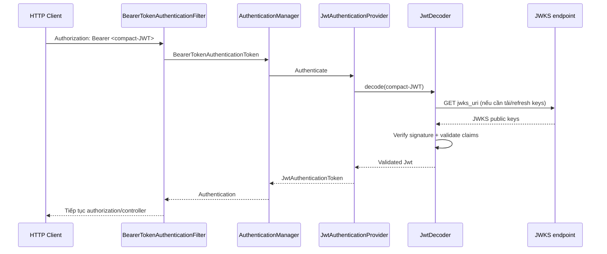

# jwt() không chứng minh chữ ký, discovery hoặc tải JWKS đã được kiểm tra

## 1. Mục tiêu của bài học

Trong kiểm thử Spring Security Servlet, thư viện **spring-security-test** cung cấp request post-processor **jwt()**:

```java
mockMvc.perform(get("/api/orders")
        .with(jwt()))
        .andExpect(status().isOk());
```

Đoạn test này hữu ích để kiểm tra **authorization**: một request đã có JwtAuthenticationToken với các authority được chỉ định có được phép truy cập endpoint hay không. Nhưng nó **không chứng minh** Spring Security đã:

- Nhận và parse một Bearer token thật từ HTTP header.
- Xác minh chữ ký JWS bằng public key của issuer.
- Đọc metadata discovery của OpenID Provider/Authorization Server.
- Tải JSON Web Key Set (JWKS) từ jwks_uri.
- Chọn đúng JWK theo kid và xác minh chữ ký.
- Chạy issuer, audience, timestamp hoặc token-profile validators.
- Xử lý key rotation hoặc lỗi mạng khi gọi JWKS endpoint.

Lý do là jwt() dựng sẵn một JWT/principal cho test và đặt authentication vào request security context. Nó không ký một compact JWT để gửi qua Authorization: Bearer, cũng không gọi JwtDecoder như luồng xác thực Bearer thực tế.

Bài này phân biệt hai mục tiêu kiểm thử:

1. **Authorization test:** dùng jwt() để kiểm tra scope, role, request matcher, method security và hành vi controller khi principal đã được xác thực.
2. **Authentication/trust-path test:** ký JWT bằng test private key, gửi nó như Bearer credential qua đầy đủ filter chain, để decoder thực sự lấy public key từ JWKS và xác minh token.

Ta cũng sẽ kiểm tra riêng issuer discovery, JWKS download, cấu hình issuer-uri/jwk-set-uri, lỗi signature và cache/rotation. Đây là các bài test khác nhau; một test xanh với jwt() không thay thế được chúng.

## 2. Luồng xác thực JWT thực tế trong Servlet

Với Spring Security Resource Server, request có Bearer token đi qua các thành phần chính:



Ở đây:

- BearerTokenAuthenticationFilter trích token từ header.
- JwtAuthenticationProvider dùng JwtDecoder để xác minh token.
- NimbusJwtDecoder thường xác minh JWS bằng key lấy từ JWKS.
- OAuth2TokenValidator kiểm tra issuer, thời hạn, audience và policy bổ sung.
- Chỉ sau khi authentication thành công, authorization mới đánh giá authority/scope.

Trong cấu hình:

```java
http.oauth2ResourceServer(oauth2 ->
        oauth2.jwt(Customizer.withDefaults()));
```

Spring Security nối các thành phần này vào filter chain. Nếu test chỉ tạo authentication sẵn bằng jwt(), nó bắt đầu ở gần cuối luồng, sau bước mà ta muốn kiểm chứng.

## 3. jwt() thực sự làm gì?

SecurityMockMvcRequestPostProcessors.jwt() là test helper tạo một JwtAuthenticationToken để đặt vào MockHttpServletRequest/security context. Có thể tùy chỉnh claims và authorities:

```java
mockMvc.perform(get("/api/orders")
        .with(jwt()
                .jwt(jwt -> jwt
                        .subject("user-123")
                        .claim("scope", "orders:read"))
                .authorities(
                        new SimpleGrantedAuthority(
                                "SCOPE_orders:read"))))
        .andExpect(status().isOk());
```

Test trên kiểm tra rằng principal có authority SCOPE_orders:read được phép gọi endpoint. Nó không tạo chữ ký RSA/ECDSA, không chứa private key, không gọi metadata endpoint và không tải JWKS.

### 3.1. Vì sao tên jwt() dễ gây hiểu nhầm?

Đối tượng được tạo là một Jwt trong bộ nhớ. Trong luồng kiểm thử này, Jwt là principal đã được dựng sẵn, không phải compact token được gửi qua HTTP rồi decode. Claims có thể trông giống JWT production nhưng không có nghĩa các claims đó đã được issuer ký.

| Cách test | Authentication được tạo như thế nào? | Có gọi JwtDecoder? | Kiểm tra chữ ký/JWKS? |
| --- | --- | --- | --- |
| with(jwt()) | Test helper tạo JwtAuthenticationToken. | **Không** trong luồng helper này. | **Không**. |
| with(user(...)) / @WithMockUser | Tạo user authentication giả lập. | Không. | Không. |
| with(authentication(...)) | Đặt Authentication do test tạo. | Không, trừ khi test tự gọi decoder riêng. | Không tự động. |
| Authorization: Bearer <JWT> qua filter chain | Bearer filter gọi AuthenticationManager/Provider/Decoder. | **Có**, nếu dùng decoder thật. | Có, nếu decoder dùng trusted key/JWKS của test. |
| Gọi JwtDecoder.decode(token) trực tiếp | Test gọi decoder. | Có. | Có thể, nhưng chưa kiểm tra HTTP filter chain. |

### 3.2. jwt() vẫn rất hữu ích

Không nên bỏ jwt() khỏi test suite. Nó phù hợp cho:

- Quy tắc hasAuthority("SCOPE_orders:read").
- Quy tắc role hoặc permission mapping.
- Method security như @PreAuthorize.
- Quyền truy cập theo claim đã được chuyển thành principal.
- Controller/service behavior khi đã có một actor hợp lệ.
- Các tổ hợp authority và domain policy mà không cần lặp lại cryptographic setup.

Chỉ cần đặt đúng tên và phạm vi cho test: đây là **authorization test với principal giả lập**, không phải JWT authentication test.

## 4. Phân biệt authentication và authorization

Một Resource Server có ít nhất hai quyết định:

| Giai đoạn | Câu hỏi | Ví dụ kiểm tra |
| --- | --- | --- |
| Authentication | Credential có thực sự hợp lệ theo trust configuration không? | JWS signature, issuer, exp, nbf, audience, JWKS key. |
| Authorization | Principal đã xác thực có quyền làm việc này không? | SCOPE_orders:read, role, tenant, owner, method security. |

Ví dụ:

- JWT được ký đúng bởi issuer tin cậy, đúng audience, chưa hết hạn, nhưng thiếu orders:write → authentication thành công, authorization có thể trả **403**.
- JWT có claim scope=orders:write nhưng chữ ký sai → authentication thất bại, thường **401**.
- Test jwt().authorities(SCOPE_orders:write) chỉ kiểm tra nhánh thứ nhất sau khi authentication đã được giả lập thành công.

Nếu một test jwt() trả 200, không thể kết luận JWT giả mạo sẽ bị từ chối. Nếu một test jwt() trả 403, cũng không thể kết luận chữ ký hoặc issuer đã được kiểm tra.

## 5. Hai kiểu cấu hình lấy khóa: issuer discovery và jwk-set-uri

Spring Security Resource Server có thể được cấu hình để tìm public keys theo hai cách phổ biến.

### 5.1. issuer-uri: discovery từ issuer

Ví dụ:

```yaml
spring:
  security:
    oauth2:
      resourceserver:
        jwt:
          issuer-uri: https://login.example.test/realms/shop
```

Với issuer-uri, Resource Server dùng issuer để khám phá metadata của Authorization Server/OpenID Provider. Metadata cung cấp jwks_uri, từ đó decoder lấy public keys.

```text
issuer-uri
    │
    ▼
Authorization Server metadata / OIDC discovery
    │
    └── jwks_uri
             │
             ▼
          JWKS JSON
             │
             ▼
      NimbusJwtDecoder
```

Trong quá trình cấu hình và xác minh, issuer phải khớp với giá trị iss đã được xác minh trong token. Discovery không có nghĩa Resource Server tin mọi issuer mà token tự khai.

### 5.2. jwk-set-uri: cấu hình trực tiếp JWKS

Ví dụ:

```yaml
spring:
  security:
    oauth2:
      resourceserver:
        jwt:
          jwk-set-uri: https://login.example.test/realms/shop/protocol/openid-connect/certs
```

Với jwk-set-uri, ứng dụng biết sẵn endpoint JWKS và không cần lấy jwks_uri qua metadata discovery. Decoder vẫn phải tải/đọc JWKS để xác minh chữ ký khi cần.

**Không có discovery không đồng nghĩa không có JWKS request.** Nếu test chỉ dùng jwt(), nó bỏ qua cả hai.

### 5.3. Cấu hình cả issuer-uri và jwk-set-uri

Spring Boot/Spring Security cho phép khai báo cả hai:

```yaml
spring:
  security:
    oauth2:
      resourceserver:
        jwt:
          issuer-uri: https://login.example.test/realms/shop
          jwk-set-uri: https://login.example.test/realms/shop/protocol/openid-connect/certs
```

Điều này cho phép cấu hình trực tiếp vị trí JWKS trong khi vẫn giữ issuer validation. Nó hữu ích khi không muốn discovery metadata lookup để tìm key endpoint. **Không được bỏ issuer validator chỉ vì đã cấu hình jwk-set-uri.**

Nếu tự tạo decoder:

```java
NimbusJwtDecoder decoder = NimbusJwtDecoder
        .withJwkSetUri(jwkSetUri)
        .build();

OAuth2TokenValidator<Jwt> issuerAndTimestamp =
        JwtValidators.createDefaultWithIssuer(issuerUri);

decoder.setJwtValidator(issuerAndTimestamp);
```

withJwkSetUri cấu hình nguồn khóa; JwtValidators.createDefaultWithIssuer giữ các kiểm tra mặc định liên quan timestamp và issuer. Audience validator của API có thể được ghép thêm bằng DelegatingOAuth2TokenValidator.

## 6. Discovery và JWKS là hai request khác nhau

Giả sử issuer là:

```text
https://login.example.test
```

Metadata discovery có thể trả:

```http
GET /.well-known/openid-configuration HTTP/1.1
Host: login.example.test
```

Response:

```json
{
  "issuer": "https://login.example.test",
  "jwks_uri": "https://login.example.test/oauth2/jwks",
  "authorization_endpoint": "https://login.example.test/oauth2/authorize",
  "token_endpoint": "https://login.example.test/oauth2/token"
}
```

Sau đó decoder dùng jwks_uri:

```http
GET /oauth2/jwks HTTP/1.1
Host: login.example.test
```

Response JWKS:

```json
{
  "keys": [
    {
      "kty": "RSA",
      "kid": "shop-key-2026-01",
      "use": "sig",
      "alg": "RS256",
      "n": "<base64url-modulus>",
      "e": "AQAB"
    }
  ]
}
```

Hai endpoint có ý nghĩa khác nhau:

| Endpoint | Trả về | Dùng để |
| --- | --- | --- |
| Discovery metadata | Metadata về issuer và endpoint liên quan, bao gồm jwks_uri. | Xác định vị trí và thông tin Authorization Server. |
| JWKS endpoint | Tập public JWK. | Xác minh chữ ký JWT và chọn key theo JOSE header. |

Một test chỉ assert request tới JWKS không chứng minh discovery đã chạy. Một test chỉ assert metadata đã tải không chứng minh decoder đã tải public key hoặc xác minh chữ ký.

## 7. Tại sao jwt() không chứng minh discovery đã chạy?

Khi dùng:

```java
mockMvc.perform(get("/api/orders")
        .with(jwt()))
        .andExpect(status().isOk());
```

request đã được cung cấp một authentication. Resource Server không cần lấy issuer metadata để tạo authentication đó. Vì thế:

- Metadata URL có thể sai mà test vẫn xanh.
- Discovery endpoint có thể không truy cập được mà test vẫn xanh.
- issuer trong metadata có thể không khớp mà test vẫn xanh.
- Metadata thiếu jwks_uri mà test vẫn xanh.
- jwks_uri trỏ tới host sai mà test vẫn xanh.

Để chứng minh discovery, phải khởi tạo decoder theo issuer discovery và kiểm tra HTTP request tới metadata endpoint bằng mock server hoặc Authorization Server test thực.

## 8. Tại sao jwt() không chứng minh JWKS đã được tải?

jwt() không gửi compact token qua JwtDecoder, do đó không kích hoạt việc lấy JWK từ remote set. Những tình huống sau có thể không được phát hiện:

- JWKS URL trả 404 hoặc 500.
- JWKS JSON malformed.
- keys rỗng hoặc không có key phù hợp.
- kid trong JWT không có trong JWKS.
- Key trong JWKS không khớp chữ ký.
- TLS certificate của JWKS host không được tin.
- Cache JWKS giữ key cũ hoặc refresh không hoạt động.
- Network timeout khi decoder cần key.

Muốn kiểm tra các trường hợp đó, test phải gửi **Bearer compact JWT thật** tới decoder. Một mock JwtDecoder luôn trả về Jwt cũng không chứng minh JWKS được tải.

## 9. Chiến lược test theo từng lớp

| Lớp test | Cách làm | Điều chứng minh được |
| --- | --- | --- |
| Authorization unit/integration | with(jwt()) và authorities/claims tường minh. | Quy tắc quyền sau authentication. |
| Decoder test | JwtDecoder.decode(signedCompactJwt) với public key test. | Signature và validators trong decoder. |
| JWKS protocol test | NimbusJwtDecoder.withJwkSetUri(mockJwksUrl) và HTTP mock server. | Decoder thực sự tải JWKS và chọn key. |
| Discovery protocol test | JwtDecoders.fromIssuerLocation(mockIssuer) và metadata/JWKS mock server. | Metadata discovery, issuer và jwks_uri. |
| Servlet filter-chain test | MockMvc gửi Authorization: Bearer <signed-JWT> qua app context có decoder thật. | HTTP parsing, Bearer filter, decoder, validators và authorization tích hợp. |
| Operational test | JWKS outage, key rotation, cache, TLS và timeout. | Hành vi dependency/rotation theo cấu hình. |

Không cần nhồi tất cả vào một test. Tách lớp giúp biết chính xác điều gì đã được chứng minh và lỗi nằm ở đâu.

## 10. Tạo JWS test token có chữ ký thật

Để kiểm tra chữ ký, test cần:

- Một private key chỉ dùng trong test để ký token.
- Public key tương ứng được đưa vào test JWKS.
- Một compact JWT thực sự có ba phần header.payload.signature.
- kid trùng với public JWK trong JWKS.
- Claims hợp lệ theo validator của API.

Ví dụ tạo test RSA JWK bằng Nimbus JOSE:

```java
import com.nimbusds.jose.JOSEException;
import com.nimbusds.jose.JWSAlgorithm;
import com.nimbusds.jose.JWSHeader;
import com.nimbusds.jose.JOSEObjectType;
import com.nimbusds.jose.crypto.RSASSASigner;
import com.nimbusds.jose.jwk.RSAKey;
import com.nimbusds.jose.jwk.gen.RSAKeyGenerator;
import com.nimbusds.jwt.JWTClaimsSet;
import com.nimbusds.jwt.SignedJWT;

import java.time.Instant;
import java.util.Date;

final class TestJwtFactory {

    static RSAKey newSigningKey(String keyId) throws JOSEException {
        return new RSAKeyGenerator(2048)
                .keyID(keyId)
                .generate();
    }

    static String sign(
            RSAKey signingKey,
            String issuer,
            String audience) throws JOSEException {

        Instant now = Instant.now();

        JWTClaimsSet claims = new JWTClaimsSet.Builder()
                .issuer(issuer)
                .subject("user-123")
                .audience(audience)
                .issueTime(Date.from(now))
                .expirationTime(Date.from(now.plusSeconds(300)))
                .claim("scope", "orders:read")
                .build();

        JWSHeader header = new JWSHeader.Builder(JWSAlgorithm.RS256)
                .type(JOSEObjectType.JWT)
                .keyID(signingKey.getKeyID())
                .build();

        SignedJWT jwt = new SignedJWT(header, claims);
        jwt.sign(new RSASSASigner(signingKey.toPrivateKey()));

        return jwt.serialize();
    }
}
```

TestJwtFactory ký token bằng private key test. Resource Server chỉ nhận public key. Không dùng production private key hoặc token thật trong test/CI.

### 10.1. Tạo JWKS từ public key

```java
import com.nimbusds.jose.jwk.JWKSet;
import com.nimbusds.jose.jwk.RSAKey;

static String jwksJson(RSAKey signingKey) {
    return new JWKSet(signingKey.toPublicJWK()).toString();
}
```

toPublicJWK() loại private parameters. JWKS phục vụ Resource Server không được chứa private key.

### 10.2. Vì sao nên dùng test key thay vì mock decoder?

Một test key pair cho phép xác minh thực sự:

1. Token được ký bằng private key A.
2. JWKS công bố public key A.
3. Decoder lấy key A.
4. Chữ ký được xác minh thành công.
5. Token ký bằng key B bị từ chối nếu JWKS chỉ công bố key A.

Nếu mock decoder luôn trả Jwt, bước 2–4 không hề chạy.

## 11. Test decoder với JWKS endpoint giả lập

Có thể dùng MockWebServer hoặc WireMock. Ví dụ với OkHttp MockWebServer:

```java
import okhttp3.mockwebserver.MockResponse;
import okhttp3.mockwebserver.MockWebServer;
import okhttp3.mockwebserver.RecordedRequest;

import org.junit.jupiter.api.AfterAll;
import org.junit.jupiter.api.BeforeAll;
import org.junit.jupiter.api.Test;
import org.springframework.security.oauth2.jwt.Jwt;
import org.springframework.security.oauth2.jwt.JwtValidators;
import org.springframework.security.oauth2.jwt.NimbusJwtDecoder;

import static org.junit.jupiter.api.Assertions.assertEquals;

class JwksDecoderTest {

    static MockWebServer jwksServer;
    static RSAKey issuerSigningKey;
    static final String ISSUER = "https://issuer.example.test";

    @BeforeAll
    static void startServer() throws Exception {
        jwksServer = new MockWebServer();
        jwksServer.start();
        issuerSigningKey = TestJwtFactory.newSigningKey("issuer-key-1");
    }

    @AfterAll
    static void stopServer() throws Exception {
        jwksServer.shutdown();
    }

    @Test
    void downloadsJwksAndValidatesSignedJwt() throws Exception {
        jwksServer.enqueue(new MockResponse()
                .setResponseCode(200)
                .addHeader("Content-Type", "application/json")
                .setBody(TestJwtFactory.jwksJson(issuerSigningKey)));

        String jwksUri = jwksServer.url("/jwks").toString();

        NimbusJwtDecoder decoder = NimbusJwtDecoder
                .withJwkSetUri(jwksUri)
                .build();
        decoder.setJwtValidator(
                JwtValidators.createDefaultWithIssuer(ISSUER));

        String token = TestJwtFactory.sign(
                issuerSigningKey, ISSUER, "orders-api");

        Jwt decoded = decoder.decode(token);

        assertEquals("user-123", decoded.getSubject());

        RecordedRequest request = jwksServer.takeRequest();
        assertEquals("GET", request.getMethod());
        assertEquals("/jwks", request.getPath());
    }
}
```

Đây là ví dụ component test cho decoder. Các helper imports và dependency MockWebServer cần có trong test source set. Nếu dự án quản lý phiên bản bằng Spring Boot BOM, để BOM quản lý phiên bản thư viện tương thích.

### 11.1. Điều gì đã được chứng minh?

Test trên chứng minh:

- Một compact JWS thật được tạo bằng private key.
- Decoder được cấu hình trỏ tới JWKS URI.
- Decoder phát HTTP GET tới JWKS mock server.
- Public key trong JWKS đủ để xác minh token.
- Issuer validator chấp nhận issuer mong đợi.

Nó **chưa** chứng minh BearerTokenAuthenticationFilter hoặc toàn bộ HTTP security chain. Để kiểm tra các thành phần đó, thêm MockMvc integration test gửi token trong Authorization header.

## 12. Test chữ ký sai nhưng header và claims trông hợp lệ

Một test quan trọng là ký token bằng private key B nhưng JWKS chỉ công bố public key A. Để chắc chắn decoder tìm thấy kid nhưng signature vẫn sai, có thể tạo hai key pair cùng kid trong fixture:

```java
RSAKey trustedKey = TestJwtFactory.newSigningKey("shared-kid");
RSAKey attackerKey = TestJwtFactory.newSigningKey("shared-kid");

String tokenSignedByTrustedKey =
        TestJwtFactory.sign(trustedKey, ISSUER, "orders-api");

String tokenSignedByAttackerKey =
        TestJwtFactory.sign(attackerKey, ISSUER, "orders-api");
```

JWKS mock chỉ công bố trustedKey.toPublicJWK(). Token thứ nhất phải decode thành công; token thứ hai phải thất bại khi xác minh chữ ký. Cả hai có thể có cùng iss, aud, sub, exp và kid; sự khác biệt nằm ở private key đã ký token.

Test này chứng minh decoder kiểm tra **chữ ký mật mã**, không chỉ kiểm tra kid hoặc claims.

### 12.1. Test token bị sửa sau khi ký

Một biến thể khác:

1. Tạo compact JWT hợp lệ bằng test key.
2. Thay một ký tự trong payload segment hoặc signature segment.
3. Giữ nguyên header/claims nhìn có vẻ hợp lệ.
4. Gửi token qua decoder.
5. Assert JwtException hoặc HTTP 401 qua filter chain.

Không cần giải mã và ký lại token sau khi thay đổi; mục tiêu là chứng minh token bị sửa không còn chữ ký hợp lệ.

### 12.2. Không dùng kid lạ để thay thế test signature

kid không phải bằng chứng chữ ký. Khi kid không tồn tại trong JWKS, decoder có thể không tìm được key và từ chối trước khi kiểm tra signature. Đây là test hữu ích cho key selection, nhưng **khác** với test dùng đúng kid nhưng chữ ký sai.

Nên có cả:

- kid không tồn tại → không tìm được trusted key.
- kid có tồn tại nhưng token ký bằng private key khác → signature verification thất bại.

## 13. Test issuer discovery thực sự

Để kiểm tra discovery, dùng mock server trả metadata với issuer và jwks_uri. Ví dụ skeleton:

```java
String issuer = "http://localhost:" + server.getPort();
String jwksUri = issuer + "/jwks";

server.enqueue(new MockResponse()
        .setResponseCode(200)
        .addHeader("Content-Type", "application/json")
        .setBody("""
            {
              "issuer": "http://localhost:PORT",
              "jwks_uri": "http://localhost:PORT/jwks"
            }
            """.replace("PORT", Integer.toString(server.getPort()))));

server.enqueue(new MockResponse()
        .setResponseCode(200)
        .addHeader("Content-Type", "application/json")
        .setBody(TestJwtFactory.jwksJson(signingKey)));

JwtDecoder decoder = JwtDecoders.fromIssuerLocation(issuer);
Jwt jwt = decoder.decode(
        TestJwtFactory.sign(signingKey, issuer, "orders-api"));

RecordedRequest metadataRequest = server.takeRequest();
RecordedRequest jwksRequest = server.takeRequest();

assertEquals("/.well-known/openid-configuration",
        metadataRequest.getPath());
assertEquals("/jwks", jwksRequest.getPath());
```

Đây là skeleton; server, signingKey và lifecycle setup do test khởi tạo. Dùng issuer root để discovery path trong ví dụ đơn giản là /.well-known/openid-configuration. Nếu issuer có path, Spring Security có thể thử các well-known metadata URL theo quy tắc discovery; hãy assert endpoint thực tế của issuer trong fixture thay vì hardcode một path chung cho mọi issuer.

### 13.1. Kiểm tra metadata issuer mismatch

Metadata trả issuer khác URI đã cấu hình phải bị từ chối. Không chỉ kiểm tra có request GET metadata; phải kiểm tra decoder chấp nhận đúng issuer identity.

### 13.2. Kiểm tra metadata thiếu jwks_uri

Nếu metadata không có jwks_uri hợp lệ, decoder không thể lấy public keys theo discovery. Test phải xác nhận quá trình khởi tạo/decode thất bại theo contract và request protected không tạo authentication.

### 13.3. Kiểm tra discovery lỗi mạng

Mock metadata endpoint trả 404, 500 hoặc timeout. Xác nhận decoder không âm thầm dùng key bất kỳ hoặc bỏ qua chữ ký. HTTP status cuối cùng của ứng dụng phụ thuộc exception handling; invariant bảo mật là **không có authenticated principal và không gọi business handler**.

## 14. Test jwk-set-uri trực tiếp và chứng minh không discovery

Khi decoder được tạo bằng:

```java
NimbusJwtDecoder decoder =
        NimbusJwtDecoder.withJwkSetUri(jwksUri).build();
```

thì không có metadata discovery step. Test có thể dùng mock server:

1. Chỉ enqueue response cho /jwks.
2. Tạo decoder bằng URI /jwks.
3. Decode một token có chữ ký hợp lệ.
4. Assert request tới /jwks.
5. Assert không có request tới /.well-known/openid-configuration.

Với Spring Boot, cấu hình cả issuer-uri và jwk-set-uri nếu muốn bỏ metadata discovery nhưng vẫn kiểm tra issuer:

```yaml
spring:
  security:
    oauth2:
      resourceserver:
        jwt:
          issuer-uri: http://localhost:9000
          jwk-set-uri: http://localhost:9000/jwks
```

Không nên chỉ đặt jwk-set-uri rồi cho rằng issuer validation tự xuất hiện. Nếu tự tạo decoder, ghép validator issuer như mục 5.3.

## 15. Full MockMvc test phải gửi Bearer token thật

Để kiểm tra toàn bộ Servlet Resource Server path, dùng @SpringBootTest và @AutoConfigureMockMvc, sau đó gửi header Authorization:

```java
@SpringBootTest
@AutoConfigureMockMvc
class OrdersJwtFilterChainTest {

    @Autowired
    MockMvc mockMvc;

    @Test
    void acceptsSignedJwtThroughBearerFilter() throws Exception {
        String token = TestJwtFactory.sign(
                trustedTestKey,
                TEST_ISSUER,
                "orders-api");

        mockMvc.perform(get("/api/orders")
                        .header(HttpHeaders.AUTHORIZATION,
                                "Bearer " + token))
                .andExpect(status().isOk());
    }

    @Test
    void rejectsTokenSignedByUntrustedKey() throws Exception {
        String token = TestJwtFactory.sign(
                attackerTestKey,
                TEST_ISSUER,
                "orders-api");

        mockMvc.perform(get("/api/orders")
                        .header(HttpHeaders.AUTHORIZATION,
                                "Bearer " + token))
                .andExpect(status().isUnauthorized());
    }
}
```

Ví dụ giả định test application context dùng JwtDecoder thật được cấu hình với test JWKS endpoint chỉ công bố trustedTestKey. attackerTestKey phải không được công bố trong JWKS. Để test signature sai độc lập với kid lookup, hai key có thể dùng cùng kid như mục 12.

### 15.1. Không tắt servlet filters trong test

@AutoConfigureMockMvc mặc định tích hợp filter chain. Nếu test cấu hình:

```java
@AutoConfigureMockMvc(addFilters = false)
```

thì test không chạy Security filter chain; gửi Bearer header cũng không chứng minh Resource Server được gọi. Chỉ tắt filters khi mục tiêu rõ ràng là test MVC/controller không có security.

### 15.2. Không thay decoder bằng mock trong trust-path test

Nếu context có:

```java
@MockBean
JwtDecoder jwtDecoder;
```

và mock trả Jwt bất kỳ, request có thể thành công mà không có chữ ký/JWKS thật. Mock decoder hữu ích để test behavior của authentication/authorization quanh decoder, nhưng không thể chứng minh decoder thật hoạt động.

## 16. Test matrix: test nào chứng minh điều gì?

| Case | Test setup | Kỳ vọng |
| --- | --- | --- |
| AUTHZ-01 | with(jwt()), authority SCOPE_orders:read | 2xx nếu rule cho phép. |
| AUTHZ-02 | with(jwt()), thiếu scope | 403. |
| AUTHZ-03 | with(jwt()), role/tenant khác | Domain/method authorization từ chối. |
| JWT-01 | Bearer compact JWS ký bằng trusted test key | Decoder xác minh thành công. |
| JWT-02 | Bearer JWS ký bằng untrusted key | 401. |
| JWT-03 | Payload/signature bị sửa sau khi ký | 401. |
| JWT-04 | Đúng signature nhưng iss sai | 401. |
| JWT-05 | Đúng signature/issuer nhưng aud sai | 401. |
| JWT-06 | Đúng signature nhưng exp quá khứ | 401. |
| JWKS-01 | jwk-set-uri mock trả key phù hợp | Có GET JWKS và decode thành công. |
| JWKS-02 | JWKS JSON malformed/HTTP 500 | Không authentication; không vào controller. |
| JWKS-03 | kid không tồn tại | Không tìm được trusted key; từ chối. |
| JWKS-04 | Cùng kid, token ký bằng key khác | Signature fail. |
| DISC-01 | issuer-uri, metadata hợp lệ | Metadata GET và JWKS GET theo jwks_uri. |
| DISC-02 | Metadata issuer mismatch | Discovery/decoder từ chối. |
| DISC-03 | Metadata thiếu jwks_uri | Không thể hoàn tất key discovery. |
| DISC-04 | Metadata endpoint timeout/5xx | Fail closed. |
| CFG-01 | Chỉ jwk-set-uri | Không discovery; vẫn có JWKS fetch khi decode. |
| CFG-02 | issuer-uri + jwk-set-uri | Không cần metadata lookup; issuer validation vẫn hoạt động theo cấu hình Boot. |
| ROT-01 | JWKS publish key mới và token dùng kid mới | Decoder có thể cập nhật key theo cache/refresh policy. |
| ROT-02 | Key cũ bị gỡ sau overlap window | Token ký bằng key cũ bị từ chối khi key không còn được tin/cache hết hạn. |

## 17. Test audience validator ngoài chữ ký

Chữ ký hợp lệ chỉ chứng minh token được ký bởi key tương ứng. Resource Server vẫn phải kiểm tra issuer và audience.

Ví dụ validator:

```java
OAuth2TokenValidator<Jwt> audienceValidator = jwt -> {
    if (jwt.getAudience().contains("orders-api")) {
        return OAuth2TokenValidatorResult.success();
    }

    OAuth2Error error = new OAuth2Error(
            "invalid_token",
            "Token is not intended for this API",
            null);

    return OAuth2TokenValidatorResult.failure(error);
};

decoder.setJwtValidator(
        new DelegatingOAuth2TokenValidator<>(
                JwtValidators.createDefaultWithIssuer(TEST_ISSUER),
                audienceValidator));
```

Test cần một token được ký đúng bởi trusted key nhưng có aud=inventory-api; token đó phải bị từ chối ở audience validator. Nếu chỉ dùng token ký bằng key sai, test không chứng minh audience validator đang hoạt động vì decoder đã từ chối ở bước chữ ký.

### 17.1. Tách negative tests theo nguyên nhân

Để xác định lớp nào bị hỏng:

- Wrong signature + correct claims → kiểm tra signature verification.
- Correct signature + wrong issuer → kiểm tra issuer validation.
- Correct signature/issuer + wrong audience → kiểm tra audience validation.
- Correct signature/issuer/audience + expired exp → kiểm tra timestamp validation.

Mỗi case chỉ thay một yếu tố quan trọng. Điều này giúp tránh test “token invalid” quá chung, không biết decoder đã thực hiện validator nào.

## 18. JWKS cache và key rotation

JWKS thường được cache để giảm network calls. Vì vậy số lần GET JWKS không nhất thiết bằng số request API.

### 18.1. Một test jwt() không thể kiểm tra cache

Do jwt() không gọi decoder, nó không chạm JWK source hoặc cache. Test có thể xanh ngay cả khi JWKS endpoint không truy cập được, key mới chưa được tải, cache giữ key cũ hoặc unknown kid không được refresh theo policy.

### 18.2. Test key rotation

```text
Ban đầu:
  JWKS = { key-1 }
  Token T1 signed by private key-1

Sau overlap:
  JWKS = { key-1, key-2 }
  Token T2 signed by private key-2

Sau khi loại key cũ:
  JWKS = { key-2 }
```

Test:

1. Decoder xác minh T1 bằng key-1.
2. Mock JWKS cập nhật để công bố key-2.
3. Gửi T2 có kid=key-2 sau khi decoder cần refresh JWK set.
4. Xác nhận T2 được chấp nhận theo cache/refresh behavior của thư viện.
5. Sau cửa sổ overlap và cache policy phù hợp, xác nhận token chỉ có key cũ bị từ chối.

Không hardcode giả định mọi decoder refresh JWKS ngay lập tức khi server thay đổi. Cache/refresh timing phụ thuộc Nimbus và cấu hình. Dùng decoder mới hoặc điều khiển cache trong test component nếu cần một test xác định; test operational riêng xác minh behavior thực tế của version đang dùng.

### 18.3. JWKS outage phải fail closed

Khi decoder không thể lấy key cần thiết, nó không có đủ bằng chứng để xác minh chữ ký. Request phải bị từ chối/không tạo Authentication; không được:

- Bỏ qua signature.
- Chấp nhận token chỉ vì iss/aud nhìn đúng.
- Dùng public key lấy từ jku/x5u do token tự khai nếu nguồn đó chưa được trust.
- Trả về một principal giả trong fallback.

HTTP status cuối cùng phụ thuộc exception mapping; test invariant là không có business access.

## 19. Discovery/JWKS test ở cấp Spring Boot

Khi dùng auto-configuration:

```yaml
spring:
  security:
    oauth2:
      resourceserver:
        jwt:
          issuer-uri: http://localhost:9000
```

Test có thể khởi động mock metadata/JWKS server và đưa URI vào property. DynamicPropertySource là một cách truyền URL runtime:

```java
@SpringBootTest
@AutoConfigureMockMvc
class IssuerDiscoveryIntegrationTest {

    static final MockWebServer issuerServer = new MockWebServer();

    @DynamicPropertySource
    static void properties(DynamicPropertyRegistry registry) {
        registry.add("spring.security.oauth2.resourceserver.jwt.issuer-uri",
                () -> issuerServer.url("/").toString());
    }

    // @BeforeAll: start server và enqueue metadata/JWKS responses.
    // Test: gửi signed Bearer JWT qua MockMvc.
}
```

Đây là skeleton, không phải class chạy độc lập. Khởi động server trước khi Spring context cần property; metadata phải trả đúng issuer string mà decoder đang xác minh và jwks_uri trỏ về mock server. Dùng server lifecycle tĩnh và dọn dẹp sau test.

### 19.1. Discovery có thể diễn ra lazy

Không nên viết test dựa trên giả định metadata/JWKS luôn được tải ngay lúc ApplicationContext khởi động. Tùy Spring Security/Spring Boot version và cách decoder được khởi tạo, một số hoạt động có thể được trì hoãn cho tới request đầu tiên cần xác thực JWT.

Hãy kích hoạt một request Bearer thật rồi assert các HTTP calls. Nếu cần kiểm tra startup behavior cụ thể, viết test riêng cho đúng version và cấu hình thực tế.

### 19.2. Không nhầm application startup với proof of discovery

Application context khởi động thành công không chứng minh metadata endpoint đã được gọi. Nếu decoder initialization được lazy, app có thể khởi động dù issuer host đang down. Ngược lại, app fail lúc startup có thể do nhiều bean/configuration khác.

Để chứng minh discovery, phải assert request metadata thực tế và metadata response được sử dụng.

## 20. Một bộ test mẫu: phân chia authorization và trust path

### 20.1. Authorization test với jwt()

```java
@Test
void readerCanReadOrders() throws Exception {
    mockMvc.perform(get("/api/orders")
            .with(jwt().authorities(
                    new SimpleGrantedAuthority(
                            "SCOPE_orders:read"))))
            .andExpect(status().isOk());
}

@Test
void readerCannotCreateOrders() throws Exception {
    mockMvc.perform(post("/api/orders")
            .with(jwt().authorities(
                    new SimpleGrantedAuthority(
                            "SCOPE_orders:read"))))
            .andExpect(status().isForbidden());
}
```

Hai test này kiểm tra authorization behavior. Không cần JWKS mock vì test không nhắm tới authentication.

### 20.2. Trust-path test bằng Bearer token thật

```java
@Test
void signedTokenIsDecodedThroughResourceServer() throws Exception {
    String token = TestJwtFactory.sign(
            trustedTestKey, TEST_ISSUER, "orders-api");

    mockMvc.perform(get("/api/orders")
            .header(HttpHeaders.AUTHORIZATION, "Bearer " + token))
            .andExpect(status().isOk());
}

@Test
void wrongSignatureIsRejectedBeforeController() throws Exception {
    String token = TestJwtFactory.sign(
            attackerTestKey, TEST_ISSUER, "orders-api");

    mockMvc.perform(get("/api/orders")
            .header(HttpHeaders.AUTHORIZATION, "Bearer " + token))
            .andExpect(status().isUnauthorized());
}
```

Hai test này chỉ chứng minh trust path nếu test application context:

- Dùng decoder thật, không phải mock.
- Có Bearer Resource Server filter chain.
- Decoder lấy public key từ test JWKS endpoint.
- JWKS không công bố attacker public key.
- Validator issuer/audience được cấu hình như production contract.

### 20.3. Test protocol calls riêng

Khi cần chứng minh discovery:

- Enqueue metadata response.
- Trigger request Bearer thật.
- Assert metadata URL được gọi.
- Assert metadata issuer đúng.
- Assert jwks_uri được gọi.

Khi dùng direct JWKS:

- Không enqueue metadata.
- Trigger decode bằng token ký thật.
- Assert JWKS endpoint được gọi.
- Assert không có discovery request.

## 21. Những lỗi thường gặp

1. **Dùng jwt() rồi kết luận chữ ký hợp lệ:** jwt() tạo principal giả lập, không có JWS signature verification.
2. **Dùng jwt() rồi kết luận JWKS hoạt động:** không có JwtDecoder invocation nên không có JWK retrieval.
3. **Dùng jwt() rồi kết luận discovery thành công:** không có metadata lookup.
4. **Dùng @WithMockUser để test Bearer authentication:** đây là user authentication giả lập.
5. **Mock JwtDecoder trong test chữ ký:** mock trả Jwt không chứng minh cryptography, issuer, audience hoặc JWKS.
6. **Chỉ test kid lạ:** không chứng minh signature check với kid hợp lệ nhưng private key sai.
7. **Chỉ test token sai chữ ký:** có thể bỏ sót issuer/audience/expiry validator.
8. **Chỉ assert app context startup:** discovery/JWKS có thể lazy; trigger Bearer request và assert outbound calls.
9. **Cấu hình jwk-set-uri nhưng bỏ issuer validation:** nguồn khóa trực tiếp không tự chứng minh iss đúng.
10. **Assert JWKS request đúng một lần:** cache có thể làm số request khác nhau.
11. **Dùng production key hoặc token trong test:** tạo test key pair riêng và token ngắn hạn.
12. **Tắt filters rồi gửi Bearer header:** nếu addFilters=false, Resource Server filter không chạy.
13. **Dùng decoder test rồi tuyên bố full HTTP path đúng:** gọi decode trực tiếp không kiểm tra header parsing/Bearer filter/request matcher.

## 22. Checklist chọn đúng test

| Câu hỏi cần trả lời | Test phù hợp |
| --- | --- |
| User có SCOPE_orders:read được gọi GET không? | with(jwt().authorities(...)). |
| User thiếu scope có bị 403 không? | with(jwt()) với authority thiếu. |
| JWS ký bằng trusted key có được decode không? | Signed token + real JwtDecoder. |
| Chữ ký sai có bị từ chối không? | Token ký bằng key khác + real decoder. |
| Issuer metadata có được tải không? | JwtDecoders.fromIssuerLocation + mock metadata server + assert request. |
| JWKS có được tải không? | Real decoder + mock JWKS endpoint + signed token + assert GET. |
| kid được chọn đúng không? | JWKS có nhiều keys và token kid cụ thể. |
| Audience validator chạy không? | Signed token đúng signature/issuer nhưng sai aud. |
| Bearer filter có hoạt động không? | MockMvc gửi Authorization: Bearer ... qua full filter chain. |
| Key rotation có hoạt động không? | Thay JWKS, dùng token với key mới và test cache/refresh policy. |
| JWKS outage có fail closed không? | Mock endpoint lỗi và assert không có Authentication/business invocation. |

## 23. Tài liệu tham khảo

- **Spring Security Reference — Testing OAuth 2.0:** jwt() request post-processor và kiểm thử Resource Server. https://docs.spring.io/spring-security/reference/servlet/test/mockmvc/oauth2.html
- **Spring Security Reference — OAuth 2.0 Resource Server JWT:** issuer discovery, JWK Set URI, JWT validation và key rotation. https://docs.spring.io/spring-security/reference/servlet/oauth2/resource-server/jwt.html
- **Spring Security Reference — Servlet Security Architecture:** filter chain và authentication flow. https://docs.spring.io/spring-security/reference/servlet/architecture.html
- **Spring Security API — SecurityMockMvcRequestPostProcessors.jwt():** https://docs.spring.io/spring-security/reference/api/java/org/springframework/security/test/web/servlet/request/SecurityMockMvcRequestPostProcessors.html
- **Spring Security API — JwtDecoder / NimbusJwtDecoder:** https://docs.spring.io/spring-security/reference/api/java/org/springframework/security/oauth2/jwt/JwtDecoder.html
- **RFC 7515 — JSON Web Signature (JWS):** compact JWS và chữ ký. https://www.rfc-editor.org/rfc/rfc7515
- **RFC 7517 — JSON Web Key (JWK):** biểu diễn public key và JWKS. https://www.rfc-editor.org/rfc/rfc7517
- **RFC 8414 — Authorization Server Metadata:** metadata discovery. https://www.rfc-editor.org/rfc/rfc8414
- **OpenID Connect Discovery 1.0:** provider configuration và jwks_uri. https://openid.net/specs/openid-connect-discovery-1_0.html

## 24. Kết luận

jwt() trong MockMvc là công cụ tốt để kiểm tra **authorization với một JwtAuthenticationToken được dựng sẵn**. Nó không gửi compact JWT qua Bearer filter và không gọi JwtDecoder, vì thế không chứng minh chữ ký, issuer discovery, JWKS download, key selection hoặc validators đã chạy.

Để kiểm tra trust path, hãy ký JWT bằng test private key, công bố public key trong mock JWKS, gửi token bằng Authorization: Bearer ... qua MockMvc với filter chain thật và xác nhận token sai chữ ký/issuer/audience/expiry bị từ chối. Nếu cần kiểm tra discovery, mock metadata endpoint và assert request tới metadata cùng jwks_uri; nếu cấu hình trực tiếp jwk-set-uri, assert JWKS fetch và nhớ giữ issuer validator.

Hãy dùng jwt() cho các câu hỏi về quyền, signed Bearer tokens cho các câu hỏi về xác thực và mock metadata/JWKS servers cho các câu hỏi về discovery/key retrieval. Khi mỗi test có mục tiêu rõ ràng, một kết quả xanh sẽ chứng minh đúng lớp bảo mật mà nó được viết để kiểm tra.
