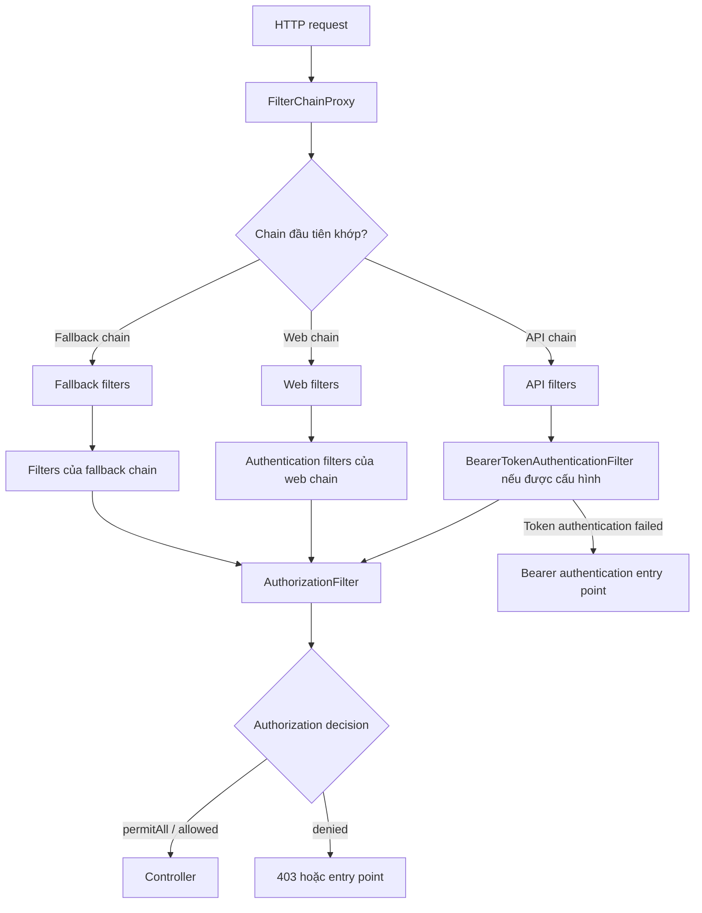

# Kiểm tra nhiều filter chain và endpoint permitAll có gửi token sai

Trong Spring Security Servlet, một endpoint được cấu hình permitAll() vẫn có thể trả về **401 khi request mang một Bearer token không hợp lệ**. Lý do là permitAll là quy tắc authorization, còn việc trích xuất và xác thực Bearer token diễn ra trong authentication filter trước đó.

Điều này dễ gây nhầm lẫn khi ứng dụng có nhiều SecurityFilterChain. FilterChainProxy chọn chain đầu tiên khớp request; mỗi chain có tập filter và quy tắc riêng. Endpoint có thể nằm trong chain bật OAuth2 Resource Server, trong chain không có Bearer filter, hoặc vô tình bị một catch-all chain đứng trước bắt mất.

Bài này giải thích cách phân biệt hai loại matcher, cách chain selection ảnh hưởng tới Bearer authentication, hành vi của endpoint permitAll khi có token sai, và cách kiểm tra bằng MockMvc với filter chain thật. Mục tiêu là xác định request đang đi qua chain nào, filter nào xử lý Authorization header, và vì sao kết quả là 200, 401, 403 hoặc lỗi OAuth khác.

> **Quy tắc cần nhớ:** permitAll cho phép request đi qua bước authorization mà không cần Authentication. Nó không yêu cầu Spring bỏ qua authentication filters đã chạy trước đó. Nếu BearerTokenAuthenticationFilter nằm trong chain được chọn và client gửi token sai, authentication có thể thất bại trước khi AuthorizationFilter áp dụng permitAll.

## 1. Hai giai đoạn khác nhau: chọn filter chain và authorize request

Spring Security Servlet sử dụng FilterChainProxy để điều phối các SecurityFilterChain. Khi request tới ứng dụng, quá trình tổng quát là:

1. FilterChainProxy kiểm tra các chain theo thứ tự.
2. Chain đầu tiên có RequestMatcher khớp được chọn.
3. Các filter của chain đó được thực thi theo thứ tự.
4. Authentication filters có thể đọc credential và tạo Authentication.
5. Authorization filter áp dụng quy tắc như permitAll, authenticated hoặc hasAuthority.
6. Request được chuyển tới servlet/controller nếu không có filter nào chặn.



Một request chỉ đi qua **một chain được chọn** trong lần dispatch đó. Các chain không cộng filter với nhau. Vì vậy, việc một chain có cấu hình Resource Server không có nghĩa mọi request trong ứng dụng đều đi qua BearerTokenAuthenticationFilter.

### 1.1. securityMatcher chọn chain

securityMatcher(...) xác định request nào thuộc về một SecurityFilterChain.

```java
http
    .securityMatcher("/api/**")
    .authorizeHttpRequests(auth -> auth
        .anyRequest().authenticated()
    )
    .oauth2ResourceServer(oauth2 ->
        oauth2.jwt(Customizer.withDefaults())
    );
```

Chain trên chỉ áp dụng cho URL khớp /api/**. Nếu request là /web/home, chain này không được chọn.

### 1.2. requestMatchers chọn authorization rule bên trong chain

requestMatchers(...) trong authorizeHttpRequests xác định rule nào áp dụng sau khi chain đã được chọn.

```java
http
    .securityMatcher("/api/**")
    .authorizeHttpRequests(auth -> auth
        .requestMatchers("/api/public/**").permitAll()
        .requestMatchers("/api/admin/**").hasAuthority("SCOPE_admin")
        .anyRequest().authenticated()
    )
    .oauth2ResourceServer(oauth2 ->
        oauth2.jwt(Customizer.withDefaults())
    );
```

Ở đây /api/public/ping vẫn thuộc API chain. Nó được phép ở bước authorization, nhưng chain đó vẫn chứa BearerTokenAuthenticationFilter.

### 1.3. So sánh nhanh

| Cấu hình | Vai trò | Thời điểm có tác dụng |
|---|---|---|
| securityMatcher("/api/**") | Chọn chain | Trước khi filter của chain chạy |
| requestMatchers("/api/public/**").permitAll() | Cho phép request theo authorization rule | Ở bước authorization trong chain đã chọn |
| anyRequest().authenticated() | Yêu cầu Authentication cho các request còn lại | Ở bước authorization |
| oauth2ResourceServer().jwt() | Thêm cấu hình JWT Bearer authentication cho chain | Khi filter chain được xây dựng |

Đừng dùng requestMatchers như thể nó tạo một filter chain mới. Nếu muốn public routes đi qua tập filter khác, cần một chain riêng với securityMatcher và thứ tự phù hợp.

## 2. permitAll có bỏ qua BearerTokenAuthenticationFilter không?

Không. Hai cơ chế này giải quyết hai câu hỏi khác nhau:

- BearerTokenAuthenticationFilter hỏi: request có mang Bearer credential không, và credential đó có xác thực được không?
- AuthorizationFilter hỏi: Authentication hiện tại có được phép truy cập endpoint này không?

Nếu request không gửi Bearer token, BearerTokenAuthenticationFilter thường không làm gì. Request tiếp tục tới AuthorizationFilter, nơi permitAll cho phép truy cập.

Nếu request gửi một Bearer token nhưng token không hợp lệ, filter cố xác thực token. Khi decoder hoặc authentication provider ném lỗi, filter xử lý authentication failure và gọi authentication entry point. Request thường kết thúc bằng 401 trước khi permitAll được xét.

### 2.1. Bảng hành vi cơ bản

Giả sử endpoint /api/public/ping nằm trong chain có:

```java
.authorizeHttpRequests(auth -> auth
    .requestMatchers("/api/public/**").permitAll()
    .anyRequest().authenticated()
)
.oauth2ResourceServer(oauth2 ->
    oauth2.jwt(Customizer.withDefaults())
)
```

Kết quả thông thường:

| Request | Kết quả mong đợi | Lý do |
|---|---:|---|
| Không có Authorization header | 200 | Không có Bearer credential để xác thực; permitAll cho phép |
| Bearer token hợp lệ | 200 | Authentication thành công; endpoint không yêu cầu quyền cụ thể |
| Bearer token hết hạn | 401 | Authentication thất bại trước authorization |
| Bearer token sai chữ ký | 401 | Decoder không xác minh được token |
| Bearer token sai issuer/audience | 401 | Token không hợp lệ theo Resource Server contract |
| Header Bearer sai cú pháp | Có thể 400 hoặc 401 tùy lỗi resolver/protocol | Có thể là invalid_request, khác token hợp lệ về cú pháp nhưng invalid |
| Token hợp lệ nhưng thiếu scope | 200 trên endpoint permitAll | Endpoint không yêu cầu scope đó |

Điểm cuối cần hiểu đúng: nếu token hợp lệ, filter có thể tạo Authentication và đặt vào SecurityContext. permitAll không buộc request trở thành anonymous. Controller có thể nhìn thấy principal nếu cần, dù endpoint không bắt buộc đăng nhập.

### 2.2. permitAll không có nghĩa bỏ qua mọi lỗi credential

Ví dụ một endpoint public:

```java
.requestMatchers("/health/public").permitAll()
```

Ý nghĩa là request không cần principal có quyền để qua authorization. Nó không có nghĩa client có thể gửi credential sai mà hệ thống phải bỏ qua credential đó.

Hành vi mặc định thường hữu ích: nếu client chủ động gửi Authorization: Bearer ..., hệ thống xác minh credential và báo lỗi nếu credential không hợp lệ. Điều này giúp phát hiện token cũ, token bị hỏng, client cấu hình sai hoặc token được gửi nhầm audience.

## 3. Thứ tự filter liên quan tới kết quả

Trong chain có OAuth2 Resource Server, các filter quan trọng có thể gồm:

- SecurityContextHolderFilter: thiết lập cách SecurityContext được nạp/lưu trong request.
- BearerTokenAuthenticationFilter: trích xuất và xác thực Bearer token nếu có.
- AnonymousAuthenticationFilter: cung cấp anonymous Authentication khi phù hợp.
- ExceptionTranslationFilter: chuyển authentication/authorization exceptions sang entry point hoặc access-denied handler.
- AuthorizationFilter: áp dụng authorization rules.

Thứ tự thực tế có thể có các filter khác tùy cấu hình, nhưng điều quan trọng là Bearer authentication diễn ra trước authorization decision của AuthorizationFilter.

Nếu Bearer authentication thất bại, request không đi tới bước permitAll như một request bình thường.

### 3.1. Khi không có token

Request:

```http
GET /api/public/ping HTTP/1.1
Host: api.example.test
```

BearerTokenAuthenticationFilter không tìm thấy Bearer token và tiếp tục chain. AuthorizationFilter nhận rule permitAll và cho request đi tiếp.

### 3.2. Khi có token sai

Request:

```http
GET /api/public/ping HTTP/1.1
Host: api.example.test
Authorization: Bearer not-a-valid-jwt
```

Filter phát hiện Bearer credential, chuyển nó tới AuthenticationManager/Provider. JWT decoder không thể decode hoặc validate token, lỗi được xử lý thành authentication failure. Với Bearer entry point mặc định, response thường là 401 cùng WWW-Authenticate: Bearer và error tương ứng.

permitAll không được dùng để cứu một Authentication đã thất bại.

### 3.3. Khi có token hợp lệ

Request:

```http
GET /api/public/ping HTTP/1.1
Host: api.example.test
Authorization: Bearer <VALID_TOKEN_FOR_API>
```

Filter xác thực token và đặt JwtAuthenticationToken vào SecurityContext. AuthorizationFilter áp dụng permitAll và cho request qua. Nếu controller đọc Authentication, principal có thể là user/service trong token.

## 4. Nhiều SecurityFilterChain: chain đầu tiên khớp thắng

Một ứng dụng có thể khai báo nhiều SecurityFilterChain, ví dụ:

- API stateless dùng JWT.
- Browser pages dùng form login/session.
- Actuator endpoints có policy riêng.
- Public/static resources.
- Fallback chain cho các đường dẫn còn lại.

FilterChainProxy duyệt các chain theo thứ tự. **Chain đầu tiên khớp request được sử dụng.** Các chain sau không bổ sung filter cho request đó.

### 4.1. Ví dụ cấu hình ba chain

```java
@Configuration
@EnableWebSecurity
public class SecurityConfiguration {

    @Bean
    @Order(1)
    SecurityFilterChain apiChain(HttpSecurity http) throws Exception {
        return http
            .securityMatcher("/api/**")
            .sessionManagement(session ->
                session.sessionCreationPolicy(
                    SessionCreationPolicy.STATELESS
                )
            )
            .authorizeHttpRequests(auth -> auth
                .requestMatchers("/api/public/**").permitAll()
                .requestMatchers(HttpMethod.GET, "/api/orders/**")
                    .hasAuthority("SCOPE_orders.read")
                .requestMatchers(HttpMethod.POST, "/api/orders/**")
                    .hasAuthority("SCOPE_orders.write")
                .anyRequest().authenticated()
            )
            .oauth2ResourceServer(oauth2 ->
                oauth2.jwt(Customizer.withDefaults())
            )
            .build();
    }

    @Bean
    @Order(2)
    SecurityFilterChain browserChain(HttpSecurity http) throws Exception {
        return http
            .securityMatcher("/web/**")
            .authorizeHttpRequests(auth -> auth
                .requestMatchers("/web/public/**").permitAll()
                .anyRequest().authenticated()
            )
            .formLogin(Customizer.withDefaults())
            .build();
    }

    @Bean
    @Order(3)
    SecurityFilterChain fallbackChain(HttpSecurity http) throws Exception {
        return http
            .securityMatcher("/**")
            .authorizeHttpRequests(auth -> auth
                .anyRequest().denyAll()
            )
            .build();
    }
}
```

Imports chính:

```java
import org.springframework.context.annotation.Bean;
import org.springframework.context.annotation.Configuration;
import org.springframework.core.annotation.Order;
import org.springframework.http.HttpMethod;
import org.springframework.security.config.Customizer;
import org.springframework.security.config.annotation.web.builders.HttpSecurity;
import org.springframework.security.config.annotation.web.configuration.EnableWebSecurity;
import org.springframework.security.config.http.SessionCreationPolicy;
import org.springframework.security.web.SecurityFilterChain;
```

Đây là ví dụ minh họa; ứng dụng thực tế có thể cần CSRF, CORS, exception handling, session policy hoặc filter riêng. Fallback chain /** giúp request không khớp các chain chuyên biệt vẫn được xử lý bởi security policy rõ ràng.

### 4.2. Vì sao cần @Order?

Nếu hai chain cùng khớp /api/public/ping, chain có order cao hơn (giá trị số nhỏ hơn) được xét trước. Nếu chain đó là catch-all và không có Resource Server, API request có thể không bao giờ đi vào API JWT chain.

Ví dụ cấu hình nguy hiểm:

```java
@Bean
@Order(1)
SecurityFilterChain catchAll(HttpSecurity http) throws Exception {
    return http
        .securityMatcher("/**")
        .authorizeHttpRequests(auth -> auth.anyRequest().permitAll())
        .build();
}

@Bean
@Order(2)
SecurityFilterChain api(HttpSecurity http) throws Exception {
    return http
        .securityMatcher("/api/**")
        .oauth2ResourceServer(oauth2 ->
            oauth2.jwt(Customizer.withDefaults())
        )
        .build();
}
```

Catch-all chain khớp mọi URL trước, vì vậy API chain không được chọn. Đây không phải lỗi trong Bearer filter; lỗi nằm ở chain selection.

### 4.3. Không có chain nào khớp cũng là một rủi ro

Nếu ứng dụng khai báo các chain chỉ khớp /api/** và /web/**, request /internal/report có thể không đi qua chain nào. Khi đó các security filters của Spring Security không bảo vệ request đó.

Hãy có fallback chain khớp các request còn lại, thường là /**, với policy tường minh. Không dựa vào giả định rằng Spring sẽ tự chọn chain gần nhất hoặc ghép các chain lại.

## 5. Public endpoint trong chain có Resource Server

Cấu hình thường gặp:

```java
@Bean
SecurityFilterChain apiSecurity(HttpSecurity http) throws Exception {
    return http
        .securityMatcher("/api/**")
        .authorizeHttpRequests(auth -> auth
            .requestMatchers("/api/public/**").permitAll()
            .anyRequest().authenticated()
        )
        .oauth2ResourceServer(oauth2 ->
            oauth2.jwt(Customizer.withDefaults())
        )
        .build();
}
```

Các request /api/public/** có cùng filter set với các request API khác, gồm BearerTokenAuthenticationFilter.

Kết quả:

- Không có token: public endpoint vẫn hoạt động.
- Token hợp lệ: public endpoint vẫn hoạt động và Authentication có thể hiện diện.
- Token sai: authentication failure, thường là 401.
- Token hết hạn: authentication failure, thường là 401.

Đây là lựa chọn phù hợp khi ứng dụng muốn endpoint public không bắt buộc login nhưng vẫn muốn từ chối credential sai nếu client gửi credential.

### 5.1. Public endpoint có thể nhận cả anonymous và authenticated request

Ví dụ endpoint:

```java
@GetMapping("/api/public/ping")
Map<String, Object> ping(Authentication authentication) {
    return Map.of(
        "status", "ok",
        "authenticated", authentication != null
            && authentication.isAuthenticated()
    );
}
```

Lưu ý AnonymousAuthenticationToken cũng có thể trả isAuthenticated() == true; nếu cần phân biệt user đã xác thực, hãy kiểm tra đúng loại principal hoặc dùng AuthenticationTrustResolver/policy thích hợp. Không dựa đơn thuần vào boolean này để xác định user có Bearer token.

Nếu không có token, request vẫn được permit. Nếu có token hợp lệ, controller có thể đọc principal thật. Nếu token sai, controller không được gọi.

### 5.2. permitAll không bỏ qua scope converter

Khi Bearer token hợp lệ, Spring vẫn decode token và tạo authorities theo JWT authentication converter. Endpoint permitAll không cần scope để qua authorization, nhưng converter vẫn có thể chạy.

Nếu token hợp lệ nhưng claim scope không có orders.read, endpoint public vẫn có thể trả 200. Cùng token đó gọi protected GET endpoint cần SCOPE_orders.read sẽ bị 403.

## 6. Public endpoint nằm trong chain không có Resource Server

Giả sử:

```java
@Bean
@Order(1)
SecurityFilterChain publicChain(HttpSecurity http) throws Exception {
    return http
        .securityMatcher("/public/**")
        .authorizeHttpRequests(auth ->
            auth.anyRequest().permitAll()
        )
        .build();
}

@Bean
@Order(2)
SecurityFilterChain apiChain(HttpSecurity http) throws Exception {
    return http
        .securityMatcher("/api/**")
        .authorizeHttpRequests(auth ->
            auth.anyRequest().authenticated()
        )
        .oauth2ResourceServer(oauth2 ->
            oauth2.jwt(Customizer.withDefaults())
        )
        .build();
}

@Bean
@Order(3)
SecurityFilterChain fallback(HttpSecurity http) throws Exception {
    return http
        .securityMatcher("/**")
        .authorizeHttpRequests(auth ->
            auth.anyRequest().denyAll()
        )
        .build();
}
```

Ở /public/status, chain không cấu hình OAuth2 Resource Server nên không có BearerTokenAuthenticationFilter do cấu hình đó thêm vào. Header Authorization: Bearer ... có thể không được xử lý bởi JWT decoder; endpoint permitAll vẫn có thể trả 200 kể cả token sai.

Ở /api/orders, API chain được chọn và Bearer token được xác thực.

Đây là khác biệt theo chain, không phải do permitAll tự thay đổi hành vi authentication.

### 6.1. Có nên tách public endpoints sang chain riêng?

Chỉ nên tách nếu ứng dụng thực sự muốn một security boundary khác. Ví dụ static/public service endpoint không cần đọc user identity, không nhận token optional và có policy riêng.

Nếu endpoint public cần cá nhân hóa response khi có token hợp lệ, hoặc muốn báo lỗi khi client gửi token sai, giữ nó trong Resource Server chain và dùng permitAll thường rõ ràng hơn.

Nếu endpoint nằm trong chain không có Bearer filter, token sai có thể bị bỏ qua. Hãy quyết định điều đó có đúng với API contract hay không và viết test thể hiện behavior.

### 6.2. web.ignoring() khác permitAll()

web.ignoring() loại request khỏi Spring Security filter chain. Khi request bị ignore:

- Không có BearerTokenAuthenticationFilter.
- Không có AuthorizationFilter.
- Không có các security headers/filter khác trong chain.
- Header Bearer không được Resource Server xác minh.

Dùng ignore chủ yếu cho tài nguyên tĩnh thực sự cần bỏ qua security chain. Với endpoint ứng dụng, permitAll thường phù hợp hơn vì request vẫn đi qua security filters.

## 7. Các loại lỗi Bearer không giống nhau

Không phải mọi header Authorization sai đều tạo cùng response.

| Tình huống | Lỗi thường gặp | Response mặc định thường gặp |
|---|---|---:|
| Bearer token compact không parse được | invalid_token | 401 |
| JWT sai chữ ký | invalid_token | 401 |
| JWT hết hạn hoặc chưa tới nbf | invalid_token | 401 |
| JWT sai issuer/audience | invalid_token | 401 |
| Token hợp lệ nhưng thiếu authority ở protected endpoint | insufficient_scope/access denied | 403 |
| Bearer request truyền token theo nhiều cách không được phép | invalid_request | 400 |
| Không có token ở protected endpoint | Authentication required | 401 |
| Không có token ở permitAll endpoint | Không có lỗi | Endpoint được xử lý |

Chi tiết response phụ thuộc AuthenticationEntryPoint, AccessDeniedHandler, BearerTokenResolver và cấu hình exception handling. Nếu ứng dụng tùy chỉnh các thành phần này, test phải xác nhận contract thực tế.

### 7.1. Token invalid khác token thiếu quyền

Token sai signature/issuer/audience là authentication failure. Server không thể tin principal hoặc claims.

Token hợp lệ nhưng thiếu SCOPE_orders.write là authorization failure. Server đã xác thực principal nhưng policy không cho phép hành động.

Không trả 403 cho mọi token lỗi chỉ vì endpoint public/protected; giữ semantics để client có thể phân biệt credential invalid với insufficient permission.

### 7.2. Header malformed có thể tạo 400

Một Bearer request có cấu trúc không hợp lệ có thể bị resolver từ chối với invalid_request, chẳng hạn request cố truyền access token qua nhiều cơ chế cùng lúc. Điều này khác token có cú pháp hợp lệ nhưng signature không đúng.

Test cần tách:
- Authorization: Bearer <malformed-compact-token> — thường đi vào decoder và có thể 401.
- Header Bearer protocol malformed/duplicate token sources — có thể 400.
- Không có Bearer header — không có authentication attempt.

## 8. Cấu hình JWT Resource Server và permitAll

Ví dụ đầy đủ cho API chain:

```java
@Configuration
@EnableWebSecurity
public class ApiSecurityConfiguration {

    @Bean
    @Order(1)
    SecurityFilterChain apiSecurity(HttpSecurity http) throws Exception {
        return http
            .securityMatcher("/api/**")
            .sessionManagement(session ->
                session.sessionCreationPolicy(
                    SessionCreationPolicy.STATELESS
                )
            )
            .authorizeHttpRequests(auth -> auth
                .requestMatchers(
                    HttpMethod.GET,
                    "/api/public/**"
                ).permitAll()
                .requestMatchers(
                    HttpMethod.GET,
                    "/api/orders/**"
                ).hasAuthority("SCOPE_orders.read")
                .requestMatchers(
                    HttpMethod.POST,
                    "/api/orders/**"
                ).hasAuthority("SCOPE_orders.write")
                .anyRequest().authenticated()
            )
            .oauth2ResourceServer(oauth2 ->
                oauth2.jwt(Customizer.withDefaults())
            )
            .build();
    }
}
```

Trong ví dụ này:
- /api/public/** không yêu cầu Authentication.
- Nếu client gửi Bearer token, token vẫn được xác thực.
- /api/orders/** yêu cầu Authentication và scope theo HTTP method.
- JWT hợp lệ nhưng thiếu scope sẽ qua authentication rồi bị từ chối authorization.
- JWT invalid bị từ chối ở authentication trước khi authorization rule được áp dụng.

### 8.1. Cấu hình issuer-uri

```yaml
spring:
  security:
    oauth2:
      resourceserver:
        jwt:
          issuer-uri: https://login.example.test/realms/shop
```

Spring Boot/Spring Security có thể dùng issuer để cấu hình decoder và xác minh issuer theo discovery/JWK metadata. Nếu cần audience validator hoặc thuật toán giới hạn, cấu hình decoder/validators theo token contract.

Đối với test hành vi filter, có thể dùng JwtDecoder giả để kiểm soát success/failure. Đối với test chữ ký/issuer/audience thật, dùng decoder thật với test keys và JWKS endpoint kiểm soát được.

## 9. Kiểm tra chain nào được chọn

Khi có nhiều chain, đừng chỉ đọc authorizeHttpRequests rồi suy luận. Hãy xác minh request thực sự đi qua chain nào.

### 9.1. Kiểm tra FilterChainProxy trong test

Có thể inject FilterChainProxy và xem danh sách filters cho URL:

```java
@Autowired
FilterChainProxy springSecurityFilterChain;

@Test
void apiPublicEndpointUsesBearerResourceServerChain() {
    List<Filter> filters =
        springSecurityFilterChain.getFilters("/api/public/ping");

    assertThat(filters)
        .anyMatch(BearerTokenAuthenticationFilter.class::isInstance);
}
```

Imports:

```java
import jakarta.servlet.Filter;
import java.util.List;
import org.springframework.security.oauth2.server.resource.web.authentication.BearerTokenAuthenticationFilter;
import org.springframework.security.web.FilterChainProxy;
```

Phương thức getFilters(String) hữu ích để kiểm tra chain đã chọn trong test. Nếu ứng dụng dùng custom request matchers, servlet path/context path hoặc matcher phức tạp, test HTTP request thật vẫn là nguồn xác nhận cuối cùng.

### 9.2. Kiểm tra chain không có Bearer filter

```java
@Test
void webPublicEndpointDoesNotUseApiBearerFilter() {
    List<Filter> filters =
        springSecurityFilterChain.getFilters("/web/public/status");

    assertThat(filters)
        .noneMatch(BearerTokenAuthenticationFilter.class::isInstance);
}
```

Test này xác nhận cấu trúc filter chain. Nó không thay thế test behavior: vẫn cần gửi request với header invalid để xác nhận response mà client nhận được.

### 9.3. Bật debug logs có kiểm soát

Trong môi trường local/test, Spring Security debug logs có thể cho biết filter chain nào match và filter nào đang chạy. Ví dụ cấu hình log:

```yaml
logging:
  level:
    org.springframework.security: DEBUG
```

Không bật debug logging rộng trong production nếu log có thể chứa thông tin nhạy cảm hoặc tạo quá nhiều dữ liệu. Không ghi raw Authorization header/token khi điều tra.

## 10. Kiểm thử MockMvc: request không token và token sai

Một test quan trọng phải chạy qua filter chain thật. Ví dụ ứng dụng có endpoint:

```java
@RestController
@RequestMapping("/api")
class PublicApiController {

    @GetMapping("/public/ping")
    Map<String, String> ping() {
        return Map.of("status", "ok");
    }
}
```

Test không gửi token:

```java
@SpringBootTest
@AutoConfigureMockMvc
class PublicEndpointSecurityTests {

    @Autowired
    MockMvc mockMvc;

    @Test
    void publicEndpointAllowsRequestWithoutBearerToken()
            throws Exception {

        mockMvc.perform(get("/api/public/ping"))
            .andExpect(status().isOk())
            .andExpect(jsonPath("$.status").value("ok"));
    }
}
```

Test này chứng minh permitAll cho request không có credential.

### 10.1. Gửi token sai vào cùng endpoint

Nếu API chain có Resource Server, gửi token invalid:

```java
@Test
void publicEndpointRejectsInvalidBearerToken()
        throws Exception {

    mockMvc.perform(get("/api/public/ping")
            .header(
                HttpHeaders.AUTHORIZATION,
                "Bearer not-a-valid-jwt"
            ))
        .andExpect(status().isUnauthorized());
}
```

Đây là behavior cần mong đợi trong cấu hình mặc định của chain có JWT Resource Server. Controller không được gọi vì authentication thất bại trước authorization.

### 10.2. Xác nhận decoder thực sự được gọi

Trong test filter integration có thể mock JwtDecoder:

```java
@MockBean
JwtDecoder jwtDecoder;

@Test
void invalidBearerIsSentToDecoderEvenOnPermitAllEndpoint()
        throws Exception {

    given(jwtDecoder.decode("broken-token"))
        .willThrow(new BadJwtException("Invalid JWT"));

    mockMvc.perform(get("/api/public/ping")
            .header(
                HttpHeaders.AUTHORIZATION,
                "Bearer broken-token"
            ))
        .andExpect(status().isUnauthorized());

    then(jwtDecoder).should().decode("broken-token");
}
```

Imports:

```java
import static org.mockito.BDDMockito.given;
import static org.mockito.BDDMockito.then;
import org.springframework.security.oauth2.jwt.BadJwtException;
import org.springframework.security.oauth2.jwt.JwtDecoder;
```

@MockBean phù hợp với nhiều phiên bản Spring Boot; các phiên bản mới có thể khuyến nghị annotation thay thế từ Spring Framework. Điều quan trọng là mock được inject vào JwtAuthenticationProvider đang được chain dùng.

Test này chứng minh filter đã trích xuất Bearer token và gọi decoder. Nó không chứng minh chữ ký JWT thật được xác minh; dùng integration test với decoder thật cho phần cryptographic validation.

## 11. Kiểm thử token hợp lệ và scope

Để chứng minh permitAll không bắt buộc scope nhưng vẫn cho phép authentication khi token hợp lệ, cần test token hợp lệ qua Bearer filter.

Với decoder mock:

```java
@Test
void publicEndpointAllowsValidTokenWithoutRequiredBusinessScope()
        throws Exception {

    Jwt jwt = Jwt.withTokenValue("valid-token")
        .header("alg", "RS256")
        .subject("user-123")
        .claim("scope", "profile.read")
        .build();

    given(jwtDecoder.decode("valid-token")).willReturn(jwt);

    mockMvc.perform(get("/api/public/ping")
            .header(
                HttpHeaders.AUTHORIZATION,
                "Bearer valid-token"
            ))
        .andExpect(status().isOk());

    then(jwtDecoder).should().decode("valid-token");
}
```

Vì endpoint là permitAll, scope orders.read không cần có. Authentication vẫn được tạo.

Để kiểm tra protected endpoint:

```java
@Test
void protectedEndpointRejectsValidTokenWithoutRequiredScope()
        throws Exception {

    Jwt jwt = Jwt.withTokenValue("valid-token")
        .header("alg", "RS256")
        .subject("user-123")
        .claim("scope", "profile.read")
        .build();

    given(jwtDecoder.decode("valid-token")).willReturn(jwt);

    mockMvc.perform(get("/api/orders")
            .header(
                HttpHeaders.AUTHORIZATION,
                "Bearer valid-token"
            ))
        .andExpect(status().isForbidden());
}
```

Test cụ thể cần bảo đảm JWT converter của ứng dụng map scope theo đúng claim format. Nếu dùng claim scp, custom converter hoặc role mapping riêng, fixture phải tương ứng.

### 11.1. Vì sao không dùng jwt() trong test này?

Spring Security Test cung cấp jwt()/mockJwt() để tạo Authentication giả lập. Nó hữu ích cho authorization rule, nhưng thường bỏ qua BearerTokenAuthenticationFilter và JwtDecoder.

Nếu mục tiêu là chứng minh request header đi qua decoder, gửi Authorization: Bearer ... thật. Có thể dùng jwt() ở test khác để kiểm tra scope rules nhanh hơn.

## 12. Kiểm thử nhiều filter chain bằng MockMvc

Giả sử có:
- /api/**: JWT Resource Server.
- /web/**: form login, không có JWT Resource Server.
- /**: fallback deny-all.

Test theo từng URL:

```java
@Test
void apiPublicRouteRejectsInvalidBearer() throws Exception {
    mockMvc.perform(get("/api/public/ping")
            .header(
                HttpHeaders.AUTHORIZATION,
                "Bearer broken-token"
            ))
        .andExpect(status().isUnauthorized());
}

@Test
void webPublicRouteUsesItsOwnChain() throws Exception {
    mockMvc.perform(get("/web/public/status")
            .header(
                HttpHeaders.AUTHORIZATION,
                "Bearer broken-token"
            ))
        .andExpect(status().isOk());
}
```

Test thứ hai chỉ đúng nếu:
- /web/public/status match browser chain trước fallback.
- Browser chain không chứa BearerTokenAuthenticationFilter.
- Không có filter/custom authentication khác xử lý header đó.
- Endpoint thực sự được permitAll.
- Không có proxy/gateway ngoài ứng dụng từ chối request trước đó.

Kết quả 200 ở chain không có Resource Server có nghĩa header Bearer bị bỏ qua trong chain này. Hãy xác nhận đây là policy mong muốn, đặc biệt nếu API public có thể nhận token optional.

### 12.1. Test fallback chain

Một request không thuộc /api/** hay /web/** phải vào fallback chain:

```java
@Test
void unmatchedRouteIsHandledByFallbackChain() throws Exception {
    mockMvc.perform(get("/unmatched/path"))
        .andExpect(status().isForbidden());
}
```

Ví dụ fallback dùng denyAll, do đó có thể trả 403. Nếu fallback yêu cầu authenticated, không có token thường trả 401. Điều quan trọng là request không rơi ra ngoài mọi chain.

### 12.2. Test thứ tự chain bằng URL overlap

Nếu chain A match /api/** và chain B match /**, test request /api/orders phải chứng minh API chain thắng. Có thể:
- Assert FilterChainProxy.getFilters(...) có BearerTokenAuthenticationFilter.
- Assert decoder được gọi khi gửi Bearer token.
- Assert endpoint protected trả đúng status.
- Assert browser-specific filter không xuất hiện trong chain API nếu đó là yêu cầu.

Đừng chỉ assert @Order annotation tồn tại; assert behavior của request thực tế.

## 13. Test ma trận đầy đủ

Một ma trận nhỏ nhưng hiệu quả:

| Chain | Endpoint | Authorization header | Expected |
|---|---|---|---:|
| API + Resource Server | /api/public/ping permitAll | Không có | 200 |
| API + Resource Server | /api/public/ping permitAll | Token hợp lệ | 200 |
| API + Resource Server | /api/public/ping permitAll | Token sai | 401 |
| API + Resource Server | /api/public/ping permitAll | Token hết hạn | 401 |
| API + Resource Server | /api/orders authenticated | Không có | 401 |
| API + Resource Server | /api/orders authenticated | Token sai | 401 |
| API + Resource Server | /api/orders scope read | Token hợp lệ có scope | 200 |
| API + Resource Server | /api/orders scope read | Token hợp lệ thiếu scope | 403 |
| Web chain không có Resource Server | /web/public/status permitAll | Token sai | Thường 200, header bị bỏ qua |
| Fallback deny-all | /other/path | Không có | 403 |
| Fallback authenticated | /other/path | Không có | 401 |

Expected values cần điều chỉnh nếu app dùng custom entry point, custom access-denied handler hoặc proxy filter.

### 13.1. Kiểm thử public endpoint có valid token và invalid token riêng

Không gộp thành một test permitAll works. Cần ít nhất ba test:

1. Không gửi token → endpoint public hoạt động.
2. Gửi token hợp lệ → endpoint public hoạt động; nếu cần, Authentication có thể được đọc.
3. Gửi token invalid → authentication failure theo policy.

Như vậy mới chứng minh rõ token optional không đồng nghĩa credential invalid được bỏ qua.

## 14. Kiểm thử JWT thật với test key/JWKS

Mock JwtDecoder hữu ích để kiểm tra wiring/filter behavior. Để kiểm tra cryptographic validation, dùng test key pair và decoder thật.

Một integration test có thể:
1. Tạo RSA test key pair.
2. Khởi chạy fake JWKS endpoint trả public JWK.
3. Cấu hình NimbusJwtDecoder trỏ tới fake JWKS URI.
4. Ký JWT bằng private test key.
5. Gửi JWT compact qua Authorization header.
6. Thay đổi một byte signature hoặc claim rồi gửi lại.
7. Xác nhận valid token được chấp nhận và invalid token bị 401.

Ví dụ decoder:

```java
@Bean
JwtDecoder testJwtDecoder() {
    NimbusJwtDecoder decoder =
        NimbusJwtDecoder.withJwkSetUri(
            "http://localhost:9001/jwks"
        )
        .jwsAlgorithm(SignatureAlgorithm.RS256)
        .build();

    decoder.setJwtValidator(
        JwtValidators.createDefaultWithIssuer(
            "https://issuer.test"
        )
    );

    return decoder;
}
```

Trong test, fake JWKS phải trả key có kid khớp với JWT header và public key tương ứng private key đã dùng ký. Cần kiểm soát iss, aud, exp, nbf theo validators thực tế.

### 14.1. Public endpoint vẫn từ chối JWT sai chữ ký

Cho dù endpoint là permitAll, token sai chữ ký vẫn bị decoder từ chối nếu request đi qua chain có Resource Server.

Đây là test quan trọng vì token giả có thể được gửi vào endpoint public để kiểm tra parser, gây nhiễu logs hoặc dò lỗi cấu hình. Hành vi mặc định vẫn là xác thực credential đã được gửi.

### 14.2. Tách test signature và test authorization

- Test signature/issuer/audience: gửi bearer token thật, decoder thật.
- Test scope authorization: có thể dùng jwt() hoặc signed JWT với scope khác nhau.
- Test chain selection: dùng FilterChainProxy inspection và HTTP requests.
- Test permitAll: gửi cả request không token, valid token và invalid token.

Không dùng một mock Authentication test để kết luận cả bốn điều.

## 15. Kiểm thử custom AuthenticationEntryPoint và AccessDeniedHandler

Ứng dụng có thể tùy chỉnh:

```java
.oauth2ResourceServer(oauth2 -> oauth2
    .authenticationEntryPoint(customBearerEntryPoint)
    .accessDeniedHandler(customBearerDeniedHandler)
    .jwt(Customizer.withDefaults())
)
```

Khi đó status/body có thể khác mặc định. Nhưng không nên biến invalid bearer token trên public endpoint thành success chỉ vì muốn response public.

Test cần phân biệt:
- Decoder ném BadJwtException → authentication entry point.
- Token valid nhưng thiếu scope ở protected endpoint → access-denied handler.
- Public endpoint permitAll và không có token → không gọi entry point.
- Public endpoint permitAll và token valid → không gọi access-denied handler.

### 15.1. Bearer error response

Với default BearerTokenAuthenticationEntryPoint, invalid token thường có WWW-Authenticate challenge. Có thể assert:

```java
mockMvc.perform(get("/api/public/ping")
        .header(
            HttpHeaders.AUTHORIZATION,
            "Bearer invalid-token"
        ))
    .andExpect(status().isUnauthorized())
    .andExpect(header().string(
        HttpHeaders.WWW_AUTHENTICATE,
        containsString("Bearer")
    ));
```

Không assert body error format cứng nếu ứng dụng có custom entry point hoặc version khác. Ưu tiên assert status, challenge và decoder invocation theo contract.

## 16. Optional authentication: khi endpoint public vẫn muốn đọc user

Có trường hợp endpoint public nhưng response có thể cá nhân hóa:

- Không token: trả catalog public.
- Token hợp lệ: thêm giá theo membership/user.
- Token invalid: trả 401 nếu client đã gửi credential.
- Token hợp lệ thiếu một scope optional: vẫn trả public view, bỏ phần dữ liệu cần quyền cao hơn.

Trong trường hợp này, giữ endpoint trong Resource Server chain và dùng permitAll là mô hình rõ ràng. Controller/service đọc Authentication nếu có và thực hiện authorization bổ sung cho phần dữ liệu riêng.

### 16.1. Không kiểm tra principal bằng string tùy tiện

Dùng Spring Security principal type hoặc JwtAuthenticationToken khi cần claims. Không đọc JWT từ header lần thứ hai trong controller rồi tự parse. Filter đã xác thực token và đặt Authentication vào SecurityContext.

### 16.2. Optional authentication không phải optional validation

Optional nghĩa là request không cần credential để lấy public data. Khi client gửi credential, hệ thống vẫn xác minh credential theo chain. Đây là behavior dễ dự đoán cho API client.

## 17. Nếu thật sự muốn bỏ qua token sai trên một public route

Một số hệ thống có policy cụ thể: public route phải hoàn toàn độc lập với Authorization header và luôn xử lý như anonymous. Có hai hướng kiến trúc, mỗi hướng cần cân nhắc.

### 17.1. Tách route sang chain không có Resource Server

Đây là cách thể hiện ranh giới rõ ràng: route thuộc chain không có Bearer authentication filter. Khi đó header Bearer không được Resource Server xử lý trong chain đó.

Chỉ chọn cách này khi route không cần token optional và không cần user principal. Viết test xác nhận token header bị bỏ qua và chain đúng được chọn.

### 17.2. Custom BearerTokenResolver

Có thể tùy chỉnh resolver để không trích xuất Bearer token cho một số request. Khi resolver trả null, Bearer filter coi request không có token.

Tuy nhiên, resolver bỏ qua token trên route public có nghĩa:
- Token hợp lệ cũng bị bỏ qua.
- Token invalid cũng bị bỏ qua.
- Controller không nhận được authenticated principal từ Bearer token.
- Policy có thể khó hiểu nếu route thay đổi từ public sang protected.

Nếu sử dụng, phải match chính xác HTTP method/path, kiểm soát context path và dispatcher behavior, có test cho valid/invalid/no token và không để client điều khiển điều kiện bypass. Tránh custom resolver rộng dựa trên prefix quá chung.

### 17.3. Không dùng permitAll như một cách bypass decoder

Thêm permitAll không tạo ra bypass. Nếu yêu cầu là bỏ qua mọi bearer credential, hãy thể hiện bằng chain/resolver policy riêng và kiểm thử rõ. Đừng dựa vào một giả định sai về thứ tự filter.

## 18. web.ignoring() và tài nguyên tĩnh

WebSecurityCustomizer có thể cấu hình request không đi qua Spring Security:

```java
@Bean
WebSecurityCustomizer webSecurityCustomizer() {
    return web -> web.ignoring()
        .requestMatchers("/assets/**", "/favicon.ico");
}
```

Cấu hình này khác permitAll:
- permitAll: vẫn chạy các security filters của chain.
- web.ignoring: bỏ qua Spring Security filter chain cho request match.

Với /assets/app.js, ignore có thể hợp lý nếu thực sự là static content. Với /api/public/ping, thường nên dùng permitAll để giữ security headers, CORS integration, logging/security context và các filter khác.

Nếu static resource request mang header invalid, nó có thể vẫn trả nội dung vì security chain không chạy. Đó không phải behavior của Resource Server permitAll.

## 19. CORS preflight và các request đặc biệt

Một số test có thể gây hiểu nhầm nếu chỉ gửi OPTIONS:

- Browser preflight thường gửi Access-Control-Request-Headers: authorization, không gửi access token thật trong Authorization header.
- CORS filter có thể xử lý preflight trước khi Bearer authentication được thực hiện.
- Request thực sau preflight mới mang Bearer token.

Do đó, test OPTIONS /api/public/ping không chứng minh invalid bearer token được xử lý như GET/POST. Nếu cần kiểm tra token sai, gửi đúng request method và Authorization header thực.

Ngoài ra, khi có ERROR, FORWARD, ASYNC dispatcher hoặc servlet path/context path đặc biệt, matcher và filter dispatcher behavior có thể ảnh hưởng. Hãy test bằng URL/dispatcher tương tự production.

## 20. Kiểm tra path matcher và chain overlap

Các lỗi phổ biến:

- API chain match /api/**, nhưng public endpoint thật nằm ở /public/api/**.
- Context path khiến matcher path khác với URL browser thấy.
- Catch-all chain có order trước API chain.
- Hai chain cùng match một path nhưng chain đầu không có Resource Server.
- Một chain dùng MVC matcher, chain khác dùng Ant/path matcher với semantics khác.
- securityMatcher quá hẹp khiến một số endpoint không thuộc chain nào.
- Method matcher chỉ mở GET, nhưng endpoint có POST/HEAD/OPTIONS khác.

### 20.1. Kiểm tra bằng đúng request

Nếu endpoint là:

```text
POST /api/public/payment-preview
```

hãy test đúng POST path, không chỉ GET /api/public/**. Authorization rule có thể phân biệt HTTP method.

### 20.2. Kiểm tra fallback và error dispatch

Một request ban đầu có thể đi qua API chain, sau đó servlet ERROR dispatch tới /error. Nếu /error thuộc chain khác, response error có thể có behavior khác. Đừng kết luận từ status cuối cùng mà bỏ qua log/trace của dispatch và exception handler.

### 20.3. Tránh duplicate matcher không cần thiết

Nếu API chain đã có securityMatcher("/api/**"), bên trong thường chỉ cần match path tương đối hoặc cụ thể. Có thể dùng path đầy đủ như ví dụ; điều quan trọng là không nhầm matcher chọn chain với matcher chọn authorization rule.

## 21. Test strategy theo tầng

| Tầng test | Công cụ | Chứng minh | Không chứng minh |
|---|---|---|---|
| Authorization unit | jwt()/mockJwt() | permitAll, scope/role rules với Authentication giả lập | Bearer filter/decoder |
| Filter integration | MockMvc + real SecurityFilterChain + mocked JwtDecoder | Header được trích xuất, decoder được gọi, entry point xử lý lỗi | JWS signature thật |
| Chain selection | FilterChainProxy inspection + MockMvc | Chain đầu tiên khớp và filter set tương ứng | Production gateway routing |
| JWT integration | MockMvc + real JwtDecoder + test JWKS/key | Signature, issuer, audience, time validation | Identity provider production |
| Full API integration | Test app + fake AS + downstream test server | End-to-end request behavior giữa filter/authorization/downstream | Mọi production topology |
| Browser/CORS test | Browser/integration environment | Preflight và actual request behavior | JWT validation nếu không gửi bearer token thật |

Một bộ test tốt không cần lặp mọi logic ở mọi tầng. Mỗi test nên chứng minh một boundary cụ thể.

## 22. Ví dụ cấu trúc test hoàn chỉnh

Một class test có thể tổ chức:

```java
@SpringBootTest
@AutoConfigureMockMvc
class ApiSecurityIntegrationTests {

    @Autowired
    MockMvc mockMvc;

    @Test
    void publicEndpointAllowsAnonymousRequest() throws Exception {
        mockMvc.perform(get("/api/public/ping"))
            .andExpect(status().isOk());
    }

    @Test
    void publicEndpointRejectsInvalidBearerToken() throws Exception {
        mockMvc.perform(get("/api/public/ping")
                .header(
                    HttpHeaders.AUTHORIZATION,
                    "Bearer invalid-token"
                ))
            .andExpect(status().isUnauthorized());
    }

    @Test
    void protectedEndpointRequiresAuthentication() throws Exception {
        mockMvc.perform(get("/api/orders"))
            .andExpect(status().isUnauthorized());
    }

    @Test
    void protectedEndpointRejectsInvalidBearerToken() throws Exception {
        mockMvc.perform(get("/api/orders")
                .header(
                    HttpHeaders.AUTHORIZATION,
                    "Bearer invalid-token"
                ))
            .andExpect(status().isUnauthorized());
    }
}
```

Trong test class thực tế, decoder/JWKS fixture cần được cấu hình để invalid-token chắc chắn bị từ chối. Nếu app dùng form login hoặc custom entry point, status của protected route có thể là redirect/login thay vì 401; test phải theo contract của API chain.

### 22.1. Không dùng @WithMockUser để test Bearer header

@WithMockUser đặt Authentication giả lập vào SecurityContext. Nó không chứng minh BearerTokenAuthenticationFilter đã đọc header hoặc JwtDecoder đã chạy.

Dùng @WithMockUser/jwt() cho authorization tests; dùng Authorization header với token fixture để kiểm tra Resource Server filter.

### 22.2. Không mock toàn bộ FilterChainProxy

Nếu mock FilterChainProxy hoặc chỉ gọi controller trực tiếp, test không còn kiểm tra chain selection/filter order. Dùng MockMvc được Spring Security filter chain thật tích hợp.

## 23. Troubleshooting theo triệu chứng

| Triệu chứng | Nguyên nhân có thể | Cách xác minh |
|---|---|---|
| Public endpoint trả 401 khi không gửi token | Chain khác được chọn, endpoint không match permitAll, custom auth filter | Kiểm tra chain matcher, request path/method và logs |
| Public endpoint trả 401 khi gửi token sai | Expected behavior của Resource Server chain | Xác nhận BearerTokenAuthenticationFilter có trong chain |
| Public endpoint trả 200 dù token sai | Route nằm trong chain không có Bearer filter hoặc resolver bỏ qua token | Inspect FilterChainProxy và decoder invocation |
| API protected không gọi JwtDecoder | Chain không khớp hoặc chain khác đứng trước | Kiểm tra @Order, securityMatcher, fallback |
| API trả 403 với token invalid | Custom entry point/exception mapping hoặc lỗi thực ra là authorization | Kiểm tra exception/error code và decoder result |
| API trả 401 với token valid thiếu scope | Token validation fail, sai audience/issuer, converter không tạo Authentication | Kiểm tra decoder, claims và authorities |
| API public trả 403 với token hợp lệ | Authorization rule khác, matcher không đúng, custom authorization manager | Kiểm tra rule match và chain |
| Request không được bảo vệ | Không có chain nào match | Thêm fallback chain và test unmatched path |
| /error trả status khác | Error dispatch đi qua chain/matcher khác | Kiểm tra dispatcher type và error handling |
| OPTIONS behavior khác GET | CORS preflight short-circuit hoặc matcher theo method | Test actual request với Authorization header |
| Web route nhận JWT 401 bất ngờ | Web route bị API/catch-all chain có Resource Server bắt trước | Kiểm tra order và URL overlap |

## 24. Những lỗi thiết kế thường gặp

1. **Nghĩ permitAll bỏ qua authentication.** Bearer filter chạy trước authorization; token invalid vẫn có thể 401.
2. **Nhầm securityMatcher với requestMatchers.** Một cái chọn chain, một cái chọn authorization rule trong chain.
3. **Cho catch-all chain lên đầu.** Nó có thể bắt hết requests và ngăn API Resource Server chain chạy.
4. **Không có fallback chain.** Requests không match chain nào có thể đi qua mà không được Spring Security bảo vệ.
5. **Giả định các chain được ghép lại.** FilterChainProxy chọn chain đầu tiên khớp, không merge filter từ các chain sau.
6. **Dùng web.ignoring cho API public.** Request bỏ qua toàn bộ Spring Security filters.
7. **Test chỉ với request không token.** Không phát hiện hành vi invalid bearer trên permitAll endpoint.
8. **Dùng jwt() để kiểm tra decoder.** Test helper tạo Authentication giả lập và bypass Bearer token decoding.
9. **Dùng token sai cú pháp để đại diện mọi lỗi.** Malformed request có thể là 400, token invalid thường là 401.
10. **Không kiểm tra scope converter.** Token valid có thể không map authority như rule yêu cầu.
11. **Không kiểm tra HTTP method.** GET public không có nghĩa POST cùng path cũng public.
12. **Không kiểm tra chain selection bằng request thật.** Annotation @Order không chứng minh chain thực tế được chọn.
13. **Cho phép invalid token bị bỏ qua ngoài ý muốn.** Chain không có Resource Server có thể coi request như anonymous.
14. **Log raw Authorization header khi debug.** Token là credential; redaction logs trước khi bật trace.

## 25. Checklist kiểm thử trước khi phát hành

- [ ] Mỗi SecurityFilterChain có securityMatcher/phạm vi rõ ràng.
- [ ] @Order phản ánh đúng thứ tự từ chain cụ thể tới fallback.
- [ ] Có fallback chain bảo vệ requests còn lại.
- [ ] Không có catch-all chain đứng trước chain API chuyên biệt.
- [ ] Đã phân biệt securityMatcher và requestMatchers.
- [ ] Đã xác nhận chain của public endpoint có hay không có BearerTokenAuthenticationFilter.
- [ ] Public endpoint không token trả kết quả theo contract.
- [ ] Public endpoint token hợp lệ trả kết quả theo contract.
- [ ] Public endpoint token invalid có expected status được ghi rõ.
- [ ] Protected endpoint không token bị từ chối.
- [ ] Protected endpoint token invalid bị từ chối.
- [ ] Protected endpoint token valid thiếu scope bị 403.
- [ ] Test gửi Authorization header thật qua MockMvc.
- [ ] Test decoder mock được tách khỏi test signature/JWKS thật.
- [ ] jwt()/@WithMockUser chỉ dùng cho authorization tests phù hợp.
- [ ] Có test cho chain overlap và fallback path.
- [ ] Có test HTTP method và context/servlet path liên quan.
- [ ] CORS preflight không bị nhầm với request Bearer thực.
- [ ] Error/forward dispatch được kiểm tra nếu ứng dụng sử dụng.
- [ ] Custom entry point/access-denied handler giữ đúng semantics.
- [ ] Không log access token hoặc Authorization header.

## 26. Tài liệu tham khảo

- [Spring Security Reference — Servlet Architecture](https://docs.spring.io/spring-security/reference/servlet/architecture.html): FilterChainProxy, SecurityFilterChain và filter ordering.
- [Spring Security Reference — Java Configuration](https://docs.spring.io/spring-security/reference/servlet/configuration/java.html): nhiều SecurityFilterChain, securityMatcher và @Order.
- [Spring Security Reference — Authorize HTTP Requests](https://docs.spring.io/spring-security/reference/servlet/authorization/authorize-http-requests.html): permitAll, authenticated và authorization matchers.
- [Spring Security Reference — OAuth 2.0 Resource Server JWT](https://docs.spring.io/spring-security/reference/servlet/oauth2/resource-server/jwt.html): Bearer token authentication và JWT decoder.
- [Spring Security Reference — Testing](https://docs.spring.io/spring-security/reference/servlet/test/index.html): MockMvc và test support cho Spring Security.
- [Spring Security Reference — MockMvc OAuth2](https://docs.spring.io/spring-security/reference/servlet/test/mockmvc/oauth2.html): jwt() và OAuth2 test request post-processors.
- [RFC 6750 — OAuth 2.0 Bearer Token Usage](https://www.rfc-editor.org/rfc/rfc6750): Bearer error semantics invalid_request, invalid_token, insufficient_scope.
- [Spring Security API — BearerTokenAuthenticationFilter](https://docs.spring.io/spring-security/site/docs/current/api/org/springframework/security/oauth2/server/resource/web/authentication/BearerTokenAuthenticationFilter.html): Bearer authentication filter API.
- [Spring Security API — FilterChainProxy](https://docs.spring.io/spring-security/site/docs/current/api/org/springframework/security/web/FilterChainProxy.html): request dispatch tới security filter chains.

**Kết luận:** Khi public endpoint nằm trong chain có OAuth2 Resource Server, permitAll cho phép request không token và token hợp lệ đi qua, nhưng token Bearer sai vẫn có thể bị BearerTokenAuthenticationFilter từ chối trước authorization. Khi có nhiều chain, FilterChainProxy chỉ chọn chain đầu tiên khớp; securityMatcher quyết định chain, requestMatchers quyết định authorization rule bên trong chain. Hãy kiểm tra bằng MockMvc với header Bearer thật, inspect filter set của URL và test riêng các trường hợp không token, token hợp lệ, token invalid, token thiếu scope, chain không có Resource Server và fallback. **Đừng suy luận hành vi từ tên endpoint hoặc permitAll đơn lẻ; chain thực tế mới quyết định filter nào xử lý credential.**
