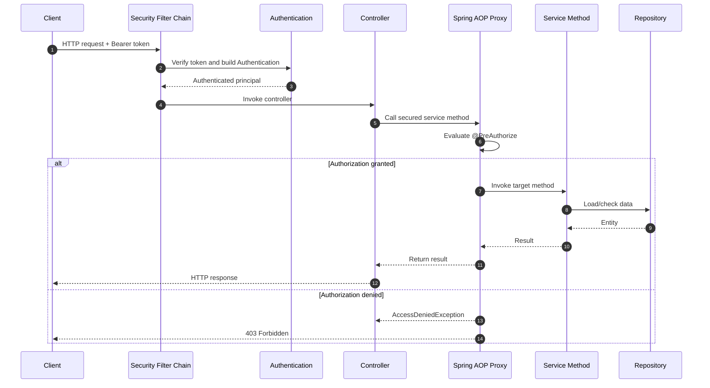
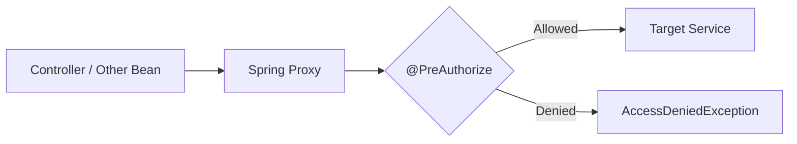
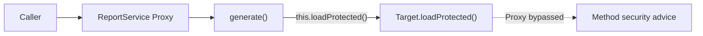

# Kiểm thử method security, lời gọi qua proxy và quyền sở hữu dữ liệu

Trong ứng dụng Spring Security Servlet, kiểm tra một endpoint trả về 403 Forbidden chưa đủ để chứng minh method security hoạt động đúng. Quy tắc có thể nằm trên service method, được thực thi qua Spring AOP proxy, phụ thuộc vào Authentication hiện tại và cần xác minh quyền sở hữu dữ liệu trong database. Nếu test gọi trực tiếp object được tạo bằng new, gọi method nội bộ trong cùng class hoặc chỉ mock repository, test có thể bỏ qua chính đường đi mà ứng dụng production sử dụng.

Bài học này tập trung vào ba lớp liên quan chặt chẽ: **method authorization**, **proxy invocation** và **data ownership**. Ví dụ dùng Spring Boot 3, Spring Security 6, JUnit 5 và Spring Test. Mục tiêu là chứng minh caller có authority phù hợp mới gọi được method, lời gọi thực sự đi qua security proxy, và user chỉ đọc hoặc sửa được dữ liệu thuộc phạm vi mà họ được phép truy cập.

## 1. Method security nằm ở đâu trong request lifecycle?

Servlet Resource Server thường xác minh Bearer token trong filter chain, tạo Authentication rồi lưu trong SecurityContext. Khi controller gọi service method có @PreAuthorize, method-security interceptor kiểm tra quyền trước khi method body được thực thi.



Hai lớp kiểm soát cần được test riêng:

- **Request authorization:** endpoint nào được gọi, HTTP authentication/authorization trả 401 hay 403.
- **Method authorization:** một Spring bean method có được phép chạy với Authentication hiện tại hay không.

Nếu chỉ test controller, bạn có thể không biết annotation ở service đã được áp dụng. Nếu chỉ test method bằng mock Authentication, bạn chưa chứng minh JWT decoder, issuer và audience được cấu hình đúng.

## 2. Bật method security trong ứng dụng

Spring Security 6 dùng @EnableMethodSecurity:

```java
import org.springframework.context.annotation.Configuration;
import org.springframework.security.config.annotation.method.configuration.EnableMethodSecurity;

@Configuration
@EnableMethodSecurity
class MethodSecurityConfiguration {
}
```

Mặc định, cấu hình này bật các annotation như @PreAuthorize, @PostAuthorize, @PreFilter và @PostFilter. Nếu ứng dụng cần annotation @Secured hoặc JSR-250 như @RolesAllowed, hãy bật rõ:

```java
@Configuration
@EnableMethodSecurity(
    securedEnabled = true,
    jsr250Enabled = true
)
class MethodSecurityConfiguration {
}
```

Không bật thêm tùy chọn nếu ứng dụng không sử dụng. Method security chỉ có tác dụng trên Spring-managed beans được gọi qua cơ chế proxy/interceptor phù hợp.

## 3. Phân biệt hasAuthority và hasRole

Spring Security dùng hai cách kiểm tra thường gặp:

```java
@PreAuthorize("hasAuthority('document:read')")
public DocumentView read(UUID id) {
    // ...
}

@PreAuthorize("hasRole('ADMIN')")
public void archiveAll() {
    // ...
}
```

hasAuthority so sánh authority đúng nguyên văn. hasRole('ADMIN') thêm prefix mặc định ROLE_, vì vậy tương đương kiểm tra authority ROLE_ADMIN.

| Annotation expression | Authority được kiểm tra |
| --- | --- |
| hasAuthority('document:read') | document:read |
| hasRole('ADMIN') | ROLE_ADMIN |
| hasAnyAuthority('document:read','document:write') | Một trong các authority được liệt kê |
| hasAnyRole('ADMIN','AUDITOR') | ROLE_ADMIN hoặc ROLE_AUDITOR |

Đừng viết test chỉ dùng roles = ADMIN rồi kỳ vọng nó cấp document:write. Role và permission là hai vocabulary khác nhau; mapping từ role sang authorities phải được cấu hình có chủ đích.

## 4. Đặt quy tắc trên service method

Ví dụ một service có quyền đọc và sửa tài liệu:

```java
import java.util.UUID;
import org.springframework.security.access.prepost.PreAuthorize;
import org.springframework.stereotype.Service;

@Service
public class DocumentService {

    @PreAuthorize("hasAuthority('document:read')")
    public DocumentView read(UUID documentId) {
        return loadView(documentId);
    }

    @PreAuthorize("hasAuthority('document:write')")
    public void update(UUID documentId, UpdateDocument command) {
        updateDocument(documentId, command);
    }
}
```

Method security bảo vệ method bất kể caller là controller, scheduled task hay một service khác, miễn lời gọi đi qua secured Spring bean. Controller-level rules vẫn hữu ích để chặn request sớm, nhưng service method là ranh giới phù hợp khi cùng nghiệp vụ được gọi từ nhiều entry points.

Không đặt security annotation lên một helper private rồi mong Spring AOP chặn được lời gọi nội bộ. Cần hiểu proxy model trước khi viết test.

## 5. Vì sao proxy quyết định method security có chạy hay không?

Spring method security được thực thi bằng method interceptor gắn vào proxy của Spring bean. Caller gọi proxy; proxy chạy security advice rồi mới delegate đến target object.



Nếu test tự tạo target:

```java
DocumentService service = new DocumentService();
service.read(documentId);
```

thì object không được Spring proxy bọc. Annotation chỉ là metadata; không có method-security interceptor thực thi. Test đó có thể chạy method body bất kể quyền.

Trong test tích hợp, inject bean từ ApplicationContext:

```java
@Autowired
DocumentService documentService;
```

Bean được inject là reference qua Spring infrastructure và method security có cơ hội chạy. Không thay thế bean đó bằng new khi mục tiêu test là proxy enforcement.

## 6. Self-invocation bỏ qua proxy

Một lỗi phổ biến:

```java
@Service
public class ReportService {

    public Report generate(UUID id) {
        return loadProtected(id);
    }

    @PreAuthorize("hasAuthority('report:read')")
    public Report loadProtected(UUID id) {
        return repository.findById(id).orElseThrow();
    }
}
```

Khi generate() gọi this.loadProtected(), lời gọi đi trực tiếp vào target object. Nó không quay ra proxy, vì vậy advice trên loadProtected() có thể bị bỏ qua.



Cách sửa dễ hiểu nhất là tách method được bảo vệ sang một bean riêng:

```java
@Service
public class ProtectedReportReader {

    @PreAuthorize("hasAuthority('report:read')")
    public Report load(UUID id) {
        return repository.findById(id).orElseThrow();
    }
}

@Service
public class ReportService {

    private final ProtectedReportReader reader;

    public ReportService(ProtectedReportReader reader) {
        this.reader = reader;
    }

    public Report generate(UUID id) {
        return buildReport(reader.load(id));
    }
}
```

ReportService gọi qua reference Spring-managed ProtectedReportReader, nên lời gọi đi qua proxy. Self-injection hoặc AopContext.currentProxy() có thể tồn tại, nhưng thường làm code khó hiểu và gắn chặt vào proxy infrastructure. Ưu tiên tách trách nhiệm thành bean có ranh giới rõ.

## 7. Những method không phù hợp với proxy-based interception

Với proxy-based AOP:

- Private method không thể được gọi qua proxy như public service API thông thường.
- Final method không thể bị override để tạo subclass proxy.
- Final class không thể được CGLIB subclass.
- Self-invocation không đi qua proxy.
- Object được tạo bằng new không có Spring advice.
- Method trên bean không được Spring quản lý không được tự động bảo vệ.

JDK dynamic proxy hoạt động qua interface; CGLIB subclass proxy hoạt động qua class và có giới hạn với final class/method. Hãy kiểm tra loại proxy thực tế và cách bean được đăng ký trong context. Không viết annotation lên một private helper rồi coi đó là ranh giới authorization.

## 8. Kiểm tra bean thực sự là proxy

Trong test chẩn đoán có thể dùng:

```java
import org.springframework.aop.support.AopUtils;

assertThat(AopUtils.isAopProxy(documentService)).isTrue();
Class<?> targetClass = AopUtils.getTargetClass(documentService);
assertThat(targetClass).isEqualTo(DocumentService.class);
```

Đây là kiểm tra hỗ trợ chẩn đoán. Assertion quan trọng hơn vẫn là behavior: user thiếu quyền phải nhận AccessDeniedException và method body không được thực thi. Proxy có thể tồn tại vì transaction/cache/other advice; do đó isAopProxy một mình không chứng minh method-security advisor được áp dụng.

## 9. Test method security bằng Spring Test và @WithMockUser

spring-security-test cung cấp @WithMockUser để thiết lập SecurityContext trong test:

```java
import org.junit.jupiter.api.Test;
import org.springframework.beans.factory.annotation.Autowired;
import org.springframework.boot.test.context.SpringBootTest;
import org.springframework.security.access.AccessDeniedException;
import org.springframework.security.test.context.support.WithMockUser;

import static org.assertj.core.api.Assertions.assertThat;
import static org.assertj.core.api.Assertions.assertThatThrownBy;

@SpringBootTest
class DocumentServiceMethodSecurityTest {

    @Autowired
    DocumentService documentService;

    @Test
    @WithMockUser(
        username = "alice",
        authorities = "document:read"
    )
    void readerCanReadDocument() {
        DocumentView view = documentService.read(existingDocumentId());
        assertThat(view).isNotNull();
    }

    @Test
    @WithMockUser(
        username = "alice",
        authorities = "document:read"
    )
    void readerCannotUpdateDocument() {
        assertThatThrownBy(() ->
            documentService.update(
                existingDocumentId(), updateCommand()))
            .isInstanceOf(AccessDeniedException.class);
    }

    @Test
    @WithMockUser(
        username = "alice",
        authorities = "document:write"
    )
    void writerCanUpdateDocument() {
        documentService.update(
            existingDocumentId(), updateCommand());
    }
}
```

Các helper existingDocumentId() và updateCommand() đại diện fixture do test chuẩn bị. Bài test phải gọi bean được inject từ Spring, không gọi object tự tạo.

@WithMockUser tạo username và authorities giả lập. Nó không chạy JWT decoder, không xác minh chữ ký, issuer, audience hoặc claim mapping. Đây là test tốt cho method authorization với Authentication đã được tạo.

## 10. roles và authorities trong @WithMockUser

Hai cách sau khác nhau:

```java
@Test
@WithMockUser(username = "alice", roles = "ADMIN")
void roleAdminHasRoleAuthority() {
    // Authentication contains ROLE_ADMIN.
}

@Test
@WithMockUser(username = "alice", authorities = "document:read")
void permissionIsPresent() {
    // Authentication contains document:read.
}
```

Dùng roles khi method expression dùng hasRole('ADMIN'). Dùng authorities khi expression dùng hasAuthority('document:read').

Không truyền roles = ROLE_ADMIN vì roles tự thêm prefix ROLE_; điều đó tạo role sai hoặc gây lỗi kiểm tra cấu hình. Khi cần nhiều authorities, truyền mảng:

```java
@Test
@WithMockUser(
    username = "alice",
    authorities = {
        "document:read",
        "document:write",
        "tenant:member"
    }
)
void userHasSeveralPermissions() {
    // ...
}
```

## 11. Test anonymous và authenticated nhưng thiếu quyền

Phân biệt hai trạng thái:

- **Anonymous:** chưa có Authentication hợp lệ.
- **Authenticated nhưng thiếu authority:** đã xác thực nhưng không được phép làm operation.

Với method security, cả hai thường bị chặn bởi @PreAuthorize, nhưng ở HTTP boundary response có thể khác nhau: unauthenticated request thường nhận 401 từ entry point; authenticated request bị từ chối thường nhận 403 từ access-denied handling.

```java
import org.springframework.security.test.context.support.WithAnonymousUser;

@Test
@WithMockUser(authorities = "profile:read")
void wrongAuthorityCannotReadDocument() {
    assertThatThrownBy(() ->
        documentService.read(existingDocumentId()))
        .isInstanceOf(AccessDeniedException.class);
}

@Test
@WithAnonymousUser
void anonymousCannotReadDocument() {
    assertThatThrownBy(() ->
        documentService.read(existingDocumentId()))
        .isInstanceOf(AccessDeniedException.class);
}
```

Nếu muốn xác minh status code HTTP, hãy test request qua MockMvc thay vì chỉ assert exception từ method call.

## 12. Dependency test trong project

Với Gradle Spring Boot project, dependency test thường được quản lý bằng starter:

```groovy
dependencies {
    implementation("org.springframework.boot:spring-boot-starter-security")
    implementation("org.springframework.boot:spring-boot-starter-oauth2-resource-server")

    testImplementation("org.springframework.boot:spring-boot-starter-test")
    testImplementation("org.springframework.security:spring-security-test")
}
```

spring-boot-starter-test mang JUnit Jupiter, AssertJ và Spring Test. spring-security-test cung cấp annotations và request post-processors như @WithMockUser, jwt() và opaqueToken().

Dùng version được Spring Boot BOM quản lý để tránh lệch version giữa Spring Security modules. Đây là ví dụ cấu trúc dependency, không phải xác nhận project cụ thể đã khai báo chúng.

## 13. Kiểm thử ownership: quyền không chỉ là scope

Một user có document:read không đồng nghĩa được đọc mọi document. Quyền có thể còn phụ thuộc:

- Document thuộc user hiện tại hay không.
- User có thuộc tenant sở hữu document không.
- User có được share document không.
- Document có ở trạng thái được đọc không.
- User có quyền quản trị tenant hay không.

Có thể mô hình hóa rule:

```text
Allow read if:
  caller has document:read
  AND (
    document.ownerId == caller.subjectId
    OR caller has document:read:any
    OR caller is an authorized member of document.tenantId
  )
```

Scope/authority là một phần của policy. Ownership và tenant membership thường cần dữ liệu domain đã được lưu trữ và cập nhật có thẩm quyền.

## 14. Lấy subject từ Authentication đã xác minh

Trong Spring Security, method expression có thể nhận authentication:

```java
@PreAuthorize("@documentAuthorization.canRead(authentication, #documentId)")
public DocumentView read(UUID documentId) {
    // ...
}
```

Bean documentAuthorization quyết định subject hiện tại và kiểm tra dữ liệu. Không nhận ownerId từ request rồi tin nó:

```java
// Không an toàn nếu caller có thể chọn ownerId.
@PreAuthorize("@documentAuthorization.canReadOwner(#ownerId)")
public DocumentView read(UUID documentId, String ownerId) {
    // ...
}
```

Caller có thể thay ownerId thành người khác. Authorization nên so sánh identity đã xác minh trong Authentication với owner/tenant được đọc từ database. Request có thể cung cấp document ID; service phải tự tải document và áp dụng policy.

## 15. Dùng @P để ổn định tên tham số trong SpEL

SpEL thường tham chiếu method parameter bằng tên:

```java
@PreAuthorize("@documentAuthorization.canRead(authentication, #documentId)")
public DocumentView read(UUID documentId) {
    // ...
}
```

Tên parameter discovery phụ thuộc cách compile và metadata có sẵn. Để tránh expression phụ thuộc debug symbols hoặc compiler flags, có thể dùng @P:

```java
import org.springframework.security.core.parameters.P;

@PreAuthorize("@documentAuthorization.canRead(authentication, #id)")
public DocumentView read(@P("id") UUID documentId) {
    // ...
}
```

Nếu dùng tên parameter tự nhiên, bật compiler -parameters và xác nhận build giữ metadata. Với method nhiều tham số, annotation tên rõ giúp expression bền vững khi đổi tên biến Java.

Không dùng #p0/#a0 như cách duy nhất nếu codebase có thể thay đổi signature; chúng khó đọc và dễ sai khi method tiến hóa.

## 16. Bean authorization kiểm tra ownership từ repository

Ví dụ một policy bean:

```java
import java.util.UUID;
import org.springframework.security.core.Authentication;
import org.springframework.stereotype.Component;

@Component("documentAuthorization")
public class DocumentAuthorization {

    private final DocumentRepository documents;
    private final MembershipRepository memberships;

    public DocumentAuthorization(
            DocumentRepository documents,
            MembershipRepository memberships) {
        this.documents = documents;
        this.memberships = memberships;
    }

    public boolean canRead(
            Authentication authentication,
            UUID documentId) {

        if (authentication == null
                || !authentication.isAuthenticated()
                || authentication instanceof org.springframework.security.authentication.AnonymousAuthenticationToken) {
            return false;
        }

        Document document = documents.findById(documentId)
            .orElse(null);

        if (document == null) {
            return false;
        }

        String subjectKey = trustedSubjectKey(authentication);
        if (subjectKey == null) {
            return false;
        }

        if (document.getOwnerKey().equals(subjectKey)) {
            return true;
        }

        boolean canReadAny = authentication.getAuthorities().stream()
            .anyMatch(a -> a.getAuthority().equals("document:read:any"));

        if (canReadAny) {
            return true;
        }

        return memberships.isActiveMember(
            subjectKey, document.getTenantId());
    }

    private String trustedSubjectKey(Authentication authentication) {
        Object principal = authentication.getPrincipal();
        if (principal instanceof org.springframework.security.oauth2.jwt.Jwt jwt) {
            return jwt.getIssuer() + "|" + jwt.getSubject();
        }
        return authentication.getName();
    }
}
```

Đây là ví dụ khung. Trong production, identity key nên nhất quán với model lưu owner, thường là cặp (issuer, subject) hoặc một internal user ID được map từ cặp đó. authentication.getName() không phải lúc nào cũng là JWT sub; nó phụ thuộc converter/principal implementation. Không bỏ issuer nếu nhiều IdPs có thể phát cùng subject string.

isActiveMember phải truy vấn membership có thẩm quyền hoặc một cache domain có freshness policy rõ ràng. Nếu dữ liệu membership thay đổi nhanh, test cần kiểm tra hành vi sau khi membership bị thu hồi.

## 17. Dùng @PostAuthorize để bảo vệ object trả về

Khi cần tải object rồi mới quyết định ownership, có thể dùng:

```java
@PostAuthorize(
    "@documentAuthorization.canReadResult(authentication, returnObject)"
)
public DocumentView find(UUID id) {
    return repository.findViewById(id).orElseThrow();
}
```

@PostAuthorize chạy sau method body. Nó có thể bảo vệ dữ liệu trả về, nhưng object đã được tải và code method đã chạy. Không dùng nó làm lớp bảo vệ duy nhất cho thao tác có side effect, vì email, event, payment hoặc database write có thể đã xảy ra trước khi access bị từ chối.

Đối với list lớn, @PostFilter cũng có thể tải nhiều dữ liệu rồi lọc ở memory; điều đó ảnh hưởng hiệu năng và có thể gây pagination/count semantics sai. Hãy ưu tiên query lọc theo tenant/owner trong database.

## 18. Bảo vệ write operation trước khi side effect xảy ra

Đối với update/delete, authorization phải xảy ra trước side effect. Ví dụ:

```java
@PreAuthorize("@documentAuthorization.canEdit(authentication, #id)")
@Transactional
public void rename(
        @P("id") UUID documentId,
        @P("title") String title) {

    Document document = repository.findById(documentId)
        .orElseThrow(DocumentNotFoundException::new);

    document.rename(title);
}
```

Policy bean phải kiểm tra ownership/tenant và edit grant. Tuy nhiên, nếu policy query và update tách rời, dữ liệu có thể thay đổi giữa hai bước (TOCTOU). Với yêu cầu chặt, thực hiện ownership predicate ngay trong update query hoặc kiểm tra lại trong transaction/locking phù hợp.

Ví dụ query scoped:

```sql
UPDATE documents
SET title = :title
WHERE id = :documentId
  AND owner_issuer = :issuer
  AND owner_subject = :subject
  AND tenant_id = :tenantId
```

Kiểm tra affected row count. Nếu bằng 0, xử lý theo API contract (404/403) mà không tiết lộ document có tồn tại ở tenant khác hay không. Security decision và data mutation cần cùng một trust model.

## 19. Tránh IDOR bằng kiểm tra ownership phía server

IDOR (Insecure Direct Object Reference) xảy ra khi caller thay một identifier trong URL/body để truy cập object không thuộc quyền của mình:

```http
GET /documents/11111111-1111-1111-1111-111111111111
GET /documents/22222222-2222-2222-2222-222222222222
```

UUID khó đoán không phải authorization. Opaque IDs, UUIDs hoặc sequential IDs đều cần kiểm tra ownership/tenant. Một endpoint không nên dựa vào việc người dùng “không biết ID” để bảo vệ object.

Test phải có ít nhất:
- Owner đọc được object của chính mình.
- User khác không đọc được object đó.
- User ở tenant khác không thể vượt qua tenant boundary.
- Admin/reader-any chỉ được phép khi có explicit authority.
- Object không tồn tại có response phù hợp API contract.

## 20. @PreFilter và @PostFilter cần được kiểm thử cẩn thận

@PreFilter lọc input collection trước khi method chạy; @PostFilter lọc collection trả về sau khi method chạy:

```java
@PreFilter(
    filterTarget = "documentIds",
    value = "@documentAuthorization.canRead(authentication, filterObject)"
)
public List<UUID> retainReadableIds(List<UUID> documentIds) {
    return documentIds;
}

@PostFilter(
    "@documentAuthorization.canReadResult(authentication, filterObject)"
)
public List<DocumentView> findVisibleDocuments() {
    return repository.findAllViews();
}
```

Filter collection không thay thế authorization query ở repository và không tự bảo đảm pagination/count an toàn. Với bulk update, không để lọc âm thầm làm caller tưởng toàn bộ IDs đã được xử lý. Nên trả kết quả rõ ràng và kiểm tra từng resource theo policy.

## 21. Kiểm thử owner và non-owner

Một test ownership nên dùng hai subject khác nhau và fixture rõ ràng:

```java
@SpringBootTest
class DocumentOwnershipTest {

    @Autowired
    DocumentService documentService;

    @Test
    @WithMockUser(username = "issuer-A|alice",
                  authorities = "document:read")
    void ownerCanReadOwnDocument() {
        DocumentView view = documentService.read(aliceDocumentId());
        assertThat(view.id()).isEqualTo(aliceDocumentId());
    }

    @Test
    @WithMockUser(username = "issuer-A|bob",
                  authorities = "document:read")
    void otherUserCannotReadAliceDocument() {
        assertThatThrownBy(() ->
            documentService.read(aliceDocumentId()))
            .isInstanceOf(AccessDeniedException.class);
    }
}
```

Test này minh họa identity key ở authentication.name. Nếu production principal là JwtAuthenticationToken, hãy dùng custom @WithSecurityContext hoặc dựng JwtAuthenticationToken có claims/issuer đúng để kiểm thử cùng code path của trustedSubjectKey().

Đừng chỉ mock DocumentAuthorization.canRead() trả true trong test owner. Làm vậy test service wiring, không kiểm tra logic ownership. Hãy có test riêng cho policy bean với repository fixture để xác minh owner/tenant decisions.

## 22. Tách test policy bean khỏi test method interceptor

Hai lớp test có mục đích khác nhau:

| Test | Điều được chứng minh |
| --- | --- |
| DocumentAuthorizationTest | Owner, tenant, admin, missing document và membership policy trả đúng allow/deny. |
| DocumentServiceMethodSecurityTest | Annotation được thực thi qua Spring proxy. |
| DocumentControllerMvcTest | HTTP status, authentication entry point, endpoint authorization và JSON contract. |
| JwtResourceServerIntegrationTest | Token decoder, issuer, signature, audience và authority mapping thực tế. |

Test policy bean có thể là unit test thuần với mocked repositories. Test method-security cần Spring context và proxied bean. Test JWT integration cần decoder/keys/issuer fixture hoặc test IdP phù hợp.

Đừng cố gom mọi điều vào một test lớn; mỗi test nên chứng minh một ranh giới cụ thể.

## 23. Tạo test context nhỏ cho method security

Có thể dùng @SpringJUnitConfig với cấu hình test tối giản:

```java
@Configuration
@EnableMethodSecurity
static class TestConfig {

    @Bean
    DocumentAuthorization documentAuthorization(
            DocumentRepository documents,
            MembershipRepository memberships) {
        return new DocumentAuthorization(documents, memberships);
    }

    @Bean
    DocumentService documentService(
            DocumentRepository documents,
            DocumentAuthorization authorization) {
        return new DocumentService(documents, authorization);
    }
}
```

Test context nhỏ giúp xác nhận proxy/interceptor mà không cần khởi động cả web server. Bean cần đúng dependency và annotation giống production. Với repository mock, test method-security không chứng minh ownership query; test policy bean riêng mới xác minh điều đó.

Trong project thực tế, cấu hình test nên import security configuration production hoặc cấu hình tương đương có chủ đích. Đừng vô tình tạo test config không bật @EnableMethodSecurity.

## 24. Xác nhận method body không chạy khi bị từ chối

Một assertion exception chứng minh caller bị chặn, nhưng có thể kiểm tra thêm side effect không xảy ra:

```java
@Test
@WithMockUser(authorities = "document:read")
void readerCannotCallWriteMethod() {
    assertThatThrownBy(() ->
        documentService.update(documentId, command))
        .isInstanceOf(AccessDeniedException.class);

    verify(documentRepository, never()).save(any());
}
```

Tùy thiết kế, repository có thể được gọi để kiểm tra policy hoặc load entity trước method body. Hãy verify đúng side effect cần ngăn, chẳng hạn save, publish event hoặc external client call, thay vì assert never() trên mọi repository method.

Đối với @PreAuthorize, interceptor kiểm tra trước khi method body được gọi. Với @PostAuthorize, body đã chạy trước khi kết quả bị từ chối. Test cần phản ánh sự khác nhau này.

## 25. Kiểm tra self-invocation bằng test hành vi

Nếu service method public generate() gọi secured method cùng class, hãy viết test chứng minh policy có thể bị bỏ qua khi thiết kế sai. Sau đó tách bean và test lại qua proxy.

Không nên chỉ assert AopUtils.isAopProxy; hãy tạo user thiếu authority và xác minh protected operation bị từ chối. Nếu generate() là entry point, test nên gọi generate() chứ không gọi trực tiếp loadProtected(), vì đó là đường đi production thực sự.

Một cách thiết kế tốt là làm các public service operations có security boundary rõ ràng, các private helpers chỉ xử lý logic nội bộ sau khi boundary đã được xác minh.

## 26. MockMvc test: method denial trở thành HTTP 403

Một controller gọi secured service:

```java
@RestController
@RequestMapping("/documents")
class DocumentController {

    private final DocumentService documents;

    DocumentController(DocumentService documents) {
        this.documents = documents;
    }

    @GetMapping("/{id}")
    DocumentView get(@PathVariable UUID id) {
        return documents.read(id);
    }
}
```

MockMvc test:

```java
@WebMvcTest(DocumentController.class)
@Import({
    MethodSecurityConfiguration.class,
    DocumentService.class
})
class DocumentControllerTest {

    @Autowired
    MockMvc mvc;

    @Test
    @WithMockUser(authorities = "profile:read")
    void insufficientAuthorityReturnsForbidden() throws Exception {
        mvc.perform(get("/documents/{id}", documentId))
            .andExpect(status().isForbidden());
    }
}
```

Đây là cấu trúc minh họa; cần cung cấp repository/policy beans hoặc mock dependencies và import đúng service. Một @WebMvcTest có thể không tự cấu hình toàn bộ Resource Server filter chain nếu slice bị giới hạn. Kiểm tra test context thực tế và không dùng addFilters = false khi muốn kiểm tra HTTP security.

Nếu controller service được mock, method security trên implementation có thể không được kích hoạt. Để test service method annotation, inject bean thật được proxy bọc. Để test controller HTTP mapping riêng, mock service là hợp lý nhưng không thể kết luận method security đã hoạt động.

## 27. Phân biệt 401 và 403 trong HTTP test

| Tình huống | Kết quả thường mong đợi |
| --- | --- |
| Không gửi Bearer token đến endpoint yêu cầu authentication | 401 Unauthorized |
| Bearer token không hợp lệ/expired | 401 Unauthorized |
| Token hợp lệ nhưng thiếu scope ở request authorization | 403 Forbidden |
| Token hợp lệ, endpoint cho qua nhưng service @PreAuthorize từ chối | 403 Forbidden |
| Anonymous gọi secured method trực tiếp | AccessDeniedException hoặc xử lý theo method-security entry-point configuration |

HTTP exception handling phụ thuộc security filter chain và entry point/access denied handler. Không assert mọi lỗi authorization là 401; không assert mọi method exception đều tự động trở thành HTTP 403 nếu test không đi qua ExceptionTranslationFilter hoặc MVC exception mapping phù hợp.

## 28. Test JWT claims và authority mapping thực tế

@WithMockUser không tạo JWT. Với MockMvc, Spring Security Test có jwt() post-processor để dựng JwtAuthenticationToken cho request:

```java
import static org.springframework.security.test.web.servlet.request.SecurityMockMvcRequestPostProcessors.jwt;

mvc.perform(get("/documents/{id}", documentId)
        .with(jwt().jwt(jwt -> jwt
            .issuer("https://idp.example/realms/shop")
            .subject("alice")
            .claim("aud", List.of("documents-api"))
            .claim("scope", "document:read"))))
    .andExpect(status().isOk());
```

Post-processor này tạo Authentication test; nó **không kiểm tra chữ ký JWT**, JWK endpoint hoặc decoder validators. Dùng nó để test authorization mapping/endpoint behavior khi claims đã được giả lập.

Để kiểm tra decoder thật, dùng JWT được ký bằng test key và JWK Set fixture. Test token có issuer sai, audience sai, hết hạn, algorithm không được phép và signature sai. Nếu dùng jwt() trong test, đừng gọi kết quả đó là test signature verification.

## 29. Test audience và issuer ở downstream

Nếu API có audience validator, phải có test cho:

- Issuer đúng, audience đúng, scope đúng: cho phép.
- Issuer đúng, audience khác: 401/invalid token.
- Issuer không được trust: 401.
- Signature sai hoặc key không phù hợp: 401.
- Token hết hạn hoặc chưa đến nbf: 401.
- Token đúng audience nhưng thiếu scope: 403.

Một test jwt() có thể xác nhận request authorization khi Authentication mang claims/authorities mong đợi. Nhưng integration test với decoder thật mới chứng minh validator được gắn vào decoder đang được filter chain dùng.

## 30. Dùng custom @WithSecurityContext cho JWT principal

Khi method policy phụ thuộc issuer, subject, tenant hoặc claims tùy chỉnh, tạo annotation test riêng:

```java
@Retention(RetentionPolicy.RUNTIME)
@WithSecurityContext(factory = WithTestJwtSecurityContextFactory.class)
public @interface WithTestJwt {
    String issuer() default "https://idp.example/realms/shop";
    String subject() default "alice";
    String[] authorities() default {"document:read"};
}
```

Factory dựng Jwt và Authentication:

```java
public class WithTestJwtSecurityContextFactory
        implements WithSecurityContextFactory<WithTestJwt> {

    @Override
    public SecurityContext createSecurityContext(WithTestJwt annotation) {
        Instant now = Instant.now();
        Jwt jwt = Jwt.withTokenValue("test-token")
            .header("alg", "RS256")
            .issuer(annotation.issuer())
            .subject(annotation.subject())
            .claim("tenant_id", "tenant-a")
            .issuedAt(now)
            .expiresAt(now.plusSeconds(300))
            .build();

        var authorities = AuthorityUtils.createAuthorityList(
            annotation.authorities());

        Authentication authentication =
            new JwtAuthenticationToken(jwt, authorities);

        SecurityContext context = SecurityContextHolder.createEmptyContext();
        context.setAuthentication(authentication);
        return context;
    }
}
```

Đây là principal giả lập cho method-security test, không phải token hợp lệ để gọi Resource Server filter chain. Không dùng header alg của object test để suy luận chữ ký đã được xác minh. Fixture này chỉ tạo object Jwt nội bộ để kiểm thử SpEL/policy với claim fields.

Nếu cần kiểm tra claim converter, hãy test converter riêng với Jwt fixture và integration test decoder/filter chain bằng chữ ký thật.

## 31. Kiểm tra ownership theo issuer và subject

Trong hệ thống nhiều IdPs, sub=123 từ issuer A không nhất thiết là cùng user với sub=123 từ issuer B. Owner key nên dùng identity namespace rõ ràng:

```text
owner_key = issuer + "|" + subject
```

Hoặc map cặp issuer-subject sang internal user ID ổn định sau khi xác minh. Không dùng email làm primary authorization key nếu email có thể đổi, tái sử dụng hoặc không unique giữa issuers.

Test nên tạo hai principal:

| Principal | Issuer | Subject | Kết quả |
| --- | --- | --- | --- |
| Alice | issuer-A | 123 | Đọc document owner issuer-A và subject 123 |
| Bob | issuer-A | 456 | Bị từ chối document của Alice |
| Mallory | issuer-B | 123 | Bị từ chối nếu chưa map cùng internal identity |

Điều này phát hiện lỗi chỉ so sánh sub mà bỏ iss.

## 32. Ownership thay đổi và tenant membership bị revoke

Một test tốt không chỉ kiểm tra state ban đầu. Hãy kiểm tra sau khi membership bị thu hồi:

1. Alice là member active của tenant A.
2. Alice đọc được document tenant A theo policy.
3. Admin revoke membership của Alice.
4. Request/method call kế tiếp bị từ chối theo freshness policy.
5. Alice vẫn không đọc được document tenant B.

Nếu membership cache được dùng, test cần điều khiển TTL/invalidation hoặc cache fixture. Nếu policy query trực tiếp database, test phải commit/refresh transaction đúng cách để không vô tình đọc persistence context cũ.

Không giả định token còn hợp lệ thì membership luôn còn hợp lệ. Authentication và authorization domain có vòng đời khác nhau.

## 33. Kiểm thử tenant isolation và cross-tenant IDOR

Seed hai tenant và documents:

```text
tenant-a:
  alice -> document A-1
  bob   -> document A-2

tenant-b:
  carol -> document B-1
```

Test matrix:

| Caller | Resource | Expected |
| --- | --- | --- |
| Alice | A-1 | Allow |
| Alice | A-2 | Deny nếu policy owner-only |
| Alice | B-1 | Deny |
| Bob | A-2 | Allow |
| Carol | B-1 | Allow |
| Tenant admin A | A-1/A-2 | Allow nếu có explicit tenant-admin permission |
| Tenant admin A | B-1 | Deny |

Đừng chỉ test owner đọc object của mình. Cross-tenant negative test là bằng chứng quan trọng để ngăn bug query bỏ sót tenant_id.

## 34. Phân biệt 404 và 403 để tránh enumeration

Khi caller yêu cầu document không tồn tại hoặc document thuộc user khác, API có thể chọn:

- Trả 404 cho cả hai để không tiết lộ sự tồn tại.
- Trả 403 khi caller đã biết resource và contract cho phép thể hiện rõ quyền bị từ chối.

Đây là quyết định API/security policy. Test phải cố định semantics đã chọn. Không để repository trả 404 cho missing và policy trả 403 cho foreign object một cách vô tình nếu điều đó làm lộ object enumeration.

Dù response giống nhau, audit event nội bộ vẫn có thể phân biệt not_found và ownership_denied mà không ghi dữ liệu nhạy cảm vào log công khai.

## 35. Test @PostAuthorize và side effects

Với @PostAuthorize, test nên xác minh method body đã chạy trước khi access bị từ chối. Ví dụ method trả object của user khác: interceptor có thể từ chối sau khi repository đọc dữ liệu.

Nếu method có side effect, đó là lý do cần chuyển authorization trước side effect hoặc thiết kế transaction đảm bảo không commit. Không dùng test chỉ assert AccessDeniedException rồi kết luận side effect không xảy ra. Hãy verify DB state, event publisher và external calls.

Với read-only object retrieval, @PostAuthorize có thể phù hợp trong một số trường hợp; query-level ownership thường hiệu quả và dễ kiểm soát hơn cho list/search/pagination.

## 36. Test method authorization với transaction

Nếu method vừa có @PreAuthorize vừa có @Transactional, nhiều advisors cùng bọc bean. Không phụ thuộc thứ tự advisor ngẫu nhiên để bảo vệ side effect. Security check cần xảy ra trước khi logic nghiệp vụ có thể ghi dữ liệu.

Test tích hợp nên:
- Gọi method qua proxy.
- Dùng user thiếu quyền.
- Assert AccessDeniedException.
- Reload entity trong transaction mới để kiểm tra dữ liệu không đổi.
- Verify không phát domain event hoặc gọi external client.

Không dùng @Transactional ở test một cách vô thức rồi chỉ kiểm tra cùng persistence context; dirty state có thể khiến kết quả test không phản ánh database commit. Dùng transaction boundary rõ và query lại bằng cách phù hợp.

## 37. Test permission mapping và policy evolution

Nếu authority được map từ JWT claims, viết test riêng cho converter:

- scope string thành SCOPE_... hoặc canonical permissions theo policy.
- roles từ đúng claim path/issuer thành role authorities.
- Claim sai kiểu, thiếu claim hoặc issuer không thuộc mapping profile không cấp quyền.
- Role trùng/unknown được xử lý theo allowlist.
- Policy version mới thay đổi mapping mà không giữ authority cũ.

Sau đó method-security test dùng canonical authorities để chứng minh method rule. Không gắn quá nhiều logic parse provider claims vào SpEL; converter là nơi chuẩn hóa token, policy bean là nơi kiểm tra domain resource.

## 38. Test method security cho background jobs và system actors

Scheduled task hoặc message consumer có thể không có user HTTP Authentication. Nếu method yêu cầu document:write, background job cần identity/policy riêng được thiết kế rõ.

Không đặt @WithMockUser(roles = "ADMIN") trong test để che việc production scheduler không có SecurityContext. Test job với system actor thực tế, hoặc thiết kế method nội bộ riêng chỉ được gọi bởi trusted workflow. Không tạo SecurityContext admin toàn cục để làm job chạy.

Nếu một background operation hành động thay mặt user, message/event phải có provenance và delegation contract được bảo vệ; correlation ID trong message không chứng minh user identity.

## 39. Kiểm tra method security không vô tình bị tắt trong test slice

Một test có thể pass vì @EnableMethodSecurity không được load, annotation không được proxy hoặc bean đã bị mock. Khi test method security:

- Xác nhận config bật @EnableMethodSecurity.
- Inject bean thật từ context.
- Không mock secured service nếu muốn test interceptor thật.
- Không tự khởi tạo service bằng new.
- Gọi method qua reference được inject.
- Có test denied chứng minh interceptor thực sự chặn.
- Có test allowed chứng minh rule không từ chối mọi caller.

Nếu dùng @WebMvcTest, chủ động import method-security config và secured service bean hoặc dùng @SpringBootTest cho một integration test nhỏ. Test slice phải thể hiện đúng production wiring cần kiểm tra.

## 40. Ma trận test tối thiểu cho method security và ownership

| Nhóm | Positive case | Negative case |
| --- | --- | --- |
| Authority | Có document:read đọc được | Thiếu authority bị chặn |
| Role | ROLE_ADMIN đáp ứng hasRole('ADMIN') | Authority ADMIN không prefix không đáp ứng |
| Proxy | Spring bean invocation áp dụng interceptor | Object new không đại diện production path |
| Self-invocation | Gọi qua bean khác vẫn bị kiểm soát | this.securedMethod() không được dùng làm boundary |
| Owner | Owner truy cập document | User khác bị từ chối |
| Tenant | Member đúng tenant truy cập | User tenant khác bị từ chối |
| Admin override | Có explicit read:any theo policy | Không suy luận admin từ role không liên quan |
| JWT identity | Issuer/subject mapping đúng | Cùng subject, issuer khác bị phân biệt |
| HTTP | Authenticated request hợp lệ trả 2xx | Missing/invalid token 401, thiếu quyền 403 |
| Side effect | Writer hợp lệ cập nhật | Reader không thể update/publish event |
| Membership revocation | Active member được phép | Sau revoke bị từ chối theo freshness contract |
| Pagination | Query trả đúng tenant/owner rows | Không lọc ở memory làm sai total/page |

Ma trận cần được điều chỉnh theo policy thực tế. Các test negative phải xác minh cả response/exception lẫn side effects quan trọng.

## 41. Ví dụ test policy bean với Mockito

Policy bean có thể được test độc lập mà không cần Spring AOP:

```java
@ExtendWith(MockitoExtension.class)
class DocumentAuthorizationTest {

    @Mock
    DocumentRepository documents;

    @Mock
    MembershipRepository memberships;

    @InjectMocks
    DocumentAuthorization authorization;

    @Test
    void ownerCanReadDocument() {
        UUID id = UUID.randomUUID();
        Document document = document(
            id, "issuer-A|alice", "tenant-A");

        when(documents.findById(id)).thenReturn(Optional.of(document));

        Authentication authentication =
            new UsernamePasswordAuthenticationToken(
                "issuer-A|alice",
                "n/a",
                AuthorityUtils.createAuthorityList("document:read"));

        assertThat(authorization.canRead(authentication, id)).isTrue();
        verify(memberships, never()).isActiveMember(anyString(), anyString());
    }

    @Test
    void anotherSubjectCannotReadPrivateDocument() {
        UUID id = UUID.randomUUID();
        Document document = document(
            id, "issuer-A|alice", "tenant-A");

        when(documents.findById(id)).thenReturn(Optional.of(document));
        when(memberships.isActiveMember("issuer-A|bob", "tenant-A"))
            .thenReturn(false);

        Authentication authentication =
            new UsernamePasswordAuthenticationToken(
                "issuer-A|bob",
                "n/a",
                AuthorityUtils.createAuthorityList("document:read"));

        assertThat(authorization.canRead(authentication, id)).isFalse();
    }
}
```

Các factory document(...) là fixture helper. Test này kiểm tra policy bean thuần: owner và non-owner. Nó không kiểm tra @PreAuthorize; test method-security integration vẫn cần Spring context/proxy.

## 42. Lỗi thường gặp khi kiểm thử

| Lỗi | Vì sao test sai | Cách làm đúng |
| --- | --- | --- |
| new Service() | Không có Spring proxy | Inject bean từ context |
| Mock secured service | Bỏ qua method interceptor thật | Dùng bean thật trong test method security |
| Chỉ test controller mock service | Không chứng minh service annotation chạy | Thêm test proxied service |
| Gọi secured method từ cùng class | Self-invocation bypass proxy | Tách bean hoặc gọi qua proxy |
| Chỉ test owner success | Bỏ sót IDOR | Test non-owner và cross-tenant |
| So sánh sub đơn lẻ | Trùng subject giữa issuer | Dùng issuer-subject tuple hoặc internal ID |
| Dùng @PostAuthorize cho write | Side effect có thể đã chạy | Pre-authorize và enforce trong query/transaction |
| Chỉ test jwt() | Không kiểm tra chữ ký/decoder | Thêm integration test với signed JWT |
| @WithMockUser(roles=...) sai prefix | Test authority khác policy | Dùng roles hoặc authorities đúng semantics |
| Bỏ filter trong MockMvc | HTTP security không chạy | Giữ filter chain trong test cần kiểm tra |
| Assert exception | Side effect có thể vẫn xảy ra | Kiểm tra database/event/client calls |
| Chỉ dùng mock repository | Không chứng minh query tenant-scoped | Có integration test persistence/query |

## 43. Tài liệu tham khảo

- [Spring Security 6.5 — Method Security](https://docs.spring.io/spring-security/reference/6.5/servlet/authorization/method-security.html): @EnableMethodSecurity, pre/post authorization và method interceptors.
- [Spring Security 6.5 — Testing Method Security](https://docs.spring.io/spring-security/reference/6.5/servlet/test/method.html): @WithMockUser, @WithAnonymousUser, custom @WithSecurityContext.
- [Spring Security 6.5 — MockMvc Security](https://docs.spring.io/spring-security/reference/6.5/servlet/test/mockmvc/index.html): request post-processors và MockMvc integration.
- [Spring Security 6.5 — OAuth 2.0 Resource Server JWT](https://docs.spring.io/spring-security/reference/6.5/servlet/oauth2/resource-server/jwt.html): JWT decoder, issuer/audience validation và authorities.
- [Spring Framework — AOP Proxies](https://docs.spring.io/spring-framework/reference/core/aop/proxying.html): JDK/CGLIB proxy, self-invocation và giới hạn proxy.
- [OWASP — Insecure Direct Object Reference Prevention](https://cheatsheetseries.owasp.org/cheatsheets/Insecure_Direct_Object_Reference_Prevention_Cheat_Sheet.html): kiểm soát quyền truy cập object phía server.
- [OWASP — Authorization Cheat Sheet](https://cheatsheetseries.owasp.org/cheatsheets/Authorization_Cheat_Sheet.html): deny-by-default, least privilege và kiểm tra quyền trên mọi request.

## 44. Kết luận

Method security chỉ có hiệu lực khi secured method được gọi qua Spring-managed proxy và security interceptor được bật. Vì vậy, test phải inject bean từ ApplicationContext, gọi đúng entry point production và có cả case allow lẫn deny. @WithMockUser hữu ích để kiểm tra authority rules; custom @WithSecurityContext giúp dựng JWT principal/issuer/subject khi policy phụ thuộc claims; MockMvc kiểm tra HTTP mapping; signed JWT integration test kiểm tra decoder và token validators.

Quyền sở hữu dữ liệu phải được kiểm tra bằng identity đã xác minh và dữ liệu domain có thẩm quyền. Dùng issuer-subject tuple hoặc internal identity mapping để tránh trùng sub, kiểm tra tenant/object trong query hoặc policy bean, và có test non-owner, cross-tenant, missing object, membership revocation. Với write operation, kiểm tra quyền trước side effect và cân nhắc race condition giữa authorization với update.

**Điểm cốt lõi:** *Một test method-security đáng tin phải chứng minh lời gọi đi qua proxy, đúng Authentication được áp dụng, và caller không thể truy cập object chỉ bằng cách thay ID trong request.*
