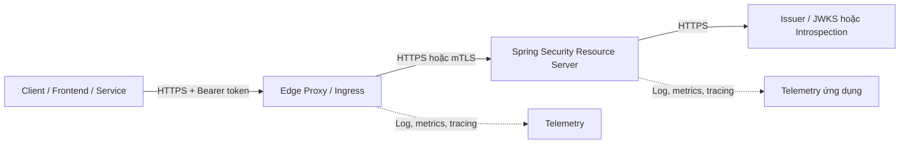

# HTTPS, proxy và bảo vệ Bearer token trên đường truyền

Trong hệ thống **Spring Security OAuth 2.0/OIDC Resource Server**, một API thường nhận access token qua HTTP header:

```http
GET /api/orders/42 HTTP/1.1
Host: api.example.com
Authorization: Bearer <access-token>
```

Với cơ chế **Bearer**, bên nào nắm được token hợp lệ thường có thể sử dụng token đó để gọi API trong phạm vi quyền mà token được cấp. Resource Server không mặc nhiên biết người gửi hiện tại có phải người được cấp token ban đầu hay không. Vì vậy, việc token bị lộ qua mạng, reverse proxy, log hay một chặng HTTP nội bộ có thể dẫn đến truy cập trái phép dù Spring Security vẫn xác minh chữ ký JWT chính xác.

Chủ đề này tập trung vào cách bảo vệ Bearer token **trong lúc truyền và đi qua proxy**, cách Spring Security vận hành phía sau TLS termination, và các giới hạn của HTTPS cần được hiểu đúng.

## 1. Vì sao Bearer token cần được bảo vệ đặc biệt?

Một access token có thể chứa hoặc tham chiếu đến các quyền như `orders.read`, `orders.write`. Nếu token bị đánh cắp và chưa hết hạn, kẻ tấn công có thể thử gửi lại token đó:

```http
GET /api/orders/42 HTTP/1.1
Host: api.example.com
Authorization: Bearer <stolen-access-token>
```

Nếu token hợp lệ, đúng audience và được cấp quyền cho endpoint, Resource Server có thể không phân biệt được yêu cầu của kẻ tấn công với yêu cầu của client ban đầu. Đây là rủi ro **replay** của Bearer token.

Phân biệt ba mục tiêu bảo mật:

| Mục tiêu | Cơ chế chính | Điều cần nhớ |
|---|---|---|
| **Bảo mật khi truyền (confidentiality in transit)** | HTTPS/TLS trên mọi chặng có token | Ngăn người nghe lén đường truyền đọc header `Authorization` |
| **Bảo đảm tính toàn vẹn và nguồn phát hành token** | Xác minh JWT signature hoặc introspection; kiểm `iss`, `aud`, `exp`... | Token được ký đúng vẫn có thể bị đánh cắp và phát lại |
| **Giới hạn khả năng sử dụng token** | Scope/quyền tối thiểu, thời hạn ngắn, kiểm quyền tài nguyên; khi phù hợp dùng sender-constrained token | Giảm thiệt hại nếu token lộ, không thay thế mã hóa đường truyền |

**JWT ký số không đồng nghĩa với JWT được mã hóa.** Phần header và payload của JWT dạng JWS thường chỉ được mã hóa Base64URL để truyền, có thể đọc nếu ai đó lấy được chuỗi token. Chữ ký bảo vệ tính toàn vẹn và tính xác thực, chứ không che giấu nội dung token hoặc ngăn người khác sử dụng lại Bearer token.

OAuth 2.0 Bearer Token Usage (RFC 6750) yêu cầu bảo vệ token trên đường truyền bằng TLS và ưu tiên truyền token trong header `Authorization`.

## 2. Mô hình triển khai có proxy: xác định từng điểm token có thể lộ

Trong thực tế, Spring Boot Resource Server thường chạy phía sau CDN, API Gateway, Load Balancer, Ingress hoặc Nginx. HTTPS ở địa chỉ công khai **không có nghĩa** toàn bộ tuyến truyền tới ứng dụng đã được mã hóa.



Khi **TLS termination** diễn ra ở proxy, proxy giải mã request để định tuyến và kiểm tra; Bearer token xuất hiện dưới dạng plaintext trong bộ nhớ của proxy. Proxy sẽ tạo kết nối mới đến backend. Nếu kết nối này là `http://`, token tiếp tục đi **không mã hóa** trong mạng nội bộ.

Ví dụ hai tuyến:

```text
CHƯA BẢO VỆ ĐỦ:
Client  ==HTTPS==>  Nginx  ---HTTP--->  Spring Boot
                     (TLS kết thúc)      (Authorization ở dạng plaintext)

KHUYẾN NGHỊ:
Client  ==HTTPS==>  Nginx  ==HTTPS/mTLS==>  Spring Boot
                     (TLS kết thúc)        (TLS được thiết lập lại)
```

Tuyến HTTP nội bộ không thể được xem là an toàn chỉ vì dùng IP private, mạng container hoặc Kubernetes Service. Mạng nội bộ vẫn có nguy cơ nghe lén do cấu hình sai, workload bị xâm nhập, chuyển tiếp sai tuyến hoặc đặc quyền quá rộng. Nếu kiến trúc buộc phải sử dụng kết nối không mã hóa ở một đoạn, đó là một quyết định rủi ro cần xác định rõ trust boundary, cô lập mạng và quyền truy cập; không thể mô tả là mã hóa đầu cuối.

### Những nơi cần kiểm tra trên hành trình của token

| Vị trí | Nguy cơ điển hình | Biện pháp |
|---|---|---|
| Client → proxy công khai | Nghe lén hoặc chèn sửa khi dùng HTTP; chứng chỉ giả | Chỉ dùng HTTPS, kiểm tra chứng chỉ và hostname |
| Proxy → backend | TLS bị bỏ sau load balancer; token lộ trong mạng nội bộ | Dùng HTTPS/mTLS đến backend, xác minh chứng chỉ upstream |
| Proxy/API Gateway | Header `Authorization` xuất hiện trong log, tracing, debug, WAF event | Loại bỏ hoặc che token trong toàn bộ telemetry |
| Proxy → dịch vụ khác | Forward token nhầm đến upstream ngoài phạm vi tin cậy | Định tuyến/allowlist chặt chẽ, không phát tán header tùy tiện |
| Resource Server → JWKS/introspection | Trao đổi metadata, public key hoặc thông tin kiểm tra token qua kết nối kém an toàn | Gọi endpoint của Authorization Server qua HTTPS đáng tin cậy; bảo vệ thông tin xác thực introspection |
| Browser/app client | Token xuất hiện trong URL, history, referrer, console hoặc extension | Giữ token ngoài URL và log; hạn chế nơi token được lưu/đọc |

## 3. HTTPS/TLS phải được thực thi ở đúng chặng

### 3.1. Bắt đầu bằng HTTPS, không trông chờ vào HTTP redirect

Client phải gửi ngay yêu cầu API có Bearer token tới URL `https://`:

```text
ĐÚNG:  https://api.example.com/api/orders/42
SAI:   http://api.example.com/api/orders/42
```

Một cấu hình HTTP `301`, `302`, `307` hay `308` chuyển hướng sang HTTPS hữu ích cho trình duyệt truy cập trang công khai, nhưng **không bảo vệ được Bearer token đã nằm trong request HTTP đầu tiên**. Ngay trước khi server trả redirect, token đã truyền qua kết nối không mã hóa.

Với API nhận thông tin xác thực, nên cấu hình client chỉ tạo request HTTPS, từ chối URL HTTP trước khi gắn token và giới hạn hoặc tắt HTTP entrypoint cho các endpoint nhạy cảm. Tránh để HTTP redirect tự động chuyển tiếp header `Authorization` qua hostname/origin khác.

### 3.2. Chứng chỉ và kiểm tra danh tính server

Các điều kiện nền tảng:

- Sử dụng TLS được hỗ trợ và cấu hình an toàn (thông thường TLS 1.2/1.3; ưu tiên TLS 1.3 khi có thể).
- Chứng chỉ phải còn hạn, có chuỗi tin cậy phù hợp và tên miền trong SAN khớp hostname client kết nối.
- Client, reverse proxy và backend **phải kiểm tra certificate chain lẫn hostname**; không tắt kiểm tra chỉ vì chứng chỉ nội bộ/self-signed.
- Quản lý vòng đời certificate, tự động gia hạn/thay khóa và bảo vệ private key; không nhúng private key trong mã nguồn.
- Tránh tùy chọn “trust all certificates”, `insecureSkipVerify`, `curl -k`, `verify=false` trong production. Chúng phá vỡ khả năng chống máy chủ giả mạo/MITM.

Đối với dịch vụ nội bộ, có thể dùng CA nội bộ được phân phối đúng cách hoặc mTLS. Nếu áp dụng **mutual TLS** giữa proxy và Resource Server, hai phía có thể xác minh danh tính của nhau; đây là một lớp bảo vệ bên cạnh việc xác thực Bearer token.

### 3.3. HSTS giúp gì và không giúp gì?

HTTP Strict Transport Security (HSTS) là header trả về trên kết nối HTTPS hợp lệ, ví dụ:

```http
Strict-Transport-Security: max-age=31536000
```

Trình duyệt hỗ trợ HSTS sẽ nhớ dùng HTTPS cho tên miền trong thời gian chỉ định, giảm nguy cơ truy cập HTTP ở những lần sau. Tuy nhiên:

- HSTS **không mã hóa** đường proxy → backend.
- HSTS không thay thế việc client gọi đúng `https://` ngay từ đầu; lần truy cập đầu tiên chưa chắc đã được bảo vệ nếu chưa có chính sách HSTS được nhớ/preload.
- HSTS chủ yếu là cơ chế của browser, không thể mặc định mọi service-to-service HTTP client đều áp dụng.
- Chỉ bật `includeSubDomains`/preload sau khi bảo đảm các subdomain liên quan đáp ứng HTTPS lâu dài.

## 4. Truyền token đúng cách trong HTTP

### 4.1. Ưu tiên header `Authorization: Bearer`

```http
GET /api/orders/42 HTTP/1.1
Host: api.example.com
Authorization: Bearer eyJ...<rút-gọn>
Accept: application/json
```

RFC 6750 định nghĩa cách gửi Bearer token bằng header `Authorization`, ngoài một số hình thức khác có điều kiện. Với API hiện đại, header là lựa chọn nên dùng vì có ý nghĩa chuẩn và tránh đưa token vào URL.

**Không đặt access token trong query string hoặc path**, ví dụ:

```text
SAI: GET /api/orders/42?access_token=eyJ...
SAI: GET /api/token/eyJ.../orders/42
```

Token trong URL dễ đi vào access log, browser history, công cụ phân tích, monitoring, reverse proxy, referrer, báo cáo lỗi và các hệ thống chia sẻ liên kết. Việc “đã dùng HTTPS” không ngăn token xuất hiện trong các nơi lưu trữ này sau TLS termination.

Không nhét Bearer token vào form field hoặc request body tùy tiện để né log header; các cách này dễ tạo thêm bề mặt lộ lọt, phá vỡ giả định về middleware và không cải thiện được bảo mật đường truyền.

### 4.2. Giới hạn việc gửi token và xử lý redirect

Client chỉ nên thêm header Bearer khi request gửi tới API/origin được cấu hình là bên nhận token. Nếu có chuyển hướng sang domain khác, không tự động mang header `Authorization` theo redirect. Với frontend đa API, tránh interceptor gắn cùng access token vào **mọi** request HTTPS; token cho Orders API không nên đến Analytics API hoặc domain CDN.

Access token cũng nên có `aud` phù hợp với Resource Server đích. `aud` là lớp kiểm soát tại server giúp giảm việc dùng nhầm token giữa các API; nó không thay thế việc client bảo vệ đường truyền.

### 4.3. Phản hồi và caching

Với response chứa dữ liệu riêng tư, có thể áp dụng:

```http
Cache-Control: no-store
```

Cấu hình cache/proxy phù hợp cho endpoint đã xác thực để tránh chia sẻ response của người dùng này cho người dùng khác. Không cache riêng dữ liệu từ Bearer-authenticated request theo key chỉ gồm URL nếu không có cơ chế phân tách người dùng và chính sách cache chính xác. Tránh đưa nguyên token vào cache key hiển thị trong log, metrics hoặc trace.

## 5. Reverse proxy, header `Authorization` và ranh giới tin cậy

### 5.1. Proxy phải chuyển token đến đúng backend nhưng không ghi token vào log

Proxy cần bảo đảm header `Authorization` tới đúng Resource Server mà không vô tình bị xóa hoặc bị ghi vào telemetry. Một số API Gateway có thể tự xác thực token ở edge, nhưng nếu backend còn cần kiểm JWT hoặc lấy claim phân quyền, nó phải nhận được access token **qua kết nối được bảo vệ** hoặc một ngữ cảnh danh tính nội bộ được xác thực theo thiết kế riêng.

Các nhóm rủi ro cần nhận diện:

- Ghi toàn bộ request headers, ví dụ `$http_authorization`, trong access log hay error log.
- Gửi headers và body thô vào hệ thống APM/tracing hoặc công cụ hỗ trợ lỗi.
- Ghi token trong debug log của HTTP client/REST template, gateway filter hoặc Spring Security khi bật logging quá chi tiết.
- Forward request/header sang upstream khác mà không kiểm soát domain đích.
- Đưa token vào URL, query string, error message, stack trace hoặc event analytics.

Khi cần quan sát lỗi xác thực, nên log **mã trạng thái, request ID, endpoint, issuer/audience ở mức phù hợp, lý do lỗi tổng quát và định danh người dùng đã giảm thiểu dữ liệu**. Không log nguyên access token, refresh token, ID Token, cookie phiên, client secret hoặc thông tin xác thực của introspection endpoint.

### 5.2. `X-Forwarded-*` và `Forwarded` không phải bằng chứng về TLS

Khi TLS kết thúc ở proxy, backend đôi lúc nhìn thấy kết nối từ proxy đến ứng dụng và không trực tiếp quan sát HTTPS từ client. Proxy có thể gửi metadata:

```http
X-Forwarded-Proto: https
X-Forwarded-Host: api.example.com
X-Forwarded-For: 203.0.113.10
```

Hoặc dùng header chuẩn `Forwarded`. Những header này phục vụ nhận biết scheme, host và địa chỉ gốc để tạo URL, redirect, log hoặc áp dụng cơ chế cần biết kết nối bên ngoài có HTTPS.

**Header forwarded do client bất kỳ gửi lên không được tự động tin cậy.** Nếu Resource Server có thể truy cập trực tiếp và cấu hình tin mọi `X-Forwarded-Proto: https`, kẻ tấn công có thể tự gửi header đó qua HTTP để đánh lừa logic nhận diện secure request.

Thiết kế đúng gồm các quy tắc bổ trợ:

1. Edge proxy **loại bỏ/ghi đè** forwarded headers do client từ Internet cung cấp, rồi tạo lại từ thông tin kết nối mà edge thực sự quan sát.
2. Backend chỉ nhận request từ các proxy được phép; dùng firewall, security group hoặc Kubernetes NetworkPolicy nếu phù hợp.
3. Nếu có nhiều proxy, xác định chính xác proxy nào đáng tin và quy tắc xây dựng chuỗi client IP/scheme/host; không tự tin toàn bộ chuỗi `X-Forwarded-For` do đầu vào cung cấp.
4. Ứng dụng chỉ xử lý forwarded headers khi hạ tầng đã thiết lập ranh giới tin cậy rõ ràng.

`X-Forwarded-Proto: https` giúp mô tả kết nối bên ngoài, **không tự mã hóa kết nối proxy → backend**. TLS nội bộ vẫn phải được cấu hình độc lập.

## 6. Ví dụ Nginx kết thúc TLS rồi mã hóa lại đến Spring Boot

Giả sử:

- Client gọi `https://api.example.com`.
- Nginx là reverse proxy biên và giải mã TLS công khai.
- Spring Boot Resource Server có TLS tại `https://orders-api.internal:8443`, với chứng chỉ hợp lệ theo internal CA.
- Backend không mở trực tiếp cho Internet; Nginx có thể xác thực TLS upstream.

Ví dụ cấu hình minh họa (đường dẫn chứng chỉ, hostname và port phải thay bằng giá trị thực tế):

```nginx
# Log tối thiểu: KHÔNG ghi Authorization header, query string hay Referer.
# Với đường dẫn chứa dữ liệu bí mật, vẫn phải sửa thiết kế URL.
log_format api_min '$remote_addr "$request_method $uri" '
                   '$status $body_bytes_sent';

server {
    listen 443 ssl;
    server_name api.example.com;

    ssl_certificate     /etc/nginx/tls/fullchain.pem;
    ssl_certificate_key /etc/nginx/tls/private-key.pem;
    ssl_protocols TLSv1.2 TLSv1.3;

    add_header Strict-Transport-Security "max-age=31536000" always;
    access_log /var/log/nginx/api_access.log api_min;

    location / {
        # Kết nối HTTPS mới từ proxy đến backend.
        proxy_pass https://orders-api.internal:8443;

        # Xác minh chứng chỉ backend theo CA đáng tin cậy.
        proxy_ssl_server_name on;
        proxy_ssl_verify on;
        proxy_ssl_trusted_certificate /etc/nginx/tls/internal-ca.pem;

        # Edge là nơi tạo lại forwarded headers tin cậy.
        proxy_set_header Host $host;
        proxy_set_header X-Forwarded-Proto https;
        proxy_set_header X-Forwarded-Host $host;
        proxy_set_header X-Forwarded-For $remote_addr;
        proxy_set_header Forwarded "";

        # Cho Resource Server nhận access token qua đường truyền bảo vệ.
        proxy_set_header Authorization $http_authorization;
    }
}
```

Giải thích các dòng quan trọng:

| Thành phần | Tác dụng | Điều kiện bổ sung |
|---|---|---|
| `listen 443 ssl` | Nhận kết nối HTTPS công khai | Quản lý chứng chỉ và chính sách TLS thực tế |
| `proxy_pass https://...` | Tạo TLS mới từ Nginx đến backend | Địa chỉ backend phải là endpoint HTTPS thật |
| `proxy_ssl_verify on` | Yêu cầu kiểm chứng certificate upstream | CA đáng tin cậy, hostname trên chứng chỉ phải khớp tên upstream; không tắt kiểm tra khi lỗi |
| `proxy_ssl_server_name on` | Gửi SNI khi bắt tay TLS với backend | Hữu ích nếu upstream phân biệt certificate theo hostname |
| `Authorization $http_authorization` | Chuyển token tới đúng API | Không log token; không forward sang upstream không được phép |
| `X-Forwarded-Proto https` | Khai báo scheme client → edge | Edge thực sự nhận HTTPS và chặn/ghi đè giá trị từ ngoài |
| `X-Forwarded-For $remote_addr` | Dùng IP kết nối tới edge, tránh nối thêm chuỗi người dùng tự khai | Nếu đứng sau CDN/proxy tin cậy khác, cần thiết kế chuỗi IP riêng |
| `log_format api_min` | Giảm nguy cơ token lọt qua query string trong access log | Các log hệ thống khác, error log và APM vẫn cần chính sách lọc dữ liệu |

Đây chỉ là phần server HTTPS minh họa. Production còn phải cấu hình listener HTTP/redirect hoặc chặn HTTP thích hợp, DNS, timeout, giới hạn truy cập, chính sách TLS và bảo vệ private key theo môi trường. Nếu có proxy/CDN **đứng trước** Nginx, phải cập nhật mô hình trust và TLS cho toàn chuỗi; ví dụ `$remote_addr` lúc đó có thể là IP CDN thay vì IP client cuối.

### Một lỗi cấu hình rất phổ biến

```nginx
# Bảo vệ client -> proxy, nhưng hop proxy -> app vẫn là HTTP.
location / {
    proxy_pass http://orders-api.internal:8080;
}
```

Trong trường hợp này, token **không được mã hóa** trên chặng Nginx → Spring Boot. Dù kiến trúc vẫn có thể vận hành, không thể xem nó tương đương với cấu hình HTTPS trên cả hai chặng.

## 7. Spring Boot Resource Server phía sau proxy

### 7.1. Resource Server cần kiểm token, không giao toàn bộ bảo mật cho proxy

Spring Security Resource Server tiếp nhận Bearer token và kiểm tra token theo loại token được cấu hình:

- JWT: kiểm signature với key tin cậy, issuer, thời gian hiệu lực, audience và các chính sách claim phù hợp.
- Opaque token: gọi introspection endpoint đáng tin cậy để xác định trạng thái và quyền token.
- Cả hai: tiếp tục phân quyền endpoint và tài nguyên, không chỉ kiểm token “có hợp lệ không”.

Ví dụ `application.yml` của một Spring Boot JWT Resource Server, với các giá trị chỉ để minh họa:

```yaml
spring:
  security:
    oauth2:
      resourceserver:
        jwt:
          issuer-uri: https://login.example.com/realms/shop
          audiences:
            - orders-api

# Chỉ bật xử lý forwarded headers khi proxy đã lọc/ghi đè
# các header từ Internet và backend không thể bị gọi trực tiếp.
server:
  forward-headers-strategy: framework
```

`issuer-uri` qua HTTPS giúp kết nối đến nhà phát hành tin cậy khi cần truy xuất metadata/JWKS. Với OAuth introspection, cũng phải dùng HTTPS, xác minh chứng chỉ và bảo vệ client credential dùng để gọi endpoint.

`server.forward-headers-strategy: framework` cho phép ứng dụng xử lý các forwarded headers theo cơ chế framework trong Spring Boot. **Thuộc tính này không biến proxy thành đáng tin cậy**, không kiểm chứng rằng header thực sự đến từ một proxy được phép và không thiết lập TLS giữa proxy/backend. Nó chỉ phù hợp khi hạ tầng đã bảo đảm ranh giới tin cậy như mục 5.2. Nếu không cần xử lý forwarded headers, không nên bật theo thói quen.

### 7.2. HTTPS enforcement của Spring Security là lớp bổ sung

Trong ứng dụng Spring Security Servlet, có thể khai báo yêu cầu secure channel:

```java
import org.springframework.context.annotation.Bean;
import org.springframework.context.annotation.Configuration;
import org.springframework.security.config.Customizer;
import org.springframework.security.config.annotation.web.builders.HttpSecurity;
import org.springframework.security.web.SecurityFilterChain;

@Configuration
class SecurityConfig {

    @Bean
    SecurityFilterChain apiSecurity(HttpSecurity http) throws Exception {
        http
            .requiresChannel(channels -> channels
                .anyRequest().requiresSecure()
            )
            .authorizeHttpRequests(auth -> auth
                .requestMatchers("/actuator/health").permitAll()
                .anyRequest().authenticated()
            )
            .oauth2ResourceServer(oauth2 -> oauth2
                .jwt(Customizer.withDefaults())
            );

        return http.build();
    }
}
```

`requiresSecure()` yêu cầu Spring Security xem request là secure; nếu request không secure, cơ chế mặc định có thể chuyển hướng sang HTTPS. Đây là **kiểm soát ở tầng ứng dụng**, không cứu được Bearer token đã đi qua HTTP trước đó. Khi app sau reverse proxy, giá trị secure phụ thuộc vào kết nối backend hoặc forwarded headers mà ứng dụng đã quyết định tin. Nếu cấu hình sai, có thể xảy ra redirect loop, URL sai scheme hoặc kiểm tra bị đánh lừa bởi header giả.

Để thực sự bảo vệ token trên mạng, ưu tiên:

1. Chỉ công bố API qua HTTPS ở edge.
2. Bật TLS (hoặc mTLS nếu phù hợp) giữa edge và Spring Boot.
3. Chặn truy cập trực tiếp vào backend từ nguồn không được phép.
4. Chỉ tin forwarded headers do proxy tin cậy thiết lập.
5. Vẫn kiểm Bearer token và phân quyền trong Resource Server.

### 7.3. Header `Authorization` có thể bị thay thế hoặc biến mất ở gateway

Nếu client gửi Bearer token nhưng Spring Security trả 401, không phải lúc nào nguyên nhân cũng là JWT sai. Proxy/Gateway có thể đã xóa `Authorization`, thay nó bằng cơ chế đăng nhập khác, hoặc gửi request sang backend không đúng route. Ngược lại, gateway được cấu hình sai có thể chuyển tiếp nguyên token sang dịch vụ không nên nhận token đó.

Để xử lý, kiểm tra ở mức **hiện diện của header và tuyến định tuyến** (ví dụ “Authorization có/không”, không log giá trị) và xem cấu hình proxy. Nếu gateway xác thực ở edge rồi chuyển danh tính bằng header nội bộ, header đó phải được proxy tạo và bảo vệ bằng cơ chế xác thực hop nội bộ; backend không được tin header danh tính do client tự gửi lên.

## 8. Mã trạng thái, redirect và phản hồi lỗi

Khi API dùng Bearer authentication:

| Tình huống | Hướng xử lý |
|---|---|
| Thiếu Bearer token | Thường trả `401 Unauthorized` cùng `WWW-Authenticate: Bearer` phù hợp |
| Token hết hạn, signature sai, issuer/audience không hợp lệ | Thường `401`; không trả nguyên token trong error body |
| Token hợp lệ nhưng không đủ quyền | Thường `403 Forbidden` |
| Gọi URL HTTP kèm `Authorization` | Chặn từ client trước khi gửi; không coi redirect là biện pháp bảo vệ token |
| Proxy redirect sang domain ngoài | Không tự forward Bearer token sang domain ngoài |
| API bị lỗi 500 khi xác thực | Trả lỗi tổng quát; log mã lỗi/request ID thay vì token hay header nhạy cảm |

Ví dụ phản hồi 401 cơ bản:

```http
HTTP/1.1 401 Unauthorized
WWW-Authenticate: Bearer
Cache-Control: no-store
```

Tránh gắn token vào URL đăng nhập, tham số `returnUrl` hoặc nội dung exception. Với API thường nhận Bearer token, 401 thích hợp hơn việc tự động chuyển tới trang login HTML của OIDC client, trừ khi kiến trúc của bạn thực sự triển khai luồng đăng nhập browser riêng.

## 9. Kiểm tra hành trình token trong một hệ thống thực tế

Khi kiểm tra triển khai, hãy theo dõi từng chặng theo thứ tự:

**Bước 1 — Xác định điểm vào công khai.** Client đang gọi hostname nào? Tất cả request có Bearer token có bắt đầu bằng `https://` không? Có endpoint HTTP công khai nào nhận header `Authorization` không?

**Bước 2 — Xác định nơi TLS kết thúc.** Load Balancer, Ingress hay API Gateway nào terminate TLS? Nếu có nhiều lớp proxy, mỗi lớp kết nối tới lớp kế tiếp bằng HTTP hay HTTPS?

**Bước 3 — Xác minh TLS upstream.** Proxy có thực sự bật kiểm tra certificate và hostname của Spring Boot/backend hay đang bỏ qua verification? Nếu dùng mTLS, cơ chế xác thực certificate client/server đặt ở đâu?

**Bước 4 — Xem đường đi của headers.** `Authorization` có được gửi đến API đích không? `X-Forwarded-Proto`/`Forwarded` có được proxy tin cậy tạo lại không? Backend có bị truy cập trực tiếp không?

**Bước 5 — Kiểm tra nơi ghi dữ liệu.** Log Nginx/Ingress, access log Spring Boot, APM, distributed trace, gateway events, exception reporting có ghi Authorization header, cookie, query string hay token trong body không?

**Bước 6 — Kiểm tra phản hồi và phân quyền.** Token sai phải bị từ chối; token đúng nhưng sai `aud` phải bị từ chối; token đúng nhưng thiếu quyền hoặc không sở hữu tài nguyên phải bị chặn. Không nhầm xác thực token với cho phép truy cập mọi bản ghi.

Ví dụ lệnh kiểm tra cấu hình HTTPS ở môi trường được phép:

```bash
# Quan sát certificate/handshake của endpoint công khai.
openssl s_client -connect api.example.com:443 -servername api.example.com

# Kiểm tra header phản hồi cho URL HTTPS, không cần token thật.
curl --head --url https://api.example.com/

# Kiểm tra cách endpoint HTTP phản hồi, cũng không gắn token thật.
curl --head --url http://api.example.com/
```

Các lệnh trên không chứng minh proxy → backend đã mã hóa. Muốn xác nhận chặng nội bộ, phải xem cấu hình transport upstream thực tế, chứng chỉ và chính sách kết nối giữa các dịch vụ. Không sử dụng `-k`/`--insecure` để “cho qua” chứng chỉ lỗi. Khi dùng `curl -v`, packet capture hoặc debug proxy, đừng đưa Bearer token thật vào dữ liệu chia sẻ hoặc log không được bảo vệ.

## 10. Các tình huống nâng cao và giới hạn của HTTPS

### 10.1. TLS bảo vệ trên đường truyền, không bảo vệ token sau khi endpoint giải mã

HTTPS ngăn bên nghe lén ở giữa đọc nội dung HTTP. Nhưng client, proxy terminate TLS và backend đều có thể nhìn thấy Bearer token ở dạng plaintext để xử lý. Nếu một trong các thành phần đó bị xâm nhập hoặc ghi log token, TLS không ngăn rò rỉ.

Vì vậy cần kết hợp secret handling, log redaction, quyền truy cập vận hành tối thiểu và giới hạn thời gian sống/scope của token. Nếu API cần nhận ít thông tin hơn, nên xem xét hạn chế claim trong access token thay vì đưa dữ liệu cá nhân không cần thiết vào payload JWT.

### 10.2. HTTPS không xóa được rủi ro XSS hoặc lưu token thiếu an toàn

Với browser, access token giữ trong JavaScript memory/local storage vẫn có thể bị lộ nếu ứng dụng mắc XSS hoặc extension độc hại có quyền đọc dữ liệu. HTTP-only secure cookie trong mô hình Backend-for-Frontend (BFF) có thể giảm nguy cơ JavaScript trực tiếp đọc session/token, nhưng kéo theo yêu cầu quản trị session, cookie `Secure`/`HttpOnly`/`SameSite` và bảo vệ CSRF phù hợp.

TLS và thiết kế lưu token là **hai lớp bảo vệ khác nhau**. Không thể dùng HTTPS để kết luận tất cả cách lưu và truyền token ở frontend đều an toàn.

### 10.3. Nếu Bearer token bị đánh cắp sau TLS termination?

Một kẻ tấn công lấy token từ log có thể dùng nó trên **một kết nối HTTPS hoàn toàn hợp lệ** do chính kẻ đó tạo. TLS vẫn hoạt động đúng, nhưng không biết người đang giữ token có phải chủ sở hữu hợp pháp không.

Tùy mức độ rủi ro, có thể áp dụng:

- Access token thời hạn ngắn; scope và audience tối thiểu.
- Cơ chế thu hồi hoặc kiểm trạng thái token khi kiến trúc hỗ trợ.
- Kiểm tra quyền trên từng tài nguyên/tenant; giới hạn bất thường, rate limiting và giám sát.
- Sender-constrained access token như OAuth mTLS-bound token hoặc DPoP nếu hệ sinh thái Authorization Server, client và Resource Server cùng hỗ trợ; những cơ chế này bổ sung bằng chứng về người nắm khóa tương ứng và giảm khả năng replay khi chỉ lộ chuỗi token.

Việc bật **mTLS giữa proxy và backend** không tự động biến Bearer token do client gửi thành mTLS-bound token. Muốn token được ràng buộc với khóa/certificate của client, Authorization Server phải phát hành token có xác nhận ràng buộc và Resource Server phải xác minh cơ chế proof-of-possession tương ứng theo giao thức áp dụng.

### 10.4. CORS và CSRF có thay thế HTTPS không?

Không. CORS là cơ chế browser giới hạn ứng dụng web ở origin nào được đọc phản hồi cross-origin; nó không mã hóa request và không ngăn một HTTP client độc lập gửi Bearer token. CSRF là bài toán khác, đặc biệt với cookie tự động gắn vào request. Hai cơ chế đó cần được cấu hình theo mô hình frontend nhưng không thay thế TLS hoặc chính sách bảo vệ Bearer token trên proxy.

## 11. Tổng hợp các lỗi cấu hình thường gây rò rỉ token

| Lỗi | Hậu quả | Cách sửa |
|---|---|---|
| Client gọi `http://` rồi mới chờ redirect | Token lộ ngay trong request đầu tiên | Chỉ gửi token trên URL HTTPS |
| HTTPS công khai nhưng `proxy_pass http://backend` | Token đi plaintext trong nội bộ | HTTPS/mTLS đến backend và xác minh cert |
| Proxy bật `proxy_ssl_verify off` hoặc client bỏ kiểm certificate | Có thể bị máy chủ giả mạo/MITM | Bật xác minh chain và hostname |
| Log `$http_authorization`, raw HTTP headers hoặc token trong URL | Bên đọc log có thể tái sử dụng token | Không log token, redaction tại gateway/APM/app |
| Backend tin `X-Forwarded-Proto` từ Internet | Logic secure request có thể bị giả mạo | Proxy ghi đè headers và hạn chế truy cập backend |
| Gateway forward cùng token tới nhiều upstream | Token bị lộ cho dịch vụ không có quyền nhận | Giới hạn nơi forward và kiểm `aud` tại API |
| Tưởng JWT signature che giấu payload | Nội dung claim bị đọc khi token lộ | Không đặt bí mật không cần thiết trong JWT; bảo vệ đường truyền và nơi lưu |
| Dùng HTTPS nhưng không kiểm quyền từng tài nguyên | Token hợp lệ có thể truy cập sai dữ liệu | Áp dụng authorization theo quyền, owner, tenant, trạng thái |

## Kết luận

Bearer token là một thông tin xác thực có thể bị phát lại khi bị lấy cắp. Trong Spring Security OAuth 2.0/OIDC Resource Server, **HTTPS phải bao phủ cả đường client → proxy và mọi chặng proxy → backend có mang token**; reverse proxy phải xác minh TLS upstream, giữ token ngoài URL và log, xử lý forwarded headers theo ranh giới tin cậy. Spring Security vẫn chịu trách nhiệm kiểm access token và phân quyền thực tế. Chữ ký JWT, HSTS, CORS hay một lần HTTP redirect không thể thay thế các kiểm soát bảo vệ token này.

### Tài liệu tham khảo

- [RFC 6750 — OAuth 2.0 Bearer Token Usage](https://www.rfc-editor.org/rfc/rfc6750)
- [RFC 9700 — Best Current Practice for OAuth 2.0 Security](https://www.rfc-editor.org/rfc/rfc9700)
- [RFC 9449 — OAuth 2.0 Demonstrating Proof of Possession (DPoP)](https://www.rfc-editor.org/rfc/rfc9449)
- [Spring Security — OAuth 2.0 Resource Server](https://docs.spring.io/spring-security/reference/servlet/oauth2/resource-server/index.html)
- [Spring Boot — Running Behind a Front-end Proxy Server](https://docs.spring.io/spring-boot/how-to/webserver.html#howto.webserver.use-behind-a-proxy-server)
- [NGINX — Module ngx_http_proxy_module](https://nginx.org/en/docs/http/ngx_http_proxy_module.html)
