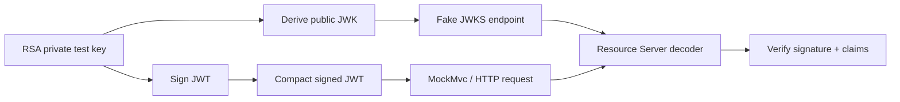

# Tạo bộ khóa kiểm thử và token có chữ ký với claims được kiểm soát

Khi kiểm thử tích hợp Spring Security OAuth 2.0 Resource Server, một chuỗi JWT tự ghép hoặc một Authentication được mock không đủ để chứng minh ứng dụng xác minh chữ ký đúng. Muốn kiểm tra trọn đường đi của Bearer token, test cần có **key pair kiểm thử, public JWKS tương ứng và JWT compact được ký thật**. Đồng thời, claims phải được kiểm soát để chủ động tạo token đúng, token sai issuer/audience, token hết hạn, token chưa tới thời điểm hiệu lực hoặc token thiếu scope.

Bộ fixture tốt cho phép test tái tạo cùng một tình huống mà không phụ thuộc Authorization Server production. Test tự tạo private signing key, chỉ công bố public key qua fake JWKS endpoint, ký JWT với claims theo từng case và gửi chính chuỗi token đó qua Authorization header tới MockMvc hoặc HTTP test server.

Bài này sử dụng Nimbus JOSE + JWT, thư viện nằm dưới Spring Security JWT support. Ví dụ chính dùng RSA với RS256; phần cuối đề cập EC/ES256, JWKS rotation, time control, claim profiles và cách phân biệt signed JWT với Spring Security test helpers.

> **Nguyên tắc:** Private test key chỉ dùng để ký trong test. Resource Server nhận public key từ JWKS và xác minh chữ ký. Không đưa private JWK, production signing key, access token thật hoặc client secret vào fixture, test logs hay repository.

## 1. Vì sao cần token được ký thật?

Có hai nhóm test thường bị gộp nhầm:

- **Authorization test:** kiểm tra endpoint cần scope/role nào, principal nào được truy cập. Có thể dùng jwt(), mockJwt() hoặc Authentication giả lập.
- **JWT integration test:** kiểm tra Bearer header, token parsing, signature, issuer, audience, thời gian hiệu lực và mapping claims. Cần gửi JWT compact được ký thật qua filter chain với decoder thật.

Ví dụ Spring Security Test:

```java
mockMvc.perform(get("/api/orders")
        .with(jwt().authorities(
            new SimpleGrantedAuthority("SCOPE_orders.read")
        )))
    .andExpect(status().isOk());
```

Đoạn test này có ích cho authorization, nhưng Authentication đã được tạo trong test. Nó không chứng minh BearerTokenAuthenticationFilter đã đọc một JWT compact, JwtDecoder đã tải JWKS hoặc chữ ký RS256 được kiểm tra.

Với JWT thật, request phải có:

```http
GET /api/orders HTTP/1.1
Host: api.example.test
Authorization: Bearer <SIGNED_JWT>
```

Sau đó Resource Server mới thực hiện quy trình:

1. Trích xuất Bearer token.
2. Parse JWT header và claims.
3. Tìm public key phù hợp theo kid trong trusted JWKS.
4. Kiểm tra chữ ký theo thuật toán được cho phép.
5. Kiểm tra issuer, audience và thời gian theo validators.
6. Chuyển claims thành JwtAuthenticationToken/authorities.
7. Áp dụng authorization rule.

## 2. Chọn thuật toán và kiểu khóa cho test

Với Resource Server dùng asymmetric signing, RSA/RS256 là lựa chọn fixture phổ biến:

- Authorization Server giữ private key để ký.
- Resource Server chỉ cần public key để xác minh.
- JWKS công bố public JWK.
- Private key không được gửi tới Resource Server.



Không dùng một secret HMAC chung làm fixture mặc định cho hệ thống production dùng RSA. Với HMAC, bên xác minh cũng giữ secret có thể ký token; điều đó làm thay đổi trust model.

### 2.1. Tạo RSA JWK bằng Nimbus

Nimbus JOSE + JWT có thể tạo RSA key trực tiếp:

```java
RSAKey signingKey = new RSAKeyGenerator(2048)
    .keyID("test-rsa-1")
    .keyUse(KeyUse.SIGNATURE)
    .algorithm(JWSAlgorithm.RS256)
    .generate();

RSAKey publicJwk = signingKey.toPublicJWK();
```

Imports:

```java
import com.nimbusds.jose.JWSAlgorithm;
import com.nimbusds.jose.jwk.KeyUse;
import com.nimbusds.jose.jwk.RSAKey;
import com.nimbusds.jose.jwk.gen.RSAKeyGenerator;
```

RSA 2048-bit là kích thước fixture thường dùng cho test RS256. Nếu hệ thống thực tế dùng key profile khác, test phải theo profile đó. Không hạ kích thước khóa production chỉ để test chạy nhanh.

### 2.2. Mỗi key cần kid riêng

Header JWT chứa kid để decoder chọn public key phù hợp từ JWKS:

```json
{
  "alg": "RS256",
  "kid": "test-rsa-1",
  "typ": "JWT"
}
```

kid là identifier trong key set, không phải bằng chứng xác thực. Chữ ký mới chứng minh token được tạo bởi private key tương ứng. Mỗi public key đang được công bố nên có kid duy nhất và ổn định trong thời gian key được sử dụng.

Không dùng lại cùng kid cho một key pair khác trong cùng JWKS. Nếu thay nội dung key nhưng giữ kid, cache và key selection có thể tạo hành vi khó đoán.

### 2.3. Chỉ công bố public JWK

JWKS test phải được tạo từ public projection:

```java
JWKSet publicJwkSet = new JWKSet(signingKey.toPublicJWK());
```

Public RSA JWK có các thành phần như kty, kid, use, alg, n và e. Private RSA JWK còn có các tham số nhạy cảm như d, p, q, dp, dq, qi và có thể oth.

Có thể kiểm tra fixture:

```java
assertThat(publicJwk.isPrivate()).isFalse();
assertThat(publicJwk.toJSONObject())
    .doesNotContainKeys("d", "p", "q", "dp", "dq", "qi", "oth");
```

JWK public được đưa lên fake JWKS endpoint. Private key ở lại trong test process để ký token. Không serialize toàn bộ signingKey thành JWKS response.

## 3. Tạo JWT compact với claims được kiểm soát

Một access token test nên mô tả đúng contract mà Resource Server mong đợi. Claims phổ biến:

| Claim | Mục đích | Ví dụ |
|---|---|---|
| iss | Issuer đã phát hành token | https://issuer.test |
| sub | Subject/principal | user-123 |
| aud | Resource Server được phép nhận token | orders-api |
| iat | Thời điểm token được phát hành | thời điểm hiện tại |
| nbf | Thời điểm token bắt đầu có hiệu lực | thời điểm hiện tại |
| exp | Thời điểm token hết hạn | hiện tại + 5 phút |
| jti | Token identifier | UUID |
| scope | OAuth scopes | orders.read orders.write |
| tenant_id | Tenant theo application contract | shop-a |
| client_id | OAuth client theo token profile | shop-web |

Không phải mọi claim đều bắt buộc trong mọi JWT profile. Test phải mô phỏng đúng token contract của issuer, đồng thời có các negative cases cho claim mà ứng dụng yêu cầu.

### 3.1. Helper ký JWT bằng RSA

Ví dụ một factory nhỏ:

```java
public final class TestJwtFactory {

    private final RSAKey signingKey;
    private final Clock clock;

    public TestJwtFactory(RSAKey signingKey, Clock clock) {
        this.signingKey = signingKey;
        this.clock = clock;
    }

    public String issue(
            String issuer,
            String subject,
            List<String> audiences,
            Set<String> scopes,
            Duration lifetime,
            Map<String, Object> extraClaims) throws JOSEException {

        Instant now = clock.instant();

        JWTClaimsSet.Builder claims =
            new JWTClaimsSet.Builder()
                .issuer(issuer)
                .subject(subject)
                .audience(audiences)
                .issueTime(Date.from(now))
                .notBeforeTime(Date.from(now))
                .expirationTime(
                    Date.from(now.plus(lifetime))
                )
                .jwtID(UUID.randomUUID().toString())
                .claim("scope", String.join(
                    " ",
                    new TreeSet<>(scopes)
                ));

        extraClaims.forEach(claims::claim);

        JWSHeader header = new JWSHeader.Builder(
                JWSAlgorithm.RS256
            )
            .keyID(signingKey.getKeyID())
            .type(JOSEObjectType.JWT)
            .build();

        SignedJWT jwt = new SignedJWT(header, claims.build());

        jwt.sign(new RSASSASigner(signingKey.toPrivateKey()));

        return jwt.serialize();
    }
}
```

Imports chính:

```java
import com.nimbusds.jose.JOSEException;
import com.nimbusds.jose.JOSEObjectType;
import com.nimbusds.jose.JWSAlgorithm;
import com.nimbusds.jose.JWSHeader;
import com.nimbusds.jose.crypto.RSASSASigner;
import com.nimbusds.jwt.JWTClaimsSet;
import com.nimbusds.jwt.SignedJWT;

import java.time.Clock;
import java.time.Duration;
import java.time.Instant;
import java.util.Date;
import java.util.List;
import java.util.Map;
import java.util.Set;
import java.util.TreeSet;
import java.util.UUID;
```

Các điểm đáng chú ý:

- Issuer, subject và audience được truyền vào theo từng test.
- Scopes được sắp xếp trước khi ghép thành chuỗi để output ổn định hơn.
- iat, nbf và exp được tính từ Clock.
- jti được tạo riêng cho từng token.
- Extra claims chỉ được dùng cho claims ứng dụng đã định nghĩa.
- Header alg và kid luôn khớp key dùng ký.
- Token được ký bằng private key và serialize thành compact JWS.

Đây là helper cho access token test theo profile minh họa. Nếu issuer dùng claim scp thay scope, tenant claim khác tên, hoặc header typ là at+jwt, điều chỉnh factory theo token profile thật.

### 3.2. Ví dụ phát hành token cho Orders API

```java
String token = jwtFactory.issue(
    "https://issuer.test",
    "user-123",
    List.of("orders-api"),
    Set.of("orders.read", "orders.write"),
    Duration.ofMinutes(5),
    Map.of("tenant_id", "shop-a")
);
```

Token sẽ có subject user-123, audience orders-api, hai scopes và tenant shop-a. Token được ký bằng private key tương ứng kid trong JWKS.

### 3.3. Không sửa JWT sau khi ký

JWT compact có ba phần:

```text
base64url(header).base64url(payload).base64url(signature)
```

Thay payload hoặc header sau khi ký sẽ làm chữ ký không còn hợp lệ. Nếu cần token sai audience, hãy ký một token mới với audience sai. Nếu cần token sai chữ ký, ký bằng key khác hoặc sửa một phần compact token sau khi tạo. Không sửa payload rồi vẫn kỳ vọng signature cũ hợp lệ.

## 4. Tạo JWKS JSON cho fake Authorization Server

JWKS là JSON Web Key Set, thường có dạng:

```json
{
  "keys": [
    {
      "kty": "RSA",
      "kid": "test-rsa-1",
      "use": "sig",
      "alg": "RS256",
      "n": "<PUBLIC_MODULUS>",
      "e": "AQAB"
    }
  ]
}
```

Tạo JSON từ public JWK:

```java
ObjectMapper mapper = new ObjectMapper();

String jwksJson = mapper.writeValueAsString(
    new JWKSet(signingKey.toPublicJWK()).toJSONObject()
);
```

Imports:

```java
import com.nimbusds.jose.jwk.JWKSet;
import com.fasterxml.jackson.databind.ObjectMapper;
```

Không tự tạo n/e bằng cách copy từ private key hoặc đưa private JWK lên endpoint. Hãy để Nimbus tạo public projection.

### 4.1. Fake JWKS endpoint bằng WireMock

Ví dụ:

```java
stubFor(get(urlEqualTo("/jwks"))
    .willReturn(aResponse()
        .withHeader("Content-Type", "application/json")
        .withBody(jwksJson)));
```

Fake server có thể chạy trên port động trong test. Cấu hình decoder trỏ tới URL mà test server cung cấp. Nếu dùng WireMock, MockWebServer hoặc embedded HTTP server khác, nguyên tắc giống nhau: response trả đúng JWKS public, có content type JSON và không yêu cầu kết nối tới identity provider thật.

### 4.2. Cấu hình decoder trỏ fake JWKS

Ví dụ Servlet Resource Server:

```java
@Bean
JwtDecoder jwtDecoder(
        @Value("${test.jwks-uri}") String jwksUri) {

    NimbusJwtDecoder decoder =
        NimbusJwtDecoder.withJwkSetUri(jwksUri)
            .jwsAlgorithm(SignatureAlgorithm.RS256)
            .build();

    decoder.setJwtValidator(
        JwtValidators.createDefaultWithIssuer(
            "https://issuer.test"
        )
    );

    return decoder;
}
```

Trong test context, property test.jwks-uri phải trỏ tới fake server. Không để test vô tình gọi JWKS production hoặc public internet.

### 4.3. Thêm audience validator

Issuer validation không tự thay thế audience validation. Nếu API yêu cầu orders-api, cấu hình validator cụ thể:

```java
OAuth2TokenValidator<Jwt> audienceValidator = jwt ->
    jwt.getAudience().contains("orders-api")
        ? OAuth2TokenValidatorResult.success()
        : OAuth2TokenValidatorResult.failure(
            new OAuth2Error(
                "invalid_token",
                "Required audience is missing",
                null
            )
        );

decoder.setJwtValidator(
    new DelegatingOAuth2TokenValidator<>(
        JwtValidators.createDefaultWithIssuer(
            "https://issuer.test"
        ),
        audienceValidator
    )
);
```

Imports:

```java
import org.springframework.security.oauth2.core.DelegatingOAuth2TokenValidator;
import org.springframework.security.oauth2.core.OAuth2Error;
import org.springframework.security.oauth2.core.OAuth2TokenValidator;
import org.springframework.security.oauth2.core.OAuth2TokenValidatorResult;
import org.springframework.security.oauth2.jwt.Jwt;
import org.springframework.security.oauth2.jwt.JwtDecoder;
import org.springframework.security.oauth2.jwt.JwtValidators;
import org.springframework.security.oauth2.jwt.NimbusJwtDecoder;
import org.springframework.security.oauth2.jose.jws.SignatureAlgorithm;
```

Với nhiều APIs, expected audience phải được cấu hình riêng cho từng Resource Server. Không dùng validator chấp nhận mọi audience chỉ để fixture dễ chạy.

## 5. Điều khiển thời gian trong test

Claims thời gian là nguyên nhân phổ biến khiến test chập chờn:

- exp: token không còn hợp lệ sau thời điểm này.
- nbf: token chưa được sử dụng trước thời điểm này.
- iat: thời điểm phát hành, hữu ích cho audit/profile validation.

Nên dùng Clock thay vì gọi Instant.now() rải rác trong helper. Khi test cần thời gian cố định, dùng Clock.fixed:

```java
Instant testNow = Instant.parse("2026-11-15T09:00:00Z");
Clock fixedClock = Clock.fixed(testNow, ZoneOffset.UTC);
```

Imports:

```java
import java.time.Clock;
import java.time.Instant;
import java.time.ZoneOffset;
```

Token factory và timestamp validator nên dùng cùng clock trong test deterministic. Spring Security JwtTimestampValidator hỗ trợ clock và clock skew:

```java
JwtTimestampValidator timestampValidator =
    new JwtTimestampValidator(Duration.ofSeconds(30));

timestampValidator.setClock(fixedClock);
```

Sau đó kết hợp timestamp validator với issuer/audience validators trong decoder. Nếu test ứng dụng dùng JwtValidators.createDefaultWithIssuer(), hãy xác định cách ứng dụng cấu hình clock; không để test phát token theo fixed clock nhưng decoder lại dùng system clock hiện tại khác xa.

### 5.1. Test token hợp lệ

```text
testNow = 10:00:00
iat     = 10:00:00
nbf     = 10:00:00
exp     = 10:05:00
request = 10:00:01
```

Token nằm trong validity window, nên timestamp validation có thể thành công.

### 5.2. Test token hết hạn

```text
testNow = 10:06:00
iat     = 10:00:00
nbf     = 10:00:00
exp     = 10:05:00
```

Token đã hết hạn. Với timestamp validator và clock được đồng bộ, decoder từ chối token.

### 5.3. Test token chưa tới nbf

```text
testNow = 10:00:00
nbf     = 10:02:00
exp     = 10:05:00
```

Token chưa có hiệu lực. Test phải xét clock skew được cấu hình; nếu nbf chỉ cách hiện tại vài giây và clock skew 30 giây, kết quả có thể vẫn được chấp nhận theo policy.

### 5.4. iat không tự động thay thế exp/nbf validation

Không giả định mọi validator mặc định đều từ chối iat ở tương lai. Nếu ứng dụng yêu cầu iat không được vượt quá một giới hạn, viết validator riêng và test rõ. Timestamp validator mặc định tập trung vào exp/nbf theo contract của Spring Security version.

## 6. Tạo fixture cho các claim khác nhau

Một factory nên cho phép thay đổi claims mà không phải viết lại logic ký. Có thể tạo các helper đặt tên theo mục đích:

```java
String validOrdersToken();
String tokenForWrongAudience();
String tokenFromUntrustedIssuer();
String expiredToken();
String tokenNotYetValid();
String tokenWithoutRequiredScope();
String tokenForAnotherTenant();
String tokenSignedByUnknownKey();
String tokenWithInvalidSignature();
```

Các helper này có thể gọi chung TestJwtFactory với input khác nhau.

### 6.1. Issuer

Token có iss phải khớp issuer được Resource Server tin cậy. Một token ký bởi cùng private key nhưng có issuer sai vẫn phải bị từ chối nếu issuer validator được cấu hình.

Đừng chỉ kiểm tra signature và bỏ issuer validation. Một key có thể được sử dụng trong nhiều issuer contexts; trust cần ràng buộc cả issuer và key source.

### 6.2. Audience

Token cho Orders API:

```json
{"aud": ["orders-api"]}
```

Token cho Payments API:

```json
{"aud": ["payments-api"]}
```

Nếu decoder của Orders API yêu cầu orders-api, token chỉ dành cho payments-api phải bị từ chối dù chữ ký hợp lệ.

### 6.3. Scope

Spring Security mặc định có thể chuyển claim scope dạng chuỗi phân tách bằng dấu cách thành authorities có prefix SCOPE_:

```json
{"scope": "orders.read orders.write"}
```

Ví dụ authorities:
- SCOPE_orders.read
- SCOPE_orders.write

Nếu ứng dụng dùng claim scp, roles hoặc custom JwtAuthenticationConverter, test phải tạo đúng schema và xác nhận mapping tương ứng. Không giả định mọi issuer đặt quyền ở cùng một claim.

### 6.4. Tenant và custom claims

```json
{
  "tenant_id": "shop-a",
  "roles": ["ORDER_MANAGER"],
  "department": "fulfillment"
}
```

Các claim tùy chỉnh chỉ có ý nghĩa nếu ứng dụng định nghĩa và validate chúng. Test tenant isolation nên tạo token shop-a và shop-b, sau đó gọi endpoint với resource thuộc từng tenant.

### 6.5. Subject và client identity

Token user có thể có sub=user-123. Token service có thể có subject/client identity theo profile của AS. Claim client_id hoặc azp không thay subject và không tự chứng minh service actor nếu contract không định nghĩa.

## 7. Kiểm soát JWT header

JWT header cũng cần được kiểm soát:

| Header | Ý nghĩa | Test cần xác nhận |
|---|---|---|
| alg | Thuật toán ký | Chỉ thuật toán được cấu hình mới được chấp nhận |
| kid | Chọn JWK | Phải tìm được key tin cậy |
| typ | Token type/profile | Khớp profile mà API chấp nhận nếu có validate |
| cty | Content type/nested JWT context | Chỉ dùng khi profile yêu cầu |

Ví dụ header RS256:

```java
JWSHeader header = new JWSHeader.Builder(JWSAlgorithm.RS256)
    .keyID(signingKey.getKeyID())
    .type(JOSEObjectType.JWT)
    .build();
```

Một số JWT access-token profile dùng typ=at+jwt theo RFC 9068. Nếu AS phát access token theo profile đó, fixture nên mô phỏng typ tương ứng và decoder/application có thể cần validator riêng. Không thay typ tùy ý rồi kết luận token vẫn đại diện cùng loại credential.

### 7.1. Không chấp nhận alg=none

Test negative case với unsigned JWT hoặc alg=none phải bảo đảm Resource Server không chấp nhận. Không tắt signature validation để đơn giản hóa fixture.

### 7.2. Algorithm allowlist

Nếu API chỉ tin RS256, cấu hình decoder chỉ chấp nhận RS256. Token được ký hợp lệ bằng HS256/ES256 vẫn phải bị từ chối nếu algorithm không nằm trong allowlist. Chữ ký đúng không có nghĩa thuật toán bất kỳ đều được tin.

### 7.3. Unknown kid

Tạo token ký bằng key B nhưng JWKS chỉ công bố public key A. Decoder không tìm được key tin cậy cho kid của token và phải từ chối. Không có fallback sang key bất kỳ hoặc bỏ qua signature.

## 8. Tạo token sai chữ ký một cách có chủ đích

Có hai cách tạo invalid signature:

**Cách 1: ký bằng key khác.** Tạo key pair B, nhưng fake JWKS chỉ công bố public key A. JWT có kid của B; decoder không thể xác minh bằng key được công bố.

**Cách 2: sửa signature sau khi ký.** Tạo JWT hợp lệ rồi thay một ký tự ở phần signature mà không ký lại. Header/payload vẫn parse được nhưng chữ ký không còn khớp.

Trong test, cách dùng key B với JWKS A thường rõ ràng hơn vì giữ compact token hợp lệ về cấu trúc. Nếu test parser riêng, có thể tạo chuỗi malformed khác.

Không dùng một token malformed để đại diện cho mọi loại failure. Parser error, unknown kid, bad signature, wrong issuer, wrong audience và expired token là các nhánh khác nhau.

## 9. Bộ key test cho nhiều issuer hoặc nhiều Resource Servers

Nếu ứng dụng tin nhiều issuers, mỗi issuer nên có JWKS/test key set riêng theo contract:

```text
issuer-A:
  jwks = /issuer-a/jwks
  key = issuer-a-test-key
  expected audience = orders-api

issuer-B:
  jwks = /issuer-b/jwks
  key = issuer-b-test-key
  expected audience = inventory-api
```

Test nên xác nhận:
- Token issuer-A không được xác thực bằng trust configuration của issuer-B.
- Token đúng signature nhưng sai issuer bị từ chối.
- Audience của API A không được tự động chấp nhận tại API B.
- Không có issuer fallback chỉ vì kid trùng nhau.

Không chỉ dùng kid để phân biệt issuers. kid không phải global identifier; trust context còn gồm issuer và JWKS URI.

## 10. Kiểm thử key rotation bằng hai key pair

Tạo key A và key B:

```java
RSAKey keyA = new RSAKeyGenerator(2048)
    .keyID("test-key-A")
    .keyUse(KeyUse.SIGNATURE)
    .algorithm(JWSAlgorithm.RS256)
    .generate();

RSAKey keyB = new RSAKeyGenerator(2048)
    .keyID("test-key-B")
    .keyUse(KeyUse.SIGNATURE)
    .algorithm(JWSAlgorithm.RS256)
    .generate();
```

Tạo JWT A ký bằng private key A, JWT B ký bằng private key B. Fake JWKS có thể chuyển qua các giai đoạn:

```text
Phase 1: JWKS = [public A]
  token A -> accepted
  token B -> rejected (unknown kid)

Phase 2: JWKS = [public A, public B]
  token A -> accepted
  token B -> accepted after decoder obtains B

Phase 3: JWKS = [public B]
  token B -> accepted
  token A -> rejected after decoder refreshes its JWK cache
```

### 10.1. JWKS rotation không đồng nghĩa cache refresh tức thì

Decoder có thể cache JWK set. Khi fake JWKS bỏ key A, decoder đang chạy có thể vẫn giữ public key A cho tới khi cache refresh/expire hoặc refresh trigger được kích hoạt.

Vì vậy:
- Test tạo decoder mới với JWKS chỉ có B chứng minh decoder mới từ chối token A.
- Test cùng decoder sau cache refresh chứng minh behavior của cache lifecycle.
- Test nhiều decoder instances chứng minh propagation giữa các instance.

Không dùng decoder mới rồi tuyên bố đã kiểm tra cache refresh của decoder cũ.

### 10.2. Kiểm tra public JWKS không lộ private material trong mỗi phase

Khi tạo JWKS A+B, hãy đưa public projection của cả hai key:

```java
JWKSet jwks = new JWKSet(List.of(
    keyA.toPublicJWK(),
    keyB.toPublicJWK()
));
```

Không đưa keyA/keyB đầy đủ vào JWKSet. Private signing keys chỉ được giữ trong test factory.

## 11. Tạo EC key và ký ES256

Nếu Resource Server production dùng EC/ES256, test nên tạo EC key pair thay vì chỉ test RSA.

```java
ECKey ecSigningKey = new ECKeyGenerator(Curve.P_256)
    .keyID("test-ec-1")
    .keyUse(KeyUse.SIGNATURE)
    .algorithm(JWSAlgorithm.ES256)
    .generate();

ECKey ecPublicJwk = ecSigningKey.toPublicJWK();
```

Imports:

```java
import com.nimbusds.jose.jwk.Curve;
import com.nimbusds.jose.jwk.ECKey;
import com.nimbusds.jose.jwk.gen.ECKeyGenerator;
```

Ký:

```java
SignedJWT jwt = new SignedJWT(
    new JWSHeader.Builder(JWSAlgorithm.ES256)
        .keyID(ecSigningKey.getKeyID())
        .type(JOSEObjectType.JWT)
        .build(),
    claims
);

jwt.sign(new ECDSASigner(ecSigningKey.toECPrivateKey()));

String compact = jwt.serialize();
```

Imports:

```java
import com.nimbusds.jose.crypto.ECDSASigner;
```

Resource Server phải được cấu hình để tin ES256 nếu test muốn chấp nhận token này. Nếu chỉ RS256 được allowlist, token ES256 cần bị từ chối dù signature đúng.

Không trộn test key type và algorithm tùy tiện. RSA key dùng RS256; EC P-256 dùng ES256 theo profile tương ứng.

## 12. Dependencies và phiên bản thư viện

Nimbus JOSE + JWT thường đã xuất hiện gián tiếp qua Spring Security OAuth2 JOSE trong ứng dụng Resource Server. Nếu test source trực tiếp import Nimbus APIs, khai báo test dependency rõ ràng để build không phụ thuộc tình cờ vào transitive compile classpath.

Ví dụ Gradle:

```gradle
dependencies {
    implementation("org.springframework.boot:spring-boot-starter-oauth2-resource-server")

    testImplementation("com.nimbusds:nimbus-jose-jwt")
    testImplementation("org.springframework.boot:spring-boot-starter-test")
    testImplementation("org.springframework.security:spring-security-test")
}
```

Quản lý version theo Spring Boot dependency management/BOM hoặc version catalog của project. Không copy version ngẫu nhiên vào build file nếu project đã quản lý tập trung.

Các API Nimbus có thể khác nhẹ giữa versions. Dùng dependency version mà project đã khóa và compile test fixture trên version đó.

## 13. Test JWT thật qua MockMvc

Một integration test cần:
- Spring Security filter chain thật.
- Resource Server config thật.
- JwtDecoder thật trỏ fake JWKS.
- RSA test key pair.
- JWT compact ký thật.
- MockMvc gửi Authorization header.

Ví dụ:

```java
@SpringBootTest
@AutoConfigureMockMvc
class SignedJwtResourceServerTests {

    @Autowired
    MockMvc mockMvc;

    @Autowired
    TestJwtFactory jwtFactory;

    @Test
    void acceptsSignedTokenForOrdersAudience() throws Exception {
        String token = jwtFactory.issue(
            "https://issuer.test",
            "user-123",
            List.of("orders-api"),
            Set.of("orders.read"),
            Duration.ofMinutes(5),
            Map.of()
        );

        mockMvc.perform(get("/api/orders")
                .header(
                    HttpHeaders.AUTHORIZATION,
                    "Bearer " + token
                ))
            .andExpect(status().isOk());
    }
}
```

Đây là cấu trúc minh họa. Test factory, fake JWKS server và test properties phải được đăng ký trong test context. Nếu endpoint cần database fixture, tạo resource tương ứng để test không thất bại vì business layer trước khi security assertion hoàn tất.

### 13.1. Wrong audience

```java
@Test
void rejectsTokenForAnotherAudience() throws Exception {
    String token = jwtFactory.issue(
        "https://issuer.test",
        "user-123",
        List.of("payments-api"),
        Set.of("orders.read"),
        Duration.ofMinutes(5),
        Map.of()
    );

    mockMvc.perform(get("/api/orders")
            .header(
                HttpHeaders.AUTHORIZATION,
                "Bearer " + token
            ))
        .andExpect(status().isUnauthorized());
}
```

Nếu audience validator của Orders API yêu cầu orders-api, token trên bị từ chối ở authentication. Status thường là 401.

### 13.2. Wrong issuer

Ký bằng key test đã được JWKS tin cậy nhưng dùng issuer khác:

```java
String token = jwtFactory.issue(
    "https://untrusted-issuer.test",
    "user-123",
    List.of("orders-api"),
    Set.of("orders.read"),
    Duration.ofMinutes(5),
    Map.of()
);
```

Issuer validator phải từ chối token. Điều này chứng minh trust không chỉ dựa vào việc signature dùng đúng public key.

### 13.3. Expired token

```java
String token = jwtFactory.issue(
    ISSUER,
    "user-123",
    List.of("orders-api"),
    Set.of("orders.read"),
    Duration.ofSeconds(-60),
    Map.of()
);
```

Nếu factory cho phép lifetime âm, token sẽ có exp trong quá khứ. Có thể tạo helper expiredToken() rõ ràng hơn để tránh truyền duration âm trong test. Decoder phải từ chối theo timestamp validator.

### 13.4. Valid token nhưng thiếu scope

Token vẫn có issuer, audience, signature và time hợp lệ, nhưng chỉ có orders.profile:

```java
String token = jwtFactory.issue(
    ISSUER,
    "user-123",
    List.of("orders-api"),
    Set.of("orders.profile"),
    Duration.ofMinutes(5),
    Map.of()
);
```

Nếu endpoint yêu cầu SCOPE_orders.read, authentication thành công nhưng authorization bị từ chối. Với cấu hình phổ biến, response là 403. Đây là test phân biệt invalid token với insufficient authority.

## 14. Kiểm thử Bearer header với WebTestClient

Với WebFlux, nguyên tắc không đổi: gửi compact JWT thực qua Authorization header và cấu hình ReactiveJwtDecoder trỏ tới fake JWKS.

```java
webTestClient.get()
    .uri("/api/orders")
    .headers(headers ->
        headers.setBearerAuth(signedToken)
    )
    .exchange()
    .expectStatus().isOk();
```

Không gọi mutateWith(mockJwt()) trong test chữ ký/JWKS. Helper đó tạo Authentication giả lập và bỏ qua reactive decoder.

Nếu cần kiểm tra reactive JWT validator với fixed clock, dùng ReactiveJwtDecoder/validator tương ứng và đảm bảo clock được cấu hình cùng test time.

## 15. Test helper và integration test chứng minh điều gì?

| Test approach | Có thể chứng minh | Không chứng minh |
|---|---|---|
| jwt()/mockJwt() | Authorization rules với Authentication giả lập | Compact token signature/JWKS |
| @WithMockUser | Role/authority access rules | Bearer parsing/JWT validation |
| Mock JwtDecoder | Filter trích token, gọi decoder và xử lý decoder result | Cryptographic signature |
| Signed JWT + real decoder | Signature, key lookup, issuer/audience/time validators | Production AS availability |
| Fake JWKS HTTP endpoint | JWK retrieval, kid selection, decoder integration | Provider production behavior |
| Full test AS + Resource Server | Token issuance/validation theo contract test | Mọi production network/cache topology |

Một test suite nên kết hợp các tầng phù hợp, không dùng một test mock để kết luận toàn bộ OAuth flow.

## 16. Test matrix cho bộ key và token

| Case | Key/JWKS | Claims/header | Expected |
|---|---|---|---|
| Valid token | Public key A có trong JWKS | issuer/audience/time/scope hợp lệ | 200 nếu endpoint cho phép |
| Wrong signature | JWKS A, token ký bằng B | Claims khác đều hợp lệ | 401 |
| Unknown kid | JWKS A, token kid B | Token ký bằng B | 401 |
| Wrong issuer | Public key A trusted | iss sai | 401 |
| Wrong audience | Public key A trusted | aud không có API hiện tại | 401 |
| Expired | Public key A trusted | exp ở quá khứ | 401 |
| Future nbf | Public key A trusted | nbf vượt clock skew | 401 |
| Missing scope | Public key A trusted | Token valid, thiếu authority | 403 trên protected endpoint |
| Wrong tenant | Public key A trusted | tenant claim khác resource tenant | 403/404 theo policy |
| Unsupported algorithm | JWKS key/decoder allowlist không khớp | alg không được phép | 401 |
| Unsigned JWT | Không có signature tin cậy | alg=none | 401 |
| Rotated key | JWKS A+B | Token A và B | Cả hai hợp lệ trong overlap |
| Old key removed | JWKS chỉ còn B sau refresh | Token A | 401 sau cache refresh |
| Wrong typ/profile | Signature hợp lệ | typ không đúng profile nếu validator yêu cầu | Từ chối theo profile |
| Missing required claim | Signature hợp lệ | Thiếu claim bắt buộc | Từ chối nếu validator/policy yêu cầu |

Status 401/403/404 có thể thay đổi theo exception mapping và anti-enumeration policy. Điều quan trọng là test xác định đúng tầng từ chối.

## 17. Access token, ID token và profile claims

Không phải JWT nào do OIDC provider phát hành cũng là access token dành cho API.

- **ID token:** được phát hành cho OIDC client, mô tả authentication event và client audience.
- **Access token:** credential để gọi resource server, có audience/scope theo API contract.
- **Refresh token:** credential dùng với AS để xin access token mới, không gửi tới business API.

Một ID token có sub, email, aud và chữ ký hợp lệ vẫn không tự trở thành access token cho Orders API.

Nếu test cần OIDC ID token, tạo fixture riêng với claims như iss, sub, aud của client, exp, iat, nonce và các claim theo OIDC profile. Không tái sử dụng access-token factory rồi chỉ đổi claim audience.

### 17.1. JWT access token profile

Một số hệ thống tuân theo RFC 9068 và dùng typ=at+jwt cùng claims profile. Các hệ thống khác có access-token profile riêng. Fixture nên phản ánh đúng AS contract và validator đang chạy.

Không thêm typ=at+jwt vào mọi token chỉ vì đây là access token nếu issuer thực tế dùng profile khác và downstream không hỗ trợ.

## 18. Quản lý private key test an toàn

Test key có thể được tạo mới khi test suite khởi động:

- Dùng key pair riêng cho mỗi test class hoặc test suite.
- Không dùng production private key.
- Không lưu private JWK vào golden fixture nếu không cần thiết.
- Không in private key, signed token hoặc Authorization header ra logs.
- Public JWKS có thể xuất hiện trong fake server response.
- Hủy/giải phóng tài nguyên test server sau test.
- Không tái sử dụng private test key như credential của môi trường staging/production.

Tạo key mỗi test run làm fixture không phụ thuộc file key được chia sẻ, nhưng không nhất thiết cần tạo key mới cho từng test method. Có thể tạo một key per test class và cấp nhiều JWT với claims khác nhau.

### 18.1. Không nhầm test key với secret

Private key test vẫn là private key. Dù không có quyền production, không nên đưa nó vào public JWKS hoặc logs. Nếu cần lưu test key cố định để kiểm thử compatibility, đặt trong test resources, giới hạn phạm vi sử dụng và đánh dấu rõ không dùng ngoài test.

### 18.2. Không đưa token vào assertion message

Tránh assertion failure hiển thị toàn bộ JWT. Log token có thể làm lộ credential trong CI artifact. Assert status, claim, kid hoặc hash/digest an toàn thay vì raw token.

## 19. Những lỗi thường gặp khi tạo JWT test

1. **Dùng jwt() để kiểm tra chữ ký.** Authentication giả lập bỏ qua decoder.
2. **JWKS chứa private key.** Fake server vô tình công bố toàn bộ JWK thay vì public projection.
3. **kid không khớp.** Token header dùng kid khác với key trong JWKS.
4. **alg không khớp key/decoder.** Token ký RS256 nhưng decoder chỉ allow ES256 hoặc ngược lại.
5. **Audience không đúng API.** Token signature hợp lệ nhưng Resource Server từ chối đúng theo contract.
6. **Issuer không khớp.** Dùng issuer production/test khác nhau giữa token và decoder.
7. **Token hết hạn do test chạy chậm.** Tạo lifetime quá ngắn hoặc dùng thời gian cố định không đồng bộ.
8. **Clock skew bị bỏ qua.** Token ở biên nbf/exp có kết quả khác dự kiến.
9. **Scope claim sai format.** App mong scope string nhưng fixture gửi array/roles khác.
10. **Sửa payload sau khi ký.** Signature trở nên invalid.
11. **Dùng cùng kid cho nhiều key.** Key selection/cache khó đoán.
12. **Không test unknown kid.** Decoder có thể gặp key lookup failure khi rotation.
13. **Chỉ test decoder trực tiếp.** Không kiểm tra Bearer filter/HTTP chain.
14. **Chỉ test filter với decoder mock.** Không kiểm tra cryptographic validation.
15. **Dùng ID token cho API.** Sai token purpose/audience.
16. **Đưa private key vào logs/CI artifacts.** Credential test vẫn cần được bảo vệ.
17. **Giả định JWKS refresh tức thì.** Cache của decoder có thể giữ key cũ.

## 20. Quy trình tạo fixture cho một test suite

**Bước 1 — Đọc token contract.** Xác định issuer, audience, algorithm, kid, token type, required claims và scope format.

**Bước 2 — Tạo key pair.** Dùng RSA 2048/RS256 hoặc EC P-256/ES256 theo cấu hình Resource Server.

**Bước 3 — Tạo public JWKS.** Chỉ xuất public JWK và xác nhận không có private parameters.

**Bước 4 — Khởi động fake JWKS endpoint.** Trỏ decoder tới test server, không tới AS production.

**Bước 5 — Tạo JWT factory.** Điều khiển iss, sub, aud, iat, nbf, exp, jti, scope và custom claims.

**Bước 6 — Đồng bộ Clock.** Token factory và timestamp validator dùng cùng test clock nếu test thời gian cố định.

**Bước 7 — Tạo positive/negative fixtures.** Valid, wrong issuer, wrong audience, expired, future nbf, missing scope, unknown kid và invalid signature.

**Bước 8 — Gửi token thật qua HTTP.** Dùng MockMvc hoặc WebTestClient với Authorization Bearer header.

**Bước 9 — Test key rotation.** Publish A, publish A+B, remove A và quan sát cache refresh.

**Bước 10 — Giữ mock authorization tests riêng.** jwt()/mockJwt() dùng để kiểm tra access rules nhanh; không dùng làm bằng chứng signature validation.

## 21. Tài liệu tham khảo

- [Spring Security Reference — JWT Resource Server](https://docs.spring.io/spring-security/reference/servlet/oauth2/resource-server/jwt.html): decoder, JWKS, issuer và JWT validation.
- [Spring Security Reference — Testing OAuth 2.0](https://docs.spring.io/spring-security/reference/servlet/test/index.html): test support cho MockMvc và Resource Server.
- [Spring Security Reference — MockMvc OAuth2](https://docs.spring.io/spring-security/reference/servlet/test/mockmvc/oauth2.html): jwt() và các request post-processors.
- [Nimbus JOSE + JWT](https://connect2id.com/products/nimbus-jose-jwt): JWK, JWKSet, SignedJWT, signer và verifier APIs.
- [RFC 7515 — JSON Web Signature](https://www.rfc-editor.org/rfc/rfc7515): JWS compact serialization và chữ ký.
- [RFC 7517 — JSON Web Key](https://www.rfc-editor.org/rfc/rfc7517): JWK/JWKS và public key representation.
- [RFC 7519 — JSON Web Token](https://www.rfc-editor.org/rfc/rfc7519): registered claims như iss, sub, aud, exp, nbf, iat và jti.
- [RFC 8725 — JSON Web Token Best Current Practices](https://www.rfc-editor.org/rfc/rfc8725): algorithm verification, issuer/audience và cross-JWT confusion.
- [RFC 9068 — JWT Profile for OAuth 2.0 Access Tokens](https://www.rfc-editor.org/rfc/rfc9068): access token JWT profile và typ=at+jwt.
- [RFC 7518 — JSON Web Algorithms](https://www.rfc-editor.org/rfc/rfc7518): RS256, ES256 và thuật toán JWS.

**Kết luận:** Một test JWT integration đáng tin cậy cần private test key để ký, public-only JWKS để Resource Server xác minh và claims được tạo có kiểm soát theo token contract. Hãy giữ riêng các test chữ ký/issuer/audience/time với test authorization dùng mock Authentication. Tạo positive và negative tokens bằng cùng factory, điều khiển thời gian qua Clock, kiểm tra kid/algorithm và gửi JWT compact thật qua MockMvc hoặc WebTestClient. **Không công bố private key, không sửa payload sau khi ký và không dùng ID token thay access token cho API.**
