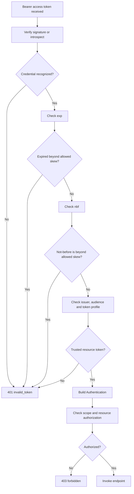

# Token hết hạn, chưa có hiệu lực và ranh giới clock skew

## 1. Mục tiêu: kiểm soát thời gian của access token

JWT access token thường chứa các claim thời gian như `iat`, `nbf` và `exp`. Resource Server (RS) so sánh những timestamp này với clock hiện tại để quyết định token đã được phát hành, đã tới thời điểm được phép sử dụng và còn trong thời hạn hay không.

Ví dụ:

```json
{
  "iss": "https://auth.example.test/realms/orders",
  "sub": "alice-123",
  "aud": ["orders-api"],
  "scope": "orders:read",
  "iat": 1890000000,
  "nbf": 1890000000,
  "exp": 1890003600
}
```

Nếu đồng hồ Authorization Server (AS) và RS lệch nhau, token vừa được cấp có thể bị từ chối vì `nbf` nằm trong tương lai theo clock của RS. Ngược lại, token đã hết hạn theo AS có thể vẫn được chấp nhận nếu clock RS chậm.

Spring Security hỗ trợ **clock skew** — một khoảng dung sai thời gian — khi xác minh timestamp của JWT. Dung sai giúp chịu được sai lệch đồng hồ nhỏ. Nếu cấu hình quá lớn, token có thể được chấp nhận lâu hơn thời hạn dự kiến hoặc sớm hơn thời điểm được phép.

Bài học thuộc chương **Kiểm chứng tích hợp** của mô-đun **Spring Security OAuth 2.0 OIDC Resource Server**. Nội dung tập trung vào semantics của `exp`, `nbf`, `iat`; cách `JwtTimestampValidator` hoạt động; cấu hình clock skew; kiểm thử biên thời gian có tính xác định; và phân biệt lỗi timestamp với lỗi issuer, audience hoặc signature.

> **Nguyên tắc quan trọng:** Clock skew chỉ là dung sai cho chênh lệch đồng hồ. Nó không thay thế đồng bộ thời gian và không nên được dùng để che lỗi cấu hình clock.

---

## 2. Ba claim thời gian cần phân biệt

| Claim | Tên | Ý nghĩa |
|---|---|---|
| `iat` | Issued At | Thời điểm token được phát hành. |
| `nbf` | Not Before | Token không được chấp nhận trước thời điểm này. |
| `exp` | Expiration Time | Token không được chấp nhận tại hoặc sau thời điểm hết hạn, có thể áp dụng leeway nhỏ cho clock skew. |

Các giá trị NumericDate biểu diễn số giây kể từ Unix epoch `1970-01-01T00:00:00Z`, không phải milliseconds.

### 2.1. Issued At — iat

`iat` cho biết token được phát hành khi nào. Claim này hữu ích cho audit, age policy và một số quy tắc phát hiện token bất thường.

`iat` **không tự động có nghĩa token chỉ được dùng sau đúng thời điểm đó**. Claim xác định thời điểm phát hành; `nbf` mới là claim chuyên biệt biểu diễn thời điểm bắt đầu có hiệu lực.

Nếu ứng dụng muốn từ chối token có `iat` nằm quá xa trong tương lai so với đồng hồ RS, cần định nghĩa validator riêng. Không mặc định rằng kiểm tra `exp` và `nbf` cũng đã kiểm tra `iat`.

### 2.2. Not Before — nbf

```json
{
  "iat": 1890000000,
  "nbf": 1890000060,
  "exp": 1890003600
}
```

Token được phát hành lúc `iat`, nhưng chỉ được phép sử dụng từ `nbf`. Trong khoảng giữa hai thời điểm, token tồn tại và có chữ ký hợp lệ nhưng chưa được phép sử dụng theo policy.

Một token có thể bị từ chối với lỗi not-yet-valid nếu RS kiểm tra trước `nbf` và clock skew không đủ dung nạp chênh lệch.

### 2.3. Expiration Time — exp

```json
{
  "iat": 1890000000,
  "nbf": 1890000000,
  "exp": 1890003600
}
```

Sau thời điểm hết hạn, token không còn được chấp nhận. `exp` là mốc thời gian tuyệt đối, không phải TTL tính từ lúc RS nhận request. Client không thể kéo dài token bằng cách gửi lại nó.

### 2.4. iat không thay thế nbf

```json
{
  "iat": 1890000300,
  "nbf": 1890000000,
  "exp": 1890003600
}
```

`iat` nằm trong tương lai nhưng `nbf` đã có hiệu lực. Theo semantics của hai claim, `nbf` không cấm sử dụng token ở thời điểm hiện tại. Tuy nhiên, `iat` tương lai có thể cho thấy:

- Đồng hồ AS chạy nhanh.
- Token được tạo sai.
- Issuer không tuân thủ profile của hệ thống.
- Token có timestamp bị thao túng hoặc có nguồn không đáng tin.

Nếu policy yêu cầu `iat` không vượt quá thời điểm hiện tại cộng một dung sai nhỏ, phải thêm validator cho `iat`. Đừng gán nhầm hành vi đó cho `JwtTimestampValidator` mặc định.

---

## 3. Quy tắc thời gian theo JWT

RFC 7519 mô tả semantics cơ bản:

- Nếu có `exp`, current date/time phải đứng trước `exp`; sau thời điểm đó token không được chấp nhận.
- Nếu có `nbf`, current date/time phải bằng hoặc sau `nbf` để token được chấp nhận.
- `iat` xác định thời điểm phát hành.
- Hệ thống có thể cho phép một khoảng leeway nhỏ để xử lý clock skew.

Cửa sổ hợp lệ khi chưa xét các claim/profile khác:

```text
             Token chưa có hiệu lực          Token được chấp nhận       Token hết hạn
Time  ------------------------------------------------|====================|-------->
                                                     nbf                  exp
```

Với clock skew `S`, vùng thời gian chấp nhận có thể mở rộng ở hai đầu:

```text
         nbf - S                 nbf                  exp             exp + S
------------|--------------------|====================|----------------|-------->
         early tolerance          nominal validity      late tolerance
```

Đây là cách diễn giải khái niệm. Khi cần quyết định tại đúng ranh giới, hãy dùng hành vi cụ thể của validator và version Spring Security đang chạy. Không tự viết phép so sánh khác rồi giả định nó giống framework.

### 3.1. Leeway không sửa timestamp trong JWT

Nếu token có `exp=1890003600`, validator không sửa claim thành một giá trị muộn hơn. Nó chỉ áp dụng tolerance khi so sánh timestamp với clock hiện tại.

JWT gửi tới downstream vẫn có cùng `exp`. Một service khác với clock skew nhỏ hơn có thể từ chối token mà service đầu tiên vừa chấp nhận. Vì vậy các Resource Servers cần policy thời gian tương thích.

### 3.2. Clock skew không phải token lifetime extension tại AS

AS vẫn nên cấp access token với lifetime phù hợp. Clock skew là tolerance tại validator, không phải cách để AS cấp token 5 phút nhưng ngầm cho phép mọi nơi dùng thêm 10 phút.

### 3.3. Token profile có thể yêu cầu claim bắt buộc

JWT nói chung cho phép nhiều registered claims là tùy chọn. Một access-token profile cụ thể có thể yêu cầu `exp`, `iat`, `iss`, `aud` hoặc claims khác.

RFC 9068 định nghĩa JWT Profile cho OAuth 2.0 Access Tokens với yêu cầu claim riêng. Cần phân biệt:

- JWT syntax cho phép claim vắng mặt.
- Access-token profile có thể yêu cầu claim đó.
- Spring timestamp validator chỉ kiểm tra timestamp khi claim tương ứng có mặt; nó không tự thay thế toàn bộ profile validation.

Nếu hệ thống yêu cầu mọi access token phải có `exp`, hãy enforce sự hiện diện của claim bằng profile validator riêng hoặc bảo đảm AS phát hành đúng contract.

---

## 4. Clock skew là gì?

Clock skew là độ lệch giữa các đồng hồ được dùng để phát hành và xác minh token.

| Thành phần | Đồng hồ | Sai lệch |
|---|---|---:|
| Authorization Server | 10:00:00 | Đúng |
| Resource Server A | 09:59:40 | Chậm 20 giây |
| Resource Server B | 10:00:25 | Nhanh 25 giây |

AS phát token với:

```text
nbf = 10:00:00
exp = 10:10:00
```

RS A nhận token lúc thực tế 10:00:05 nhưng đồng hồ của nó chỉ là 09:59:45. Không có tolerance, token có thể bị coi là chưa tới `nbf`.

RS B nhận token lúc thực tế 10:09:50 nhưng đồng hồ của nó là 10:10:15. Không có tolerance, token có thể bị coi là đã hết hạn dù theo đồng hồ AS vẫn còn 10 giây.

### 4.1. Nguồn gây clock skew

Sai lệch đồng hồ có thể đến từ:

- VM hoặc container host không đồng bộ thời gian.
- NTP/chrony service bị dừng hoặc cấu hình sai.
- Node mới khởi động chưa đồng bộ clock.
- Virtual machine bị suspend/resume.
- Một region có time source hoặc network path khác.
- Hệ thống dùng clock ảo trong test nhưng component khác dùng system clock.
- Đồng hồ trong môi trường developer khác với đồng hồ CI.
- AS và RS chạy trên các nền tảng có cấu hình time synchronization khác nhau.

Container thường dùng clock của host kernel. Không nên cho rằng mỗi container có một đồng hồ độc lập được tự động đồng bộ riêng.

### 4.2. Đồng bộ thời gian vẫn là biện pháp chính

Production systems nên:

- Đồng bộ host clock bằng NTP/chrony hoặc dịch vụ time synchronization được tổ chức hỗ trợ.
- Theo dõi clock offset và synchronization status.
- Cảnh báo khi offset vượt ngưỡng.
- Giữ timezone UTC cho hệ thống và log.
- Tránh chỉnh đồng hồ thủ công trong lúc service đang xử lý token.
- Kiểm tra time synchronization ở mọi region/node.
- Dùng clock injection trong tests thay vì chờ thời gian thực.

Clock skew trong validator là lớp dung sai bổ sung, không phải biện pháp thay cho đồng bộ đồng hồ.

---

## 5. JwtTimestampValidator trong Spring Security

Spring Security dùng `JwtTimestampValidator` để kiểm tra timestamp của JWT. Validator này kiểm tra `exp` và `nbf` nếu các claim có mặt.

Trong Spring Security 6.x, `JwtTimestampValidator` có clock skew mặc định 60 giây. Có thể cấu hình khoảng dung sai bằng constructor hoặc setter tùy API của version:

```java
JwtTimestampValidator timestampValidator =
    new JwtTimestampValidator(Duration.ofSeconds(30));
```

Ở đây validator chấp nhận một khoảng dung sai 30 giây cho timestamp checks. Chọn con số theo clock offset đo được và security requirements của hệ thống.

### 5.1. Hành vi ở mức khái niệm

Với clock skew `S`:

- Token bị coi là expired khi đồng hồ validator vượt quá `exp` sau khi tính tolerance.
- Token bị coi là not-yet-valid khi `nbf` còn nằm ngoài tolerance về phía tương lai.
- Token trong vùng tolerance có thể được chấp nhận.
- `iat` không được kiểm tra như một điều kiện thời gian bắt buộc bởi timestamp validator này.

Ở implementation hiện tại, phép so sánh tại đúng ranh giới dùng các điều kiện strict comparison; vì vậy equality có thể được xử lý khác với thời điểm vượt qua ranh giới. Khi viết security regression test, hãy cố định clock và kiểm tra đúng version đang dùng thay vì dựa vào một phép tính nhẩm.

### 5.2. Validator mặc định khi dùng issuer

Một cách cấu hình decoder phổ biến là dùng `JwtValidators.createDefaultWithIssuer(issuer)`. Validator mặc định này bao gồm timestamp validation và issuer validation theo behavior của Spring Security version tương ứng.

```java
NimbusJwtDecoder decoder =
    NimbusJwtDecoder.withJwkSetUri(jwkSetUri).build();

decoder.setJwtValidator(
    JwtValidators.createDefaultWithIssuer(issuer)
);
```

Cách này dùng validator mặc định, trong đó clock skew mặc định của timestamp validator được áp dụng.

### 5.3. Khi cần custom clock skew

Nếu cần cấu hình skew khác default, hãy tạo validator tường minh và kết hợp các validators mà ứng dụng cần:

```java
@Bean
JwtDecoder jwtDecoder() {
    NimbusJwtDecoder decoder =
        NimbusJwtDecoder.withJwkSetUri(
            "https://auth.example.test/realms/orders/protocol/openid-connect/certs"
        ).build();

    JwtTimestampValidator timestampValidator =
        new JwtTimestampValidator(Duration.ofSeconds(30));

    OAuth2TokenValidator<Jwt> issuerValidator =
        new JwtIssuerValidator(
            "https://auth.example.test/realms/orders"
        );

    OAuth2TokenValidator<Jwt> audienceValidator = jwt -> {
        if (jwt.getAudience().contains("orders-api")) {
            return OAuth2TokenValidatorResult.success();
        }

        OAuth2Error error = new OAuth2Error(
            "invalid_token",
            "Required audience orders-api is missing",
            null
        );

        return OAuth2TokenValidatorResult.failure(error);
    };

    decoder.setJwtValidator(
        new DelegatingOAuth2TokenValidator<>(
            timestampValidator,
            issuerValidator,
            audienceValidator
        )
    );

    return decoder;
}
```

Imports chính:

```java
import java.time.Duration;

import org.springframework.context.annotation.Bean;
import org.springframework.security.oauth2.core.OAuth2Error;
import org.springframework.security.oauth2.core.OAuth2TokenValidator;
import org.springframework.security.oauth2.core.OAuth2TokenValidatorResult;
import org.springframework.security.oauth2.jwt.DelegatingOAuth2TokenValidator;
import org.springframework.security.oauth2.jwt.Jwt;
import org.springframework.security.oauth2.jwt.JwtDecoder;
import org.springframework.security.oauth2.jwt.JwtIssuerValidator;
import org.springframework.security.oauth2.jwt.JwtTimestampValidator;
import org.springframework.security.oauth2.jwt.NimbusJwtDecoder;
```

Nếu dự án dùng `JwtValidators.createDefaultWithIssuer(...)` và muốn thay riêng skew, có thể tự tạo `JwtTimestampValidator` rồi kết hợp với issuer validator và các validator khác mà ứng dụng đang yêu cầu.

**Lưu ý:** Khi tự gọi `decoder.setJwtValidator(...)`, bạn đang thay bộ validator được decoder sử dụng. Đừng vô tình bỏ issuer, audience hoặc custom access-token profile validators chỉ vì muốn đổi clock skew.

### 5.4. Thêm validator cho iat nếu policy yêu cầu

`JwtTimestampValidator` tập trung vào `exp` và `nbf`. Nếu hệ thống yêu cầu từ chối `iat` nằm quá xa trong tương lai, có thể viết validator riêng:

```java
public final class IssuedAtValidator
        implements OAuth2TokenValidator<Jwt> {

    private final Clock clock;
    private final Duration allowedFutureSkew;

    public IssuedAtValidator(
            Clock clock,
            Duration allowedFutureSkew) {
        this.clock = clock;
        this.allowedFutureSkew = allowedFutureSkew;
    }

    @Override
    public OAuth2TokenValidatorResult validate(Jwt jwt) {
        Instant issuedAt = jwt.getIssuedAt();

        if (issuedAt == null) {
            return failure("Required iat claim is missing");
        }

        Instant latestAllowed =
            clock.instant().plus(allowedFutureSkew);

        if (issuedAt.isAfter(latestAllowed)) {
            return failure("iat is too far in the future");
        }

        return OAuth2TokenValidatorResult.success();
    }

    private OAuth2TokenValidatorResult failure(String description) {
        return OAuth2TokenValidatorResult.failure(
            new OAuth2Error("invalid_token", description, null)
        );
    }
}
```

Đây là validator minh họa. Nếu `iat` là bắt buộc theo token profile, việc thiếu claim cũng cần bị từ chối như ví dụ. Nếu profile không yêu cầu `iat`, hãy cân nhắc kỹ trước khi tự thêm yêu cầu mới.

Validator này phải dùng cùng clock source/policy với timestamp validator để tránh mỗi validator nhìn một thời điểm khác nhau trong cùng request.

---

## 6. Đặt clock có thể kiểm soát trong test

Một test dựa vào `Instant.now()` và `Thread.sleep()` thường không ổn định:

- Test có thể chạy chậm hoặc nhanh khác nhau trên CI.
- Scheduler/GC có thể làm lệch thời điểm.
- Test biên phụ thuộc millisecond.
- Một test chạy song song có thể ảnh hưởng timing.
- Sleep lâu làm suite chậm mà vẫn không bảo đảm đúng boundary.

Dùng `Clock.fixed(...)` để kiểm thử tại một thời điểm xác định.

```java
private static final Instant NOW =
    Instant.parse("2026-11-15T10:00:00Z");

private static final Clock FIXED_CLOCK =
    Clock.fixed(NOW, ZoneOffset.UTC);
```

Sau đó inject clock vào validator:

```java
JwtTimestampValidator validator =
    new JwtTimestampValidator(Duration.ZERO);

validator.setClock(FIXED_CLOCK);
```

Mọi test dùng cùng `NOW`, vì vậy kết quả không phụ thuộc giờ chạy của máy.

### 6.1. Helper tạo JWT fixture

```java
private Jwt jwtWithTimes(
        Instant issuedAt,
        Instant notBefore,
        Instant expiresAt) {

    return Jwt.withTokenValue("test-token")
        .header("alg", "RS256")
        .issuer("https://auth.example.test/realms/orders")
        .subject("alice-123")
        .audience(List.of("orders-api"))
        .issuedAt(issuedAt)
        .notBefore(notBefore)
        .expiresAt(expiresAt)
        .claim("scope", "orders:read")
        .build();
}
```

Đây là object fixture để gọi validator. Nó không phải JWT compact đã ký. Khi test `JwtTimestampValidator` trực tiếp, điều đó không thành vấn đề vì mục tiêu chỉ là timestamp comparison.

### 6.2. Helper kiểm kết quả

```java
private void assertValid(Jwt jwt) {
    OAuth2TokenValidatorResult result = validator.validate(jwt);
    assertThat(result.hasErrors()).isFalse();
}

private void assertInvalid(Jwt jwt) {
    OAuth2TokenValidatorResult result = validator.validate(jwt);
    assertThat(result.hasErrors()).isTrue();
}
```

Có thể kiểm cả error description nếu ứng dụng cần stable error contract, nhưng không nên phụ thuộc toàn bộ framework message trong mọi test nếu message có thể thay đổi giữa các version.

---

## 7. Unit test cho expiry: token còn hạn và token hết hạn

Giả sử:

```text
Fixed clock = 2026-11-15T10:00:00Z
Clock skew = 0
```

### 7.1. Token hết hạn trong quá khứ

```java
@Test
void expiredTokenIsRejected() {
    Jwt jwt = jwtWithTimes(
        NOW.minusSeconds(600),
        NOW.minusSeconds(600),
        NOW.minusSeconds(1)
    );

    assertInvalid(jwt);
}
```

`exp` nằm trước thời điểm hiện tại. Với skew bằng zero, token phải bị từ chối.

### 7.2. Token còn hạn

```java
@Test
void tokenWithFutureExpirationIsAccepted() {
    Jwt jwt = jwtWithTimes(
        NOW.minusSeconds(60),
        NOW.minusSeconds(60),
        NOW.plusSeconds(300)
    );

    assertValid(jwt);
}
```

`exp` ở tương lai và `nbf` đã qua, nên timestamp validation thành công.

### 7.3. Kiểm thử đúng ranh giới expiry

Tạo fixture có `exp` đúng bằng fixed clock, sau đó kiểm kết quả trên đúng version Spring Security đang dùng. Đây là test boundary quan trọng vì implementation có thể dùng phép so sánh strict khác nhau tại equality.

Không dùng `Thread.sleep()` để đẩy clock qua ranh giới. Hãy cố định clock và đặt timestamp fixture tường minh.

### 7.4. Token hết hạn ngay trước clock

```java
@Test
void tokenExpiredBeforeCurrentInstantIsRejected() {
    Jwt jwt = jwtWithTimes(
        NOW.minusSeconds(300),
        NOW.minusSeconds(300),
        NOW.minusSeconds(1)
    );

    assertInvalid(jwt);
}
```

`Instant` có độ chính xác cao hơn NumericDate giây trong model Java. Khi tạo JWT compact thực tế, NumericDate có thể được serialize theo giây; cần đảm bảo test signed token dùng timestamp representation phù hợp với thư viện.

---

## 8. Unit test cho not-before: token chưa tới thời điểm có hiệu lực

### 8.1. nbf ở tương lai

```java
@Test
void notBeforeInFutureIsRejected() {
    Jwt jwt = jwtWithTimes(
        NOW.minusSeconds(10),
        NOW.plusSeconds(60),
        NOW.plusSeconds(300)
    );

    assertInvalid(jwt);
}
```

Token có chữ ký hợp lệ vẫn có thể bị từ chối vì chưa tới `nbf`.

### 8.2. nbf đúng bằng hiện tại

```java
@Test
void notBeforeAtCurrentInstantIsAcceptedWithZeroSkew() {
    Jwt jwt = jwtWithTimes(
        NOW.minusSeconds(60),
        NOW,
        NOW.plusSeconds(300)
    );

    assertValid(jwt);
}
```

Theo semantics `nbf`, token được chấp nhận khi current time bằng hoặc sau thời điểm not-before. Kiểm thử boundary vẫn nên được khóa theo version validator.

### 8.3. nbf đã qua

```java
@Test
void notBeforeInPastIsAccepted() {
    Jwt jwt = jwtWithTimes(
        NOW.minusSeconds(60),
        NOW.minusSeconds(1),
        NOW.plusSeconds(300)
    );

    assertValid(jwt);
}
```

### 8.4. nbf sau exp

Một token có `nbf` muộn hơn `exp` không có cửa sổ hợp lệ theo thời gian. AS không nên phát token như vậy; RS có thể thêm validator để từ chối rõ ràng.

```java
@Test
void impossibleValidityWindowIsRejectedAtCurrentTime() {
    Jwt jwt = jwtWithTimes(
        NOW.minusSeconds(60),
        NOW.plusSeconds(300),
        NOW.plusSeconds(120)
    );

    assertInvalid(jwt);
}
```

---

## 9. Kiểm tra clock skew với exp

Giả sử clock cố định tại `NOW`, skew là 30 giây.

```java
private JwtTimestampValidator validatorWithSkew(Duration skew) {
    JwtTimestampValidator validator =
        new JwtTimestampValidator(skew);
    validator.setClock(FIXED_CLOCK);
    return validator;
}
```

### 9.1. Token hết hạn 10 giây trước clock nhưng nằm trong tolerance

```java
@Test
void recentlyExpiredTokenCanBeAcceptedWithinConfiguredSkew() {
    JwtTimestampValidator validator =
        validatorWithSkew(Duration.ofSeconds(30));

    Jwt jwt = jwtWithTimes(
        NOW.minusSeconds(300),
        NOW.minusSeconds(300),
        NOW.minusSeconds(10)
    );

    assertThat(validator.validate(jwt).hasErrors()).isFalse();
}
```

Đây là hệ quả của tolerance: token đã qua nominal expiry nhưng vẫn nằm trong vùng clock-skew cho phép.

### 9.2. Token hết hạn quá xa tolerance

```java
@Test
void tokenExpiredBeyondConfiguredSkewIsRejected() {
    JwtTimestampValidator validator =
        validatorWithSkew(Duration.ofSeconds(30));

    Jwt jwt = jwtWithTimes(
        NOW.minusSeconds(600),
        NOW.minusSeconds(600),
        NOW.minusSeconds(31)
    );

    assertThat(validator.validate(jwt).hasErrors()).isTrue();
}
```

### 9.3. Ma trận so sánh

| Token `exp` so với fixed clock | Skew 0 giây | Skew 30 giây |
|---|---|---|
| `NOW + 60s` | Accept | Accept |
| `NOW + 1s` | Accept | Accept |
| `NOW` | Kiểm boundary theo validator/version | Trong tolerance |
| `NOW - 10s` | Reject | Accept trong tolerance |
| `NOW - 30s` | Reject | Tại boundary, kiểm version |
| `NOW - 31s` | Reject | Reject |

Các hàng sát boundary cần được kiểm bằng test cố định và version framework thực tế. Không dùng bảng này thay cho việc đọc validator/API của version đang chạy.

---

## 10. Kiểm tra clock skew với nbf

Clock skew cũng có tác dụng với token chưa tới thời điểm bắt đầu hiệu lực.

Giả sử:

```text
Fixed clock = 10:00:00
nbf         = 10:00:20
clock skew  = 30 seconds
```

Vì `nbf` chỉ cách clock 20 giây, token có thể được chấp nhận trong tolerance. Điều này hữu ích nếu AS clock nhanh hơn RS một khoảng nhỏ, nhưng cũng có nghĩa token có thể được dùng sớm hơn nominal `nbf`.

### 10.1. nbf nằm trong tolerance

```java
@Test
void notBeforeWithinConfiguredSkewCanBeAccepted() {
    JwtTimestampValidator validator =
        validatorWithSkew(Duration.ofSeconds(30));

    Jwt jwt = jwtWithTimes(
        NOW,
        NOW.plusSeconds(20),
        NOW.plusSeconds(300)
    );

    assertThat(validator.validate(jwt).hasErrors()).isFalse();
}
```

### 10.2. nbf vượt tolerance

```java
@Test
void notBeforeBeyondConfiguredSkewIsRejected() {
    JwtTimestampValidator validator =
        validatorWithSkew(Duration.ofSeconds(30));

    Jwt jwt = jwtWithTimes(
        NOW,
        NOW.plusSeconds(31),
        NOW.plusSeconds(300)
    );

    assertThat(validator.validate(jwt).hasErrors()).isTrue();
}
```

### 10.3. Ma trận so sánh

| `nbf` so với fixed clock | Skew 0 giây | Skew 30 giây |
|---|---|---|
| `NOW - 60s` | Accept | Accept |
| `NOW` | Accept | Accept |
| `NOW + 10s` | Reject | Accept trong tolerance |
| `NOW + 30s` | Reject | Tại boundary, kiểm version |
| `NOW + 31s` | Reject | Reject |

### 10.4. Skew có tác dụng ở cả hai đầu

Một lỗi cấu hình là chỉ xem skew như “thêm thời gian sau expiry”. Trên thực tế, timestamp tolerance có thể ảnh hưởng cả `exp` và `nbf`:

- Cho phép một token hết hạn gần đây thêm một khoảng ngắn.
- Cho phép một token có `nbf` trong tương lai gần được chấp nhận sớm.

Vì vậy tăng skew có thể làm **mở rộng cửa sổ chấp nhận ở cả hai phía**. Cần đánh giá risk cho cả early acceptance và late expiration.

---

## 11. iat tương lai và custom validator

`iat` không giống `nbf`. Nếu ứng dụng muốn từ chối `iat` quá xa trong tương lai, hãy viết validator riêng và test độc lập.

### 11.1. Validator với Clock injection

```java
public final class FutureIssuedAtValidator
        implements OAuth2TokenValidator<Jwt> {

    private final Clock clock;
    private final Duration tolerance;

    public FutureIssuedAtValidator(
            Clock clock,
            Duration tolerance) {
        this.clock = clock;
        this.tolerance = tolerance;
    }

    @Override
    public OAuth2TokenValidatorResult validate(Jwt jwt) {
        Instant issuedAt = jwt.getIssuedAt();

        if (issuedAt == null) {
            return OAuth2TokenValidatorResult.failure(
                new OAuth2Error(
                    "invalid_token",
                    "Missing iat claim",
                    null
                )
            );
        }

        Instant latestAllowed =
            clock.instant().plus(tolerance);

        if (issuedAt.isAfter(latestAllowed)) {
            return OAuth2TokenValidatorResult.failure(
                new OAuth2Error(
                    "invalid_token",
                    "iat is in the future",
                    null
                )
            );
        }

        return OAuth2TokenValidatorResult.success();
    }
}
```

### 11.2. Test iat tương lai trong tolerance

```java
@Test
void futureIssuedAtWithinToleranceIsAccepted() {
    FutureIssuedAtValidator validator =
        new FutureIssuedAtValidator(
            FIXED_CLOCK,
            Duration.ofSeconds(30)
        );

    Jwt jwt = jwtWithTimes(
        NOW.plusSeconds(20),
        NOW.minusSeconds(10),
        NOW.plusSeconds(300)
    );

    assertThat(validator.validate(jwt).hasErrors()).isFalse();
}
```

### 11.3. Test iat tương lai ngoài tolerance

```java
@Test
void futureIssuedAtBeyondToleranceIsRejected() {
    FutureIssuedAtValidator validator =
        new FutureIssuedAtValidator(
            FIXED_CLOCK,
            Duration.ofSeconds(30)
        );

    Jwt jwt = jwtWithTimes(
        NOW.plusSeconds(31),
        NOW.minusSeconds(10),
        NOW.plusSeconds(300)
    );

    assertThat(validator.validate(jwt).hasErrors()).isTrue();
}
```

### 11.4. Không bắt buộc mọi hệ thống phải validate iat

Nếu issuer và RS có clock synchronization tốt, `iat` future check có thể hữu ích để phát hiện token bất thường. Nhưng nếu clock skew giữa hai hệ thống là điều đã được đo và chấp nhận, tolerance phải được định nghĩa rõ.

Đừng dùng `iat` làm thay thế `nbf` hoặc tự áp một quy tắc mà Authorization Server không biết. Các thành phần phải thống nhất token profile.

---

## 12. Kết hợp timestamp validator với issuer và audience

Timestamp hợp lệ không có nghĩa token được phép dùng ở API hiện tại. Một token có `exp` trong tương lai vẫn có thể sai issuer, audience hoặc scope.

Một validator tổng hợp thường gồm:

1. Timestamp validator.
2. Issuer validator.
3. Audience validator.
4. Custom access-token profile validator nếu cần.
5. Custom claim/policy validator nếu cần.

Ví dụ:

```java
OAuth2TokenValidator<Jwt> validator =
    new DelegatingOAuth2TokenValidator<>(
        new JwtTimestampValidator(Duration.ofSeconds(30)),
        new JwtIssuerValidator(EXPECTED_ISSUER),
        audienceValidator,
        requiredClaimsValidator
    );

decoder.setJwtValidator(validator);
```

### 12.1. Test phân biệt lỗi timestamp và audience

| Fixture | Timestamp | Issuer | Audience | Kết quả |
|---|---|---|---|---|
| A | Hợp lệ | Đúng | Đúng | Accept |
| B | Expired | Đúng | Đúng | Reject |
| C | Not-yet-valid | Đúng | Đúng | Reject |
| D | Hợp lệ | Sai | Đúng | Reject |
| E | Hợp lệ | Đúng | Sai | Reject |
| F | Hợp lệ | Đúng | Đúng nhưng thiếu required claim | Reject theo profile |
| G | Hợp lệ | Đúng | Đúng nhưng scope thiếu | Decoder có thể accept; authorization trả 403 |

Scope thường được ánh xạ thành authority sau authentication. Nếu scope thiếu, không nhất thiết decoder phải từ chối token; request authorization có thể bị từ chối với 403. Cần phân biệt token validation và permission checks.

### 12.2. Không thay toàn bộ validators khi chỉ muốn đổi skew

Nếu trước đây decoder dùng:

```java
decoder.setJwtValidator(
    JwtValidators.createDefaultWithIssuer(EXPECTED_ISSUER)
);
```

và sau đó bạn thay bằng:

```java
decoder.setJwtValidator(
    new JwtTimestampValidator(Duration.ofSeconds(30))
);
```

thì issuer validation có thể bị bỏ khỏi validator chain. Đây là lỗi dễ gây regression. Khi custom skew, kết hợp lại issuer, audience và mọi validators mà ứng dụng cần.

---

## 13. Mock JwtDecoder không kiểm tra timestamp thật

Đây là điểm rất quan trọng trong integration testing.

Nếu test cấu hình:

```java
@MockBean
JwtDecoder jwtDecoder;
```

và stub:

```java
when(jwtDecoder.decode(TOKEN))
    .thenReturn(expiredJwtFixture);
```

thì Spring Security provider nhận `Jwt` từ mock. `JwtTimestampValidator` nằm trong decoder thật không tự được chạy sau khi mock trả object.

Kết quả có thể là request được xác thực dù fixture chứa `exp` đã qua. Điều đó không có nghĩa filter production bỏ qua expiry; test đã thay thế component chịu trách nhiệm xác minh timestamp.

### 13.1. Khi nào dùng mock decoder?

Dùng mock decoder để kiểm:

- Bearer header được trích xuất.
- Provider gọi `decode(token)`.
- Authentication được tạo từ JWT fixture.
- Authorities được converter ánh xạ.
- Request matcher và authorization rules.
- 401 khi mock ném `JwtException`.
- 403 khi mock trả JWT hợp lệ nhưng thiếu scope.

Không dùng mock decoder để kết luận:

- `exp`/`nbf` được kiểm đúng.
- Clock skew được áp dụng đúng.
- Signature/JWKS/issuer/audience validators hoạt động.
- JWT compact token có hợp lệ.

### 13.2. Cách test timestamp trong filter chain

Để kiểm expiry/not-before trong filter chain, dùng decoder thật với test key:

1. Tạo RSA test keypair.
2. Dựng `NimbusJwtDecoder` thật từ public key hoặc test JWKS.
3. Gắn `JwtTimestampValidator` với clock cố định.
4. Ký JWT fixture bằng private key.
5. Gửi compact JWT qua MockMvc Authorization header.
6. Kiểm status 200/401 ở các mốc thời gian.
7. Giữ cùng key/issuer/audience và chỉ thay timestamp để cô lập nguyên nhân.

---

## 14. Ví dụ signed JWT integration test với real decoder

Một test có thể dùng RSA keypair tạo trong test và `NimbusJwtDecoder.withPublicKey(...)`. Phần này minh họa hướng triển khai; imports Nimbus JOSE/JWT và key generation phải tương thích dependency version của dự án.

### 14.1. Tạo test keypair

```java
RSAKey rsaJwk = new RSAKeyGenerator(2048)
    .keyID("test-key")
    .generate();

RSAPublicKey publicKey = rsaJwk.toRSAPublicKey();
RSAPrivateKey privateKey = rsaJwk.toRSAPrivateKey();
```

Private key chỉ dùng để ký fixture test; decoder chỉ nhận public key.

### 14.2. Tạo decoder thật với fixed clock

```java
NimbusJwtDecoder decoder =
    NimbusJwtDecoder.withPublicKey(publicKey).build();

JwtTimestampValidator timestampValidator =
    new JwtTimestampValidator(Duration.ofSeconds(30));

timestampValidator.setClock(FIXED_CLOCK);

decoder.setJwtValidator(
    new DelegatingOAuth2TokenValidator<>(
        timestampValidator,
        new JwtIssuerValidator(EXPECTED_ISSUER),
        audienceValidator
    )
);
```

Decoder thực hiện signature verification trước khi validators đánh giá claims. Clock cố định làm timestamp behavior có thể lặp lại.

### 14.3. Ký JWT test fixture

```java
JWTClaimsSet claims = new JWTClaimsSet.Builder()
    .issuer(EXPECTED_ISSUER)
    .subject("alice-123")
    .audience("orders-api")
    .issueTime(Date.from(NOW.minusSeconds(60)))
    .notBeforeTime(Date.from(NOW.minusSeconds(60)))
    .expirationTime(Date.from(NOW.plusSeconds(300)))
    .claim("scope", "orders:read")
    .build();

SignedJWT signed = new SignedJWT(
    new JWSHeader.Builder(JWSAlgorithm.RS256)
        .keyID("test-key")
        .type(JOSEObjectType.JWT)
        .build(),
    claims
);

signed.sign(new RSASSASigner(privateKey));
String compactToken = signed.serialize();
```

### 14.4. Gửi token qua MockMvc

```java
mvc.perform(get("/api/orders/42")
        .header(
            HttpHeaders.AUTHORIZATION,
            "Bearer " + compactToken))
    .andExpect(status().isOk());
```

Để test expired token, tạo một JWT khác với `exp` nằm ngoài tolerance. Giữ nguyên issuer, audience, subject, key và scope. Khi đó response 401 có thể được quy về timestamp validation.

### 14.5. Vì sao không chỉ dùng jwt() post-processor?

`jwt()` tạo authentication test trực tiếp. Nó rất phù hợp authorization-only tests, nhưng không đi qua decoder thật để verify signature và timestamps. Muốn chứng minh expiry ở filter chain, phải gửi compact signed token trong Authorization header.

---

## 15. Opaque token và thời hạn: introspection server chịu trách nhiệm active state

Với opaque token, Resource Server không tự đọc `exp`/`nbf` từ token string. Nó gọi `OpaqueTokenIntrospector`, thường là introspection endpoint theo RFC 7662.

Response ví dụ:

```json
{
  "active": true,
  "sub": "alice-123",
  "scope": "orders:read",
  "exp": 1890003600,
  "iat": 1890000000
}
```

Trong opaque-token model, AS/introspection server là nơi xác định token còn active hay không theo trạng thái hiện tại. RS nhận `active=true` rồi tạo authentication; `active=false` dẫn tới authentication failure.

### 15.1. exp trong introspection response

RFC 7662 định nghĩa `active` là boolean bắt buộc; các metadata khác, gồm `exp`, là tùy chọn. Nếu AS trả `exp`, nó mô tả thời điểm hết hạn của token. Tuy nhiên, Resource Server không nên mặc định rằng mọi implementation introspector sẽ độc lập áp dụng mọi timestamp rule giống `JwtTimestampValidator`.

Trong mô hình opaque token:

- AS phải trả `active=false` khi token không còn active theo semantics và policy của nó.
- RS tin kết quả introspection qua kết nối và client authentication được bảo vệ.
- Nếu response metadata được dùng để enforce thêm expiry/nbf ở RS, phải triển khai rõ trong custom introspector hoặc validation layer.
- Cache introspection có thể làm trạng thái active bị stale.

### 15.2. Mock introspector cũng bypass thời gian thật

Nếu test:

```java
when(introspector.introspect(TOKEN))
    .thenReturn(activePrincipal);
```

thì request được xác thực theo principal mà mock trả về. Một attribute `exp` cũ trong map không tự làm `OpaqueTokenAuthenticationProvider` từ chối token nếu mock đã trả principal active.

Để test filter behavior khi token inactive:

```java
when(introspector.introspect(TOKEN))
    .thenThrow(new BadOpaqueTokenException("Inactive test token"));
```

Để test HTTP introspection và timestamp semantics thực, dùng introspector thật với mock HTTP server và response `active` tương ứng.

### 15.3. Cache làm stale active=true

Nếu introspection result `active=true` được cache trong 60 giây, token hết hạn hoặc bị revoke sau khi cache được tạo có thể tiếp tục được chấp nhận trong thời gian cache còn hiệu lực, tùy cache implementation.

TTL cache phải tương thích với:

- Token expiry.
- Revocation SLA.
- Security risk của endpoint.
- AS availability.
- Clock skew giữa AS và RS.
- Event invalidation/reconciliation nếu có.

Không cache active response lâu hơn token expiry theo đồng hồ được dùng để tính TTL. Với high-risk endpoints, có thể cần cache ngắn hoặc introspection mỗi request.

---

## 16. Clock skew và cache interaction

Clock skew và cache có thể cộng dồn thành cửa sổ chấp nhận lớn hơn dự kiến.

Ví dụ:

- Token `exp` là 10:00:00 theo AS.
- RS cho phép skew 30 giây.
- Introspection cache giữ `active=true` 60 giây.
- Cache được nạp ngay trước expiry.

Nếu cache không tính TTL còn lại theo `exp`, token có thể được dùng tới thời điểm cache entry hết hạn, thậm chí sau vùng skew mà RS định cấu hình.

### 16.1. Các yếu tố cần tính

```text
Effective acceptance window can be influenced by:
  - AS/RS clock offset
  - JWT timestamp validator skew
  - introspection cache TTL
  - revocation propagation delay
  - in-flight request duration
```

Đây là danh sách yếu tố, không phải công thức cộng cố định. Một cache có thể hết hạn theo thời gian riêng; event invalidation có thể giảm stale period; request đã qua authorization có thể hoàn tất sau đó.

### 16.2. Cấu hình cache theo expiry

Nếu cache introspection, TTL hiệu lực nên bị giới hạn bởi thời gian còn lại của token và policy cache. Cẩn thận với timezone/clock source; tính TTL bằng `Duration.between(clock.instant(), exp)` từ một clock nhất quán, sau đó clamp giá trị không âm và giới hạn maximum TTL.

### 16.3. Không để cache che timestamp regression

Nếu test chỉ gọi RS lần đầu khi token còn hạn, sau đó gọi lại cùng token từ cache, nó không chứng minh timestamp validator hoạt động ở lần sau. Có thể:

- Tắt cache trong timestamp test.
- Dùng token fixture khác nhau cho mỗi case.
- Cố định clock và chủ động expire cache.
- Test cache behavior riêng với fake clock/cache ticker.
- Đo số lần gọi introspector để xác nhận hit/miss.

---

## 17. Đồng hồ của test và production cần nhất quán

Trong production, timestamp validator mặc định thường dùng system UTC clock. Trong unit test, dùng `Clock.fixed`. Không để custom validator dùng clock cố định nhưng một validator khác dùng `Instant.now()`.

### 17.1. Inject Clock vào custom code

Nếu có policy kiểm `iat`, `auth_time`, `max_age` hoặc custom `valid_until`, inject `Clock`:

```java
@Bean
Clock securityClock() {
    return Clock.systemUTC();
}
```

Validator nhận clock qua constructor:

```java
@Bean
FutureIssuedAtValidator issuedAtValidator(Clock securityClock) {
    return new FutureIssuedAtValidator(
        securityClock,
        Duration.ofSeconds(30)
    );
}
```

Test có thể thay bean Clock bằng fixed clock. Tránh gọi `Instant.now()` rải rác trong validators vì khó test chính xác.

### 17.2. Clock không nên thay đổi giữa một lần validation

Một request không nên có nhiều clock reads không nhất quán nếu đang sát expiry boundary. Với policy phức tạp, có thể đọc `Instant now` một lần và truyền cho các custom checks. Timestamp validator framework tự quản lý clock nội bộ; không cố thay đổi global system time để ép test.

### 17.3. Không dùng local timezone để so sánh NumericDate

JWT NumericDate là thời điểm tuyệt đối. Dùng `Instant`/UTC. Không parse claim thành local date/time rồi so theo timezone của server. DST/timezone không nên ảnh hưởng việc token hết hạn.

---

## 18. Những trường hợp đặc biệt của timestamp claims

### 18.1. Thiếu exp

JWT chuẩn cho phép `exp` là tùy chọn ở cấp RFC 7519. Nhưng access token profile của hệ thống có thể bắt buộc claim này.

`JwtTimestampValidator` chỉ có thể kiểm tra expiry nếu `exp` có mặt. Nếu thiếu `exp` mà profile yêu cầu, token có thể qua timestamp validator nhưng vẫn phải bị custom profile validator từ chối.

### 18.2. Thiếu nbf

`nbf` là optional trong JWT chung. Không có `nbf` thường có nghĩa không khai báo một thời điểm bắt đầu hiệu lực riêng; các điều kiện khác vẫn áp dụng.

Đừng tự đặt `nbf=iat` nếu issuer contract không quy định điều đó. Nếu muốn yêu cầu `nbf`, enforce bằng validator riêng.

### 18.3. iat nằm sau exp

Token có `iat > exp` không có lifecycle hợp lý. Timestamp validator không nên được xem là toàn bộ profile validator cho trường hợp này. Một custom claim validator có thể từ chối cấu trúc timestamp bất khả thi.

### 18.4. nbf lớn hơn hoặc bằng exp

Không có khoảng thời gian nominal nào token vừa bắt đầu có hiệu lực vừa chưa hết hạn. AS không nên phát token như vậy; RS có thể thêm validator để từ chối rõ ràng.

### 18.5. NumericDate sai kiểu

Các claim thời gian phải được decoder parse theo định dạng NumericDate. Giá trị không phải số hoặc representation không hợp lệ có thể khiến decoder từ chối token trước khi timestamp validator chạy.

### 18.6. Fractional NumericDate

RFC 7519 cho phép NumericDate là số, có thể chứa phần thập phân. Các thư viện có thể giữ precision khác nhau khi chuyển thành `Instant`. Test boundary phải phản ánh serialization/parsing thực tế của thư viện đang dùng.

### 18.7. Leap seconds và Unix time

Unix epoch/NumericDate không được diễn giải như local wall-clock string. Không tự cộng trừ leap second vào `exp`. Dùng time library và clock source chuẩn của nền tảng.

---

## 19. Clock skew cho OIDC auth_time và max_age

OIDC có các timestamp khác ngoài JWT access-token claims. Ví dụ ID Token có `auth_time` khi authentication xảy ra. Client có thể gửi `max_age` để yêu cầu user phải xác thực lại trong một khoảng thời gian.

Đừng nhầm:

- `exp`: thời hạn của token.
- `nbf`: thời điểm token bắt đầu có hiệu lực.
- `iat`: thời điểm token được phát hành.
- `auth_time`: thời điểm user thực sự authenticate tại OP.

Một ID Token mới có thể được phát hành từ một SSO session cũ. `iat` mới không chứng minh user vừa nhập lại password/MFA. Nếu policy cần freshness của authentication, phải kiểm `auth_time` và `max_age` theo OIDC semantics, không suy ra từ `iat`.

### 19.1. Access token và ID Token có mục đích khác nhau

Resource Server nên xác minh access token theo resource-server profile. Không lấy `auth_time` của ID Token để thay `exp` của access token. Nếu ứng dụng cần assurance/freshness, issuer phải đưa claims/contract phù hợp vào token mà API được phép nhận hoặc API cần kiểm trạng thái qua một service được thiết kế cho việc đó.

### 19.2. Skew cho authentication freshness

Nếu custom code so `auth_time` với clock RS, cần định nghĩa tolerance riêng. Không mặc định `JwtTimestampValidator` áp dụng cho `auth_time`, vì validator này tập trung vào `exp` và `nbf`.

---

## 20. Kiểm thử ranh giới clock skew có tính xác định

Một bộ test timestamp tốt cần dùng một fixed instant và các fixture có offset rõ.

Giả sử:

```text
NOW = 2026-11-15T10:00:00Z
SKEW = 30 seconds
```

### 20.1. Ma trận expiry

| `exp` | Ý nghĩa | Kỳ vọng với skew 30s |
|---|---|---|
| `NOW + 300s` | Còn 5 phút | Accept |
| `NOW + 1s` | Còn 1 giây | Accept |
| `NOW` | Đúng expiry instant | Kiểm boundary theo validator/version |
| `NOW - 10s` | Hết hạn 10 giây | Accept trong tolerance |
| `NOW - 29s` | Hết hạn gần 30 giây | Accept trong tolerance |
| `NOW - 31s` | Hết hạn quá 30 giây | Reject |
| `NOW - 300s` | Hết hạn 5 phút | Reject |

### 20.2. Ma trận not-before

| `nbf` | Ý nghĩa | Kỳ vọng với skew 30s |
|---|---|---|
| `NOW - 300s` | Có hiệu lực từ lâu | Accept |
| `NOW` | Có hiệu lực đúng hiện tại | Accept |
| `NOW + 10s` | Chưa tới nominal start | Accept trong tolerance |
| `NOW + 29s` | Chưa tới start nhưng gần | Accept trong tolerance |
| `NOW + 31s` | Vượt tolerance | Reject |
| `NOW + 300s` | Chưa có hiệu lực lâu nữa | Reject |

### 20.3. Ma trận iat nếu custom validator bật

| `iat` | Tolerance future 30s | Kỳ vọng |
|---|---|---|
| `NOW - 300s` | Không áp dụng | Accept |
| `NOW` | Không áp dụng | Accept |
| `NOW + 10s` | Trong tolerance | Accept |
| `NOW + 30s` | Tại boundary | Kiểm behavior validator |
| `NOW + 31s` | Ngoài tolerance | Reject |
| Missing | Nếu required | Reject |

Các giá trị trong bảng dùng để thiết kế tests. Hãy cố định clock và kiểm boundary cụ thể trên Spring Security version đang dùng.

### 20.4. Không dùng sleep

Không viết:

```java
Thread.sleep(2000);
```

để đợi token hết hạn. Thay vào đó:

- Cố định clock.
- Tạo JWT với `exp`/`nbf` tương đối so với `NOW`.
- Dùng validator clock injection.
- Hoặc dùng test clock có thể advance nếu cache/async component hỗ trợ.
- Tách test timestamp validation khỏi test real-time scheduling.

---

## 21. Kiểm tra lỗi qua MockMvc

Sau khi đã có test validator unit và signed-token integration test, có thể kiểm kết quả HTTP.

### 21.1. Token expired

Với decoder thật và timestamp validator có skew 30 giây:

```java
mvc.perform(get("/api/orders/42")
        .header(
            HttpHeaders.AUTHORIZATION,
            "Bearer " + expiredSignedToken))
    .andExpect(status().isUnauthorized());
```

### 21.2. Token not-yet-valid

```java
mvc.perform(get("/api/orders/42")
        .header(
            HttpHeaders.AUTHORIZATION,
            "Bearer " + notYetValidSignedToken))
    .andExpect(status().isUnauthorized());
```

### 21.3. Token timestamp hợp lệ nhưng thiếu scope

```java
mvc.perform(get("/api/orders/42")
        .header(
            HttpHeaders.AUTHORIZATION,
            "Bearer " + validTokenWithoutReadScope))
    .andExpect(status().isForbidden());
```

Case thứ ba là authorization failure, không phải timestamp validation failure. Tách ba test giúp tránh một status 401/403 che giấu nguyên nhân.

### 21.4. Kiểm WWW-Authenticate

Với invalid/expired Bearer token, response thường có Bearer challenge và error `invalid_token` theo RFC 6750. Nội dung cụ thể có thể phụ thuộc entry point/error handler. Nếu API có error contract riêng, assert theo contract đó thay vì phụ thuộc message nội bộ.

---

## 22. Timestamp validation và introspection error handling

Với opaque token, AS trả `active=false` cho token expired/not-yet-valid theo trạng thái và policy của nó. RS nhận authentication failure.

### 22.1. Test active=false

```java
when(introspector.introspect(TOKEN))
    .thenThrow(new BadOpaqueTokenException("Token is inactive"));

mvc.perform(get("/api/orders/42")
        .header(
            HttpHeaders.AUTHORIZATION,
            "Bearer " + TOKEN))
    .andExpect(status().isUnauthorized());
```

Đây là filter-flow test với mock introspector; nó mô phỏng kết quả inactive.

### 22.2. Test introspection server timeout

Timeout không đồng nghĩa token hết hạn. Nếu AS không trả lời, RS không có kết quả introspection hiện hành.

Tùy exception mapping và API contract, response có thể là 5xx/503 thay vì 401. Không biến dependency outage thành invalid token nếu hệ thống cần phân biệt hai trạng thái.

### 22.3. Test cache hết hạn

Nếu introspection result cache, test cần xác định:

- Cache key.
- Cache TTL.
- Cache clock/ticker.
- Có invalidate khi token expiry không.
- Có invalidate khi account/token revoke không.
- Pod khác có shared cache hay local cache.

Dùng fake ticker/clock của cache library nếu hỗ trợ. Không đợi thật tới expiry trong unit test.

---

## 23. Chọn clock skew bao nhiêu?

Không có một con số đúng cho mọi hệ thống. Chọn skew theo đo lường và security requirement.

### 23.1. Các yếu tố cần xem xét

- Maximum clock offset thực tế giữa AS và RS.
- Mức đồng bộ time source giữa regions.
- Thời gian deploy/boot của nodes.
- Access token lifetime.
- Sensitivity của API.
- Revocation requirement.
- Khả năng client gửi token ngay sau issuance.
- Các downstream Resource Servers dùng skew khác nhau.
- Introspection cache/authorization cache.
- Sai lệch đo được và alert threshold.

### 23.2. Ví dụ lựa chọn

| Môi trường | Skew minh họa | Lý do |
|---|---:|---|
| Local deterministic tests | 0 giây | Fixed clock, không cần tolerance. |
| CI có clock ổn định | 0–5 giây | Giảm yếu tố timing không cần thiết. |
| Production nodes được đồng bộ tốt | 30–60 giây | Dung sai nhỏ cho offset/propagation. |
| Mạng/region có offset đo được lớn hơn | Theo measured offset và risk review | Cần xử lý nguyên nhân clock trước khi tăng skew rộng. |

Đây là giá trị tham khảo, không phải mặc định bắt buộc. Nếu production cần skew vài phút để token mới hoạt động, hãy điều tra time synchronization trước khi tăng tolerance.

### 23.3. Skew quá lớn tạo risk gì?

- Token đã hết hạn vẫn được chấp nhận thêm lâu.
- Token có `nbf` trong tương lai có thể được dùng sớm.
- JWT bị lộ có thêm thời gian để bị khai thác.
- Các services có skew khác nhau tạo hành vi khó dự đoán.
- Token revocation/expiry SLA có thể bị hiểu sai.
- Test chỉ kiểm nominal expiry nhưng bỏ qua tolerance thực tế.

### 23.4. Skew quá nhỏ tạo vấn đề gì?

- Token vừa cấp có thể bị từ chối ở node clock chậm.
- Request sát expiry có thể thất bại không nhất quán giữa replicas.
- Multi-region service có thể có intermittent 401.
- Client refresh sớm hơn cần thiết.
- Incident khó chẩn đoán nếu chỉ nhìn token claims mà không xem node clock.

Mục tiêu là tolerance nhỏ nhất vẫn đáp ứng offset thực tế và yêu cầu vận hành.

---

## 24. Quan sát clock và timestamp failures trong production

Khi Resource Server trả 401 do token time invalid, cần có telemetry đủ để chẩn đoán mà không log token.

Có thể ghi metrics/log fields như:

- Validation error category: expired, not-before, issuer, audience, signature.
- Service/region/node ID.
- Clock offset health từ time synchronization agent.
- Timestamp delta bucket (ví dụ expired by 5–10s, 10–30s, >30s).
- Token issuer ID (canonical).
- Route/API class.
- Correlation ID.
- Decoder/provider error class.

Không log raw JWT, full claims chứa PII, Authorization header hoặc token value.

### 24.1. Không để error description trở thành data leak

`JwtTimestampValidator` có thể trả error description liên quan timestamp. Nếu expose trực tiếp ra client, không tiết lộ claims nhạy cảm hoặc chi tiết hạ tầng. Có thể giữ client response generic `invalid_token` và ghi category nội bộ đã redact.

### 24.2. Theo dõi đồng hồ node

SRE nên có alert cho:

- NTP/chrony unsynchronized.
- Clock offset vượt threshold.
- Node time jump bất thường.
- Container host clock issue.
- Region-to-region offset.
- Time sync service unavailable.

Nếu nhiều requests cùng bị `not yet valid` sau deployment, kiểm clock của node mới trước khi tăng skew toàn hệ thống.

### 24.3. Phân biệt expiry burst với issuer outage

Một đợt 401 có thể đến từ:

- AS phát token có `nbf` tương lai.
- RS clock chạy nhanh.
- Token thực sự expired.
- Decoder/JWKS/key rotation issue.
- Issuer/audience configuration change.
- Client gửi ID Token thay access token.

Log category và correlation giúp phân biệt thay vì chỉ nhìn tổng số 401.

---

## 25. Những lỗi thiết kế thường gặp

| Lỗi | Hậu quả | Cách xử lý |
|---|---|---|
| Coi `iat` là `nbf` | Từ chối/cho phép token sai semantics. | Dùng `nbf` cho not-before; custom validator nếu cần kiểm `iat`. |
| Nghĩ `JwtTimestampValidator` kiểm mọi claim thời gian | Future `iat` hoặc `auth_time` có thể chưa được kiểm. | Viết validator riêng cho policy đó. |
| Tăng skew để chữa clock drift | Token expired/early-valid được chấp nhận lâu hơn. | Đồng bộ clock và đo offset trước. |
| Quên issuer validator khi custom decoder | Token từ issuer khác có thể được chấp nhận nếu signature key trust không đủ ràng buộc. | Kết hợp timestamp, issuer, audience và profile validators. |
| Mock decoder rồi kết luận expiry hoạt động | Mock bypass timestamp validation. | Dùng real decoder cho timestamp integration test. |
| Mock introspector trả principal rồi kết luận `exp` đã được kiểm | Provider tin principal mock trả về. | Mock inactive hoặc test real introspector/AS. |
| Dùng `Instant.now()` rải rác trong test | Boundary test không deterministic. | Inject `Clock.fixed`. |
| Dùng `Thread.sleep()` chờ expiry | Test chậm và flaky. | Fixed clock/fake clock. |
| Chỉ test token expired | Bỏ sót not-before và skew early tolerance. | Test cả `exp`, `nbf`, boundary và custom `iat`. |
| Không test đúng boundary | Regression ở equality có thể lọt. | Test tại `NOW`, `NOW ± skew` theo version. |
| Cache introspection không xét expiry | `active=true` có thể stale sau exp. | TTL bị giới hạn theo expiry/cache policy. |
| Mỗi service đặt skew tùy ý | Cùng token có behavior khác nhau. | Chuẩn hóa policy theo issuer/resource profile. |
| Dùng timezone local | Kết quả phụ thuộc môi trường. | Dùng `Instant` và UTC. |
| Bỏ qua claim bắt buộc khi thiếu | Token không đúng access-token profile vẫn qua. | Required-claim/profile validator. |
| Dùng `exp` của ID Token để kiểm access token | Nhầm token type/purpose. | Xác minh đúng access token ở Resource Server. |
| Log full JWT để debug timestamp | Lộ bearer credential/PII. | Log error category và time delta đã redact. |

---

## 26. Checklist kiểm chứng timestamp

| Hạng mục | Cần xác nhận |
|---|---|
| **exp** | Token hết hạn bị từ chối sau khi tính skew. |
| **nbf** | Token chưa tới thời điểm có hiệu lực bị từ chối ngoài tolerance. |
| **iat** | Có policy rõ; không giả định timestamp validator tự kiểm future iat. |
| **Required claims** | Access-token profile yêu cầu claim nào được enforce riêng. |
| **Clock source** | Production dùng UTC/system clock đã đồng bộ. |
| **Clock skew** | Được đo, giới hạn nhỏ và nhất quán giữa services. |
| **Boundary** | Test tại expiry/not-before và sát hai đầu tolerance. |
| **Determinism** | Unit tests dùng `Clock.fixed`, không sleep. |
| **JWT filter test** | Real decoder dùng signed token cho timestamp integration. |
| **Mock decoder scope** | Không dùng mock để chứng minh signature/timestamp validators. |
| **Opaque token** | AS/introspection xác định `active`; mock principal không tự validate exp. |
| **Cache** | TTL không vượt expiry/revocation policy; invalidation được test. |
| **Issuer/audience** | Không bị bỏ khi thay validator chain. |
| **Error handling** | Expired/not-before là invalid credential; dependency outage được phân loại riêng. |
| **Observability** | Có error category và clock offset metrics; không log token. |
| **Downstream consistency** | Các Resource Servers có timestamp/skew policy tương thích. |

---

## 27. Runbook: token mới cấp bị 401 hoặc token hết hạn vẫn được chấp nhận

### 27.1. Token vừa cấp bị từ chối là not-yet-valid

Điều tra:

1. Xác định `iss`, `nbf`, `iat`, `exp` từ token trong môi trường an toàn; không ghi raw token.
2. Đối chiếu clock AS và RS theo UTC.
3. Kiểm tra NTP/chrony status trên node bị lỗi.
4. Kiểm tra `JwtTimestampValidator` skew và custom validators.
5. Xác định `nbf` có nằm ngoài tolerance hay không.
6. Kiểm tra token có được phát hành với timestamp sai tại AS không.
7. So sánh các RS replicas/regions để tìm node có clock lệch.
8. Kiểm token có đi qua cache/introspection layer không.
9. Nếu cần tăng skew tạm thời, đánh giá cả early acceptance và late expiry, đặt giới hạn và alert.
10. Khắc phục time source rồi giảm tolerance về policy đã thống nhất.

### 27.2. Token đã hết hạn nhưng vẫn được chấp nhận

Điều tra:

1. Xác nhận endpoint thực sự dùng access token, không phải session hoặc credential khác.
2. Kiểm `exp` và thời điểm RS nhận request.
3. Kiểm clock RS có chậm hơn AS không.
4. Kiểm `JwtTimestampValidator` skew.
5. Xác nhận decoder production có gắn timestamp validator không.
6. Nếu custom decoder, kiểm `setJwtValidator(...)` có giữ timestamp validator không.
7. Nếu opaque token, kiểm AS trả `active` như thế nào.
8. Kiểm introspection/cache TTL có giữ `active=true` quá lâu không.
9. Kiểm có route/filter chain khác không chạy Resource Server validation.
10. Kiểm test có dùng `jwt()` hoặc mock decoder khiến expiry không được thực thi.
11. Kiểm các downstream Resource Servers có cùng expiry policy không.
12. Tạo regression test bằng signed token và fixed clock.

Không kết luận lỗi chỉ từ claim `exp` nhìn thấy trong debugger. Cần xác định clock, skew, decoder/introspector và cache path thực tế.

---

## 28. Bản đồ quyết định timestamp



Sơ đồ khái niệm thể hiện các lớp kiểm tra. Với JWT, signature và claims được xử lý qua decoder/validators. Với opaque token, introspection server quyết định active state theo contract. Thứ tự triển khai nội bộ có thể khác nhưng API không nên permit request nếu credential chưa được xác minh.

---

## 29. Tài liệu kỹ thuật tham khảo

- [Spring Security — OAuth 2.0 Resource Server JWT (Servlet)](https://docs.spring.io/spring-security/reference/servlet/oauth2/resource-server/jwt.html): decoder, validators và JWT authentication.
- [Spring Security API — JwtTimestampValidator](https://docs.spring.io/spring-security/site/docs/current/api/org/springframework/security/oauth2/jwt/JwtTimestampValidator.html): timestamp validation và clock-skew configuration.
- [Spring Security API — JwtValidators](https://docs.spring.io/spring-security/site/docs/current/api/org/springframework/security/oauth2/jwt/JwtValidators.html): bộ validator mặc định và issuer-aware validation.
- [Spring Security — OAuth 2.0 Resource Server Opaque Token](https://docs.spring.io/spring-security/reference/servlet/oauth2/resource-server/opaque-token.html): introspection-based authentication.
- [RFC 7519 — JSON Web Token](https://www.rfc-editor.org/rfc/rfc7519.html): semantics của `iat`, `nbf`, `exp` và NumericDate.
- [RFC 9068 — JWT Profile for OAuth 2.0 Access Tokens](https://www.rfc-editor.org/rfc/rfc9068.html): profile JWT cho OAuth access token và required claims.
- [RFC 7662 — OAuth 2.0 Token Introspection](https://www.rfc-editor.org/rfc/rfc7662.html): `active` và metadata introspection.
- [RFC 6750 — OAuth 2.0 Bearer Token Usage](https://www.rfc-editor.org/rfc/rfc6750.html): `invalid_token` và Bearer challenge.
- [OpenID Connect Core 1.0](https://openid.net/specs/openid-connect-core-1_0.html): ID Token, `auth_time`, `iat`, `exp` và `max_age`.
- [NTP — Network Time Protocol](https://www.ntp.org/): đồng bộ đồng hồ cho các hệ thống phân tán.

**Kết luận:** `exp` xác định thời điểm hết hạn, `nbf` xác định thời điểm bắt đầu có hiệu lực, còn `iat` ghi nhận thời điểm phát hành. Spring Security dùng `JwtTimestampValidator` để kiểm tra `exp` và `nbf`, có clock skew mặc định và cho phép cấu hình tolerance. Skew giúp chịu được clock offset nhỏ nhưng mở rộng cửa sổ chấp nhận ở cả phía trước `nbf` và sau `exp`. Hãy đồng bộ clock, chọn tolerance theo số liệu thực tế, giữ issuer/audience/profile validators khi custom decoder, và dùng fixed clock để kiểm thử các boundary. Với opaque token, trạng thái thời gian được phản ánh qua kết quả introspection; mock introspector trả principal active không tự kiểm tra timestamp. Muốn chứng minh expiry trong filter chain, dùng decoder/introspector thật ở integration test thay vì dựa vào mock đã bỏ qua bước xác minh đó.
