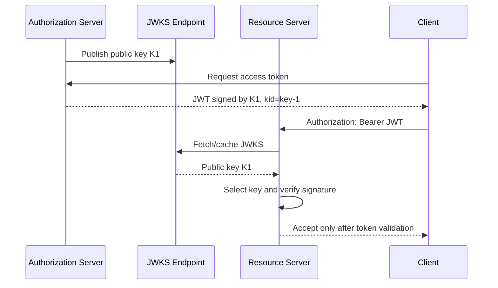
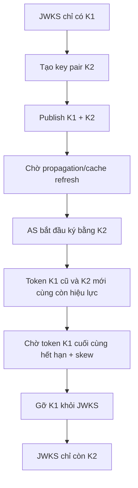

# Luân chuyển khóa, kid mới, khóa cũ và JWKS không truy cập được

JWT Resource Server xác minh chữ ký access token bằng public key do Authorization Server công bố. Các public key thường được phân phối qua **JWKS (JSON Web Key Set)**. Khi Authorization Server đổi signing key, Resource Server phải xử lý đồng thời token được ký bằng khóa cũ, token mới mang `kid` mới và tình huống endpoint JWKS tạm thời không truy cập được.

Luân chuyển khóa an toàn là một quy trình có thời gian chồng lấp. Authorization Server cần **công bố public key mới trước khi bắt đầu ký token bằng private key mới**, giữ public key cũ trong JWKS đủ lâu để Resource Server xác minh những token cũ còn hiệu lực, rồi mới gỡ khóa cũ. Resource Server cần cache JWKS có chủ đích, xử lý `kid` chưa biết, giới hạn retry và giữ nguyên nguyên tắc fail closed khi không thể xác minh chữ ký.

Bài học thuộc chương **Kiểm chứng tích hợp**, tập trung vào ý nghĩa của `kid` và JWKS, trình tự publish-before-sign, khoảng overlap giữa khóa mới/cũ, cache và refresh, outage, cấu hình Spring Security, kiểm thử tích hợp, quan sát vận hành, rollback và xử lý khóa bị lộ.

> **Ngữ cảnh minh họa:** Orders API dùng Spring Boot 3.x / Spring Security 6.x và nhận JWT access token từ `https://id.example.com`. Authorization Server ký token bằng RSA. Resource Server lấy public keys từ `https://id.example.com/oauth2/jwks`. Các URL, key ID và token trong bài là ví dụ.

## 1. Mô hình signing key và JWKS

### 1.1. Authorization Server giữ private key, Resource Server dùng public key

Trong mô hình ký bất đối xứng:

- Authorization Server giữ private signing key và dùng nó để ký JWT.
- Authorization Server công bố public key tương ứng qua JWKS.
- Resource Server tải JWKS, chọn public key phù hợp rồi xác minh chữ ký JWT.
- Private key không được xuất hiện trong JWKS hoặc gửi tới Resource Server.



Resource Server cần xác minh toàn bộ token profile: chữ ký, issuer, audience, thời hạn, thuật toán được phép và các validator nghiệp vụ. Tải được public key không tự làm token hợp lệ.

### 1.2. JWKS là một tập public JWK

Một JWKS có cấu trúc tổng quát:

```json
{
  "keys": [
    {
      "kty": "RSA",
      "kid": "orders-signing-2026-01",
      "use": "sig",
      "alg": "RS256",
      "n": "BASE64URL_MODULUS",
      "e": "AQAB"
    }
  ]
}
```

| Trường | Ý nghĩa |
|---|---|
| `keys` | Danh sách JWK trong key set |
| `kty` | Loại khóa, ví dụ RSA hoặc EC |
| `kid` | Key ID để chọn khóa tương ứng |
| `use` | Mục đích sử dụng, thường `sig` cho signing |
| `alg` | Thuật toán liên quan nếu được công bố |
| `n`, `e` | Public modulus và exponent của RSA |
| `crv`, `x`, `y` | Curve và tọa độ public key của EC |

JWKS chỉ công bố public parameters. Không đưa private parameters như RSA `d`, `p`, `q` hoặc EC private scalar vào endpoint này.

### 1.3. kid giúp chọn key, không xác minh chữ ký

Protected header của JWT có thể chứa:

```json
{
  "alg": "RS256",
  "kid": "orders-signing-2026-01",
  "typ": "JWT"
}
```

`kid` là key identifier. Resource Server dùng nó để tìm ứng viên public key trong JWKS. Sau đó verifier vẫn phải xác minh chữ ký bằng public key tìm được.

Không coi `kid` là bằng chứng token đáng tin. Attacker có thể tự tạo JWT với `kid` bất kỳ. Token chỉ hợp lệ khi chữ ký khớp với public key đáng tin và tất cả validators khác đều đạt.

`kid` cần duy nhất trong phạm vi issuer/key set. Khi rotate, cấp ID mới cho public key mới; không tái sử dụng cùng `kid` cho key material khác trong khi cache có thể còn giữ bản cũ. Nếu issuer phát hành nhiều loại token, quản lý key ID và key usage để tránh chọn nhầm signing key.

Không lấy key source từ URL do JWT header tự khai như `jku` hoặc `x5u`. JWKS URI phải đến từ cấu hình/trust metadata đã được ứng dụng tin cậy; nếu tin URL do token điều khiển, attacker có thể hướng verifier tới key set của họ.

## 2. Vì sao phải rotate signing key?

Private signing key có thể cần thay đổi vì chu kỳ rotation, thay đổi thuật toán/kích thước key, KMS/HSM migration, thay đổi hạ tầng quản lý khóa, giảm thời gian sử dụng một key dài hạn hoặc xử lý key có nguy cơ bị lộ.

Rotation định kỳ giúp giảm thời gian sử dụng của mỗi private key. Tuy nhiên, rollover sai thứ tự có thể khiến Resource Server không xác minh được token mới hoặc token cũ dù token đó chưa hết hạn.

### 2.1. Ký bằng key mới trước khi công bố public key mới

1. Authorization Server bắt đầu ký token bằng private key K2.
2. JWT có header `kid=key-2`.
3. JWKS endpoint vẫn chỉ công bố K1.
4. Resource Server không tìm được K2 và từ chối token.

### 2.2. Gỡ key cũ quá sớm

1. Authorization Server đã ngừng ký bằng K1.
2. Một số access token K1 vẫn còn trong thời hạn.
3. JWKS endpoint xóa public K1.
4. Resource Server vừa refresh JWKS sẽ không thể xác minh token K1 còn hiệu lực.

Cả hai lỗi đều có thể gây 401 trên diện rộng. Quy trình an toàn cần khoảng overlap.

## 3. Quy trình rollover: publish trước, sign sau, retire cuối cùng

Một đợt rotation thông thường có ba giai đoạn:

1. **Pre-publication:** tạo K2 và công bố public key K2 cùng K1.
2. **Switch signing:** sau khi K2 đã lan truyền và Resource Server có cơ hội tải JWKS mới, Authorization Server chuyển sang ký token bằng K2.
3. **Retirement:** chờ token K1 cuối cùng hết hạn và qua clock skew/safety margin, rồi mới gỡ public key K1.



### 3.1. Giai đoạn 1: tạo key mới và công bố public key

Authorization Server tạo key pair mới:

- Private K2 được lưu trong HSM/KMS hoặc key store an toàn.
- Public K2 được thêm vào JWKS.
- JWKS tiếp tục chứa public K1 đang dùng để verify token cũ.
- Key ID K2 khác K1.
- Kiểm tra JWKS truy cập được qua đúng hostname, TLS certificate và network path của Resource Server.

Ví dụ JWKS trong giai đoạn overlap:

```json
{
  "keys": [
    {
      "kty": "RSA",
      "kid": "orders-signing-2025-12",
      "use": "sig",
      "alg": "RS256",
      "n": "PUBLIC_MODULUS_K1",
      "e": "AQAB"
    },
    {
      "kty": "RSA",
      "kid": "orders-signing-2026-01",
      "use": "sig",
      "alg": "RS256",
      "n": "PUBLIC_MODULUS_K2",
      "e": "AQAB"
    }
  ]
}
```

Không đưa private key vào response. Nếu phân phối JWKS qua CDN hoặc nhiều region, xác nhận bản cập nhật đã tới các edge trước khi chuyển signing key.

### 3.2. Giai đoạn 2: chờ propagation rồi mới ký bằng K2

Sau khi public K2 được công bố, cần cho Resource Server có thời gian tải key set mới. Khoảng chờ phụ thuộc JWKS cache TTL, refresh behavior, số lượng instances/regions, CDN/proxy cache, replication của Authorization Server và network path của từng workload.

Sau khi xác nhận public K2 có thể được verifier lấy, Authorization Server chuyển signing key hiện hành sang K2. Token mới mang `kid=orders-signing-2026-01`.

Không chỉ dựa vào một lần gọi JWKS từ máy quản trị. Cần xác nhận từ các network zone/regions và một số Resource Server representative.

### 3.3. Giai đoạn 3: giữ K1 cho đến khi token cũ hết hạn

Sau khi switch, JWKS tiếp tục chứa cả K1 và K2:

- Token phát hành trước switch có `kid` K1.
- Token phát hành sau switch có `kid` K2.
- Resource Server xác minh token theo đúng key ID.
- Authorization Server không tiếp tục ký token mới bằng K1.

Chỉ gỡ K1 sau khi token K1 cuối cùng đã hết hạn và cộng thêm clock skew cùng safety margin. Phải tính từ **thời điểm phát hành token K1 cuối cùng** và maximum lifetime thực tế, không chỉ đếm từ lúc switch.

Công thức lập kế hoạch bảo thủ:

```text
oldKeyRemovalTime >=
    lastTokenIssuedWithOldKey
    + maximumOldTokenLifetime
    + acceptedClockSkew
    + operationalSafetyMargin
```

Nếu TTL access token khác nhau theo client/grant hoặc có quy trình cấp token cũ kéo dài, hãy tính theo dữ liệu phát hành thực tế và policy của Authorization Server.

### 3.4. Cache TTL ảnh hưởng điều gì?

JWKS cache TTL ảnh hưởng thời điểm Resource Server nhìn thấy key set mới hoặc key đã bị gỡ. Nó không thay thế việc giữ public key đủ lâu cho mọi token cũ còn hợp lệ. Một số instance có thể refresh sớm, số khác có thể còn cache bản cũ; rollout phải tính đến độ trễ này.

## 4. Resource Server chọn key và xử lý kid mới

Khi nhận JWT, verifier thường thực hiện logic:

1. Parse protected header.
2. Xác định issuer/key source theo trust configuration.
3. Tìm JWK phù hợp với `kid`, key type, algorithm và usage.
4. Xác minh chữ ký.
5. Chạy validators cho issuer, audience, thời hạn và policy.
6. Chỉ tạo Authentication khi tất cả bước cần thiết thành công.

```text
Incoming JWT
    |
    v
Parse protected header
    |
    +-- alg not allowed -> reject
    |
    v
Read kid
    |
    v
Find matching public JWK in trusted JWKS
    |
    +-- no matching key -> refresh/resolve according to JWK source
    |       |
    |       +-- still missing / fetch failed -> reject
    |
    v
Verify cryptographic signature
    |
    v
Validate issuer, audience, exp, nbf, token profile
    |
    v
Create JwtAuthenticationToken
```

### 4.1. Unknown kid không đồng nghĩa token chắc chắn giả

Resource Server có thể chưa có key tương ứng vì Authorization Server vừa rotate và cache còn cũ. JWK source có thể thử làm mới key set để tìm key mới. Nếu sau refresh vẫn không tìm thấy `kid`, token không thể được xác minh và phải bị từ chối.

Không tự động chấp nhận token chỉ vì JWKS fetch gặp lỗi. Unknown `kid` phải được resolve từ trusted key source.

### 4.2. Unknown kid có thể bị lợi dụng để gây tải

Attacker có thể gửi nhiều JWT giả với các giá trị `kid` ngẫu nhiên. Nếu mỗi token gây một request JWKS mới, Resource Server và Authorization Server có thể bị quá tải.

Cần xem xét cache/refresh behavior, rate limiting ở gateway/JWKS endpoint, timeout, connection pool, retry budget, giới hạn kích thước JWT/header và metric unknown-kid. Không viết vòng retry vô hạn khi không tìm thấy `kid`. Cơ chế unknown-key refresh phải có giới hạn và được kiểm thử theo implementation/version thực tế.

### 4.3. kid không thay algorithm allowlist

JWT header cũng có `alg`. Resource Server phải chỉ chấp nhận thuật toán đã cấu hình. Không để attacker điều khiển thuật toán hoặc khiến verifier dùng sai loại key. Public JWK cần phù hợp key type và thuật toán được cho phép.

Ví dụ RSA public key chỉ được dùng với các thuật toán RSA tương ứng mà ứng dụng chấp nhận. Không chuyển sang thuật toán khác chỉ vì token header yêu cầu.

## 5. JWKS caching và tác động đến rotation

JWKS thường được cache để tránh gọi Authorization Server trên mỗi request. Cache cải thiện latency và giảm tải, nhưng làm thay đổi thời điểm Resource Server nhìn thấy key mới hoặc key đã bị gỡ.

Các yếu tố quan trọng: cache TTL, HTTP cache headers nếu client sử dụng chúng, cache implementation, refresh khi `kid` không được tìm thấy, invalidation giữa instances, timeout và hành vi khi cache hết hạn nhưng endpoint unavailable.

### 5.1. Cache quá lâu làm chậm việc nhận key mới

Nếu JWKS cache tồn tại lâu, Resource Server có thể tiếp tục giữ key set chỉ có K1 sau khi Authorization Server đã publish K2. Khi AS bắt đầu ký bằng K2, verifier có thể không tìm thấy `kid=key-2`.

Một số JWK source có thể refresh khi không tìm thấy key; không nên dựa vào điều đó mà bỏ qua propagation window. Hãy cấu hình TTL và kiểm thử unknown-kid refresh của phiên bản thư viện đang dùng.

### 5.2. Cache quá ngắn làm tăng phụ thuộc vào JWKS endpoint

TTL rất ngắn khiến Resource Server tải key set thường xuyên hơn. Khi JWKS endpoint chậm hoặc unavailable, request có thể bị ảnh hưởng nhiều hơn và số lần fetch tăng cũng tạo thêm tải cho issuer.

Chọn TTL dựa trên rotation frequency, availability SLO của JWKS endpoint, số lượng instances, unknown-kid refresh, yêu cầu thu hồi khóa khẩn cấp và mức chấp nhận độ trễ cập nhật key. Không có một TTL phù hợp cho mọi hệ thống.

### 5.3. Cache không phải cơ chế thu hồi tức thời

Nếu Resource Server đang giữ public key cũ trong cache, việc xóa key khỏi JWKS origin không nhất thiết làm mọi instance ngừng chấp nhận token được ký bằng key đó ngay lập tức.

Điều này đặc biệt quan trọng khi private key bị compromise. JWKS removal có thể chỉ có hiệu lực khi cache refresh/invalidate. Emergency response cần thêm cơ chế như giảm TTL, chủ động invalidate cache, deny key theo policy hoặc thu hồi token bị ảnh hưởng.

### 5.4. Đừng mặc định mọi cache đều phục vụ stale data khi outage

Khi JWKS endpoint unavailable:

- Nếu public key cần thiết còn trong cache và JWK source cho phép dùng cache entry đó, token có thể vẫn được xác minh.
- Nếu cache hết hạn, bị invalidate hoặc không có key cần thiết, verifier có thể không tải được key và phải từ chối token.
- Cache/provider có stale-if-error behavior có thể khác provider không hỗ trợ.
- Unknown `kid` vẫn không thể xác minh nếu không lấy được public key tương ứng.

Hành vi thực tế phụ thuộc JWK source, cache và version. Hãy kiểm thử thay vì giả định mọi outage đều dùng cached key hoặc đều thất bại ngay.

## 6. JWKS endpoint không truy cập được: xử lý theo tình huống

JWKS outage có thể đến từ DNS, TLS certificate, network policy, proxy, load balancer, HTTP 5xx, timeout hoặc response JSON sai định dạng.

| Tình huống | Khả năng xử lý | Hành vi an toàn |
|---|---|---|
| Key đã có trong cache còn hiệu lực | Có thể xác minh bằng cached key | Tiếp tục nếu signature và validators đạt |
| Cache hết hạn, JWKS fetch thành công | Tải key set mới | Xác minh theo key mới |
| Cache hết hạn, JWKS fetch thất bại | Không có key source khả dụng | Từ chối token cần key đó |
| JWT mang kid mới, cache cũ | JWK source có thể refresh | Chỉ chấp nhận sau khi tìm thấy key và verify signature |
| kid không tồn tại trong JWKS mới | Không có key phù hợp | Từ chối |
| JWKS JSON malformed | Không thể tin key set | Từ chối và phát cảnh báo |
| TLS certificate không hợp lệ | Không thiết lập được trust channel | Từ chối fetch; sửa TLS/trust |
| DNS/network timeout | Không lấy được key | Không bypass verification |

### 6.1. Fail closed khi không thể xác minh chữ ký

Nếu Resource Server không có public key đáng tin cậy để verify token, nó không được:

- Chấp nhận token vì payload trông hợp lệ.
- Bỏ qua chữ ký khi JWKS endpoint lỗi.
- Dùng public key do caller gửi trong JWT header làm trust anchor.
- Tạm cho phép mọi scope.
- Hạ token thành anonymous hoặc service identity mà không có policy rõ.

Với API được bảo vệ, request không xác minh được thường kết thúc ở authentication failure, thường là 401. Chi tiết error response phụ thuộc exception handler và API contract.

### 6.2. Phân biệt lỗi xác minh token với lỗi nghiệp vụ

JWKS outage là lỗi dependency ở authentication boundary. Không trả 403 `insufficient_scope` vì token chưa được xác minh và authorities chưa được thiết lập. Không để exception mạng từ JWK fetch tràn thành 500 không kiểm soát; map lỗi theo Resource Server error handling và theo dõi riêng.

### 6.3. Không retry đồng bộ quá nhiều lần trên request path

Retry ngắn có thể xử lý lỗi mạng thoáng qua nếu được giới hạn, nhưng retry nhiều lần trên mỗi request có thể khuếch đại outage. Cần connect/read timeout hữu hạn, retry budget nhỏ, backoff có jitter nếu transport hỗ trợ, circuit breaker/bulkhead ở lớp phù hợp và không retry liên tục cho mọi unknown `kid`.

Nếu không thể lấy key trong giới hạn thời gian, từ chối request và để client retry theo API policy.

## 7. Cấu hình Spring Security Resource Server

### 7.1. Cấu hình issuer và JWKS URI trong Spring Boot

Ví dụ:

```yaml
spring:
  security:
    oauth2:
      resourceserver:
        jwt:
          issuer-uri: https://id.example.com
          jwk-set-uri: https://id.example.com/oauth2/jwks
```

Cấu hình cho Resource Server biết issuer được tin cậy và URI dùng để lấy JWK Set. Kết hợp hai property giúp ứng dụng biết trực tiếp JWKS URI, đồng thời vẫn xác minh claim issuer theo cấu hình Spring Security/Boot tương ứng.

Kiểm tra property names và behavior của đúng Spring Boot/Spring Security version đang dùng. Không suy ra khai báo JWKS URI đồng nghĩa đã kiểm tra audience; audience thường cần validator bổ sung.

### 7.2. Cấu hình decoder trực tiếp

Có thể tạo decoder từ JWKS URI:

```java
@Bean
JwtDecoder jwtDecoder() {
    String jwkSetUri = "https://id.example.com/oauth2/jwks";
    String issuer = "https://id.example.com";

    NimbusJwtDecoder decoder =
        NimbusJwtDecoder.withJwkSetUri(jwkSetUri).build();

    decoder.setJwtValidator(
        JwtValidators.createDefaultWithIssuer(issuer)
    );

    return decoder;
}
```

Ví dụ minh họa việc kết hợp JWKS key source với issuer validation. Nếu ứng dụng cần audience validation, thêm validator riêng. Kiểm tra default validators của version và cách cấu hình decoder hiện tại trước khi thay bean tự động của Spring Boot.

### 7.3. Thêm audience validator

```java
OAuth2TokenValidator<Jwt> audienceValidator = jwt -> {
    if (jwt.getAudience().contains("orders-api")) {
        return OAuth2TokenValidatorResult.success();
    }

    OAuth2Error error = new OAuth2Error(
        "invalid_token",
        "Required audience is missing",
        null
    );

    return OAuth2TokenValidatorResult.failure(error);
};
```

Kết hợp validator:

```java
OAuth2TokenValidator<Jwt> issuerValidator =
    JwtValidators.createDefaultWithIssuer(issuer);

OAuth2TokenValidator<Jwt> validator =
    new DelegatingOAuth2TokenValidator<>(
        issuerValidator,
        audienceValidator
    );

decoder.setJwtValidator(validator);
```

Không thay default timestamp/issuer validators bằng audience validator đơn lẻ nếu không chủ đích. Các validator cần được compose để giữ điều kiện bắt buộc.

### 7.4. Algorithm allowlist

Cấu hình decoder chỉ chấp nhận thuật toán ký đã thống nhất với issuer. Ví dụ RSA:

```java
NimbusJwtDecoder decoder = NimbusJwtDecoder
    .withJwkSetUri(jwkSetUri)
    .jwsAlgorithm(SignatureAlgorithm.RS256)
    .build();
```

Tên builder method và overload có thể khác theo Spring Security version. Nếu issuer chuyển từ RS256 sang PS256 hoặc ES256, thực hiện thay đổi có kiểm soát ở cả AS và Resource Server; đừng mở allowlist vô hạn để “hỗ trợ tạm”.

### 7.5. Cấu hình cache

Nimbus/Spring có các điểm cấu hình JWK source/cache thay đổi theo version. Trước khi thêm custom cache:

1. Xác định JWK source thực tế mà decoder đang dùng.
2. Kiểm tra default cache và refresh behavior của version.
3. Xác định TTL, size, eviction và error behavior.
4. Kiểm tra có stale-if-error hay không.
5. Kiểm tra unknown `kid` có trigger refresh và được rate-limit không.
6. Đảm bảo mọi Resource Server instance có policy tương đương.

Nếu version cung cấp cache hook trên Nimbus decoder builder hoặc JWK source, cấu hình qua API được hỗ trợ. Không thêm một cache ngoài decoder khiến key set bị cache hai lần với TTL khó dự đoán.

## 8. Quy trình triển khai rotation trong môi trường nhiều instance

### 8.1. Trước khi switch

- Tạo K2 trong KMS/HSM.
- Công bố public K2 cùng K1.
- Kiểm tra JWKS JSON, kid uniqueness và key usage.
- Kiểm tra từ từng network zone/region có thể fetch JWKS.
- Xác nhận cache của Resource Server có thể nhận K2 hoặc refresh khi unknown kid.
- Chuẩn bị dashboard cho unknown kid, JWKS fetch latency và JWT verification failures.

### 8.2. Khi switch

- Chuyển signing key tại Authorization Server theo rollout có kiểm soát.
- Xác nhận token mới có `kid` K2.
- Gửi token mới qua các Resource Server representative.
- Theo dõi 401/invalid signature và unknown-kid rates.
- Nếu lỗi tăng, có thể rollback signing key về K1 trong khi K1 vẫn còn trong JWKS.

Rollback chỉ an toàn nếu private K1 còn được bảo vệ và được phép sử dụng. Nếu K1 bị compromise, không rollback về K1.

### 8.3. Sau switch

- Theo dõi thời điểm phát hành token K1 cuối cùng.
- Chờ maximum lifetime + skew + safety margin.
- Xác nhận không còn token K1 cần được chấp nhận theo policy.
- Gỡ K1 khỏi JWKS.
- Xác nhận Resource Server refresh key set và vẫn xác minh token K2.
- Lưu audit record về thời điểm tạo, publish, activate và retire key.

### 8.4. Không phụ thuộc vào đồng hồ một máy

Thời điểm token K1 cuối cùng nên đến từ dữ liệu vận hành đáng tin cậy của Authorization Server, không phải ước lượng trên một pod. Đồng bộ NTP/clock và thống nhất clock skew giữa issuer/resource servers. Nếu token lifetime khác nhau theo client hoặc grant, dùng maximum thực tế.

## 9. Xử lý khóa cũ bị compromise

Rotation định kỳ và emergency key compromise là hai tình huống khác nhau. Trong rotation định kỳ, giữ K1 trong JWKS để xác minh token K1 còn hạn. Trong compromise, tiếp tục tin K1 có thể cho phép attacker tự ký token mới bằng private key bị lộ.

Các bước khẩn cấp có thể gồm:

1. Ngừng ký token mới bằng key bị lộ.
2. Gỡ/disable public key compromise khỏi JWKS.
3. Chủ động invalidate/flush JWK caches nếu có thể.
4. Thêm deny rule theo issuer/key ID hoặc token policy trong Resource Server.
5. Thu hồi các token bị ảnh hưởng theo khả năng của hệ thống.
6. Phát key mới, publish và chuyển signing theo quy trình emergency.
7. Xác nhận mọi Resource Server instance đã nhận chính sách mới.
8. Điều tra phạm vi token, log và downstream usage.

### 9.1. JWKS removal một mình có thể không đủ

Một instance còn cache public K1 có thể tiếp tục xác minh JWT ký bằng K1 cho đến khi cache refresh hoặc hết hạn. Nếu attacker có private K1, họ có thể tạo JWT giả có chữ ký hợp lệ về mặt toán học. Vì vậy, với compromise, cần cơ chế từ chối key ID/token theo policy và cache invalidation khẩn cấp.

### 9.2. Token revocation và key revocation khác nhau

- **Token revocation:** vô hiệu một token hoặc grant.
- **Key revocation:** ngừng tin mọi token ký bằng một signing key.
- **JWKS removal:** thay đổi tập public key được công bố.
- **Cache invalidation:** khiến Resource Server ngừng dùng key set đã cache.

Chúng liên quan nhưng không tương đương. JWT offline validation không tự biết token bị thu hồi nếu không có cơ chế bổ sung.

## 10. Kiểm thử tích hợp với JWKS endpoint trong test

Để kiểm tra rotation và outage, dùng một JWKS endpoint test có thể điều khiển nội dung và lỗi HTTP. Có thể dùng MockWebServer, WireMock hoặc HTTP server test tương đương.

Mục tiêu là để decoder thật gọi HTTP và xác minh chữ ký bằng public key thật trong test. Cách này khác với mock `JwtDecoder` trả sẵn một object Jwt.

### 10.1. Tạo hai key pair test

Trong test fixture:

- Tạo RSA key pair K1 và K2.
- Dùng private K1 ký JWT cũ với `kid` `key-1`.
- Dùng private K2 ký JWT mới với `kid` `key-2`.
- JWKS server trả public K1/K2 theo từng phase.
- Resource Server dùng Nimbus decoder thật trỏ tới JWKS test URL.

Không dùng private key production. Key test có thể được tạo lúc test setup hoặc dùng fixture cố định trong test resources.

### 10.2. Test rollover thành công

1. JWKS trả K1.
2. Decoder xác minh token K1.
3. JWKS được cập nhật thành K1 + K2.
4. Làm mới cache theo cách test kiểm soát.
5. Decoder xác minh token K2.
6. Decoder vẫn xác minh token K1 còn hạn trong overlap.
7. Sau khi policy cho phép retire K1 và JWKS chỉ còn K2, token K2 vẫn hợp lệ.
8. Token K1 không được chấp nhận sau khi key set refresh và token không còn được phép.

Tránh test phụ thuộc sleep dài. Dùng clock có thể kiểm soát nếu validator hỗ trợ và cache/test server hooks để kiểm soát thời điểm refresh.

### 10.3. Test unknown kid

- JWKS hiện tại chỉ có K1.
- Gửi JWT có `kid` K2.
- Xác nhận decoder thực hiện hành vi refresh/lookup theo version đang dùng.
- Cập nhật JWKS có K2.
- Xác nhận token K2 được xác minh sau khi key source nhận bản mới.
- Gửi một kid không tồn tại và xác nhận request bị từ chối.

Nếu muốn kiểm tra refresh rate, assert số lần JWKS request với cache và retry được kiểm soát. Đừng giả định implementation sẽ gọi endpoint đúng một lần nếu test không kiểm soát cache.

### 10.4. Test JWKS outage khi key còn cache

1. Tải JWKS chứa K1 thành công.
2. Làm cho JWKS server trả 503 hoặc timeout.
3. Gửi token K1 khi cache còn hiệu lực.
4. Xác nhận behavior theo cache/JWK source thực tế.
5. Ghi nhận request dùng cache hay fetch lại.

Test này xác minh khả năng tiếp tục xác minh bằng cached key trong policy đã chọn.

### 10.5. Test JWKS outage sau khi cache hết hạn

- Cho cache hết hạn hoặc chủ động invalidate.
- Làm JWKS endpoint unavailable.
- Gửi token cần K1.
- Xác nhận Resource Server không bỏ qua signature verification và không chấp nhận token khi không lấy được key đáng tin.
- Kiểm tra response/error mapping và metric dependency failure.

### 10.6. Test malformed JWKS và TLS/network errors

Nên bao phủ HTTP 404/500/503, timeout, DNS resolution failure, TLS certificate invalid, JSON không hợp lệ, JWKS không có `keys`, JWK thiếu public parameters, key ID duplicate/ambiguous theo parser behavior và key có `use`/`alg` không phù hợp.

Không cần test mọi lỗi mạng ở mọi module, nhưng phải có test cho error handling quan trọng của decoder và deployment environment.

## 11. Test chữ ký và key selection

| Token | Header kid | Chữ ký | JWKS | Kỳ vọng |
|---|---|---|---|---|
| Token A | key-1 | K1 private | Có K1 | Hợp lệ nếu claims đạt |
| Token B | key-2 | K2 private | Có K1 + K2 | Hợp lệ sau khi key set cập nhật |
| Token giả | key-1 | K2 private | Có K1 | Chữ ký không hợp lệ |
| Token unknown | key-99 | Key không có trong JWKS | Không có key-99 | Từ chối |
| Token cũ | key-1 | K1 private | Chỉ K2 | Từ chối sau refresh và theo policy |
| Token hết hạn | key-2 | K2 private | Có K2 | Từ chối do exp |
| Token sai issuer | key-2 | K2 private | Có K2 | Từ chối do issuer |
| Token sai audience | key-2 | K2 private | Có K2 | Từ chối do audience |

Một test quan trọng là **kid đúng nhưng chữ ký sai**. Nó chứng minh verifier không chỉ tìm thấy key ID rồi chấp nhận token.

## 12. Theo dõi JWKS và key rotation trong production

Các metric hữu ích:

| Metric | Mục đích |
|---|---|
| JWKS fetch success/failure | Theo dõi khả năng lấy key set |
| JWKS fetch latency | Phát hiện endpoint chậm |
| JWKS cache hit/miss | Hiểu tần suất dùng cache |
| Unknown kid count | Phát hiện rotation hoặc token giả |
| JWT signature validation failure | Phát hiện key mismatch/attack/config |
| JWT issuer/audience failure | Theo dõi token profile errors |
| Decoder dependency failure | Tách lỗi JWKS/network khỏi lỗi quyền |
| Current signing kid (AS) | Xác nhận key AS đang dùng |
| JWKS published key IDs | Kiểm tra key set được công bố |
| Last successful JWKS refresh | Xác định độ mới của cache |

Đây là metric gợi ý; không phải tất cả đều có sẵn trong Spring Security. Có thể cần instrument JWK source/HTTP client hoặc log có cấu trúc. Tránh đưa raw token, full JWT, subject hoặc `kid` tùy ý do caller điều khiển vào metric label có cardinality cao.

### 12.1. Alert cần có

- JWKS fetch failure kéo dài.
- Unknown-kid tăng đột biến.
- Signature failure tăng sau rotation.
- JWKS key set không chứa current signing kid.
- Public key mới chưa xuất hiện ở một số region.
- Old key bị gỡ trước thời hạn overlap.
- Decoder failure rate vượt ngưỡng.
- TLS certificate của JWKS endpoint sắp hết hạn.

### 12.2. Audit rotation

Ghi lại các sự kiện quản trị: key pair được tạo, public key được publish, key được chọn làm active signing key, token cuối cùng ký bằng key cũ, key cũ bị retire, cache invalidation/emergency deny được kích hoạt và người/quy trình phê duyệt thay đổi.

Audit event không chứa private key hoặc access token.

## 13. Runbook xử lý sự cố

### 13.1. Token mới bị 401 ngay sau rotation

Kiểm tra theo thứ tự:

1. Decode protected header để đọc `kid` và `alg` (chỉ dùng cho chẩn đoán, không coi là xác thực).
2. Xác nhận JWKS hiện tại có public key với kid đó.
3. Xác nhận public key tương ứng đúng với private key AS đang dùng.
4. Kiểm tra Resource Server có fetch được JWKS không.
5. Kiểm tra cache/unknown-kid refresh và propagation giữa các instances.
6. Kiểm tra thuật toán allowlist.
7. Kiểm tra signature, issuer, audience, exp và nbf.
8. So sánh lỗi theo region/pod để xác định cache hoặc network khác nhau.

Không sửa bằng cách tắt signature validation.

### 13.2. Token cũ bị 401 trong overlap

- Xác nhận public key cũ vẫn còn trong JWKS.
- Xác nhận token cũ chưa hết hạn.
- Xác nhận `kid` trong token cũ trỏ đúng key ID.
- Kiểm tra cache đã tải JWKS response thiếu key cũ hay chưa.
- Xác nhận AS không vô tình reuse kid cho key material mới.
- Kiểm tra token cũ có đúng issuer/audience/algorithm không.

### 13.3. JWKS endpoint unavailable

- Kiểm tra DNS, TLS, proxy, firewall và HTTP status.
- Kiểm tra cache hit/miss và thời điểm refresh cuối cùng.
- Xác định token đang dùng key đã cache hay cần key mới.
- Giữ fail-closed cho token không thể xác minh.
- Khôi phục JWKS service hoặc network path.
- Theo dõi decoder failures và unknown-kid rate sau phục hồi.

Không phát hành token bằng key mới khi Resource Server không thể lấy public key mới, trừ khi có một distribution channel tin cậy khác đã được triển khai và kiểm thử.

## 14. Những sai lầm thường gặp

1. **Switch signing key trước khi publish public key mới:** Resource Server không tìm thấy kid mới.
2. **Xóa public key cũ ngay khi ngừng ký:** token cũ còn hạn không xác minh được.
3. **Tái sử dụng kid cho key material khác:** cache và key selection trở nên mơ hồ.
4. **Tin kid mà không verify signature:** attacker tự khai kid bất kỳ.
5. **Tin jku/x5u từ JWT header:** verifier có thể bị điều hướng tới key source không tin cậy.
6. **Không cấu hình issuer/audience validators:** token ký đúng key nhưng dành cho resource/issuer khác vẫn có thể được chấp nhận nếu thiếu kiểm tra.
7. **Cho phép thuật toán bất kỳ:** tăng nguy cơ algorithm confusion và cấu hình yếu.
8. **Giả định JWKS outage luôn dùng cached key:** behavior phụ thuộc cache/JWK source và TTL.
9. **Giả định JWKS outage luôn làm mọi token thất bại ngay:** key còn cache có thể vẫn xác minh được.
10. **Retry JWKS không giới hạn:** unknown-kid có thể gây refresh storm.
11. **JWKS removal được coi là revoke tức thời:** cache có thể tiếp tục giữ public key cũ.
12. **Rollback về key đã compromise:** khôi phục lỗi bảo mật.
13. **Chỉ test bằng mock JwtDecoder:** không kiểm tra HTTP fetch, JWKS parsing, key selection hoặc signature.
14. **Không test nhiều instance/region:** rollout có thể thành công ở một pod nhưng thất bại ở pod khác.
15. **Không theo dõi current kid và last refresh:** khó phát hiện lệch trạng thái giữa AS và Resource Server.

## 15. Checklist trước, trong và sau rotation

| Giai đoạn | Điều cần xác nhận |
|---|---|
| Chuẩn bị | K2 được tạo và private key lưu an toàn |
| Chuẩn bị | K2 có kid mới, không reuse ID |
| Publish | JWKS có cả K1 và K2 |
| Publish | Public K2 không chứa private parameters |
| Publish | JWKS truy cập được từ mọi Resource Server region |
| Propagation | Cache/refresh behavior được hiểu và kiểm thử |
| Switch | AS bắt đầu ký token mới bằng K2 sau propagation |
| Overlap | K1 tiếp tục có trong JWKS |
| Overlap | Token K1 còn hạn vẫn được xác minh |
| Overlap | Token K2 mới được xác minh |
| Retirement | Xác định token K1 cuối cùng được phát hành |
| Retirement | Chờ max lifetime + clock skew + safety margin |
| Retirement | Gỡ K1 sau thời gian giữ khóa cũ |
| Sau rotation | Resource Server tải JWKS mới và xác minh token K2 |
| Outage | Có timeout, cache policy và fail-closed behavior |
| Emergency | Có cache invalidation/deny policy cho key compromise |
| Observability | Có metric JWKS fetch, unknown kid và signature failure |
| Audit | Có mốc publish, activate, last old token và retire |

## 16. Tài liệu tham khảo

- [RFC 7517 — JSON Web Key (JWK)](https://www.rfc-editor.org/rfc/rfc7517): JWK và JWKS format.
- [RFC 7515 — JSON Web Signature (JWS)](https://www.rfc-editor.org/rfc/rfc7515): protected header, thuật toán và chữ ký.
- [RFC 7519 — JSON Web Token (JWT)](https://www.rfc-editor.org/rfc/rfc7519): JWT claims và token structure.
- [RFC 8725 — JSON Web Token Best Current Practices](https://www.rfc-editor.org/rfc/rfc8725): algorithm verification, issuer/key validation và JWT security best practices.
- [RFC 9068 — JWT Profile for OAuth 2.0 Access Tokens](https://www.rfc-editor.org/rfc/rfc9068): profile và validation access token.
- [Spring Security — JWT Resource Server](https://docs.spring.io/spring-security/reference/servlet/oauth2/resource-server/jwt.html): Nimbus decoder, issuer và JWK Set URI configuration.
- [Spring Security — OAuth2 Resource Server](https://docs.spring.io/spring-security/reference/servlet/oauth2/resource-server/index.html): Servlet Resource Server architecture.
- [Nimbus JOSE + JWT](https://connect2id.com/products/nimbus-jose-jwt): JWK, JWKS, JWT processing và remote key source.
- [OWASP JSON Web Token for Java Cheat Sheet](https://cheatsheetseries.owasp.org/cheatsheets/JSON_Web_Token_for_Java_Cheat_Sheet.html): thực hành bảo vệ JWT trong Java.

**Kết luận:** Rotation an toàn cần publish public key mới trước, chờ Resource Server có thể nhận key, chuyển signing sang kid mới, giữ key cũ trong suốt thời gian token cũ còn hợp lệ rồi mới retire. JWKS cache quyết định thời điểm các instance nhìn thấy thay đổi; unknown kid và outage phải được xử lý có giới hạn, đồng thời Resource Server luôn fail closed khi không có public key đáng tin để xác minh chữ ký. Khi kiểm thử, dùng decoder thật và JWKS endpoint test có thể điều khiển để xác nhận rollover, cache, key selection và failure behavior.
