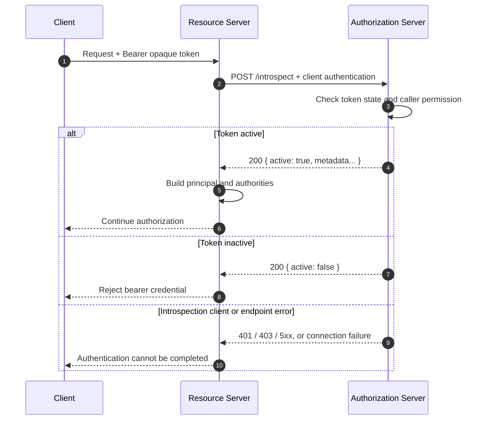

# Introspection active=false, thiếu metadata và lỗi thông tin xác thực

Với OAuth 2.0 Opaque Token Resource Server, access token thường là một chuỗi mà API không thể tự giải mã và xác minh. Resource Server gửi token đến Authorization Server qua **token introspection endpoint** và nhận response mô tả trạng thái cùng metadata mà authority cho phép tiết lộ. Khi tích hợp, ba tình huống cần được phân biệt rõ:

- **active=false:** Authorization Server đã trả lời rằng token không active. Đây là kết quả nghiệp vụ hợp lệ của introspection; Resource Server phải từ chối credential đó.
- **Thiếu hoặc sai metadata:** response không đáp ứng contract của RFC 7662 hoặc thiếu claim mà API yêu cầu. Có thể đây là response malformed, hoặc token active nhưng không đủ thông tin theo policy riêng của API.
- **Lỗi thông tin xác thực/kết nối tới introspection endpoint:** Resource Server không xác minh được token vì client credentials sai, endpoint từ chối client, TLS/network lỗi hoặc upstream unavailable. Đây không phải bằng chứng token người dùng đã bị revoke.

Nếu gộp các trường hợp này thành một kết quả chung, đội vận hành khó phân biệt token invalid với cấu hình Resource Server sai; đồng thời hệ thống có thể vô tình cho phép request khi không xác minh được token. Bài học này tập trung vào semantics của RFC 7662, cách Spring Security xử lý opaque token, cách xác thực metadata theo contract của API và cách kiểm thử từng kết quả.

## 1. Luồng introspection trong Resource Server

Resource Server không tự giải mã một opaque token. Nó gửi token đến endpoint được cấu hình và dùng response của Authorization Server để tạo Authentication.



Trong flow này có **hai bộ thông tin xác thực**:

1. Bearer token do caller gửi cho Resource Server. Đây là credential đang được kiểm tra.
2. Client credentials hoặc cơ chế client authentication mà Resource Server dùng để gọi introspection endpoint. Đây là credential của chính Resource Server.

Hai bộ credential có chủ thể, mục đích và vòng đời khác nhau. active=false nói về token được introspect; invalid_client ở introspection endpoint thường nói về client Resource Server đang gọi endpoint.

## 2. active là trường bắt buộc trong RFC 7662

RFC 7662 quy định response introspection phải có thuộc tính boolean active. Giá trị này cho biết token có đang active theo định nghĩa của Authorization Server hay không.

```json
{
  "active": true,
  "scope": "orders.read orders.write",
  "client_id": "web-client",
  "username": "alice",
  "sub": "user-42",
  "aud": ["orders-api"],
  "iss": "https://idp.example",
  "exp": 1794758400
}
```

Các trường ngoài active là metadata có thể được trả về theo chính sách của Authorization Server và nhu cầu của Resource Server. Response tối thiểu cho một token active có thể chỉ chứa active: true, nếu contract không yêu cầu thêm thông tin.

active phải là boolean. Các giá trị như chuỗi "true", số 1, null hoặc không có thuộc tính không phải response hợp lệ theo contract. Không dùng truthiness của JSON hoặc ép kiểu tùy tiện để quyết định token active.

## 3. active=false là kết quả hợp lệ, không phải lỗi HTTP

Một Authorization Server có thể trả:

```http
HTTP/1.1 200 OK
Content-Type: application/json

{
  "active": false
}
```

Điều này có nghĩa introspection endpoint đã xử lý request và xác nhận token không active. Các lý do có thể gồm:

- Token không tồn tại hoặc không được Authorization Server nhận diện.
- Token đã hết hạn.
- Token đã bị revoke.
- Token không được phép sử dụng cho resource/caller hiện tại theo policy của issuer.
- Token không còn ở trạng thái được chấp nhận.

Authorization Server có thể cố ý không tiết lộ lý do chi tiết để tránh tạo oracle giúp attacker dò trạng thái token. Resource Server nên xử lý active=false như một credential không hợp lệ, không suy diễn lý do cụ thể từ response tối thiểu.

Điểm cần nhớ: **HTTP 200 mô tả việc introspection request được xử lý thành công; active=false mô tả trạng thái của token được hỏi.** Không nhầm HTTP success với authorization success.

## 4. Spring Security xử lý active=false như thế nào?

Với cấu hình opaque token mặc định, Spring Security sử dụng OpaqueTokenIntrospector, thường là NimbusOpaqueTokenIntrospector, để gọi endpoint và chuyển response thành OAuth2AuthenticatedPrincipal.

Khi introspector xác định token inactive, nó từ chối introspection thay vì tạo principal để request tiếp tục. Trong Spring Security, tình huống này thường được biểu diễn bằng BadOpaqueTokenException, thuộc nhóm lỗi authentication của Resource Server.

Ví dụ cấu hình cơ bản:

```yaml
spring:
  security:
    oauth2:
      resourceserver:
        opaquetoken:
          introspection-uri: https://idp.example/oauth2/introspect
          client-id: orders-resource-server
          client-secret: ${INTROSPECTION_CLIENT_SECRET}
```

Resource Server bật opaque token support:

```java
@Bean
SecurityFilterChain apiSecurity(HttpSecurity http) throws Exception {
    return http
        .authorizeHttpRequests(auth -> auth
            .requestMatchers("/orders/**")
                .hasAuthority("SCOPE_orders.read")
            .anyRequest().authenticated())
        .oauth2ResourceServer(oauth2 -> oauth2.opaqueToken(
            Customizer.withDefaults()))
        .build();
}
```

Tên property và bean được Spring Boot bind theo cấu hình ứng dụng. Secret phải lấy từ secret manager hoặc cơ chế quản lý secrets phù hợp; không ghi secret trực tiếp vào source, image hoặc log.

## 5. Phân biệt active=false với thiếu thuộc tính active

Hai response sau không tương đương:

```json
{
  "active": false
}
```

```json
{
  "scope": "orders.read",
  "sub": "user-42"
}
```

Response đầu tiên có boolean active và xác nhận token inactive. Response thứ hai thiếu trường bắt buộc; client không có cơ sở hợp lệ để kết luận token active. Phải từ chối request và ghi nhận response contract error trong telemetry.

Một số implementation introspector mặc định có thể xử lý mọi response mà active không phải boolean true theo cùng nhánh inactive-token. Vì vậy, nếu hệ thống cần phân biệt rõ **confirmed inactive** với **malformed introspection response**, hãy kiểm thử implementation/version đang dùng và cân nhắc một adapter kiểm tra response contract ở tầng HTTP trước khi chuyển thành principal. Không suy luận loại lỗi chỉ từ exception message không ổn định giữa các version.

## 6. Metadata ngoài active có thể là optional

RFC 7662 định nghĩa nhiều thuộc tính response thường gặp, nhưng không yêu cầu mọi Authorization Server phải trả tất cả chúng trong mọi response.

| Thuộc tính | Ý nghĩa thường gặp | Khi nào Resource Server có thể cần |
| --- | --- | --- |
| scope | Quyền được cấp cho token | Khi API map scope thành authorities |
| sub | Subject mà token đại diện | Ownership, audit, user-level authorization |
| client_id | OAuth client được cấp token | Client policy, workload classification |
| username | Tên người dùng theo issuer | Hiển thị/audit khi contract cho phép |
| aud | Resource/audience token dành cho | Phân biệt token giữa nhiều APIs |
| iss | Issuer | Trust namespace hoặc multi-issuer policy |
| exp | Thời điểm hết hạn | Acceptance deadline, cache policy |
| iat | Thời điểm phát hành | Audit hoặc token-age policy |
| nbf | Thời điểm token bắt đầu hợp lệ | Time validation nếu contract yêu cầu |
| jti | Token identifier | Correlation/revocation theo issuer contract |
| token_type | Loại token | Phân biệt token profile nếu issuer cung cấp |

active=true không tự bảo đảm API có mọi metadata mà logic nghiệp vụ cần. Nhưng việc một claim vắng mặt cũng không tự động chứng minh token inactive theo RFC. Cần tách **protocol-required fields** khỏi **application-required fields**.

## 7. Khi thiếu sub, scope hoặc aud thì sao?

Hãy quyết định theo contract của API:

- Nếu endpoint chỉ cho phép service token và dùng client identity làm principal, thiếu sub có thể chấp nhận được nếu client_id là định danh bắt buộc và được kiểm tra.
- Nếu API kiểm tra ownership theo user, cần subject ổn định. Không có subject hợp lệ thì không thể quyết định owner một cách an toàn.
- Nếu endpoint yêu cầu orders.read, thiếu scope tương ứng có nghĩa không có authority để thực hiện thao tác.
- Nếu Resource Server cần ràng buộc token với orders-api, thiếu audience theo profile nội bộ phải bị từ chối.
- Nếu cần multi-issuer identity, thiếu issuer hoặc một trust namespace tương đương có thể khiến việc phân biệt subject không an toàn.
- Nếu cần cache theo expiry, thiếu exp có thể khiến cache không xác định được deadline an toàn.

Không tự điền giá trị mặc định như admin, orders.read, tenant mặc định hoặc một subject giả. Default có thể biến metadata thiếu thành quyền được cấp ngoài ý muốn.

## 8. Phân biệt metadata không có, rỗng và sai kiểu

Ba response sau cần được xử lý theo contract:

```json
{ "active": true }
```

```json
{ "active": true, "scope": "" }
```

```json
{ "active": true, "scope": 42 }
```

- **Absent:** claim không có trong response.
- **Empty:** claim có nhưng không chứa giá trị hữu ích.
- **Wrong type:** claim không đúng kiểu được contract quy định.

Nếu scope là metadata tùy chọn, absent/empty có thể có nghĩa token không được cấp scope và do đó không có scope authorities. Nếu API yêu cầu scope cụ thể, token phải bị từ chối authorization. Nếu scope sai kiểu, response có thể vi phạm contract và cần được coi là malformed theo policy.

Không ép mọi claim về String bằng toString(). Ví dụ số 42 thành chuỗi "42" không làm nó trở thành scope hợp lệ.

## 9. Scope và authorities trong Spring Security

Opaque token introspector chuyển scope thành authorities theo converter. Với cấu hình mặc định, scope thường được ánh xạ thành authority có prefix SCOPE_.

Ví dụ:

```json
{
  "active": true,
  "scope": "orders.read orders.write",
  "sub": "user-42"
}
```

Authorities tương ứng có dạng:

```text
SCOPE_orders.read
SCOPE_orders.write
```

Khi scope vắng mặt, Resource Server không nên tự cấp một authority mặc định. Request có thể authenticated nhưng không đủ quyền và nhận kết quả authorization denied.

Ví dụ:

```java
.authorizeHttpRequests(auth -> auth
    .requestMatchers(HttpMethod.GET, "/orders/**")
        .hasAuthority("SCOPE_orders.read")
    .requestMatchers(HttpMethod.POST, "/orders/**")
        .hasAuthority("SCOPE_orders.write")
    .anyRequest().denyAll())
```

Không nhầm “token active” với “token có đủ quyền”. active=true trả lời câu hỏi token còn được issuer chấp nhận hay không; scope/authority và domain policy trả lời caller có được làm operation cụ thể hay không.

## 10. Audience thiếu hoặc không đúng

Nếu API có nhiều resource servers, audience giúp ngăn token phát cho API A bị dùng ở API B. Tuy nhiên aud không phải thuộc tính bắt buộc trong mọi response introspection theo mọi profile.

Ví dụ response:

```json
{
  "active": true,
  "scope": "orders.read",
  "sub": "user-42",
  "aud": ["billing-api"]
}
```

Nếu endpoint hiện tại thuộc orders-api, token này không đáp ứng audience policy của Orders API. Dù active=true, API phải từ chối.

Nếu aud vắng mặt, hãy căn cứ token profile và issuer contract. Nếu profile yêu cầu audience, absent là invalid theo policy của API. Nếu hệ thống dựa trên một introspection endpoint riêng cho từng resource và issuer có contract khác, có thể có cách ràng buộc resource tương đương; phải được tài liệu hóa và test. Không tự bỏ audience validation chỉ để integration test pass.

## 11. Principal name và subject phải có contract rõ

OAuth2AuthenticatedPrincipal có tên principal và map attributes từ introspection response. Ứng dụng không nên mặc định rằng getName() luôn là claim sub trong mọi introspector, converter hoặc token profile.

Nếu ownership dựa trên subject, hãy định nghĩa một identity resolver rõ ràng:

```java
public record ExternalIdentity(String issuer, String subject) {
}

public ExternalIdentity identityOf(
        OAuth2AuthenticatedPrincipal principal) {

    String issuer = principal.getAttribute("iss");
    String subject = principal.getAttribute("sub");

    if (issuer == null || issuer.isBlank()
            || subject == null || subject.isBlank()) {
        throw new BadOpaqueTokenException(
            "Required subject identity metadata is missing");
    }

    return new ExternalIdentity(issuer, subject);
}
```

Ví dụ này áp dụng cho API có contract bắt buộc cả issuer và subject. Nếu introspection endpoint riêng đã ràng buộc một issuer cố định, ứng dụng có thể dùng issuer đã được xác minh từ cấu hình thay cho claim iss, nhưng phải giữ namespace trong identity model. Không dùng email hoặc username thay cho stable subject nếu issuer không bảo đảm tính ổn định/duy nhất.

## 12. Viết custom metadata validation sau introspection

Khi response active nhưng thiếu claim mà ứng dụng bắt buộc, có thể bọc một introspector đã xác minh token:

```java
import java.util.Collection;

import org.springframework.security.oauth2.core.OAuth2AuthenticatedPrincipal;
import org.springframework.security.oauth2.server.resource.introspection.BadOpaqueTokenException;
import org.springframework.security.oauth2.server.resource.introspection.OpaqueTokenIntrospector;

public final class RequiredMetadataIntrospector
        implements OpaqueTokenIntrospector {

    private final OpaqueTokenIntrospector delegate;
    private final String requiredAudience;

    public RequiredMetadataIntrospector(
            OpaqueTokenIntrospector delegate,
            String requiredAudience) {
        this.delegate = delegate;
        this.requiredAudience = requiredAudience;
    }

    @Override
    public OAuth2AuthenticatedPrincipal introspect(String token) {
        OAuth2AuthenticatedPrincipal principal =
            this.delegate.introspect(token);

        Object subject = principal.getAttribute("sub");
        if (!(subject instanceof String value) || value.isBlank()) {
            throw new BadOpaqueTokenException(
                "Required subject metadata is missing");
        }

        Object audience = principal.getAttribute("aud");
        if (!containsAudience(audience, this.requiredAudience)) {
            throw new BadOpaqueTokenException(
                "Required audience metadata is missing or invalid");
        }

        boolean hasReadScope = principal.getAuthorities().stream()
            .anyMatch(authority ->
                authority.getAuthority().equals("SCOPE_orders.read"));

        if (!hasReadScope) {
            throw new BadOpaqueTokenException(
                "Required scope is missing");
        }

        return principal;
    }

    private boolean containsAudience(Object value, String expected) {
        if (value instanceof String audience) {
            return expected.equals(audience);
        }
        if (value instanceof Collection<?> audiences) {
            return audiences.contains(expected);
        }
        return false;
    }
}
```

Đây là decorator minh họa cho contract yêu cầu sub, aud và orders.read. Nếu ứng dụng có service token không có user subject, hãy định nghĩa một nhánh policy riêng dựa trên client_id; không ép mọi token phải có cùng loại principal.

Điểm quan trọng là delegate phải introspect trước. Nếu delegate trả active=false hoặc gặp lỗi endpoint, exception được giữ nguyên và metadata validation không chạy. Decorator không được biến lỗi của delegate thành principal mặc định.

## 13. Đăng ký custom OpaqueTokenIntrospector

Có thể tạo bean dùng Nimbus introspector làm delegate:

```java
import org.springframework.beans.factory.annotation.Value;
import org.springframework.context.annotation.Bean;
import org.springframework.context.annotation.Configuration;
import org.springframework.security.oauth2.server.resource.introspection.NimbusOpaqueTokenIntrospector;
import org.springframework.security.oauth2.server.resource.introspection.OpaqueTokenIntrospector;

@Configuration
class OpaqueTokenConfiguration {

    @Bean
    OpaqueTokenIntrospector opaqueTokenIntrospector(
            @Value("${oauth2.introspection-uri}") String uri,
            @Value("${oauth2.introspection-client-id}") String clientId,
            @Value("${oauth2.introspection-client-secret}") String clientSecret) {

        OpaqueTokenIntrospector delegate =
            new NimbusOpaqueTokenIntrospector(uri, clientId, clientSecret);

        return new RequiredMetadataIntrospector(
            delegate, "orders-api");
    }
}
```

Tên property tùy ứng dụng. Có thể dùng spring.security.oauth2.resourceserver.opaquetoken.* để Spring Boot cấu hình introspector mặc định, hoặc tự tạo bean khi cần custom behavior. Đừng vừa cấu hình hai introspector khác nhau vừa không rõ bean nào được SecurityFilterChain sử dụng.

Nếu cần custom HTTP client, timeout, TLS, proxy hoặc phân biệt response malformed với active=false, hãy cấu hình RestOperations cho Nimbus introspector hoặc triển khai adapter HTTP riêng. Đảm bảo adapter kiểm tra response contract trước khi tạo OAuth2AuthenticatedPrincipal.

## 14. Client credentials của introspection endpoint là credential riêng

Resource Server thường xác thực với introspection endpoint bằng client ID/secret hoặc một cơ chế client authentication khác do Authorization Server hỗ trợ.

Ví dụ cấu hình:

```yaml
spring:
  security:
    oauth2:
      resourceserver:
        opaquetoken:
          introspection-uri: https://idp.example/oauth2/introspect
          client-id: orders-resource-server
          client-secret: ${INTROSPECTION_CLIENT_SECRET}
```

Nếu client ID/secret sai, endpoint có thể trả 401 Unauthorized hoặc 403 Forbidden, tùy Authorization Server. Đây là lỗi cấu hình hoặc credential của **Resource Server**, không phải kết quả active=false cho token caller.

Không xử lý lỗi này bằng cách tạo principal anonymous, gán scope mặc định hoặc cho request tiếp tục. Resource Server chưa có bằng chứng để xác thực token.

## 15. Phân loại các lỗi thông tin xác thực

Trong hệ thống có ít nhất bốn loại credential/trust cần xem xét:

| Thành phần | Credential hoặc trust | Lỗi ví dụ | Ý nghĩa |
| --- | --- | --- | --- |
| Caller → Resource Server | Bearer access token | Token inactive/expired | Caller credential không được chấp nhận |
| Resource Server → Introspection | Client ID/secret hoặc private-key JWT | invalid_client | Resource Server không được phép gọi introspection |
| Resource Server → Introspection | TLS server trust/client certificate | Certificate invalid | Không thiết lập được kết nối tin cậy |
| Introspection response → Resource Server | Response contract | Missing active, malformed JSON | Không có kết quả introspection hợp lệ |
| Resource Server → Domain API | Service/network identity | Downstream mTLS/auth failure | Lỗi ở lời gọi tiếp theo, không phải introspection |

Tên lỗi và HTTP status cụ thể phụ thuộc Authorization Server, reverse proxy và TLS termination. Hãy dùng response body/trace của upstream trong hệ thống vận hành có kiểm soát; không trả chi tiết client secret hoặc cấu hình nội bộ cho caller.

## 16. Phân biệt invalid_token, invalid_client và insufficient_scope

Ba khái niệm này nói về ba vấn đề khác nhau:

- **invalid_token:** Bearer credential gửi đến resource server không được chấp nhận, chẳng hạn token inactive hoặc expired.
- **invalid_client:** client đang gọi Authorization Server/introspection endpoint không xác thực được hoặc không được phép.
- **insufficient_scope:** token đã được chấp nhận nhưng không có quyền cần thiết cho resource/operation.

Với Bearer Token Usage, response thường được phân biệt:

| Trạng thái | Ý nghĩa ở API | HTTP thường dùng |
| --- | --- | --- |
| Missing/invalid bearer token | Authentication chưa thành công | 401 |
| Token valid, thiếu scope | Authentication thành công, authorization thất bại | 403 |
| Introspection client invalid | Resource Server không xác minh được token do lỗi upstream credential | Cần phân loại như dependency/configuration failure theo vận hành |

Không biến invalid_client thành invalid_token trong telemetry nội bộ. Nếu tất cả đều được chuyển thành 401 ở HTTP boundary bởi default authentication entry point, log/metric nội bộ vẫn cần giữ exception category để đội vận hành nhận ra sự cố client configuration. Nếu sản phẩm cần trả 503 cho dependency outage, cần custom error handling có chủ đích và không tiết lộ chi tiết upstream.

## 17. Introspection endpoint trả 401 hoặc 403

Khi introspection endpoint trả 401/403, kiểm tra theo thứ tự:

1. Resource Server có gửi đúng client ID không?
2. Secret có đúng environment và còn hiệu lực không?
3. Client authentication method có khớp đăng ký ở Authorization Server không?
4. Client có được cấp quyền introspect loại token/resource này không?
5. Có nhầm token endpoint với introspection endpoint không?
6. Reverse proxy/gateway có strip hoặc rewrite Authorization header không?
7. Clock, TLS trust và endpoint hostname có đúng không?
8. Có client rotation vừa xảy ra nhưng pod còn dùng secret cũ không?

Không yêu cầu người dùng cuối đăng nhập lại như cách xử lý duy nhất. Nếu mọi token đều fail sau một lần deploy, nguyên nhân có thể là credential của Resource Server hoặc cấu hình upstream.

## 18. Introspection endpoint trả 5xx, timeout hoặc không kết nối được

Những tình huống này cho biết Resource Server không nhận được kết quả đáng tin:

- HTTP 500/502/503/504.
- Connection refused/reset.
- DNS resolution failure.
- TLS handshake/certificate validation failure.
- Read timeout hoặc connection timeout.
- Response body bị cắt hoặc không parse được.
- Rate limit hoặc throttling như 429.

**Không được fail open.** Khi không xác minh được token, không cấp Authentication hoặc authorities dựa trên phỏng đoán. Cần từ chối request và phát tín hiệu vận hành.

Nếu API có custom availability contract, có thể trả 503 cho dependency outage. Nếu dùng default Resource Server entry point, exception có thể được map sang authentication failure response; đừng giả định mọi exception của introspector tự động thành 503. Kiểm tra exception translation và HTTP behavior của version đang triển khai.

## 19. Không dùng active=false để biểu diễn lỗi upstream

Một anti-pattern là bắt mọi exception rồi trả principal có quyền mặc định, hoặc ngược lại coi mọi exception là token inactive:

```java
// Sai: lỗi introspection được biến thành một principal hợp lệ.
try {
    return delegate.introspect(token);
} catch (Exception ex) {
    return defaultPrincipalWithAdminAuthority();
}
```

Một biến thể cũng sai:

```java
// Sai: mọi lỗi upstream bị cache như token inactive.
try {
    return delegate.introspect(token);
} catch (Exception ex) {
    negativeCache.put(tokenFingerprint(token), INACTIVE);
    throw new BadOpaqueTokenException("Inactive");
}
```

Cách xử lý đúng:

- Giữ BadOpaqueTokenException cho kết quả token không được chấp nhận.
- Giữ exception introspection/dependency để phân loại endpoint unavailable hoặc client configuration failure.
- Không cache dependency errors thành positive hoặc negative token status.
- Không cấp default authorities khi metadata thiếu.
- Log reason code an toàn và correlation/trace ID, không log raw token.

## 20. Response malformed và JSON parser errors

Response malformed có thể gồm:

- JSON không parse được.
- Body rỗng hoặc bị cắt.
- Root JSON không phải object theo contract.
- active không phải boolean.
- Claim có kiểu không được hỗ trợ.
- HTTP 200 nhưng body là HTML từ reverse proxy/login page.
- Content-Type hoặc charset không đúng contract.

Đây là vấn đề ở protocol boundary. Không diễn giải một HTML error page thành token inactive; cũng không suy luận active chỉ vì status là 200. Adapter nên kiểm tra HTTP status, content type, parse JSON, required active và type trước khi tạo principal.

Một response JSON hợp lệ với active=true nhưng thiếu claim application-required lại là trường hợp khác: protocol response có thể hợp lệ, nhưng API từ chối theo policy metadata riêng.

## 21. Metadata optional nhưng cần thiết cho authorization

Ví dụ introspection response chỉ có:

```json
{
  "active": true
}
```

Theo protocol, active có thể đủ để trả lời token còn active. Nhưng nếu API cần orders.read, sub, aud và tenant, nó không thể thực hiện authorization như mong đợi. Có ba lựa chọn thiết kế:

1. Cập nhật Authorization Server để trả các metadata đã thỏa thuận cho client/resource này.
2. Dùng introspection client/profile riêng có response contract rõ hơn.
3. Từ chối token ở Resource Server nếu thiếu metadata bắt buộc.

Không tự gọi userinfo endpoint để “bù” metadata cho mọi request nếu chưa thiết kế caching, subject binding, latency và trust relationship. UserInfo và introspection là hai protocol endpoints có semantics khác nhau.

## 22. Introspection client được phép nhìn thấy metadata nào?

Authorization Server có thể giới hạn metadata dựa trên client/resource đang introspect. Cùng một token nhưng hai introspection clients có thể nhận các response khác nhau nếu policy của issuer cho phép.

Ví dụ:

```text
resource server A:
  active
  scope
  sub
  aud = orders-api

resource server B:
  active
  scope
  client_id
  aud = billing-api
```

Điều này có thể là thiết kế đúng: mỗi resource chỉ nhận thông tin cần thiết. Vì vậy, khi thiếu claim, hãy kiểm tra **introspection client, resource binding và issuer policy** trước khi kết luận Authorization Server bị lỗi.

Không dùng response của một introspection client để cấp quyền cho resource khác. Cache introspection result cần namespace theo authority/client/resource profile nếu được dùng.

## 23. Không giả định active=true đồng nghĩa có thể truy cập mọi endpoint

Ngay cả khi token active, các bước sau vẫn cần được kiểm tra:

1. Token thuộc issuer được Resource Server tin cậy.
2. Audience/resource binding phù hợp với API hiện tại.
3. Scope/authorities đủ cho operation.
4. Subject/client identity hợp lệ theo loại caller.
5. Tenant membership còn hiệu lực.
6. Ownership/ACL của object cho phép truy cập.
7. Token profile và client policy không vi phạm quy tắc riêng.

Ví dụ token active chỉ có orders.read không được phép gọi POST /orders yêu cầu orders.write. Authentication và authorization là hai bước khác nhau.

## 24. HTTP response và exception translation

Một Resource Server có thể nhận:

- Token inactive: authentication thất bại, thường trả 401 và Bearer challenge có invalid_token.
- Token active nhưng thiếu authority ở request/method rule: trả 403.
- Introspection client credentials sai hoặc endpoint unavailable: framework có thể đưa lỗi qua authentication failure path; nếu cần HTTP 503 cho dependency outage thì phải cấu hình mapping riêng.

Không đưa chi tiết như client_secret_invalid, introspection URI nội bộ hoặc response body của IdP vào HTTP response cho caller. Response công khai nên giữ ổn định; log nội bộ mới giữ category và correlation context để điều tra.

## 25. Kiểm thử bằng introspection endpoint giả lập

Integration test nên chạy Resource Server với một introspection endpoint local/mock server có thể trả response tùy tình huống. Cách này kiểm tra được HTTP request thực tế, Basic/client authentication, JSON response, timeout và exception mapping.

Ví dụ fixture endpoint:

```text
POST /oauth2/introspect
Authorization: Basic <test-client-credentials>
Content-Type: application/x-www-form-urlencoded

token=opaque-token-value
```

Trong test, không dùng secret production. Dùng client credentials giả lập và kiểm tra endpoint nhận đúng request form, đúng HTTP method, đúng client authentication. Đừng in request body chứa token vào test log ngoài nhu cầu debugging có kiểm soát.

## 26. Test active=true với metadata đầy đủ

Response giả lập:

```json
{
  "active": true,
  "scope": "orders.read",
  "sub": "user-42",
  "aud": ["orders-api"],
  "iss": "https://idp.test"
}
```

Kỳ vọng:

- Introspection request được gửi.
- Resource Server tạo Authentication.
- Principal có subject theo contract.
- Scope được map thành SCOPE_orders.read.
- Endpoint yêu cầu orders.read được phép nếu domain policy cũng pass.
- Log không chứa raw token hoặc client secret.

Đây là happy path nhưng chưa đủ để chứng minh hệ thống xử lý an toàn các negative paths.

## 27. Test active=false

Response:

```json
{
  "active": false
}
```

Kỳ vọng:

- Introspection endpoint trả HTTP 200.
- Resource Server không tạo Authentication hợp lệ cho caller.
- Method/controller protected không được chạy.
- HTTP boundary trả authentication failure theo contract (thường là 401).
- Không fallback sang JWT decoder hoặc anonymous principal được cấp quyền.
- Metrics ghi nhận invalid/inactive token mà không gắn raw token làm label.

Không yêu cầu introspection endpoint trả sub, scope hoặc lý do revoke cho response inactive; issuer có thể cố ý không tiết lộ chúng.

## 28. Test thiếu active, active sai kiểu và malformed body

Tạo các response riêng:

```json
{}
```

```json
{
  "active": "true"
}
```

```text
not-json
```

Kỳ vọng:

- Không trường hợp nào tạo Authentication hợp lệ.
- Contract violation được phân biệt trong test adapter nếu implementation cần phân loại riêng.
- Không gán chúng thành confirmed revoked token nếu telemetry cần biết response malformed.
- Không retry vô hạn một response sai contract.
- Có alert/metric phù hợp nếu lỗi xảy ra hàng loạt.

Nếu dùng NimbusOpaqueTokenIntrospector mặc định, kiểm tra chính xác behavior version hiện tại: response active thiếu/sai kiểu có thể bị coi như inactive do logic kiểm tra boolean true. Nếu cần phân loại malformed riêng, viết adapter contract-aware và test adapter trực tiếp.

## 29. Test thiếu metadata application-required

Ví dụ response active nhưng không có sub:

```json
{
  "active": true,
  "scope": "orders.read",
  "aud": ["orders-api"]
}
```

Hoặc có subject nhưng thiếu audience:

```json
{
  "active": true,
  "scope": "orders.read",
  "sub": "user-42"
}
```

Kỳ vọng phụ thuộc contract:
- Nếu API bắt buộc subject và audience, reject token.
- Nếu client token không có user subject nhưng có client identity được phép, kiểm tra theo service-token policy riêng.
- Nếu scope thiếu, authenticated principal không có authority cần thiết; request bị deny.
- Không cấp claim mặc định để test pass.

Test nên xác nhận đúng exception category mà adapter/policy thiết kế, không chỉ assert mọi trường hợp đều trả một exception chung.

## 30. Test invalid_client ở introspection endpoint

Mock endpoint trả:

```http
HTTP/1.1 401 Unauthorized
Content-Type: application/json

{
  "error": "invalid_client"
}
```

Kỳ vọng:

- Resource Server không tạo Authentication.
- Lỗi được ghi nhận là introspection client authentication/configuration failure trong telemetry.
- Không ghi raw client secret hoặc Authorization header.
- Không ghi kết quả token caller thành active=false.
- Không yêu cầu user đổi password hoặc refresh token như thể user credential chắc chắn sai.

Thêm test 403 nếu Authorization Server dùng 403 cho client không được cấp quyền introspect. Hãy kiểm tra status/error contract thực tế của IdP.

## 31. Test timeout và upstream 5xx

Các test này mô phỏng endpoint chậm hoặc lỗi:

| Tình huống | Kỳ vọng |
| --- | --- |
| Connection timeout | Không Authentication; error category là timeout |
| Read timeout | Không Authentication; không coi token inactive |
| HTTP 500 | Dependency failure |
| HTTP 503 | Dependency unavailable |
| HTTP 429 | Rate limit; tuân thủ retry policy |
| DNS/TLS failure | Không xác minh được issuer endpoint |
| Body bị cắt | Response parse/transport failure |

Không retry một cách vô hạn. Retry cần giới hạn attempts, backoff, jitter, request deadline và chỉ áp dụng cho lỗi transient phù hợp. Không retry 401/403 invalid_client như một lỗi mạng.

## 32. Test scope thiếu và scope không đúng

Response active nhưng không có scope:

```json
{
  "active": true,
  "sub": "user-42",
  "aud": ["orders-api"]
}
```

Kỳ vọng: Authentication có thể được tạo theo contract, nhưng request yêu cầu SCOPE_orders.read không được phép. HTTP thường trả 403 vì token đã xác thực nhưng thiếu authority.

Response có scope khác:

```json
{
  "active": true,
  "scope": "profile.read",
  "sub": "user-42",
  "aud": ["orders-api"]
}
```

Kết quả tương tự đối với endpoint orders. Không tự map profile.read sang orders.read chỉ vì test muốn thành công.

## 33. Test introspection client gửi đúng credential

Trong test endpoint giả lập, kiểm tra:

- HTTP method là POST theo endpoint contract.
- Token được gửi trong form parameter token theo profile đã cấu hình.
- Client authentication đúng method (ví dụ HTTP Basic nếu cấu hình dùng Basic).
- Không có client secret trong URL/query string.
- TLS được dùng ở môi trường thật.
- Client không gửi credential đến host không nằm trong allowlist.
- Redirect không làm lộ Authorization header sang host khác.

Test chỉ xác nhận header tồn tại không đủ; cần kiểm tra client identity và body/form đúng theo cấu hình.

## 34. Kiểm thử không gọi business logic khi introspection thất bại

Để chứng minh fail closed, dùng một service hoặc repository spy/mock:

```java
@Test
void inactiveTokenNeverReachesProtectedBusinessOperation() throws Exception {
    mockIntrospectionResponse("""
        {"active": false}
        """);

    mvc.perform(get("/orders")
            .header("Authorization", "Bearer opaque-token"))
        .andExpect(status().isUnauthorized());

    verify(orderService, never()).listOrders();
}
```

Đây là ví dụ cấu trúc. Test context cần bật Resource Server filter chain thật và cấu hình introspection URI trỏ đến mock endpoint. Không dùng jwt() post-processor trong test này vì nó bỏ qua introspection.

Với HTTP 401/403 mapping, dùng đúng exception translation của application. Mục tiêu quan trọng nhất là protected business method không được gọi khi token chưa được xác minh.

## 35. Test metadata validator bằng unit test

Decorator metadata có thể test độc lập bằng một delegate giả trả principal:

```java
import java.util.List;
import java.util.Map;

import org.junit.jupiter.api.Test;
import org.springframework.security.core.authority.SimpleGrantedAuthority;
import org.springframework.security.oauth2.core.DefaultOAuth2AuthenticatedPrincipal;
import org.springframework.security.oauth2.core.OAuth2AuthenticatedPrincipal;
import org.springframework.security.oauth2.server.resource.introspection.BadOpaqueTokenException;
import org.springframework.security.oauth2.server.resource.introspection.OpaqueTokenIntrospector;

class RequiredMetadataIntrospectorTest {

    @Test
    void rejectsPrincipalWithoutSubject() {
        OpaqueTokenIntrospector delegate = token ->
            new DefaultOAuth2AuthenticatedPrincipal(
                "unknown",
                Map.of("active", true, "aud", List.of("orders-api")),
                List.of(new SimpleGrantedAuthority("SCOPE_orders.read")));

        OpaqueTokenIntrospector introspector =
            new RequiredMetadataIntrospector(delegate, "orders-api");

        assertThatThrownBy(() -> introspector.introspect("opaque-token"))
            .isInstanceOf(BadOpaqueTokenException.class);
    }
}
```

Ví dụ này cần imports và fixture theo version Spring Security đang dùng. Unit test chứng minh policy metadata; nó không kiểm tra HTTP call, client credentials hoặc JSON parsing của Nimbus introspector. Những phần đó cần test integration riêng.

## 36. Test phân biệt inactive và upstream error

Tạo hai test với cùng token value nhưng endpoint trả kết quả khác:

| Mock introspection response | Expected internal category | Principal |
| --- | --- | --- |
| 200 + active:false | Inactive/bad bearer token | Không tạo |
| 401 + invalid_client | Introspection client auth failure | Không tạo |
| 503 | Dependency unavailable | Không tạo |
| 200 + missing active | Malformed response/implementation-specific inactive branch | Không tạo |
| 200 + active:true, thiếu required sub | Application metadata validation failure | Không tạo |
| 200 + active:true, thiếu required scope | Authorization denied hoặc token-profile failure theo contract | Không cấp scope |

Đừng chỉ assert mọi test đều ném AuthenticationException. Assert loại lỗi ở lớp introspector/adapter, đồng thời xác minh HTTP boundary không cho request đi tiếp.

## 37. Logging và metrics không làm lộ token

Không log:

- Raw opaque token.
- Authorization header hoặc Basic credential.
- Client secret/private key.
- Toàn bộ introspection response nếu chứa PII.
- Subject/email làm metric label không giới hạn cardinality.

Có thể ghi:

```json
{
  "event": "opaque_token_introspection_failed",
  "issuer_alias": "internal-idp",
  "resource_server": "orders-api",
  "reason": "invalid_client",
  "http_status": 401,
  "correlation_id": "request-correlation-id"
}
```

Dùng reason enum/allowlist như inactive, client_authentication, timeout, upstream_5xx, malformed_response, required_metadata_missing. Không đưa exception message thô từ HTTP client vào response cho caller; message có thể chứa URL, header hoặc chi tiết cấu hình.

Metrics nên có bounded labels: issuer_alias, resource_server, outcome, reason, http_status_class. Không dùng token, sub, email, jti hoặc raw URL tùy ý làm metric labels.

## 38. Retry, circuit breaker và availability

Introspection là network dependency trên authentication path. Cần đặt:

- Connect timeout ngắn và read timeout theo latency budget.
- Connection pool có giới hạn.
- Retry có giới hạn cho timeout/429/5xx transient nếu phù hợp.
- Không retry invalid_client, malformed response hoặc confirmed inactive.
- Circuit breaker/bulkhead nếu dùng, với fallback **fail closed**.
- Alert khi error rate hoặc latency tăng bất thường.

Circuit breaker open không biến token thành active/inactive; nó chỉ cho biết dependency hiện không thể phục vụ. Nếu API muốn trả 503 thay vì 401 trong trường hợp này, hãy định nghĩa và kiểm thử custom error mapping. Không có fallback principal khi circuit mở.

## 39. Cache introspection không được làm sai semantics

Nếu cache kết quả introspection:

- Cache positive chỉ khi response active và metadata contract đã được kiểm tra.
- TTL positive phải bị giới hạn bởi exp nếu claim này có trong contract.
- Cache key phải namespace theo introspection authority/client/resource profile.
- Không cache timeout, 429, 5xx, TLS/client-auth errors thành inactive.
- Negative cache chỉ lưu confirmed inactive và TTL phải ngắn theo revoke SLO.
- Metadata thiếu không được tự biến thành positive result.
- Token fingerprint phải tránh lưu raw bearer token trong key/log.

Cache positive có thể giữ token được chấp nhận sau revoke trong TTL. Do đó test active=false ngay sau khi revoke cần tính đến cache hit/stale window nếu ứng dụng có cache.

## 40. Checklist tích hợp cho một introspection client

Trước khi đưa vào production, cần xác định:

1. Introspection URI chính xác và thuộc issuer tin cậy.
2. Client ID và authentication method được Authorization Server đăng ký.
3. Secret/certificate/private key được quản lý và rotate.
4. TLS certificate/hostname validation hoạt động.
5. Request method và form body theo endpoint contract.
6. Response active có boolean đúng kiểu.
7. Metadata optional/required được tài liệu hóa.
8. Scope mapping và audience policy đúng resource.
9. Subject identity có namespace issuer rõ ràng.
10. Timeout, retry, rate limit và circuit breaker có giới hạn.
11. Error categories được giữ trong telemetry.
12. Raw token/secret/PII được redacted.
13. Negative tests chứng minh fail closed.
14. Multi-pod configuration/secret rotation đồng bộ.

Đây là các điểm cấu hình và vận hành của integration; không thay thế threat model hay policy authorization của ứng dụng.

## 41. Runbook khi mọi opaque token đột ngột bị từ chối

Nếu mọi request opaque token bắt đầu thất bại cùng lúc:

1. Kiểm tra deploy/config change gần nhất của introspection URI.
2. Xác minh client ID, secret version và client authentication method.
3. Kiểm tra introspection endpoint có trả 401/403, 429 hay 5xx.
4. Kiểm tra TLS trust, DNS, proxy, firewall và network route.
5. Kiểm tra response body/Content-Type và active type.
6. Kiểm tra Authorization Server có đổi policy/metadata contract không.
7. Kiểm tra clock skew và token expiry nếu chỉ một nhóm token fail.
8. Kiểm tra cache cũ hoặc cache namespace sai nếu kết quả không nhất quán giữa pods.
9. So sánh error category/issuer alias theo instance.
10. Khôi phục credential/configuration đã được xác minh, sau đó test active, inactive và endpoint error.

Không yêu cầu người dùng cuối reset password hàng loạt trước khi xác định được lỗi ở bearer token hay introspection client.

## 42. Runbook khi chỉ một số token bị từ chối

Nếu chỉ một nhóm token fail:

1. Kiểm tra Authorization Server có trả active=false hay không.
2. Kiểm tra token có hết hạn/revoke hoặc thuộc client/grant khác không.
3. Kiểm tra introspection client có được phép introspect token đó không.
4. So sánh scope, aud, sub, iss và token profile với contract.
5. Kiểm tra app-required metadata validator.
6. Kiểm tra tenant membership/ACL nếu Authentication thành công nhưng authorization bị từ chối.
7. Phân biệt 401 do invalid credential với 403 do insufficient scope/domain policy.
8. Không log raw token khi thu thập evidence.

Nếu response active true nhưng scope thiếu, có thể token đã được xác thực nhưng không đủ quyền. Nếu response active false, đó là quyết định trạng thái token từ Authorization Server.

## 43. Các lỗi thiết kế thường gặp

| Lỗi | Hậu quả | Cách xử lý |
| --- | --- | --- |
| Coi HTTP 200 là token active | Token active:false vẫn được chấp nhận | Kiểm tra boolean active |
| Coi active:false là endpoint outage | Telemetry và retry sai | Phân loại inactive result |
| Thiếu active nhưng default true | Fail open | Từ chối malformed response |
| Coi invalid_client là token user sai | Điều tra nhầm phía caller | Phân loại introspection client credential |
| Bắt mọi exception và tạo principal | Bypass authentication | Fail closed |
| Coi metadata optional là luôn bắt buộc | Từ chối token hợp lệ ngoài contract | Tách RFC fields và app-required claims |
| Thiếu scope nhưng cấp default authority | Privilege escalation | Không cấp quyền mặc định |
| Chỉ so sánh sub | Trùng subject giữa issuer | Namespace identity bằng issuer |
| Log raw token để debug | Credential leak | Redact và dùng correlation ID |
| Cache timeout thành inactive | Kết quả negative sai kéo dài | Không cache dependency errors |
| Cache active vô thời hạn | Token bị revoke vẫn được dùng | TTL, expiry cap và invalidation |
| Retry 401 invalid_client vô hạn | Tăng tải và che lỗi cấu hình | Không retry permanent auth failures |

## 44. Tài liệu tham khảo

- [RFC 7662 — OAuth 2.0 Token Introspection](https://www.rfc-editor.org/rfc/rfc7662.html): protocol request/response, thuộc tính active và metadata.
- [RFC 6750 — OAuth 2.0 Bearer Token Usage](https://www.rfc-editor.org/rfc/rfc6750.html): invalid_token, insufficient_scope và HTTP error semantics.
- [Spring Security 6.5 — Opaque Token Resource Server](https://docs.spring.io/spring-security/reference/6.5/servlet/oauth2/resource-server/opaque-token.html): cấu hình opaque token, introspection và principal.
- [Spring Security API — NimbusOpaqueTokenIntrospector](https://docs.spring.io/spring-security/site/docs/6.5.x/api/org/springframework/security/oauth2/server/resource/introspection/NimbusOpaqueTokenIntrospector.html): introspector mặc định và cấu hình HTTP client.
- [Spring Security API — OpaqueTokenIntrospector](https://docs.spring.io/spring-security/site/docs/6.5.x/api/org/springframework/security/oauth2/server/resource/introspection/OpaqueTokenIntrospector.html): interface introspection có thể bọc hoặc thay thế.
- [Spring Security API — BadOpaqueTokenException](https://docs.spring.io/spring-security/site/docs/6.5.x/api/org/springframework/security/oauth2/server/resource/introspection/BadOpaqueTokenException.html): exception cho opaque token không được chấp nhận.

## 45. Kết luận

active=false là kết quả hợp lệ cho biết Authorization Server không chấp nhận token tại thời điểm introspection. Response thiếu active hoặc sai kiểu không cung cấp bằng chứng token active và phải bị từ chối. Các metadata như sub, scope, aud, iss và exp có thể optional theo RFC, nhưng API cần định nghĩa claim nào bắt buộc cho token profile và authorization policy của chính nó.

Lỗi invalid_client, TLS, timeout, 429 hoặc 5xx xảy ra trên đường Resource Server gọi introspection endpoint. Chúng cho biết Resource Server chưa xác minh được bearer token; không được biến thành principal hợp lệ hoặc ghi thành confirmed inactive một cách tùy tiện. Giữ riêng error categories, fail closed, redacted logs và kiểm thử bằng endpoint giả lập để xác minh behavior.

**Điểm cốt lõi:** *Chỉ tạo Authentication sau khi introspection xác nhận active=true và metadata bắt buộc của resource contract đã hợp lệ. Khi introspection client hoặc endpoint gặp lỗi, không có cơ sở để cho request đi tiếp.*
