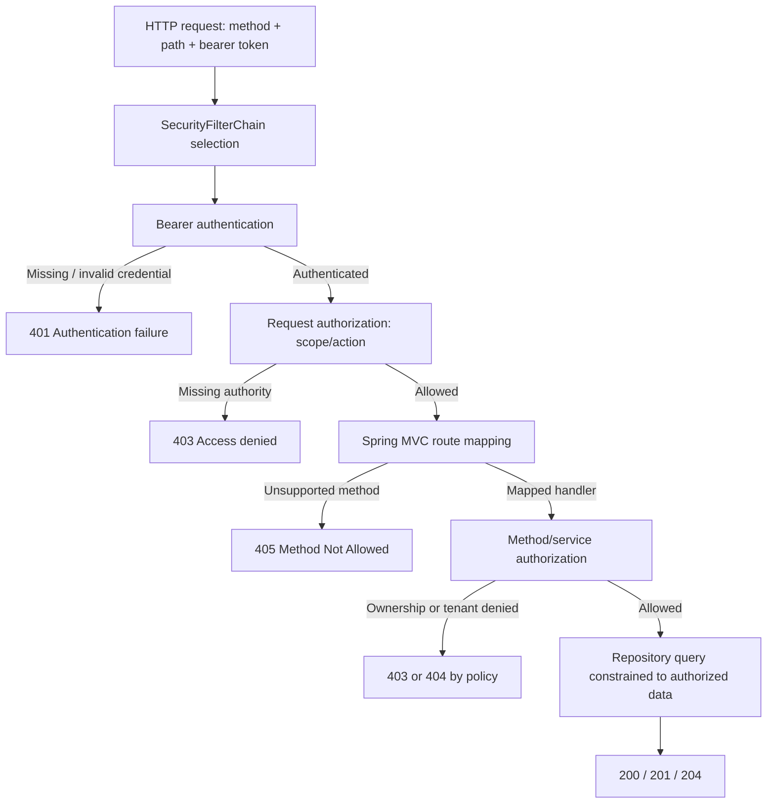

# Ma trận xác thực, scope, chủ sở hữu và phương thức HTTP

Một endpoint của Spring Security OAuth 2.0 Resource Server có thể nhận request từ nhiều trạng thái: không có token, token sai, token hợp lệ nhưng thiếu scope, token đủ scope nhưng user không sở hữu dữ liệu, hoặc request dùng HTTP method không được phép. Nếu chỉ kiểm thử một trường hợp thành công và một trường hợp 401, nhiều lỗi phân quyền vẫn có thể lọt qua.

Cách kiểm thử có hệ thống là lập ma trận theo bốn trục:

1. **Authentication:** Bearer token có tồn tại và hợp lệ không?
2. **Scope/action authorization:** principal đã xác thực có quyền thực hiện hành động tương ứng không?
3. **Ownership/tenant:** principal có quyền trên đúng object và tenant đang được yêu cầu không?
4. **HTTP method/route:** request method và path có được API hỗ trợ, và method đó có gắn đúng policy không?

Bốn trục này kiểm tra các ranh giới khác nhau. Token không hợp lệ thường dẫn tới **401**; token hợp lệ nhưng thiếu scope thường dẫn tới **403**; object không thuộc phạm vi truy cập có thể trả **403 hoặc 404** theo chính sách bảo vệ thông tin; method không được controller hỗ trợ thường dẫn tới **405**, nhưng security matcher có thể từ chối request trước khi Spring MVC xử lý route.

Bài này xây dựng ma trận test cho Spring Security Servlet Resource Server, dùng request matchers, method security, kiểm tra ownership trong service/repository và MockMvc. Các nguyên tắc tương tự áp dụng cho WebFlux với WebTestClient và reactive method security.

> **Nguyên tắc:** Xác thực principal một lần ở security boundary, kiểm tra scope cho hành động, rồi kiểm tra quyền trên object/tenant cụ thể. Không coi scope chung là bằng chứng user sở hữu mọi object, và không dùng HTTP method đơn lẻ làm authorization.

## 1. Bốn lớp quyết định của một request

Một request tới Orders API có thể đi qua các lớp sau:



Thứ tự chi tiết có thể thay đổi khi ứng dụng thêm filter, exception handler hoặc custom authorization manager, nhưng các trách nhiệm vẫn nên được phân tách:

| Lớp | Câu hỏi | Ví dụ quyết định |
|---|---|---|
| Chain selection | Request thuộc security chain nào? | API chain dùng JWT |
| Authentication | Token có được tin cậy không? | 401 nếu signature/issuer/expiry sai |
| Request authorization | Principal có quyền gọi action này không? | 403 nếu thiếu orders.write |
| Route mapping | Controller có hỗ trợ method/path này không? | 405 hoặc 404 |
| Object authorization | Principal có quyền với order cụ thể không? | 403 hoặc 404 |
| Data access | Query có giới hạn theo tenant/owner không? | Chỉ trả records được phép |

Không gộp mọi lỗi thành “token invalid”. Một user có thể có token hoàn toàn hợp lệ nhưng vẫn không được đọc order của người khác.

## 2. Xác định token contract và authority mapping

Giả sử Orders API tin issuer và audience đã cấu hình, access token có dạng:

```json
{
  "iss": "https://issuer.test",
  "sub": "user-123",
  "aud": ["orders-api"],
  "scope": "orders.read orders.write",
  "tenant_id": "shop-a",
  "exp": 1900000000
}
```

Spring Security thường ánh xạ claim scope thành authorities có prefix SCOPE_:

| Claim scope | GrantedAuthority |
|---|---|
| orders.read | SCOPE_orders.read |
| orders.write | SCOPE_orders.write |
| orders.cancel | SCOPE_orders.cancel |

Khi cấu hình yêu cầu authority chính xác SCOPE_orders.read, rule kiểm tra đúng giá trị đó. Nếu dùng hasRole("ADMIN"), Spring thường kiểm tra authority ROLE_ADMIN; đó là quy ước khác với OAuth scope.

### 2.1. Đừng nhầm scope với ownership

Token có orders.read có thể cho phép user gọi chức năng đọc order, nhưng không có nghĩa user được đọc mọi order trong hệ thống.

```text
user-123:
  scope = orders.read
  tenant = shop-a

order-42:
  tenant = shop-a
  owner = user-456
```

Scope đủ để gọi endpoint GET, nhưng object policy có thể vẫn từ chối vì order-42 thuộc user-456. Nếu hệ thống có vai trò quản trị viên được đọc mọi order trong tenant, cần thể hiện rule đó rõ ràng trong policy.

### 2.2. Claim tenant không tự chứng minh membership hiện hành

Nếu token có tenant_id=shop-a, API cần xác định token issuer có đáng tin, claim có nằm trong audience/profile hợp lệ và policy có chấp nhận membership snapshot tới hết token lifetime hay phải tra membership hiện hành.

Nếu membership có thể bị revoke tức thời, claim tenant cũ trong JWT không tự cập nhật. Cần online membership check, token version hoặc cơ chế revocation phù hợp với freshness requirement.

## 3. Định nghĩa ma trận quyền trước khi viết test

Một ma trận mẫu cho Orders API:

| HTTP method | Endpoint | Required scope | Ownership/policy |
|---|---|---|---|
| GET | /api/orders | orders.read | Chỉ list order trong tenant/user scope được phép |
| GET | /api/orders/{id} | orders.read | Owner hoặc order-reader/admin trong tenant |
| POST | /api/orders | orders.write | Principal có quyền tạo trong tenant hiện hành |
| PATCH | /api/orders/{id} | orders.write | Owner hoặc editor/admin trong tenant |
| DELETE | /api/orders/{id} | orders.delete | Owner hoặc delete-admin theo policy |
| POST | /api/orders/{id}/cancel | orders.cancel | Owner hoặc cancellation operator |
| GET | /api/public/catalog | Không yêu cầu | Dữ liệu public |
| OPTIONS | API CORS preflight | CORS policy | Chỉ xử lý preflight hợp lệ |

Đây là ví dụ. Ứng dụng cần xác định method, scope và ownership rule theo business contract thật. Không tự động dùng cùng scope orders.write cho PATCH, DELETE và cancel nếu mức độ rủi ro khác nhau.

### 3.1. Tạo bảng quyền theo từng principal

Ví dụ dữ liệu test:

| Principal | Tenant | Scope | Object |
|---|---|---|---|
| user-A | shop-a | orders.read, orders.write | Owner order-A |
| user-B | shop-a | orders.read | Owner order-B |
| user-C | shop-b | orders.read, orders.write | Owner order-C |
| user-D | shop-a | Không có orders.read | Không sở hữu order |
| admin-A | shop-a | orders.read, orders.delete | Tenant administrator |

Bộ test cần có các trường hợp:
- Đúng scope, đúng owner, đúng tenant.
- Đúng scope nhưng khác owner.
- Đúng scope nhưng khác tenant.
- Đúng owner nhưng thiếu scope.
- Đúng tenant nhưng token không hợp lệ.
- Có role quản trị được phép vượt owner restriction theo policy.
- Principal không có membership hiện hành dù JWT vẫn còn claim tenant.

## 4. Authentication matrix: không token, token sai và token hợp lệ

Authentication cần được kiểm tra trước scope và ownership.

| Credential | Endpoint protected | Kết quả thường gặp | Ý nghĩa |
|---|---|---:|---|
| Không có Authorization header | GET /api/orders | 401 | Chưa xác thực |
| Bearer token malformed | GET /api/orders | 401 hoặc lỗi request 400 tùy dạng malformed | Credential không được chấp nhận |
| JWT sai chữ ký | GET /api/orders | 401 | Không xác minh được token |
| JWT sai issuer | GET /api/orders | 401 | Issuer không được tin |
| JWT sai audience | GET /api/orders | 401 | Token không dành cho Orders API |
| JWT hết hạn | GET /api/orders | 401 | Token hết validity |
| JWT hợp lệ | GET /api/orders | Tiếp tục authorization | Chưa kết luận user có quyền |
| JWT hợp lệ nhưng thiếu scope | GET /api/orders | 403 | Authentication thành công, authorization thất bại |

Điểm quan trọng: không dùng 401 cho token hợp lệ nhưng thiếu quyền. Nếu mọi failure đều thành 401, client khó phân biệt cần đăng nhập lại hay cần quyền khác.

### 4.1. Test 401 với Bearer header thật

Để kiểm tra Bearer authentication, gửi Authorization header qua MockMvc với filter chain thật:

```java
mockMvc.perform(get("/api/orders")
        .header(
            HttpHeaders.AUTHORIZATION,
            "Bearer invalid-token"
        ))
    .andExpect(status().isUnauthorized());
```

Đảm bảo JwtDecoder hoặc fake JWKS được cấu hình để token fixture thực sự bị từ chối. Với JWT malformed, parser có thể trả lỗi trước signature validation; nếu muốn kiểm tra bad signature cụ thể, tạo compact JWT hợp lệ về cấu trúc nhưng ký bằng key không được tin cậy.

### 4.2. Không dùng mockJwt để chứng minh authentication

```java
mockMvc.perform(get("/api/orders")
        .with(jwt().authorities(
            new SimpleGrantedAuthority("SCOPE_orders.read")
        )))
    .andExpect(status().isOk());
```

Đây là cách phù hợp để kiểm tra authorization với Authentication giả lập. Nó không chứng minh token trong header được parse, chữ ký được xác minh, issuer/audience validator chạy hoặc JWKS được tải.

Tách hai loại test:
- Mock JWT để kiểm tra scope/action/ownership logic nhanh.
- Signed JWT thật qua Bearer header để kiểm tra authentication integration.

## 5. Scope/action matrix

Sau khi token hợp lệ, scope quyết định principal có thể gọi action nào.

Ví dụ policy:

```java
@Bean
SecurityFilterChain ordersSecurity(HttpSecurity http) throws Exception {
    return http
        .securityMatcher("/api/**")
        .sessionManagement(session ->
            session.sessionCreationPolicy(
                SessionCreationPolicy.STATELESS
            )
        )
        .authorizeHttpRequests(auth -> auth
            .requestMatchers("/api/public/**").permitAll()
            .requestMatchers(HttpMethod.GET, "/api/orders/**")
                .hasAuthority("SCOPE_orders.read")
            .requestMatchers(HttpMethod.POST, "/api/orders/*/cancel")
                .hasAuthority("SCOPE_orders.cancel")
            .requestMatchers(HttpMethod.POST, "/api/orders/**")
                .hasAuthority("SCOPE_orders.write")
            .requestMatchers(HttpMethod.PATCH, "/api/orders/**")
                .hasAuthority("SCOPE_orders.write")
            .requestMatchers(HttpMethod.DELETE, "/api/orders/**")
                .hasAuthority("SCOPE_orders.delete")
            .anyRequest().denyAll()
        )
        .oauth2ResourceServer(oauth2 ->
            oauth2.jwt(Customizer.withDefaults())
        )
        .build();
}
```

Các rule cụ thể được đặt trước rule rộng hơn. Ví dụ route cancel là POST nhưng yêu cầu orders.cancel, nên phải đứng trước matcher POST chung yêu cầu orders.write.

Nếu POST cancel matcher bị đặt sau POST /api/orders/**, request có thể match rule write trước và không bao giờ tới rule cancel. Thứ tự authorization matchers có ý nghĩa.

### 5.1. Bảng kiểm tra scope theo method

| Method/action | Scope có | Scope thiếu | Token invalid |
|---|---:|---:|---:|
| GET order | 200 hoặc kết quả object policy | 403 | 401 |
| POST create | 201 | 403 | 401 |
| PATCH update | 200/204 | 403 | 401 |
| DELETE order | 204 | 403 | 401 |
| POST cancel | 200/204 | 403 | 401 |

Status thành công phụ thuộc endpoint contract. Bảng chỉ mô tả security decision trước business response.

### 5.2. Scope rộng không tự cho phép mọi method

Nếu token có orders.write nhưng không có orders.delete, request PATCH có thể được phép còn DELETE phải bị từ chối. Không ánh xạ tất cả write operations thành một scope duy nhất nếu business policy cần phân biệt.

### 5.3. Kiểm tra cả scope granted và scope mapping

Nếu issuer phát claim scope dạng chuỗi, Spring Security converter mặc định thường map thành SCOPE_ authorities. Nếu issuer phát scp array hoặc permissions custom, cần cấu hình JwtAuthenticationConverter tương ứng và fixture phải phản ánh schema đó.

Test nên xác nhận:
- Token có scope được map đúng authority.
- Token thiếu scope không nhận authority mặc định.
- Claim rỗng/null/malformed không tạo quyền ngoài ý muốn.
- Role và scope không bị nhầm prefix.
- Custom converter không bỏ qua issuer/audience validation.

## 6. Ownership matrix: user có scope nhưng không sở hữu object

Ownership là authorization ở cấp object. Nó thường cần dữ liệu của resource và quan hệ giữa principal với resource.

Ví dụ order:

```json
{
  "id": "order-A",
  "tenantId": "shop-a",
  "ownerSubject": "user-A",
  "status": "PENDING"
}
```

Ma trận:

| Token subject | Scope | Tenant trong context | Order owner/tenant | Expected theo policy |
|---|---|---|---|---|
| user-A | orders.read | shop-a | user-A / shop-a | Cho phép |
| user-B | orders.read | shop-a | user-A / shop-a | 403 hoặc 404 |
| user-A | Không có orders.read | shop-a | user-A / shop-a | 403 trước object policy |
| user-C | orders.read | shop-b | user-A / shop-a | 404 hoặc 403 |
| admin-A | orders.read + admin policy | shop-a | user-A / shop-a | Cho phép nếu admin policy cho phép |
| user-A | orders.read | membership đã revoked | user-A / shop-a | Từ chối theo membership freshness policy |

### 6.1. Kiểm tra owner bằng subject đã xác thực

So sánh owner với subject từ Jwt đã được decoder xác thực. Không lấy owner identity từ query parameter, request body hoặc header do caller gửi.

Ví dụ service:

```java
@Service
public class OrderQueryService {

    private final OrderRepository orders;
    private final TenantAccessPolicy tenantPolicy;

    public OrderQueryService(
            OrderRepository orders,
            TenantAccessPolicy tenantPolicy) {
        this.orders = orders;
        this.tenantPolicy = tenantPolicy;
    }

    @PreAuthorize("hasAuthority('SCOPE_orders.read')")
    public OrderDto findVisibleOrder(UUID orderId, Jwt jwt) {
        String subject = jwt.getSubject();
        String tenantId = tenantPolicy.requireActiveTenant(jwt);

        return orders
            .findByIdAndTenantIdAndOwnerSubject(
                orderId,
                tenantId,
                subject
            )
            .map(OrderDto::from)
            .orElseThrow(() -> new OrderNotFoundException(orderId));
    }
}
```

Method security cần bật bằng @EnableMethodSecurity. Đây là ví dụ policy chỉ cho owner đọc order. Nếu admin hoặc delegated actor có quyền đọc, đưa logic đó vào một access policy rõ ràng và test từng nhánh.

### 6.2. Giới hạn query theo tenant và owner

```sql
SELECT *
FROM orders
WHERE id = :orderId
  AND tenant_id = :authorizedTenant
  AND owner_subject = :verifiedSubject;
```

có thể tránh tải object của tenant khác hoặc owner khác vào application layer. Nếu policy có admin, query/policy phải bổ sung điều kiện admin đã được xác minh.

Đừng làm query theo ID toàn cục rồi chỉ kiểm tra owner ở UI. UI không phải security boundary.

### 6.3. 403 hay 404 cho object không thuộc user?

Hai cách trả lời đều có thể hợp lệ tùy threat model:

- **403:** server xác nhận resource tồn tại nhưng principal không có quyền.
- **404:** server không tiết lộ resource có tồn tại hay không trong phạm vi principal đó.

Nếu dùng 404 để chống enumeration, cần áp dụng nhất quán cho order không tồn tại và order tồn tại nhưng không visible. Không để response body, timing, count hoặc log correlation vô tình tiết lộ khác biệt cho caller.

### 6.4. Ownership không nhất thiết là một cột owner

Một order có thể được chia sẻ cho collaborator, team hoặc role trong tenant. Khi đó policy có thể dựa trên ACL, assignment, membership hoặc relationship. Tên ownership trong ma trận là khái niệm object-level access; test phải phản ánh mô hình quan hệ thực tế.

## 7. Tenant isolation là một chiều riêng của ownership

User có thể thuộc nhiều tenants nhưng quyền khác nhau ở mỗi tenant:

```text
user-A:
  shop-a: orders.read, orders.write
  shop-b: orders.read
  shop-c: no membership
```

Một test chỉ kiểm tra subject=user-A và scope=orders.read chưa đủ. Phải kiểm tra tenant context.

| Principal | Requested tenant | Membership | Expected |
|---|---|---|---|
| user-A | shop-a | Active | Cho phép nếu object policy đạt |
| user-A | shop-b | Active read-only | GET có thể cho phép, POST từ chối |
| user-A | shop-c | Không có | 403/404 theo policy |
| user-B | shop-a | Active nhưng không owner | Theo ACL/owner policy |
| user-A | shop-a | Revoked sau khi token phát hành | Từ chối sau freshness window |

Tenant ID có thể đến từ path, host hoặc token claim, nhưng mọi nguồn đều cần được ràng buộc với membership đã xác minh. Path /tenants/shop-a không tự cấp quyền shop-a.

### 7.1. Không dùng tenant từ request làm trusted context

Sai:

```java
String tenantId = request.getHeader("X-Tenant-Id");
return repository.findByTenantId(tenantId);
```

Caller có thể tự đổi header. Header chỉ nên là selector/context input; server phải kiểm tra subject có membership/permission trong tenant đó trước khi query.

### 7.2. Kiểm tra membership hiện hành

Nếu token có tenant claim nhưng membership có thể bị revoke trong thời gian token còn hạn, policy có thể:
- Tra membership service/database theo request.
- Cache membership với TTL có giới hạn.
- Dùng tenant membership version.
- Chấp nhận snapshot tới token expiry nếu risk policy cho phép.

Ma trận test phải bao gồm token cũ còn hạn sau membership revoke. Kết quả mong đợi phải khớp freshness contract.

## 8. HTTP method là một phần của authorization contract

Cùng một path có thể có quyền khác nhau theo method:

```text
GET    /api/orders/42  -> orders.read
PATCH  /api/orders/42  -> orders.write
DELETE /api/orders/42  -> orders.delete
```

Không dùng rule chỉ theo path nếu rule đó vô tình cho phép DELETE với chỉ scope read. Hãy ràng buộc method/action rõ ràng.

### 8.1. Thứ tự matcher cụ thể trước matcher rộng

Ví dụ:

```java
.authorizeHttpRequests(auth -> auth
    .requestMatchers(HttpMethod.POST, "/api/orders/*/cancel")
        .hasAuthority("SCOPE_orders.cancel")
    .requestMatchers(HttpMethod.POST, "/api/orders/**")
        .hasAuthority("SCOPE_orders.write")
    .anyRequest().denyAll()
)
```

Route cancel phải được xử lý trước POST rule chung. Khi thêm endpoint mới, cập nhật cả controller mapping, authorization matcher và test matrix.

### 8.2. Method không được hỗ trợ có thể trả 405 hoặc bị security chặn trước

Spring Security filters chạy trước DispatcherServlet route mapping. Vì vậy, nếu request không có token nhưng security matcher áp dụng authenticated cho path, request có thể bị 401 trước khi Spring MVC phát hiện method không được hỗ trợ.

Nếu token hợp lệ nhưng không match bất kỳ authorization rule nào:
- anyRequest().denyAll() có thể trả 403 trước route mapping.
- anyRequest().authenticated() có thể cho request qua authorization, sau đó MVC có thể trả 405/404.
- Một custom matcher có thể tạo kết quả khác.

Không mặc định mọi method sai đều trả 405. Test status theo cấu hình thực tế và xác định lớp nào từ chối request.

### 8.3. HEAD

Spring MVC thường hỗ trợ HEAD cho GET mapping theo semantics của framework, nhưng authorization matcher dùng HttpMethod.GET có thể không match HEAD như một GET rule. Hãy quyết định rõ HEAD có được phép dùng cùng scope orders.read hay không và viết matcher/test tương ứng.

Không giả định proxy, servlet container và Spring Security xử lý method normalization giống nhau trong mọi cấu hình.

### 8.4. OPTIONS và CORS preflight

CORS preflight thường là OPTIONS request có Origin, Access-Control-Request-Method và Access-Control-Request-Headers. Nó không giống một business OPTIONS request.

Cấu hình CORS đúng và để CORS filter xử lý preflight theo policy. Nếu thêm permitAll cho OPTIONS, giới hạn theo API/CORS design; đừng coi OPTIONS permitAll là cho phép mọi business operation. Test actual GET/POST/PATCH vẫn cần Authorization header và authorization assertions riêng.

### 8.5. Method override và method tunneling

Nếu ứng dụng hoặc proxy hỗ trợ method override qua header/parameter, cần xác định Spring Security matcher nhìn thấy method nào và DispatcherServlet xử lý method nào. Không bật method override tùy tiện; nếu được dùng, test cả method gốc và method sau override để tránh bypass rule.

## 9. Cấu hình request matcher cho ma trận method/scope

Ví dụ đầy đủ:

```java
@Bean
SecurityFilterChain ordersSecurity(HttpSecurity http) throws Exception {
    return http
        .securityMatcher("/api/**")
        .sessionManagement(session ->
            session.sessionCreationPolicy(
                SessionCreationPolicy.STATELESS
            )
        )
        .authorizeHttpRequests(auth -> auth
            .requestMatchers("/api/public/**").permitAll()
            .requestMatchers(HttpMethod.OPTIONS, "/api/**").permitAll()
            .requestMatchers(HttpMethod.GET, "/api/orders/**")
                .hasAuthority("SCOPE_orders.read")
            .requestMatchers(HttpMethod.POST, "/api/orders/*/cancel")
                .hasAuthority("SCOPE_orders.cancel")
            .requestMatchers(HttpMethod.POST, "/api/orders/**")
                .hasAuthority("SCOPE_orders.write")
            .requestMatchers(HttpMethod.PATCH, "/api/orders/**")
                .hasAuthority("SCOPE_orders.write")
            .requestMatchers(HttpMethod.DELETE, "/api/orders/**")
                .hasAuthority("SCOPE_orders.delete")
            .anyRequest().denyAll()
        )
        .oauth2ResourceServer(oauth2 ->
            oauth2.jwt(Customizer.withDefaults())
        )
        .build();
}
```

Lưu ý:
- OPTIONS rule trong ví dụ chỉ minh họa authorization; cấu hình CORS vẫn phải định nghĩa origins, methods và headers được phép.
- Matcher POST cancel đặt trước POST orders rộng.
- anyRequest().denyAll() làm rõ các route/method chưa được định nghĩa.
- Nếu cần HEAD, thêm matcher/behavior theo contract.
- Public route vẫn nằm trong Resource Server chain nên Bearer token sai có thể bị xác thực thất bại trước permitAll.

## 10. Kết hợp request authorization và method security

Request matcher phù hợp cho coarse-grained authorization theo HTTP method/path. Method security phù hợp cho rule gắn với operation/service method. Có thể dùng cả hai để bảo vệ hai boundary khác nhau.

Bật method security:

```java
@Configuration
@EnableMethodSecurity
class MethodSecurityConfiguration {
}
```

Service:

```java
@Service
public class OrderCommandService {

    @PreAuthorize("hasAuthority('SCOPE_orders.write')")
    public OrderDto updateOrder(
            UUID orderId,
            UpdateOrderCommand command,
            Jwt jwt) {
        // Load only an order visible to this subject and tenant.
        // Apply business validation and persist the update.
        return null;
    }

    @PreAuthorize("hasAuthority('SCOPE_orders.delete')")
    public void deleteOrder(UUID orderId, Jwt jwt) {
        // Apply object-level delete policy.
    }
}
```

Đây là khung minh họa; implementation phải thực hiện ownership/tenant checks trước khi thay đổi dữ liệu. Method security không tự hiểu order owner chỉ từ tên method.

### 10.1. Tránh chỉ bảo vệ controller

Nếu chỉ đặt PreAuthorize trên controller, một service khác có thể gọi service method trực tiếp và bỏ qua rule controller. Với nghiệp vụ nhạy cảm, đặt policy tại service boundary hoặc policy component được mọi entry point sử dụng.

### 10.2. Tránh chỉ bảo vệ service method bằng scope mà bỏ object policy

PreAuthorize với orders.write chỉ chứng minh principal có scope. Nó không chứng minh principal được sửa orderId đang truyền vào. Ownership/tenant check vẫn phải chạy.

### 10.3. Method security và proxy

Spring method security thường dùng proxy/AOP. Self-invocation trong cùng bean có thể không đi qua proxy, nên annotation trên method được gọi nội bộ có thể không được áp dụng như mong đợi. Thiết kế service boundaries rõ và test gọi qua Spring bean/proxy thực.

## 11. Object authorization bằng policy component

Khi rule phức tạp hơn owner equality, tách policy:

```java
@Component
public class OrderAccessPolicy {

    public boolean canRead(
            Jwt jwt,
            Order order,
            TenantMembership membership) {

        if (!membership.isActive()) {
            return false;
        }

        if (!membership.tenantId().equals(order.getTenantId())) {
            return false;
        }

        boolean owner =
            order.getOwnerSubject().equals(jwt.getSubject());

        boolean tenantReader =
            membership.hasPermission("orders.read.all");

        return owner || tenantReader;
    }
}
```

Sau đó service load membership và object theo một quy trình có kiểm soát:

```java
@PreAuthorize("hasAuthority('SCOPE_orders.read')")
public OrderDto readOrder(UUID id, Jwt jwt) {
    TenantMembership membership =
        membershipService.requireActiveMembership(
            jwt.getSubject(),
            resolveAuthorizedTenant(jwt)
        );

    Order order = orderRepository
        .findByIdAndTenantId(id, membership.tenantId())
        .orElseThrow(() -> new OrderNotFoundException(id));

    if (!orderAccessPolicy.canRead(jwt, order, membership)) {
        throw new OrderNotFoundException(id);
    }

    return OrderDto.from(order);
}
```

Ở đây ví dụ dùng 404 cho object không visible. Nếu policy muốn 403, thay exception mapping phù hợp. Cần nhất quán giữa detail, list, count, export và search endpoints.

### 11.1. Kiểm tra list và detail cùng policy

Một lỗi phổ biến là detail endpoint kiểm tra owner nhưng list endpoint chỉ lọc theo tenant. Hoặc list trả count của toàn tenant dù records đã được lọc. Mỗi cách truy cập object phải cùng tuân thủ policy:

- GET /orders/{id}
- GET /orders
- GET /orders/search
- GET /orders/count
- Export/report endpoints
- Background jobs truy cập dữ liệu theo user context

Ma trận test nên kiểm tra cả collection và individual resource.

## 12. Tạo bộ fixture cho principal và resource

Giữ test data dễ đọc:

```text
Principals:
  alice:
    sub = user-alice
    tenant = shop-a
    authorities = orders.read, orders.write

  bob:
    sub = user-bob
    tenant = shop-a
    authorities = orders.read

  carol:
    sub = user-carol
    tenant = shop-b
    authorities = orders.read, orders.write

  admin:
    sub = admin-a
    tenant = shop-a
    authorities = orders.read, orders.delete
    membership permission = orders.read.all

Orders:
  order-a:
    tenant = shop-a
    owner = user-alice

  order-b:
    tenant = shop-a
    owner = user-bob

  order-c:
    tenant = shop-b
    owner = user-carol
```

Fixture này cho phép test:
- Alice đọc/sửa order-a.
- Alice đọc order-b nếu policy chỉ owner thì bị từ chối; nếu tenant-reader policy cho phép thì cần authority/membership bổ sung.
- Bob đọc order-b nhưng không được sửa nếu thiếu orders.write.
- Carol không truy cập order-a vì khác tenant.
- Admin đọc order-b nếu membership permission cho phép.
- Token shop-a không được dùng để truy vấn shop-b chỉ bằng cách đổi path.

Tránh tạo test data mà mọi user đều là owner của mọi order; fixture như vậy không kiểm tra được ownership.

## 13. MockMvc: test scope và ownership bằng JWT Authentication giả lập

Đối với authorization matrix, Spring Security Test có thể tạo JwtAuthenticationToken giả lập:

```java
mockMvc.perform(get("/api/orders/{id}", orderId)
        .with(jwt()
            .jwt(jwt -> jwt
                .subject("user-alice")
                .claim("tenant_id", "shop-a")
            )
            .authorities(
                new SimpleGrantedAuthority("SCOPE_orders.read")
            )))
    .andExpect(status().isOk());
```

Imports/static imports thường dùng:

```java
import static org.springframework.security.test.web.servlet.request.SecurityMockMvcRequestPostProcessors.jwt;
import static org.springframework.test.web.servlet.request.MockMvcRequestBuilders.get;
import static org.springframework.test.web.servlet.result.MockMvcResultMatchers.status;

import org.springframework.security.core.authority.SimpleGrantedAuthority;
```

Trong test này:
- Principal subject là user-alice.
- Tenant claim là shop-a.
- Authority orders.read được cấp.
- Service/repository fixture phải có order thuộc user-alice/shop-a.

### 13.1. Test thiếu scope

```java
mockMvc.perform(get("/api/orders/{id}", orderId)
        .with(jwt()
            .jwt(jwt -> jwt.subject("user-alice"))
            .authorities(
                new SimpleGrantedAuthority("SCOPE_profile.read")
            )))
    .andExpect(status().isForbidden());
```

Request đã có Authentication nhưng không có authority orders.read. Nếu request matcher chặn trước controller, object service không cần được gọi.

### 13.2. Test đúng scope nhưng sai owner

```java
mockMvc.perform(get("/api/orders/{id}", orderOwnedByBob)
        .with(jwt()
            .jwt(jwt -> jwt
                .subject("user-alice")
                .claim("tenant_id", "shop-a")
            )
            .authorities(
                new SimpleGrantedAuthority("SCOPE_orders.read")
            )))
    .andExpect(status().isNotFound());
```

Expected 404 ở ví dụ anti-enumeration policy. Nếu ứng dụng dùng 403, đổi assertion theo contract. Test phải chứng minh service/object policy được thực thi chứ không chỉ request matcher.

### 13.3. Test đúng owner nhưng sai tenant context

```java
mockMvc.perform(get("/api/tenants/{tenant}/orders/{id}",
            "shop-b",
            orderOwnedByAliceInShopA)
        .with(jwt()
            .jwt(jwt -> jwt
                .subject("user-alice")
                .claim("tenant_id", "shop-a")
            )
            .authorities(
                new SimpleGrantedAuthority("SCOPE_orders.read")
            )))
    .andExpect(status().isNotFound());
```

Request path yêu cầu shop-b nhưng principal context chỉ cho shop-a. Tenant resolver/policy phải từ chối trước khi trả dữ liệu.

### 13.4. Test admin override

Nếu admin có permission orders.read.all trong tenant:

```java
mockMvc.perform(get("/api/orders/{id}", orderOwnedByBob)
        .with(jwt()
            .jwt(jwt -> jwt
                .subject("admin-a")
                .claim("tenant_id", "shop-a")
            )
            .authorities(
                new SimpleGrantedAuthority("SCOPE_orders.read")
            )))
    .andExpect(status().isOk());
```

Fixture membership phải cấp admin permission đã xác định. Đừng chỉ đặt tên subject là admin rồi để policy suy luận quyền từ tên.

## 14. Parameterized test cho method và scope

Một cách tổ chức là định nghĩa cases có method, path, authority và expected status:

```java
record MethodCase(
    HttpMethod method,
    String path,
    String requiredScope,
    String grantedScope,
    int expectedStatus
) {}
```

Ví dụ cases:

```java
static Stream<Arguments> methodCases() {
    return Stream.of(
        Arguments.of(
            HttpMethod.GET,
            "/api/orders/order-a",
            "orders.read",
            "orders.read",
            200
        ),
        Arguments.of(
            HttpMethod.GET,
            "/api/orders/order-a",
            "orders.read",
            "orders.write",
            403
        ),
        Arguments.of(
            HttpMethod.PATCH,
            "/api/orders/order-a",
            "orders.write",
            "orders.write",
            200
        ),
        Arguments.of(
            HttpMethod.DELETE,
            "/api/orders/order-a",
            "orders.delete",
            "orders.read",
            403
        )
    );
}
```

Đây là minh họa cấu trúc test; endpoint success status và method mapping phải khớp ứng dụng. Khi dùng JUnit parameterized tests, mỗi case cần tạo request đúng method, gắn authority đúng và setup object policy tương ứng.

### 14.1. Không chỉ kiểm tra scope theo một method

Nếu test chỉ GET, một lỗi matcher có thể vô tình cho DELETE qua. Hãy kiểm tra từng method nhạy cảm và ít nhất một method không được hỗ trợ.

### 14.2. Không dùng cùng expected cho mọi failure

- Thiếu token: 401.
- Token invalid: 401.
- Token valid thiếu scope: 403.
- Token valid có scope nhưng object không visible: 403/404.
- Method không có handler: 405/404 nếu security cho request qua tới MVC; có thể 403 nếu security deny trước.
- Preflight không hợp lệ: CORS rejection theo policy.

Expected phải chỉ rõ failure layer.

## 15. Full method matrix

Với policy ví dụ ở trên:

| Principal/token | GET /orders/{id} | POST /orders | PATCH /orders/{id} | DELETE /orders/{id} |
|---|---:|---:|---:|---:|
| Anonymous | 401 | 401 | 401 | 401 |
| Invalid JWT | 401 | 401 | 401 | 401 |
| Alice: read + write, owner | 200 | 201 | 200/204 | 403 nếu thiếu delete |
| Bob: read only, owner | 200 | 403 | 403 | 403 |
| Carol: read + write, khác tenant | 404/403 | Theo tenant policy | 404/403 | 404/403 |
| Alice: read + write, không owner | 404/403 | 201 nếu được tạo trong tenant | 404/403 | 404/403 |
| Admin: read + delete, tenant admin | 200 nếu admin-read policy | 403 nếu thiếu write | 403 nếu thiếu write | 204 nếu delete policy cho phép |

Bảng trên giả định:
- Authentication được xác minh.
- Scope được kiểm tra theo method.
- Ownership/tenant được kiểm tra cho object operations.
- Admin override là explicit policy.
- POST create không cần owner trước khi tạo; tenant membership và create permission được kiểm tra.

### 15.1. POST create cần kiểm tra tenant và dữ liệu đầu vào

Với POST /orders, chưa có owner object để kiểm tra. API cần xác minh principal có quyền tạo order trong tenant, rồi server tự gán owner từ verified subject hoặc policy. Không nhận ownerSubject từ body để caller tự chọn owner khác.

### 15.2. PATCH không cho đổi owner tùy tiện

Nếu PATCH body có ownerSubject hoặc tenantId, đây là thuộc tính nhạy cảm. Không bind trực tiếp toàn bộ DTO vào entity. Chỉ cho phép thay đổi owner/tenant qua workflow riêng có permission rõ ràng và audit.

### 15.3. DELETE phải có policy riêng

Có orders.write không tự có nghĩa được xóa order. Delete có thể không được phép với order đã thanh toán, đang fulfilment hoặc đã settlement. Scope authorization và business state validation đều cần test.

## 16. Method security với object expressions

Spring Security có thể dùng PreAuthorize để gọi policy bean:

```java
@PreAuthorize("@orderPolicy.canRead(authentication, #orderId)")
public OrderDto read(UUID orderId) {
    return orderService.load(orderId);
}
```

Policy có thể truy vấn membership/ownership và trả boolean. Cần cân nhắc:
- Query policy có thể tạo thêm database calls.
- Không để policy và service load object bằng hai điều kiện khác nhau.
- Không trả true chỉ vì principal có scope chung.
- Nếu dùng 404 anti-enumeration, boolean false phải được ánh xạ nhất quán.
- Không tạo N+1 policy lookups trong collection endpoints.

Một lựa chọn là load object theo tenant-constrained repository method rồi kiểm tra policy trên object đã load. Lựa chọn khác là query trực tiếp theo principal/tenant/ACL để object không visible không bao giờ được trả về service.

## 17. Repository-level authorization và IDOR

IDOR (Insecure Direct Object Reference) xảy ra khi API nhận một identifier do caller kiểm soát rồi trả/sửa object mà không kiểm tra quyền trên object đó.

Ví dụ nguy hiểm:

```java
Order order = repository.findById(orderId).orElseThrow();
return OrderDto.from(order);
```

Nếu không có ownership/tenant policy sau query, bất kỳ user nào có orders.read có thể thử IDs khác.

An toàn hơn:

```java
Order order = repository
    .findByIdAndTenantIdAndOwnerSubject(
        orderId,
        authorizedTenant,
        verifiedSubject
    )
    .orElseThrow(() -> new OrderNotFoundException(orderId));
```

Hoặc dùng repository query join ACL/membership hiện hành. Cần bảo đảm mọi update/delete query cũng có điều kiện owner/tenant:

```sql
UPDATE orders
SET status = :newStatus
WHERE id = :orderId
  AND tenant_id = :authorizedTenant
  AND owner_subject = :verifiedSubject;
```

Kiểm tra số hàng được cập nhật. Nếu update count bằng 0, trả lỗi theo policy. Điều này giúp tránh time-of-check/time-of-use gap giữa kiểm tra owner và mutation, dù các workflow phức tạp có thể cần transaction/locking bổ sung.

## 18. List, search, count và export cần cùng ma trận

Một hệ thống có thể bảo vệ GET /orders/{id} nhưng quên lọc GET /orders. User không đọc được chi tiết order khác nhưng vẫn thấy order đó trong list hoặc count.

Kiểm tra:
- List chỉ trả object trong tenant/owner/ACL scope.
- Search không cho filter owner/tenant tùy ý để vượt policy.
- Count chỉ đếm records visible.
- Pagination không tiết lộ tổng số records không được phép.
- Export/report dùng cùng access policy.
- Bulk endpoints kiểm tra mọi ID, không chỉ ID đầu tiên.
- Batch action không xử lý một phần records trái policy mà không có contract rõ.

Với bulk request:

```json
{
  "orderIds": ["order-a", "order-b", "order-c"],
  "action": "cancel"
}
```

nếu một ID không được phép, ứng dụng phải có policy rõ: fail toàn bộ, trả kết quả từng item hay bỏ qua item không visible. Không để response lộ dữ liệu object mà caller không được xem.

## 19. Kiểm thử HEAD, OPTIONS và unsupported methods

Một bảng riêng cho method edge cases:

| Request | Câu hỏi cần kiểm tra | Expected phụ thuộc |
|---|---|---|
| HEAD /api/orders | Có dùng policy GET không? | Matcher, MVC HEAD support |
| OPTIONS preflight | CORS có xử lý đúng không? | CorsConfigurationSource/filter |
| OPTIONS business endpoint | Có handler/policy riêng không? | Controller mapping và security rule |
| PUT /api/orders/{id} | API có hỗ trợ PUT không? | 405 hoặc security denial |
| TRACE /api/orders | Có bị chặn ở container/security không? | Server config |
| PATCH với body sai | Authorization hay validation chạy trước? | Filter/handler/business validation |
| POST cancel | Có match scope cancel cụ thể không? | Thứ tự requestMatchers |

### 19.1. HEAD policy

Nếu muốn HEAD dùng cùng read permission, có thể khai báo rõ:

```java
.requestMatchers(
    HttpMethod.GET,
    "/api/orders/**"
).hasAuthority("SCOPE_orders.read")
.requestMatchers(
    HttpMethod.HEAD,
    "/api/orders/**"
).hasAuthority("SCOPE_orders.read")
```

Tùy MVC mapping và version, HEAD có thể được xử lý thông qua GET mapping nhưng security matcher vẫn cần được kiểm chứng. Test bằng HEAD thực, không suy luận từ GET.

### 19.2. CORS preflight

Cấu hình CORS ví dụ:

```java
@Bean
CorsConfigurationSource corsConfigurationSource() {
    CorsConfiguration config = new CorsConfiguration();
    config.setAllowedOrigins(List.of("https://app.example.test"));
    config.setAllowedMethods(
        List.of("GET", "POST", "PATCH", "DELETE", "OPTIONS")
    );
    config.setAllowedHeaders(
        List.of("Authorization", "Content-Type")
    );

    UrlBasedCorsConfigurationSource source =
        new UrlBasedCorsConfigurationSource();
    source.registerCorsConfiguration("/api/**", config);
    return source;
}
```

Và bật CORS trong chain theo cấu hình ứng dụng. CORS preflight không chứng minh user có scope; nó chỉ xác định browser origin/method/header được phép gửi cross-origin request. Actual request vẫn phải đi qua authentication, scope và ownership policy.

## 20. Kiểm thử negative cases không được bỏ sót

Ngoài các case cơ bản, thêm:
- JWT đúng signature nhưng sai issuer.
- JWT đúng issuer nhưng sai audience.
- JWT expired hoặc chưa tới nbf.
- Token thiếu sub hoặc tenant claim bắt buộc theo profile.
- Token có scope nhưng membership đã bị revoke.
- Token có scope read nhưng gọi PATCH/DELETE.
- Token có scope đúng nhưng object thuộc user khác.
- Token có tenant đúng nhưng object thuộc tenant khác.
- User owner nhưng account bị disabled.
- Admin scope nhưng không có membership admin trong tenant cụ thể.
- Bulk request chứa một object unauthorized.
- Method override hoặc path normalization không được policy cho phép.
- HEAD và OPTIONS có policy khác với GET/POST.
- Request tới route không có handler hoặc không có chain.
- Public route với invalid bearer nếu route nằm trong Resource Server chain.

Các case này phát hiện lỗi ở các lớp khác nhau. Không nên chỉ assert response status; nơi phù hợp, verify service/repository không được gọi hoặc query bị ràng buộc theo tenant/owner.

## 21. Xác nhận đúng lớp đã từ chối request

Để hiểu một test failure, kiểm tra:
- Bearer decoder có được gọi không?
- JwtAuthenticationToken có được tạo không?
- Authorization matcher nào match?
- Controller có được gọi không?
- Method security có được kích hoạt qua proxy không?
- Ownership policy có được gọi không?
- Repository query có tenant/owner predicates không?

Ví dụ thiếu scope phải bị chặn trước controller/service nếu request matcher làm coarse authorization. Object ownership denial phải xảy ra sau khi token đã xác thực và scope đủ.

Test có thể dùng Mockito verify:

```java
verify(orderQueryService, never())
    .findVisibleOrder(any(), any());
```

cho case thiếu scope. Với case sai owner, service có thể đã được gọi nhưng repository phải chỉ trả object visible hoặc policy phải từ chối. Chọn assertion theo boundary thực tế, không verify một implementation detail không ổn định.

## 22. WebFlux tương đương

Trong WebFlux, các khái niệm vẫn giống nhau:
- SecurityWebFilterChain chọn filter chain theo matcher.
- ReactiveJwtDecoder xác minh JWT.
- authorizeExchange/requestMatchers kiểm tra path/method.
- Reactive method security bảo vệ service methods.
- WebTestClient gửi HTTP requests.
- Repository/policy checks vẫn phải ràng buộc owner và tenant.

Ví dụ request matcher:

```java
@Bean
SecurityWebFilterChain apiSecurity(ServerHttpSecurity http) {
    return http
        .authorizeExchange(exchanges -> exchanges
            .pathMatchers(HttpMethod.GET, "/api/orders/**")
                .hasAuthority("SCOPE_orders.read")
            .pathMatchers(HttpMethod.POST, "/api/orders/**")
                .hasAuthority("SCOPE_orders.write")
            .anyExchange().denyAll()
        )
        .oauth2ResourceServer(oauth2 ->
            oauth2.jwt(Customizer.withDefaults())
        )
        .build();
}
```

Ví dụ WebTestClient:

```java
webTestClient.get()
    .uri("/api/orders/order-a")
    .headers(headers -> headers.setBearerAuth(signedToken))
    .exchange()
    .expectStatus().isOk();
```

Dùng mockJwt cho authorization tests và signed bearer token với ReactiveJwtDecoder thật cho signature/claims integration. Trong reactive policy, không gọi blocking repository hoặc block() trên event loop.

## 23. Bộ test tối thiểu nên được chia thành các nhóm

| Nhóm | Các case tối thiểu | Mục tiêu |
|---|---|---|
| Authentication | no token, malformed, bad signature, expired, wrong issuer/aud | 401 và decoder behavior |
| Scope | đúng scope, thiếu scope, scope khác action | 200/403 theo action |
| Ownership | owner, non-owner, admin, missing object | Object-level policy |
| Tenant | same tenant, other tenant, revoked membership | Tenant isolation/freshness |
| HTTP method | GET, POST, PATCH, DELETE, cancel, unsupported, HEAD | Method-specific rules |
| Collection | list, search, count, export, bulk | Không lộ records ngoài policy |
| CORS | preflight hợp lệ/không hợp lệ, actual request | Browser boundary |
| Integration | signed JWT + real decoder + MockMvc/WebTestClient | End-to-end authentication |

Có thể dùng parameterized tests cho scope/method matrix, nhưng ownership và tenant scenarios thường cần fixtures riêng để test dễ đọc.

## 24. Ví dụ một test case đầy đủ từ token tới object

Một test đọc order có thể mô tả:

```text
Request:
  GET /api/tenants/shop-a/orders/order-a

Authentication:
  JWT signature valid
  issuer = trusted issuer
  audience = orders-api
  subject = user-alice
  tenant_id = shop-a

Authorization:
  authority = SCOPE_orders.read

Object:
  id = order-a
  tenant = shop-a
  owner = user-alice

Expected:
  200 OK
```

Biến thể non-owner:

```text
Request:
  GET /api/tenants/shop-a/orders/order-b

Authentication:
  Same valid JWT, subject=user-alice

Authorization:
  SCOPE_orders.read present

Object:
  id = order-b
  tenant = shop-a
  owner = user-bob

Expected:
  404 Not Found (anti-enumeration policy)
```

Biến thể thiếu scope:

```text
Request:
  GET /api/tenants/shop-a/orders/order-a

Authentication:
  JWT valid, subject=user-alice

Authorization:
  orders.read absent

Expected:
  403 Forbidden
  Object service is not invoked
```

Biến thể invalid token:

```text
Request:
  GET /api/tenants/shop-a/orders/order-a

Authentication:
  JWT signature invalid

Expected:
  401 Unauthorized
  Controller/service is not invoked
```

Bốn biến thể cùng route cho thấy mỗi layer chịu trách nhiệm một quyết định riêng.

## 25. Những lỗi thiết kế thường gặp

1. **Chỉ test token hợp lệ.** Không phát hiện missing scope, wrong owner hoặc tenant isolation.
2. **Coi scope là ownership.** orders.read không tự cấp quyền đọc mọi order.
3. **Coi tenant claim là membership hiện hành.** JWT snapshot có thể cũ sau khi membership revoke.
4. **Dùng path/body/header làm owner identity.** Caller có thể tự chọn ID người khác.
5. **Chỉ bảo vệ detail endpoint.** List/count/export/bulk có thể làm lộ dữ liệu.
6. **Dùng một scope cho mọi HTTP method.** Read scope có thể vô tình cho phép mutation.
7. **Đặt matcher rộng trước matcher cụ thể.** Route cancel có thể nhận nhầm orders.write.
8. **Cho rằng method sai luôn trả 405.** Security có thể chặn trước DispatcherServlet.
9. **Không kiểm tra HEAD/OPTIONS.** Method edge cases có thể đi qua rule khác.
10. **Chỉ kiểm tra controller annotation.** Service có thể được gọi từ entry point khác.
11. **Dùng self-invocation với method security.** Proxy có thể không áp dụng annotation.
12. **Query theo ID toàn cục rồi dựa vào UI.** Có nguy cơ IDOR.
13. **Trả 403/404 không nhất quán.** Có thể làm lộ resource qua response khác nhau.
14. **Mock Authentication để kết luận JWT hợp lệ.** jwt() không chứng minh chữ ký.
15. **Không xác nhận service/repository không chạy khi thiếu scope.** Request có thể đã vượt qua boundary ngoài dự kiến.
16. **Không test admin override theo tenant.** Admin của tenant A có thể bị áp dụng nhầm sang tenant B.
17. **Không xử lý revoked membership.** Token còn hạn có thể giữ quyền cũ ngoài freshness SLA.
18. **Bỏ qua bulk operations.** Một ID unauthorized có thể làm lộ hoặc sửa records khác.
19. **Dùng 401 cho mọi failure.** Client mất khả năng phân biệt authentication và authorization.
20. **Log bearer token trong test failure.** CI artifacts có thể lưu credential.

## 26. Checklist phát hành

- [ ] Đã ghi rõ issuer, audience, claim format và authority mapping.
- [ ] Mỗi HTTP method có scope/action policy cụ thể.
- [ ] Matcher cụ thể được đặt trước matcher rộng.
- [ ] Public endpoints có behavior rõ khi không token, token valid và token invalid.
- [ ] Missing/invalid token được kiểm tra riêng với missing scope.
- [ ] Token valid thiếu scope trả kết quả theo authorization contract.
- [ ] Owner và tenant được xác minh từ principal đã xác thực cùng policy hiện hành.
- [ ] Không tin owner/tenant chỉ từ request body hoặc header.
- [ ] Detail, list, search, count, export và bulk cùng áp dụng object policy.
- [ ] Admin override được giới hạn theo tenant và permission cụ thể.
- [ ] Membership revoke có freshness policy và test token cũ.
- [ ] GET/POST/PATCH/DELETE/cancel có tests riêng.
- [ ] HEAD/OPTIONS và unsupported methods có expected behavior.
- [ ] Đã xác định khi nào method sai trả 403, 404 hoặc 405.
- [ ] Method security được bật và service boundary được test qua proxy.
- [ ] Query/update/delete có tenant/owner/ACL predicates phù hợp.
- [ ] Mock JWT tests được tách khỏi signed-token integration tests.
- [ ] Test kiểm tra controller/service/repository không chạy khi authentication/scope bị từ chối ở lớp trước.
- [ ] CORS preflight được test riêng với actual request.
- [ ] Không log raw JWT, Authorization header hoặc secret trong test/CI.

## 27. Tài liệu tham khảo

- [Spring Security — Authorize HTTP Requests](https://docs.spring.io/spring-security/reference/servlet/authorization/authorize-http-requests.html): request matchers, HTTP method và authorization rules.
- [Spring Security — Method Security](https://docs.spring.io/spring-security/reference/servlet/authorization/method-security.html): EnableMethodSecurity, PreAuthorize và method authorization.
- [Spring Security — JWT Resource Server](https://docs.spring.io/spring-security/reference/servlet/oauth2/resource-server/jwt.html): JWT authentication, authority mapping và decoder.
- [Spring Security — Testing](https://docs.spring.io/spring-security/reference/servlet/test/index.html): MockMvc test support.
- [Spring Security — MockMvc OAuth2](https://docs.spring.io/spring-security/reference/servlet/test/mockmvc/oauth2.html): jwt request post-processor và mock JWT authentication.
- [RFC 6750 — OAuth 2.0 Bearer Token Usage](https://www.rfc-editor.org/rfc/rfc6750): Bearer authentication errors và insufficient_scope.
- [RFC 7519 — JSON Web Token](https://www.rfc-editor.org/rfc/rfc7519): iss, sub, aud, exp và các registered claims.
- [OWASP API Security Top 10 — Broken Object Level Authorization](https://owasp.org/API-Security/editions/2023/en/0xa1-broken-object-level-authorization/): kiểm soát quyền trên từng object.
- [OWASP Authorization Cheat Sheet](https://cheatsheetseries.owasp.org/cheatsheets/Authorization_Cheat_Sheet.html): deny-by-default và kiểm tra authorization trên mọi request.
- [OWASP REST Security Cheat Sheet](https://cheatsheetseries.owasp.org/cheatsheets/REST_Security_Cheat_Sheet.html): HTTP methods, status codes và REST API security.

**Kết luận:** Ma trận tích hợp cần kiểm tra riêng token validity, scope/action, object ownership/tenant và HTTP method. Token hợp lệ chỉ xác nhận principal; scope cho phép một loại hành động; ownership policy quyết định principal được thao tác trên object nào; method matcher gắn từng hành động HTTP với quyền tương ứng. Dùng MockMvc để kết hợp các trục, signed JWT để kiểm tra authentication thật, và repository/policy assertions để phát hiện IDOR hoặc tenant leakage. **Một request chỉ được phép khi cả bốn lớp đều phù hợp với contract của API.**
