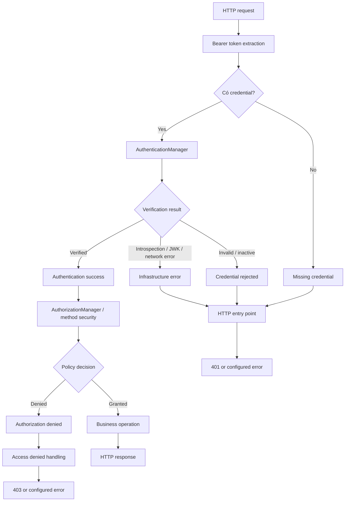

# Metric xác thực thành công, token bị từ chối và lỗi hạ tầng

Một Resource Server cần biết **bao nhiêu lần xác thực thành công, bao nhiêu token bị từ chối, bao nhiêu quyết định authorization bị deny và bao nhiêu lần không thể xác minh token do hạ tầng**. Những con số này giúp phát hiện credential bất thường, cấu hình sai, sự cố Authorization Server và suy giảm hiệu năng trước khi người dùng báo lỗi.

Các nhóm kết quả phải được đo riêng. Token inactive, JWT hết hạn hoặc chữ ký sai là kết quả từ chối credential. Token hợp lệ nhưng thiếu scope hoặc không sở hữu dữ liệu là quyết định authorization denied. Introspection endpoint timeout, trả invalid_client, lỗi TLS hoặc JWK endpoint unavailable là vấn đề xác minh/hạ tầng. Chúng có thể cùng xuất hiện dưới HTTP 401 ở một cấu hình mặc định, nhưng ý nghĩa vận hành hoàn toàn khác nhau.

Bài học thuộc chương **Hiệu năng và vận hành** của Spring Security OAuth 2.0 / OIDC Resource Server. Nội dung tập trung vào cách chọn metric, instrument authentication và introspection, phân loại lỗi, tránh cardinality cao, xây dashboard/alert và kiểm thử số liệu bằng Micrometer.

## 1. Bốn nhóm kết quả cần đo

Trước khi tạo metric, hãy phân loại sự kiện theo nơi quyết định xảy ra:

| Nhóm | Ví dụ | Ý nghĩa |
| --- | --- | --- |
| **Authentication success** | JWT signature hợp lệ; opaque token được introspect active | Resource Server đã tạo Authentication |
| **Credential rejection** | Token hết hạn, inactive, sai chữ ký, issuer/audience không hợp lệ | Caller chưa được xác thực |
| **Authorization denial** | Thiếu scope, role, tenant membership hoặc ownership | Caller đã xác thực nhưng không được phép thực hiện operation |
| **Infrastructure/verification error** | Introspection timeout, invalid client của Resource Server, TLS/DNS/JWK endpoint lỗi | Resource Server không thể hoàn thành việc xác minh hoặc phụ thuộc bảo mật |

Có thể bổ sung nhóm **request không có credential** như request thiếu Bearer header. Đây là một request authentication-required bị từ chối ở filter chain, nhưng không nhất thiết là một lần gọi AuthenticationManager hay introspection.

Không gộp bốn nhóm thành một metric security.failure. Nếu chỉ nhìn tổng số 401/403, đội vận hành không biết người dùng gửi token sai, policy từ chối, hay identity provider đang gặp sự cố.

## 2. Vị trí đo trong request lifecycle



Mỗi điểm có thể phát ra metric riêng:

- Filter chain/request instrumentation đo request thiếu token và HTTP outcome.
- Authentication manager/provider đo kết quả xác thực.
- Opaque introspector đo số lần gọi endpoint, latency và response/error.
- JWT decoder/JWK retrieval instrumentation đo key refresh và lỗi lấy key.
- Authorization manager hoặc policy bean đo allow/deny.
- HTTP server instrumentation đo latency và status tổng thể.

Đo đúng ranh giới giúp tránh đếm một request nhiều lần như nhiều token rejection.

## 3. Authentication success không phải HTTP 2xx

Một request có thể xác thực thành công rồi bị từ chối quyền và trả 403. Ngược lại, một request public có thể trả 200 mà không hề có authentication.

Vì vậy:

- Metric authentication success đếm lần Resource Server tạo Authentication hợp lệ.
- Metric authorization granted đếm quyết định policy cho phép.
- Metric HTTP success đếm response 2xx của endpoint.
- Không dùng HTTP 2xx làm đại diện cho số lần xác thực thành công.

Một request có thể tăng authentication success và authorization denied trong cùng trace. Điều này là bình thường và cung cấp thông tin tốt hơn một metric kết quả duy nhất.

## 4. Credential rejection khác authorization denial

Ví dụ:

| Request | Authentication | Authorization | Kết quả HTTP thường gặp |
| --- | --- | --- | --- |
| Không có Bearer token trên endpoint protected | Chưa có | Không thực hiện được | 401 |
| JWT hết hạn | Rejected | Không thực hiện | 401 |
| Opaque token introspection trả active=false | Rejected | Không thực hiện | 401 |
| Token hợp lệ nhưng thiếu orders.write | Success | Denied | 403 |
| Token hợp lệ, đủ scope nhưng không sở hữu order | Success | Denied | 403 hoặc 404 theo API contract |
| Introspection client credentials sai | Không xác minh được | Không thực hiện | Có thể đi qua authentication failure mapping mặc định; cần metric hạ tầng riêng |

HTTP status hữu ích cho client và dashboard tổng quan, nhưng không thay thế reason category nội bộ.

## 5. Chọn metric theo câu hỏi vận hành

Một metric tốt trả lời được câu hỏi cụ thể:

| Câu hỏi | Metric phù hợp |
| --- | --- |
| Có bao nhiêu authentication thành công? | Counter theo outcome |
| Có bao nhiêu credential bị từ chối? | Counter theo bounded rejection reason |
| Có bao nhiêu authorization denial? | Counter theo policy/resource label cố định |
| Introspection chậm bao nhiêu? | Timer/histogram |
| Identity provider đang lỗi bao nhiêu? | Counter theo dependency/error category |
| JWK refresh có thất bại không? | Counter và timer của key retrieval |
| Request protected trả 401/403/5xx bao nhiêu? | HTTP server request metrics |
| Circuit breaker đang mở không? | Gauge/state metric |
| Introspection cache có hiệu quả không? | Hit/miss counters và cache size gauge |

Đừng tạo metric chỉ vì có thể lấy được một field. Mỗi metric và tag nên có một mục đích vận hành rõ ràng.

## 6. Counter, timer, gauge và distribution

Micrometer cung cấp các loại meter chính:

- **Counter:** số lần một sự kiện xảy ra, ví dụ authentication success/rejection hoặc introspection error.
- **Timer:** số lần và thời gian của một operation, ví dụ gọi introspection endpoint.
- **Distribution summary:** phân bố một giá trị số, ví dụ kích thước response hoặc số authority được map nếu thực sự cần.
- **Gauge:** trạng thái hiện tại, ví dụ số connection đang chờ hoặc cache entry count.

Không dùng gauge để đếm sự kiện tích lũy. Không dùng counter làm latency. Với timer, dùng histogram/percentile phù hợp để biết p50/p95/p99 thay vì chỉ nhìn trung bình.

## 7. Đặt tên metric ổn định

Một bộ tên minh họa:

| Metric | Loại | Ý nghĩa |
| --- | --- | --- |
| security.authentication.events | Counter | Authentication success/failure events |
| security.authentication.rejections | Counter | Credential rejection theo reason |
| security.authorization.decisions | Counter | Authorization granted/denied |
| security.introspection.responses | Counter | Kết quả introspection |
| security.introspection.duration | Timer | Latency introspection |
| security.introspection.errors | Counter | Lỗi khi gọi introspection |
| security.jwks.refreshes | Counter | Kết quả JWK refresh |
| security.jwks.refresh.duration | Timer | Thời gian tải JWK set |
| security.dependency.errors | Counter | Lỗi identity provider/dependency |
| http.server.requests | Timer | HTTP request count và latency |

Tên metric cần thống nhất giữa services. Nếu dùng Micrometer Prometheus registry, tên được chuẩn hóa thành dạng Prometheus, thường dùng dấu gạch dưới và suffix theo loại meter. Hãy kiểm tra tên thực tế tại actuator prometheus endpoint hoặc registry tương ứng.

## 8. Dùng bounded tags

Tags cho phép phân nhóm metric, nhưng mỗi tổ hợp tag tạo một time series. Chỉ dùng giá trị hữu hạn, có kiểm soát:

```text
outcome = success | rejected | error
mechanism = jwt | opaque | other
reason = expired | inactive | bad_signature | invalid_client | timeout | malformed_response | insufficient_scope
resource = orders_api | inventory_api | billing_api
status_class = 2xx | 4xx | 5xx
```

Các giá trị này phải được map từ allowlist trong code. Nếu gặp exception không nhận diện, dùng other hoặc unknown; không lấy exception message làm tag.

Một metric với 5 giá trị outcome, 2 mechanisms, 8 reasons và 4 resources có thể tạo tối đa 320 series trước khi tính các tags khác. Hãy ước tính cardinality trước khi triển khai.

## 9. Tránh high cardinality và dữ liệu nhạy cảm

Không đưa các giá trị sau vào metric tags:

- Raw access token hoặc token fingerprint duy nhất cho mỗi request.
- sub, username, email, session ID hoặc user ID.
- jti, correlation ID, trace ID hoặc request ID.
- URL đầy đủ có path parameter/query string tùy ý.
- Raw exception message, stack trace hoặc introspection response.
- Client-provided header có thể chứa giá trị không giới hạn.

Một triệu user không nên tạo một triệu time series. Dùng logs/traces có access control để điều tra từng request; metrics chỉ thể hiện tổng hợp.

Hash token không giải quyết cardinality. Hash của mỗi token vẫn là một giá trị khác nhau và có thể tạo cùng lượng series như raw token.

## 10. Đo Authentication bằng Spring Security events

Spring Security có các authentication application events như AuthenticationSuccessEvent và AbstractAuthenticationFailureEvent. Chúng hữu ích để đo kết quả do AuthenticationManager/ProviderManager xử lý.

Ví dụ listener:

```java
import org.springframework.context.event.EventListener;
import org.springframework.security.authentication.event.AbstractAuthenticationFailureEvent;
import org.springframework.security.authentication.event.AuthenticationSuccessEvent;
import org.springframework.stereotype.Component;

import io.micrometer.core.instrument.Counter;
import io.micrometer.core.instrument.MeterRegistry;

@Component
public class AuthenticationMetrics {

    private final MeterRegistry registry;

    public AuthenticationMetrics(MeterRegistry registry) {
        this.registry = registry;
    }

    @EventListener
    public void onSuccess(AuthenticationSuccessEvent event) {
        increment("success");
    }

    @EventListener
    public void onFailure(AbstractAuthenticationFailureEvent event) {
        increment("failure");
    }

    private void increment(String outcome) {
        Counter.builder("security.authentication.events")
            .description("Authentication manager outcomes")
            .tag("outcome", outcome)
            .register(registry)
            .increment();
    }
}
```

Event publisher phải được cấu hình trên AuthenticationManager/ProviderManager đang xử lý authentication. Tùy cách ứng dụng dựng filter chain và manager, không nên mặc định mọi failure đều phát event. Hãy viết test để xác nhận wiring của chính ứng dụng.

## 11. Authentication events không bao phủ mọi request thiếu credential

Request protected không có Bearer token thường bị chặn bởi authorization/filter-chain entry point trước khi AuthenticationManager xác thực token. Bearer token sai định dạng cũng có thể thất bại ở bước resolve/extract trước khi provider chạy.

Do đó, listener ở phần trước không nhất thiết đếm:
- Request không có Authorization header.
- Authorization header sai scheme.
- Bearer token không parse được trước AuthenticationManager.
- Request public không có credential.

Dùng HTTP request metrics hoặc một filter/observation tại security boundary để đo những trường hợp này. Không cộng số HTTP 401 vào authentication failure event một cách máy móc vì một request có thể đã được đếm ở cả hai nơi.

## 12. Phân loại authentication failure bằng reason enum

Một dashboard hữu ích cần reason category ổn định:

| Reason | Nguồn điển hình | Phân loại |
| --- | --- | --- |
| expired | JWT exp/time validation hoặc introspection inactive | Credential rejection |
| bad_signature | JWT signature verification | Credential rejection |
| issuer_mismatch | JWT/introspection issuer policy | Credential rejection |
| audience_mismatch | Resource audience validation | Credential rejection |
| inactive | Introspection trả active false | Credential rejection |
| malformed_token | Bearer/JWT parser | Credential rejection |
| introspection_client_auth | Resource Server client invalid | Infrastructure/configuration |
| introspection_timeout | HTTP client timeout | Infrastructure |
| introspection_unavailable | DNS/TLS/5xx/connection error | Infrastructure |
| malformed_introspection_response | Response contract/parser | Dependency/protocol error |

Một số framework version có thể biểu diễn nhiều lỗi qua cùng exception type. Nếu cần phân biệt, instrument tại nơi thông tin còn rõ (HTTP client/adapter) và map exception sang reason enum. Không phụ thuộc vào message text có thể thay đổi giữa version.

## 13. Đo authorization decisions riêng

Authentication thành công không bảo đảm authorization thành công. Cần đo policy decisions tại request authorization, method security hoặc domain policy bean.

Ví dụ một policy service có thể tăng counter khi quyết định:

```java
public boolean canReadOrder(Authentication authentication, Order order) {
    boolean granted = policyAllows(authentication, order);

    Counter.builder("security.authorization.decisions")
        .tag("resource", "orders_api")
        .tag("operation", "read")
        .tag("decision", granted ? "granted" : "denied")
        .register(registry)
        .increment();

    return granted;
}
```

Ví dụ chỉ minh họa một điểm quyết định. Nếu PreAuthorize cũng phát event và policy bean cũng tăng counter, cùng một denial có thể bị đếm hai lần. Chọn một boundary chuẩn cho từng loại policy và ghi rõ metric định nghĩa gì.

Không dùng tên method tùy ý hoặc object ID làm tag. Dùng operation/resource labels được khai báo trước.

## 14. Ghi nhận lý do authorization denied

Có thể phân biệt các nhóm:

- scope_missing
- role_missing
- tenant_membership_denied
- ownership_denied
- resource_state_denied
- policy_denied
- unknown

Không ghi subject, tenant ID, document ID hoặc nội dung policy expression vào metric. Nếu cần điều tra một denial cụ thể, log một event có kiểm soát với trace ID và identity đã được bảo vệ theo retention/access policy.

Đừng gọi mọi AccessDeniedException là insufficient scope. Method security có thể từ chối do SpEL, domain ownership hoặc tenant membership; lý do cần được instrument tại policy có ngữ cảnh.

## 15. Đo opaque token introspection

Opaque token Resource Server gọi introspection endpoint để xác minh trạng thái token. Đây là network operation có latency và error mode riêng.

Nên đo tối thiểu:

- Số response introspection active.
- Số response bị từ chối (inactive/invalid theo introspector).
- Số lỗi gọi endpoint.
- Latency p50/p95/p99.
- HTTP status class từ upstream nếu adapter có thể lấy an toàn.
- Cache hit/miss nếu có cache introspection.

Một response active=false là token rejection. Timeout hoặc invalid_client là lỗi xác minh/hạ tầng. Không gộp hai nhóm.

## 16. Bọc OpaqueTokenIntrospector bằng Micrometer Timer

Có thể instrument ngay quanh delegate để đo thời gian và kết quả:

```java
import org.springframework.security.oauth2.core.OAuth2AuthenticatedPrincipal;
import org.springframework.security.oauth2.server.resource.introspection.BadOpaqueTokenException;
import org.springframework.security.oauth2.server.resource.introspection.OpaqueTokenIntrospector;

import io.micrometer.core.instrument.Counter;
import io.micrometer.core.instrument.MeterRegistry;
import io.micrometer.core.instrument.Timer;

public final class MeteredOpaqueTokenIntrospector
        implements OpaqueTokenIntrospector {

    private final OpaqueTokenIntrospector delegate;
    private final MeterRegistry registry;

    public MeteredOpaqueTokenIntrospector(
            OpaqueTokenIntrospector delegate,
            MeterRegistry registry) {
        this.delegate = delegate;
        this.registry = registry;
    }

    @Override
    public OAuth2AuthenticatedPrincipal introspect(String token) {
        Timer.Sample sample = Timer.start(registry);

        try {
            OAuth2AuthenticatedPrincipal principal =
                delegate.introspect(token);

            record(sample, "active");
            return principal;
        } catch (BadOpaqueTokenException ex) {
            record(sample, "rejected");
            throw ex;
        } catch (RuntimeException ex) {
            record(sample, "error");
            throw ex;
        }
    }

    private void record(Timer.Sample sample, String outcome) {
        sample.stop(Timer.builder("security.introspection.duration")
            .description("Time spent introspecting an opaque access token")
            .tag("outcome", outcome)
            .register(registry));

        Counter.builder("security.introspection.responses")
            .tag("outcome", outcome)
            .register(registry)
            .increment();
    }
}
```

Decorator này đo ba kết quả ở ranh giới introspector: principal được trả về, token bị introspector từ chối và exception khi không hoàn thành được operation. BadOpaqueTokenException có thể đại diện inactive token hoặc một số response không hợp lệ tùy implementation; metric rejected không khẳng định tất cả đều là revoke.

Nếu cần phân biệt malformed response với confirmed inactive, adapter HTTP phải phân loại response trước khi exception bị chuẩn hóa. Không dùng token làm tag hoặc log trong decorator.

## 17. Đăng ký decorator đúng một lần

Spring Resource Server có thể nhận custom OpaqueTokenIntrospector bean. Hãy bọc delegate mặc định hoặc delegate được cấu hình rõ ràng, rồi bảo đảm đúng bean đó được SecurityFilterChain sử dụng.

Ví dụ wiring khái niệm:

```java
@Bean
OpaqueTokenIntrospector meteredIntrospector(
        MeterRegistry registry,
        @Value("${oauth2.introspection-uri}") String uri,
        @Value("${oauth2.client-id}") String clientId,
        @Value("${oauth2.client-secret}") String clientSecret) {

    OpaqueTokenIntrospector delegate =
        new NimbusOpaqueTokenIntrospector(uri, clientId, clientSecret);

    return new MeteredOpaqueTokenIntrospector(delegate, registry);
}
```

Tên property là ví dụ theo ứng dụng. Nếu Boot đã tự cấu hình introspector, tránh tạo hai bean cạnh tranh hoặc bọc một delegate không được dùng. Kiểm thử bằng request thật qua Resource Server filter chain để xác nhận metric tăng đúng một lần.

## 18. active=false và introspection infrastructure error

Các kết quả phải được phân biệt:

| Upstream result | Metric outcome | Diễn giải |
| --- | --- | --- |
| HTTP 200, active=true | active | Token được issuer xác nhận active |
| HTTP 200, active=false | rejected | Credential không được chấp nhận |
| HTTP 401, invalid_client | error / client_auth | Client Resource Server không xác thực được |
| HTTP 403 | error / client_forbidden | Client không có quyền introspect theo policy |
| HTTP 429 | error / rate_limited | Upstream giới hạn tốc độ |
| HTTP 5xx | error / upstream_unavailable | Dependency failure |
| Timeout/DNS/TLS | error / transport | Không nhận được kết quả xác minh |
| Response malformed | error hoặc rejected theo adapter contract | Không có response đủ tin cậy |

Metric ở decorator cơ bản chỉ có active, rejected, error. Nếu cần reason chi tiết, instrument HTTP adapter/RestOperations và map status/exception vào enum bounded. Không suy ra invalid_client từ BadOpaqueTokenException nếu delegate không giữ thông tin đó.

## 19. Đo JWT validation và JWK retrieval

JWT Resource Server xác minh token cục bộ sau khi có JWK phù hợp. Không nhất thiết gọi Authorization Server trên mọi request. Vì vậy, metric JWK fetch/refresh không phải số lần JWT authentication.

Đo riêng:

- Authentication success/rejection của JWT.
- JWK set fetch/refresh count và latency.
- JWK endpoint 4xx/5xx, TLS/DNS/timeout errors.
- Unknown kid/key rotation event nếu có thể quan sát an toàn.
- Cache hit/miss hoặc refresh failure nếu ứng dụng tự quản lý JWK source/cache.

Không tạo một metric time series cho từng kid. Có thể ghi key_lookup=hit|refresh|miss hoặc outcome=success|error theo enum nhỏ.

Khi JWK endpoint unavailable nhưng cache vẫn có key hợp lệ, JWT có thể tiếp tục được xác minh tùy cache behavior. Metric cần phân biệt refresh failure với token verification failure; không kết luận toàn bộ token đều invalid chỉ vì refresh thất bại.

## 20. Đo HTTP request metrics cùng security metrics

Spring Boot Actuator/Micrometer thường cung cấp http.server.requests, với thông tin như method, normalized URI, status, outcome và exception theo cấu hình instrumentation.

Dùng metric này để xem:
- Tỷ lệ 2xx/4xx/5xx theo route.
- Latency của endpoint protected.
- Request 401/403 tăng đột biến.
- 5xx và latency tăng cùng thời điểm với IdP outage.

Security metrics bổ sung lý do nội bộ mà HTTP metric không thể biết. Một HTTP 401 có thể là missing token, invalid token hoặc introspection error bị ánh xạ thành authentication failure. Hãy kết hợp hai nguồn theo trace/time window, không cố nhồi mọi lý do vào URI/status tag.

## 21. Không dùng raw URI làm tag

Một route như:

```text
GET /orders/1001
GET /orders/1002
GET /orders/1003
```

nên được chuẩn hóa thành route template như /orders/{id}. Nếu dùng raw path, mỗi order ID có thể tạo time series mới.

Tương tự, không đưa query string, token, user ID hoặc header vào tag. Dùng route template do framework cung cấp hoặc tên resource cố định.

## 22. Đo lỗi hạ tầng theo dependency

Đặt metric riêng cho các dependency bảo mật:

| Dependency | Metric nên có |
| --- | --- |
| Authorization Server introspection | Request count, latency, status/error category |
| JWK Set endpoint | Refresh count, duration, failure |
| DNS/TLS/network | Transport failure count |
| Secret/config provider | Secret retrieval/rotation failure |
| Distributed cache | Read/write errors, latency, hit/miss |
| Database membership/ACL | Query latency, error, timeout |
| Metrics exporter/backend | Scrape/export failure |

Không gộp lỗi database ownership query với lỗi token introspection. Cả hai có thể làm request protected thất bại, nhưng người xử lý và cách khắc phục khác nhau.

## 23. HTTP status không đủ để phân loại dependency failure

Ví dụ introspection endpoint trả invalid_client. Resource Server chưa thể xác minh Bearer token. Default exception translation có thể đưa lỗi qua authentication failure path và trả 401; một ứng dụng có custom availability handling có thể trả 503 cho dependency outage.

Vì vậy, dashboard cần hai chiều:

- **Public HTTP outcome:** status 401, 403, 5xx.
- **Internal verification outcome:** inactive, invalid token, introspection client auth, timeout, upstream unavailable, malformed response.

Không thay HTTP contract tùy tiện chỉ để metric dễ phân loại. Nếu đổi 401 sang 503, cần cân nhắc client behavior, caching, retry và security disclosure.

## 24. Tính tỷ lệ thành công và từ chối đúng mẫu số

Ví dụ công thức vận hành:

```text
authentication_success_rate =
  successful_authentications
  / (successful_authentications + credential_rejections)

credential_rejection_rate =
  credential_rejections
  / (successful_authentications + credential_rejections)

verification_infrastructure_error_rate =
  verification_infrastructure_errors
  / verification_attempts
```

Không đưa authorization denied vào credential rejection rate: caller đã được xác thực. Không đưa infrastructure errors vào credential rejection rate: token có thể hợp lệ nhưng Resource Server không thể kiểm tra.

Missing credential có thể được theo dõi riêng theo request count, vì không phải lần xác thực token nào cũng được bắt đầu. Ghi rõ denominator trong dashboard để người xem không diễn giải nhầm.

## 25. Dashboard tổng quan cho Resource Server

Một dashboard hữu ích có thể chia thành các hàng:

1. **Traffic:** request rate, 2xx/401/403/5xx và p95/p99 HTTP latency.
2. **Authentication:** success, credential rejection và missing credential.
3. **Authorization:** granted/denied theo resource/operation cố định.
4. **Introspection:** active/rejected/error, latency p50/p95/p99, upstream status.
5. **JWK:** refresh success/failure, refresh duration, key lookup behavior.
6. **Dependencies:** IdP availability, DNS/TLS errors, cache/database failures.
7. **Capacity:** connection pool, request queue, circuit breaker state.
8. **Privacy/quality:** tỷ lệ unknown reason và số metric series.

Dashboard nên có filter theo environment, service, region và resource server. Tránh filter theo user/token.

## 26. Alert cho sự cố xác thực và hạ tầng

Alert nên tập trung vào thay đổi có ý nghĩa:

- Introspection error rate tăng vượt ngưỡng trong một cửa sổ đủ dài.
- p95/p99 introspection latency vượt authentication latency budget.
- invalid_client xuất hiện trên nhiều pods sau secret rotation/deploy.
- JWK refresh liên tục thất bại hoặc unknown key rate tăng đột biến.
- HTTP 5xx tăng cùng với identity provider error.
- Authentication success giảm mạnh trong khi traffic không giảm.
- Circuit breaker mở hoặc connection pool chờ tăng.
- Metric unknown reason tăng, báo hiệu exception mới chưa được phân loại.

Không cảnh báo mức page cho mọi token invalid đơn lẻ. Token bị từ chối là một phần bình thường của security boundary; cần threshold/rate/anomaly phù hợp và có thể kết hợp WAF/security event.

## 27. Phân biệt traffic tấn công với outage

Dấu hiệu thường gặp:

| Dấu hiệu | Khả năng cần điều tra |
| --- | --- |
| Invalid token tăng, introspection/JWK vẫn khỏe | Client gửi token cũ/sai hoặc credential probing |
| invalid_client tăng đồng loạt ở mọi pod | Secret/client registration/rotation |
| Timeout và 5xx tăng, p95 introspection tăng | Authorization Server hoặc network overload |
| 403 tăng, authentication success ổn định | Scope/role/tenant/ownership policy hoặc client behavior |
| 401 tăng nhưng authentication event không tăng | Missing/malformed Bearer header hoặc lỗi trước AuthenticationManager |
| Chỉ một issuer/resource bị ảnh hưởng | Trust configuration, issuer metadata hoặc resource-specific policy |
| Chỉ sau key rotation | JWK refresh/cache/kid handling |

Đây là tín hiệu định hướng, không phải kết luận tự động. Dùng trace/log redacted và upstream telemetry để xác nhận.

## 28. Cache introspection và metric hit/miss

Nếu Resource Server cache introspection result, hãy đo:

- security.introspection.cache với result=hit|miss.
- Active/rejected result từ cache hoặc upstream.
- Cache lookup latency.
- Entry count/eviction nếu cần.
- Invalidation events và errors.
- Tuổi của positive result nếu policy cho phép đo.

Cache hit giảm latency và load upstream, nhưng có thể kéo dài thời gian chấp nhận token sau revoke. Dashboard cần thể hiện cache hit ratio cùng positive TTL/stale window để vận hành hiểu trade-off.

Không cache timeout/5xx thành inactive. Không cache lỗi invalid_client thành token rejection. Cache key không được lộ raw token trong logs; dùng keyed fingerprint nếu cần key representation an toàn và được quản trị.

## 29. Log, trace và metric phục vụ các mục đích khác nhau

| Signal | Dùng để | Ví dụ |
| --- | --- | --- |
| Metrics | Xu hướng, tỷ lệ, alert, capacity | 12% introspection errors trong 5 phút |
| Logs | Chi tiết sự kiện đã được redacted | reason=introspection_timeout, traceId=... |
| Traces | Quan hệ và thời gian giữa services | Orders API → introspection endpoint → database |
| Audit events | Bằng chứng hành động/decision theo policy | Principal X được/không được đọc resource Y |

Không biến metrics thành audit log. Không log raw token để có thể tìm kiếm. Trace baggage không phải nơi lưu claims hoặc credential.

## 30. Redact credential và giới hạn dữ liệu quan sát

Không ghi:
- Authorization header, opaque token, JWT hoặc refresh token.
- Introspection client secret, Basic Authorization hoặc private key.
- Toàn bộ JWT/introspection claims nếu có PII.
- User email/subject làm tag metric.
- Raw request body chứa credential.

Có thể ghi:
- Outcome enum.
- Reason category.
- Resource server/service alias.
- HTTP status class.
- Correlation/trace ID trong log có access control.
- Issuer alias đã được cấu hình, không phải URL do caller cung cấp.

Metrics thường được chia sẻ rộng hơn logs. Vì vậy, metric tags cần được giới hạn nghiêm hơn nữa.

## 31. Metric khi method security từ chối

Nếu denial xảy ra ở PreAuthorize, cần chọn cách instrument phù hợp:

- Authorization event publisher nếu ứng dụng đã cấu hình và xác nhận event được phát.
- Một policy bean có metric tại điểm quyết định domain.
- Một wrapper quanh AuthorizationManager nếu muốn đo request-level decision tập trung.

Không tăng counter ở controller rồi lại tăng ở service cho cùng một denial. Ghi rõ metric đếm decision hay request response. Một request có thể có nhiều authorization decisions, ví dụ kiểm tra scope, tenant và ownership.

Với method security, nếu cần reason cụ thể như ownership_denied, hãy đo tại policy bean nơi có đủ ngữ cảnh. Event chung AccessDeniedException có thể không cho biết lý do domain.

## 32. Test metric authentication events

Kiểm thử event listener cần xác nhận event publisher được nối vào manager. Ví dụ hướng test:

```java
@SpringBootTest
class AuthenticationMetricsTest {

    @Autowired
    MeterRegistry registry;

    @Test
    @WithMockUser
    void successfulAuthenticationEventIsCounted() {
        // Invoke a path that authenticates through the configured manager.
        // Assert the expected counter increased by one.
    }
}
```

WithMockUser có thể thiết lập SecurityContext cho test mà không chạy AuthenticationManager. Vì vậy, test trên chỉ là skeleton: để kiểm tra AuthenticationSuccessEvent, hãy thực hiện authentication thật qua manager/provider hoặc test listener bằng cách publish event có kiểm soát.

Không kết luận event integration đúng chỉ vì test có WithMockUser.

## 33. Test introspection timer và outcome counters

Decorator có thể test bằng SimpleMeterRegistry và delegate giả:

```java
@Test
void activeResponseRecordsSuccessMetric() {
    SimpleMeterRegistry registry = new SimpleMeterRegistry();

    OpaqueTokenIntrospector delegate = token -> activePrincipal();
    OpaqueTokenIntrospector metered =
        new MeteredOpaqueTokenIntrospector(delegate, registry);

    metered.introspect("opaque-test-token");

    assertThat(registry.counter(
        "security.introspection.responses",
        "outcome", "active").count()).isEqualTo(1.0);

    assertThat(registry.timer(
        "security.introspection.duration",
        "outcome", "active").count()).isEqualTo(1);
}
```

Tạo test tương ứng cho delegate ném BadOpaqueTokenException và một runtime exception đại diện dependency failure. Xác nhận outcome lần lượt là rejected và error, đồng thời exception vẫn được ném lại để Security không cho request đi tiếp.

Test không cần và không nên đưa token value vào metric labels.

## 34. Test HTTP status và security metrics cùng nhau

Dùng MockMvc hoặc integration test với Resource Server filter chain thật:

| Test input | HTTP expectation thường gặp | Metric cần tăng |
| --- | --- | --- |
| Token hợp lệ, đủ quyền | 2xx | Authentication success; authorization granted |
| JWT expired | 401 | Credential rejection |
| Opaque active=false | 401 | Introspection rejected |
| Token thiếu scope | 403 | Authentication success; authorization denied |
| Token đúng scope nhưng sai owner | 403/404 theo contract | Authentication success; ownership denied |
| Introspection timeout | Theo error mapping đã cấu hình | Introspection error/timeout |
| Introspection invalid_client | Theo error mapping đã cấu hình | Infrastructure/client-auth error |
| Request không có Bearer token | 401 nếu protected | Missing credential/request outcome |

Mỗi test cần xác nhận protected business method không chạy khi authentication chưa thành công. Với infrastructure error, xác nhận lỗi không bị ghi thành active=false.

## 35. Test cardinality và privacy

Ngoài kiểm tra counter tăng, hãy xác nhận:

- Nhiều token khác nhau không tạo meter mới.
- Nhiều subject khác nhau không tạo tag mới.
- Exception message tùy ý không được dùng làm label.
- Correlation/trace ID chỉ xuất hiện trong log/trace, không phải metric tag.
- Unknown reason được map về other.
- Route parameter được chuẩn hóa.
- Không có Authorization header/token trong log test.

Một test đơn giản có thể introspect hàng trăm token giả và xác nhận số meter vẫn giữ nguyên theo số outcome cố định. Đây là cách bắt lỗi high cardinality sớm.

## 36. Kiểm soát metric volume trong môi trường nhiều pod

Khi triển khai nhiều replicas:
- Mỗi pod có registry cục bộ và exporter/scraper thu thập theo instance.
- Dashboard có thể tổng hợp bằng sum/rate, nhưng vẫn giữ service, instance hoặc region khi điều tra một pod lỗi.
- Không gắn pod UID hoặc deployment hash vào mọi metric nếu backend cardinality quá lớn; dùng labels chuẩn của platform.
- Kiểm tra scrape interval, retention và remote-write limits.
- Xác nhận metric name/tag schema nhất quán giữa các phiên bản.

Một pod dùng secret cũ có thể tạo nhiều invalid_client trong khi pod khác bình thường. Giữ label instance ở tầng scrape/platform để phát hiện, thay vì nhét hostname tùy ý vào từng application metric.

## 37. Ví dụ truy vấn Prometheus

Nếu metric counter security.authentication.events có tag outcome, exporter thường chuẩn hóa thành tên dạng security_authentication_events_total.

Tốc độ authentication success:

```promql
sum(rate(security_authentication_events_total{outcome="success"}[5m]))
```

Tốc độ failure event:

```promql
sum(rate(security_authentication_events_total{outcome="failure"}[5m]))
```

Tỷ lệ introspection error trong các kết quả introspection:

```promql
sum(rate(security_introspection_responses_total{outcome="error"}[5m]))
/
clamp_min(sum(rate(security_introspection_responses_total[5m])), 1)
```

p95 introspection latency nếu timer được export dạng histogram:

```promql
histogram_quantile(
  0.95,
  sum by (le) (
    rate(security_introspection_duration_seconds_bucket[5m])
  )
)
```

Tên metric chính xác phụ thuộc registry/exporter và naming convention. Kiểm tra exposition thực tế trước khi đưa query vào dashboard. Dùng clamp_min hoặc xử lý denominator bằng 0 để tránh NaN khi không có traffic.

## 38. Đặt SLO cho verification dependency

Có thể định nghĩa SLO riêng cho việc xác minh token:

- **Availability:** tỷ lệ introspection/JWK verification operations hoàn thành mà không gặp lỗi dependency.
- **Latency:** p95/p99 thời gian introspection nằm trong budget của request.
- **Correctness:** token invalid không được chấp nhận; token active hợp lệ không bị từ chối do cấu hình sai.
- **Freshness:** thời gian cache có thể giữ positive result sau revoke nằm trong revocation SLO.

Không dùng authentication success rate làm SLO availability của identity provider. Một đợt token hết hạn có thể làm success rate giảm dù IdP khỏe. SLO dependency phải loại trừ credential rejection và đo riêng transport/upstream errors.

## 39. Runbook khi authentication success giảm đột ngột

Khi success rate giảm:

1. So sánh traffic rate để xem có thay đổi lượng request không.
2. Tách credential rejection khỏi infrastructure errors.
3. Kiểm tra HTTP 401/403/5xx theo route và resource server.
4. Kiểm tra JWT expired/issuer/audience/signature reasons.
5. Với opaque token, kiểm tra active/rejected/error và introspection latency.
6. Kiểm tra invalid_client, secret rotation, TLS/DNS và upstream status.
7. Với JWT, kiểm tra JWK refresh/unknown key sau rotation.
8. Kiểm tra deployment/config change và khác biệt giữa pods.
9. Dùng trace/log redacted để xác nhận một request đại diện.
10. Chỉ thay đổi config/credential sau khi xác minh nguyên nhân.

Nếu rejection tăng nhưng dependency metrics bình thường, điều tra caller/client/token issuance trước khi restart Resource Server.

## 40. Runbook khi introspection error tăng

1. Kiểm tra timeout, 429, 5xx và client-auth errors tách biệt.
2. So sánh p95/p99 latency và connection pool.
3. Kiểm tra Authorization Server health, rate limit và capacity.
4. Kiểm tra client ID/secret version và rotation rollout.
5. Kiểm tra DNS, TLS chain, hostname, proxy và network route.
6. Xác minh response Content-Type/JSON contract.
7. Kiểm tra retry/circuit breaker có làm tăng request amplification không.
8. Kiểm tra cache hit ratio và stale positive window.
9. Kiểm tra lỗi có tập trung ở một region/pod không.
10. Khôi phục dependency/configuration theo runbook đã phê duyệt và xác nhận metric trở lại bình thường.

Không xử lý lỗi invalid_client bằng cách retry nhanh liên tục. Đây thường là lỗi cấu hình/credential cần sửa.

## 41. Runbook khi 403 tăng nhưng authentication ổn định

Nếu authentication success bình thường nhưng 403 tăng:

- Kiểm tra scope/authority mapping có thay đổi không.
- Kiểm tra client registration và requested scopes.
- Kiểm tra policy PreAuthorize/request matcher vừa deploy.
- Kiểm tra tenant membership/ownership changes.
- Kiểm tra role-to-authority converter.
- Kiểm tra cache ACL/membership và invalidation.
- So sánh denial reason theo resource/operation cố định.
- Xác minh response 403 có đúng contract hay đang che một lỗi khác.

Không xoay client secret hoặc restart IdP nếu metric cho thấy authentication vẫn thành công và vấn đề nằm ở authorization.

## 42. Các anti-pattern thường gặp

| Anti-pattern | Hậu quả | Cách xử lý |
| --- | --- | --- |
| Đếm mọi 401 là token invalid | Missing token và IdP outage bị trộn | Đo request, credential và dependency riêng |
| Đếm mọi 403 là insufficient scope | Ownership/tenant denial bị mất | Instrument tại policy decision |
| Gộp introspection timeout với active=false | Alert/retry và runbook sai | Tách rejected và error |
| Chỉ đo HTTP status | Không thấy reason nội bộ | Bổ sung security-specific metrics |
| Tag bằng sub hoặc token | Cardinality tăng và lộ dữ liệu | Dùng bounded enum |
| Tag bằng exception message | Time series bùng nổ | Map sang reason allowlist |
| Dùng average latency | Che tail latency | Timer histogram p95/p99 |
| Đếm authentication bằng 2xx | Public endpoint làm sai số | Đếm Authentication event |
| Tin mọi failure event đều được phát | Bỏ sót lỗi trước AuthenticationManager | Đo filter/request boundary |
| Retry mọi lỗi introspection | Tạo tải lớn hơn khi IdP hỏng | Retry có giới hạn theo loại lỗi |
| Alert mọi invalid token | Nhiễu alert | Threshold/rate/anomaly và abuse detection |
| Dùng metrics làm audit | Không đủ chi tiết, sai mục đích | Dùng audit event có kiểm soát |

## 43. Tài liệu tham khảo

- [Spring Security 6.5 — Observability](https://docs.spring.io/spring-security/reference/6.5/servlet/integrations/observability.html): observations cho authentication và authorization.
- [Spring Security 6.5 — Authentication Events](https://docs.spring.io/spring-security/reference/6.5/servlet/authentication/events.html): authentication success/failure events và event publisher.
- [Spring Security 6.5 — Opaque Token Resource Server](https://docs.spring.io/spring-security/reference/6.5/servlet/oauth2/resource-server/opaque-token.html): opaque token introspection và custom introspector.
- [Spring Security 6.5 — JWT Resource Server](https://docs.spring.io/spring-security/reference/6.5/servlet/oauth2/resource-server/jwt.html): JWT validation và JWK Set retrieval.
- [Spring Boot — Actuator Metrics](https://docs.spring.io/spring-boot/reference/actuator/metrics.html): Micrometer registry và metrics endpoint.
- [Micrometer — Meters](https://docs.micrometer.io/micrometer/reference/concepts/meters.html): counter, timer, gauge, tags và cardinality.
- [Prometheus — Naming](https://prometheus.io/docs/practices/naming/): naming convention và metric labels.
- [Prometheus — Instrumentation](https://prometheus.io/docs/practices/instrumentation/): chọn metric và thiết kế instrumentation.

## 44. Kết luận

Resource Server cần đo riêng **authentication success**, **credential rejection**, **authorization denial** và **verification infrastructure error**. Một token inactive hoặc JWT hết hạn là kết quả credential; thiếu scope hoặc ownership là quyết định policy; introspection invalid_client, timeout, TLS hoặc JWK refresh failure là vấn đề hạ tầng. HTTP status có thể gom các tình huống này vào cùng một nhóm, nên cần metric tại đúng boundary.

Micrometer counters phù hợp để đếm outcome, timers để đo latency và gauges để theo dõi trạng thái hiện tại. Spring Security authentication events có thể hỗ trợ đo provider outcomes khi event publisher được nối đúng; một OpaqueTokenIntrospector decorator có thể đo trực tiếp kết quả và thời gian introspection. HTTP request metrics bổ sung status/route/latency tổng thể.

Giữ metric tags ở dạng enum hữu hạn, không dùng token, subject, correlation ID hoặc exception message làm labels. Dashboard nên cho thấy traffic, 401/403/5xx, authentication/authorization outcomes, introspection/JWK latency và dependency errors. Test phải chứng minh metric tăng đúng một lần, không lộ credential và phân biệt token bị từ chối với lỗi không thể xác minh.

**Điểm cốt lõi:** *Đếm kết quả bảo mật tại nơi kết quả được quyết định; đo lỗi hạ tầng riêng với token bị từ chối để dashboard và alert dẫn đến đúng cách xử lý.*
