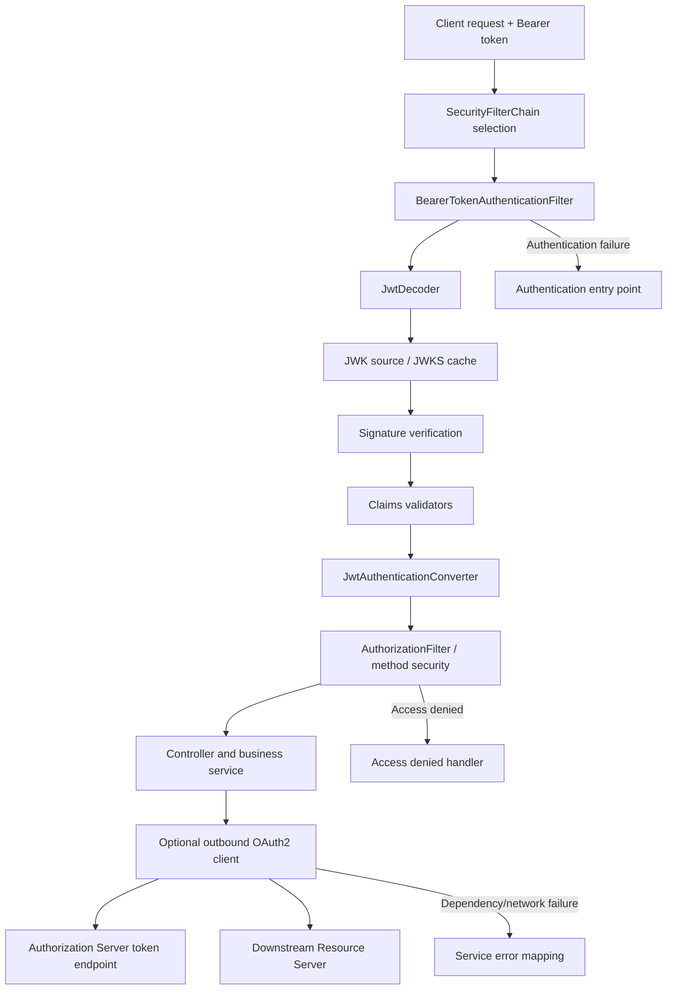

# Phân biệt lỗi chữ ký, claims, quyền với lỗi kết nối hoặc cấu hình

Khi Spring Security OAuth 2.0 Resource Server từ chối một request, status HTTP thường chỉ cho biết request đã bị từ chối ở đâu đó trong security flow. Nó không luôn chỉ ra nguyên nhân gốc. Một token sai chữ ký, token đúng chữ ký nhưng sai audience, token hợp lệ nhưng thiếu scope, JWKS endpoint không truy cập được và cấu hình issuer sai đều có thể tạo log hoặc response trông khá giống nhau nếu chỉ nhìn status 401.

Để vận hành đúng, cần tách các lỗi theo boundary:

1. **Lỗi chữ ký/key:** JWT không thể được xác minh bằng public key mà Resource Server tin cậy.
2. **Lỗi claims/token validation:** chữ ký hợp lệ nhưng issuer, audience, thời gian hoặc claim bắt buộc không đúng.
3. **Lỗi authorization:** token đã xác thực, nhưng principal thiếu scope/authority hoặc không có quyền trên object/tenant.
4. **Lỗi kết nối tới identity infrastructure:** không lấy được discovery metadata, JWKS, token introspection hoặc token endpoint.
5. **Lỗi kết nối tới downstream API:** Resource Server đã xác thực request inbound, nhưng service không gọi được API tiếp theo.
6. **Lỗi cấu hình/runtime:** sai URI, registration, client authentication method, truststore, clock, filter chain hoặc authority converter.

Bài này đưa ra quy trình chẩn đoán theo từng lớp, cách đọc exception và HTTP response, cấu hình quan sát an toàn, bảng triệu chứng và cách kiểm thử các tình huống bằng fake JWKS/Authorization Server. Mục tiêu là phân biệt **credential thực sự không hợp lệ** với **hệ thống tạm thời không thể kiểm tra credential**, để xử lý đúng cả security và availability.

> **Nguyên tắc vận hành:** Không kết luận từ một status code. Kết hợp exception type/cause, component phát sinh lỗi, request correlation ID, dependency trace và trạng thái cấu hình. Không log raw JWT, refresh token, client secret hoặc Authorization header.

## 1. Nhìn toàn bộ request path trước khi đọc log

Một request tới Orders API có thể đi qua:



Mỗi node có failure modes khác nhau. Ví dụ:
- Chữ ký sai là vấn đề token/key trust.
- Audience sai là vấn đề token contract.
- Thiếu scope là vấn đề authorization.
- DNS lỗi tới JWKS là dependency connectivity.
- Token endpoint trả invalid_client là client configuration/credentials.
- Payments API trả 403 là downstream authorization, không nhất thiết là lỗi Orders API authentication.

### 1.1. Xác định ứng dụng đang làm vai trò nào

Một Spring Boot service có thể đồng thời là:
- Resource Server: xác thực access token inbound.
- OAuth2 Client: lấy token outbound.
- Client gọi downstream Resource Server.
- OIDC client: đăng nhập người dùng và xử lý ID token.

Hãy ghi rõ flow đang lỗi. Một lỗi ở outbound OAuth2 Client không nên bị chẩn đoán như lỗi JWT inbound chỉ vì cả hai đều liên quan OAuth.

### 1.2. Phân biệt dependency nào đang được gọi

| Dependency | Được gọi khi nào? | Dùng để làm gì? |
|---|---|---|
| OIDC discovery metadata | Khi cấu hình discovery qua issuer URI, tùy cách khởi tạo decoder | Tìm issuer metadata/JWKS endpoint |
| JWKS endpoint | Khi decoder cần public key hoặc cần refresh key set | Xác minh chữ ký JWT |
| Introspection endpoint | Khi Resource Server xác thực opaque/reference token | Hỏi AS token còn active và metadata là gì |
| Token endpoint | Khi OAuth2 Client xin access token/refresh token/token exchange | Cấp token outbound |
| Downstream API | Sau khi inbound request đã qua policy và service cần gọi API khác | Thực hiện business operation |

Không gọi JWKS endpoint cho mọi request nếu key set đã được cache. Vì vậy, một request thành công trước đó không chứng minh JWKS endpoint hiện tại đang reachable; decoder có thể đang dùng key đã cache.

## 2. Chẩn đoán theo thứ tự: authentication trước, authorization sau

Khi nhận lỗi, bắt đầu từ các câu hỏi sau:

1. Request có vào đúng SecurityFilterChain không?
2. Bearer token có được trích xuất không?
3. Resource Server đang dùng JWT decoder hay opaque token introspector?
4. Decoder/introspector có nhận được phản hồi từ dependency không?
5. Nếu nhận được key/response, token có được xác minh không?
6. Claims validators có chấp nhận token không?
7. Authentication có được tạo và authorities có đúng không?
8. Authorization rule hoặc method security từ chối ở đâu?
9. Nếu request qua được security, lỗi xảy ra ở business/downstream call nào?

Thứ tự này tránh nhầm một lỗi scope với lỗi chữ ký hoặc một timeout JWKS với token giả mạo.

## 3. Lỗi chữ ký và key lookup

Với JWT Resource Server, decoder phải tìm public key tin cậy và xác minh JWS signature trước khi claims được dùng làm principal.

### 3.1. Các nguyên nhân phổ biến

- Token được ký bằng private key khác với public key đang có trong JWKS.
- Header JWT có kid không tồn tại trong JWKS.
- JWKS đã rotate nhưng Resource Server còn cache key cũ hoặc chưa nhận key mới.
- AS và Resource Server đang trỏ tới hai realm/tenant/issuer khác nhau.
- Token dùng thuật toán không nằm trong allowlist.
- Token bị sửa sau khi ký hoặc bị cắt/méo khi truyền qua proxy.
- Public JWK sai hoặc key material không tương ứng private signing key.
- JWKS response sai định dạng hoặc không có signing key phù hợp.

### 3.2. Dấu hiệu cần tìm

Log có thể chứa exception thuộc nhóm:
- JwtException hoặc BadJwtException.
- JOSEException/BadJOSEException ở cause chain.
- Lỗi không tìm được key phù hợp theo kid.
- Lỗi verify signature hoặc unsupported algorithm.
- Lỗi parse compact serialization.

Tên exception cụ thể có thể khác theo phiên bản Spring Security/Nimbus và cách exception được wrap. Hãy xem root cause và component tạo lỗi, không phụ thuộc duy nhất vào message text.

### 3.3. Cách kiểm tra

1. Lấy header JWT đã decode an toàn trong môi trường test hoặc từ token fixture; không ghi token thật ra log.
2. Ghi nhận alg và kid.
3. Xác định JWKS URI mà Resource Server thực sự dùng.
4. Kiểm tra public JWKS có key với kid đó hay không.
5. Kiểm tra kty/alg/use/key_ops có tương thích với token signature không.
6. Xác minh token được ký bằng private key tương ứng.
7. Kiểm tra cache/rotation timing nếu key vừa thay đổi.

Không dùng payload decode như bằng chứng token hợp lệ. Decode base64url chỉ đọc được claims; nó không xác minh chữ ký.

### 3.4. Unknown kid khác bad signature

| Trường hợp | Ý nghĩa |
|---|---|
| kid không có trong JWKS | Decoder không tìm được candidate key |
| kid có trong JWKS nhưng signature sai | Candidate key có, nhưng chữ ký không xác minh được |
| kid trùng nhưng key material đã đổi | Có thể là lỗi key rotation/cache hoặc vi phạm quản lý kid |
| JWKS endpoint unreachable | Không thể lấy key set mới; chưa đủ bằng chứng kết luận token sai |
| JWKS JSON malformed | Dependency phản hồi nhưng dữ liệu key set không dùng được |

Đừng gộp unknown kid và JWKS network outage thành cùng một incident. Một cái có thể là token ký bởi key không được tin cậy; cái còn lại có thể là hạ tầng key distribution đang lỗi.

### 3.5. Key rotation và cache

Quy trình rotation an toàn thường có overlap:
1. Công bố public key mới cùng public key cũ.
2. Bắt đầu ký token bằng key mới.
3. Chờ token cũ hết hạn và các decoder/cache cập nhật.
4. Gỡ public key cũ sau thời gian overlap đã tính toán.

Nếu gỡ key cũ trước khi token cũ hết hạn, các request mang token cũ có thể thất bại. Nếu bắt đầu ký bằng key mới trước khi public key mới được phân phối, token mới có thể bị từ chối ở Resource Server.

Khi điều tra:
- Ghi thời điểm key mới được publish.
- Ghi thời điểm AS bắt đầu dùng kid mới.
- Ghi thời điểm từng Resource Server instance fetch JWKS.
- So sánh cache state giữa các instances.
- Không kết luận cache lỗi chỉ vì một instance còn giữ key cũ; hãy xem cache policy và refresh trigger của decoder.

## 4. Claims validation: chữ ký đúng nhưng token vẫn không được chấp nhận

Một JWT có signature hợp lệ vẫn có thể không phải token phù hợp cho API hiện tại. Claims validation ràng buộc token với issuer, resource, thời gian và profile mà ứng dụng tin cậy.

### 4.1. Issuer không khớp

Ví dụ Resource Server tin:

```yaml
spring:
  security:
    oauth2:
      resourceserver:
        jwt:
          issuer-uri: https://issuer.example.test/realms/shop
```

JWT lại có iss là issuer staging:

```json
{
  "iss": "https://issuer-staging.example.test/realms/shop"
}
```

Chữ ký có thể hợp lệ nếu hai issuer dùng cùng key material, nhưng issuer validator vẫn phải từ chối token nếu issuer không đúng. Issuer là một phần trust contract, không phải một label tùy ý.

Các lỗi cấu hình thường gặp:
- Dùng issuer URI của staging ở production.
- Sai realm/tenant path.
- Khác trailing slash hoặc canonical issuer URL.
- Discovery metadata trả issuer không trùng cấu hình.
- Reverse proxy thay host/scheme khiến metadata có issuer khác.
- Token do một identity provider khác phát hành.

### 4.2. Audience không đúng Resource Server

Orders API có expected audience orders-api. Token có aud payments-api không được chấp nhận tại Orders API chỉ vì issuer và signature hợp lệ.

Kiểm tra:
- Token có aud dạng string hay array.
- Expected audience có đúng resource identifier do AS phát hành không.
- Decoder có audience validator hay chưa.
- Gateway/AS có đang phát token audience chung không.
- API đang dùng đúng issuer và đúng environment không.

Spring Security không nên được cấu hình để chấp nhận bất kỳ audience nào chỉ vì token signature hợp lệ. Với API có audience requirement, tạo validator riêng và test wrong-audience token.

### 4.3. Token hết hạn hoặc chưa tới thời điểm hiệu lực

Các claims thời gian chính:
- exp: token không còn hợp lệ sau thời điểm này.
- nbf: token chưa có hiệu lực trước thời điểm này.
- iat: thời điểm phát hành token, có thể được ứng dụng dùng cho profile/freshness policy.

Nguyên nhân có thể:
- Token thực sự hết hạn.
- Đồng hồ máy AS, application host hoặc container lệch.
- Timezone/clock configuration sai.
- Clock skew được cấu hình không phù hợp.
- Token fixture dùng fixed clock nhưng decoder dùng system clock.
- Request bị queue/retry lâu trước khi tới Resource Server.

Đối chiếu thời gian UTC của token và host/container. Không chỉ nhìn giờ hiển thị ở dashboard nếu dashboard dùng timezone khác.

### 4.4. Claim bắt buộc bị thiếu hoặc sai kiểu

Một token có thể được ký đúng nhưng thiếu sub, tenant_id hoặc claim profile mà application policy cần. Claim có thể có nhưng sai type, ví dụ scope là array trong khi converter mong chuỗi phân tách bằng khoảng trắng.

Phân biệt:
- Claim validation: token bị từ chối vì claim bắt buộc không đạt.
- Authority conversion: token được chấp nhận nhưng converter không tạo authority mong đợi.
- Business policy: token hợp lệ nhưng tenant/object relationship không cho phép.

Nếu claim là điều kiện bắt buộc để token được xem là hợp lệ, đưa kiểm tra vào validator. Nếu claim chỉ tham gia policy của một operation, có thể kiểm tra ở authorization/service layer.

## 5. Lỗi authorization: Authentication đã thành công

Dấu hiệu quan trọng: Resource Server đã tạo Authentication từ token, nhưng request vẫn bị từ chối vì không đủ quyền.

Các trường hợp thường gặp:
- Token thiếu scope cần thiết.
- Scope có trong token nhưng converter map sai prefix/claim name.
- Rule yêu cầu ROLE_ADMIN nhưng token chỉ tạo SCOPE_admin.
- Method matcher yêu cầu scope khác với scope mà AS cấp.
- Method security từ chối service operation.
- User có scope nhưng không sở hữu object.
- User có scope nhưng tenant membership không còn active.
- Delegated token thiếu actor/delegation claim mà downstream policy yêu cầu.

### 5.1. 403 thường biểu thị access denied

Ví dụ:

```java
.authorizeHttpRequests(auth -> auth
    .requestMatchers(HttpMethod.GET, "/api/orders/**")
        .hasAuthority("SCOPE_orders.read")
    .requestMatchers(HttpMethod.POST, "/api/orders/**")
        .hasAuthority("SCOPE_orders.write")
    .anyRequest().denyAll()
)
```

Token hợp lệ có orders.read nhưng gọi POST sẽ bị từ chối ở authorization. Đây không phải lỗi signature hoặc issuer.

### 5.2. Kiểm tra authority mapping

Mặc định, Spring Security thường chuyển scope claim thành SCOPE_ authorities. Ví dụ:

```json
{
  "scope": "orders.read orders.write"
}
```

có thể tạo:
- SCOPE_orders.read
- SCOPE_orders.write

Nếu token thực tế dùng scp, permissions hoặc roles, converter phải được cấu hình tương ứng. Đừng sửa token/AS ngay khi thấy 403; trước tiên xem Authentication authorities thực tế trong debug log an toàn hoặc test.

### 5.3. hasRole và hasAuthority

hasRole("ADMIN") thường áp dụng prefix ROLE_ và kiểm tra ROLE_ADMIN. hasAuthority("SCOPE_orders.read") kiểm tra authority chính xác.

Một rule dùng hasRole("orders.read") có thể yêu cầu ROLE_orders.read thay vì SCOPE_orders.read. Đây là mismatch cấu hình, không phải token invalid.

### 5.4. Scope đủ nhưng object policy từ chối

Nếu token có orders.read nhưng user không sở hữu order hoặc không thuộc tenant của order, policy object-level có thể trả 403/404. Đọc log ở service/repository boundary:
- subject đã xác thực là ai?
- tenant context được resolve từ đâu?
- membership hiện hành có active không?
- object thuộc tenant/owner nào?
- policy nào trả deny?

Không ghi dữ liệu cá nhân hoặc toàn bộ object vào log chỉ để tìm nguyên nhân.

### 5.5. Downstream 403 không có nghĩa inbound token sai

Orders API có thể xác thực user và cho phép operation, sau đó Payments API từ chối token outbound vì thiếu payments.create. Trong trường hợp đó:
- Inbound authentication của Orders đã thành công.
- Outbound token có thể hợp lệ nhưng thiếu scope, hoặc sai audience.
- Response 403 đến từ Payments API.
- Cần trace phân biệt caller, outbound registration và downstream service.

Ghi rõ service nào phát ra response; nếu chỉ log status cuối cùng ở gateway, dễ chẩn đoán nhầm.

## 6. Lỗi kết nối tới JWKS, discovery và introspection

Một dependency có thể không truy cập được dù token hoàn toàn hợp lệ.

### 6.1. JWKS endpoint timeout/DNS/TLS

Các nguyên nhân:
- DNS không resolve host.
- Egress/network policy chặn outbound traffic.
- Proxy cấu hình sai.
- TLS certificate hết hạn hoặc CA không được trust.
- Hostname/SAN không khớp.
- Connect timeout hoặc read timeout.
- JWKS endpoint đang 5xx hoặc rate limit.
- URL path sai hoặc redirect không được hỗ trợ.

Dấu hiệu:
- WebClient/RestOperations/HTTP client exception.
- ConnectException, UnknownHostException, SocketTimeoutException.
- SSLHandshakeException hoặc certificate path error.
- HTTP 5xx/429 từ JWKS endpoint.
- Không có JWK response mới trong dependency trace.

Một lỗi kết nối tới JWKS không chứng minh token có chữ ký sai. Nếu decoder đang có key cache, một số token vẫn có thể được xác thực; token mới dùng kid chưa cache có thể thất bại.

### 6.2. OIDC discovery failure

Nếu cấu hình dùng issuer URI để discovery, Resource Server có thể cần gọi metadata endpoint để tìm jwks_uri. Lỗi ở discovery có thể xảy ra khi:
- Issuer URL sai.
- Metadata endpoint không reachable.
- Discovery response thiếu jwks_uri hoặc issuer không khớp.
- Proxy rewrite URL không đúng.
- Certificate hoặc DNS lỗi.

Nếu cấu hình jwk-set-uri trực tiếp, discovery call có thể không nằm trong startup/request path; nhưng issuer validation vẫn phải được cấu hình theo trust contract. Đừng xóa issuer validation chỉ để làm discovery lỗi biến mất.

### 6.3. Opaque token introspection failure

Opaque token Resource Server gọi introspection endpoint để hỏi token có active hay không. Cần phân biệt:
- Introspection response thành công và active=false: token không được chấp nhận.
- Introspection endpoint trả invalid_client: client credentials/configuration sai.
- Endpoint timeout/DNS/TLS: dependency unavailable.
- Endpoint trả 5xx/429: Authorization Server đang lỗi hoặc throttling.
- Response JSON/schema lỗi: protocol/provider integration issue.

Active=false là kết quả xác minh token. Không có response do network outage là tình trạng dependency failure. Hai tình huống cần alert và xử lý khác nhau.

### 6.4. Status code không đủ để phân biệt outage với invalid token

Tùy phiên bản Spring Security, authentication manager, decoder/introspector, exception wrapping và custom entry point, lỗi dependency có thể được ánh xạ khác nhau. Một số lỗi xác thực xuất hiện như 401, dù root cause là không lấy được key/introspection response.

Vì vậy:
- 401 kèm invalid_token và bad signature/claims cause thường là credential failure.
- 401 nhưng root cause là timeout/TLS/DNS tới JWKS/introspection có thể là infrastructure failure.
- 5xx có thể cho thấy dependency failure được ánh xạ ra server error.
- Không ép mọi dependency failure thành 401 vì client có thể refresh token vô ích.
- Nếu muốn trả 503 cho dependency unavailable, cần custom error mapping phân biệt lỗi xác thực với lỗi dịch vụ, có test và không tiết lộ chi tiết nội bộ cho caller.

## 7. Lỗi token endpoint và OAuth2 Client configuration

Khi application xin token outbound, lỗi thuộc OAuth2 Client/token endpoint path.

### 7.1. Lỗi protocol từ token endpoint

| OAuth error/response | Nguyên nhân thường gặp | Kiểm tra |
|---|---|---|
| invalid_client | Client ID/secret sai, client auth method sai, credential hết hạn | Registration và client authentication method |
| invalid_grant | Authorization code/refresh token/subject token không hợp lệ hoặc hết hạn | Grant input, redirect URI, token expiry, exchange policy |
| invalid_scope | Scope không được client/resource cho phép | Scope registration và AS policy |
| unauthorized_client | Client không được phép dùng grant type | AS client configuration |
| unsupported_grant_type | AS không hỗ trợ grant hoặc request sai | grant_type và provider capability |
| invalid_target | Resource/audience không được chấp nhận | Resource identifier/allowlist |
| HTTP 429 | Rate limit | Token acquisition volume và retry policy |
| HTTP 5xx | AS/server failure | Provider status và incident |

### 7.2. Lỗi kết nối tới token endpoint

Các lỗi DNS, TLS, connection refused, timeout hoặc proxy không phải invalid_grant. Chúng cho biết application không trao đổi được với token endpoint.

Kiểm tra:
- token-uri thực tế.
- DNS và route từ container/host.
- TLS trust chain và hostname.
- proxy/egress rules.
- connect/read timeout.
- AS health và rate limit.
- client secret có được inject vào runtime không.

Không in form body của token request vì nó có thể chứa client secret, refresh token hoặc subject token.

### 7.3. Client registration sai

Cấu hình ví dụ:

```yaml
spring:
  security:
    oauth2:
      client:
        registration:
          payments-service:
            provider: shop-issuer
            client-id: orders-service
            client-secret: "<secret-injected-at-runtime>"
            authorization-grant-type: client_credentials
            scope:
              - payments.create
        provider:
          shop-issuer:
            token-uri: https://issuer.example.test/oauth2/token
```

Các lỗi thường gặp:
- registration ID được gọi trong code không trùng cấu hình.
- grant type sai.
- token-uri trỏ nhầm environment.
- secret không có trong container environment.
- client auth method không khớp AS.
- scope không được AS cấp.
- resource/audience parameter chưa được gửi theo provider contract.
- service dùng reactive manager trong servlet flow hoặc ngược lại.

### 7.4. Client Credentials và OBO không thể thay thế tùy tiện

Nếu downstream operation cần quyền của user, dùng service token Client Credentials có thể tạo confused deputy. Nếu OBO/token exchange bị lỗi, không tự fallback sang service token có quyền rộng hơn. Chẩn đoán cần xác định request đang dùng đúng grant type và principal semantics.

## 8. Lỗi kết nối tới downstream Resource Server

Sau khi token inbound đã xác thực và authorization thành công, business service có thể gọi downstream API.

Phân biệt response:
- **Downstream 401:** token outbound không hợp lệ với downstream, sai audience/issuer/signature/expiry hoặc client authentication ở gateway.
- **Downstream 403:** token hợp lệ nhưng thiếu scope/role hoặc object policy từ chối.
- **Downstream 404:** resource không tồn tại/không visible theo anti-enumeration policy.
- **Downstream 429:** rate limited.
- **Downstream 5xx:** service đích lỗi.
- **Connect/DNS/TLS/timeout:** không thiết lập được kết nối hoặc response không tới kịp.

Đừng chuyển tất cả thành 401 inbound. Nếu Orders API đã xác thực caller nhưng Payments API timeout, đó là lỗi dependency của Orders operation, thường cần mapping sang 502/503/504 theo API contract.

### 8.1. Phân biệt HTTP response và transport exception

| Failure | Có HTTP response? | Bằng chứng |
|---|---|---|
| Downstream trả 403 | Có | Response status/body/header từ downstream |
| Downstream trả 503 | Có | HTTP response 503 |
| DNS failure | Không | UnknownHostException |
| Connection refused | Không | ConnectException |
| TLS handshake failure | Không | SSLHandshakeException |
| Response timeout | Không hoặc response chưa hoàn tất | TimeoutException/ReadTimeout |
| JSON decoding failure | Có response nhưng body không parse được | Codec/DecodingException |

Với WebClient, transport failure có thể được wrap trong WebClientRequestException; HTTP status failure thường đi qua WebClientResponseException hoặc status handler tùy cách gọi. Đọc cause chain và remote response metadata đã được redact.

### 8.2. Timeout và retry

Đặt timeout phù hợp cho:
- Discovery/JWKS retrieval.
- Token endpoint.
- Introspection.
- Downstream API.

Retry chỉ phù hợp với lỗi transient và phải có budget/backoff. Không retry invalid signature, invalid_client, invalid_grant hoặc invalid_scope như lỗi mạng. Không retry business POST không idempotent nếu không có idempotency key.

### 8.3. Connection pool exhaustion

Nếu connection pool cạn, request có thể timeout trước khi được gửi. Kiểm tra:
- pending acquire count.
- active/idle connections.
- acquire timeout.
- response latency.
- downstream saturation.
- request body/response body có được consume/release đúng không.

Đây là lỗi hiệu năng/kết nối, không phải lỗi JWT.

## 9. Bảng phân loại nhanh theo triệu chứng

| Triệu chứng | Nhóm khả năng cao | Bằng chứng tiếp theo |
|---|---|---|
| JWT parse được nhưng signature verification fails | Signature/key | alg, kid, trusted JWKS và signing key |
| Unknown kid | Key distribution/rotation | JWKS response, cache, thời điểm publish |
| Signature đúng nhưng issuer mismatch | Claims/configuration | iss trong token và expected issuer |
| Signature đúng nhưng audience mismatch | Claims/API contract | aud và expected resource identifier |
| Token expired/nbf invalid | Claims/clock | exp/nbf UTC và host clock |
| 403 với Authentication hợp lệ | Scope/authorization | Granted authorities và matched rule |
| Scope đúng nhưng object trả 404 | Ownership/tenant policy | subject, authorized tenant, object visibility |
| Token hợp lệ nhưng authority list rỗng | Converter/claim mapping | scope/scp/roles schema và converter |
| JWKS fetch timeout | Network/dependency | DNS/TLS/egress/HTTP client trace |
| Introspection active=false | Token state | AS response và token status |
| Introspection timeout | Network/dependency | endpoint availability, timeout, client auth |
| Token endpoint invalid_client | Client configuration | client ID, auth method, secret injection |
| Token endpoint invalid_scope | OAuth policy/configuration | requested vs allowed scope |
| Token endpoint DNS/TLS failure | Network/dependency | DNS, certificate, proxy, egress |
| Downstream 401 | Outbound credential | outbound aud/iss/exp/signature |
| Downstream 403 | Downstream authorization | granted scope/actor/object policy |
| Downstream timeout | Network/availability | connection pool, latency, timeout |
| 405 hoặc 403 khi method sai | Route/security matcher | handler mapping và method-specific rule |

Bảng này định hướng bước điều tra; không thay thế exception cause và trace.

## 10. Đọc logs và exception theo cách hữu ích

### 10.1. Log theo failure layer

Một structured log event nên ghi các trường không nhạy cảm:

```json
{
  "event": "resource_server_authentication_failed",
  "service": "orders-api",
  "request_id": "req-42",
  "failure_layer": "jwt_claim_validation",
  "reason_code": "audience_mismatch",
  "issuer_alias": "shop-issuer",
  "expected_audience": "orders-api",
  "http_status": 401
}
```

Không ghi:
- Raw access token hoặc ID token.
- Authorization header.
- Refresh token.
- Client secret/private key.
- Toàn bộ JWT payload nếu có PII.
- Token endpoint form body.
- Private JWK.

Có thể ghi kid hoặc issuer alias nếu policy logging cho phép. Không ghi subject/email/tenant identifiers nếu không cần; nếu cần correlation, dùng identifier nội bộ hoặc hash có kiểm soát.

### 10.2. Dùng correlation ID xuyên suốt

Mỗi request có request ID/trace ID. Propagate trace context tới:
- Orders API.
- JWKS/introspection/token endpoint client spans nếu instrumentation hỗ trợ.
- Payments API.
- Database/policy service.

Không dùng token làm trace ID. Không đưa token vào baggage hoặc span attributes.

### 10.3. Giữ root cause nhưng redact secret

Log exception type, root cause class và dependency host alias có thể giúp phân loại. Tránh log request URL có query parameters nhạy cảm, HTTP body hoặc headers chứa credential.

Ví dụ thông tin hữu ích:
- exception class.
- failure layer.
- dependency logical name.
- DNS/TLS/timeout category.
- remote status code nếu có.
- duration.
- retry count.
- request/trace ID.

### 10.4. Không bật debug logging vô thời hạn

Trong môi trường local/test, có thể bật:

```yaml
logging:
  level:
    org.springframework.security: DEBUG
    org.springframework.web.reactive.function.client: DEBUG
```

Chỉ bật có kiểm soát và kiểm tra logging filter/redaction trước. Production nên dùng log level/diagnostic toggle giới hạn thời gian, phạm vi service và request sampling. Debug logs của HTTP client có thể vô tình chứa headers/body.

## 11. Metrics và alerting

Theo dõi các metrics có cardinality thấp:

| Metric | Ý nghĩa |
|---|---|
| resource_server_authentication_failures_total | Authentication failures theo failure category |
| jwt_validation_failures_total | JWT validation failures |
| jwks_fetch_duration_seconds | Thời gian lấy JWKS |
| jwks_fetch_failures_total | JWKS dependency failures |
| introspection_requests_total | Số lần gọi introspection |
| introspection_failures_total | Introspection failures theo category |
| oauth2_token_requests_total | Token endpoint requests theo grant/client alias |
| oauth2_token_request_failures_total | Token endpoint failures |
| downstream_client_requests_total | Calls tới downstream theo service/status |
| downstream_client_duration_seconds | Latency của downstream calls |
| http_client_connection_errors_total | Lỗi kết nối outbound |
| connection_pool_pending_acquire | Áp lực connection pool |

Không dùng raw token, subject, email, request ID hoặc URL chứa object ID làm metric labels. Chúng tạo cardinality cao và có thể chứa dữ liệu nhạy cảm.

### 11.1. Alert theo nhóm lỗi

- Tăng invalid signature/unknown kid đột ngột: kiểm tra signing-key rotation, token issuer và key distribution.
- Tăng wrong issuer/audience: kiểm tra deployment config, client environment và token audience policy.
- Tăng 403: kiểm tra scope issuance, converter, role/policy changes và object authorization.
- JWKS fetch failure: kiểm tra identity infrastructure, DNS/TLS/egress.
- Token endpoint 5xx/timeout: kiểm tra AS availability và connection pool.
- invalid_client tăng: kiểm tra credential rotation và client auth config.
- Downstream timeout/5xx tăng: kiểm tra service đích, network và pool saturation.

Một spike 401 có thể do client gửi token cũ sau deployment; một spike JWKS timeout có thể là hạ tầng. Alert nên tách failure category thay vì chỉ đếm tổng 401.

## 12. Kiểm tra cấu hình theo component

### 12.1. Resource Server JWT

Kiểm tra:
- issuer-uri đúng environment và realm.
- jwk-set-uri đúng nếu cấu hình trực tiếp.
- issuer validator vẫn được bật khi dùng jwk-set-uri.
- audience validator đúng resource identifier.
- thuật toán được allowlist.
- clock/clock skew.
- claim converter và authority prefix.
- SecurityFilterChain matcher/order.
- custom AuthenticationEntryPoint/AccessDeniedHandler.

### 12.2. Opaque token Resource Server

Kiểm tra:
- introspection-uri.
- introspection client ID/secret hoặc client auth method.
- TLS trust.
- response active/claims.
- introspection timeout.
- cache policy nếu có.
- behavior khi AS unavailable.

### 12.3. OAuth2 Client outbound

Kiểm tra:
- registration ID.
- provider ID.
- token-uri.
- grant type.
- client ID và secret injection.
- client authentication method.
- scopes và resource/audience parameters.
- AuthorizedClientManager đúng Servlet/Reactive stack.
- authorized client principal/cache isolation.
- token expiry và reauthorization behavior.

### 12.4. Downstream WebClient

Kiểm tra:
- base URL.
- TLS/truststore.
- DNS/egress/proxy.
- connect/response timeout.
- connection pool.
- Authorization header được set đúng token provider.
- Không forward nhầm inbound token.
- Status/error mapping.
- Retry/idempotency.
- Không log credential.

## 13. Quy trình triage một incident

Dùng trình tự sau để tránh thay nhiều cấu hình cùng lúc:

**Bước 1 — Thu thập request context.** Ghi request ID, service/instance, route, HTTP method, thời điểm UTC và response status. Không lấy raw token.

**Bước 2 — Xác định failure boundary.** Inbound Resource Server, authorization policy, outbound token endpoint, JWKS/introspection hay downstream API?

**Bước 3 — Xác định loại token.** JWT hay opaque? Access token hay ID token? Token do issuer/environment nào phát hành? Dùng alias/kid an toàn nếu cần.

**Bước 4 — Đọc exception chain.** Phân loại parser/signature/claims/authorization/protocol/network/TLS/timeout.

**Bước 5 — Kiểm tra dependency trace.** Có HTTP request tới JWKS/token/introspection/downstream không? Có response hay transport failure?

**Bước 6 — So sánh cấu hình runtime.** issuer, audience, jwks URI, token URI, client registration, auth method, scopes, truststore, proxy và environment variables.

**Bước 7 — Tái tạo bằng fixture.** Dùng test key/JWKS và fake endpoint để tái hiện signature/claims; dùng mock server để tái hiện timeout, 4xx, 5xx và TLS failures.

**Bước 8 — Sửa đúng lớp và xác nhận.** Thêm regression test cho root cause, quan sát metrics sau deploy và xác nhận không mở rộng trust/permissions ngoài ý muốn.

Không xoay signing key, thay audience validator hoặc cấp scope rộng hơn chỉ để làm một request lỗi biến mất. Mỗi thay đổi trust/policy cần có nguyên nhân và test chứng minh.

## 14. Kiểm thử phân biệt signature, claims và authorization

Một test suite có thể dùng cùng test key và fake JWKS, chỉ thay một điều kiện mỗi case.

| Case | Signature | Claims | Authority | Expected |
|---|---|---|---|---|
| Valid | Đúng | issuer/aud/time đúng | đủ scope | 200 |
| Wrong signature | Sai | có vẻ đúng | đủ scope | 401 |
| Wrong issuer | Đúng | iss sai | đủ scope | 401 |
| Wrong audience | Đúng | aud sai | đủ scope | 401 |
| Expired | Đúng | exp quá khứ | đủ scope | 401 |
| Future nbf | Đúng | nbf chưa tới | đủ scope | 401 |
| Missing scope | Đúng | đúng | thiếu scope | 403 |
| Wrong tenant/object | Đúng | token valid | đủ scope | 403/404 theo policy |

Mỗi test chỉ thay một biến chính. Nếu một test vừa sai signature vừa sai audience, không biết validator nào đã từ chối trước.

### 14.1. Test signature với key không được tin cậy

- Tạo key A và key B.
- Fake JWKS chỉ publish public key A.
- Ký token bằng private key B.
- Gửi token B tới endpoint protected.
- Xác nhận Resource Server từ chối.

Giữ claims khác đều hợp lệ để lỗi được quy về key/signature.

### 14.2. Test claims với signature hợp lệ

- Ký token bằng key A.
- Publish public key A.
- Giữ issuer/audience/time đúng, chỉ thay audience hoặc issuer trong một test riêng.
- Xác nhận decoder từ chối ở claims validation.

Không dùng mockJwt trong test này vì nó bỏ qua signature/claims decoder path.

### 14.3. Test authorization với token hợp lệ

- Ký token đúng issuer/audience/time.
- Publish key phù hợp.
- Cấp token thiếu scope cần thiết.
- Gửi bearer header thật hoặc dùng mock JWT nếu chỉ kiểm tra rule.
- Xác nhận authentication thành công và authorization từ chối.

Nếu dùng signed JWT thật, kiểm tra 403 và xác nhận controller/service không chạy khi request matcher chặn trước.

## 15. Kiểm thử lỗi kết nối với fake dependency

### 15.1. Fake JWKS server

Có thể dùng WireMock/MockWebServer để mô phỏng:
- JWKS 200 hợp lệ.
- JWKS 404.
- JWKS 500.
- Timeout.
- Connection refused.
- TLS certificate không được trust.
- JSON malformed.
- JWKS không có kid mà token yêu cầu.

Không phải mọi lỗi dependency sẽ ánh xạ thành cùng HTTP status ở Resource Server. Test phải xác nhận mapping của phiên bản Spring Security và custom entry point đang chạy.

### 15.2. Fake introspection/token endpoint

Mô phỏng:
- active=true.
- active=false.
- invalid_client.
- invalid_grant.
- invalid_scope.
- 429.
- 500.
- timeout/DNS/TLS.
- response JSON sai schema.

Test không gửi credential production. Dùng test-only client ID/secret và fake server.

### 15.3. Fake downstream API

Mô phỏng response:
- 401: outbound token invalid.
- 403: thiếu downstream authority.
- 404: object không visible.
- 429: rate limit.
- 503: dependency unavailable.
- timeout/connect failure.

Xác nhận Orders API giữ được phân biệt giữa inbound authentication success và downstream failure. Không biến downstream timeout thành invalid bearer response.

### 15.4. Test retry và timeout

Kiểm tra:
- Timeout kết thúc trong budget của request.
- Retry chỉ xảy ra cho lỗi transient đã chọn.
- Không retry invalid_client/invalid_grant/invalid_scope.
- Không retry non-idempotent payment POST nếu chưa có idempotency protection.
- Connection pool không giữ request pending vô hạn.
- Dependency recovery không yêu cầu restart nếu client/cache có cơ chế phục hồi.

## 16. Phân biệt lỗi cấu hình với lỗi runtime

| Loại | Ví dụ | Dấu hiệu |
|---|---|---|
| Cấu hình tĩnh sai | issuer URI/token URI sai | Lỗi lặp lại ổn định ở mọi request |
| Secret sai/không được inject | invalid_client | Token endpoint trả protocol error |
| Environment drift | Dev chạy, prod lỗi | Khác property, DNS, truststore, egress |
| Runtime network outage | JWKS/token endpoint timeout | Lỗi bắt đầu tại một thời điểm, có transport cause |
| Key rotation mismatch | unknown kid/bad signature sau rollout | Tương quan với thời điểm đổi key |
| Clock drift | Token bị expired/nbf bất thường trên một số nodes | Lệch thời gian giữa hosts |
| Authority mapping regression | 403 sau đổi converter/token schema | Authentication thành công, authority khác dự kiến |
| Policy regression | 403/404 sau thay ownership/tenant rule | Principal/object context thay đổi |
| Pool saturation | Timeout tăng dưới tải | Pending acquire/active connection tăng |

Một cấu hình sai thường tái hiện ổn định; outage thường có tương quan thời gian, instance hoặc dependency health. Tuy vậy, secret rotation, rolling deployment và cache state có thể làm lỗi chỉ xuất hiện trên một số instances.

## 17. Status code và cách map lỗi ra API

Một API nên có contract rõ ràng:

| Failure category | Response thường phù hợp | Ghi chú |
|---|---:|---|
| Missing/invalid inbound credential | 401 | Bearer challenge |
| Valid credential, thiếu scope/permission | 403 | Không yêu cầu client login lại |
| Object không visible | 404 hoặc 403 | Chọn theo anti-enumeration policy |
| Unsupported HTTP method | 405 | Nếu request tới được MVC mapping |
| Dependency unavailable | 503 | Khi service không thể xác minh hoặc thực hiện do dependency outage, theo API contract |
| Upstream/downstream gateway failure | 502/503/504 | Tùy lỗi và vai trò gateway/service |
| Invalid client configuration | Thường 5xx ở service boundary hoặc deployment failure | Không trả secret/config details cho client |
| Malformed bearer request | 400 hoặc 401 tùy protocol failure | Phân biệt invalid_request và invalid_token |

Không phải mọi ứng dụng phải dùng đúng một mapping chung. Điều quan trọng là:
- Giữ 401 cho authentication failure thực sự.
- Giữ 403 cho authorization failure.
- Có cách nhận biết dependency outage ở telemetry.
- Không trả stack trace, issuer secret hoặc nội bộ JWKS URL cho client.
- Không biến lỗi dependency thành “user token invalid” nếu hệ thống có thể phân biệt và API contract hỗ trợ.

## 18. Health checks và readiness

Không nên gọi token endpoint ở mỗi liveness probe. Điều đó có thể tạo tải và biến sự cố AS thành restart loop.

Tách:
- **Liveness:** process còn sống, event loop/thread pool hoạt động.
- **Readiness:** service có đủ dependency thiết yếu để nhận traffic theo policy.
- **Dependency telemetry:** JWKS/token/introspection/downstream latency và error rate.

Nếu service dùng cached JWKS, readiness không nhất thiết phải fail ngay khi JWKS endpoint tạm thời không reachable. Cần xem:
- Key cần cho token hiện tại đã cache chưa?
- Có thể xác minh token mới dùng kid chưa biết không?
- Stale key có được chấp nhận và trong bao lâu?
- Threat model có cho phép tiếp tục dùng cached keys khi AS outage không?
- Service có dùng opaque introspection bắt buộc online cho mọi request không?

Không đưa access token hoặc client secret vào health response. Health endpoint chỉ nên cho biết dependency state tổng quát.

## 19. Security và vận hành khi identity infrastructure outage

Khi JWKS/introspection/token endpoint không khả dụng, quyết định tiếp tục phục vụ phụ thuộc token model và policy:

- JWT với cached public key có thể vẫn xác minh được token hiện có trong cache.
- JWT dùng kid mới chưa được cache có thể không xác minh được.
- Opaque token introspection thường cần gọi AS online, trừ khi ứng dụng có cache introspection.
- OAuth2 Client có thể dùng authorized client/token đã cache tới khi token hết hạn.
- Token exchange mới không thực hiện được nếu AS token endpoint outage.

Không tự động chấp nhận token chưa xác minh hoặc bỏ qua audience/issuer để duy trì availability. Fail-open như vậy phá trust boundary. Nếu dùng cached state, định nghĩa rõ maximum stale age, token lifetime, revocation implications và alert.

### 19.1. Graceful degradation

Có thể:
- Cho phép endpoint public không phụ thuộc identity provider tiếp tục hoạt động.
- Từ chối protected operations cần credential mới.
- Dùng cached JWKS trong policy đã định.
- Trả 503 cho dependency outage nếu ứng dụng phân biệt được.
- Giới hạn retry và tránh retry storm.
- Giữ read-only mode nếu business policy cho phép và quyền vẫn xác minh được.

Không thực hiện mutation nhạy cảm khi không thể xác minh authority/object policy theo contract.

## 20. Một playbook thực tế cho lỗi 401 tăng đột biến

Khi dashboard báo 401 tăng:

1. Tách 401 từ từng service/route/instance.
2. Tách failure reason: signature, issuer, audience, expiry, no token, resolver.
3. Kiểm tra có thay đổi issuer/JWKS/keys/deployment gần thời điểm đó không.
4. Kiểm tra tỷ lệ unknown kid và JWKS fetch errors.
5. Kiểm tra clock drift giữa nodes.
6. Kiểm tra client có gửi ID token hoặc token của environment khác không.
7. So sánh valid/invalid token behavior bằng test fixture.
8. Xem gateway có strip/duplicate Authorization header không.
9. Kiểm tra custom entry point có gộp mọi exception thành 401 không.
10. Theo dõi tỷ lệ lỗi sau khi sửa.

Nếu 401 tăng đồng thời với JWKS timeout, điều tra network/key distribution trước khi yêu cầu users đăng nhập lại. Nếu signature/claims validation tăng nhưng JWKS healthy, kiểm tra issuer, audience, key rotation và token client.

## 21. Playbook cho lỗi 403 tăng đột biến

Khi 403 tăng:
1. Xác nhận inbound token authentication thành công.
2. Ghi authority list đã map, không ghi raw claims nhạy cảm.
3. So sánh scopes được AS cấp trước/sau rollout.
4. Kiểm tra converter, prefix và claim schema.
5. Kiểm tra request matcher theo HTTP method.
6. Kiểm tra method security và self-invocation/proxy.
7. Kiểm tra tenant membership, owner/ACL và policy version.
8. Kiểm tra downstream service có phát 403 hay chính Orders API.
9. So sánh service/client registration và token audience/scope outbound.
10. Thêm regression test cho action và object policy.

Đừng cấp thêm scope diện rộng như cách sửa nhanh trước khi xác định rule nào từ chối.

## 22. Troubleshooting checklist theo thứ tự

| Câu hỏi | Nếu không | Hành động |
|---|---|---|
| Request vào đúng Resource Server chain? | Không | Kiểm tra matcher/order/fallback |
| Bearer token được trích xuất? | Không | Kiểm tra header/resolver/proxy |
| Decoder/introspector được gọi? | Không | Kiểm tra chain/filter |
| JWKS/introspection reachable? | Không | Kiểm tra DNS/TLS/proxy/timeout |
| Key/token response hợp lệ? | Không | Kiểm tra kid/JWKS hoặc active response |
| Signature hợp lệ? | Không | Kiểm tra signing key, alg và token integrity |
| Issuer/audience/time hợp lệ? | Không | Kiểm tra claims và validators |
| Authentication được tạo? | Không | Đọc validation exception/cause |
| Authorities được map đúng? | Không | Kiểm tra converter và claim schema |
| Scope/action được phép? | Không | Kiểm tra AS grants và request matcher |
| Owner/tenant policy được phép? | Không | Kiểm tra membership/ACL/object query |
| Outbound token request thành công? | Không | Kiểm tra registration/client auth/AS |
| Downstream reachable? | Không | Kiểm tra DNS/TLS/pool/timeout |
| Downstream cho phép token? | Không | Kiểm tra audience/scope/actor/object policy |

Bảng này là quy trình thu thập bằng chứng, không phải yêu cầu bật mọi debug log trong production.

## 23. Những lỗi vận hành thường gặp

1. **Chỉ nhìn status 401.** Có thể nhầm token invalid với JWKS/introspection outage.
2. **Decode JWT rồi tin claims.** Payload đọc được không chứng minh chữ ký hợp lệ.
3. **Gộp signature và claims thành một lỗi chung.** Sai key và sai audience cần điều tra khác nhau.
4. **Gộp 401 và 403.** Authentication và authorization có remediation khác nhau.
5. **Không phân biệt inbound và outbound token.** Downstream 401 không nhất thiết là caller token sai.
6. **Dùng sai issuer environment.** Token staging có thể bị production từ chối.
7. **Thiếu audience validator.** API có thể chấp nhận token dành cho resource khác.
8. **Cấp scope rộng để sửa 403.** Tạo privilege expansion.
9. **Không theo dõi JWKS cache/rotation.** Key rollout gây lỗi theo từng instance.
10. **Không kiểm tra clock drift.** Token có thể bị coi là expired hoặc not yet valid.
11. **Log Authorization header.** Làm lộ credential trong log/trace.
12. **Retry mọi lỗi token endpoint.** Tạo retry storm với invalid_client/invalid_grant.
13. **Fallback sang token khác khi exchange lỗi.** Có thể phá subject/actor/audience semantics.
14. **Bật debug HTTP body ở production.** Có nguy cơ ghi secret/token.
15. **Readiness gọi token endpoint liên tục.** Tăng tải khi AS outage và tạo restart loop.
16. **Không có dependency metrics riêng.** Không phân biệt identity outage với client token failure.
17. **Chỉ test decoder mock.** Không kiểm tra network/JWKS/TLS thực.
18. **Chỉ test fake server 200.** Bỏ sót timeout, 429, 5xx và malformed response.
19. **Không kiểm tra downstream source của 401/403.** Có thể gắn nhầm lỗi cho inbound authentication.
20. **Thay cấu hình trust trong incident mà không test.** Có thể mở rộng issuer/audience/algorithm ngoài dự kiến.

## 24. Checklist vận hành trước khi phát hành

- [ ] Có sơ đồ inbound Resource Server, outbound OAuth2 Client và downstream dependencies.
- [ ] Phân biệt JWT decoder và opaque token introspector.
- [ ] Issuer và audience validators được cấu hình rõ.
- [ ] Algorithm allowlist và key source được giới hạn.
- [ ] JWKS endpoint, cache và key rotation có runbook.
- [ ] Clock synchronization và clock skew được theo dõi.
- [ ] Scope converter và authorization rules có tests.
- [ ] Object ownership/tenant policy có tests riêng.
- [ ] Token endpoint registration, grant type và client auth method được kiểm tra.
- [ ] DNS, TLS, proxy, egress và timeout cho từng dependency được kiểm tra.
- [ ] Downstream 401/403 được phân biệt với inbound 401/403.
- [ ] Logs có failure category, exception cause class và correlation ID.
- [ ] Logs/traces không chứa token, secret hoặc Authorization header.
- [ ] Metrics phân biệt invalid token, authorization denial và dependency failure.
- [ ] Alert tách JWKS, introspection, token endpoint và downstream.
- [ ] Retry chỉ áp dụng cho lỗi transient và có budget/backoff.
- [ ] Health/readiness không tạo token requests liên tục.
- [ ] Fake JWKS tests bao gồm signature, kid, issuer, audience và time.
- [ ] Fake token endpoint tests bao gồm OAuth errors và network failures.
- [ ] Fake downstream tests bao gồm 401/403/429/5xx/timeout.
- [ ] API error mapping giữ đúng semantics và không lộ chi tiết nội bộ.

## 25. Tài liệu tham khảo

- [Spring Security — JWT Resource Server](https://docs.spring.io/spring-security/reference/servlet/oauth2/resource-server/jwt.html): JWT decoder, JWKS, issuer và validation.
- [Spring Security — Opaque Token Resource Server](https://docs.spring.io/spring-security/reference/servlet/oauth2/resource-server/opaque-token.html): introspection và opaque token authentication.
- [Spring Security — OAuth2 Client Core](https://docs.spring.io/spring-security/reference/servlet/oauth2/client/core.html): client registration và authorized client management.
- [Spring Security — OAuth2 Client Authorized Clients](https://docs.spring.io/spring-security/reference/servlet/oauth2/client/authorized-clients.html): token acquisition và authorized client lifecycle.
- [Spring Framework — WebClient](https://docs.spring.io/spring-framework/reference/web/webflux-webclient.html): HTTP client, response handling và transport errors.
- [RFC 7515 — JSON Web Signature](https://www.rfc-editor.org/rfc/rfc7515): JWS signature và compact serialization.
- [RFC 7517 — JSON Web Key](https://www.rfc-editor.org/rfc/rfc7517): JWK/JWKS và public key distribution.
- [RFC 7519 — JSON Web Token](https://www.rfc-editor.org/rfc/rfc7519): registered claims iss, sub, aud, exp, nbf và iat.
- [RFC 8725 — JSON Web Token Best Current Practices](https://www.rfc-editor.org/rfc/rfc8725): algorithm, issuer, audience và JWT validation guidance.
- [RFC 6750 — OAuth 2.0 Bearer Token Usage](https://www.rfc-editor.org/rfc/rfc6750): invalid_token, invalid_request và insufficient_scope.
- [RFC 7662 — OAuth 2.0 Token Introspection](https://www.rfc-editor.org/rfc/rfc7662): introspection request/response và active token semantics.
- [OWASP Logging Cheat Sheet](https://cheatsheetseries.owasp.org/cheatsheets/Logging_Cheat_Sheet.html): log event design và sensitive data exclusion.

**Kết luận:** Hãy xác định lỗi ở đúng boundary: chữ ký/key, claims, authority/object policy, identity dependency, token endpoint hay downstream API. Signature failure và claims failure thường là invalid credential; thiếu scope là authorization denial; DNS/TLS/timeout là dependency problem; invalid_client/invalid_scope là OAuth client hoặc policy configuration. HTTP status là một tín hiệu, còn exception cause và dependency trace mới giúp xác định nguyên nhân. **Giữ riêng các failure categories trong logs, metrics, tests và API mapping; không nới lỏng trust hoặc cấp thêm quyền chỉ để che một sự cố kết nối.**
