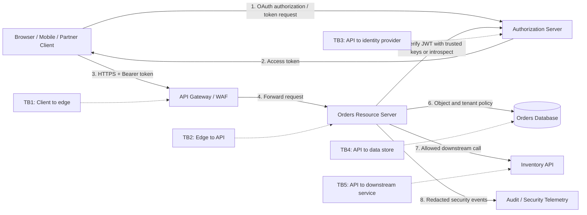

# Mô hình đe dọa và các ranh giới tin cậy của API

## 1. Vì sao Resource Server cần threat model riêng?

Một OAuth 2.0 Resource Server không chỉ là endpoint có bật xác thực Bearer. Nó nằm giữa nhiều thành phần có mức độ tin cậy khác nhau: client, Authorization Server (AS), API gateway, service nội bộ, hệ thống lưu trữ, message broker và nhà cung cấp bên ngoài.

Mỗi thành phần có thể bị cấu hình sai hoặc bị xâm phạm theo cách khác nhau. Một JWT có chữ ký hợp lệ vẫn có thể bị dùng sai audience. Một request đã qua gateway vẫn có thể mang header giả mạo. Một user có scope hợp lệ vẫn có thể đọc dữ liệu thuộc tenant khác nếu API bỏ qua kiểm tra quyền trên từng object. Một service nội bộ có thể vô tình chuyển tiếp Bearer token đến host không đáng tin.

**Mô hình đe dọa (threat model)** là cách mô tả có cấu trúc những tài sản cần bảo vệ, tác nhân có thể tấn công, đường đi của dữ liệu, ranh giới tin cậy, điểm yếu có thể bị khai thác và biện pháp giảm thiểu. Với OAuth 2.0/OIDC Resource Server, threat model phải bao gồm cả token lifecycle và authorization logic trong API.

Bài học thuộc chương **Triển khai an toàn** của mô-đun **Spring Security OAuth 2.0 OIDC Resource Server**. Mục tiêu là lập threat model thực dụng cho API dùng Spring Security, nhận diện trust boundaries, phân tích STRIDE/abuse cases và chuyển kết quả thành cấu hình, kiểm thử cùng quy trình vận hành.

> **Nguyên tắc nền tảng:** Trust phải được xác lập ở từng boundary bằng credential, validation và policy cụ thể. Vị trí trong mạng nội bộ, request đã qua gateway hoặc chữ ký JWT hợp lệ riêng lẻ không đủ để cấp quyền truy cập dữ liệu.

---

## 2. Phạm vi và thuật ngữ

Một API Resource Server nhận access token để bảo vệ resource. API có thể xác minh JWT cục bộ hoặc introspect opaque token qua AS.

| Thuật ngữ | Ý nghĩa trong threat model |
|---|---|
| **Resource Owner** | Chủ thể có quyền cấp quyền truy cập resource; thường là end user. |
| **Client** | Ứng dụng xin access token và gọi API. Client có thể là public client hoặc confidential client. |
| **Authorization Server (AS)** | Cấp access token, quản lý client, grant, consent, key và token policy. |
| **Resource Server (RS)** | API nhận token, xác minh credential và quyết định request có được phép hay không. |
| **Access token** | Credential đại diện quyền truy cập resource; có thể là JWT hoặc opaque token. |
| **ID Token** | OIDC token mô tả kết quả xác thực user cho OIDC client; không mặc nhiên là API access token. |
| **Principal / subject** | Danh tính mà Authentication đại diện. Trong token, subject thường nằm ở claim sub. |
| **Actor / client** | Thành phần thực hiện hành động; có thể là OAuth client hoặc service gọi thay mặt user. |
| **Audience** | Resource server hoặc nhóm resource mà token được cấp để sử dụng. |
| **Scope / authority** | Quyền ở mức API/action được biểu diễn trong token hoặc Authentication. |
| **Trust boundary** | Điểm nơi dữ liệu, identity hoặc quyền đi từ miền tin cậy này sang miền khác và cần được xác minh lại. |
| **Threat actor** | Người hoặc hệ thống có khả năng khai thác một điểm yếu để đạt mục tiêu trái phép. |

### 2.1. Threat model không chỉ là kiểm tra JWT

JWT validation là một phần của threat model. Một API an toàn còn cần xem xét:

- Ai được phép gọi endpoint?
- User có được phép thao tác trên object cụ thể không?
- Token có đúng resource audience không?
- Client có thể làm giả identity bằng header không?
- API có thể bị ép gọi URL nội bộ hoặc host do attacker kiểm soát không?
- Token có thể bị lộ qua logs, traces, browser storage hoặc outbound requests không?
- Một request hợp lệ có thể gây tiêu thụ CPU, database connection hoặc introspection quota quá mức không?
- Khi AS, JWKS hoặc downstream bị lỗi, API fail closed hay vô tình fail open?

### 2.2. Phân biệt authentication và authorization

**Authentication** trả lời: credential có hợp lệ và đại diện principal nào?

**Authorization** trả lời: principal đó có được thực hiện hành động này trên resource cụ thể không?

Ví dụ, JWT có chữ ký hợp lệ và scope orders:read chỉ chứng minh token được chấp nhận theo trust policy và principal có authority ở mức API. Nó không tự chứng minh Alice được đọc order số 42 hoặc order đó thuộc tenant của Alice.

---

## 3. Xác định tài sản cần bảo vệ

Threat model nên bắt đầu bằng tài sản (assets), không bắt đầu bằng danh sách công nghệ.

| Tài sản | Ví dụ | Hậu quả nếu bị xâm phạm |
|---|---|---|
| **Access token** | JWT hoặc opaque token của user/service | Attacker mạo danh principal trong phạm vi quyền token. |
| **Signing private key** | Khóa ký JWT của AS | Attacker tự phát hành token giả được RS tin cậy. |
| **JWKS / public key metadata** | Public keys, key IDs, issuer metadata | Key discovery sai có thể làm validation lỗi hoặc trust nhầm key. |
| **Client secret / private key** | Credential của confidential OAuth client | Attacker lấy token bằng client identity hoặc giả mạo client. |
| **Refresh token** | Token dài hạn của OAuth client | Có thể duy trì quyền truy cập sau khi access token hết hạn. |
| **User identity** | Subject, tenant, roles, authentication context | Mạo danh hoặc gán nhầm quyền. |
| **Business data** | Orders, invoices, profiles, payment records | Rò rỉ, sửa đổi hoặc xóa dữ liệu trái phép. |
| **Tenant boundary** | tenantId, organizationId, accountId | Truy cập chéo tenant và vi phạm cô lập dữ liệu. |
| **Authorization policy** | Scope mapping, role mapping, object policy | Quyền bị cấp rộng hoặc bị bỏ qua. |
| **Service identity** | Workload identity, mTLS certificate, client credentials | Service giả mạo service khác hoặc được cấp quyền vượt phạm vi. |
| **Audit trail** | Actor, subject, action, resource, timestamp | Mất khả năng điều tra và chứng minh trách nhiệm. |
| **Availability** | API capacity, database, introspection endpoint | DoS, cạn tài nguyên hoặc gián đoạn nghiệp vụ. |
| **Secrets and configuration** | Issuer URI, client credentials, truststore | Trust boundary bị thay đổi hoặc credential bị lộ. |

### 3.1. Phân loại dữ liệu và credential

Không phải mọi dữ liệu có cùng mức nhạy cảm. Cần đánh dấu:

- Public data: có thể công khai.
- Internal data: chỉ dành cho nhân viên/service được phép.
- Confidential business data: dữ liệu khách hàng, giao dịch hoặc hợp đồng.
- Sensitive personal data: dữ liệu cá nhân cần kiểm soát truy cập và audit chặt.
- Security credentials: token, signing key, client secret, private key và session identifier.

Access token phải được xem là **secret bearer credential**. Không đưa token vào log, URL, metrics label, error response hoặc tài liệu support.

### 3.2. Xác định impact trước khi chọn control

Một token đọc danh mục public và một token sửa payment có impact khác nhau. Threat model nên ghi rõ:

- Confidentiality: dữ liệu có thể bị đọc trái phép.
- Integrity: dữ liệu có thể bị sửa hoặc xóa.
- Availability: dịch vụ có thể bị làm chậm hoặc dừng.
- Accountability: không thể xác định ai đã thực hiện hành động.
- Privacy/compliance: dữ liệu cá nhân hoặc dữ liệu được quản lý bị lộ.
- Lateral movement: compromise một service dẫn tới các service khác.

---

## 4. Xác định actors và năng lực của attacker

Không nên giả định attacker chỉ là người ngoài Internet. Các nguồn rủi ro có thể đến từ client hợp lệ bị xâm phạm, user nội bộ, service account bị lộ hoặc dependency bên thứ ba.

| Actor | Năng lực có thể có | Mục tiêu thường gặp |
|---|---|---|
| **Anonymous Internet attacker** | Gửi request tùy ý, fuzz header/body/path, tạo tải lớn | Bypass auth, exploit parser, DoS, SSRF. |
| **Authenticated low-privilege user** | Có token hợp lệ với scope giới hạn | Đọc object của user khác, nâng quyền, vượt tenant boundary. |
| **Malicious OAuth client** | Có client registration hợp lệ hoặc credential bị đánh cắp | Xin token sai scope, replay token, lạm dụng grant. |
| **Compromised browser/mobile app** | Có thể lấy token trong runtime/storage của app | Exfiltrate token và gọi API thay user. |
| **Compromised internal service** | Có network reachability và có thể sở hữu workload credential | Pivot sang downstream, relay token, giả mạo header. |
| **Malicious tenant administrator** | Quyền quản trị trong tenant của họ | Thử truy cập dữ liệu tenant khác hoặc lạm dụng delegated access. |
| **Insider/operator** | Quyền truy cập log, configuration, secrets hoặc production console | Đọc dữ liệu/token, thay trust config, xóa audit trail. |
| **Compromised third-party service** | Nhận outbound request hoặc callback | Lấy token relay, khai thác SSRF/redirect. |
| **Compromised AS / signing key** | Có thể cấp token hoặc ký JWT được tin cậy | Giả mạo principal và quyền trên toàn bộ resource tin issuer. |

### 4.1. Ghi rõ attacker không có quyền gì

Threat model nên nêu giả định cụ thể, ví dụ:

- Attacker không có quyền truy cập private signing key của AS.
- Attacker có thể gửi request Internet và biết API URL.
- Attacker có thể đăng ký một tài khoản user bình thường.
- Attacker có thể kiểm soát một số input như path parameter, search filter và webhook URL.
- Attacker có thể replay một access token bị lộ cho tới khi token hết hạn/revoke.
- Attacker có thể gọi trực tiếp service nếu network ingress chưa bị giới hạn.

Nếu giả định sai, kết luận bảo mật có thể sai. Ví dụ, nếu API có thể bị gọi trực tiếp ngoài gateway, không thể dựa vào gateway authorization header làm trust anchor.

---

## 5. Vẽ data-flow diagram và đánh dấu trust boundaries

Trước khi chọn Spring Security configuration, hãy vẽ luồng request từ client tới data store.



Các đường chấm là trust boundaries cần có control cụ thể. Sơ đồ này chỉ là ví dụ; một hệ thống có thể không dùng gateway, dùng opaque token, service mesh hoặc nhiều Resource Servers.

### 5.1. Trust boundary 1: client tới Internet edge

Dữ liệu đi qua boundary:

- HTTP method, path, query, headers và body.
- Bearer access token.
- Client-supplied identifiers như userId, tenantId hoặc accountId.
- File upload, search filters và callback URLs.

Threats:

- Token bị đánh cắp/replay.
- Header spoofing.
- Request smuggling hoặc parser discrepancy giữa proxy và app.
- Payload quá lớn, path traversal, injection hoặc malformed input.
- Brute force và request flooding.

Controls:

- HTTPS bắt buộc; HSTS cho browser-facing origin nếu phù hợp.
- Validate request size, content type, schema và encoding.
- Rate limit theo IP, client, principal và endpoint phù hợp.
- Không tin identity/role/tenant header từ client.
- Giới hạn upload, pagination, filter complexity và execution time.
- Bảo vệ token trong browser/mobile client theo threat model của nền tảng.

### 5.2. Trust boundary 2: gateway tới Resource Server

Gateway có thể terminate TLS, route request, enforce coarse rate limit và thêm correlation metadata. Nhưng API vẫn cần hiểu rõ điều gì được gateway xác thực.

Câu hỏi bắt buộc:

- Gateway chỉ route request hay cũng validate access token?
- API có xác minh token độc lập không?
- Nếu gateway thêm X-Authenticated-User, ai có thể gọi API trực tiếp?
- Gateway có strip header do client gửi trước khi thêm trusted header không?
- Internal hop có TLS/mTLS không?
- Network policy có chặn bypass gateway không?
- Gateway và API có cùng issuer, audience và authorization policy không?

Không chấp nhận header như X-User-Id, X-User-Roles hoặc X-Tenant-Id làm bằng chứng identity nếu request có thể tới API từ nguồn không được xác thực.

Nếu API tin identity header từ gateway, phải chứng minh gateway là trusted proxy: header đầu vào bị xóa, giá trị mới được ghi đè, direct ingress bị chặn, hop được xác thực và header integrity được bảo vệ.

### 5.3. Trust boundary 3: Resource Server tới Authorization Server/JWKS

JWT validation thường cần public keys từ JWKS endpoint. Opaque token cần introspection call.

Threats:

- Trust nhầm issuer hoặc key source.
- JWKS/discovery URL bị cấu hình thành host không tin cậy.
- DNS hoặc TLS trust bị xâm phạm.
- AS outage làm authentication fail hoặc gây request backlog.
- Introspection endpoint bị flood.
- Key rotation/caching tạo cửa sổ xác minh không nhất quán.

Controls:

- Cấu hình issuer/JWKS/introspection URI từ trusted deployment config.
- Dùng HTTPS và certificate validation.
- Không lấy discovery URL tùy ý từ request hoặc token claim.
- Giới hạn outbound network và egress.
- Cache JWKS/introspection theo policy rõ ràng.
- Timeout và bulkhead cho AS dependency.
- Theo dõi key rotation và validator failures.
- Fail closed khi không thể xác minh credential mới, theo availability policy được thiết kế.

### 5.4. Trust boundary 4: Resource Server tới database

Token authentication không bảo vệ dữ liệu nếu query không có tenant/object constraint.

Threats:

- BOLA/IDOR: thay order ID để đọc object của user khác.
- Tenant escape: đổi tenant identifier trong request.
- Mass assignment: user ghi field nhạy cảm như owner, tenant hoặc approval status.
- SQL/NoSQL injection.
- Query quá rộng gây data exfiltration hoặc DoS.

Controls:

- Kiểm tra owner/tenant tại service/repository boundary.
- Lấy principal identity từ Authentication đã xác minh.
- Không lấy tenant/owner từ client input làm nguồn quyết định quyền.
- Áp constraint trong query hoặc policy layer.
- Dùng DTO allowlist thay bind entity trực tiếp.
- Database least privilege, parameterized query và audit.

### 5.5. Trust boundary 5: Resource Server tới downstream API

Nếu API relay token hoặc dùng service credential, đây là boundary độc lập.

Threats:

- Token user bị gửi tới host ngoài allowlist.
- Downstream tin token sai audience.
- Service identity có quyền quá rộng.
- Header do caller điều khiển làm giả user/tenant.
- SSRF hoặc redirect làm lộ credential.
- Downstream không kiểm authorization object-level.

Controls:

- WebClient riêng theo destination/trust domain.
- Fixed base URL hoặc allowlist service discovery.
- Audience và scope riêng cho downstream.
- Token exchange hoặc client credentials khi cần credential khác.
- mTLS/workload identity cho service-to-service.
- Không log Authorization header.
- Downstream tự xác minh credential và authorize.

---

## 6. STRIDE áp dụng cho OAuth2/OIDC Resource Server

STRIDE là một cách phân loại threat theo sáu nhóm: Spoofing, Tampering, Repudiation, Information Disclosure, Denial of Service và Elevation of Privilege.

| Nhóm | Câu hỏi cho Resource Server | Ví dụ |
|---|---|---|
| **Spoofing** | Attacker có thể giả mạo user, client, service hoặc issuer không? | Giả header X-User-Id, dùng token từ issuer giả. |
| **Tampering** | Attacker có thể sửa token, request hoặc authorization metadata không? | JWT payload bị sửa, tenant ID bị thay, role claim bị tin sai nguồn. |
| **Repudiation** | Có thể phủ nhận hành động vì audit không đủ không? | Log không ghi subject, actor, resource hoặc correlation ID. |
| **Information Disclosure** | Token hoặc business data có thể bị lộ không? | Authorization header vào log, BOLA, token relay tới external host. |
| **Denial of Service** | Có thể làm cạn CPU, memory, connection hoặc AS quota không? | Token flood, introspection flood, expensive queries. |
| **Elevation of Privilege** | User/service có thể có quyền vượt policy không? | Scope mapping sai, confused deputy, thiếu tenant check. |

### 6.1. Spoofing

Các điểm cần kiểm:

- JWT signature được xác minh bằng key thuộc issuer đã cấu hình.
- Issuer claim khớp expected issuer.
- Audience có resource identifier của API.
- Token type/profile được kiểm nếu contract yêu cầu.
- Client identity không bị suy ra từ header do caller tự gửi.
- Trusted proxy strip và overwrite forwarded identity headers.
- Service-to-service request xác thực workload identity.

### 6.2. Tampering

JWT signed bảo vệ integrity của claims nếu signature được verify đúng. Nhưng request data nằm ngoài token vẫn cần validation.

Ví dụ attacker gửi token hợp lệ nhưng thay path:

```http
GET /api/orders/other-users-order HTTP/1.1
Authorization: Bearer <valid-access-token>
```

Signature không bảo vệ path, query hoặc body. API phải kiểm quyền trên resource được request tham chiếu.

### 6.3. Repudiation

Audit event hữu ích nên chứa:

- Timestamp UTC.
- Correlation/trace ID.
- Subject/principal identifier ổn định.
- Client ID hoặc actor/service identity nếu có.
- Action và resource identifier.
- Tenant context đã được xác minh.
- Outcome (allowed/denied).
- Policy/reason category.
- Source service hoặc gateway identity.

Không ghi raw token, refresh token, client secret hoặc full sensitive request body. Audit trail phải có access control và retention policy; log có thể bị attacker có quyền vận hành sửa/xóa nếu không được bảo vệ.

### 6.4. Information disclosure

Đặc biệt kiểm:

- Authorization header trong access logs, debug logs và distributed traces.
- Exception body chứa JWT claims.
- Error response chứa internal hostname/stack trace.
- CORS cho phép origin không cần thiết.
- Object ID enumeration.
- Token relay sang external service.
- Cache key hoặc metrics label chứa token.
- Sensitive data trong actuator/debug endpoints.

### 6.5. Denial of Service

Resource Server có thể tốn tài nguyên ở nhiều bước:

- Parse JWT lớn hoặc JSON phức tạp.
- Signature verification.
- JWKS refresh.
- Introspection HTTP.
- Database queries.
- Serialization/deserialization.
- Downstream fan-out.
- Password/client credential or token endpoint dependencies.

Áp giới hạn cho header/token length, body size, request rate, concurrency, timeout, pagination, query complexity và connection pools. Đặt timeout riêng cho AS/downstream và có bulkhead để dependency lỗi không chiếm hết worker threads.

### 6.6. Elevation of Privilege

Các đường nâng quyền thường đến từ:

- Converter ánh xạ claim không đúng.
- Role hierarchy hoặc prefix authority sai.
- Scope rộng hơn ý định.
- Không kiểm tenant/object ownership.
- Dùng ID Token thay access token.
- Chấp nhận audience không đúng.
- Tin user role header.
- Service có thể relay user token tới mọi destination.
- Confused deputy: service dùng quyền của chính nó để làm việc mà user không được phép.

---

## 7. Trust boundary của access token: issuer, audience, scope và subject

Một access token chỉ đáng tin khi Resource Server kiểm tra đầy đủ contract.

### 7.1. Issuer: ai phát hành?

Claim iss phải khớp issuer được tin cậy. Không dùng issuer URL lấy từ request parameter hoặc tự động tin issuer bất kỳ được token khai báo.

Nếu một ứng dụng tin nhiều issuers, cần mapping rõ issuer → key source → token profile → tenant/client policy. Không gom mọi issuer vào một trust domain nếu họ có semantics và security posture khác nhau.

### 7.2. Audience: token dành cho API nào?

Ví dụ:

```json
{
  "iss": "https://auth.example.test/realms/platform",
  "sub": "alice-123",
  "aud": ["orders-api"],
  "scope": "orders:read",
  "exp": 1890003600
}
```

Token dành cho orders-api không mặc nhiên được phép gọi inventory-api. Signature hợp lệ chỉ xác nhận token do issuer tin cậy ký và không bị sửa. Audience giúp giới hạn resource nhận token.

Không thêm tất cả microservices vào audience chỉ để giảm lỗi 401. Cấp token theo resource, dùng token exchange hoặc workload credential khi cần gọi service khác.

### 7.3. Subject: token đại diện ai?

sub thường định danh principal. Nhưng ý nghĩa chính xác phụ thuộc issuer và token type. Không giả định mọi token có cùng subject semantics:

- User delegated token có thể đại diện end user.
- Client credentials token có thể đại diện OAuth client/service.
- Token exchange có thể biểu diễn subject và actor.
- Multi-tenant issuer có thể cần kết hợp issuer + subject hoặc tenant context để có identifier duy nhất.

Không dùng email/username làm stable security key nếu issuer có thể thay đổi giá trị. Dùng identifier ổn định theo contract.

### 7.4. Scope: quyền ở mức nào?

Scope thường biểu diễn quyền API/action, ví dụ:

- orders:read
- orders:write
- inventory:read
- payments:refund

Scope không tự chứng minh user được thao tác trên mọi object thuộc API. Endpoint có thể yêu cầu orders:read, nhưng service vẫn phải kiểm tra order thuộc user/tenant được phép.

### 7.5. Token type và ID Token confusion

OIDC ID Token xác nhận thông tin authentication cho client. Resource Server nên nhận access token có đúng profile. Không chấp nhận ID Token chỉ vì nó là JWT có chữ ký hợp lệ.

Nếu issuer hỗ trợ JWT access-token profile RFC 9068, có thể enforce typ/claims theo profile đã thỏa thuận. Không áp một quy tắc typ chung cho mọi issuer nếu contract không quy định.

---

## 8. Threat model cho JWT validation

JWT là self-contained token. RS thường xác minh chữ ký bằng public key và kiểm claims cục bộ.

Một validation policy cần xem xét:

1. Signature và allowed algorithm.
2. Trusted issuer.
3. Audience của API.
4. Expiration và not-before.
5. Token type/profile khi cần.
6. Required claims.
7. Scope/authority conversion.
8. Tenant/subject mapping.
9. Custom business constraints.

### 8.1. Signature không phải authorization

Một JWT có chữ ký hợp lệ vẫn có thể:

- Hết hạn.
- Chưa tới nbf.
- Sai issuer.
- Sai audience.
- Là ID Token.
- Thiếu scope.
- Đại diện client thay vì user.
- Có tenant không được phép.
- Không được phép đọc object cụ thể.

Mỗi lớp kiểm tra giải quyết một câu hỏi khác nhau.

### 8.2. Algorithm và key trust

Không tự chấp nhận algorithm chỉ vì token header khai báo. Dùng decoder/framework đã cấu hình thuật toán được phép và key source thuộc issuer tin cậy. Tránh tự viết JWT verification bằng cách decode Base64 rồi so payload.

Các rủi ro cần xem:

- Algorithm confusion hoặc algorithm yếu.
- Key ID (kid) không tồn tại hoặc gây key lookup bất thường.
- JWKS có key trùng ID hoặc metadata sai.
- Key rotation không được cập nhật.
- Public key được lấy từ URL không tin cậy trong token/header.
- Decoder chấp nhận key không phù hợp với algorithm/profile.

### 8.3. JWKS và discovery là outbound trust

issuer-uri hoặc jwk-set-uri là cấu hình trust. Nếu attacker điều khiển URI, RS có thể bị hướng tới server của attacker hoặc mạng nội bộ.

Không lấy issuer/JWKS URL từ:

- Query parameter.
- Header do client gửi.
- Claim jku hoặc x5u không được policy cho phép.
- Dynamic tenant metadata chưa được kiểm soát.
- Redirect tùy ý.

Với multi-issuer/multi-tenant system, issuer lookup phải dùng registry allowlist và giới hạn network egress.

### 8.4. Key rotation

Threat model cần hỏi:

- AS công bố key mới trước khi bắt đầu ký bằng key đó bao lâu?
- RS cache JWKS bao lâu?
- Unknown kid có kích hoạt refresh không?
- Refresh có thể bị flood không?
- Key cũ được giữ bao lâu để validate token đang còn hạn?
- Nếu key bị compromise, có thể revoke/deny nhanh thế nào?

Không xóa key cũ quá sớm nếu token đã ký bằng key đó vẫn còn hợp lệ; cũng không giữ key compromised lâu hơn cần thiết. Có incident procedure cho signing-key compromise.

---

## 9. Threat model cho opaque token và introspection

Opaque token không thể được RS tự xác minh bằng cách parse JWT. RS gửi token tới introspection endpoint và nhận trạng thái cùng metadata.

### 9.1. Trust boundary với introspection endpoint

Cần xác minh:

- Introspection URI thuộc AS đã được tin cậy.
- RS xác thực với AS bằng confidential client credential hoặc cơ chế được hỗ trợ.
- Kết nối HTTPS và certificate validation.
- Request timeout và error handling.
- Response active được xử lý đúng.
- Scope, audience, subject và tenant attributes được map đúng.
- Không log token trong request body hoặc HTTP wire logs.

### 9.2. Availability và cache

Nếu introspection server chậm hoặc lỗi, RS có thể không xác minh được token mới. Không nên fail open và tự cho phép request chỉ vì AS đang unavailable.

Cache introspection result có thể giảm latency nhưng tạo stale authorization window. TTL cần xét expiry, revocation SLA và endpoint sensitivity.

### 9.3. Phân biệt inactive token và dependency failure

- active=false: token không active; authentication bị từ chối.
- Timeout/5xx: AS không cung cấp được kết quả hiện hành.
- 401/403 từ introspection endpoint: có thể là credential/configuration issue của RS.
- Response malformed: không thể tạo principal đáng tin.

Không map tất cả dependency failures thành anonymous request rồi tiếp tục xử lý. Fail closed đối với authentication; map availability errors theo API contract và alert vận hành.

---

## 10. Trust boundary của authorization: scope chưa đủ

Một lỗi phổ biến là dừng ở kiểm tra authority:

```java
.requestMatchers(HttpMethod.GET, "/api/orders/**")
    .hasAuthority("SCOPE_orders:read")
```

Rule trên bảo vệ capability ở mức endpoint. Nó chưa trả lời user có quyền đọc order cụ thể hay không.

### 10.1. Broken Object Level Authorization (BOLA)

Giả sử Alice có token orders:read. Cô gọi:

```http
GET /api/orders/1001 HTTP/1.1
Authorization: Bearer <alice-access-token>
```

Sau đó đổi path thành:

```http
GET /api/orders/1002 HTTP/1.1
Authorization: Bearer <alice-access-token>
```

Nếu order 1002 thuộc Bob nhưng API chỉ kiểm scope, Alice có thể đọc dữ liệu Bob. Đây là BOLA/IDOR.

### 10.2. Kiểm tra ownership tại service layer

Ví dụ:

```java
@Service
public class OrderQueryService {

    private final OrderRepository orders;

    public OrderQueryService(OrderRepository orders) {
        this.orders = orders;
    }

    public Order getOrder(String orderId, Jwt jwt) {
        String subject = jwt.getSubject();
        String tenantId = requiredTenant(jwt);

        return orders.findByIdAndTenantId(orderId, tenantId)
            .filter(order -> order.isVisibleTo(subject))
            .orElseThrow(OrderNotFoundException::new);
    }

    private String requiredTenant(Jwt jwt) {
        Object value = jwt.getClaims().get("tenant_id");
        if (!(value instanceof String tenantId)
                || tenantId.isBlank()) {
            throw new AccessDeniedException("Missing tenant context");
        }
        return tenantId;
    }
}
```

Đây là ví dụ minh họa. Tên claim, tenant semantics và ownership policy phải theo issuer/business contract. Có thể dùng repository query để ràng buộc tenant ngay từ đầu thay vì tải object bất kỳ rồi mới kiểm tra.

### 10.3. Không lấy tenant từ request làm authority

Ví dụ không an toàn:

```java
// Không dùng tenant do caller gửi làm nguồn quyết định quyền.
String tenantId = request.getHeader("X-Tenant-Id");
return repository.findByTenantIdAndId(tenantId, orderId);
```

Client có thể thay header. Nếu API hỗ trợ user chọn một tenant trong nhiều tenant mà user được phép truy cập, phải xác minh lựa chọn đó với membership/entitlement đã được kiểm tra ở server.

### 10.4. Kết hợp endpoint policy và object policy

Một quyết định cho phép đầy đủ có thể cần:

- Token hợp lệ.
- Đúng audience.
- Scope/authority cho action.
- Principal active và không bị disabled.
- Tenant context hợp lệ.
- User/service có membership.
- Object thuộc phạm vi được phép.
- Business state cho phép action.
- Separation of duties hoặc approval rule nếu nghiệp vụ yêu cầu.

Không nên nhét toàn bộ logic object authorization vào một regex matcher hoặc chỉ dựa trên role ADMIN.

---

## 11. Confused deputy và delegation

**Confused deputy** xảy ra khi service có quyền riêng của nó bị caller thuyết phục dùng quyền đó để thực hiện hành động mà caller không được phép.

Ví dụ:

1. Alice gọi orders-api với token chỉ có orders:read.
2. orders-api có service credential rộng để gọi payments-api.
3. Alice gửi một request khiến orders-api gọi refund endpoint.
4. orders-api chỉ kiểm user đã authenticated mà không kiểm Alice có quyền refund.
5. payments-api thấy service credential hợp lệ và thực hiện refund.

Downstream xác thực orders-api đúng, nhưng API đầu đã dùng quyền service vượt authority của user.

### 11.1. Phân biệt subject và actor

Trong delegated call, cần hiểu:

- Subject: user hoặc entity được đại diện.
- Actor: service thực hiện request thay mặt subject.
- Client: OAuth client đã xin token.
- Resource: API nhận token.

Một token client credentials thường đại diện service, không tự đại diện user. Không ghi user ID vào header rồi coi service token thành user delegation.

### 11.2. Các lựa chọn credential

| Mô hình | Khi phù hợp | Downstream cần hiểu |
|---|---|---|
| **User token relay** | Token inbound có audience/scope phù hợp downstream | User/delegated principal và authority gốc. |
| **OAuth2 client credentials** | Tác vụ chỉ cần workload identity | Service/client principal. |
| **Token exchange** | Cần token mới cho audience/scope downstream hoặc delegation chain | Subject/actor và quyền được AS cấp. |
| **mTLS/workload identity** | Xác thực workload ở network/service layer | Service identity, có thể kết hợp OAuth authorization. |

### 11.3. Không nâng quyền bằng cách đổi credential âm thầm

Nếu orders-api đổi user token thành service token, cần kiểm tra user policy trước khi gọi downstream và ghi audit subject/actor. Nếu cần downstream tự quyết định delegation, dùng token exchange hoặc protocol được issuer hỗ trợ.

### 11.4. Token relay có trust boundary riêng

Một WebClient có relay filter có thể gắn user token vào outbound request. Chỉ dùng client đó cho destination đã được phê duyệt. Không dùng một WebClient relay cho arbitrary URL, webhook hoặc external API.

---

## 12. Header spoofing và trusted proxy

Nhiều hệ thống truyền identity qua headers sau gateway. Đây là một trust boundary dễ bị hiểu nhầm.

Ví dụ headers:

```http
X-Authenticated-User: alice-123
X-Authenticated-Roles: ADMIN
X-Tenant-Id: tenant-a
X-Forwarded-For: 203.0.113.10
```

Nếu client có thể tự gửi các header này và gateway không xóa/ghi đè, API có thể tin dữ liệu giả.

### 12.1. Điều kiện để tin identity header

Chỉ cân nhắc tin header do proxy cấp nếu tất cả điều kiện sau được đáp ứng:

- API chỉ nhận traffic từ trusted proxy theo network policy.
- Proxy xóa mọi header identity tương ứng từ request client.
- Proxy tạo giá trị mới từ authentication đã xác minh.
- Proxy-to-API hop được bảo vệ bằng TLS/mTLS hoặc cơ chế tương đương.
- Direct ingress không thể bypass proxy.
- API xác thực proxy/workload identity.
- Header schema, encoding và duplicate-header behavior được thống nhất.
- Có test chứng minh spoofed header từ client không được giữ lại.

Ngay cả khi có trusted identity headers, API vẫn cần authorization trên endpoint và object.

### 12.2. Forwarded headers

X-Forwarded-For, Forwarded, X-Forwarded-Proto có thể bị spoof nếu proxy chain không được cấu hình đúng. Chỉ tin forwarded headers từ proxy hop nằm trong trusted proxy list. Không dùng IP từ header tùy ý làm identity hoặc security principal.

### 12.3. Không dùng CORS như access control

CORS là browser policy kiểm soát JavaScript từ origin nào được đọc response. CORS không ngăn curl, mobile app, backend hoặc attacker gọi API trực tiếp. API vẫn phải xác thực và authorize từng request.

---

## 13. Browser, cookie, CSRF và CORS trong threat model

Resource Server có thể nhận Bearer token từ browser application hoặc cookie/session. Hai mô hình có threat profile khác nhau.

### 13.1. Bearer token trong Authorization header

Browser app thường chủ động gắn header Authorization. Trình duyệt không tự động gửi header đó tới mọi site như cookie, nhưng XSS có thể đọc token nếu token nằm trong JavaScript-accessible storage hoặc runtime.

Controls:

- Hạn chế XSS bằng output encoding, CSP và dependency hygiene.
- Dùng authorization code flow với PKCE cho public client.
- Giữ access token ngắn hạn và audience-scoped.
- Không lưu token trong localStorage nếu threat model yêu cầu bảo vệ trước persistent XSS; cân nhắc BFF hoặc storage/runtime strategy phù hợp.
- Không đưa token vào URL.
- CORS allowlist origin cần thiết, nhưng không coi đó là authorization.

### 13.2. Cookie authentication

Cookie được browser gửi tự động theo domain/path/samesite rules. Nếu API dùng cookie/session authentication, CSRF là threat quan trọng vì attacker có thể khiến browser gửi request mà user không chủ động tạo.

Controls:

- CSRF token và SameSite policy phù hợp.
- Secure, HttpOnly cookie flags.
- Kiểm Origin/Referer theo policy phù hợp.
- Tách API stateless Bearer-only khỏi browser session chain nếu kiến trúc cần.
- Không disable CSRF cho chain dùng cookie/session chỉ vì endpoint là REST.

### 13.3. CSRF không phải vấn đề duy nhất của browser

XSS có thể chạy trong origin đáng tin và thực hiện hành động dưới quyền user. CSRF protection không chặn XSS. Cần bảo vệ cả frontend và API.

### 13.4. CORS policy

Cấu hình CORS nên:

- Chỉ allow origin thực sự cần.
- Chỉ allow methods/headers cần.
- Không kết hợp wildcard origin với credentials.
- Không phản chiếu tùy ý Origin header.
- Xử lý preflight mà không bỏ qua authorization cho actual request.
- Không trả token hoặc sensitive data trong response headers không cần thiết.

---

## 14. SSRF và outbound trust

API có thể gọi downstream dựa trên URL hoặc identifier do client cung cấp. Nếu outbound HTTP client có credential, SSRF có thể biến API thành proxy lấy token hoặc truy cập internal metadata.

### 14.1. Ví dụ nguy hiểm

```java
public Mono<String> fetch(String userSuppliedUrl) {
    return relayWebClient.get()
        .uri(userSuppliedUrl)
        .retrieve()
        .bodyToMono(String.class);
}
```

Nếu relayWebClient gắn Bearer token hiện tại, attacker có thể cung cấp URL tới server do họ kiểm soát. Token có thể bị gửi đến destination không được phép.

### 14.2. Controls cho outbound destinations

- Dùng base URL cố định trong configuration.
- Map service ID sang allowlisted destination.
- Validate scheme, host và port.
- Chặn loopback, link-local, private ranges và cloud metadata endpoints theo network policy.
- Kiểm DNS resolution và DNS rebinding risk.
- Không follow redirect sang origin không tin cậy khi credential có thể được forward.
- Dùng egress firewall/network policy.
- Không để request body hoặc query parameter điều khiển destination tùy ý.
- Tách WebClient có token relay khỏi WebClient public/external.

### 14.3. JWKS/discovery cũng là outbound requests

Issuer discovery và JWKS retrieval có thể bị lạm dụng nếu URI không cố định. Đừng tạo decoder theo issuer do caller gửi mà không có issuer registry, allowlist và egress restrictions.

### 14.4. Timeout và redirect

Outbound client cần timeout, connection pool limits và redirect policy rõ. Một redirect tới host khác là một lần thay đổi trust boundary. Kiểm tra behavior của connector đang dùng thay vì giả định Authorization header luôn được xử lý an toàn.

---

## 15. Token theft, replay và proof of possession

OAuth 2.0 Bearer token có đặc tính: bên sở hữu token có thể sử dụng token trong phạm vi quyền của nó. Vì vậy token bị lấy cắp có thể bị replay.

### 15.1. Các nguồn rò rỉ token

- Browser storage hoặc XSS.
- Mobile device bị compromise.
- Application logs/debug logs.
- Distributed tracing hoặc APM capture.
- Proxy/access logs.
- Crash dump hoặc heap dump.
- CI artifacts và test reports.
- Support tickets/screenshots.
- URL query strings và referrer.
- Outbound request tới host sai.
- Message queue hoặc database lưu token lâu dài.

### 15.2. Giảm thiểu token replay

- Access token lifetime ngắn phù hợp risk.
- Audience restriction.
- Scope tối thiểu.
- TLS trên mọi hop.
- Bảo vệ token ở client và server.
- Không log/persist raw token nếu không có thiết kế credential vault rõ ràng.
- Revocation/introspection policy phù hợp.
- DPoP hoặc mutual-TLS-bound access token nếu hệ sinh thái hỗ trợ và threat model yêu cầu proof-of-possession.

DPoP và mTLS-bound tokens làm giảm khả năng dùng token bị đánh cắp một cách độc lập, nhưng không loại bỏ mọi replay hoặc endpoint compromise. Phải triển khai đúng protocol ở cả client, AS và RS.

### 15.3. Refresh token thuộc boundary khác

Resource Server thường chỉ cần access token. Refresh token được giữ ở OAuth client hoặc thành phần token-management được thiết kế riêng. Không đưa refresh token tới API chỉ để kéo dài session và không log nó.

---

## 16. Multi-tenant trust boundary

Multi-tenant API có nguy cơ rò rỉ chéo tenant nếu tenant context không được xác minh ở mọi tầng.

### 16.1. Tenant claim không tự chứng minh membership

Ví dụ token:

```json
{
  "sub": "alice-123",
  "tenant_id": "tenant-a",
  "aud": ["orders-api"],
  "scope": "orders:read"
}
```

RS phải tin claim tenant_id chỉ khi:

- Issuer đã được xác minh.
- Claim có semantics rõ trong token contract.
- Issuer chỉ cấp tenant membership sau khi kiểm tra entitlement.
- Subject/client được phép hoạt động trong tenant đó.
- Token audience và scope phù hợp.

Không tin tenant_id từ path/header/body nếu chưa kiểm tra membership.

### 16.2. User có nhiều tenant

Nếu user được phép chọn tenant hiện hành, API cần xác minh user là member của tenant đó. Một access token có subject không nhất thiết đã giới hạn tenant duy nhất.

Có thể dùng claim tenant được issuer cấp hoặc membership lookup server-side. Nếu client gửi tenant selector, treat nó là requested context cần authorize, không phải proof.

### 16.3. Tenant isolation ở data layer

Áp tenant filter trong repository/query hoặc database row-level security khi phù hợp. Dùng composite key và constraint để tránh query theo object ID đơn lẻ.

Ví dụ:

```java
Optional<Order> findByTenantIdAndId(
    String tenantId,
    String orderId
);
```

Đây là defense in depth. Application authorization vẫn cần kiểm actor có quyền thao tác với object trong tenant đó.

### 16.4. Background jobs và event consumers

Message event có thể chứa tenant ID và user ID. Consumer không nên tin payload như một credential. Xác thực producer/service identity, kiểm schema/signature nếu protocol cần, và enforce tenant policy tại thời điểm xử lý.

---

## 17. OIDC và ranh giới giữa authentication client với API authorization

OIDC bổ sung lớp identity trên OAuth 2.0. ID Token được phát cho OIDC client để xác nhận authentication event. Access token được dùng để truy cập resource.

Threat model cần kiểm:

- API chỉ chấp nhận access token theo contract.
- Client xác minh ID Token theo OIDC flow riêng.
- nonce, state và PKCE được dùng đúng ở authorization flow tương ứng.
- Không coi ID Token là access token chỉ vì có chữ ký hợp lệ.
- Không tin email claim nếu chưa xác minh email_verified theo policy.
- Authentication assurance (acr, amr, auth_time) chỉ được dùng khi issuer contract và validation đã rõ.
- API không tự suy ra user vừa re-authenticate từ iat của ID Token.

### 17.1. sub có phạm vi issuer

Cùng một chuỗi subject từ hai issuers khác nhau không nhất thiết là cùng user. Nếu hệ thống tin nhiều issuers, principal identity nên có namespace issuer hoặc mapping rõ.

### 17.2. Client identity và user identity khác nhau

Một token có thể chứa client_id và sub. Không mặc định client_id là user. Trong client credentials flow, principal thường đại diện service/client. Authorization policy phải phân biệt user delegated call với workload call.

---

## 18. Spring Security: cấu hình Resource Server theo trust policy

Một security configuration nên phản ánh threat model: chỉ bảo vệ API path cần thiết, yêu cầu authority rõ và mặc định deny.

Ví dụ Servlet Resource Server:

```java
@Configuration
@EnableWebSecurity
@EnableMethodSecurity
public class ApiSecurityConfig {

    @Bean
    SecurityFilterChain apiSecurity(HttpSecurity http)
            throws Exception {
        return http
            .securityMatcher("/api/**")
            .sessionManagement(session -> session
                .sessionCreationPolicy(SessionCreationPolicy.STATELESS))
            .csrf(AbstractHttpConfigurer::disable)
            .authorizeHttpRequests(auth -> auth
                .requestMatchers(HttpMethod.GET, "/api/orders/**")
                    .hasAuthority("SCOPE_orders:read")
                .requestMatchers(HttpMethod.POST, "/api/orders/**")
                    .hasAuthority("SCOPE_orders:write")
                .anyRequest().denyAll())
            .oauth2ResourceServer(oauth ->
                oauth.jwt(Customizer.withDefaults()))
            .build();
    }
}
```

csrf(AbstractHttpConfigurer::disable) trong ví dụ chỉ phù hợp với chain API stateless xác thực bằng Authorization Bearer header và không dựa vào cookie/session. Nếu chain dùng cookie authentication hoặc browser session, cần CSRF protection tương ứng.

Imports chính:

```java
import org.springframework.context.annotation.Bean;
import org.springframework.context.annotation.Configuration;
import org.springframework.http.HttpMethod;
import org.springframework.security.config.Customizer;
import org.springframework.security.config.annotation.method.configuration.EnableMethodSecurity;
import org.springframework.security.config.annotation.web.builders.HttpSecurity;
import org.springframework.security.config.annotation.web.configuration.EnableWebSecurity;
import org.springframework.security.config.annotation.web.configurers.AbstractHttpConfigurer;
import org.springframework.security.config.http.SessionCreationPolicy;
import org.springframework.security.web.SecurityFilterChain;
```

### 18.1. Cấu hình issuer và audience

Cấu hình issuer giúp Resource Server biết issuer được tin cậy và discovery/JWKS metadata liên quan. Audience phải được kiểm tra theo resource identifier của API.

Ví dụ decoder:

```java
@Bean
JwtDecoder jwtDecoder() {
    String issuer = "https://auth.example.test/realms/platform";
    String jwkSetUri =
        "https://auth.example.test/realms/platform/protocol/openid-connect/certs";

    NimbusJwtDecoder decoder =
        NimbusJwtDecoder.withJwkSetUri(jwkSetUri).build();

    OAuth2TokenValidator<Jwt> issuerAndTimestamp =
        JwtValidators.createDefaultWithIssuer(issuer);

    OAuth2TokenValidator<Jwt> audienceValidator = jwt -> {
        if (jwt.getAudience().contains("orders-api")) {
            return OAuth2TokenValidatorResult.success();
        }

        return OAuth2TokenValidatorResult.failure(
            new OAuth2Error(
                "invalid_token",
                "Token audience is not orders-api",
                null
            )
        );
    };

    decoder.setJwtValidator(
        new DelegatingOAuth2TokenValidator<>(
            issuerAndTimestamp,
            audienceValidator
        )
    );

    return decoder;
}
```

Imports liên quan:

```java
import org.springframework.security.oauth2.core.OAuth2Error;
import org.springframework.security.oauth2.core.OAuth2TokenValidator;
import org.springframework.security.oauth2.core.OAuth2TokenValidatorResult;
import org.springframework.security.oauth2.jwt.DelegatingOAuth2TokenValidator;
import org.springframework.security.oauth2.jwt.Jwt;
import org.springframework.security.oauth2.jwt.JwtDecoder;
import org.springframework.security.oauth2.jwt.JwtValidators;
import org.springframework.security.oauth2.jwt.NimbusJwtDecoder;
```

Khi tự đặt validator, phải giữ tất cả validators cần thiết cho issuer, timestamp, audience và access-token profile. Không thay bộ validator mặc định bằng một audience validator đơn lẻ.

### 18.2. Opaque token configuration

Với opaque token, Resource Server dùng introspection endpoint đã được cấu hình tin cậy. Credential của introspection client là secret cần quản lý riêng. Đặt timeout, connection limits và observability cho AS dependency.

### 18.3. Method security và object authorization

Method security hữu ích cho capability-level rules:

```java
@PreAuthorize("hasAuthority('SCOPE_orders:read')")
public Order getOrder(String orderId) {
    // Additional tenant and ownership policy still required.
}
```

Method security không tự kiểm ownership nếu expression/policy không làm điều đó. Đặt object authorization ở service/repository layer nơi có đủ principal, tenant và resource context.

### 18.4. Deny by default

Dùng anyRequest().denyAll() hoặc policy tương đương cho API chain nếu có thể. Khi thêm endpoint mới, developer phải chủ động quyết định authority thay vì endpoint vô tình được phép vì rule rộng đặt trước.

---

## 19. CORS, CSRF, session và statelessness không thay thế authorization

Một số cấu hình thường bị hiểu nhầm là security boundary đầy đủ:

| Cấu hình/cơ chế | Giải quyết | Không giải quyết |
|---|---|---|
| CORS | Browser origin nào được đọc response | API authentication, curl/mobile access, object authorization |
| CSRF token | Request giả mạo dựa trên credential browser tự gửi | XSS, stolen Bearer token, thiếu scope |
| Stateless session | Không lưu SecurityContext trong HTTP session theo cơ chế stateful | Token replay, BOLA, token theft |
| HTTPS | Bảo vệ dữ liệu trên đường truyền | Credential bị log, endpoint compromise, authorization bug |
| API Gateway | Routing, edge policy, rate limit, có thể validate token | Object-level policy nếu API không enforce |
| JWT signature | Integrity và issuer/key authenticity theo trust config | Audience, scope, object ownership, revocation |
| Network allowlist | Giới hạn network reachability | Identity/authorization của từng request |

Một hệ thống cần nhiều lớp control. Không dùng một cơ chế để tuyên bố đã giải quyết toàn bộ threat.

---

## 20. Service-to-service security và workload identity

Trong microservices, mỗi service là một principal riêng. Network nội bộ không phải một trust domain tuyệt đối.

### 20.1. Xác thực workload

Có thể dùng:

- OAuth2 client credentials.
- mTLS.
- Service mesh workload identity.
- Private-key JWT client authentication.
- Token exchange cho delegated calls.

Credential phải gắn với service identity và được rotate. Không dùng chung một client secret cho mọi service nếu có thể cấp identity riêng.

### 20.2. Least privilege cho service account

Một service chỉ cần scope cần thiết, ví dụ inventory:read, không cần inventory:* hoặc quyền admin. Tách client registration theo workload và environment.

### 20.3. Downstream vẫn validate

inventory-api phải xác minh token/workload identity mà nó nhận. Nếu token audience là orders-api, inventory-api nên từ chối. Không dựa vào DNS name, private subnet hoặc header tự khai báo.

### 20.4. Token relay và token exchange

Relay giữ nguyên token inbound, nên chỉ phù hợp nếu downstream được phép nhận token đó. Token exchange tạo token mới theo policy của AS và phù hợp khi cần audience/scope/delegation khác. Client credentials phù hợp khi chỉ cần service identity.

---

## 21. Secrets, key management và configuration boundaries

### 21.1. Signing keys

Private signing key của AS cần:

- KMS/HSM hoặc secret manager phù hợp.
- Access control tối thiểu.
- Rotation và revocation procedure.
- Audit key usage.
- Separation giữa production, staging và development.
- Backup/recovery được kiểm soát.
- Không nằm trong source code hoặc container image.

RS thường chỉ cần public keys từ JWKS. Không đưa private signing key tới Resource Server.

### 21.2. Client secrets

Client secret của introspection hoặc client credentials flow cần:

- Secret manager.
- Rotation không gây downtime ngoài dự kiến.
- Không commit vào repository.
- Không xuất hiện trong logs/environment dump.
- Scope/client permissions tối thiểu.
- Alert khi secret bị dùng bất thường.

Nếu hỗ trợ private-key JWT hoặc mTLS, bảo vệ private key/certificate theo cùng nguyên tắc.

### 21.3. Issuer/JWKS/introspection configuration

Các URI này xác định trust anchor. Quản lý bằng deployment configuration đã được review. Validate scheme/host và không cho tenant/user thay đổi URI tùy ý.

### 21.4. Configuration drift

Nếu staging và production dùng issuer/key/audience khác nhau, có thể xuất hiện lỗi chỉ xảy ra ở một environment hoặc trust rộng ngoài ý muốn. Dùng config-as-code, change review và startup validation để phát hiện sai lệch.

---

## 22. Logging, tracing và audit an toàn

Observability là cần thiết cho threat detection, nhưng chính nó có thể trở thành nơi rò credential.

### 22.1. Không log các giá trị sau

- Authorization header.
- Raw JWT hoặc opaque token.
- Refresh token.
- Client secret.
- Private key/certificate material.
- Full introspection request/response chứa token.
- Sensitive claims hoặc personal data không cần thiết.
- Session cookie.

### 22.2. Log security event đã redact

Ví dụ cấu trúc:

```json
{
  "event": "api.authorization.denied",
  "timestamp": "2026-11-15T10:00:00Z",
  "service": "orders-api",
  "route": "GET /api/orders/{id}",
  "subject_ref": "stable-pseudonymous-id",
  "client_id": "web-portal",
  "tenant_ref": "tenant-a",
  "required_authority": "SCOPE_orders:read",
  "reason": "object_not_visible",
  "correlation_id": "req-7f31"
}
```

Đây là ví dụ schema, không phải giá trị cần log nguyên trạng trong mọi hệ thống. Pseudonymize identifiers khi phù hợp và tránh đưa PII vào metric labels.

### 22.3. Tách security audit khỏi debug log

Audit log cần integrity, retention và access policy riêng. Debug logs có thể bị bật/tắt thường xuyên, vì vậy không dùng chúng làm bằng chứng duy nhất cho hành động quan trọng.

### 22.4. Tránh high-cardinality metrics

Không dùng token, user ID, order ID hoặc raw URL làm metrics label. Dùng route template, outcome, error category, service name và bounded dimensions.

---

## 23. Availability, rate limiting và fail-closed behavior

Threat model phải xem xét cả request hợp lệ bị lạm dụng.

### 23.1. Rate limit theo nhiều chiều

Có thể áp:

- IP/network source ở edge.
- OAuth client ID.
- Subject hoặc tenant sau authentication.
- Endpoint/action.
- Expensive query class.
- Introspection client/service.
- Concurrent request budget.

Rate limit theo IP đơn lẻ không đủ cho NAT/shared networks; rate limit theo user đơn lẻ không đủ chống anonymous flood. Kết hợp edge controls và application-level quotas.

### 23.2. Giới hạn request cost

- Max header size và token length.
- Max body size.
- Pagination size.
- Filter/sort allowlist.
- Query timeout.
- Max downstream fan-out.
- Request deadline.
- Connection pool và concurrency.
- Upload/download limits.

### 23.3. Fail closed khi không xác minh được identity

Nếu JWT decoder không thể xác minh signature/key hoặc opaque introspection không trả kết quả đáng tin, không cho request đi tiếp như authenticated. Có thể trả 401 cho invalid credential và 5xx/503 cho dependency outage theo contract, nhưng không bỏ qua authentication.

### 23.4. Bulkhead và circuit breaker

AS/JWKS/introspection/downstream chậm có thể kéo sập API. Dùng timeout, connection pool riêng, concurrency limit, circuit breaker/bulkhead phù hợp. Không retry mọi 401/403; retry chỉ cho transient failures và request idempotent.

### 23.5. JWKS refresh abuse

Một lượng lớn token với unknown kid có thể kích hoạt key refresh tùy decoder/cache behavior. Giới hạn request rate, theo dõi JWKS fetch và dùng cache/refresh policy phù hợp. Không tự viết key fetcher không giới hạn.

---

## 24. Threat register mẫu cho Orders API

Một threat register ghi rõ scenario, asset, impact, likelihood, control và bằng chứng kiểm thử.

| ID | Threat scenario | Asset / impact | Controls chính | Bằng chứng |
|---|---|---|---|---|
| T-01 | Attacker dùng JWT giả hoặc sửa claims | Identity, business data | Signature, issuer, allowed algorithm, trusted key source | Signed-token test: tampered signature nhận 401 |
| T-02 | Token dành cho API khác được gửi tới orders-api | Resource boundary | Audience validation | Token sai audience bị từ chối |
| T-03 | ID Token được dùng làm API credential | Identity confusion | Access-token profile/type validation | ID-token fixture bị từ chối |
| T-04 | Token hết hạn hoặc chưa có hiệu lực được chấp nhận | Credential validity | exp, nbf, clock skew policy | Fixed-clock boundary tests |
| T-05 | User đọc order của tenant khác | Confidential business data | Tenant/object authorization | Cross-tenant test bị deny |
| T-06 | Client giả X-User-Id hoặc role header | Principal integrity | Strip/overwrite headers, authenticate proxy | Spoofed-header integration test |
| T-07 | Service relay user token tới attacker host | Bearer credential | Fixed destination, WebClient separation, egress control | External client test không có Authorization |
| T-08 | Introspection flood làm AS quá tải | Availability | Rate limit, timeout, cache policy, bulkhead | Load/chaos test |
| T-09 | Token bị lộ qua logs/traces | Credential confidentiality | Header redaction, telemetry policy | Log assertion/scanner |
| T-10 | Orders API dùng service credential để refund thay user không có quyền | Integrity, financial impact | Check user action before service call, narrow service scope, delegation | Negative authorization test |
| T-11 | JWKS URL bị thay đổi tới host không tin cậy | Trust anchor, SSRF | Config allowlist, TLS, egress policy | Config validation/network policy test |
| T-12 | Gateway bị bypass trực tiếp | Edge policy | Private ingress, mTLS, API auth independent | Direct-ingress denial test |
| T-13 | Query quá rộng gây cạn DB | Availability/data exposure | Pagination/query limits, tenant filter, timeout | Query budget/load test |
| T-14 | Signing key bị compromise | Token authenticity | KMS/HSM, rotation/revocation, incident response | Key-rotation/revocation exercise |
| T-15 | Audit không phân biệt user và service actor | Accountability | Subject/actor/client fields, immutable audit | Audit event contract test |

### 24.1. Risk rating

Có thể xếp hạng theo:

```text
Risk = Likelihood × Impact
```

Dùng thang điểm có định nghĩa rõ cho tổ chức. Ví dụ, một BOLA ở endpoint chứa dữ liệu tài chính có impact cao ngay cả khi attacker cần account hợp lệ. Một lỗi debug log chỉ xuất hiện ở môi trường local có likelihood/impact khác production.

Không dùng risk score để bỏ qua control cho credential hoặc data boundary trọng yếu.

### 24.2. Ghi nhận residual risk

Không có hệ thống nào loại bỏ mọi risk. Threat register nên ghi:

- Threat chưa được giảm thiểu.
- Control hiện có.
- Residual impact.
- Owner chấp nhận risk.
- Ngày review lại.
- Trigger cần đánh giá lại (new client, new issuer, new downstream, new data class).

---

## 25. Kiểm thử threat model bằng automated tests

Threat model có giá trị khi chuyển thành tests có thể chạy lại.

### 25.1. Authentication tests

- Không có Bearer token → request protected bị từ chối.
- Token malformed → không tạo Authentication.
- Signature sai → 401.
- Issuer sai → 401.
- Audience sai → 401.
- Token expired/not-yet-valid → 401.
- Wrong token type/profile → 401 nếu profile yêu cầu.
- Opaque token inactive → authentication failure.
- AS/introspection outage → không fail open.

### 25.2. Authorization tests

- Scope đủ cho action → được phép ở mức endpoint.
- Scope thiếu → 403.
- Role/permission mapping đúng.
- User không thuộc tenant → bị từ chối.
- User không sở hữu object → bị từ chối.
- Client credentials không được dùng endpoint dành riêng user nếu policy không cho phép.
- Service identity không tự có user authority.
- Mass assignment không sửa owner/tenant/approval fields.

### 25.3. Trust-boundary tests

- Spoofed identity headers từ client bị strip/ignore.
- Direct ingress không bypass gateway policy nếu kiến trúc yêu cầu gateway.
- External WebClient không relay token.
- Redirect không đưa credential sang origin không tin cậy.
- JWKS/discovery host chỉ thuộc allowlist.
- CORS không cho origin ngoài policy.
- CSRF protection hoạt động cho cookie/session chain.
- Downstream từ chối token sai audience.

### 25.4. Abuse/availability tests

- Token/header quá lớn bị từ chối.
- Body quá lớn bị giới hạn.
- Rate limit hoạt động.
- Introspection timeout không làm thread/connection pool cạn.
- Database query có pagination/timeout.
- Retry không lặp non-idempotent action.
- JWKS refresh không bị kích hoạt vô hạn bởi unknown key IDs.

### 25.5. Audit/logging tests

- Authorization header không xuất hiện trong application logs.
- Token không xuất hiện trong trace attributes.
- Denied action ghi reason category.
- Audit có subject, actor, resource và correlation ID.
- PII/token không nằm trong metrics label.

---

## 26. Integration test với MockMvc và signed JWT

Để kiểm trust policy thực tế, giữ SecurityFilterChain và decoder thật trong test. Dùng test signing key, ký token có claims cụ thể và gửi qua Authorization header.

Ví dụ request:

```java
mvc.perform(get("/api/orders/42")
        .header(
            HttpHeaders.AUTHORIZATION,
            "Bearer " + signedToken))
    .andExpect(status().isOk());
```

Tạo biến thể token:

- Cùng key nhưng sai audience.
- Cùng audience nhưng sai issuer.
- Hết hạn.
- Chưa tới nbf.
- Thiếu scope.
- Token type sai theo profile.
- Signature bị thay đổi.
- kid không tồn tại.

Kết quả mong đợi:

| Trường hợp | Lớp từ chối | HTTP thường gặp |
|---|---|---:|
| Signature/issuer/audience/timestamp invalid | Authentication | 401 |
| Token hợp lệ nhưng thiếu scope | Authorization | 403 |
| Token hợp lệ nhưng object không thuộc user | Object authorization | 403 hoặc 404 theo policy |
| AS/JWKS dependency unavailable | Authentication dependency/availability | 5xx/503 theo contract |
| Payload quá lớn | Edge/request-size control | 413 hoặc status theo gateway |

Dùng jwt() post-processor cho authorization-only test, nhưng không dùng nó để kết luận signature/issuer/audience/timestamp validation đã chạy.

---

## 27. Incident response khi trust boundary bị xâm phạm

Threat model cần chỉ ra hành động khi control thất bại.

### 27.1. Access token bị lộ

1. Xác định token type, issuer, subject/client, audience và expiry trong môi trường an toàn.
2. Xác định nơi token có thể bị lộ: logs, trace, browser, proxy, outbound destination.
3. Revoke token/session hoặc disable client theo capability của AS.
4. Rotate client secret/key nếu credential dài hạn bị lộ.
5. Kiểm tra audit logs cho replay và bất thường.
6. Thu hồi/giảm quyền client hoặc subject nếu cần.
7. Redact/delete log copies theo retention/privacy policy.
8. Fix logging/storage path và thêm regression test.

### 27.2. Signing key compromise

1. Kích hoạt incident response của AS/security team.
2. Dừng ký bằng key bị compromise.
3. Publish key rotation/revocation theo protocol và deployment strategy.
4. Cập nhật RS trust/cache behavior.
5. Xác định token được ký trong khoảng bị ảnh hưởng.
6. Revoke sessions/tokens hoặc yêu cầu re-auth theo policy.
7. Điều tra key access và KMS/HSM audit.
8. Kiểm tra mọi issuer/resource server trust key đó.

Key rotation bình thường và key compromise response là hai quy trình khác nhau; compromise có thể cần loại bỏ key ngay cả khi còn token hợp lệ đã phát hành.

### 27.3. BOLA hoặc cross-tenant data exposure

1. Xác định endpoint, object type và tenant phạm vi ảnh hưởng.
2. Tạm khóa route hoặc áp policy chặt hơn nếu cần.
3. Tìm audit/access logs theo object ID và actor.
4. Xác định dữ liệu đã bị đọc/sửa/xóa.
5. Thông báo incident/privacy owner theo quy trình tổ chức.
6. Sửa query/service authorization.
7. Thêm regression tests cho same-tenant và cross-tenant cases.
8. Review các endpoint tương tự dùng chung repository/service.

### 27.4. AS/JWKS/introspection outage

1. Phân biệt invalid token với dependency outage.
2. Kiểm DNS, TLS, endpoint health và client credentials.
3. Kiểm JWKS cache và key rotation state.
4. Theo dõi backlog, timeout, connection pool và rate limit.
5. Giữ fail-closed cho credential chưa xác minh.
6. Không tắt validation để khôi phục availability.
7. Khôi phục AS dependency và xác minh request flow bằng signed/opaque test token.

---

## 28. Quy trình lập threat model cho một API mới

Có thể áp dụng quy trình sau trong design review.

### Bước 1: Mô tả API và dữ liệu

Ghi endpoints, methods, resource types, data classification, tenant model và downstream dependencies.

### Bước 2: Liệt kê actors

Bao gồm anonymous users, authenticated users, OAuth clients, service accounts, admins, gateways, AS và third-party services.

### Bước 3: Vẽ data flows

Vẽ token issuance, inbound request, validation, authorization, database access, downstream calls và audit events.

### Bước 4: Đánh dấu trust boundaries

Mỗi lần chuyển từ client → edge, edge → API, API → AS, API → DB hoặc API → downstream đều cần xác định credential và validation.

### Bước 5: Viết abuse cases

Dùng STRIDE hoặc user stories dạng attacker:

- Là user tenant A, tôi thử đọc order tenant B.
- Là client bị compromise, tôi replay token đã lấy được.
- Là caller, tôi gửi header giả để đổi subject.
- Là attacker, tôi điều khiển URL để API gửi token tới host của tôi.
- Là anonymous user, tôi flood introspection hoặc expensive endpoint.

### Bước 6: Chọn controls

Map mỗi threat tới một hoặc nhiều control cụ thể: signature/issuer/audience, scope, object policy, mTLS, allowlist, rate limit, redaction, timeout.

### Bước 7: Xác định test evidence

Mỗi control quan trọng cần có test hoặc operational evidence. “Đã bật Spring Security” không phải evidence đủ cho BOLA hoặc audience validation.

### Bước 8: Ghi residual risk và owner

Ghi risk còn lại, owner, thời điểm review và trigger cần cập nhật threat model.

### Bước 9: Review khi kiến trúc đổi

Cập nhật threat model khi:

- Thêm issuer/client.
- Thêm gateway hoặc bỏ gateway.
- Thêm downstream service.
- Thay JWT sang opaque hoặc ngược lại.
- Thay audience/scope model.
- Thêm multi-tenant feature.
- Thay token relay/token exchange.
- Thêm webhook, file upload hoặc dynamic URL.
- Thay data classification hoặc compliance requirement.

---

## 29. Checklist review trước production

| Nhóm | Câu hỏi |
|---|---|
| **Issuer trust** | Issuer và key source có cố định/allowlisted không? |
| **JWT validation** | Signature, algorithm, issuer, audience, expiry, not-before và profile có được kiểm tra không? |
| **Opaque validation** | Introspection endpoint, client auth, timeout, active state và cache có policy rõ không? |
| **Token purpose** | API chỉ nhận access token đúng profile, không nhầm ID Token? |
| **Authorization** | Endpoint có scope/authority rõ và default deny? |
| **Object access** | Có kiểm ownership, tenant và business state trên từng resource? |
| **Client/service identity** | User, OAuth client và workload principal có được phân biệt? |
| **Gateway** | Direct ingress có bị chặn? Identity headers có bị strip/overwrite? |
| **Network** | TLS/mTLS, egress restrictions và destination allowlist có phù hợp? |
| **Outbound calls** | Không relay token tới external/arbitrary URL? |
| **Browser** | CORS, CSRF, XSS và token storage được đánh giá riêng? |
| **Secrets** | Signing keys/client secrets nằm trong secret manager/KMS và có rotation? |
| **Logging** | Token/Authorization header được redact khỏi logs/traces/metrics? |
| **Availability** | Rate limit, body/query limit, timeout, pool và bulkhead được cấu hình? |
| **Failure behavior** | Không fail open khi không xác minh được token? |
| **Audit** | Có subject, actor, resource, action, outcome và correlation ID? |
| **Testing** | Có negative tests cho token invalid, wrong audience, missing scope, BOLA, spoofed header, SSRF và DoS? |
| **Operations** | Có runbook cho token/key compromise, AS outage và cross-tenant exposure? |
| **Residual risk** | Risk còn lại có owner và ngày review? |

---

## 30. Tài liệu kỹ thuật tham khảo

- [Spring Security — OAuth 2.0 Resource Server JWT](https://docs.spring.io/spring-security/reference/servlet/oauth2/resource-server/jwt.html): JWT decoder, issuer và validation.
- [Spring Security — OAuth 2.0 Resource Server Opaque Token](https://docs.spring.io/spring-security/reference/servlet/oauth2/resource-server/opaque-token.html): introspection-based authentication.
- [Spring Security — Authorization](https://docs.spring.io/spring-security/reference/servlet/authorization/index.html): request authorization, method security và authorization managers.
- [OAuth 2.0 Security Best Current Practice — RFC 9700](https://www.rfc-editor.org/rfc/rfc9700.html): khuyến nghị bảo mật OAuth 2.0 hiện hành.
- [OAuth 2.0 Bearer Token Usage — RFC 6750](https://www.rfc-editor.org/rfc/rfc6750.html): Bearer credential và threat considerations.
- [JWT — RFC 7519](https://www.rfc-editor.org/rfc/rfc7519.html): JWT claims và token structure.
- [JWT Best Current Practices — RFC 8725](https://www.rfc-editor.org/rfc/rfc8725.html): algorithm, issuer, audience và JWT validation guidance.
- [JWT Profile for OAuth 2.0 Access Tokens — RFC 9068](https://www.rfc-editor.org/rfc/rfc9068.html): access-token JWT profile.
- [OAuth 2.0 Token Exchange — RFC 8693](https://www.rfc-editor.org/rfc/rfc8693.html): subject/actor delegation và token exchange.
- [OAuth 2.0 Mutual-TLS Client Authentication and Certificate-Bound Access Tokens — RFC 8705](https://www.rfc-editor.org/rfc/rfc8705.html): mTLS và certificate-bound tokens.
- [OAuth 2.0 Demonstrating Proof of Possession — RFC 9449](https://www.rfc-editor.org/rfc/rfc9449.html): DPoP sender-constrained tokens.
- [OpenID Connect Core 1.0](https://openid.net/specs/openid-connect-core-1_0.html): ID Token, authentication context và OIDC client behavior.
- [OWASP API Security Top 10](https://owasp.org/API-Security/editions/2023/en/): BOLA, broken authentication, resource consumption, SSRF và API risks.
- [OWASP Threat Modeling](https://owasp.org/www-community/Threat_Modeling): cách tiếp cận threat modeling.
- [OWASP SSRF Prevention Cheat Sheet](https://cheatsheetseries.owasp.org/cheatsheets/Server_Side_Request_Forgery_Prevention_Cheat_Sheet.html): kiểm soát outbound destinations và SSRF.
- [OWASP Logging Cheat Sheet](https://cheatsheetseries.owasp.org/cheatsheets/Logging_Cheat_Sheet.html): logging an toàn và dữ liệu cần loại khỏi log.

**Kết luận:** Threat model của OAuth2/OIDC Resource Server phải theo dõi identity, token và business data qua từng trust boundary. Hãy xác định assets và actors, vẽ data flows, phân tích spoofing/tampering/disclosure/DoS/privilege escalation, rồi gắn mỗi threat với control và test evidence. Spring Security cung cấp nền tảng xác thực và authorization, nhưng API vẫn phải kiểm audience, scope, tenant, object ownership, workload identity và outbound destinations. Gateway, private network hay JWT signature không thay thế các kiểm tra đó. Threat model cần được cập nhật khi issuer, client, service, data flow hoặc authorization policy thay đổi.
