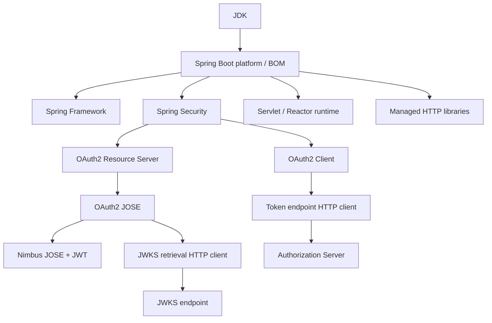

# Đối chiếu bộ phiên bản Boot, Security, JOSE và thư viện HTTP

Một ứng dụng Spring Security OAuth 2.0 Resource Server có thể build thành công nhưng vẫn lỗi khi chạy nếu Spring Boot, Spring Framework, Spring Security, JOSE/Nimbus và HTTP client không nằm trong một bộ phiên bản tương thích. Các lỗi thường xuất hiện ở những điểm tích hợp: class không còn tồn tại sau migration, method signature thay đổi, decoder không khởi tạo được, JWKS client dùng HTTP stack khác với dự kiến hoặc OAuth2 Client không gọi được token endpoint.

Cách nâng cấp an toàn là xác định một **version set có cùng release train**, để dependency management chọn các phiên bản tương ứng, sau đó kiểm tra runtime classpath và các đường đi OAuth thực tế. Spring Boot BOM thường là nguồn quản lý chính cho ứng dụng Boot. Khi chạy Spring Security độc lập, cần quản lý Spring Security theo một BOM phù hợp với Spring Framework. JOSE/Nimbus và thư viện HTTP cũng phải được đối chiếu theo dependency graph thực tế thay vì nâng từng artifact riêng lẻ.

Bài này trình bày cách đối chiếu các thành phần, đọc dependency tree, chọn HTTP client cho Servlet/WebFlux, xử lý migration giữa các thế hệ Spring và xác minh behavior của JWT/JWKS/token endpoint sau nâng cấp.

> **Nguyên tắc:** Chọn Spring Boot trước, để Boot quản lý Spring Framework và Spring Security trong cùng release train. Chỉ override một dependency khi có lý do tương thích đã được kiểm chứng, và phải kiểm tra toàn bộ runtime graph sau thay đổi.

## 1. Một version set gồm những thành phần nào?

Một Resource Server thường phụ thuộc vào nhiều lớp:

| Thành phần | Vai trò trong ứng dụng | Điều cần đối chiếu |
|---|---|---|
| JDK | Runtime, TLS, crypto providers, language/API baseline | Java version tối thiểu và runtime thực tế |
| Spring Boot | Auto-configuration, dependency management, starters | Release train và BOM |
| Spring Framework | Servlet/WebFlux, HTTP abstractions, bean lifecycle | Phiên bản tương ứng với Boot |
| Spring Security | Filter chain, Resource Server, OAuth2 Client, method security | Phiên bản được Boot quản lý |
| Spring Security OAuth2 JOSE | JWT decoder/encoder, JWK integration | Cùng phiên bản Spring Security modules |
| Nimbus JOSE + JWT | JWS/JWT/JWK/JWKS implementation | Phiên bản tương thích với Spring Security JOSE |
| Servlet container | Servlet API và request runtime | Jakarta/Servlet generation phù hợp |
| Reactor / Reactor Netty | Reactive runtime và WebClient connector | Phiên bản theo Spring Boot dependency management |
| HTTP client | Gọi JWKS, token endpoint, introspection và downstream | Client implementation và adapter tương ứng |
| Test libraries | MockMvc, WebTestClient, WireMock, testcontainers | Không kéo Spring/Security generation khác vào test runtime |

Sơ đồ dependency logic:



Các đường đi này có thể dùng HTTP abstraction khác nhau tùy phiên bản và cấu hình. Ví dụ, OAuth2 Client token acquisition và JWT decoder JWKS retrieval không nhất thiết dùng cùng một HTTP client bean mà ứng dụng tự cấu hình cho WebClient.

## 2. Bắt đầu từ Spring Boot release train

Với ứng dụng Spring Boot, Boot parent/BOM là điểm xuất phát để quản lý các thư viện Spring và nhiều dependency nền tảng khác.

Ví dụ Gradle Kotlin DSL:

```kotlin
plugins {
    java
    id("org.springframework.boot") version "<BOOT_VERSION>"
    id("io.spring.dependency-management") version "<PLUGIN_VERSION>"
}

dependencies {
    implementation("org.springframework.boot:spring-boot-starter-web")
    implementation("org.springframework.boot:spring-boot-starter-oauth2-resource-server")
    implementation("org.springframework.boot:spring-boot-starter-oauth2-client")

    testImplementation("org.springframework.boot:spring-boot-starter-test")
    testImplementation("org.springframework.security:spring-security-test")
}
```

Các placeholder version ở trên phải được thay bằng một Boot release đã chọn trong dự án. Khi dùng Boot plugin/dependency management, không cần gắn version riêng cho từng Spring Framework hoặc Spring Security artifact.

### 2.1. Vì sao nên để Boot quản lý Spring Security?

Boot kiểm thử một tập hợp phiên bản Framework, Security, Jackson, Reactor, embedded server và các integration libraries. Nếu nâng riêng Spring Security trong khi giữ Boot cũ, có thể tạo ra tổ hợp mà Boot chưa kiểm thử.

Các rủi ro:
- Spring Security module có method signature khác với module cùng nhóm đang chạy.
- Auto-configuration của Boot gọi API không còn tương thích.
- OAuth2 JOSE kéo Nimbus version khác với version mà dependency graph dự kiến.
- Test starter kéo Spring Test khác với Spring Framework runtime.
- HTTP client transitive dependencies bị nâng hoặc hạ ngoài ý muốn.

Nếu cần một tính năng Security mới, trước tiên tìm Boot release train hỗ trợ Security generation đó. Nếu không thể nâng Boot, kiểm tra ma trận tương thích và dependency graph trước khi override.

### 2.2. Không trộn các module Spring Security khác major/minor

Các artifact như:
- spring-security-core
- spring-security-web
- spring-security-config
- spring-security-oauth2-core
- spring-security-oauth2-jose
- spring-security-oauth2-resource-server
- spring-security-oauth2-client
- spring-security-test

nên dùng cùng release version. Trộn module 6.x và 7.x, hoặc các patch versions không tương thích, có thể gây NoSuchMethodError, NoClassDefFoundError hoặc behavior khác nhau giữa compile và runtime.

### 2.3. Ứng dụng không dùng Spring Boot

Nếu ứng dụng dùng Spring Framework/Security độc lập, quản lý Spring Security bằng BOM riêng và quản lý Spring Framework bằng release train phù hợp. Không lấy ngẫu nhiên một Spring Security version mới rồi ghép với Spring Framework cũ.

Ví dụ Maven:

```xml
<dependencyManagement>
    <dependencies>
        <dependency>
            <groupId>org.springframework.security</groupId>
            <artifactId>spring-security-bom</artifactId>
            <version>SPRING_SECURITY_VERSION</version>
            <type>pom</type>
            <scope>import</scope>
        </dependency>
    </dependencies>
</dependencyManagement>
```

Nếu cần Spring Framework BOM, import một version tương thích với Security release line đang chọn. Với Boot application, không thêm Security BOM độc lập trừ khi có kế hoạch override được kiểm soát; hai BOM có thể cạnh tranh quyền quản lý version.

## 3. Ma trận tương thích theo thế hệ

Không có một bảng version số cố định đúng cho mọi thời điểm và mọi application. Spring Boot, Framework và Security phát hành theo release train; bản vá mới có thể thay đổi version patch trong khi vẫn giữ cùng major/minor line.

Ma trận dưới đây mô tả cách đối chiếu các thế hệ chính, không phải danh sách patch versions để copy nguyên trạng:

| Application generation | Spring Framework line | Spring Security line | JDK baseline thường gặp | Migration concern |
|---|---|---|---|---|
| Boot 2.x generation | Framework 5.x | Security 5.x | Java 8/11 tùy Boot release | javax.servlet, API matcher cũ, legacy configuration |
| Boot 2.7 transition | Framework 5.3.x | Security 5.7/5.8 tùy setup | Java 8+ theo Boot release | Chuẩn bị Security 6 migration |
| Boot 3.x generation | Framework 6.x | Security 6.x | Java 17+ | Jakarta namespace, Security 6 configuration |
| Boot 4.x generation | Framework 7.x | Security 7.x | Theo baseline của Boot 4 release | Framework 7/Security 7 migration và API changes |

Khi chọn version cụ thể:
1. Chọn Boot release cần chạy.
2. Đọc system requirements của đúng release đó.
3. Xem dependency versions do Boot quản lý.
4. Xác nhận JDK build tool, CI và production runtime cùng đáp ứng baseline.
5. Chỉ sau đó mới quyết định có override dependency nào hay không.

Không suy luận JDK baseline chỉ từ máy developer. Gradle toolchain, CI image, Docker base image và production JVM phải đồng nhất với baseline.

### 3.1. Spring Boot 2 sang Boot 3

Đây là migration lớn vì Spring Framework 6 và Jakarta EE 9+ chuyển namespace từ javax sang jakarta cho nhiều API.

Ví dụ:
- javax.servlet.Filter → jakarta.servlet.Filter
- javax.servlet.http.HttpServletRequest → jakarta.servlet.http.HttpServletRequest
- javax.validation.* → jakarta.validation.* ở các API validation tương ứng
- javax.persistence.* → jakarta.persistence.* trong JPA ecosystem

Không phải mọi package bắt đầu bằng javax đều chuyển sang jakarta; Java SE APIs như javax.crypto vẫn thuộc JDK. Thay package theo API ownership, không dùng find/replace toàn dự án một cách mù quáng.

### 3.2. Spring Security 5 sang 6

Các thay đổi thường gặp:
- WebSecurityConfigurerAdapter đã bị loại bỏ; dùng bean SecurityFilterChain.
- authorizeRequests/antMatchers cũ được thay bằng authorizeHttpRequests/requestMatchers.
- Lambda DSL là cách cấu hình hiện đại.
- Method security sử dụng @EnableMethodSecurity.
- Servlet types chuyển sang Jakarta khi chạy trên Framework 6/Boot 3.
- OAuth2 Client/Resource Server APIs và auto-configuration cần được rà lại theo phiên bản đích.

### 3.3. Spring Security 6 sang 7

Khi nâng sang Security 7, đọc migration guide và deprecation list của đúng release. Không giả định mọi API Security 6 vẫn tồn tại hoặc giữ semantics. Đặc biệt kiểm tra:
- DSL configuration.
- Authorization APIs.
- OAuth2 Client managers và token clients.
- JWT/JWK decoder customization.
- Servlet/WebFlux integration.
- Test support và request post-processors.

## 4. Đối chiếu Spring Security và JOSE/Nimbus

Resource Server JWT dùng Spring Security abstraction và một JOSE implementation để xử lý JWS/JWK.

Các API Spring thường gặp:

| Spring Security API | Trách nhiệm |
|---|---|
| JwtDecoder | Decode và validate JWT |
| NimbusJwtDecoder | Nimbus-based implementation |
| JwtEncoder | Encode/sign JWT |
| NimbusJwtEncoder | Nimbus-based encoder |
| JwtAuthenticationConverter | Chuyển claims thành authorities |
| JwtTimestampValidator | Kiểm tra exp/nbf |
| OAuth2TokenValidator | Validate issuer/audience/custom claims |
| JWKSource | Nguồn key cho signing/verification |

### 4.1. JOSE artifact phải đi cùng Spring Security

Dependency thường dùng:

```kotlin
dependencies {
    implementation("org.springframework.boot:spring-boot-starter-oauth2-resource-server")
}
```

Starter Resource Server kéo các module cần thiết cho JWT/JOSE theo dependency management của Boot. Không thêm version Nimbus tùy ý chỉ vì muốn dùng một API mới.

Nếu source code trực tiếp import Nimbus APIs để tạo test key, ký token hoặc đọc JWK, có thể cần khai báo Nimbus dependency trực tiếp để dependency được thể hiện rõ trong build file. Tuy nhiên version nên theo Boot/Security dependency management đang sử dụng.

### 4.2. Kiểm tra Nimbus version thực tế

Dùng Gradle:

```powershell
.\gradlew dependencyInsight --dependency nimbus-jose-jwt --configuration runtimeClasspath
```

Hoặc xem toàn bộ dependency tree:

```powershell
.\gradlew dependencies --configuration runtimeClasspath
```

Nếu dùng Maven:

```powershell
mvn dependency:tree -Dincludes=com.nimbusds:nimbus-jose-jwt
```

Cần xác định:
- Nimbus được kéo bởi module nào.
- Có nhiều version candidate không.
- Version nào được chọn.
- Có explicit constraint/force nào ghi đè.
- CompileClasspath và RuntimeClasspath có cùng version không.

### 4.3. Tránh ép Nimbus bằng resolutionStrategy nếu chưa có bằng chứng

Ví dụ sau có thể làm hỏng compatibility:

```kotlin
configurations.all {
    resolutionStrategy {
        force("com.nimbusds:nimbus-jose-jwt:<ARBITRARY_VERSION>")
    }
}
```

Một version Nimbus mới hơn không tự động tương thích với Spring Security version cũ. API nội bộ, constructor, exception behavior hoặc JWK cache behavior có thể thay đổi.

Nếu security advisory buộc phải override:
1. Xác định CVE và affected range.
2. Xem Spring Boot/Security đã có patch release chưa.
3. Kiểm tra release notes và compatibility.
4. Override qua dependency management có phạm vi rõ.
5. Chạy tests JWT/JWKS thật và kiểm tra runtime graph.
6. Ghi lại lý do và thời điểm bỏ override.

### 4.4. Decoder/encoder không đồng nghĩa với việc thêm Nimbus trực tiếp

Nếu chỉ cần xác thực JWT, ưu tiên JwtDecoder abstraction. Nếu cần ký token nội bộ, cân nhắc JwtEncoder. Chỉ dùng Nimbus trực tiếp khi cần kiểm soát JOSE/JWK ở mức thấp hơn, ví dụ:
- Tạo signed JWT fixture.
- Xây dựng JWK/JWKS test.
- Tạo key rotation test.
- Kiểm tra protected header/kid/algorithm.
- Xử lý profile JOSE đặc thù.

Giữ business code phụ thuộc abstraction Spring khi có thể, để giảm phạm vi thay đổi khi JOSE implementation được nâng.

## 5. Đối chiếu HTTP client cho các OAuth flows

Một Resource Server/Client có thể dùng HTTP stack ở nhiều nơi:

- JWT decoder tải JWKS.
- Opaque token introspector gọi introspection endpoint.
- OAuth2 Client gọi token endpoint.
- WebClient/RestClient gọi downstream API.
- OIDC client gọi discovery/user-info endpoints.

Không giả định một cấu hình WebClient bean tự động điều khiển tất cả các request trên. Từng component có thể có HTTP client abstraction và customization point riêng tùy phiên bản Spring.

### 5.1. RestTemplate, RestClient và WebClient

| Client | Kiểu sử dụng | Khi phù hợp | Lưu ý |
|---|---|---|---|
| RestTemplate | Blocking, synchronous | Ứng dụng Servlet hiện hữu | Vẫn có thể dùng; kiểm tra migration path và request factory |
| RestClient | Blocking, fluent API | Ứng dụng Spring Framework có hỗ trợ API này | Không phải reactive; kiểm tra đúng Framework version |
| WebClient | Reactive/non-blocking, cũng có thể được gọi theo kiểu khác tùy API | WebFlux hoặc integration cần reactive client | Dựa trên Reactor và connector |
| JDK HttpClient | JDK HTTP API | Client đơn giản hoặc custom integration | Cần adapter/wiring phù hợp với Spring component |
| Apache HttpClient 5 | External HTTP stack | Cần pool, TLS/proxy/connection controls nâng cao | Package/API khác HttpClient 4 |
| Reactor Netty | Reactive transport | WebClient reactive stack thường dùng | Version phải khớp Reactor/Spring dependency management |

Chọn client dựa trên application model và yêu cầu transport. Đừng đưa blocking HTTP call vào reactive event loop chỉ vì muốn dùng cùng một thư viện.

### 5.2. Servlet application

Một Servlet Resource Server thường xử lý inbound request trên servlet threads. OAuth2 Client có thể dùng Servlet-oriented authorized client manager và token response client. Downstream calls có thể dùng RestClient, RestTemplate hoặc WebClient theo kiến trúc.

Khi cấu hình token endpoint HTTP client, kiểm tra API customization point của đúng Spring Security version. Đừng copy bean configuration từ một version khác mà không xác nhận class/method còn tồn tại.

### 5.3. WebFlux application

WebFlux thường dùng:
- SecurityWebFilterChain.
- ReactiveJwtDecoder.
- ReactiveOpaqueTokenIntrospector nếu dùng opaque tokens.
- ReactiveOAuth2AuthorizedClientManager.
- WebClient/Reactor Netty.

Không dùng Servlet-only OAuth2AuthorizedClientManager trong reactive flow. Cũng không gọi RestTemplate hoặc Apache blocking client trực tiếp trên Netty event loop.

### 5.4. Apache HttpClient 4 sang 5

Migration Apache HttpClient 4 → 5 không chỉ là đổi version. Package namespace và API thay đổi, ví dụ:
- org.apache.http.* thuộc HttpClient 4.
- org.apache.hc.client5.* và org.apache.hc.core5.* thuộc HttpClient 5.

Các factory/request factory tích hợp với Spring cũng khác theo Framework generation. Kiểm tra:
- Request factory class.
- TLS/SSL configuration.
- Connection pooling.
- Proxy authentication.
- Connection/request/response timeout.
- Connection eviction/idle validation.
- Retry behavior.
- Metrics instrumentation.

Đừng để cả HttpClient 4 và 5 cùng xuất hiện mà không có lý do. Một dependency cũ có thể kéo 4.x vào runtime trong khi ứng dụng cấu hình 5.x.

### 5.5. Reactor Netty và WebClient

Nếu dùng WebClient với Reactor Netty, cần giữ Reactor Core, Reactor Netty và Spring WebFlux theo dependency management tương thích. Không override reactor-netty-http riêng mà bỏ qua reactor-core/netty transitive graph.

Khi nâng:
- Kiểm tra connector đang được dùng.
- Kiểm tra TLS provider và trust configuration.
- Kiểm tra connection pool limits.
- Kiểm tra response timeout và pending acquire timeout.
- Kiểm tra metrics names/tags nếu dashboard phụ thuộc.
- Test cả success, timeout, connection reset và TLS failure.

## 6. Ma trận đối chiếu theo application profile

Bảng sau giúp chọn hướng kiểm tra, không thay thế release notes của version cụ thể:

| Profile | Boot/Framework/Security | JOSE | HTTP client chính | Điều cần xác minh |
|---|---|---|---|---|
| Servlet Resource Server, JWT | Cùng Boot release train | Boot-managed Nimbus qua Security JOSE | JWKS client theo decoder configuration | Signature, issuer, audience, key cache |
| Servlet Resource Server, opaque token | Cùng Boot release train | Không bắt buộc JOSE cho introspection path | Introspection HTTP client | active response, client auth, timeout |
| Servlet OAuth2 Client | Cùng Boot release train | JOSE chỉ cần nếu app xử lý JWT trực tiếp | Token response client | registration, grant, client auth |
| WebFlux Resource Server, JWT | Cùng Boot release train | Boot-managed Nimbus qua Security JOSE | Reactive client/connector theo decoder | Reactive decode, JWKS retrieval |
| WebFlux OAuth2 Client | Cùng Boot release train | Tùy token format | Reactive token response client | Reactive manager và token acquisition |
| Hybrid Servlet + downstream reactive | Cùng release train | Cùng JOSE dependency graph | Có thể có blocking và reactive clients | Threading, timeout, bean selection |
| Standalone Spring | Framework/Security release train được hỗ trợ | Version tương thích với Security JOSE | Client theo Framework generation | BOM alignment và container APIs |

### 6.1. Không trộn Servlet và Reactive chỉ vì cùng có OAuth2

Spring Security có các abstraction khác nhau:
- SecurityFilterChain và FilterChainProxy cho Servlet.
- SecurityWebFilterChain và WebFilter chain cho WebFlux.
- JwtDecoder và ReactiveJwtDecoder.
- OAuth2AuthorizedClientManager và ReactiveOAuth2AuthorizedClientManager.

Một dependency tree có cả spring-webmvc và spring-webflux không tự động là sai; Spring Boot có thể dùng WebClient trong ứng dụng MVC. Nhưng phải hiểu runtime application type và chọn đúng security/client manager.

### 6.2. JOSE là lớp dùng chung, không quyết định application model

Nimbus có thể phục vụ JWT/JWK cho cả Servlet và Reactive integrations. Tuy nhiên, decoder wrapper, HTTP retrieval path và lifecycle vẫn khác. Đừng suy luận chỉ từ việc cùng dùng Nimbus rằng mọi cấu hình HTTP client cũng giống nhau.

## 7. Khai báo dependencies mà không tạo version drift

### 7.1. Gradle với Spring Boot dependency management

Ví dụ:

```kotlin
dependencies {
    implementation("org.springframework.boot:spring-boot-starter-web")
    implementation("org.springframework.boot:spring-boot-starter-oauth2-resource-server")
    implementation("org.springframework.boot:spring-boot-starter-oauth2-client")

    // Add only when application code directly uses WebClient.
    implementation("org.springframework.boot:spring-boot-starter-webflux")

    // Add direct dependency if test source imports Nimbus APIs directly.
    testImplementation("com.nimbusds:nimbus-jose-jwt")

    testImplementation("org.springframework.security:spring-security-test")
}
```

Không thêm WebFlux starter chỉ để lấy một class HTTP client nếu dự án có lựa chọn dependency nhẹ hơn và phù hợp. Nếu application chạy Servlet MVC nhưng dùng WebClient, hãy hiểu tác động dependency/runtime auto-configuration và bảo đảm Boot vẫn chọn đúng application type.

### 7.2. Maven với Boot parent

Ví dụ:

```xml
<parent>
    <groupId>org.springframework.boot</groupId>
    <artifactId>spring-boot-starter-parent</artifactId>
    <version>BOOT_VERSION</version>
    <relativePath/>
</parent>

<dependencies>
    <dependency>
        <groupId>org.springframework.boot</groupId>
        <artifactId>spring-boot-starter-oauth2-resource-server</artifactId>
    </dependency>
    <dependency>
        <groupId>org.springframework.boot</groupId>
        <artifactId>spring-boot-starter-oauth2-client</artifactId>
    </dependency>
    <dependency>
        <groupId>org.springframework.security</groupId>
        <artifactId>spring-security-test</artifactId>
        <scope>test</scope>
    </dependency>
</dependencies>
```

Nếu dùng Boot BOM thay vì parent, import BOM trong dependencyManagement và không khai báo version riêng cho dependencies do BOM quản lý.

### 7.3. Không khai báo version lặp lại ở nhiều nơi

Một dự án dễ drift khi:
- Plugin Boot có một version.
- Boot BOM có version khác.
- Spring Security BOM lại override Security.
- Version Nimbus được pin trong constraints.
- Version Reactor Netty được force trong resolutionStrategy.
- Test starter kéo thêm module khác.

Tập trung version ở một nguồn quản lý. Nếu có ngoại lệ, ghi rõ dependency, lý do, phạm vi và thời hạn xem xét lại.

## 8. Đọc dependency graph thay vì đoán từ build file

Build file chỉ thể hiện dependency khai báo trực tiếp. Runtime classpath còn gồm transitive dependencies, constraints, platforms, capabilities và exclusions.

### 8.1. Gradle dependencyInsight

Kiểm tra từng dependency:

```powershell
.\gradlew dependencyInsight --dependency spring-security-core --configuration runtimeClasspath
.\gradlew dependencyInsight --dependency spring-security-oauth2-jose --configuration runtimeClasspath
.\gradlew dependencyInsight --dependency nimbus-jose-jwt --configuration runtimeClasspath
.\gradlew dependencyInsight --dependency spring-webflux --configuration runtimeClasspath
.\gradlew dependencyInsight --dependency reactor-netty-http --configuration runtimeClasspath
.\gradlew dependencyInsight --dependency httpclient5 --configuration runtimeClasspath
```

Đọc output để biết:
- Selected version.
- Requested versions.
- Selection reason.
- Dependency path.
- Constraint/platform nào áp dụng.
- Có bị conflict resolution hoặc force không.

### 8.2. Kiểm tra compileClasspath và runtimeClasspath

```powershell
.\gradlew dependencies --configuration compileClasspath
.\gradlew dependencies --configuration runtimeClasspath
.\gradlew dependencies --configuration testRuntimeClasspath
```

Một lỗi chỉ xuất hiện khi chạy có thể do runtimeClasspath khác compileClasspath. Test có thể chạy với testRuntimeClasspath khác production runtimeClasspath; vì vậy cần kiểm tra cả ba khi điều tra linkage error.

### 8.3. Maven dependency tree và effective POM

```powershell
mvn dependency:tree -Dverbose
mvn help:effective-pom
```

Effective POM cho thấy BOM và property nào cuối cùng quản lý version. Dependency tree cho thấy artifact nào kéo một thư viện vào graph.

### 8.4. Tìm duplicate classes và legacy dependencies

Tìm các dấu hiệu:
- Nhiều version của cùng Spring module.
- Spring Security module bị split version.
- HttpClient 4 và 5 cùng có mặt.
- javax.servlet API còn sót trong Boot 3+ app.
- Reactor Netty override lệch Spring Boot.
- Nimbus version bị force không theo dependency management.

Không phải mọi duplicate dependency đều gây lỗi, nhưng các trường hợp cùng package/API ở runtime cần được hiểu rõ.

## 9. Version catalog, dependency locking và reproducible builds

### 9.1. Dùng version catalog cho plugin và dependency trực tiếp

Gradle version catalog giúp tập trung version plugin và dependency được quản lý trực tiếp. Tuy nhiên, không nên tự pin tất cả transitive Spring artifacts trong catalog nếu Boot BOM đã quản lý chúng.

Ví dụ:

```toml
[versions]
spring-boot = "<BOOT_VERSION>"
spring-dependency-management = "<PLUGIN_VERSION>"

[plugins]
spring-boot = { id = "org.springframework.boot", version.ref = "spring-boot" }
spring-dependency-management = { id = "io.spring.dependency-management", version.ref = "spring-dependency-management" }
```

Giữ một nguồn version cho Boot plugin và dùng dependency management để chọn Spring modules.

### 9.2. Dependency locking

Gradle dependency locking giúp cố định graph đã giải quyết. Sau khi nâng release train:
1. Cập nhật Boot version.
2. Resolve dependency graph.
3. Chạy tests.
4. Cập nhật lock state theo quy trình repo.
5. Review diff lockfile.
6. Xác nhận không có transitive version ngoài ý muốn.

Không cập nhật lockfile trước khi kiểm tra graph; lockfile chỉ ghi lại resolution, không chứng minh compatibility.

### 9.3. Dependency verification

Nếu dự án dùng Gradle dependency verification, cập nhật checksum/signature metadata theo quy trình bảo mật sau khi xác minh artifact. Không tắt verification để vượt qua lỗi checksum không giải thích được.

## 10. Các triệu chứng version mismatch khi chạy

| Lỗi runtime | Nguyên nhân có thể | Kiểm tra |
|---|---|---|
| NoSuchMethodError | Compile/runtime API version không khớp | Runtime dependency tree và caller artifact |
| NoClassDefFoundError | Class thiếu ở runtime hoặc static initialization thất bại | Classpath, cause ban đầu và dependency scope |
| ClassNotFoundException | Class loader không tìm thấy class | Dependency packaging/optional module |
| NoSuchFieldError | Field thay đổi giữa versions | Duplicate/override artifacts |
| AbstractMethodError | Interface/implementation không cùng API generation | Module version alignment |
| BeanCreationException khi tạo JwtDecoder | JOSE/JWK/configuration mismatch hoặc invalid property | Nested cause và decoder setup |
| SSLHandshakeException | Truststore/certificate/TLS provider | Runtime trust config, hostname và CA |
| UnknownHostException | DNS/environment | Resolver, container network |
| WebClientRequestException | Transport/connector failure | Nested cause, Reactor Netty/JDK client |
| UnsatisfiedDependencyException | Auto-configuration hoặc bean type mismatch | Condition report, bean definitions |
| Method/constructor signature mismatch | Spring module split versions | Boot BOM và dependencyInsight |

### 10.1. NoSuchMethodError không phải lỗi business code thông thường

Ví dụ application compile với API có method mới, nhưng runtime nạp một jar cũ hơn. JVM tìm method và không thấy. Sửa code call site có thể không giải quyết được; phải sửa dependency graph để caller và implementation tương thích.

### 10.2. BeanCreationException là wrapper, không phải root cause

Khi JwtDecoder hoặc OAuth2 client bean không tạo được, xem nested exception:
- Invalid issuer/JWK URI.
- Unsupported algorithm.
- Class missing.
- Bean ambiguity.
- TLS/client initialization failure.
- Dependency version mismatch.

Đừng chỉ sửa bean name nếu root cause là classpath.

## 11. Migration từ Spring Security 5 sang 6 trong Resource Server

Một migration thường gồm nhiều thay đổi độc lập.

### 11.1. Thay WebSecurityConfigurerAdapter bằng SecurityFilterChain

Cấu hình cũ:

```java
@EnableWebSecurity
public class SecurityConfig extends WebSecurityConfigurerAdapter {

    @Override
    protected void configure(HttpSecurity http) throws Exception {
        http
            .authorizeRequests()
                .antMatchers("/public/**").permitAll()
                .anyRequest().authenticated()
            .and()
            .oauth2ResourceServer()
                .jwt();
    }
}
```

Cấu hình bean:

```java
@Configuration
@EnableWebSecurity
public class SecurityConfig {

    @Bean
    SecurityFilterChain securityFilterChain(HttpSecurity http)
            throws Exception {
        return http
            .authorizeHttpRequests(auth -> auth
                .requestMatchers("/public/**").permitAll()
                .anyRequest().authenticated()
            )
            .oauth2ResourceServer(oauth2 ->
                oauth2.jwt(Customizer.withDefaults())
            )
            .build();
    }
}
```

Ví dụ cần bổ sung CORS, CSRF, session policy, exception handling và chain matchers theo application contract. Mục đích là minh họa API configuration mới.

### 11.2. Thay antMatchers bằng requestMatchers

Không chỉ thay tên method. Xác nhận matcher semantics, servlet path, context path, MVC integration và thứ tự rule. Test đúng request path/method sau migration.

### 11.3. Jakarta namespace

Thay các imports thuộc Jakarta EE API theo đúng dependency generation. Kiểm tra:
- Servlet filters.
- Servlet listeners.
- Validation annotations.
- Persistence APIs.
- Servlet container.
- Third-party filters và test mocks.

Một dependency cũ dùng javax.servlet có thể compile riêng nhưng không tương thích runtime với Jakarta servlet container.

### 11.4. Method security

Rà lại @EnableGlobalMethodSecurity cũ và migration sang @EnableMethodSecurity. Kiểm tra proxy behavior, expression handler, parameter name discovery và test gọi method qua Spring bean.

### 11.5. Test support

Rà:
- MockMvc setup.
- jwt() request post-processor.
- @WithMockUser.
- TestSecurityContextHolder.
- WebTestClient nếu có reactive stack.
- Spring Security test module version.

Không để spring-security-test lệch với production Security modules.

## 12. Migration HTTP client

### 12.1. RestTemplate không tự biến mất khi nâng Framework

Một ứng dụng cũ có thể tiếp tục dùng RestTemplate nếu API còn được hỗ trợ trong target generation. Không cần rewrite tất cả HTTP calls chỉ vì đang nâng Boot.

Nếu chuyển sang RestClient:
- Kiểm tra target Framework version có API cần dùng.
- Chọn request factory phù hợp.
- Giữ timeout/TLS/proxy/pool behavior.
- Rà error handling và message converters.
- Kiểm tra interceptors và observability.
- Test token endpoint và downstream behavior.

### 12.2. WebClient không phải lúc nào cũng là lựa chọn tốt hơn

WebClient phù hợp với reactive pipelines hoặc yêu cầu non-blocking. Nếu application Servlet thực hiện blocking business operations, việc chuyển mọi client call sang reactive có thể tăng độ phức tạp mà không đem lại lợi ích rõ ràng.

Nếu dùng WebClient trong MVC:
- Không block trên shared event loop.
- Xác định lifecycle/connection pool.
- Xác định ai sở hữu timeout và retry.
- Truyền correlation context đúng cách.
- Kiểm tra resource cleanup.

### 12.3. HTTP client migration phải giữ nguyên security semantics

Khi thay request factory/connector, kiểm tra:
- Token endpoint vẫn dùng đúng client authentication method.
- JWKS fetch vẫn trust đúng CA/hostname.
- Redirect policy không làm lộ Authorization header.
- Proxy không strip/duplicate Authorization header.
- Timeouts không quá dài.
- Retry không lặp token issuance hoặc business mutations sai cách.
- Error response không log client secret/subject token.

## 13. Nâng cấp theo từng bước có thể kiểm soát

Một quy trình đề xuất:

**Bước 1 — Chụp baseline.** Ghi JDK, Boot, Framework, Security, Nimbus, Servlet container, Reactor, HTTP client và runtime dependency tree.

**Bước 2 — Chọn target Boot release.** Kiểm tra system requirements, support window và migration guide.

**Bước 3 — Đồng bộ build environment.** JDK toolchain, CI image, Gradle/Maven wrapper và production runtime.

**Bước 4 — Cập nhật Boot plugin/parent/BOM.** Để Boot chọn các Spring module versions tương ứng.

**Bước 5 — Gỡ explicit overrides không còn cần.** Kiểm tra constraints, force rules, exclusions và version catalog.

**Bước 6 — Sửa source migration.** Jakarta imports, SecurityFilterChain DSL, request matchers, method security và HTTP client API.

**Bước 7 — Đối chiếu JOSE/Nimbus.** Xác nhận decoder, encoder, JWK parsing, key rotation và algorithm policy.

**Bước 8 — Đối chiếu HTTP stack.** Xác nhận JWKS/token/introspection/downstream clients có đúng connector, TLS, pool và timeout.

**Bước 9 — Chạy test theo tầng.** Unit, MockMvc/WebTestClient, signed JWT/JWKS, token endpoint fake, downstream fake và packaging.

**Bước 10 — Kiểm tra runtime graph.** Xác nhận không còn split Spring Security modules, duplicate HTTP clients ngoài dự kiến hoặc javax APIs không tương thích.

**Bước 11 — Canary/rollout.** Theo dõi 401/403, JWKS fetch, token endpoint errors, TLS failures, connection pool và downstream latency.

**Bước 12 — Giữ rollback path.** Biết artifact/image/config nào là bản trước và tránh thay đổi signing key/issuer cùng lúc với framework upgrade nếu không cần thiết.

## 14. Test matrix sau khi nâng cấp

| Test group | Điều cần chứng minh | Ví dụ |
|---|---|---|
| Startup/context | Auto-configuration và bean graph tạo thành công | ApplicationContext starts |
| JWT positive | Token đúng signature/claims được chấp nhận | Signed RS256 JWT |
| JWT negative | Sai signature/issuer/audience/exp bị từ chối | Wrong key/claims |
| JWKS retrieval | Decoder lấy key và xử lý rotation | Fake JWKS endpoint |
| Opaque token | Introspection active/inactive và network failure | Fake introspection server |
| OAuth2 Client | Token request đúng grant/client auth/scope | Fake token endpoint |
| HTTP transport | TLS, proxy, timeout, pool behavior giữ đúng | Mock server/TLS fixture |
| Authorization | Scope và method rules không thay đổi ngoài ý muốn | GET/POST/PATCH/DELETE matrix |
| Method security | @PreAuthorize vẫn được áp dụng qua proxy | Service invocation test |
| Error mapping | 401/403/5xx được map đúng | Custom entry point/handler |
| Servlet compatibility | Jakarta container và filters hoạt động | Embedded server integration |
| Reactive compatibility | WebFilter/ReactiveJwtDecoder hoạt động | WebTestClient |
| Packaging | Runtime classpath chứa đúng modules | Boot jar/container smoke test |

### 14.1. Test behavior, không chỉ compile

Compile success không chứng minh:
- JWKS endpoint có thể được gọi.
- JWT signature được verify.
- Issuer/audience validators chạy.
- Authorities map đúng.
- Token endpoint request giữ đúng client auth.
- HTTP client giữ TLS/proxy/timeouts.
- Runtime jar không thiếu module.

### 14.2. Dùng test thật cho các integration boundary

Một bộ test hữu ích gồm:
- RSA test key pair và public JWKS.
- JWT compact ký thật.
- Fake JWKS endpoint.
- Fake introspection/token endpoint.
- Fake downstream API.
- TLS test certificate nếu thay HTTP connector/trust configuration.
- MockMvc/WebTestClient theo application model.

Giữ test authorization dùng mock Authentication riêng để chạy nhanh.

## 15. Kiểm tra JDK và TLS provider

JDK không chỉ ảnh hưởng compile. Nó còn ảnh hưởng:
- TLS protocol/cipher availability.
- Default truststore.
- Certificate path validation.
- Cryptographic provider.
- DNS resolver behavior.
- HTTP client implementation.
- Reflection/module access.

Khi nâng JDK:
1. Kiểm tra vendor/distribution và patch level.
2. Kiểm tra JVM flags và truststore path.
3. Kiểm tra CA certificates trong container.
4. Kiểm tra cipher/TLS policy của identity provider.
5. Chạy handshake test tới JWKS/token endpoint.
6. Chạy signed JWT verification với thuật toán production.
7. Kiểm tra timezone và clock synchronization.

Một SSLHandshakeException sau JDK upgrade không nhất thiết là lỗi Spring Security hoặc token. Root cause có thể là truststore hoặc TLS policy.

## 16. Quản lý version security patches và CVEs

Không override dependency chỉ dựa trên một advisory không xác định affected component.

Quy trình:
- Xác định artifact và affected version range.
- Xem Boot/Security release notes và managed dependency update.
- Kiểm tra CVE có nằm trên code path đang dùng không.
- Ưu tiên patch release thuộc cùng supported release train.
- Nếu phải override, xác minh compatibility và test graph.
- Ghi lại dependency origin và remediation.
- Theo dõi advisory khi bản Boot train tiếp theo phát hành.

Đối với Nimbus, HTTP clients, Reactor Netty và servlet container, patch một component có thể kéo transitive changes. Review toàn graph và regression tests, không chỉ nhìn artifact trực tiếp.

## 17. Runtime observability sau migration

Theo dõi trước và sau rollout:

| Signal | Dấu hiệu version/config regression |
|---|---|
| Startup failures | Bean/constructor/class mismatch |
| 401 rate | JWT decoder, issuer/audience, JWKS hoặc client token behavior |
| 403 rate | Authority mapping, request matcher, method security |
| JWKS fetch latency/errors | JOSE HTTP client, TLS, DNS, cache |
| Token endpoint latency/errors | OAuth2 Client/token response client |
| Introspection latency/errors | Opaque token HTTP client |
| Downstream latency/errors | WebClient/RestClient/connection pool |
| TLS handshake failures | JDK, truststore, provider, certificate |
| Connection pool pending | Client configuration hoặc downstream saturation |
| NoSuchMethodError/LinkageError | Runtime dependency graph mismatch |

Dùng cùng metric dimensions trước/sau upgrade để so sánh. Không thêm raw token, subject hoặc object ID làm metric labels.

## 18. Checklist đối chiếu version set

- [ ] JDK build, CI, container và production đáp ứng baseline của Boot target.
- [ ] Boot plugin/parent/BOM cùng một release.
- [ ] Spring Framework được Boot quản lý.
- [ ] Tất cả Spring Security modules cùng version.
- [ ] spring-security-test khớp production Security modules.
- [ ] OAuth2 JOSE được kéo từ cùng Security release train.
- [ ] Nimbus version được kiểm tra bằng dependencyInsight/dependency tree.
- [ ] Không có force/override Nimbus không giải thích được.
- [ ] Servlet API dùng đúng javax/jakarta generation.
- [ ] Servlet container tương thích với Framework target.
- [ ] Reactor và Reactor Netty nằm trong dependency management phù hợp.
- [ ] HTTP client 4/5 không bị trộn ngoài chủ đích.
- [ ] RestClient/WebClient/RestTemplate API phù hợp Framework version.
- [ ] Servlet và Reactive OAuth2 managers không bị dùng nhầm stack.
- [ ] JWKS, introspection và token endpoint HTTP client có TLS/proxy/timeout đúng.
- [ ] RuntimeClasspath và testRuntimeClasspath được kiểm tra.
- [ ] Không còn NoSuchMethodError/NoClassDefFoundError/AbstractMethodError.
- [ ] Signed JWT/JWKS integration tests pass.
- [ ] OAuth2 Client token endpoint tests pass.
- [ ] Downstream HTTP transport tests pass.
- [ ] 401/403/error mapping không thay đổi ngoài dự kiến.
- [ ] Có rollout metrics và rollback artifact/config rõ ràng.

## 19. Tài liệu tham khảo

- [Spring Boot Documentation](https://docs.spring.io/spring-boot/documentation.html): system requirements, dependency management, starters và migration guides.
- [Spring Boot Dependency Versions](https://docs.spring.io/spring-boot/appendix/dependency-versions/index.html): các dependency versions do từng Boot release quản lý.
- [Spring Security Reference](https://docs.spring.io/spring-security/reference/index.html): Servlet, WebFlux, Resource Server và OAuth2 Client APIs.
- [Spring Security Migration Guides](https://docs.spring.io/spring-security/reference/migration/index.html): thay đổi và hướng dẫn nâng cấp giữa các generation.
- [Spring Framework Reference](https://docs.spring.io/spring-framework/reference/): RestClient, RestTemplate, WebClient, Servlet và WebFlux.
- [Spring Framework Migration Guide](https://github.com/spring-projects/spring-framework/wiki): các thay đổi giữa Framework generations.
- [Nimbus JOSE + JWT](https://connect2id.com/products/nimbus-jose-jwt): JWT/JWS/JWK/JWKS implementation và release information.
- [Apache HttpClient 5 Documentation](https://hc.apache.org/httpcomponents-client-5.5.x/): client APIs, connection management và TLS configuration.
- [Reactor Netty Reference](https://projectreactor.io/docs/netty/release/reference/): reactive HTTP client/server và connection pool.
- [Gradle Dependency Management](https://docs.gradle.org/current/userguide/dependency_management.html): platforms, constraints, dependency insight và locking.
- [Maven Dependency Management](https://maven.apache.org/guides/introduction/introduction-to-dependency-mechanism.html): dependency management và transitive dependency resolution.

**Kết luận:** Version set của Resource Server phải được đối chiếu như một hệ thống: JDK, Boot, Framework, Security, JOSE/Nimbus, Servlet hoặc Reactive runtime và HTTP client. Dùng Boot BOM làm nguồn version chính cho Boot application, tránh trộn Spring Security modules hoặc ép Nimbus tùy tiện, và kiểm tra runtime dependency graph thay vì chỉ đọc build file. Sau migration, chạy test chữ ký/JWKS, claims, authorization, token endpoint và downstream HTTP để xác nhận cả API lẫn transport behavior còn đúng. **Một dependency graph nhất quán và một bộ integration tests theo đúng application profile là cơ sở để nâng cấp an toàn.**
