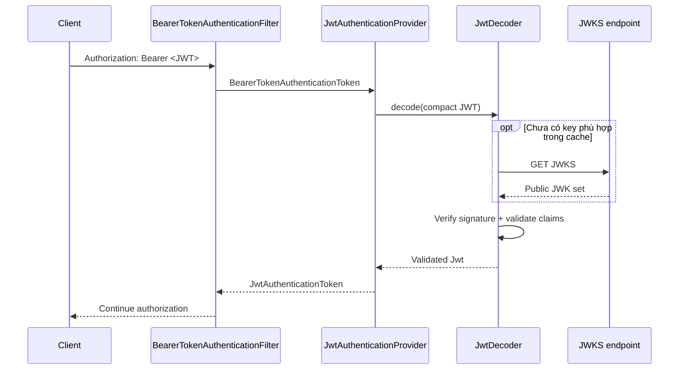
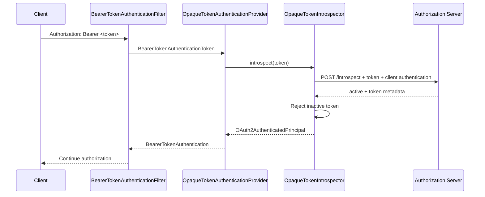

# Thay xác minh JWT cục bộ bằng introspection và so sánh hành vi

## 1. Bài toán: ai xác nhận access token còn hợp lệ?

Spring Security Resource Server có thể xác thực Bearer access token theo hai cách:

- **JWT local validation:** Resource Server nhận compact JWT, dùng public key đáng tin để kiểm tra chữ ký, sau đó xác minh issuer, thời hạn, audience và các claim theo contract. Spring Security thường thực hiện qua JwtDecoder, chẳng hạn NimbusJwtDecoder.
- **Opaque token introspection:** Resource Server gửi token tới introspection endpoint của Authorization Server (AS). AS trả metadata về token, trong đó active cho biết token có đang được coi là active hay không. Spring Security thực hiện qua OpaqueTokenIntrospector, thường là NimbusOpaqueTokenIntrospector.

Trong cả hai trường hợp, client gửi cùng một kiểu HTTP credential:

```http
GET /api/orders HTTP/1.1
Host: api.example.test
Authorization: Bearer <access-token>
```

Khác biệt nằm ở cách Resource Server xác minh token sau khi trích xuất Bearer credential.

**JWT không đồng nghĩa với local validation và opaque không đồng nghĩa với một loại thuật toán mã hóa.** JWT là định dạng token; introspection là giao thức hỏi AS về trạng thái và metadata của token. AS cũng có thể cho phép introspect một JWT. Khi chuyển sang introspection, Resource Server hỏi AS thay vì tự quyết định token bằng JwtDecoder.

## 2. Hai luồng xác thực

### 2.1. JWT local validation

Với JWT, Resource Server có thể xác minh token mà không gọi AS trên từng request:



Decoder xác minh chữ ký bằng key được lấy từ JWKS hoặc được cấu hình trực tiếp. Nó cũng cần validator cho issuer, thời gian, audience và token profile. Việc lấy JWKS thường có cache; do đó một request bình thường không nhất thiết tạo network call tới AS.

### 2.2. Opaque token introspection

Với introspection, Resource Server chuyển token tới AS qua một request server-to-server:



AS quyết định token còn active hay không và có thể trả các thuộc tính như sub, scope, client_id, aud, iss, exp hoặc các claim riêng. Spring Security dùng principal và authorities trả về để tiếp tục authorization.

### 2.3. Những thành phần Spring Security thay đổi

| Giai đoạn | JWT | Opaque introspection |
| --- | --- | --- |
| Bearer header extraction | BearerTokenAuthenticationFilter | BearerTokenAuthenticationFilter |
| Authentication provider | JwtAuthenticationProvider | OpaqueTokenAuthenticationProvider |
| Verification component | JwtDecoder | OpaqueTokenIntrospector |
| Kết quả principal | JwtAuthenticationToken | BearerTokenAuthentication với OAuth2AuthenticatedPrincipal |
| Nguồn quyết định token active | Decoder và validators tại Resource Server | Introspection response từ AS |
| Network dependency theo request | Thường không, trừ JWKS fetch/refresh | Thường có một request introspection, trừ khi có cache |

Hai kiểu xác thực dùng chung Bearer filter và authorization layer. Việc chuyển đổi không bắt buộc phải thay controller hoặc đổi header mà client gửi.

## 3. Khi nào chọn introspection?

Introspection phù hợp khi AS cần giữ quyền kiểm soát trạng thái token ở thời điểm request được xử lý:

- Access token có thể bị revoke trước exp.
- AS cần vô hiệu hóa token khi user logout, tài khoản bị khóa hoặc session bị thu hồi.
- Token là opaque string và claims không được đưa trực tiếp cho client.
- AS có logic policy động để xác định token còn active.
- Nhiều Resource Server cần hỏi cùng một nguồn trạng thái trung tâm.

JWT local validation phù hợp khi:

- Cần giảm latency và tránh gọi AS cho mỗi request.
- Resource Server phải hoạt động độc lập khi AS tạm thời không sẵn sàng.
- Token có thời hạn ngắn và chấp nhận được cửa sổ thu hồi theo exp.
- AS phát hành JWT theo contract ổn định, với issuer, audience và key rotation được quản lý tốt.
- Hệ thống có lượng request lớn và không muốn biến introspection service thành dependency đồng bộ trên mọi API call.

Không có lựa chọn luôn tốt hơn. Cần đánh đổi giữa khả năng thu hồi, độ trễ, tải lên AS, độ sẵn sàng và yêu cầu riêng tư.

## 4. Cấu hình JWT Resource Server hiện tại

Ví dụ cấu hình JWT qua Spring Boot:

```yaml
spring:
  security:
    oauth2:
      resourceserver:
        jwt:
          issuer-uri: https://login.example.test
          audiences:
            - orders-api
```

issuer-uri cho phép Spring Security khám phá metadata của issuer để tìm JWKS endpoint và thiết lập issuer validation. Tùy phiên bản Spring Boot, thuộc tính audiences có thể được hỗ trợ để cấu hình audience validation; nếu không có, cấu hình validator trong code.

Có thể cấu hình trực tiếp JWKS:

```yaml
spring:
  security:
    oauth2:
      resourceserver:
        jwt:
          issuer-uri: https://login.example.test
          jwk-set-uri: https://login.example.test/oauth2/jwks
```

Khi dùng jwk-set-uri, vẫn phải giữ issuer validation. Nguồn public key và identity của issuer là hai phần khác nhau trong trust contract.

Security chain dùng JWT:

```java
@Bean
SecurityFilterChain api(HttpSecurity http) throws Exception {
    return http
            .authorizeHttpRequests(authorize -> authorize
                    .requestMatchers("/public/**").permitAll()
                    .requestMatchers(HttpMethod.GET, "/api/orders/**")
                        .hasAuthority("SCOPE_orders:read")
                    .requestMatchers(HttpMethod.POST, "/api/orders/**")
                        .hasAuthority("SCOPE_orders:write")
                    .anyRequest().authenticated())
            .oauth2ResourceServer(oauth2 ->
                    oauth2.jwt(Customizer.withDefaults()))
            .build();
}
```

Phần authorization này có thể giữ nguyên khi chuyển sang introspection nếu authority mapping vẫn tạo ra cùng tên authority.

## 5. Thay bằng opaque token introspection trong Spring Boot

### 5.1. Cấu hình bằng application.yml

Thay cấu hình jwt bằng opaquetoken:

```yaml
spring:
  security:
    oauth2:
      resourceserver:
        opaquetoken:
          introspection-uri: https://login.example.test/oauth2/introspect
          client-id: orders-resource-server
          client-secret: ${ORDERS_INTROSPECTION_CLIENT_SECRET}
```

client-id và client-secret là credential server-to-server của Resource Server để gọi introspection endpoint. Chúng không phải credential của end user và không được gửi lại cho client.

Lưu secret từ secret manager, workload identity hoặc cơ chế cấp secret phù hợp. Không commit giá trị thật vào repository, image hoặc file cấu hình chia sẻ.

Security chain:

```java
@Bean
SecurityFilterChain api(HttpSecurity http) throws Exception {
    return http
            .authorizeHttpRequests(authorize -> authorize
                    .requestMatchers("/public/**").permitAll()
                    .requestMatchers(HttpMethod.GET, "/api/orders/**")
                        .hasAuthority("SCOPE_orders:read")
                    .requestMatchers(HttpMethod.POST, "/api/orders/**")
                        .hasAuthority("SCOPE_orders:write")
                    .anyRequest().authenticated())
            .oauth2ResourceServer(oauth2 ->
                    oauth2.opaqueToken(Customizer.withDefaults()))
            .build();
}
```

Khi Boot tìm thấy các thuộc tính opaquetoken, nó cấu hình introspector mặc định. Các endpoint vẫn nhận Bearer header như trước.

### 5.2. Cấu hình trực tiếp trong Java

Nếu cần cấu hình tường minh:

```java
@Bean
SecurityFilterChain api(HttpSecurity http) throws Exception {
    return http
            .authorizeHttpRequests(authorize -> authorize
                    .anyRequest().authenticated())
            .oauth2ResourceServer(oauth2 -> oauth2
                    .opaqueToken(opaque -> opaque
                            .introspectionUri(
                                    "https://login.example.test/oauth2/introspect")
                            .introspectionClientCredentials(
                                    "orders-resource-server",
                                    introspectionClientSecret)))
            .build();
}
```

Đây là ví dụ API cấu hình của Spring Security 6.x. Trong ứng dụng thực tế, inject URI và secret từ configuration/secret manager thay vì hardcode.

### 5.3. Chỉ chọn một cơ chế xác thực cho chain

Trong một cấu hình đơn giản, thay .jwt(...) bằng .opaqueToken(...) trên chain đang dùng. Không để hai cấu hình khác nhau cùng tranh xử lý một Bearer request mà không có thiết kế phân luồng rõ ràng.

Nếu hệ thống cần hỗ trợ song song hai loại credential trong giai đoạn chuyển đổi, hãy thiết kế rõ cách chọn authentication manager/introspector hoặc tách chain theo boundary có chủ đích. Không quyết định loại token chỉ bằng cách thử decode chuỗi rồi fallback tùy tiện; điều đó dễ tạo behavior không nhất quán và làm yếu token contract.

## 6. Introspection endpoint nhận và trả gì?

RFC 7662 định nghĩa OAuth 2.0 Token Introspection. Resource Server gửi token tới endpoint bằng HTTPS và xác thực client theo phương thức AS hỗ trợ, thường là HTTP Basic hoặc cơ chế client authentication khác.

Request thường là form-urlencoded:

```http
POST /oauth2/introspect HTTP/1.1
Host: login.example.test
Content-Type: application/x-www-form-urlencoded
Authorization: Basic <resource-server-client-credentials>

token=<access-token>
```

Không log request body hoặc Authorization header. Body có chính access token cần kiểm tra.

Response ví dụ:

```json
{
  "active": true,
  "scope": "orders:read orders:write",
  "client_id": "web-client",
  "username": "user-123",
  "token_type": "Bearer",
  "exp": 1893456000,
  "iat": 1893452400,
  "sub": "user-123",
  "aud": ["orders-api"],
  "iss": "https://login.example.test",
  "jti": "token-reference-123"
}
```

Trong RFC 7662, active là thuộc tính cốt lõi; nhiều thuộc tính khác là optional hoặc do AS mở rộng. Không giả định mọi AS trả cùng một tập claim hay cùng kiểu dữ liệu.

### 6.1. active có nghĩa gì?

- active: true: theo quyết định của AS, token hiện active và metadata có thể được sử dụng để xác thực/authorization theo contract.
- active: false: token không được coi là active; Resource Server phải từ chối.
- Introspection endpoint lỗi, timeout hoặc response không hợp lệ: Resource Server không có bằng chứng token active và phải fail closed.

active: true không tự động chứng minh token dành cho API hiện tại hoặc có scope cần thiết. Resource Server vẫn phải kiểm tra audience/resource, issuer, thời gian và authorization metadata theo contract.

### 6.2. Vì sao AS có thể trả active: false?

Ví dụ:

- Token đã hết hạn.
- Token bị revoke.
- Grant hoặc session gốc bị thu hồi.
- User hoặc client bị disable.
- Token không tồn tại hoặc không thuộc issuer.
- Token không được introspection client phép xem.
- AS không muốn tiết lộ token có tồn tại hay không.

Resource Server không nên phân biệt chi tiết các trường hợp này cho caller nếu điều đó tiết lộ thông tin nội bộ.

### 6.3. Introspection client không phải end-user client

Credential gọi introspection endpoint đại diện cho Resource Server. AS có thể giới hạn Resource Server nào được introspect token, loại token nào được xem, resource/audience nào client được nhận, metadata nào được trả về và rate limit/quota theo client.

Không dùng client ID/secret của browser/mobile app làm credential introspection. Không chuyển introspection secret tới frontend.

## 7. Ánh xạ principal và scope trong Spring Security

NimbusOpaqueTokenIntrospector chuyển response thành OAuth2AuthenticatedPrincipal. Các scope trong thuộc tính scope thường được ánh xạ thành authorities có prefix SCOPE_.

Ví dụ response:

```json
{
  "active": true,
  "sub": "user-123",
  "scope": "orders:read orders:write",
  "aud": ["orders-api"]
}
```

Authorities có thể gồm:

```text
SCOPE_orders:read
SCOPE_orders:write
```

Do đó, rule:

```java
.requestMatchers(HttpMethod.GET, "/api/orders/**")
    .hasAuthority("SCOPE_orders:read")
```

có thể giữ nguyên sau khi chuyển sang opaque introspection.

### 7.1. Kiểm tra scope và scp

Một số AS dùng scope là chuỗi cách nhau bởi dấu cách; một số hệ thống dùng scp là mảng. Mặc định của introspector cần được đối chiếu với response thực tế và version Spring Security. Nếu AS trả schema riêng, dùng custom OpaqueTokenIntrospector hoặc authority converter để ánh xạ đúng contract.

Không tự coi mọi claim tên roles, permissions, scp và scope là tương đương. Định nghĩa mapping rõ ràng và test bằng response fixture.

### 7.2. Principal name

sub thường là subject identifier, nhưng một số AS có thể dùng username hoặc thuộc tính khác. Nếu code ứng dụng gọi authentication.getName(), kiểm tra thuộc tính principal name sau migration. Tránh dựa vào một claim chỉ tồn tại trong JWT cũ.

### 7.3. Claim contract phải ổn định

Nếu controller/service cần tenant, subject, client ID hoặc actor information, hãy xác định những trường đó trong introspection response. Nếu AS không trả chúng, ứng dụng không nên âm thầm suy luận từ token string.

## 8. Kiểm tra audience và issuer sau introspection

JWT decoder thường có validator cho issuer, timestamp và audience. Introspection mặc định tập trung vào response active và principal creation; không nên giả định mọi custom audience policy của JWT được tự động chuyển sang opaque token.

Nếu AS trả aud, có thể bọc introspector để enforce audience:

```java
import java.util.Collection;

import org.springframework.security.oauth2.core.OAuth2AuthenticatedPrincipal;
import org.springframework.security.oauth2.core.OAuth2IntrospectionException;
import org.springframework.security.oauth2.server.resource.introspection.OpaqueTokenIntrospector;

final class AudienceCheckingIntrospector
        implements OpaqueTokenIntrospector {

    private final OpaqueTokenIntrospector delegate;
    private final String expectedAudience;

    AudienceCheckingIntrospector(
            OpaqueTokenIntrospector delegate,
            String expectedAudience) {
        this.delegate = delegate;
        this.expectedAudience = expectedAudience;
    }

    @Override
    public OAuth2AuthenticatedPrincipal introspect(String token) {
        OAuth2AuthenticatedPrincipal principal =
                delegate.introspect(token);

        Object aud = principal.getAttribute("aud");
        boolean matches =
                aud instanceof String value
                        ? expectedAudience.equals(value)
                        : aud instanceof Collection<?> values
                                && values.contains(expectedAudience);

        if (!matches) {
            throw new OAuth2IntrospectionException(
                    "Token is not intended for this resource");
        }

        return principal;
    }
}
```

Cấu hình delegate:

```java
@Bean
OpaqueTokenIntrospector ordersIntrospector(
        @Value("${spring.security.oauth2.resourceserver.opaquetoken.introspection-uri}") String introspectionUri,
        @Value("${spring.security.oauth2.resourceserver.opaquetoken.client-id}") String clientId,
        @Value("${spring.security.oauth2.resourceserver.opaquetoken.client-secret}") String clientSecret) {

    OpaqueTokenIntrospector delegate =
            new NimbusOpaqueTokenIntrospector(
                    introspectionUri, clientId, clientSecret);

    return new AudienceCheckingIntrospector(
            delegate, "orders-api");
}
```

Khi khai báo bean OpaqueTokenIntrospector tùy chỉnh, Spring Boot sẽ sử dụng bean đó thay introspector mặc định. Giữ nguyên client authentication và behavior của delegate.

### 8.1. Nếu introspection response không có aud

Không thể chứng minh resource binding chỉ từ active: true. Có ba cách giải quyết theo kiến trúc:

1. Cấu hình AS để introspection response trả audience/resource đã được xác minh.
2. Cấu hình introspection client riêng cho từng Resource Server và để AS enforce resource binding khi introspect.
3. Dùng một contract khác đã được AS xác thực để chứng minh token dành cho API này.

Không suy luận audience từ scope nếu AS không định nghĩa rõ quan hệ đó.

### 8.2. Kiểm tra issuer

Introspection response có thể chứa iss, nhưng RFC 7662 không bắt buộc mọi response đều phải có. Nếu có, Resource Server có thể kiểm tra issuer theo contract. Đồng thời, endpoint introspection và client authentication phải được cấu hình tới AS tin cậy qua HTTPS.

Nếu AS không trả iss, trust có thể được neo vào endpoint/client configuration và policy của AS. Ghi rõ quyết định này trong threat model.

## 9. JWT và introspection: so sánh theo hành vi

| Khía cạnh | JWT local validation | Opaque introspection |
| --- | --- | --- |
| Mỗi request cần gọi AS? | Thường không; chỉ khi cần lấy/refresh JWKS. | Thường có. |
| Thành phần chính | JwtDecoder và validators. | OpaqueTokenIntrospector. |
| Quyết định token active | Dựa vào chữ ký, claim và policy local. | AS trả active. |
| Thu hồi token | Thường chờ exp, hoặc dùng denylist/version/introspection bổ sung. | Có thể phản ánh revoke ở lần introspection kế tiếp. |
| Latency | Thấp hơn khi key đã cache; chủ yếu CPU/local validation. | Có thêm network round trip tới AS. |
| Availability | Có thể tiếp tục xác minh bằng key đã cache khi AS tạm down. | AS/introspection endpoint là dependency đồng bộ. |
| Tải lên AS | Chủ yếu JWKS fetch/refresh. | Tăng theo số lần introspection. |
| Cache | JWK set/key cache thường được dùng. | Có thể thêm cache response, nhưng phải quản lý stale-active window. |
| Dữ liệu token | Claims nằm trong JWT payload và có thể đọc được nếu không mã hóa. | Client thường chỉ thấy token reference/string; metadata chỉ trả cho Resource Server. |
| Quyền kiểm soát tập trung | Policy validation phần lớn chạy tại Resource Server. | AS giữ quyết định active và có thể cung cấp metadata mới nhất. |
| Failure mode | Key fetch/rotation/validator lỗi; token invalid bị reject. | Timeout/5xx/response malformed; token không thể được xác minh nên reject. |
| Scale | Phân tán chi phí validation trên Resource Server. | AS cần scale theo tổng request introspection. |
| Privacy | Token claims có thể được nhiều thành phần cầm token đọc. | AS kiểm soát metadata trả về; Resource Server gửi token tới AS. |

### 9.1. Thu hồi token

JWT đã ký hợp lệ thường vẫn có thể được xác minh cho tới khi hết hạn, ngay cả khi user logout hoặc AS đã đánh dấu session revoked. JWT self-contained không tự biết trạng thái revoke mới.

Các cách giảm cửa sổ này:

- Access token lifetime ngắn.
- Denylist theo jti hoặc token fingerprint ở Resource Server.
- Token version/session version được kiểm tra từ state trung tâm.
- Introspection cho những route hoặc token cần revocation gần thời gian thực.

Với introspection, AS có thể trả active: false sau khi token bị revoke. Hiệu lực thực tế phụ thuộc consistency của AS, replication delay và cache ở Resource Server.

### 9.2. Cache làm thay đổi semantics revocation

Giả sử Resource Server cache response active: true trong 60 giây. Token bị revoke ngay sau lần introspection; Resource Server có thể tiếp tục chấp nhận token cho tới khi cache hết hạn.

Do đó, cache TTL là một phần của security policy, không chỉ là tối ưu hiệu năng.

### 9.3. Availability và fail-closed

Nếu introspection endpoint timeout hoặc trả 5xx, Resource Server không biết token còn active hay không. Hành vi an toàn là từ chối request, thường trả 401 hoặc lỗi authentication phù hợp với exception mapping.

Không fallback sang “accept token nếu parse được JWT” khi introspection lỗi. Cách fallback đó biến outage thành bypass kiểm tra revoke, active state và audience policy.

Nếu yêu cầu availability cao, hãy tăng độ sẵn sàng của AS/introspection service, dùng connection pool/timeouts phù hợp và cache theo policy. Không fail-open.

## 10. Hiệu năng và capacity planning

Với JWT:

- Chi phí verify chữ ký và validate claims nằm trong Resource Server.
- JWK set được cache; nhiều request dùng lại public key.
- Network dependency chủ yếu xuất hiện khi khởi tạo decoder, cache miss hoặc key rotation.
- Resource Server có thể scale ngang mà không làm tăng một introspection call cho mỗi request.

Với introspection:

- Mỗi cache miss thường tạo một HTTP POST tới AS.
- Cần tính tổng request rate của mọi Resource Server.
- AS phải xử lý xác thực client, tra cứu token state, quyền và metadata.
- Network latency và connection pool trở thành phần của API latency.
- Một sự cố introspection có thể ảnh hưởng đồng thời nhiều API.

Ví dụ 8 Resource Server, mỗi service nhận 2.000 request/giây:

```text
JWT local validation:
  16.000 API requests/second
  ~không có 16.000 introspection calls/second
  (JWKS fetch/refresh theo cache policy)

Opaque introspection, không cache:
  16.000 API requests/second
  ~16.000 introspection calls/second
```

Đây là phép tính minh họa; traffic thực tế, cache, retry và fan-out sẽ làm số request khác đi. Không triển khai introspection diện rộng trước khi đo capacity của AS.

### 10.1. Đặt timeout và connection pool

Introspection là dependency mạng nên cần connection timeout, response/read timeout, connection pool có giới hạn, TLS verification đúng, retry có giới hạn và backoff, circuit breaker nếu phù hợp, cùng metrics cho latency/error rate/status.

Không retry vô hạn một request authentication. Retry kéo dài có thể giữ thread và làm cạn connection pool của API.

### 10.2. Cache response introspection

Spring Security không nên được giả định tự cung cấp cache response introspection theo TTL nghiệp vụ. Nếu cần cache, có thể bọc OpaqueTokenIntrospector bằng cache decorator hoặc dùng cache layer do hệ thống quản lý.

Một cache an toàn cần:

- TTL ngắn và nhỏ hơn thời hạn còn lại của token.
- TTL phù hợp với revocation SLA.
- Không cache lỗi timeout/5xx thành kết quả active.
- Cache active: false rất ngắn hoặc theo policy chống enumeration.
- Giới hạn kích thước và eviction.
- Không lưu token thô trong key/value log hoặc metrics.
- Có kế hoạch invalidation khi AS revoke token nếu cần thu hồi gần tức thời.

Nếu dùng token làm cache key, cân nhắc HMAC key riêng để không lưu raw credential trong cache diagnostics. Cache value vẫn là security-sensitive data.

### 10.3. Tính TTL theo thời gian còn lại

Nếu response có exp, TTL cache không được vượt thời gian còn lại:

```java
Duration ttl = min(
        configuredIntrospectionTtl,
        Duration.between(clock.instant(), tokenExpiration));
```

Đây là công thức khái niệm. Xử lý exp thiếu, thời gian đã hết hạn, clock skew và TTL không dương theo token contract. Nếu response không có expiration, dùng một TTL rất ngắn đã được phê duyệt hoặc không cache.

## 11. Key rotation trong JWT và thay đổi trạng thái trong introspection

| Sự kiện | JWT local validation | Opaque introspection |
| --- | --- | --- |
| Signing key mới | Resource Server cần tải JWKS mới và chọn kid mới. | AS introspection xử lý token; Resource Server không cần public key chỉ để introspect. |
| Key cũ bị retire | Cache/refresh behavior quyết định thời gian Resource Server nhận key set mới. | AS tự quyết định token ký bằng key cũ còn active không. |
| Token revoke | Local validator thường không biết ngay. | AS có thể trả active: false ở lần hỏi kế tiếp. |
| AS outage | Cached JWK có thể cho phép validate JWT đã ký bởi key đó. | Không thể hỏi trạng thái active mới; fail closed khi không có cache hợp lệ. |

Introspection giảm việc mỗi Resource Server phải tự quản lý key set để xác minh access token, nhưng làm tăng sự phụ thuộc vào AS ở runtime.

## 12. Kiểm thử introspection trực tiếp

Trước khi kiểm thử toàn bộ filter chain, có thể kiểm tra NimbusOpaqueTokenIntrospector bằng một HTTP mock server.

Ví dụ dùng OkHttp MockWebServer:

```java
import okhttp3.mockwebserver.MockResponse;
import okhttp3.mockwebserver.MockWebServer;
import okhttp3.mockwebserver.RecordedRequest;
import org.junit.jupiter.api.AfterEach;
import org.junit.jupiter.api.BeforeEach;
import org.junit.jupiter.api.Test;
import org.springframework.security.oauth2.core.OAuth2AuthenticatedPrincipal;
import org.springframework.security.oauth2.server.resource.introspection.NimbusOpaqueTokenIntrospector;

import static org.assertj.core.api.Assertions.assertThat;
import static org.junit.jupiter.api.Assertions.assertEquals;

class OpaqueIntrospectionClientTest {

    private MockWebServer server;

    @BeforeEach
    void start() throws Exception {
        server = new MockWebServer();
        server.start();
    }

    @AfterEach
    void stop() throws Exception {
        server.shutdown();
    }

    @Test
    void sendsTokenToIntrospectionAndBuildsPrincipal() throws Exception {
        server.enqueue(new MockResponse()
                .setResponseCode(200)
                .addHeader("Content-Type", "application/json")
                .setBody("""
                    {
                      "active": true,
                      "sub": "user-123",
                      "scope": "orders:read",
                      "aud": ["orders-api"]
                    }
                    """));

        NimbusOpaqueTokenIntrospector introspector =
                new NimbusOpaqueTokenIntrospector(
                        server.url("/introspect").toString(),
                        "orders-resource-server",
                        "test-secret");

        OAuth2AuthenticatedPrincipal principal =
                introspector.introspect("opaque-test-token");

        assertEquals("user-123", principal.getName());
        assertThat(principal.getAuthorities())
                .extracting("authority")
                .contains("SCOPE_orders:read");

        RecordedRequest request = server.takeRequest();
        assertEquals("POST", request.getMethod());
        assertEquals("/introspect", request.getPath());
        assertThat(request.getBody().readUtf8())
                .contains("token=opaque-test-token");
    }
}
```

Ví dụ cần dependency MockWebServer trong test source set. Request body dùng form encoding; nếu token chứa ký tự đặc biệt, thư viện sẽ encode giá trị trước khi gửi.

Trong test thực tế, không in request headers/body ra test report vì request có introspection credential và token. Ví dụ assert body ở đây chỉ nhằm xác nhận client gửi đúng tham số; dùng token giả và secret giả.

### 12.1. Test inactive token

Enqueue response:

```json
{
  "active": false
}
```

Gọi introspector.introspect(token) phải ném OAuth2IntrospectionException. Không tạo principal hoặc authorities cho token inactive.

### 12.2. Test introspection server lỗi

Kiểm tra HTTP 401/403 do introspection client authentication sai, HTTP 429 do rate limit, HTTP 500/503, timeout, JSON malformed và response thiếu active.

Các lỗi này không được chuyển thành authentication success. Theo exception mapping, caller thường nhận 401 cho credential không xác minh được; log nội bộ có thể phân loại dependency outage để vận hành.

## 13. MockMvc integration test qua Bearer filter

Test trực tiếp introspector chưa chứng minh Bearer filter, authentication provider và authorization rules hoạt động cùng nhau. Hãy gửi token qua HTTP header trong MockMvc.

### 13.1. Cấu hình test application

Ví dụ với Spring Boot test context, introspection URI trỏ tới MockWebServer và application dùng opaque token mode:

```java
@SpringBootTest
@AutoConfigureMockMvc
class OrdersOpaqueTokenIntegrationTest {

    @Autowired
    MockMvc mockMvc;

    // MockWebServer được start trong test lifecycle.
    // DynamicPropertySource cung cấp introspection URI.
    // Test server enqueue response trước mỗi request.

    @Test
    void activeTokenWithReadScopeCanReadOrders() throws Exception {
        mockIntrospectionResponse("""
            {
              "active": true,
              "sub": "user-123",
              "scope": "orders:read",
              "aud": ["orders-api"]
            }
            """);

        mockMvc.perform(get("/api/orders")
                .header(
                        HttpHeaders.AUTHORIZATION,
                        "Bearer opaque-test-token"))
                .andExpect(status().isOk());
    }
}
```

Đây là skeleton: helper mockIntrospectionResponse enqueue JSON vào server; DynamicPropertySource truyền URL và client credentials giả vào Spring context. Security chain phải dùng opaqueToken hoặc Boot opaque-token properties và có đầy đủ filter.

### 13.2. Test inactive token trả 401

Enqueue response:

```json
{
  "active": false
}
```

Gửi:

```http
GET /api/orders HTTP/1.1
Authorization: Bearer revoked-token
```

Kỳ vọng request bị từ chối, không tạo authenticated principal và không gọi business service.

### 13.3. Test active nhưng thiếu scope trả 403

Introspection response:

```json
{
  "active": true,
  "sub": "user-123",
  "scope": "profile:read",
  "aud": ["orders-api"]
}
```

Token active và dành cho Orders API, nhưng không có orders:read. Authentication thành công, authorization từ chối GET bằng 403.

### 13.4. Test active nhưng sai audience bị từ chối

Response:

```json
{
  "active": true,
  "sub": "user-123",
  "scope": "orders:read",
  "aud": ["inventory-api"]
}
```

Nếu Resource Server có audience-checking introspector hoặc AS đã enforce resource binding, request phải bị từ chối. Không chỉ dựa vào active: true.

### 13.5. Xác nhận không gọi business service

Với token inactive hoặc sai audience:

```java
verify(orderService, never()).findOrders(any());
```

Điều này chứng minh request bị chặn ở authentication layer trước business operation.

## 14. So sánh test JWT và test introspection

| Mục tiêu | JWT local validation | Opaque introspection |
| --- | --- | --- |
| Test authorization scope | with(jwt()) hoặc signed JWT qua filter | Introspection principal với scope tương ứng |
| Test signature | Signed JWS + trusted public key/JWKS | Không phải trách nhiệm local introspector; test AS/introspection contract |
| Test issuer/audience | JWT validators | AS response/policy và custom introspector |
| Test revoke | Thường cần denylist/state hoặc token hết hạn | Mock active: false |
| Test network dependency | JWKS fetch/refresh | Introspection POST |
| Test AS outage | JWKS outage khi cần key mới | Introspection timeout/5xx |
| Test cache | JWK cache/refresh | Introspection response cache và stale window |
| Test end-to-end | Bearer header qua JwtAuthenticationProvider | Bearer header qua OpaqueTokenAuthenticationProvider |

Không dùng with(jwt()) để tuyên bố đã test introspection. Helper đó tạo JWT authentication giả lập và bỏ qua OpaqueTokenIntrospector.

## 15. Migration từ JWT sang introspection

Thực hiện theo từng bước để giữ contract giữa AS, client và Resource Server.

### Bước 1: xác nhận AS hỗ trợ introspection

Làm rõ introspection URI, client authentication method, Resource Server client ID và credential riêng, token nào được introspect, response có active/aud/iss/scope/sub/exp và metadata nào, AS có revoke token và cập nhật trạng thái nhất quán không, cùng rate limit/quota/SLA của endpoint.

### Bước 2: chốt token contract

Xác định audience/resource của API, issuer trust, scope mapping, principal name và các claim ứng dụng cần. Nếu trước đây JWT validator enforce aud, iss, exp hoặc custom claims, chuyển các yêu cầu tương ứng sang introspection policy.

### Bước 3: thêm credential introspection

Tạo client riêng cho Resource Server với quyền tối thiểu. Lưu secret trong secret manager và thiết lập TLS/rotation.

### Bước 4: tạo test fixture introspection

Mock response cho active token đúng audience/scope, inactive/revoked token, active token sai audience, active token thiếu scope, expired/not-yet-valid token theo contract, introspection client authentication failure, timeout, 429 và 5xx.

### Bước 5: thay authentication mechanism trong chain

Chuyển từ:

```java
.oauth2ResourceServer(oauth2 ->
        oauth2.jwt(Customizer.withDefaults()))
```

sang:

```java
.oauth2ResourceServer(oauth2 ->
        oauth2.opaqueToken(Customizer.withDefaults()))
```

Giữ nguyên request authorization rules nếu authority names và principal mapping không đổi.

### Bước 6: đo latency và tải AS

Đo p50/p95/p99 của introspection, request rate, timeout, error rate, connection pool saturation và AS capacity. Thử tải với số Resource Server thực tế.

### Bước 7: rollout có kiểm soát

Có thể deploy theo service hoặc canary traffic. Theo dõi 401/403, introspection latency, AS errors, cache hit ratio nếu có và business success rate. Không log token để so sánh hai cơ chế.

### Bước 8: rollback có điều kiện

Giữ cấu hình JWT cũ trong release/configuration có thể khôi phục nếu AS introspection chưa đáp ứng SLA. Nhưng rollback chỉ hợp lệ nếu token format, signing key, issuer/audience policy và trạng thái revoke được hiểu rõ.

Không tự fallback từ introspection sang JWT khi endpoint lỗi. Nếu muốn rollback, thực hiện thay đổi cấu hình có kiểm soát, quan sát được và theo runbook; không chấp nhận token âm thầm trong cùng request.

## 16. Hỗ trợ song song JWT và introspection trong giai đoạn chuyển tiếp

Một số hệ thống cần hỗ trợ client cũ tiếp tục gửi JWT, client mới gửi opaque access token hoặc các API khác nhau có token contract khác nhau.

Có thể triển khai bằng các chain riêng theo route/resource boundary, hoặc một AuthenticationManagerResolver có quy tắc lựa chọn được định nghĩa rõ. Cần bảo đảm:

1. Mỗi route chỉ chấp nhận đúng loại token đã công bố.
2. Mỗi provider enforce issuer/audience/scope theo contract của nó.
3. Token sai loại không được thử provider khác để tìm cách chấp nhận.
4. Không chọn provider bằng heuristic không đáng tin như chỉ nhìn dấu chấm trong token string.
5. Metrics và logs phân biệt provider outcome mà không lưu raw token.

Nếu cả JWT và opaque token được chấp nhận ở cùng route, phải xác định rõ hai profile có cùng mức assurance và audience restriction hay không. Đừng mở rộng policy chỉ để rollout dễ hơn.

## 17. Security considerations riêng của introspection

### 17.1. Bảo vệ introspection endpoint

- Chỉ gọi qua HTTPS với certificate validation.
- Xác thực Resource Server client.
- Cấp quyền tối thiểu cho client.
- Rate limit theo client và network boundary.
- Không để introspection endpoint public cho caller tùy ý.
- Không để client secret xuất hiện trong source, log hoặc exception.
- Giám sát các request introspection bất thường.

### 17.2. Bảo vệ access token khi gửi tới AS

Introspection gửi raw token qua network tới AS. Dùng TLS và bảo vệ log ở cả hai phía. Không đưa token vào query string, tracing baggage hoặc metrics label.

### 17.3. Fail closed khi không xác minh được

Nếu introspection timeout, response malformed hoặc client authentication thất bại, không tạo principal. Không giả định token hợp lệ chỉ vì nó có định dạng JWT hoặc opaque string.

### 17.4. Không cache active response quá lâu

Cache kéo dài có thể giữ token đã revoke ở trạng thái active. TTL phải phù hợp với yêu cầu thu hồi và thời hạn token. Không cache exception hoặc timeout như active result.

### 17.5. Không tin metadata chỉ vì AS trả về

AS là trust authority cho introspection, nhưng Resource Server vẫn phải enforce resource-specific policy. Nếu response trả audience không đúng, scope không đúng hoặc issuer ngoài contract, phải từ chối.

## 18. Metrics và logging cho introspection

Các metric hữu ích:

| Metric | Mục đích |
| --- | --- |
| introspection.requests | Số lần gọi endpoint |
| introspection.duration | Latency p50/p95/p99 |
| introspection.errors | Timeout, 4xx, 5xx, parse failures |
| introspection.inactive | Token bị AS đánh dấu inactive |
| introspection.cache.hit | Tỷ lệ cache hit nếu có |
| resource.authentication.failures | Failure theo reason code |
| resource.authorization.denied | Denial do thiếu scope/permission |

Không dùng token, subject, email hoặc client secret làm metric tag. Các giá trị này vừa nhạy cảm vừa tạo cardinality rất lớn.

Log an toàn:

```json
{
  "event": "resource_server.introspection",
  "resource": "orders-api",
  "outcome": "inactive",
  "dependency": "identity-provider",
  "duration_ms": 18,
  "request_id": "req-7f2a",
  "trace_id": "4bf92f3577b34da6a3ce929d0e0e4736"
}
```

Không log raw token, request body, Authorization header, introspection client secret hoặc toàn bộ principal attributes.

## 19. Ma trận quyết định

| Yêu cầu | Nghiêng về JWT local validation | Nghiêng về introspection |
| --- | --- | --- |
| Latency thấp và không có network hop mỗi request | Có | Không |
| AS không phải dependency đồng bộ cho từng API call | Có | Không |
| Revoke token gần thời gian thực | Cần cơ chế bổ sung | Có, tùy consistency/cache |
| Token không muốn expose claims cho client | Không thuận lợi nếu JWT payload đọc được | Phù hợp hơn với opaque token |
| AS cần quyết định trạng thái tập trung | Cần state check bổ sung | Phù hợp |
| Traffic lớn, AS capacity hạn chế | Thường phù hợp | Cần cache/scale AS |
| Resource Server cần hoạt động khi AS down | Có thể với cached keys và token còn hạn | Khó hơn; fail closed |
| Claims/profile có thể validate độc lập | Phù hợp | Có thể nhưng phải dựa vào response contract |

Chọn introspection khi lợi ích của centralized token state/revocation đáng giá network dependency và capacity cost. Chọn JWT local validation khi độ trễ, khả năng hoạt động độc lập và scale là ưu tiên, đồng thời chấp nhận cửa sổ revoke theo token lifetime hoặc cơ chế bổ sung.

## 20. Ma trận kiểm thử tổng hợp

| Case | Cấu hình | Introspection response | Kỳ vọng |
| --- | --- | --- | --- |
| INT-01 | Opaque mode | active=true, đúng audience, đủ scope | 2xx |
| INT-02 | Opaque mode | active=false | 401 |
| INT-03 | Opaque mode | active=true, sai audience | 401 |
| INT-04 | Opaque mode | active=true, đúng audience, thiếu scope | 403 |
| INT-05 | Opaque mode | HTTP 401/403 từ AS | Authentication thất bại |
| INT-06 | Opaque mode | HTTP 429/5xx | Fail closed, dependency metric tăng |
| INT-07 | Opaque mode | Timeout | Không tạo principal |
| INT-08 | Opaque mode | JSON malformed/thiếu active | Không tạo principal |
| INT-09 | Opaque mode | active=true, thiếu exp theo contract | Theo policy; reject nếu exp bắt buộc |
| INT-10 | Opaque mode | active=true, issuer không đúng | Reject nếu issuer validation được yêu cầu |
| INT-11 | Opaque mode | active=true, scope đúng, aud dạng string | Theo response contract |
| INT-12 | Opaque mode | active=true, aud dạng array | Theo response contract |
| JWT-01 | JWT mode | Signed token, issuer/audience đúng | 2xx |
| JWT-02 | JWT mode | Signature sai | 401 |
| JWT-03 | JWT mode | Audience sai | 401 |
| JWT-04 | JWT mode | Token hết hạn | 401 |
| CACHE-01 | Introspection cache | active response được cache | Cache hit theo TTL |
| CACHE-02 | Introspection cache | Token bị revoke | Bị chặn sau invalidation/TTL trong SLA |
| CACHE-03 | Introspection cache | AS timeout | Không cache timeout thành active |
| MIG-01 | Rollout | Client dùng token contract mới | Chọn đúng provider |
| MIG-02 | Rollout | Token sai loại | Reject, không fallback tùy tiện |

## 21. Các lỗi thường gặp

1. **Nghĩ opaque token luôn là một định dạng đặc biệt:** opaque là cách Resource Server nhìn token; AS có thể introspect nhiều dạng token.
2. **Cho rằng active=true là đủ:** vẫn phải kiểm tra audience/resource, scope và contract cần thiết.
3. **Bỏ audience validation khi chuyển từ JWT:** JWT validator cũ có thể đã enforce audience; phải chuyển yêu cầu đó sang AS/introspector.
4. **Không kiểm tra principal name:** ứng dụng có thể đang phụ thuộc claim sub hoặc claim tùy chỉnh từ JWT.
5. **Giả định scope mapping giống nhau:** response scope và scp có semantics/shape khác nhau.
6. **Dùng introspection secret của end user:** introspection client phải là identity server-to-server.
7. **Không đặt timeout:** AS chậm có thể làm cạn thread/connection pool của API.
8. **Retry không giới hạn:** dễ tạo retry storm khi AS gặp sự cố.
9. **Fail open khi introspection lỗi:** có thể chấp nhận token đã revoke hoặc không xác minh được.
10. **Cache active response quá lâu:** mở rộng cửa sổ token đã revoke vẫn được chấp nhận.
11. **Cache lỗi mạng thành active:** lỗi dependency không phải bằng chứng token hợp lệ.
12. **Quên tải của AS:** mỗi request có thể tạo thêm một POST introspection.
13. **Log request body introspection:** body chứa access token.
14. **Chỉ test introspector trực tiếp:** chưa chứng minh Bearer filter và authorization chain.
15. **Chỉ test active=false:** chưa chứng minh scope/audience và status 403/401 phân biệt đúng.
16. **Tự fallback sang JWT khi AS down:** thay đổi semantics revoke mà không có quyết định rõ.
17. **Cho phép cả hai provider không có routing policy:** token sai loại có thể được thử theo đường khác.

## 22. Checklist chuyển đổi

- [ ] AS có introspection endpoint được hỗ trợ và có SLA phù hợp.
- [ ] Resource Server có client identity riêng với quyền tối thiểu.
- [ ] Introspection URI dùng HTTPS và TLS verification.
- [ ] Client secret được lưu trong secret manager.
- [ ] Đã xác định response fields và semantics của active.
- [ ] Audience/resource được enforce tại AS hoặc custom introspector.
- [ ] Issuer validation được xử lý theo contract.
- [ ] Scope/authority mapping được test.
- [ ] Principal name và claims ứng dụng cần vẫn có mặt.
- [ ] Timeout, pool, retry và circuit-breaker policy được thiết kế.
- [ ] Cache TTL phù hợp revocation SLA và exp.
- [ ] Không fail-open khi AS lỗi.
- [ ] Logs/metrics không chứa token hoặc secret.
- [ ] Có direct introspector tests và MockMvc Bearer integration tests.
- [ ] Có test inactive, wrong audience, insufficient scope và AS outage.
- [ ] Đã đo capacity của introspection service dưới tải dự kiến.
- [ ] Rollout/rollback có cấu hình và runbook rõ ràng.
- [ ] Không có automatic fallback giữa JWT và introspection ngoài policy.

## 23. Câu hỏi tự kiểm tra

**1. JWT local validation dùng thành phần nào?** JwtDecoder, thường là NimbusJwtDecoder.

**2. Opaque introspection dùng thành phần nào?** OpaqueTokenIntrospector, thường là NimbusOpaqueTokenIntrospector.

**3. Client có phải đổi Authorization header khi chuyển không?** Không; vẫn gửi Bearer access token.

**4. Introspection response cần thuộc tính cốt lõi nào?** active.

**5. active=true có đủ để cho phép gọi API không?** Không; còn audience/resource, scope và policy.

**6. Vì sao introspection có thể hỗ trợ revoke nhanh hơn JWT local validation?** AS có thể trả active=false sau khi token bị revoke.

**7. Vì sao cache làm chậm hiệu lực revoke?** Cache có thể tiếp tục trả response active cũ cho tới khi hết TTL hoặc invalidation.

**8. Nếu introspection timeout thì xử lý thế nào?** Fail closed; không tạo principal.

**9. Introspection secret thuộc về ai?** Resource Server client, không phải end user.

**10. Vì sao phải tính capacity của AS?** Mỗi cache miss hoặc mỗi request có thể tạo một network call tới introspection endpoint.

**11. Có thể giữ nguyên scope authorization rules không?** Có nếu authority mapping sau introspection tạo cùng authority names.

**12. permitAll có bỏ qua introspection không?** Nếu Bearer filter nằm trong chain và request gửi Bearer token, authentication vẫn có thể diễn ra trước authorization.

**13. JWT có thể bị introspect không?** Có; định dạng token và cơ chế introspection là hai khái niệm khác nhau.

**14. Opaque token có thể được validate local không?** Chỉ khi có cơ chế/contract khác cung cấp bằng chứng; opaque token thường được introspect vì Resource Server không tự xác minh nội dung.

**15. Vì sao không fallback sang JWT khi introspection lỗi?** Có thể bỏ qua trạng thái revoke và thay đổi security semantics khi dependency gặp sự cố.

**16. Test nào chứng minh introspection HTTP call hoạt động?** Mock introspection server, gọi NimbusOpaqueTokenIntrospector, kiểm tra POST và principal được tạo.

**17. Test nào chứng minh filter chain hoạt động?** Gửi Authorization: Bearer ... qua MockMvc với opaque provider thật và introspection endpoint giả lập.

**18. Token active nhưng thiếu scope trả gì?** Authentication thành công; authorization thường trả 403.

**19. Token inactive trả gì?** Authentication thất bại; thường 401.

**20. Khi nào JWT local validation phù hợp hơn?** Khi latency/availability/scale ưu tiên hơn revoke gần thời gian thực và token lifetime có thể quản lý được.

## 24. Tài liệu tham khảo

- **Spring Security Reference — OAuth 2.0 Resource Server Opaque Token:** cấu hình introspection, principal và authorities. https://docs.spring.io/spring-security/reference/servlet/oauth2/resource-server/opaque-token.html
- **Spring Security Reference — OAuth 2.0 Resource Server JWT:** JWT decoder, issuer, JWKS và validation. https://docs.spring.io/spring-security/reference/servlet/oauth2/resource-server/jwt.html
- **Spring Security API — OpaqueTokenIntrospector:** contract introspection trong Resource Server. https://docs.spring.io/spring-security/reference/api/java/org/springframework/security/oauth2/server/resource/introspection/OpaqueTokenIntrospector.html
- **RFC 7662 — OAuth 2.0 Token Introspection:** request/response và thuộc tính active. https://www.rfc-editor.org/rfc/rfc7662
- **RFC 6750 — OAuth 2.0 Bearer Token Usage:** gửi Bearer access token trong HTTP Authorization header. https://www.rfc-editor.org/rfc/rfc6750
- **RFC 7519 — JSON Web Token:** JWT claims và semantics của iss, aud, exp, nbf. https://www.rfc-editor.org/rfc/rfc7519
- **RFC 8725 — JSON Web Token Best Current Practices:** issuer/audience validation và các rủi ro JWT. https://www.rfc-editor.org/rfc/rfc8725
- **Spring Boot Reference — OAuth2 Resource Server:** cấu hình property và auto-configuration. https://docs.spring.io/spring-boot/reference/security/oauth2.html

## 25. Kết luận

Chuyển từ JWT local validation sang introspection thay đổi nơi Resource Server lấy quyết định về token. Với JWT, Resource Server tự xác minh chữ ký và claims bằng key đáng tin; với introspection, Resource Server hỏi Authorization Server và nhận metadata cùng trạng thái active. Bearer filter và authorization rules có thể giữ nguyên, nhưng provider, dependency mạng, principal mapping và failure behavior thay đổi.

Introspection có lợi thế khi cần trạng thái token tập trung và khả năng phản ánh revoke nhanh. Đổi lại, nó thêm network hop, tải lên AS, latency và dependency availability. Cache giúp giảm tải nhưng mở rộng cửa sổ chấp nhận token đã revoke. Khi endpoint lỗi, Resource Server phải fail closed và không âm thầm fallback sang JWT.

Một migration hoàn chỉnh cần chuyển cả token contract chứ không chỉ đổi một dòng DSL: giữ audience/issuer/scope policy, kiểm tra principal mapping, cấu hình client credential an toàn, đo capacity, đặt timeout/cache theo revocation SLA và test qua Bearer filter chain. Khi các điều kiện này được xác nhận, nhóm mới có thể so sánh đúng behavior trước và sau migration.
