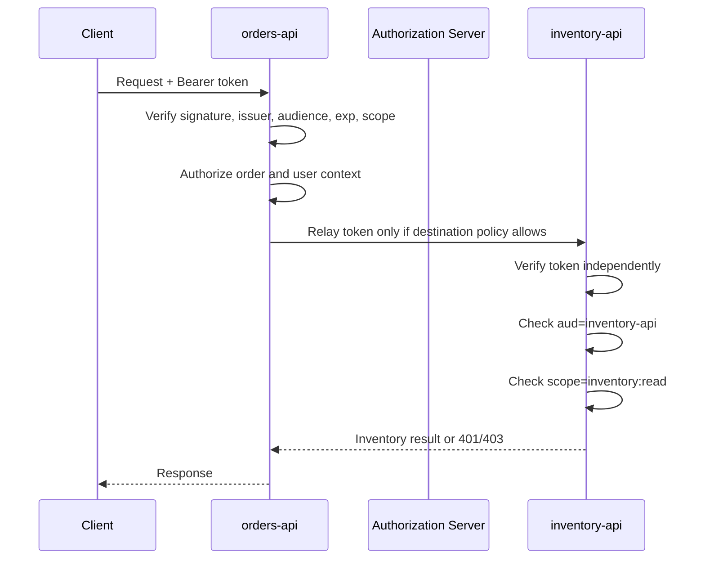
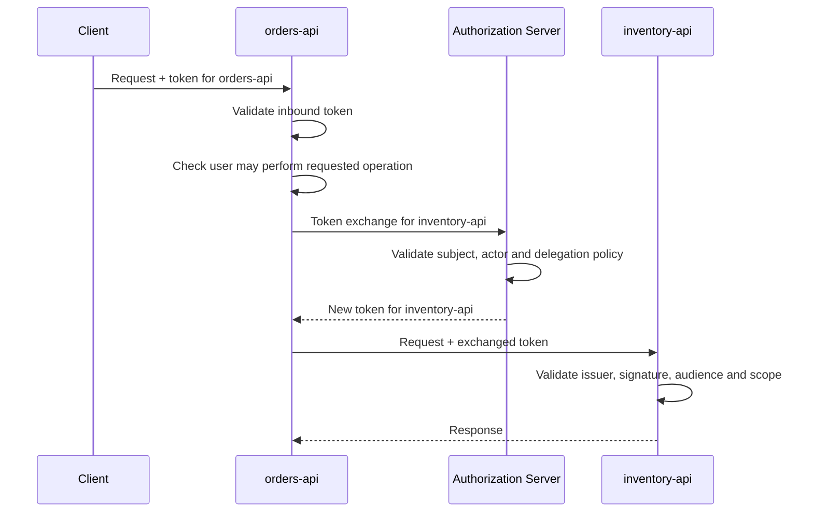

# Chuyển tiếp token đến dịch vụ được phép rồi kiểm tra audience, phạm vi quyền

## 1. Mục tiêu: relay token đúng đích và giữ nguyên giới hạn quyền

Trong kiến trúc nhiều service, một Resource Server đôi khi cần gọi API khác thay mặt người dùng hiện tại. Ví dụ, `orders-api` nhận request có access token từ client, sau đó gọi `inventory-api` để kiểm tra tồn kho. Cách chuyển tiếp access token inbound sang request outbound thường được gọi là **Bearer token relay** hoặc **token forwarding**.

Việc relay có vẻ đơn giản: lấy token hiện tại, gắn vào header `Authorization: Bearer` của request tiếp theo. Nhưng thao tác này tạo thêm một trust boundary. Token có thể bị gửi tới host sai, bị lộ qua redirect hoặc log, hoặc được downstream chấp nhận dù token không được cấp cho service đó.

Một token chỉ có chữ ký hợp lệ chưa đủ để gọi mọi API. Resource Server nhận token phải xác minh ít nhất issuer, signature, thời hạn, audience và policy quyền tương ứng. Nếu `orders-api` chuyển tiếp token có audience chỉ dành cho chính nó, `inventory-api` phải từ chối token đó. Khi cần gọi service thứ hai, hệ thống phải cấp credential phù hợp với resource đích, chẳng hạn token exchange hoặc client credentials.

Bài học thuộc chương **Thực hành tổng hợp** của mô-đun **Spring Security OAuth 2.0 OIDC Resource Server**. Nội dung hướng dẫn cách chọn mô hình gọi downstream, giới hạn destination được phép, cấu hình Spring Security/WebClient, kiểm tra audience và scope tại downstream, kiểm thử negative cases và vận hành an toàn.

> **Nguyên tắc cốt lõi:** Chỉ relay Bearer token qua HTTP client dành riêng cho destination đã được phê duyệt. Downstream phải tự xác minh token và quyền của nó. Nếu audience hoặc scope không phù hợp, hãy lấy credential mới theo đúng delegation model; đừng nới lỏng validator để request chạy qua.

---

## 2. Phân biệt token relay, client credentials và token exchange

Ba mô hình này giải quyết những nhu cầu khác nhau. Không nên coi chúng là các cách triển khai tương đương.

| Mô hình | Credential gửi tới downstream | Principal được đại diện | Khi phù hợp |
|---|---|---|---|
| **Bearer token relay** | Access token inbound hiện tại | User hoặc client được token đại diện | Token đã có audience và scope cho downstream; downstream được phép nhận cùng credential. |
| **Client credentials** | Access token mới của service client | Workload/service gọi API | Tác vụ cần quyền của service, không cần giữ delegated user identity. |
| **Token exchange / on-behalf-of** | Access token mới được AS cấp cho downstream | Subject gốc và actor/service theo policy | Cần token mới có audience/scope riêng nhưng vẫn giữ delegation context. |

### 2.1. Bearer token relay

Ví dụ request vào orders API:

```http
GET /api/orders/42 HTTP/1.1
Host: orders.example.test
Authorization: Bearer <user-access-token>
```

`orders-api` gọi inventory API và chuyển tiếp cùng token:

```http
GET /api/inventory/items/sku-123 HTTP/1.1
Host: inventory.internal.example
Authorization: Bearer <user-access-token>
```

Cách này chỉ đúng nếu token được cấp cho phép truy cập cả inventory API, ví dụ audience chứa `inventory-api` và scope có `inventory:read` theo contract của issuer.

Nếu token chỉ có audience `orders-api`, inventory API phải từ chối. Không được suy luận rằng vì orders API đã xác minh token nên inventory API có thể bỏ qua xác minh.

### 2.2. Client credentials

Nếu inventory API chỉ cần biết workload nào đang gọi, orders API có thể dùng OAuth2 client credentials để lấy token riêng:

```text
subject = orders-api
audience = inventory-api
scope = inventory:read
```

Downstream thấy principal là service client. Nó không tự biết end user nào khởi tạo hành động. Nếu business policy cần audit user, orders API phải giữ actor/subject context một cách đáng tin cậy và kiểm quyền user trước khi gọi; không giả mạo user bằng header tùy ý.

### 2.3. Token exchange

Nếu inventory API cần biết request được thực hiện thay mặt Alice, nhưng token inbound chỉ dành cho orders API, token exchange là mô hình phù hợp hơn.

Luồng khái niệm:

1. Client gửi token cho orders API.
2. Orders API xác minh token inbound.
3. Orders API yêu cầu AS đổi token theo audience/scope downstream.
4. AS xác minh quyền delegation và cấp token mới.
5. Orders API gọi inventory API bằng token mới.
6. Inventory API xác minh token mới, issuer, audience, expiry và scope.

Token exchange theo RFC 8693 có thể mang thông tin subject và actor. Cách AS biểu diễn delegation và policy cấp quyền phụ thuộc implementation; Resource Server không tự tạo token mới bằng cách sửa claim JWT.

### 2.4. Quyết định mô hình trước khi viết code

Hãy trả lời:

- Downstream cần user identity hay chỉ cần service identity?
- Token inbound có đúng audience cho downstream không?
- Scope inbound có bao gồm hành động downstream không?
- Issuer có cho phép token exchange/delegation không?
- Downstream có cần phân biệt subject với actor không?
- Audit cần ghi user, client, service hay cả ba?
- Nếu AS không cấp được token mới, request phải thất bại theo cách nào?

---

## 3. Luồng dữ liệu và trust boundaries

Một kiến trúc relay có ít nhất ba boundary: client → orders API, orders API → inventory API và mỗi API → Authorization Server/JWKS.



Nếu token inbound không có audience cho inventory API, luồng phải đổi:



Các bước kiểm tra trong sơ đồ là trách nhiệm của thành phần tương ứng. Một request đi qua network nội bộ hoặc service mesh vẫn cần credential hợp lệ và authorization policy riêng.

---

## 4. Audience là ranh giới của resource

Claim `aud` xác định resource server hoặc nhóm resource mà token được cấp để sử dụng.

Ví dụ token dành cho orders API:

```json
{
  "iss": "https://auth.example.test/realms/platform",
  "sub": "alice-123",
  "aud": ["orders-api"],
  "scope": "orders:read orders:write",
  "exp": 1890003600
}
```

Token này không được mặc nhiên dùng tại inventory API. Inventory API cần kiểm tra audience của chính nó.

Ví dụ token được cấp cho hai resource:

```json
{
  "iss": "https://auth.example.test/realms/platform",
  "sub": "alice-123",
  "aud": ["orders-api", "inventory-api"],
  "scope": "orders:read inventory:read",
  "exp": 1890003600
}
```

Issuer có thể phát token đa audience nếu authorization policy cho phép. Tuy nhiên, audience càng rộng thì token càng có thể được sử dụng ở nhiều nơi nếu bị đánh cắp. Ưu tiên token có audience hẹp theo resource.

### 4.1. Không dùng issuer làm thay thế audience

Issuer trả lời: ai phát hành token?

Audience trả lời: token dành cho resource nào?

Hai API cùng tin một issuer không có nghĩa chúng phải chấp nhận cùng một token. Issuer có thể cấp nhiều loại token cho nhiều resource khác nhau.

### 4.2. Không dùng client ID làm audience nếu contract không quy định

Client ID định danh OAuth client. Audience định danh recipient/resource theo token profile. Một số hệ thống có thể dùng cùng một chuỗi cho hai khái niệm, nhưng không nên giả định điều đó.

### 4.3. Kiểm tra mọi giá trị audience theo exact match

Không dùng substring match như:

```java
// Không an toàn: "inventory-api.attacker.example"
// cũng có thể chứa chuỗi "inventory-api".
boolean allowed = audienceValue.contains("inventory-api");
```

Dùng exact string match với resource identifier đã cấu hình:

```java
boolean allowed = jwt.getAudience().contains("inventory-api");
```

Nếu issuer dùng URI audience, so sánh đúng URI theo contract. Không tự normalize theo cách làm hai resource identifier khác nhau trở thành một.

---

## 5. Scope giới hạn hành động tại downstream

Audience cho biết token được gửi tới resource nào; scope giới hạn hành động mà token có thể thực hiện ở resource đó.

| Audience | Scope | Ý nghĩa |
|---|---|---|
| orders-api | orders:read | Đọc orders API. |
| inventory-api | inventory:read | Đọc inventory API. |
| inventory-api | inventory:write | Thay đổi inventory nếu policy cho phép. |
| payments-api | payments:refund | Yêu cầu refund tại payments API. |

Token có audience `inventory-api` nhưng chỉ có scope `orders:read` vẫn không được phép đọc inventory.

### 5.1. Scope không thay thế object-level authorization

Scope `inventory:read` cho phép capability ở mức API. Inventory API vẫn có thể cần kiểm tra:

- Tenant hoặc organization của item.
- Warehouse được user/service truy cập.
- Region/business unit.
- Trạng thái item.
- Quyền đọc giá vốn hoặc dữ liệu nhạy cảm.
- Delegation context nếu request thay mặt user.

### 5.2. Mapping scope thành Spring authorities

Spring Security thường map scope thành authority có prefix `SCOPE_`. Ví dụ scope `inventory:read` trở thành `SCOPE_inventory:read` với converter mặc định.

Một rule có thể viết:

```java
.requestMatchers(HttpMethod.GET, "/api/inventory/**")
    .hasAuthority("SCOPE_inventory:read")
```

Nếu issuer dùng claim khác như `permissions` hoặc `scp` với semantics riêng, cấu hình `JwtAuthenticationConverter` tương ứng. Không giả định mọi issuer dùng cùng claim format.

### 5.3. Không cấp scope chỉ để chữa lỗi downstream

Nếu downstream trả 403, hãy xác định scope thực sự cần thiết và kiểm tra AS policy. Không thêm wildcard hoặc admin scope cho service chỉ để request chạy qua.

---

## 6. Giới hạn destination được phép nhận token

Đây là control quan trọng nhất ở phía caller. Một WebClient có khả năng relay Bearer token là một credential-bearing HTTP client. Nếu nó gọi được arbitrary URL, attacker có thể biến API thành nơi gửi token tới host do họ kiểm soát.

### 6.1. Tạo HTTP client riêng cho một downstream

Không gắn token relay filter vào WebClient dùng chung cho:

- Webhook URL do user cung cấp.
- URL trong request body.
- Search/fetch proxy.
- External partner API.
- File download URL.
- Arbitrary callback destination.

Tạo client riêng, base URL cố định và wrapper service chỉ cung cấp các operation cần thiết.

### 6.2. Allowlist phải kiểm tra URI thực tế

Một destination guard có thể kiểm tra:

- Scheme là HTTPS.
- Host khớp chính xác hostname được cho phép.
- Port thuộc danh sách cho phép.
- Không có URI user-info.
- Path nằm trong phạm vi API cần gọi nếu policy yêu cầu.
- Redirect không được tự động đưa Authorization sang origin khác.

Không dùng `endsWith("internal.example")` một cách đơn giản. Host attacker có thể được đặt thành `inventory.internal.example.attacker.test`. So sánh hostname chính xác hoặc dùng registry đã xác thực.

### 6.3. Base URL không đủ nếu caller có thể truyền absolute URL

Một WebClient được cấu hình base URL vẫn có thể nhận absolute URI ở call site. Vì vậy:

- Không expose WebClient relay như generic client cho nhiều thành phần.
- Wrapper method nhận resource identifier/parameters, không nhận URL tùy ý.
- Có destination guard tại filter/client boundary.
- Test rằng absolute URL ngoài allowlist bị chặn trước khi request rời process.

### 6.4. DNS và egress

Hostname allowlist vẫn cần được kết hợp với TLS certificate validation và network egress policy. Xem xét DNS rebinding, DNS compromise, private/link-local addresses và cloud metadata endpoints nếu API có dynamic destination.

Đối với một downstream cố định, egress firewall hoặc service mesh policy có thể giới hạn connection tới service identity/network target đã biết.

---

## 7. Spring Security Servlet: relay inbound Bearer token bằng WebClient

Spring Security cung cấp `ServletBearerExchangeFilterFunction` cho Servlet application. Filter này lấy Bearer token từ authentication hiện tại và thêm vào outbound request.

Ví dụ client chỉ dành cho inventory API:

```java
@Configuration
public class DownstreamClientConfiguration {

    private static final String INVENTORY_BASE_URL =
        "https://inventory.internal.example";

    @Bean
    WebClient inventoryRelayWebClient(WebClient.Builder builder) {
        ExchangeFilterFunction destinationGuard =
            (request, next) -> {
                URI uri = request.url();

                boolean allowed =
                    "https".equalsIgnoreCase(uri.getScheme())
                    && "inventory.internal.example"
                        .equalsIgnoreCase(uri.getHost())
                    && (uri.getPort() == -1 || uri.getPort() == 443)
                    && uri.getRawUserInfo() == null;

                if (!allowed) {
                    return Mono.error(
                        new IllegalArgumentException(
                            "Unapproved downstream destination"
                        )
                    );
                }

                return next.exchange(request);
            };

        HttpClient httpClient =
            HttpClient.create().followRedirect(false);

        return builder
            .baseUrl(INVENTORY_BASE_URL)
            .clientConnector(
                new ReactorClientHttpConnector(httpClient)
            )
            .filter(destinationGuard)
            .filter(new ServletBearerExchangeFilterFunction())
            .build();
    }
}
```

Imports liên quan:

```java
import java.net.URI;

import org.springframework.context.annotation.Bean;
import org.springframework.context.annotation.Configuration;
import org.springframework.security.oauth2.server.resource.web.reactive.function.client.ServletBearerExchangeFilterFunction;
import org.springframework.web.reactive.function.client.ExchangeFilterFunction;
import org.springframework.web.reactive.function.client.WebClient;

import reactor.netty.http.client.HttpClient;
import org.springframework.http.client.reactive.ReactorClientHttpConnector;
import reactor.core.publisher.Mono;
```

Đây là ví dụ Servlet stack với Reactor Netty. API cấu hình connector có thể khác nếu ứng dụng dùng HTTP connector khác; giữ nguyên nguyên tắc destination allowlist và redirect policy.

### 7.1. Vì sao có destination guard?

`ServletBearerExchangeFilterFunction` có nhiệm vụ relay token. Nó không phải destination authorization policy. Guard được đặt trước filter relay để request chỉ tiếp tục khi URI đã được chấp nhận.

Cấu hình base URL cố định giúp giảm lỗi ở call site. Guard kiểm tra URI cuối cùng để phát hiện absolute URL hoặc destination không mong muốn.

### 7.2. Vì sao tắt redirect trong ví dụ?

Một server được phép nhận token có thể trả redirect tới host khác. Nếu HTTP client tự follow redirect, cần hiểu rõ client xử lý Authorization header qua redirect như thế nào. Cấu hình an toàn, dễ kiểm soát là không tự động follow redirect cho client relay. Nếu nghiệp vụ cần redirect, xử lý thủ công và xác minh destination mới trước khi gửi credential.

### 7.3. Filter này không đổi audience hoặc scope

Filter chỉ chuyển tiếp token hiện tại. Nó không:

- Xin token mới.
- Đổi audience.
- Thêm scope.
- Thực hiện token exchange.
- Làm mới token hết hạn.
- Kiểm tra downstream có chấp nhận token không.

Downstream vẫn phải tự xác minh token. Nếu token không dành cho inventory API, kết quả đúng là 401.

### 7.4. Không đăng ký filter relay toàn cục

Đừng thêm `ServletBearerExchangeFilterFunction` vào một WebClient builder global được dùng cho mọi outbound call. Một thành phần khác có thể vô tình gọi URL ngoài trust domain và làm lộ token.

Dùng bean riêng, tên rõ ràng và wrapper client riêng cho từng downstream security domain.

---

## 8. Đóng gói outbound calls trong service client

Business service không nên tự tạo URL và gắn token tùy ý. Đóng gói các operation hợp lệ:

```java
@Component
public class InventoryClient {

    private final WebClient inventoryRelayWebClient;

    public InventoryClient(
            @Qualifier("inventoryRelayWebClient")
            WebClient inventoryRelayWebClient) {
        this.inventoryRelayWebClient = inventoryRelayWebClient;
    }

    public Mono<InventoryItem> getItem(String sku) {
        return inventoryRelayWebClient
            .get()
            .uri("/api/inventory/items/{sku}", sku)
            .retrieve()
            .bodyToMono(InventoryItem.class);
    }
}
```

Ở đây caller chỉ truyền SKU. Nó không điều khiển scheme, host hoặc port. Validate SKU theo domain rules và dùng URI template để encode path variable phù hợp.

### 8.1. Không nhận URL từ request DTO

Thiết kế rủi ro:

```java
public Mono<String> fetchInventory(String url) {
    return inventoryRelayWebClient.get()
        .uri(url)
        .retrieve()
        .bodyToMono(String.class);
}
```

Thiết kế an toàn hơn là expose method như `getItem(sku)` hoặc `reserve(sku, quantity)`. Client nội bộ tự quyết định endpoint cố định.

### 8.2. Không relay token tới mọi endpoint của cùng host một cách vô điều kiện

Một host có thể phục vụ nhiều application hoặc path khác nhau. Nếu downstream security boundary được xác định theo service host, kiểm host và audience. Nếu hệ thống có nhiều API trên cùng host, giới hạn path/method theo contract và tách client theo resource khi cần.

---

## 9. Cấu hình downstream Resource Server kiểm tra audience

Inventory API phải xác minh token độc lập. Với JWT, cấu hình decoder kiểm signature/key, issuer, timestamps và audience.

Ví dụ:

```java
@Bean
JwtDecoder inventoryJwtDecoder() {
    String issuer = "https://auth.example.test/realms/platform";
    String jwkSetUri =
        "https://auth.example.test/realms/platform/protocol/openid-connect/certs";

    NimbusJwtDecoder decoder =
        NimbusJwtDecoder.withJwkSetUri(jwkSetUri).build();

    OAuth2TokenValidator<Jwt> timestampAndIssuer =
        JwtValidators.createDefaultWithIssuer(issuer);

    OAuth2TokenValidator<Jwt> audienceValidator = jwt -> {
        if (jwt.getAudience().contains("inventory-api")) {
            return OAuth2TokenValidatorResult.success();
        }

        return OAuth2TokenValidatorResult.failure(
            new OAuth2Error(
                "invalid_token",
                "Required audience inventory-api is missing",
                null
            )
        );
    };

    decoder.setJwtValidator(
        new DelegatingOAuth2TokenValidator<>(
            timestampAndIssuer,
            audienceValidator
        )
    );

    return decoder;
}
```

Imports:

```java
import org.springframework.security.oauth2.core.OAuth2Error;
import org.springframework.security.oauth2.core.OAuth2TokenValidator;
import org.springframework.security.oauth2.core.OAuth2TokenValidatorResult;
import org.springframework.security.oauth2.jwt.DelegatingOAuth2TokenValidator;
import org.springframework.security.oauth2.jwt.Jwt;
import org.springframework.security.oauth2.jwt.JwtDecoder;
import org.springframework.security.oauth2.jwt.JwtValidators;
import org.springframework.security.oauth2.jwt.NimbusJwtDecoder;
```

`JwtValidators.createDefaultWithIssuer` bao gồm issuer và timestamp validation mặc định theo Spring Security version. Audience validator được ghép vào chain để token sai resource bị từ chối.

Nếu cần custom clock skew hoặc access-token profile validators, tạo validator chain tường minh và giữ tất cả điều kiện bắt buộc. Đừng thay bộ validators mặc định bằng audience validator đơn lẻ.

### 9.1. Audience claim có thể là string hoặc array trong JWT

JWT claim `aud` có thể được biểu diễn thành một audience hoặc nhiều audience. Spring Security cung cấp `jwt.getAudience()` dưới dạng danh sách string, vì vậy dùng exact membership check.

### 9.2. Multi-issuer

Nếu inventory API tin nhiều issuers, cần registry mapping issuer tới JWKS/trust policy/audience policy. Không chấp nhận issuer tùy ý chỉ vì JWT có chữ ký verify được bằng một key bất kỳ.

### 9.3. Không lấy JWKS URL từ request inbound

Không dùng claim/header do caller điều khiển để tự tạo decoder hoặc tải key từ URL tùy ý. Cấu hình issuer/JWKS là trust anchor và cần allowlist, TLS cùng egress controls.

---

## 10. Downstream kiểm tra scope và endpoint authorization

Sau khi token qua decoder, inventory API cần authorize endpoint theo scope.

Ví dụ Servlet SecurityFilterChain:

```java
@Bean
SecurityFilterChain inventoryApiSecurity(HttpSecurity http)
        throws Exception {
    return http
        .securityMatcher("/api/**")
        .sessionManagement(session -> session
            .sessionCreationPolicy(SessionCreationPolicy.STATELESS))
        .authorizeHttpRequests(auth -> auth
            .requestMatchers(HttpMethod.GET, "/api/inventory/**")
                .hasAuthority("SCOPE_inventory:read")
            .requestMatchers(HttpMethod.POST, "/api/inventory/reservations/**")
                .hasAuthority("SCOPE_inventory:write")
            .anyRequest().denyAll())
        .oauth2ResourceServer(oauth ->
            oauth.jwt(Customizer.withDefaults()))
        .build();
}
```

Imports:

```java
import org.springframework.context.annotation.Bean;
import org.springframework.http.HttpMethod;
import org.springframework.security.config.Customizer;
import org.springframework.security.config.annotation.web.builders.HttpSecurity;
import org.springframework.security.config.http.SessionCreationPolicy;
import org.springframework.security.web.SecurityFilterChain;
```

Ví dụ này dùng default scope-to-authority mapping. Nếu token claim format khác, cấu hình converter phù hợp.

### 10.1. Kết quả 401 và 403

| Tình huống | Kết quả thường gặp | Ý nghĩa |
|---|---:|---|
| Signature invalid | 401 | Credential không hợp lệ. |
| Issuer invalid | 401 | Token không đến từ issuer được tin. |
| Audience không có inventory API | 401 | Token không dành cho resource này. |
| Token expired hoặc not-yet-valid | 401 | Token không còn/chưa được phép sử dụng. |
| Token hợp lệ nhưng thiếu inventory:read | 403 | Authentication thành công, quyền không đủ. |
| Scope đủ nhưng object/tenant policy không cho phép | 403 hoặc 404 theo policy | Không có quyền trên resource cụ thể. |

Không xử lý 401 bằng cách tự động retry cùng token nhiều lần. Không xử lý 403 bằng cách thêm quyền admin cho service.

### 10.2. Object authorization vẫn cần thiết

Một token có `inventory:read` không nhất thiết được đọc mọi warehouse hoặc mọi tenant. Inventory service phải kiểm tra ownership, tenant, region, warehouse membership và business policy theo domain.

---

## 11. Khi token inbound có audience không phù hợp

Giả sử token inbound:

```json
{
  "iss": "https://auth.example.test/realms/platform",
  "sub": "alice-123",
  "aud": ["orders-api"],
  "scope": "orders:read",
  "exp": 1890003600
}
```

Orders API muốn gọi inventory API. Có ba lựa chọn:

1. Không gọi downstream nếu user/request không có business permission.
2. Nếu chỉ cần workload identity, dùng client credentials token có audience inventory API và scope hẹp.
3. Nếu cần tiếp tục đại diện Alice, dùng token exchange/on-behalf-of theo policy của AS.

Không sửa payload token rồi ký lại bằng key của orders API. Orders API không phải issuer và không có quyền tự cấp authority cho Alice.

### 11.1. Token exchange theo RFC 8693

Request khái niệm có thể chứa:

- `grant_type` là token-exchange grant.
- `subject_token`: token inbound đã được xác minh.
- `subject_token_type`: loại subject token.
- `requested_token_type`: loại token cần cấp.
- `audience` hoặc `resource`: downstream resource.
- `scope`: quyền downstream cần.

Ví dụ minh họa form parameters:

```http
POST /oauth2/token HTTP/1.1
Host: auth.example.test
Content-Type: application/x-www-form-urlencoded
Authorization: Basic <confidential-client-credential>

grant_type=urn:ietf:params:oauth:grant-type:token-exchange&
subject_token=<inbound-access-token>&
subject_token_type=urn:ietf:params:oauth:token-type:access_token&
requested_token_type=urn:ietf:params:oauth:token-type:access_token&
audience=inventory-api&
scope=inventory:read
```

Đây là minh họa protocol. Tham số audience, resource và cách AS hỗ trợ delegation phụ thuộc implementation/policy. Dùng TLS, confidential client authentication và không log request body chứa subject token.

### 11.2. Giới hạn quyền được đổi

AS nên kiểm:

- Client gọi token exchange có được phép không.
- Subject token còn hợp lệ không.
- Subject có quyền yêu cầu downstream action không.
- Actor/service có được phép thực hiện thay subject không.
- Requested audience có nằm trong allowlist không.
- Requested scope có nằm trong intersection quyền được cấp không.
- Token mới có lifetime phù hợp không.

Không để client tự yêu cầu bất kỳ audience hoặc scope nào.

### 11.3. Không giả định Spring OAuth2 Client tự hỗ trợ mọi token exchange grant

`OAuth2AuthorizedClientManager` quản lý authorized clients và các grant providers mà ứng dụng cấu hình. Khả năng token exchange phụ thuộc Spring Security version, provider và AS integration. Với RFC 8693, cần xác nhận provider tương thích hoặc triển khai/customize grant integration theo contract của hệ thống. Không giả lập token exchange bằng cách copy token và sửa claim.

---

## 12. Client credentials cho workload-to-workload calls

Nếu downstream chỉ cần service identity, OAuth2 client credentials thường đơn giản hơn relay user token.

Ví dụ cấu hình client registration:

```yaml
spring:
  security:
    oauth2:
      client:
        registration:
          inventory-service:
            provider: platform
            client-id: orders-api
            client-secret: INVENTORY_CLIENT_SECRET_FROM_SECRET_MANAGER
            authorization-grant-type: client_credentials
            scope:
              - inventory:read
        provider:
          platform:
            token-uri: https://auth.example.test/oauth2/token
```

Giữ secret trong secret manager/environment injection an toàn; không commit giá trị thật vào repository.

### 12.1. Authorized client manager

Ví dụ manager cho service-tier client credentials:

```java
@Bean
OAuth2AuthorizedClientManager inventoryAuthorizedClientManager(
        ClientRegistrationRepository registrations,
        OAuth2AuthorizedClientService authorizedClients) {

    OAuth2AuthorizedClientProvider provider =
        OAuth2AuthorizedClientProviderBuilder.builder()
            .clientCredentials()
            .build();

    AuthorizedClientServiceOAuth2AuthorizedClientManager manager =
        new AuthorizedClientServiceOAuth2AuthorizedClientManager(
            registrations,
            authorizedClients
        );

    manager.setAuthorizedClientProvider(provider);
    return manager;
}
```

### 12.2. WebClient dùng token service riêng

```java
@Bean
WebClient inventoryServiceWebClient(
        WebClient.Builder builder,
        OAuth2AuthorizedClientManager inventoryAuthorizedClientManager) {

    ServletOAuth2AuthorizedClientExchangeFilterFunction oauth2 =
        new ServletOAuth2AuthorizedClientExchangeFilterFunction(
            inventoryAuthorizedClientManager
        );

    oauth2.setDefaultClientRegistrationId("inventory-service");

    return builder
        .baseUrl("https://inventory.internal.example")
        .apply(oauth2.oauth2Configuration())
        .build();
}
```

Imports chính:

```java
import org.springframework.security.oauth2.client.AuthorizedClientServiceOAuth2AuthorizedClientManager;
import org.springframework.security.oauth2.client.OAuth2AuthorizedClientManager;
import org.springframework.security.oauth2.client.OAuth2AuthorizedClientProvider;
import org.springframework.security.oauth2.client.OAuth2AuthorizedClientProviderBuilder;
import org.springframework.security.oauth2.client.OAuth2AuthorizedClientService;
import org.springframework.security.oauth2.client.registration.ClientRegistrationRepository;
import org.springframework.security.oauth2.client.web.reactive.function.client.ServletOAuth2AuthorizedClientExchangeFilterFunction;
```

Client credentials token đại diện `orders-api`. Nó không tự mang identity Alice. Nếu request thực hiện thay Alice, kiểm tra user permission trước khi gọi và ghi audit subject/actor; hoặc dùng token exchange nếu downstream cần delegation identity.

### 12.3. Authorized client manager cho background/service-tier work

`AuthorizedClientServiceOAuth2AuthorizedClientManager` có thể quản lý authorized client bên ngoài một servlet request cụ thể. Điều này hữu ích cho service-tier hoặc background operations. Với request-centric flows, lựa chọn manager/repository phải phù hợp lifecycle và storage policy của ứng dụng.

### 12.4. Không dùng cùng một WebClient cho relay và client credentials một cách mơ hồ

Hai client có principal semantics khác nhau. Dùng bean và tên riêng:

- `inventoryRelayWebClient`: forward inbound delegated token.
- `inventoryServiceWebClient`: attach workload token của orders API.
- `inventoryExchangedTokenClient`: gọi downstream bằng token exchange result nếu có.

Tên rõ giúp code review nhận ra loại credential được sử dụng.

---

## 13. Quy tắc không gửi token đến destination ngoài allowlist

Token relay client cần có security policy riêng.

### 13.1. Exact host allowlist

Ví dụ chỉ cho phép:

```text
scheme: https
host: inventory.internal.example
port: 443 (or default HTTPS port)
path prefix: /api/inventory/
```

Không dùng regex hostname quá rộng. Kiểm tra destination cuối cùng sau khi WebClient đã resolve base URL và path template.

### 13.2. Chặn URL do caller điều khiển

Không cho endpoint nhận `targetUrl` rồi dùng relay client để fetch. Nếu business requirement thật sự cần destination động, tách flow đó khỏi token relay, validate URL và không gắn inbound Authorization header.

### 13.3. Redirect policy

Tắt automatic redirects hoặc cấu hình client bảo đảm credential không bị forward sang origin khác. Nếu cần redirect, chỉ follow sau khi kiểm tra status, Location, scheme, host, port và credential forwarding behavior.

### 13.4. DNS và TLS

- Dùng HTTPS.
- Không disable certificate validation.
- Dùng service discovery đáng tin cậy.
- Hạn chế egress network.
- Theo dõi certificate rotation.
- Không tin hostname do client cung cấp.
- Cân nhắc DNS rebinding và private IP resolution trong hệ thống có dynamic destinations.

### 13.5. Không truyền token qua query string

Không gửi token như:

```http
GET /api/inventory/items?access_token=<token>
```

Dùng Authorization header theo Bearer token usage. URL có thể xuất hiện trong access logs, browser history, proxy logs, referrer hoặc analytics.

---

## 14. Không làm rò token qua logs, traces và errors

Token relay tạo thêm nơi token có thể xuất hiện:

- WebClient wiretap/debug logging.
- HTTP client request logging.
- Gateway access logs.
- APM instrumentation.
- Exception messages.
- Retry diagnostics.
- Distributed tracing baggage/tags.
- Test failure output.

### 14.1. Những dữ liệu không được log

Không log:

- Raw Authorization header.
- JWT compact string.
- Opaque access token.
- Refresh token.
- Subject token trong token exchange request.
- Client secret hoặc private key.
- Full introspection/token endpoint request body.
- Token claims chứa PII nếu không thực sự cần.

### 14.2. Log metadata đã redact

Có thể ghi:

- Downstream service identifier.
- Route template.
- Correlation ID.
- HTTP status.
- Error category.
- Latency.
- Token issuer/client identifier đã được policy cho phép.
- Subject reference đã pseudonymize nếu cần audit.

Không dùng token làm metric label hoặc cache key hiển thị.

### 14.3. Exception handling

Không đưa raw downstream response body hoặc token endpoint response vào client-facing error. Chuyển lỗi thành error category ổn định, giữ correlation ID và ghi chi tiết đã redact ở server-side telemetry.

---

## 15. SecurityContext và async/background processing

Trong Servlet application, SecurityContext thường gắn với request execution context. Token relay filter dựa vào authentication hiện tại, vì vậy cần hiểu lifecycle.

### 15.1. Trong request đồng bộ

Trong cùng request thread, Spring Security có thể truy cập Authentication hiện tại và relay Bearer token. Đây là trường hợp sử dụng trực tiếp của `ServletBearerExchangeFilterFunction`.

### 15.2. Async tasks và executor

Khi chuyển sang thread khác, SecurityContext có thể không được truyền như developer kỳ vọng. Một task chạy sau khi request kết thúc không nên phụ thuộc ngầm vào thread-local authentication.

Không giải quyết bằng cách lưu raw access token vào queue hoặc database để dùng sau. Hãy chọn mô hình phù hợp:

- Dùng workload identity khi background job hoạt động như service.
- Dùng token exchange khi cần delegation và AS hỗ trợ policy.
- Lưu business actor metadata đã được kiểm soát để audit.
- Kiểm tra lại authorization ở thời điểm job thực thi.
- Có expiry/revocation behavior rõ ràng nếu task thực sự cần credential delegated.

### 15.3. Không giữ token lâu hơn request cần thiết

Bearer token là credential có thể replay. Không lưu nó trong scheduled job, message payload hoặc retry store nếu không có thiết kế credential management rõ ràng.

### 15.4. Reactive application

`ServletBearerExchangeFilterFunction` dành cho Servlet context. WebFlux có execution/context model khác; dùng integration phù hợp reactive stack và Reactor Context. Không lấy Servlet ThreadLocal assumption rồi áp vào reactive chain.

---

## 16. Xử lý lỗi từ downstream

Khi gọi downstream, phân biệt authentication failure, authorization failure và availability failure.

| Downstream result | Diễn giải | Hành động phía caller |
|---|---|---|
| 401 invalid token | Token sai issuer/signature/audience/time hoặc credential không được chấp nhận | Kiểm credential flow; không retry cùng token vô hạn. |
| 403 insufficient scope | Token hợp lệ nhưng quyền không đủ | Kiểm requested operation và AS grant; không tự nâng quyền. |
| 404 | Resource không tồn tại hoặc được ẩn theo policy | Ánh xạ theo API contract; không tiết lộ cross-tenant existence. |
| 429 | Rate limit/quota | Tôn trọng Retry-After nếu có; dùng bounded backoff và idempotency. |
| 5xx | Downstream/dependency failure | Timeout, retry có giới hạn cho operation an toàn, circuit breaker. |
| Connection/TLS failure | Network hoặc trust configuration | Alert và xử lý hạ tầng; không bỏ qua TLS validation. |
| Token endpoint failure | Không lấy được token mới | Không fallback sang inbound token sai audience. |

### 16.1. 401 không phải lúc nào cũng là user login hết hạn

Downstream 401 có thể do audience sai, issuer config, signing key rotation hoặc token relay không tìm thấy SecurityContext. Chẩn đoán theo error category, không yêu cầu user đăng nhập lại ngay lập tức.

### 16.2. 403 cần giữ nguyên ý nghĩa

Nếu inventory API trả insufficient scope, orders API có thể trả lỗi nghiệp vụ hoặc 403 tùy API contract. Không đổi 403 thành thành công hoặc gọi lại bằng service-admin token trừ khi design cho phép rõ ràng.

### 16.3. Retry không sửa credential

Retry không giúp token sai audience hoặc thiếu scope trở nên hợp lệ. Retry chỉ phù hợp với lỗi transient và operation có semantics an toàn. Với POST/command, dùng idempotency key hoặc cơ chế deduplication.

---

## 17. Kiểm thử destination allowlist

Destination guard phải được test độc lập với token validator.

### 17.1. Các case cần có

| Destination | Kết quả |
|---|---|
| https://inventory.internal.example | Cho phép |
| http://inventory.internal.example | Chặn |
| https://inventory.internal.example.attacker.test | Chặn |
| https://attacker.test | Chặn |
| https://inventory.internal.example:8443 | Chặn nếu port không nằm allowlist |
| https://user@inventory.internal.example | Chặn URI user-info |
| Absolute URL do caller truyền tới host khác | Chặn trước network call |
| Redirect tới origin khác | Không tự động gửi token tiếp |

### 17.2. Test không gửi request ra ngoài

Dùng mock HTTP server hoặc test connector để xác nhận:

- Allowed destination nhận request.
- Header Authorization chỉ xuất hiện trên client relay chuyên biệt.
- Blocked destination không nhận request.
- Client external không có Authorization header.
- Redirect không gây request thứ hai mang token tới origin khác.

### 17.3. Không chỉ test filter được gọi

Assert destination cuối cùng, header thực tế và số request tới mock server. Một test chỉ xác minh filter bean tồn tại không chứng minh token được giới hạn đúng.

---

## 18. Kiểm thử audience và scope ở downstream

Dùng signed JWT test fixture và decoder thật để kiểm trust boundary.

### 18.1. Ma trận token

| Token fixture | Audience | Scope | Kết quả ở inventory API |
|---|---|---|---|
| A | inventory-api | inventory:read | Cho phép GET nếu object policy cho phép. |
| B | orders-api | inventory:read | 401 do audience không hợp lệ. |
| C | inventory-api | orders:read | 403 do thiếu scope. |
| D | inventory-api | inventory:write | GET read có thể bị từ chối nếu không có read scope. |
| E | Sai issuer | inventory:read | 401. |
| F | inventory-api | inventory:read, nhưng expired | 401. |
| G | inventory-api | inventory:read, sai tenant/object | 403 hoặc 404 theo policy. |

### 18.2. Test audience không dùng mock decoder

Mock decoder có thể trả về một Jwt fixture trực tiếp và bỏ qua signature/issuer/audience validators. Dùng mock cho authorization-only tests; dùng decoder thật với signed token cho validation integration tests.

### 18.3. Test scope mapping

Nếu dùng default converter, kiểm claim scope/scp đúng format. Nếu custom converter, test rõ:

- Scope được map thành authority mong muốn.
- Không tạo authority từ untrusted header.
- Không nhầm role claim với scope.
- Prefix không bị thêm hai lần.
- Empty/missing scope không trở thành quyền mặc định.

### 18.4. Test downstream độc lập

Inventory API phải có test riêng để chứng minh nó từ chối token sai audience ngay cả khi request đến từ orders API hoặc private network. Đừng chỉ test caller đã xác minh token trước đó.

---

## 19. Integration test end-to-end qua hai Resource Servers

Một integration test có thể khởi chạy:

- Mock Authorization Server/JWKS hoặc test signing key.
- Orders API với Resource Server config.
- Inventory API với issuer/audience/scope validators.
- Mock HTTP server cho downstream call.

Các tình huống:

1. Token audience chỉ có orders API: orders API chấp nhận inbound, relay call tới inventory API, inventory API trả 401.
2. Token audience có inventory API và scope inventory:read: downstream chấp nhận nếu issuer cho phép token đa audience.
3. Token audience inventory API nhưng thiếu scope: downstream trả 403.
4. Orders API dùng token exchange: AS cấp token audience inventory API; downstream chấp nhận token mới.
5. Token exchange bị từ chối: orders API không fallback sang relay token sai audience.
6. URL bị caller điều khiển: destination guard chặn trước khi gửi token.
7. Redirect từ downstream: client không follow tự động.
8. Token hết hạn giữa hai call: downstream xác minh theo thời điểm nhận request.

### 19.1. Quan sát cả hai phía

Test nên kiểm:

- Token nào được gửi từ caller.
- Destination thực tế.
- Audience/scope của token được downstream nhận.
- Authentication result.
- Authorization result.
- Audit actor/subject.
- Không có raw token trong logs.

Không đưa token thật vào test output hoặc snapshot.

---

## 20. Token relay và multi-tenant authorization

Nếu token chứa tenant claim, relay token sẽ chuyển tiếp nguyên tenant context. Downstream vẫn cần hiểu semantics và kiểm tra.

Ví dụ:

```json
{
  "iss": "https://auth.example.test/realms/platform",
  "sub": "alice-123",
  "aud": ["inventory-api"],
  "scope": "inventory:read",
  "tenant_id": "tenant-a",
  "exp": 1890003600
}
```

Inventory API cần xác minh:

- Issuer tin cậy và claim contract.
- Subject thuộc tenant theo policy.
- Token audience đúng inventory API.
- Scope cho phép inventory read.
- Item/warehouse thuộc tenant hoặc resource boundary tương ứng.

Không tin X-Tenant-Id do orders API hoặc client tự gửi trừ khi có service-to-service contract được xác thực và downstream kiểm tra nguồn header. Token claim đã được ký có thể là nguồn tenant context tốt hơn, nhưng vẫn phụ thuộc issuer semantics và authorization policy.

### 20.1. Tenant switching

Nếu user có nhiều tenant, token có thể được cấp theo active tenant hoặc chứa nhiều tenant entitlements. Caller không được tự đổi tenant claim. Nếu cần chuyển tenant, thực hiện flow authorization/entitlement phù hợp và nhận credential/context mới.

### 20.2. Cross-service object authorization

Mỗi service sở hữu dữ liệu của nó và chịu trách nhiệm quyết định quyền trên object. Orders API không thể thay inventory API quyết định quyền trên warehouse chỉ vì nó đã xác minh user.

---

## 21. Observability và audit cho delegated calls

Một downstream call có thể đại diện user nhưng được thực hiện bởi service. Audit nên phân biệt subject và actor.

Các trường hữu ích:

| Trường | Ý nghĩa |
|---|---|
| subject | User/entity được đại diện nếu có. |
| actor | Service/client trực tiếp gọi downstream. |
| client_id | OAuth client nhận token hoặc client registration liên quan. |
| audience | Resource mà token được cấp cho. |
| scope_set | Quyền đã được xác minh; tránh ghi toàn bộ claims nhạy cảm. |
| downstream_service | Service đích theo registry. |
| action | Operation được gọi. |
| resource_ref | ID đã được redact/pseudonymize nếu cần. |
| correlation_id | Kết nối inbound và outbound events. |
| outcome | Allowed, denied, timeout hoặc dependency failure. |

Không ghi token string hoặc subject token exchange vào audit. Nếu cần điều tra, dùng token ID/JTI hoặc identifier đã được policy cho phép, không dùng bearer credential.

### 21.1. Metrics

Có thể theo dõi:

- Outbound request count theo service/method/status.
- 401/403 rate theo downstream.
- Token exchange success/failure.
- Destination guard rejection.
- Latency và timeout.
- JWKS/introspection dependency health.
- Rate limit/quota responses.

Không đưa raw token, user ID hoặc resource ID làm metrics labels.

---

## 22. Các lỗi thiết kế thường gặp

| Lỗi | Rủi ro | Cách xử lý |
|---|---|---|
| Relay token tới mọi WebClient | Lộ credential sang external host | Tạo client riêng theo destination. |
| Chỉ cấu hình base URL | Absolute URL có thể override base URL | Guard URI thực tế và wrapper method. |
| Tin token vì caller đã xác minh | Downstream có thể nhận token sai audience | Downstream tự validate độc lập. |
| Bỏ audience validator | Token cho API khác được chấp nhận | Exact audience validation. |
| Chỉ kiểm scope ở caller | Downstream không enforce quyền riêng | Downstream kiểm scope/authorization. |
| Dùng scope wildcard/admin | Service có quyền quá rộng | Least privilege theo action. |
| Dùng client credentials nhưng audit như user token | Mất delegated identity/accountability | Ghi subject/actor hoặc dùng token exchange. |
| Sửa JWT claim để đổi audience | Token không còn chữ ký hợp lệ hoặc giả mạo issuer | Yêu cầu AS cấp token mới. |
| Follow redirect có Authorization | Token có thể sang host khác | Tắt redirect hoặc validate thủ công. |
| Dùng URL từ request DTO | SSRF và token exfiltration | Chỉ nhận business identifier, không nhận destination URL. |
| Log WebClient headers | Rò Bearer credential | Redact Authorization và wire logs. |
| Lưu token vào queue | Replay và credential tồn tại lâu | Workload identity/token exchange lúc thực thi. |
| Mock decoder trong mọi integration test | Không test signature/audience thực | Dùng real decoder cho validation tests. |
| Retry 401/403 vô hạn | Tăng tải, không sửa policy | Phân loại lỗi và retry transient only. |
| Tin private network | Lateral movement và service spoofing | TLS/mTLS/workload identity và authorization. |
| Không phân biệt 401 với 403 | Khó chẩn đoán và dễ fallback sai | Giữ đúng authentication/authorization semantics. |

---

## 23. Runbook khi downstream trả 401 hoặc 403

### 23.1. Downstream trả 401

1. Xác định token được relay hay token mới từ client credentials/token exchange.
2. Kiểm tra token có được gắn vào request hay không, nhưng không log token value.
3. Xác minh issuer và key source mà downstream tin.
4. Kiểm audience có chứa resource identifier của downstream không.
5. Kiểm exp, nbf và clock skew.
6. Kiểm token type/profile nếu downstream yêu cầu.
7. Kiểm key rotation/JWKS cache.
8. Kiểm Authorization header có bị strip ở proxy hay bị thay đổi không.
9. Kiểm client relay filter có chạy trong request context không.
10. Nếu audience sai, dùng token exchange hoặc service credential đúng mô hình; không nới validator.

### 23.2. Downstream trả 403

1. Xác nhận token đã authenticate thành công.
2. Kiểm scope/authority mà downstream tạo ra.
3. Kiểm scope có đúng cho HTTP method/endpoint không.
4. Kiểm tenant, warehouse, owner hoặc object policy.
5. Kiểm subject/actor/client identity.
6. Kiểm AS có cấp scope requested không.
7. Kiểm converter mapping có đúng claim format không.
8. Không thêm admin scope để che lỗi.

### 23.3. Destination guard chặn request

1. Ghi lại downstream service ID và route template.
2. Kiểm scheme/host/port của URI cuối cùng.
3. Kiểm có absolute URL hoặc redirect không.
4. Kiểm service discovery/configuration.
5. Không mở rộng allowlist bằng suffix regex chỉ để bỏ lỗi.
6. Nếu thêm destination mới, review trust boundary, audience, scope và egress policy.

### 23.4. Token exchange thất bại

1. Phân biệt invalid subject token, unauthorized client, unsupported grant và denied delegation.
2. Kiểm client authentication với AS.
3. Kiểm AS có hỗ trợ RFC 8693 hoặc provider-specific flow không.
4. Kiểm requested audience/resource và scope.
5. Kiểm subject/actor policy.
6. Không fallback sang token inbound nếu audience không đúng.
7. Alert lỗi cấu hình hoặc AS outage theo severity.

---

## 24. Checklist trước production

| Nhóm | Câu hỏi |
|---|---|
| **Mô hình credential** | Đã chọn relay, client credentials hay token exchange theo subject/actor requirement? |
| **Destination** | Có HTTP client riêng và allowlist exact scheme/host/port/path không? |
| **Absolute URL** | Caller có thể override base URL không? Guard có kiểm URI cuối cùng không? |
| **Redirect** | Redirect có bị tắt hoặc kiểm soát trước khi forward credential không? |
| **TLS** | HTTPS và certificate validation được bật trên outbound hop? |
| **Audience** | Downstream exact-match audience của chính nó? |
| **Issuer/signature** | Downstream tự xác minh issuer, signature và allowed algorithm? |
| **Time** | Downstream kiểm exp/nbf và clock policy? |
| **Scope** | Endpoint yêu cầu scope tối thiểu? |
| **Object policy** | Tenant, ownership và business constraints được kiểm tra? |
| **Token exchange** | AS kiểm subject, actor, requested audience và scope? |
| **Client credentials** | Service principal có quyền tối thiểu và secret được quản lý an toàn? |
| **Async** | Không giữ raw token trong queue/background store? |
| **Logging** | Authorization và token endpoint body được redact? |
| **Errors** | 401, 403, 429 và 5xx được phân loại riêng? |
| **Retries** | Chỉ retry transient errors và operation an toàn? |
| **Testing** | Có negative tests cho wrong audience, missing scope, wrong host và redirect? |
| **Observability** | Có audit subject/actor và metrics không chứa token? |
| **Operations** | Có runbook cho token theft, AS outage và downstream trust failure? |

---

## 25. Tài liệu kỹ thuật tham khảo

- [Spring Security — OAuth 2.0 Resource Server JWT](https://docs.spring.io/spring-security/reference/servlet/oauth2/resource-server/jwt.html): xác minh JWT, issuer và resource server configuration.
- [Spring Security — OAuth 2.0 Resource Server Opaque Token](https://docs.spring.io/spring-security/reference/servlet/oauth2/resource-server/opaque-token.html): introspection và opaque token authentication.
- [Spring Security — OAuth 2.0 Client](https://docs.spring.io/spring-security/reference/servlet/oauth2/client/index.html): authorized clients, client credentials và OAuth2 client integrations.
- [Spring Security API — ServletBearerExchangeFilterFunction](https://docs.spring.io/spring-security/site/docs/current/api/org/springframework/security/oauth2/server/resource/web/reactive/function/client/ServletBearerExchangeFilterFunction.html): relay Bearer token từ Servlet SecurityContext sang WebClient.
- [Spring Security API — ServletOAuth2AuthorizedClientExchangeFilterFunction](https://docs.spring.io/spring-security/site/docs/current/api/org/springframework/security/oauth2/client/web/reactive/function/client/ServletOAuth2AuthorizedClientExchangeFilterFunction.html): gắn OAuth2 authorized client token vào WebClient request.
- [RFC 6750 — OAuth 2.0 Bearer Token Usage](https://www.rfc-editor.org/rfc/rfc6750.html): cách truyền Bearer token và security considerations.
- [RFC 7519 — JSON Web Token](https://www.rfc-editor.org/rfc/rfc7519.html): registered claims như issuer, audience, expiration và subject.
- [RFC 9068 — JWT Profile for OAuth 2.0 Access Tokens](https://www.rfc-editor.org/rfc/rfc9068.html): profile cho JWT access token.
- [RFC 8693 — OAuth 2.0 Token Exchange](https://www.rfc-editor.org/rfc/rfc8693.html): subject token, actor, audience và delegation.
- [RFC 9700 — OAuth 2.0 Security Best Current Practice](https://www.rfc-editor.org/rfc/rfc9700.html): khuyến nghị bảo mật OAuth2 hiện hành.
- [OWASP API Security Top 10](https://owasp.org/API-Security/editions/2023/en/): SSRF, broken authorization và resource consumption trong API.

**Kết luận:** Token relay chỉ chuyển tiếp credential inbound; nó không đổi audience, cấp thêm scope hoặc biến token thành credential dành cho service khác. Hãy tạo WebClient riêng cho destination đã allowlist, giới hạn URI cuối cùng, kiểm soát redirect và bảo vệ Authorization header. Downstream phải tự xác minh signature, issuer, audience, thời hạn, scope và quyền trên object. Khi token inbound không dành cho downstream, dùng client credentials nếu chỉ cần workload identity hoặc token exchange nếu cần giữ delegation context. Kiểm thử cả đường thành công lẫn wrong audience, thiếu scope, destination ngoài allowlist, redirect và lỗi AS trước khi triển khai.
