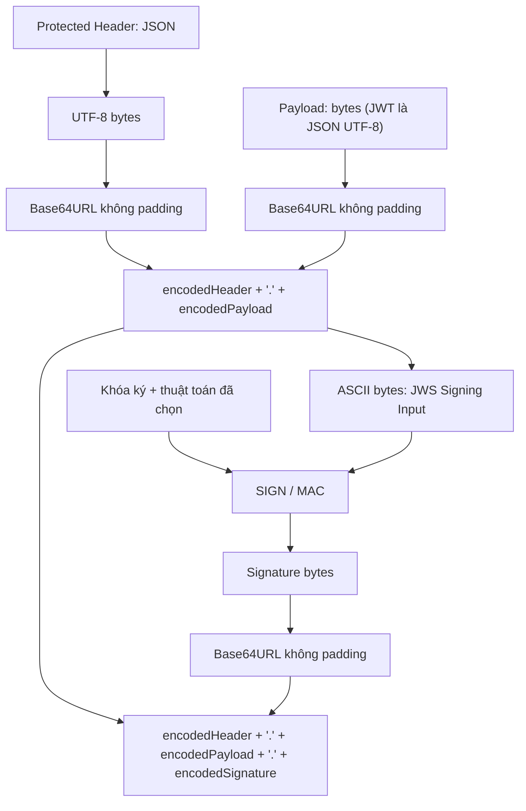
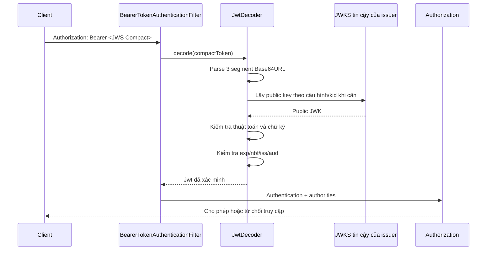

# JWS Compact: ba thành phần và mã hóa biểu diễn Base64URL

Trong hệ sinh thái **Spring Security OAuth 2.0 / OpenID Connect Resource Server**, một access token dạng JWT thường được chuyển qua HTTP dưới dạng một chuỗi ký tự giống như:

```text
eyJhbGciOiJSUzI1NiIsInR5cCI6IkpXVCJ9.eyJzdWIiOiJhbGljZSJ9.<chu_ky_base64url>
```

Chuỗi trên minh họa cấu trúc; phần `<chu_ky_base64url>` là ký hiệu thay thế nên **không phải token hợp lệ**. Hai dấu chấm phân tách ba thành phần của **JWS Compact Serialization**. Hiểu chính xác ba phần và quy tắc Base64URL giúp đọc log an toàn, phân tích lỗi Bearer token, hiểu cơ chế xác minh chữ ký, và tránh nhầm giữa *giải mã biểu diễn* với *xác thực token*.

Mục tiêu của bài học:

1. Phân biệt JOSE, JWS, JWE và JWT; nhận diện JWS Compact gồm đúng ba phần.
2. Hiểu từng phần là gì, được mã hóa thế nào, và chính xác dữ liệu nào được đem ký.
3. Tự chuyển UTF-8 ↔ Base64URL trong Java để quan sát biểu diễn mà không nhầm đây là bước xác minh.
4. Hiểu cách Spring Resource Server dùng khóa tin cậy để kiểm tra JWS, sau đó mới kiểm tra claim và quyền.
5. Nhận diện token sai cấu trúc, sai chữ ký và các ngoại lệ chuyên sâu của JWS Compact.

## 1. JWS Compact nằm ở đâu trong JOSE và JWT?

**JOSE (JSON Object Signing and Encryption)** là một họ tiêu chuẩn biểu diễn chữ ký, mã hóa và khóa bằng dữ liệu thân thiện với JSON. Một số khái niệm thường xuất hiện cùng nhau:

| Thuật ngữ | Ý nghĩa | Gắn với bài này |
|---|---|---|
| **JWS** — JSON Web Signature | Cơ chế bảo vệ tính toàn vẹn và xác thực nguồn gốc thông điệp bằng chữ ký số hoặc MAC. | Định nghĩa ba phần của chuỗi Compact. |
| **JWE** — JSON Web Encryption | Cơ chế mã hóa để bảo vệ tính bí mật của nội dung. | JWE Compact thường có **năm** phần, không phải ba. |
| **JWK** — JSON Web Key | Cách biểu diễn thông tin khóa bằng JSON. | Khóa công khai xác minh JWS có thể được công bố dạng JWK. |
| **JWKS** — JSON Web Key Set | Tập hợp các JWK, thường công bố ở endpoint HTTPS của Authorization Server. | Resource Server chọn khóa để kiểm tra chữ ký. |
| **JWT** — JSON Web Token | Kiểu token mang claims dưới dạng JSON. | JWT có thể được bảo vệ bằng JWS hoặc JWE; JWT ký bằng JWS Compact rất phổ biến. |
| **JWA** — JSON Web Algorithms | Các tên và quy ước thuật toán như `RS256`, `ES256`, `HS256`. | Giá trị `alg` trong header quyết định cơ chế ký/xác minh đã được phép. |

**JWS là định dạng bảo vệ thông điệp; JWT là kiểu nội dung/token.** Một JWS có thể ký bất kỳ chuỗi byte nào, không bắt buộc là JSON. Khi payload là JWT Claims Set (JSON), JWS Compact thường chính là hình thức chuỗi JWT mà client gửi trong header `Authorization: Bearer ...`.

Đối với Resource Server, chuỗi JWS Compact chỉ là **đầu vào chưa đáng tin** cho đến khi xác minh chữ ký, thuật toán và các claims bắt buộc thành công. Việc nhìn thấy JSON có `sub`, `scope` hoặc `roles` không tạo ra danh tính hay quyền.

## 2. Cấu trúc chính xác của JWS Compact

Ở dạng JWS Compact thông thường, cấu trúc được xác định như sau:

```text
BASE64URL(UTF8(JWS Protected Header))
.
BASE64URL(JWS Payload octets)
.
BASE64URL(JWS Signature octets)
```

Viết trên một dòng:

```text
<encoded-protected-header>.<encoded-payload>.<encoded-signature>
          phần 1               phần 2             phần 3
```

Ba chuỗi được ghép bằng **hai dấu chấm ASCII `.`**; mỗi chuỗi dùng bảng ký tự Base64URL không có dấu `=` đệm theo biểu diễn JWS. Đối với JWT thông thường, protected header và payload là JSON được chuyển sang UTF-8 trước khi mã hóa; chữ ký là **byte nhị phân**, không phải một object JSON.

| Vị trí | Nội dung gốc | Dữ liệu nhìn thấy sau Base64URL decode | Vai trò |
|---|---|---|---|
| **1. Protected Header** | JSON chứa tham số xử lý JWS, nhất là `alg`; thường có `typ` và `kid`. | Ví dụ `{"alg":"RS256","typ":"JWT","kid":"signing-01"}`. | Mô tả thuật toán và gợi ý khóa; được bảo vệ bởi chữ ký. |
| **2. Payload** | Các octet tùy ý; trong JWT là JSON Claims Set. | Ví dụ `{"sub":"alice","aud":"orders-api","scope":"orders:read"}`. | Nội dung được ký; Resource Server dùng claims để ra quyết định sau khi xác minh. |
| **3. Signature** | Byte chữ ký số hoặc MAC do thuật toán xác định. | Các byte nhị phân; không nhất thiết chuyển được thành chuỗi UTF-8. | Chứng minh header/payload chưa bị sửa theo khóa và thuật toán đã định. |

### 2.1. Protected Header

Ví dụ nội dung trước khi Base64URL:

```json
{
  "alg": "RS256",
  "typ": "JWT",
  "kid": "signing-key-2026-11"
}
```

- `alg`: tên thuật toán JWS. `RS256` nghĩa là RSA PKCS#1 v1.5 với SHA-256. Đây là thông số thiết yếu để thực hiện kiểm tra chữ ký, nhưng server **phải giới hạn thuật toán được chấp nhận theo cấu hình**, không tùy tiện làm mọi thứ header yêu cầu.
- `typ`: gợi ý loại đối tượng, thường là `JWT`. Nó giúp định hướng cách xử lý nhưng **không thể thay thế kiểm tra chữ ký, issuer, audience và các điều kiện nhận token**.
- `kid`: định danh khóa, hữu ích khi Authorization Server có nhiều khóa trong JWKS hoặc thực hiện xoay vòng khóa. Nó chỉ là **gợi ý chọn khóa trong tập khóa tin cậy đã cấu hình**, không phải chỉ dẫn đi tải khóa tùy ý từ Internet.

Với Compact Serialization, phần header này là **protected header**: không có phần *unprotected header* độc lập như một số dạng JWS JSON Serialization. Mỗi thay đổi của header đã ký, kể cả khoảng trắng trong JSON, đều làm thay đổi signing input.

### 2.2. Payload

Với access token JWT, payload thường là một JSON Claims Set:

```json
{
  "iss": "https://idp.example.test/realms/demo",
  "sub": "alice",
  "aud": ["orders-api"],
  "scope": "orders:read",
  "iat": 1890000000,
  "exp": 1890003600
}
```

Một số claims thường gặp:

- `iss` (*issuer*): bên phát hành; phải khớp issuer được Resource Server tin cậy.
- `sub` (*subject*): định danh chủ thể, ví dụ người dùng hoặc một ứng dụng tùy loại access token.
- `aud` (*audience*): bên nhận dự kiến. API nên xác minh trong audience có định danh của chính API.
- `iat` (*issued at*), `nbf` (*not before*), `exp` (*expiration*): các mốc thời gian theo **NumericDate** (giây từ Unix epoch, có thể có phần thập phân).
- `scope` hoặc `scp`: cách một Authorization Server cụ thể thể hiện quyền OAuth; đây không phải claim bắt buộc của mọi JWT.

Các ví dụ trên chỉ minh họa claims và thời gian; chúng không tạo thành access token có thể sử dụng. Một payload có hình thức hợp lệ vẫn có thể bị từ chối vì chữ ký sai, không đúng issuer/audience hoặc đã hết hạn.

### 2.3. Signature

Chữ ký không được tính bằng cách ký trực tiếp JSON sau khi parse. Với JWS Compact thông thường, đầu vào ký (*JWS Signing Input*) là chuỗi **hai phần đã mã hóa**:

```text
ASCII(BASE64URL(UTF8(protectedHeader)) + "." + BASE64URL(payloadBytes))
```

Sau đó:

```text
signatureBytes = SIGN(signingInputBytes, signingKey, approvedAlgorithm)
encodedSignature = BASE64URL(signatureBytes)
compactJws = encodedHeader + "." + encodedPayload + "." + encodedSignature
```

**Dấu chấm thứ nhất nằm trong signing input; dấu chấm thứ hai chỉ phân tách phần chữ ký.** Header và payload cùng được ký, nên không thể sửa `alg`, `kid`, `sub` hay `scope` mà vẫn giữ chữ ký hợp lệ (trừ khi kẻ tấn công có khóa ký hoặc có lỗ hổng xác minh).



### 2.4. Ví dụ tách ba phần

Một ví dụ có hai thành phần đầu ngắn để dễ đọc:

```text
eyJhbGciOiJIUzI1NiJ9.eyJzdWIiOiJhbGljZSJ9.<signature-placeholder>
```

Nếu giải mã Base64URL:

```text
eyJhbGciOiJIUzI1NiJ9   ->  {"alg":"HS256"}
eyJzdWIiOiJhbGljZSJ9   ->  {"sub":"alice"}
<signature-placeholder>  ->  Không phải chuỗi Base64URL hợp lệ
```

Hai đoạn mã hóa đầu có thể khôi phục JSON mà **không cần khóa**. Đây là lý do JWT ký bằng JWS **không phải dữ liệu bí mật được mã hóa**. Phần thứ ba chỉ có giá trị nếu chứa chữ ký hợp lệ tương ứng với signing input và khóa kiểm tra.

## 3. Base64URL thực sự làm gì?

### 3.1. Base64URL là cách biểu diễn byte, không phải mật mã

Base64 thường biểu diễn các nhóm 3 byte thành 4 ký tự ASCII. **Base64URL** là biến thể của Base64 dùng bảng chữ cái phù hợp với URL và token:

| Base64 thông thường | Base64URL trong JWS | Lý do |
|---|---|---|
| `A–Z`, `a–z`, `0–9` | Giữ nguyên | Các ký tự chữ và số không thay đổi. |
| `+` | `-` | Tránh dấu cộng trong ngữ cảnh URL/form. |
| `/` | `_` | Tránh dấu gạch chéo của đường dẫn URL. |
| `=` ở cuối để đệm | **Bỏ padding** | JOSE dùng biểu diễn không có ký tự đệm. |

Ví dụ cùng hai byte nhị phân `0xFB 0xFF`:

```text
Base64 chuẩn: +/8=
Base64URL:   -_8
```

Chuỗi Unicode phải được chuyển thành byte UTF-8 **trước khi Base64URL**. Chẳng hạn, `"đơn hàng"` không phải chuỗi byte; nó cần UTF-8 encoding trước rồi mới thực hiện Base64URL. Một byte chữ ký cũng đi qua Base64URL, nhưng không có bước “chuyển chữ ký sang UTF-8” vì nó vốn là dữ liệu nhị phân.

Các ví dụ nhỏ dễ nhớ:

| Dữ liệu byte ASCII | Base64URL không đệm |
|---|---|
| `f` | `Zg` |
| `fo` | `Zm8` |
| `foo` | `Zm9v` |
| `{"alg":"HS256"}` | `eyJhbGciOiJIUzI1NiJ9` |
| `{"sub":"alice"}` | `eyJzdWIiOiJhbGljZSJ9` |

**Không có mã hóa bí mật nào trong bước này.** Người nhận có thể decode hai phần đầu mà không cần khóa. Chỉ có phần chữ ký mới bảo vệ tính toàn vẹn và xác thực nguồn gốc theo cơ chế ký đã chọn.

### 3.2. Padding, độ dài và lỗi định dạng

Vì JWS bỏ dấu `=` ở cuối, bộ giải mã Base64URL có thể tự suy ra số bit còn thiếu:

- Độ dài chia 4 dư **0**: không cần padding.
- Dư **2**: nếu cần dùng bộ giải mã Base64 có padding, thêm `==`.
- Dư **3**: nếu cần, thêm `=`.
- Dư **1**: không phải một biểu diễn Base64URL hợp lệ của các byte đầu vào.

Một chuỗi JWS Compact thông thường không chứa khoảng trắng, xuống dòng, ký tự `+`, `/` hoặc `=` trong từng segment. Đừng “sửa” token lỗi bằng cách âm thầm xóa ký tự lạ rồi mới xác minh. Dữ liệu được ký là **chuỗi đã mã hóa chính xác** như đã nhận.

### 3.3. Java 17: encode và decode Base64URL

Lớp `java.util.Base64` đã hỗ trợ biến thể URL-safe. Có thể chạy lớp demo sau độc lập với Spring:

```java
import java.nio.charset.StandardCharsets;
import java.util.Base64;

public class Base64UrlDemo {
    static String encode(byte[] bytes) {
        return Base64.getUrlEncoder()
            .withoutPadding()
            .encodeToString(bytes);
    }

    static byte[] decode(String encoded) {
        return Base64.getUrlDecoder().decode(encoded);
    }

    public static void main(String[] args) {
        String headerJson = "{\"alg\":\"HS256\"}";
        String payloadJson = "{\"sub\":\"alice\"}";

        String headerSegment = encode(headerJson.getBytes(StandardCharsets.UTF_8));
        String payloadSegment = encode(payloadJson.getBytes(StandardCharsets.UTF_8));

        System.out.println(headerSegment);
        // eyJhbGciOiJIUzI1NiJ9
        System.out.println(payloadSegment);
        // eyJzdWIiOiJhbGljZSJ9

        String decodedHeader = new String(
            decode(headerSegment), StandardCharsets.UTF_8);
        String decodedPayload = new String(
            decode(payloadSegment), StandardCharsets.UTF_8);

        System.out.println(decodedHeader);  // {"alg":"HS256"}
        System.out.println(decodedPayload); // {"sub":"alice"}
    }
}
```

Bài demo này chỉ chuyển đổi biểu diễn. Nó **không chứng minh** rằng `alice` là người đã xác thực và không phát hiện payload bị sửa. `Base64.getDecoder()` dành cho Base64 thông thường; dùng `getUrlDecoder()` cho JWS.

### 3.4. Java: nhìn ba phần mà không xác thực

Để quan sát Compact Serialization, có thể tách chuỗi thành ba phần và đọc hai phần đầu trong **một chương trình học tập**:

```java
import java.nio.charset.StandardCharsets;
import java.util.Base64;

public class JwsStructureExplorer {
    public static void inspect(String compact) {
        // "\\." là regex khớp dấu chấm thật. -1 giữ cả phần rỗng.
        String[] parts = compact.split("\\.", -1);
        if (parts.length != 3) {
            throw new IllegalArgumentException("JWS Compact thông thường có 3 phần");
        }

        Base64.Decoder decoder = Base64.getUrlDecoder();
        byte[] headerBytes = decoder.decode(parts[0]);
        byte[] payloadBytes = decoder.decode(parts[1]);
        byte[] signatureBytes = decoder.decode(parts[2]);

        System.out.println("Header: "
            + new String(headerBytes, StandardCharsets.UTF_8));
        System.out.println("Payload (chỉ nếu là UTF-8): "
            + new String(payloadBytes, StandardCharsets.UTF_8));
        System.out.println("Signature bytes: " + signatureBytes.length);
    }
}
```

Cần lưu ý những ranh giới của ví dụ:

1. `split(".")` là sai trong Java vì dấu chấm regex có nghĩa “bất kỳ ký tự nào”; phải dùng `split("\\.", -1)`. Tham số `-1` giữ các segment rỗng để ta có thể phân biệt lỗi định dạng.
2. Payload của JWS nói chung có thể là dữ liệu nhị phân, không bắt buộc là chuỗi UTF-8. Việc in payload như văn bản chỉ thích hợp khi biết đó là JWT hay dữ liệu text.
3. Các JSON được in ra vẫn **chưa đáng tin**. Chương trình phân tích cấu trúc này không được dùng làm security filter, token validator hay căn cứ cấp quyền.
4. Không in access token thực trong log sản xuất. Các đoạn trên dành cho token giả lập cục bộ; tránh lộ thông tin người dùng và Bearer credential.

## 4. Chữ ký được tính và xác minh trên những byte nào?

Điểm dễ sai nhất khi tự đọc JWS là tưởng rằng decoder xác minh chữ ký trên object Java sau khi parse JSON. Thực tế, nó phải sử dụng **chính hai segment đã mã hóa nhận được**:

```text
Segment 1: eyJhbGciOiJIUzI1NiJ9
Segment 2: eyJzdWIiOiJhbGljZSJ9

JWS Signing Input (ASCII):
eyJhbGciOiJIUzI1NiJ9.eyJzdWIiOiJhbGljZSJ9
```

Nếu thay JSON header `{"alg":"HS256"}` thành `{ "alg": "HS256" }`, giá trị logic của `alg` vẫn giống nhau nhưng các byte UTF-8 **khác nhau**, kéo theo Base64URL và signing input khác nhau. Tương tự, thay đổi thứ tự key, khoảng trắng hoặc cách biểu diễn ký tự Unicode có thể làm chữ ký không còn khớp.

Không “chuẩn hóa” hay serialize lại JSON rồi mới xác minh JWS. Thư viện JOSE chuyên dụng sẽ giữ nguyên encoded segments cần thiết cho việc xác minh.

### 4.1. Một vài họ thuật toán thường gặp

| Giá trị `alg` | Cơ chế | Ai giữ khóa ký? | Ai có thể xác minh? |
|---|---|---|---|
| `HS256` | HMAC với SHA-256 | Bên phát hành và bên xác minh cùng chia sẻ secret. | Bất kỳ bên nào biết secret; bên xác minh cũng có khả năng tạo MAC. |
| `RS256` | RSA RSASSA-PKCS1-v1_5 với SHA-256 | Authorization Server giữ RSA private key. | Resource Server dùng public key. |
| `PS256` | RSA-PSS với SHA-256 | Authorization Server giữ RSA private key. | Resource Server dùng public key. |
| `ES256` | ECDSA P-256 với SHA-256 | Authorization Server giữ EC private key. | Resource Server dùng public key. |
| `EdDSA` | Họ EdDSA (ví dụ Ed25519 khi được cấu hình) | Bên phát hành giữ private key. | Bên nhận dùng public key. |

Đối với nhiều hệ thống Resource Server độc lập, cơ chế khóa **bất đối xứng** thường phù hợp: API chỉ giữ public key và không thể tự ký token. Với HMAC, cả bên phát hành và bên xác minh đều biết cùng secret, vì vậy việc rò rỉ secret từ một API có thể cho phép giả mạo token cho các bên cùng tin khóa đó.

Chi tiết quan trọng khi triển khai: `ES256` trong JWS biểu diễn chữ ký bằng cặp `R || S` có độ dài cố định (64 byte với P-256), **không phải** dạng ASN.1 DER thông dụng trong một số API ECDSA. Thư viện JOSE sẽ chuyển đổi đúng. Với `RS256`, signature bytes là kết quả RSA theo thuật toán đó, rồi được Base64URL mã hóa.

### 4.2. Demo tạo một JWS Compact với HMAC SHA-256

Ví dụ Java sau cho thấy rõ signing input và cách tạo phần chữ ký. Đây là mã **học cơ chế JWS**, dùng secret mẫu tại chỗ; không phải code phát hành hay xác minh access token trong sản phẩm:

```java
import java.nio.charset.StandardCharsets;
import java.util.Base64;
import javax.crypto.Mac;
import javax.crypto.spec.SecretKeySpec;

public class Hs256CompactDemo {
    private static String base64Url(byte[] input) {
        return Base64.getUrlEncoder()
            .withoutPadding()
            .encodeToString(input);
    }

    public static void main(String[] args) throws Exception {
        String header = "{\"alg\":\"HS256\",\"typ\":\"JWT\"}";
        String payload = "{\"sub\":\"alice\",\"scope\":\"orders:read\"}";

        String encodedHeader = base64Url(header.getBytes(StandardCharsets.UTF_8));
        String encodedPayload = base64Url(payload.getBytes(StandardCharsets.UTF_8));

        String signingInput = encodedHeader + "." + encodedPayload;

        // Chỉ dùng trong lab: secret HMAC thực phải dài, ngẫu nhiên,
        // được quản lý an toàn và phù hợp kiến trúc trust.
        byte[] labKey = "DEMO-ONLY-NOT-FOR-PRODUCTION-KEY-2026"
            .getBytes(StandardCharsets.UTF_8);

        Mac mac = Mac.getInstance("HmacSHA256");
        mac.init(new SecretKeySpec(labKey, "HmacSHA256"));
        byte[] signature = mac.doFinal(
            signingInput.getBytes(StandardCharsets.US_ASCII));

        String compact = signingInput + "." + base64Url(signature);

        System.out.println("Signing Input: " + signingInput);
        System.out.println("JWS Compact:  " + compact);
    }
}
```

Ở đây:

- Chúng ta chuyển JSON sang UTF-8, Base64URL hai phần đầu, nối bằng dấu chấm.
- `Mac.doFinal(...)` xử lý **byte ASCII của hai segment đã mã hóa**, không phải hai JSON thô.
- Phần chữ ký sinh ra là byte HMAC, tiếp tục Base64URL rồi nối làm segment thứ ba.
- Không có `iss`, `aud`, `exp`; nội dung bài lab không đáp ứng điều kiện của một production Resource Server dù chữ ký có thể khớp khóa demo.

Đừng lấy hướng tiếp cận “tự viết JWT verifier” làm mã production. Việc triển khai xác minh thực tế còn phải kiểm tra thuật toán, chính sách khóa, claim thời gian, issuer, audience, loại token, các header mở rộng và các trường hợp parser bất thường. Dùng thư viện JOSE/JWT đã được kiểm chứng và tích hợp bảo mật chuẩn của Spring Security.

### 4.3. Ý nghĩa của “chữ ký hợp lệ”

Với `RS256`, nếu private key đáng tin cậy đã ký chuỗi `encodedHeader.encodedPayload`, thư viện có thể dùng public key tương ứng để xác minh:

```text
Authorization Server:
  private key  +  signing input  -> signature

Resource Server:
  public key   +  signing input  +  signature -> VALID / INVALID
```

Kết luận `VALID` chỉ nói thông điệp được ký bằng khóa phù hợp và chưa bị thay đổi. Nó **chưa** đảm bảo token dùng đúng mục đích. Resource Server còn phải kiểm tra, ít nhất, `iss`, `aud`, `exp`, `nbf` theo policy; tiếp đó mới kiểm tra scope, role và quyền truy cập vào đối tượng nghiệp vụ.

Một token do cùng issuer ký có thể hoàn toàn hợp lệ về mặt mật mã nhưng **không dành cho API hiện tại**. Đây là lý do kiểm tra `aud` không được bỏ qua.

## 5. JWS Compact trong luồng Spring Security Resource Server

Một cấu hình JWT Resource Server phổ biến với Spring Boot 3.x (dùng ví dụ issuer và audience) là:

```yaml
spring:
  security:
    oauth2:
      resourceserver:
        jwt:
          issuer-uri: https://idp.example.test/realms/demo
          audiences:
            - orders-api
```

Thêm dependency `spring-boot-starter-security` và `spring-boot-starter-oauth2-resource-server`. Với cấu hình phù hợp, Spring Security làm việc qua các thành phần chính:



Ví dụ filter chain yêu cầu có token hợp lệ ở mọi route trừ health endpoint, đồng thời hạn chế route quản lý đơn hàng bởi scope `orders:read`:

```java
import org.springframework.context.annotation.Bean;
import org.springframework.context.annotation.Configuration;
import org.springframework.http.HttpMethod;
import org.springframework.security.config.Customizer;
import org.springframework.security.config.annotation.web.builders.HttpSecurity;
import org.springframework.security.web.SecurityFilterChain;

@Configuration
class ApiSecurity {
    @Bean
    SecurityFilterChain apiFilterChain(HttpSecurity http) throws Exception {
        return http
            .authorizeHttpRequests(auth -> auth
                .requestMatchers("/actuator/health").permitAll()
                .requestMatchers(HttpMethod.GET, "/api/orders/**")
                    .hasAuthority("SCOPE_orders:read")
                .anyRequest().authenticated())
            .oauth2ResourceServer(oauth -> oauth.jwt(Customizer.withDefaults()))
            .build();
    }
}
```

Trong chuỗi xử lý này:

1. Spring lấy chuỗi Bearer trong HTTP header.
2. `JwtDecoder` (thường dựa trên Nimbus JOSE + JWT) parse JWS Compact, kiểm tra chữ ký với khóa tin cậy và validate claims đã cấu hình.
3. Chỉ khi decode/validate thành công, Spring mới xây dựng principal và authorities. Converter mặc định thường ánh xạ `scope` hoặc `scp` thành authority có tiền tố `SCOPE_`.
4. `SecurityFilterChain` và logic phân quyền nghiệp vụ quyết định request được phép thực hiện hành động nào.

**Không cần tự `split` token trong controller** rồi cấp quyền từ JSON. Nếu cần truy cập claim đã được xác minh, lấy qua `@AuthenticationPrincipal Jwt` hoặc `JwtAuthenticationToken` trong SecurityContext. Với JWT access token, cấu hình issuer URI cho phép Spring khai thác OpenID Provider/Authorization Server metadata để định vị JWKS; nơi giữ khóa ký private vẫn là Authorization Server.

### 5.1. `kid` và tập khóa JWKS

Một JWKS được cung cấp bởi issuer có thể chứa nhiều public keys:

```json
{
  "keys": [
    {
      "kty": "RSA",
      "kid": "signing-key-2026-11",
      "use": "sig",
      "n": "<RSA-modulus-base64url>",
      "e": "AQAB"
    }
  ]
}
```

Khi header có `"kid":"signing-key-2026-11"`, decoder có thể tìm public key tương ứng trong **JWKS đã tin cậy**, sau đó kiểm tra thuật toán và chữ ký. Những giá trị placeholder trong JSON ở trên không phải khóa dùng được.

`kid` **không tự chứng minh khóa đáng tin**. Đặc biệt, không dùng giá trị `jku`/`x5u` trong token chưa xác minh làm URL tải khóa từ địa chỉ bất kỳ; điều đó có thể dẫn đến tin khóa do kẻ tấn công kiểm soát. Đường dẫn metadata/JWKS phải được gắn với issuer đã cấu hình và trust policy của hệ thống. Việc xoay vòng khóa cần cho phép công bố khóa mới trước khi dùng và giữ khóa cũ đủ lâu cho các token còn hạn.

### 5.2. Từ kết quả xác minh đến HTTP status

| Yêu cầu | Xử lý | Kết quả thường gặp |
|---|---|---|
| Không có Bearer token khi endpoint bắt buộc xác thực | Authentication chưa có | `401 Unauthorized` |
| Token không đúng 3 phần, Base64URL lỗi hoặc chữ ký không khớp | Token không vượt qua authentication | `401 Unauthorized` |
| Token ký đúng nhưng `iss`, `aud`, `exp`, `nbf` không đạt | Token bị validator từ chối | `401 Unauthorized` |
| Token hoàn toàn hợp lệ nhưng thiếu `orders:read` | Authentication thành công, authorization từ chối | `403 Forbidden` |
| Token hợp lệ, có scope nhưng không sở hữu bản ghi | Phân quyền ở tầng nghiệp vụ từ chối | Thường `403` hoặc `404` theo hợp đồng API |
| Token hợp lệ, có đủ quyền | Đi đến controller/service | `200`/`201`... tùy endpoint |

Phân tích JSON của token hữu ích khi gỡ lỗi, nhưng **không thể kết luận quyền truy cập** từ việc decode phần payload. Ngoài các claims, chính sách API còn có thể hạn chế tenant, chủ sở hữu, mức nhạy cảm của thao tác và kiểu chủ thể người dùng/tài khoản dịch vụ.

## 6. Những trường hợp ngoại lệ và giới hạn của quy tắc “ba phần”

Quy tắc ba phần áp dụng cho **JWS Compact Serialization thông thường**. Khi đi sâu vào JOSE, cần phân biệt một vài tình huống:

### 6.1. JWE Compact có năm phần

Một JWE được mã hóa thường có năm phần, cũng phân tách bằng dấu chấm:

```text
protectedHeader.encryptedKey.iv.ciphertext.authenticationTag
```

JWE nhằm bảo vệ **tính bí mật**, khác JWS bảo vệ tính toàn vẹn/xác thực nguồn. JWT có thể là **signed JWT (JWS)**, **encrypted JWT (JWE)** hoặc các cấu trúc lồng nhau. Vì vậy “JWT luôn ba phần” là cách nói thiếu chính xác; chính xác hơn là **JWT ký theo JWS Compact thường có ba phần**, còn JWE Compact có năm phần.

### 6.2. JWS JSON Serialization không nhất thiết là một chuỗi ba phần

JWS còn có `General JSON Serialization` và `Flattened JSON Serialization`. Chúng biểu diễn payload/signature bằng JSON object và có thể hỗ trợ nhiều chữ ký, hoặc các thông số header không được bảo vệ nếu định dạng cho phép. Đây là các dạng **khác Compact**, nên không áp dụng phép `split("\\.")` cho toàn bộ object JSON.

### 6.3. Tùy chọn `b64=false`: ngoại lệ của JWS, không dành cho JWT thông thường

RFC 7797 định nghĩa phần mở rộng cho phép **payload không qua Base64URL** khi protected header chứa `"b64":false` và khai báo đây là tham số critical, ví dụ:

```json
{
  "alg": "HS256",
  "b64": false,
  "crit": ["b64"]
}
```

Trong trường hợp này, signing input dùng **raw payload bytes**, thay vì `BASE64URL(payloadBytes)`. Compact form còn các dấu phân cách nhưng payload trực tiếp có những hạn chế, chẳng hạn không thể chứa dấu chấm theo cách thông thường nếu vẫn muốn tách đúng ba thành phần. **JWT không dùng tùy chọn unencoded payload này**; khi đang học JWT access token của Spring Resource Server, giữ mô hình Base64URL thông thường. Một thư viện JOSE phải xử lý đúng các critical header mà nó nhận; không được lờ đi extension không hiểu.

### 6.4. Detached payload

JWS còn có kiểu **detached content**: payload được truyền ở kênh khác và segment ở giữa của biểu diễn Compact có thể rỗng, dạng `encodedHeader..encodedSignature`. Khi kiểm tra chữ ký, bộ xác minh phải được cung cấp đúng payload bên ngoài. Đây không phải Bearer JWT thông thường; không nhầm nó với token của ứng dụng đã đăng nhập.

### 6.5. Unsecured JWT và `alg=none`

Một JWT không bảo vệ có thể mang header `{"alg":"none"}` và segment chữ ký rỗng. Đây là kiểu *unsecured JWT*, không cung cấp tính toàn vẹn hay xác thực nguồn gốc. **Một OAuth Resource Server dùng signed access token không được chấp nhận kiểu này** làm thông tin đăng nhập tin cậy. Kẻ tấn công có thể tự tạo JSON `sub` hoặc `scope` và đặt `alg` thành `none`; một verifier an toàn sẽ từ chối theo chính sách thuật toán.

Không bao giờ tự đổi từ `RS256` sang `HS256` chỉ vì header đề xuất như vậy; đó là dạng rủi ro *algorithm confusion*. Decoder phải được ràng buộc vào issuer, khóa và các thuật toán được cấp phép.

## 7. Thực hành từ quan sát đến xác minh

Có thể luyện theo ba tầng để thấy rõ giới hạn của từng bước.

### Bước A — Quan sát biểu diễn mà chưa kết luận token hợp lệ

Lấy một **token thử nghiệm** do môi trường lab phát hành; nếu có dữ liệu nhạy cảm, không dán token vào website giải mã công cộng.

- Kiểm tra chuỗi có hai dấu chấm ngăn ba phần hay không.
- Base64URL decode phần 1, đọc `alg`, `typ`, `kid`.
- Base64URL decode phần 2, kiểm tra JSON claims nếu đó là JWT.
- Decode phần 3 thành bytes; không cố ép thành chuỗi văn bản và không nghĩ giá trị này có ý nghĩa nếu chưa thực hiện thuật toán kiểm tra.

Kết luận được phép đưa ra ở bước này là: **token trông có cấu trúc JWS Compact**, và một số claim có dạng dự kiến. Chưa được kết luận ai đã đăng nhập.

### Bước B — Xác minh mật mã và claims bằng thư viện

Cấu hình Spring Security nhận một issuer và audience phù hợp, sau đó dùng token được cấp từ Authorization Server của lab:

- Token ký bởi đúng private key, còn hạn và có issuer/audience phù hợp thì qua authentication.
- Thay một ký tự ở payload hoặc header (không ký lại) phải dẫn đến **signature verification failure**.
- Thay một ký tự ở signature cũng phải dẫn đến thất bại; một token có đúng ba phần chưa đảm bảo chữ ký hợp lệ.
- Token ký hợp lệ nhưng do issuer không tin cậy phát hành, hết hạn hoặc không dành cho API phải bị từ chối.
- Token hợp lệ nhưng thiếu scope phải bị từ chối **ở authorization**, không phải parse/base64.

### Bước C — Gắn yêu cầu truy cập vào quyền nghiệp vụ

Dùng các access token khác nhau để gọi ví dụ `GET /api/orders/{id}`:

| Token | Chữ ký và claims bắt buộc | Scope `orders:read` | Quyền trên đơn hàng | Kết quả |
|---|---|---|---|---|
| Token A | Hợp lệ | Có | Chủ đơn | Cho phép. |
| Token B | Hợp lệ | Không | Chủ đơn | `403` vì thiếu scope. |
| Token C | Hợp lệ | Có | Không phải chủ đơn | `403`/`404` theo chính sách. |
| Token D | Chữ ký sai | Có ghi trong JSON | Không xét | `401`. |
| Token E | Đúng chữ ký, sai audience | Có ghi trong JSON | Không xét | `401`. |

Lưu ý sự khác nhau giữa **giá trị claim ghi trong payload** và **quyền thực sự được hệ thống công nhận**: chỉ sau khi chữ ký và claims bắt buộc đã được kiểm tra thì nội dung token mới có thể tham gia quyết định phân quyền.

## 8. Các lỗi tư duy và lỗi lập trình phổ biến

| Hiểu nhầm hoặc lỗi | Điều đúng cần áp dụng |
|---|---|
| “JWT là nội dung đã được mã hóa bí mật.” | JWS ký và biểu diễn payload bằng Base64URL, nên ai có token cũng đọc được payload. Dùng TLS; tránh để dữ liệu nhạy cảm không cần thiết trong claims. |
| “Decode Base64URL thành JSON tức là xác minh JWT.” | Decode chỉ biến biểu diễn thành bytes. Phải kiểm tra chữ ký, thuật toán, issuer, audience và thời gian bằng verifier đáng tin cậy. |
| “Lấy JSON đã parse, serialize lại rồi xác minh chữ ký.” | Xác minh trên signing input từ **hai segment encoded gốc**; biểu diễn khác nhau có thể cho chữ ký khác nhau. |
| “Phần signature là chuỗi JSON/hex.” | Nó là Base64URL của **byte chữ ký/MAC**; decode ra dữ liệu nhị phân. |
| “`kid` cho phép tải khóa từ URL bất kỳ trong token.” | Chỉ chọn khóa trong tập khóa tin cậy gắn với issuer/khung tin cậy đã cấu hình. |
| “Đúng ba phần là access token hợp lệ.” | Ba phần chỉ là hình dạng; mọi điều kiện security còn phải được kiểm tra. |
| “JWT luôn ba phần.” | JWS Compact thông thường có ba phần; JWE Compact có năm phần; JWT có thể dùng cả hai. |
| “Token ký đúng luôn được quyền gọi API.” | Chữ ký chỉ bảo vệ tính toàn vẹn/xác thực nguồn gốc; `aud`, `scope`, role, tenant và ownership là những bước kiểm tra riêng. |
| “Base64URL giống Base64 chuẩn, dùng bộ decoder nào cũng được.” | Biểu diễn URL-safe thay `+`/`/` bằng `-`/`_` và bỏ `=`; dùng decoder URL-safe phù hợp. |
| “Có thể tự cấp `alg=none`/đổi thuật toán để dễ thử.” | Resource Server phải từ chối thuật toán không được cấu hình, đặc biệt unsecured JWT. |

## 9. Ghi nhớ quan hệ giữa cấu trúc và bảo mật

Ba thành phần của JWS Compact thực hiện ba nhiệm vụ khác nhau:

```text
             JWS Compact (thường là signed JWT)
       ┌─────────────────────────────────────────┐
       │  encodedHeader.encodedPayload.signature │
       └─────────────────────────────────────────┘
                  │           │           │
                  ▼           ▼           ▼
           Cách xác minh   Nội dung     Chữ ký/MAC
           alg, kid, typ   cần bảo vệ    trên hai phần
                  │           │           │
                  └───────────┴─────┬─────┘
                                    ▼
                         Verify + validate
                                    ▼
                          Authentication
                                    ▼
                       Authorization của API
```

**Công thức cần nhớ** cho JWS Compact với payload được Base64URL như mặc định:

```text
protected = BASE64URL(UTF8(headerJson))
payload   = BASE64URL(payloadBytes)
input     = ASCII(protected + "." + payload)
signature = BASE64URL(SIGN(input, key, algorithm))
JWS       = protected + "." + payload + "." + signature
```

Resource Server không tự tin claims chỉ vì đọc được `payload`. Nó chỉ xây dựng danh tính và quyền sau khi toàn bộ bước xác minh JWS, kiểm tra các điều kiện tin cậy của JWT và áp dụng policy của API thành công.

### Tài liệu chuẩn để tra cứu

- **RFC 7515 — JSON Web Signature (JWS):** Compact Serialization, JWS Signing Input và cấu trúc protected header.
- **RFC 7519 — JSON Web Token (JWT):** JWT Claims Set, các loại claim như `iss`, `aud`, `exp`.
- **RFC 7518 — JSON Web Algorithms (JWA):** tên thuật toán ký và biểu diễn signature như `RS256`, `ES256`.
- **RFC 7517 — JSON Web Key (JWK):** cách biểu diễn khóa và tập khóa JSON.
- **RFC 4648, mục 5 — Base 64 Encoding with URL and Filename Safe Alphabet:** bảng ký tự Base64URL.
- **RFC 7797 — JSON Web Signature (JWS) Unencoded Payload Option:** ngoại lệ `b64=false` và điều kiện sử dụng.
- **Spring Security Reference — OAuth 2.0 Resource Server JWT:** tích hợp JWT decoder, JWK Set, validator và chuyển claims thành authorities.
