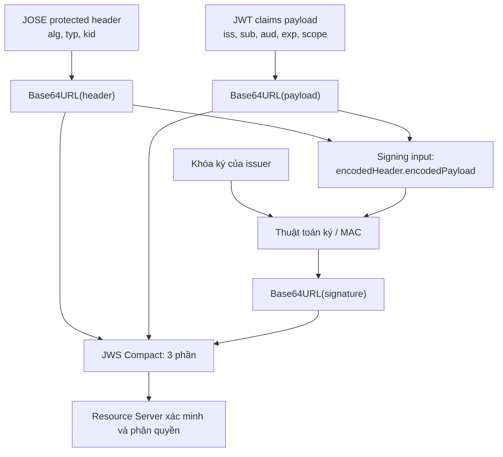
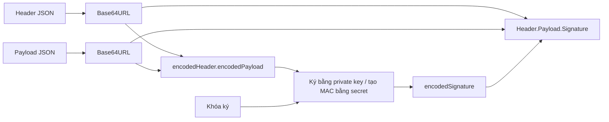
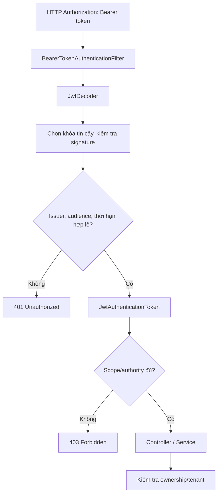
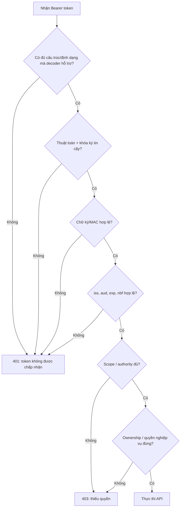

# JOSE header, payload và chữ ký

## 1. Vì sao phải hiểu cấu trúc token trước khi bảo vệ API?

Một Resource Server thường nhận access token khi Client gọi API:

```http
GET /api/orders/42 HTTP/1.1
Host: api.example.com
Authorization: Bearer <access-token>
```

Trong hệ thống dùng **JWT access token**, token thường có hình dạng gồm ba đoạn ngăn cách bởi dấu chấm:

```text
xxxxx.yyyyy.zzzzz
  1     2     3
```

Đây là cách biểu diễn phổ biến của **JWS Compact Serialization**: đoạn 1 chứa **JOSE protected header**, đoạn 2 chứa **payload**, đoạn 3 chứa **chữ ký** (signature). Từng đoạn là chuỗi Base64URL; dấu chấm đóng vai trò phân cách.

Sự phân tách này giúp API xử lý ba câu hỏi khác nhau:

1. **Header** mô tả cách token được bảo vệ bằng mật mã và gợi ý khóa xác minh.
2. **Payload** chứa những tuyên bố (claims) về chủ thể, nơi phát hành, đối tượng nhận, thời gian và quyền truy cập.
3. **Chữ ký** giúp bên nhận kiểm tra tính toàn vẹn và tính xác thực đối với khóa ký tin cậy.

Điều đặc biệt quan trọng: **đọc được payload không có nghĩa là token hợp lệ; chữ ký hợp lệ cũng không có nghĩa API phải cho phép truy cập**. Resource Server còn phải kiểm tra issuer, audience, thời hạn, scope và quyền trên tài nguyên cụ thể.

### Mục tiêu bài học

Sau khi học, bạn có thể:

- Phân biệt **JOSE, JWT, JWS, JWE** và lý do không phải mọi JWT đều có ba đoạn.
- Đọc các trường phổ biến `alg`, `typ`, `kid` của JOSE header.
- Giải thích claim trong payload và lý do Base64URL không bảo mật nội dung.
- Hiểu chính xác dữ liệu nào được ký, chữ ký chứng minh điều gì và giới hạn của nó.
- Mô tả cách Spring Security xác minh token khi đóng vai trò OAuth 2.0 Resource Server.
- Nhận ra một số lỗi triển khai khiến API chấp nhận token sai hoặc lộ dữ liệu.

## 2. JOSE, JWT, JWS và JWE liên quan như thế nào?

**JOSE** (JSON Object Signing and Encryption) là nhóm tiêu chuẩn biểu diễn thông tin mật mã dựa trên JSON. Những khái niệm quan trọng gồm:

| Khái niệm | Tên đầy đủ | Vai trò |
|---|---|---|
| **JOSE** | JSON Object Signing and Encryption | Hệ sinh thái quy tắc về chữ ký, mã hóa, khóa và thuật toán |
| **JWS** | JSON Web Signature | Bảo vệ tính toàn vẹn/xác thực dữ liệu bằng chữ ký hoặc MAC |
| **JWE** | JSON Web Encryption | Bảo mật nội dung qua mã hóa được xác thực |
| **JWK** | JSON Web Key | Biểu diễn khóa mật mã theo JSON |
| **JWKS** | JSON Web Key Set | Tập hợp các JWK, thường dùng để công bố khóa xác minh |
| **JWT** | JSON Web Token | Định dạng token mang tập claim dưới dạng JSON; thường được bảo vệ bằng JWS hoặc JWE |

**JWT mô tả nội dung token**, còn **JWS/JWE mô tả cách bảo vệ nội dung đó**.

Một JWT được ký phổ biến có dạng JWS Compact với **ba phần**:

```text
BASE64URL(protected-header).BASE64URL(payload).BASE64URL(signature)
```

Một JWT được mã hóa theo JWE Compact có **năm phần**:

```text
protected-header.encrypted-key.iv.ciphertext.authentication-tag
```

Các phần ở dạng Compact đều là biểu diễn Base64URL tương ứng với dữ liệu nhị phân hoặc JSON của chúng. JWT cũng có thể được lồng: ký trước, rồi mã hóa bên ngoài. Khi đó phải giải mã lớp ngoài theo đúng chính sách trước khi xác minh và xử lý nội dung bên trong.

> Bài này tập trung vào cấu trúc **JWT được ký bằng JWS Compact**, vốn thường gặp khi Resource Server nhận JWT access token. Không nên dùng quy tắc “JWT luôn có ba phần” để xử lý mọi biến thể JWT.

### Sơ đồ luồng dữ liệu



## 3. Phần thứ nhất: JOSE protected header

### 3.1. Header chứa những gì?

Ví dụ một header:

```json
{
  "alg": "RS256",
  "typ": "JWT",
  "kid": "signing-key-2026-11"
}
```

Đây là JSON thông thường **trước khi được mã hóa Base64URL**. Trong JWS Compact, toàn bộ protected header tham gia vào dữ liệu được ký: thay một ký tự trong header sẽ làm thay đổi signing input và khiến chữ ký cũ không còn hợp lệ.

Các trường thường gặp:

| Header parameter | Ý nghĩa | Cách Resource Server nên xử lý |
|---|---|---|
| `alg` | Thuật toán ký/MAC, ví dụ `RS256`, `ES256`, `HS256` | Chỉ chấp nhận thuật toán nằm trong chính sách đã cấu hình; không để token tự quyết định mức độ tin cậy |
| `typ` | Gợi ý loại đối tượng, ví dụ `JWT` hoặc `at+jwt` theo profile | Dùng khi profile quy định; không xem riêng `typ` là bằng chứng token được phép gọi API |
| `kid` | Định danh khóa, hỗ trợ tìm khóa phù hợp trong JWKS | Chỉ tìm trong nguồn khóa tin cậy; `kid` chưa được tin trước khi xác minh chữ ký |
| `cty` | Mô tả loại nội dung, hữu ích với cấu trúc lồng nhau | Chỉ diễn giải theo profile của hệ thống |
| `crit` | Liệt kê các extension header quan trọng cần được bên nhận hiểu | Từ chối nếu có extension bắt buộc mà bộ xác minh không hỗ trợ |

Một số JOSE header khác có thể xuất hiện như `jwk`, `jku`, `x5c` và `x5u`. Các trường đó có thể liên quan đến thông tin khóa hoặc chứng thư. **Không được tùy tiện tải khóa từ URL do token tự chỉ ra rồi xem khóa đó là đáng tin**: cách triển khai như vậy có thể dẫn đến chấp nhận token do kẻ tấn công tự ký hoặc tạo rủi ro truy cập mạng không mong muốn.

### 3.2. Vì sao `alg` cần được giới hạn?

`alg` là viết tắt của *algorithm*. Một số thuật toán JOSE phổ biến:

| `alg` | Họ thuật toán | Khóa ký | Khóa xác minh |
|---|---|---|---|
| `HS256` | HMAC-SHA-256 (MAC đối xứng) | Shared secret | Cùng shared secret |
| `RS256` | RSASSA-PKCS1-v1_5 với SHA-256 | RSA private key | RSA public key |
| `PS256` | RSASSA-PSS với SHA-256 | RSA private key | RSA public key |
| `ES256` | ECDSA P-256 với SHA-256 | EC private key | EC public key |
| `EdDSA` | Chữ ký EdDSA, phụ thuộc đường cong/khóa | Private key | Public key |

Các thuật toán thực sự hỗ trợ phụ thuộc thư viện, phiên bản framework và chính sách bảo mật. Không nên suy ra rằng mọi Resource Server đều hỗ trợ tất cả lựa chọn trên.

Với `RS256`, `PS256`, `ES256` hoặc các thuật toán ký bất đối xứng phù hợp, Authorization Server giữ **private key**; Resource Server chỉ cần public key để xác minh. Với `HS256`, bên ký và bên xác minh cùng biết secret. Vì ai nắm secret cũng có thể tạo MAC hợp lệ, HS256 cần thiết kế ranh giới tin cậy cẩn thận hơn khi có nhiều Resource Server.

Một giá trị JOSE tên `none` cũng tồn tại cho trường hợp không bảo vệ tính toàn vẹn bằng chữ ký. **Resource Server bảo vệ API bằng signed JWT không được chấp nhận `alg=none` như một token đã được xác thực.**

### 3.3. Vì sao `kid` không phải bằng chứng tin cậy?

Ví dụ JWKS tin cậy có các khóa `signing-key-2026-10` và `signing-key-2026-11`. Khi token có `kid=signing-key-2026-11`, Resource Server dùng giá trị đó để tìm public key phù hợp.

Nhưng header **được đọc trước khi chữ ký được xác minh**. Kẻ tấn công có thể gửi một token giả với `kid` bất kỳ. Vì vậy:

- `kid` chỉ là **gợi ý lựa chọn khóa**, không chứng minh token có nguồn gốc tin cậy.
- Khóa được chọn phải thuộc **JWKS/keystore đã cấu hình tin cậy**.
- Không sử dụng `kid` như đường dẫn file, câu truy vấn hoặc URL mà không ràng buộc đầu vào.
- Khi khóa luân chuyển (key rotation), bộ xác minh có thể làm mới JWKS theo cơ chế được kiểm soát.

## 4. Phần thứ hai: Payload và các JWT claims

### 4.1. Payload là gì?

Ví dụ payload của một access token:

```json
{
  "iss": "https://id.example.com/realms/shop",
  "sub": "user-417",
  "aud": ["orders-api"],
  "iat": 1893455100,
  "nbf": 1893455100,
  "exp": 1893456000,
  "jti": "tok-8df2a",
  "scope": "orders.read orders.write",
  "client_id": "shop-web"
}
```

Trong JWS Compact, đoạn payload là chuỗi Base64URL của các byte payload. Khi payload biểu diễn JWT Claims Set, các byte đó thông thường là UTF-8 của một JSON object.

Những claim thường gặp:

| Claim | Ý nghĩa | Kiểm tra liên quan |
|---|---|---|
| `iss` (*issuer*) | Định danh nơi phát hành token | Có khớp issuer đã tin cậy không? |
| `sub` (*subject*) | Chủ thể token nói đến | Chủ thể đó là ai theo hợp đồng của issuer? |
| `aud` (*audience*) | Những đối tượng nhận token | Token có được cấp cho chính API này không? |
| `exp` (*expiration time*) | Thời điểm token hết hạn | Thời điểm hiện tại đã vượt quá hạn chưa? |
| `nbf` (*not before*) | Không chấp nhận token trước thời điểm này | Token đã đến thời điểm có hiệu lực chưa? |
| `iat` (*issued at*) | Thời điểm token được phát hành | Dùng theo chính sách thời gian/tuổi token nếu có |
| `jti` (*JWT ID*) | Định danh JWT | Có thể hỗ trợ đối chiếu, chống phát lại hoặc thu hồi theo thiết kế |
| `scope` hoặc `scp` | Phạm vi OAuth được cấp | Có scope phù hợp endpoint không? |
| `client_id` | Định danh Client, nếu nhà phát hành đưa vào | Client này có phù hợp chính sách API không? |

`iss`, `sub`, `aud`, `exp`, `nbf`, `iat` và `jti` thuộc nhóm registered JWT claim names. `scope`, `scp` và `client_id` phụ thuộc OAuth profile/nhà phát hành; chúng không tự nhiên xuất hiện trong mọi JWT. Một số hệ thống còn đưa claim tùy biến như `tenant_id` hoặc `roles`.

Các mốc `exp`, `nbf` và `iat` thường sử dụng **NumericDate**, tính theo giây từ Unix epoch, không phải milliseconds của nhiều API lập trình. Ví dụ `1893456000` chỉ là mốc minh họa cho một token tương lai, **không phải token thật**.

`aud` có thể là một chuỗi hoặc mảng chuỗi theo cấu trúc JWT. Trong triển khai Spring Security, các claim đã được chuẩn hóa sẽ được truy cập bằng API của `Jwt`.

### 4.2. Payload không phải dữ liệu được mã hóa bí mật

Ví dụ `sub=user-417` được đưa vào payload, rồi Base64URL-encode. Bất cứ ai nắm token dạng JWS Compact đều có thể giải mã Base64URL để đọc giá trị này. **Base64URL là phép mã hóa biểu diễn dữ liệu, không phải encryption.**

Do đó, không đặt trực tiếp các thông tin như:

- Mật khẩu, private key, client secret hoặc API key.
- Thông tin cá nhân nhạy cảm không cần thiết cho Resource Server.
- Dữ liệu tài chính/bệnh án/nội dung nội bộ mà hệ thống không muốn bên nắm token đọc được.

Nếu phải giữ bí mật nội dung token với những bên không có quyền giải mã, cần lựa chọn phù hợp như **JWE**, hoặc thay đổi thiết kế token để tránh mang dữ liệu nhạy cảm. Dù token đã được ký, hãy bảo vệ Bearer token bằng HTTPS và tránh ghi token vào log.

### 4.3. Payload là tuyên bố, chưa phải sự thật được chấp nhận

Một payload tự khai `sub=admin` hay `scope=orders.write` không có ý nghĩa bảo mật khi chưa xác minh chữ ký/nguồn phát hành. Kẻ tấn công có thể tự tạo hai đoạn Base64URL đầu tiên rất dễ dàng.

Sau khi xác minh chữ ký, Resource Server vẫn cần kiểm tra:

- **Issuer:** đúng Authorization Server đã thỏa thuận.
- **Audience:** token thật sự được phát hành cho API.
- **Time validity:** `exp` và `nbf` phù hợp; độ lệch đồng hồ cho phép theo chính sách.
- **Scope/authorities:** đủ quyền cho endpoint và HTTP method.
- **Quyền trên tài nguyên:** người dùng có sở hữu đơn hàng này, đúng tenant, đúng trạng thái nghiệp vụ không?

Một JWT có chữ ký hợp lệ nhưng `aud=billing-api` không nên được `orders-api` nhận, kể cả cùng một nhà phát hành.

## 5. Phần thứ ba: Chữ ký được tạo ra thế nào?

### 5.1. Các byte nào được ký?

Với JWS Compact thông thường, trước tiên hệ thống tạo:

```text
encodedHeader  = BASE64URL(UTF8(JOSE protected header JSON))
encodedPayload = BASE64URL(payload bytes)

signingInput = ASCII(encodedHeader + "." + encodedPayload)
```

Sau đó ký `signingInput` bằng thuật toán `alg` được cấu hình và khóa ký phù hợp:

```text
signatureBytes  = SIGN_OR_MAC(signingInput, signingKey, algorithm)
encodedSignature = BASE64URL(signatureBytes)

compactJws = encodedHeader + "." + encodedPayload + "." + encodedSignature
```

Hình ảnh logic:



Chữ ký ràng buộc **đúng chuỗi biểu diễn header và payload đã ký**. Thay đổi `sub`, `exp`, `aud`, `scope` hoặc `alg` trong token mà không có khóa ký phù hợp sẽ khiến chữ ký không xác minh được.

Với JWS, thay đổi thứ tự field trong JSON hoặc khoảng trắng rồi mã hóa lại cũng có thể làm đổi signing input: bộ xác minh dựa trên các byte đã nhận, không tự chuẩn hóa JSON tùy ý để tạo lại chữ ký. Điều này giải thích vì sao không thể tùy tiện decode, sửa rồi encode mà vẫn giữ chữ ký cũ.

### 5.2. Ký và xác minh với `RS256`

Giả sử Authorization Server có RSA private key, còn Resource Server có RSA public key tương ứng:

1. Authorization Server tạo header chứa `alg=RS256` và một `kid` trỏ tới khóa ký.
2. Authorization Server tạo payload claim và biểu diễn hai phần đầu bằng Base64URL.
3. Nó ký signing input bằng **RSA private key** và thuật toán RS256.
4. Resource Server nhận ba đoạn, lấy public key tin cậy phù hợp với `kid`.
5. Resource Server xác minh chữ ký trên **đúng signing input**.
6. Nếu chữ ký đúng, nó tiếp tục kiểm tra issuer, audience, thời hạn và phân quyền.

Resource Server **không cần private key của Authorization Server** để xác minh RS256. Public key có thể được công bố trong JWKS để nhiều API cùng kiểm tra token mà không có khả năng tự ký token thay nhà phát hành.

### 5.3. Ký và xác minh với `HS256`

Với HS256, chữ ký ở đây là giá trị **HMAC-SHA-256**, không phải chữ ký số bất đối xứng. Bên ký và bên xác minh dùng chung một secret:

```text
macBytes = HMAC_SHA256(sharedSecret, signingInput)
```

Bên nắm secret không chỉ xác minh mà còn có thể tạo MAC hợp lệ. Vì vậy, nếu nhiều API cùng giữ shared secret, cần hiểu rõ hậu quả khi một API bị lộ khóa. Kiến trúc Authorization Server phát hành JWT cho nhiều Resource Server thường dùng thuật toán bất đối xứng để chỉ AS có private key.

**Không nhầm RSA public key với HMAC secret.** Việc để một token tự đổi `alg` từ RSA sang HMAC rồi đem RSA public key làm HMAC secret là một dạng lỗi *algorithm confusion* từng xuất hiện ở các bộ xác minh triển khai không đúng. Thư viện hiện đại và cấu hình thuật toán cho phép rõ ràng là lớp bảo vệ quan trọng.

### 5.4. Chữ ký chứng minh điều gì, và không chứng minh điều gì?

Chữ ký hợp lệ khi kết hợp với khóa tin cậy giúp kết luận rằng nội dung header/payload không bị thay đổi từ khi bên có khả năng ký tạo ra token theo thuật toán được chấp nhận.

Chữ ký **không tự chứng minh**:

- Token thuộc đúng Authorization Server, nếu API dùng sai hoặc quá nhiều khóa tin cậy.
- Token dành cho API này; cần ràng buộc `aud`.
- Token còn hạn; cần `exp`, `nbf` và quy tắc thời gian.
- Token chưa bị thu hồi; JWT ký hợp lệ có thể còn hiệu lực đến hết hạn nếu không có cơ chế thu hồi bổ sung.
- Người gọi được xem một đơn hàng cụ thể; cần scope và authorization ở tầng nghiệp vụ.
- Payload được giữ bí mật; JWS chỉ ký, không mã hóa.

## 6. Nhìn một JWT dạng ba phần từng bước

Cho header minh họa:

```json
{"alg":"RS256","typ":"JWT","kid":"shop-key-01"}
```

Và payload minh họa:

```json
{
  "iss": "https://id.example.com",
  "sub": "user-417",
  "aud": "orders-api",
  "scope": "orders.read",
  "exp": 1893456000
}
```

Sau khi encode từng phần và ký, token biểu diễn dưới dạng:

```text
BASE64URL(header).BASE64URL(payload).BASE64URL(signature)
```

Ba nhãn `BASE64URL(...)` trên là **mô tả cấu trúc, không phải chuỗi token hợp lệ**. Một JWT thật phải được tạo bởi thư viện JOSE với khóa/thuật toán phù hợp. Đừng dùng token minh họa trong yêu cầu API thực tế.

Nếu cần **quan sát dữ liệu bên trong mà không xác thực**, có thể dùng Java standard library để giải mã *chỉ hai phần đầu* của một JWS Compact:

```java
import java.nio.charset.StandardCharsets;
import java.util.Base64;

public class InspectJws {
    public static void main(String[] args) {
        String compactJws = args[0];
        String[] parts = compactJws.split("\\.", -1);

        if (parts.length != 3) {
            throw new IllegalArgumentException("Expected JWS Compact with 3 parts");
        }

        String header = new String(
            Base64.getUrlDecoder().decode(parts[0]),
            StandardCharsets.UTF_8
        );
        String payload = new String(
            Base64.getUrlDecoder().decode(parts[1]),
            StandardCharsets.UTF_8
        );

        System.out.println("UNVERIFIED header: " + header);
        System.out.println("UNVERIFIED payload: " + payload);
    }
}
```

Chương trình trên **chỉ để học cách biểu diễn Base64URL**; nó không xác minh chữ ký, không kiểm tra claim, không phân quyền. Không dùng kết quả `InspectJws` làm căn cứ xác thực request, không chạy với token thật trên máy/log không đáng tin, và không tự viết bộ xác minh JWT cho production.

### Base64 khác Base64URL ở đâu?

Base64URL được dùng để biểu diễn byte an toàn hơn trong URL và token:

| Base64 thường | Base64URL |
|---|---|
| Dùng ký tự `+` và `/` | Thay bằng `-` và `_` |
| Có thể kết thúc bằng dấu đệm `=` | JOSE Compact dùng dạng không có dấu đệm `=` |
| Không phù hợp trực tiếp với một số ngữ cảnh URL | Phù hợp dạng token ngắn gọn hơn |

Base64URL vẫn **đảo ngược được**, và bất kỳ ai có token đều có thể đọc header và payload nếu không có lớp mã hóa JWE.

## 7. JWKS, public key và luân chuyển khóa

Trong hệ thống OAuth 2.0/OIDC, Authorization Server thường công bố một **JWKS endpoint** chứa các JWK công khai, để Resource Server xác minh chữ ký JWT bất đối xứng.

Ví dụ mô phỏng cấu trúc (các giá trị khóa đã rút gọn và **không dùng để xác minh thật**):

```json
{
  "keys": [
    {
      "kty": "RSA",
      "use": "sig",
      "kid": "shop-key-01",
      "alg": "RS256",
      "n": "<rsa-modulus-base64url>",
      "e": "AQAB"
    },
    {
      "kty": "RSA",
      "use": "sig",
      "kid": "shop-key-02",
      "alg": "RS256",
      "n": "<new-rsa-modulus-base64url>",
      "e": "AQAB"
    }
  ]
}
```

Các trường thường thấy:

- `kty`: loại khóa như RSA, EC.
- `use`: mục đích sử dụng khóa, chẳng hạn `sig` cho chữ ký.
- `kid`: tên định danh giúp chọn khóa.
- `alg`: thuật toán liên quan nếu được công bố.
- `n` và `e`: thành phần public key của RSA; với EC sẽ có các trường khác phù hợp loại khóa.

**JWKS công khai phải chỉ chứa thông tin khóa có thể công bố.** Không đưa RSA private exponent hay bất kỳ private key, shared secret nào vào public JWKS.

### Khi Authorization Server đổi khóa

Một quy trình luân chuyển khóa có thể diễn ra như sau:

1. Authorization Server thêm public key mới vào JWKS, nhưng vẫn giữ public key cũ trong giai đoạn chuyển tiếp.
2. Authorization Server bắt đầu ký token mới bằng private key mới, gắn `kid` mới.
3. Resource Server gặp `kid` mới, làm mới cache JWKS theo chính sách và tìm khóa tương ứng.
4. Các token cũ còn hạn tiếp tục được xác minh bằng khóa cũ.
5. Sau giai đoạn thích hợp, nhà phát hành ngừng dùng và loại bỏ khóa cũ theo chính sách bảo mật.

Điểm cần lưu ý: **token không có quyền tự quyết định URL nhận public key**. Resource Server phải có issuer/JWKS tin cậy được cấu hình trước, xác minh thuật toán và danh tính khóa theo chính sách.

## 8. JOSE header và payload được Spring Security xử lý thế nào?

Spring Security OAuth2 Resource Server cung cấp cơ chế đọc Bearer token, xác thực JWT thông qua `JwtDecoder` và chuyển token đã xác minh thành `Authentication` để ứng dụng phân quyền.



### 8.1. Dependency và cấu hình issuer

Với ứng dụng Spring Boot + Gradle:

```groovy
dependencies {
    implementation 'org.springframework.boot:spring-boot-starter-web'
    implementation 'org.springframework.boot:spring-boot-starter-security'
    implementation 'org.springframework.boot:spring-boot-starter-oauth2-resource-server'
}
```

Ví dụ `application.yml`:

```yaml
spring:
  security:
    oauth2:
      resourceserver:
        jwt:
          issuer-uri: https://id.example.com/realms/shop
```

`issuer-uri` phải là **issuer thật và chính xác** mà Authorization Server công bố. Với hệ thống hỗ trợ metadata discovery, Spring Security có thể tìm JWKS endpoint và kiểm tra chữ ký, issuer và thời hạn theo các validator tương ứng.

**Chỉ có `issuer-uri` chưa có nghĩa là API đã kiểm tra audience hoặc quyền truy cập cụ thể.** Hãy thêm các quy tắc ứng dụng phù hợp.

### 8.2. Cấu hình endpoint dựa trên scope

```java
import org.springframework.context.annotation.Bean;
import org.springframework.context.annotation.Configuration;
import org.springframework.http.HttpMethod;
import org.springframework.security.config.Customizer;
import org.springframework.security.config.annotation.web.builders.HttpSecurity;
import org.springframework.security.config.http.SessionCreationPolicy;
import org.springframework.security.web.SecurityFilterChain;

@Configuration
public class SecurityConfig {

    @Bean
    SecurityFilterChain apiFilterChain(HttpSecurity http) throws Exception {
        return http
            .csrf(csrf -> csrf.disable())
            .sessionManagement(session -> session
                .sessionCreationPolicy(SessionCreationPolicy.STATELESS))
            .authorizeHttpRequests(authorize -> authorize
                .requestMatchers("/api/public/**").permitAll()
                .requestMatchers(HttpMethod.GET, "/api/orders/**")
                    .hasAuthority("SCOPE_orders.read")
                .requestMatchers(HttpMethod.POST, "/api/orders/**")
                    .hasAuthority("SCOPE_orders.write")
                .anyRequest().denyAll()
            )
            .oauth2ResourceServer(oauth2 ->
                oauth2.jwt(Customizer.withDefaults()))
            .build();
    }
}
```

Theo cách mapping phổ biến của Spring Security, các giá trị trong claim `scope` hoặc `scp` của JWT được chuyển thành authority với tiền tố `SCOPE_`. Ví dụ token có `scope="orders.read orders.write"` được gắn `SCOPE_orders.read` và `SCOPE_orders.write`.

Ví dụ trên giả định REST API chỉ sử dụng Bearer token trong header và không có xác thực qua cookie/session. Việc tắt CSRF **không áp dụng máy móc** cho ứng dụng dùng cookie xác thực hoặc các luồng trình duyệt có nguy cơ CSRF.

Sau khi scope đủ, Controller/Service vẫn phải kiểm tra ownership, tenant và quy tắc dữ liệu. Scope `orders.read` không cho phép đọc mọi đơn hàng.

### 8.3. Validator bổ sung cho audience

Giả sử Resource Server này chỉ nhận token có audience `orders-api`. Có thể tạo `JwtDecoder` với các validator mặc định về issuer và thời gian, cộng thêm validator audience:

```java
import org.springframework.context.annotation.Bean;
import org.springframework.context.annotation.Configuration;
import org.springframework.security.oauth2.core.DelegatingOAuth2TokenValidator;
import org.springframework.security.oauth2.core.OAuth2Error;
import org.springframework.security.oauth2.core.OAuth2TokenValidator;
import org.springframework.security.oauth2.core.OAuth2TokenValidatorResult;
import org.springframework.security.oauth2.jwt.Jwt;
import org.springframework.security.oauth2.jwt.JwtDecoder;
import org.springframework.security.oauth2.jwt.JwtDecoders;
import org.springframework.security.oauth2.jwt.JwtValidators;
import org.springframework.security.oauth2.jwt.NimbusJwtDecoder;

@Configuration
public class JwtValidationConfig {

    @Bean
    JwtDecoder jwtDecoder() {
        String issuer = "https://id.example.com/realms/shop";

        NimbusJwtDecoder decoder =
            (NimbusJwtDecoder) JwtDecoders.fromIssuerLocation(issuer);

        OAuth2TokenValidator<Jwt> issuerAndTime =
            JwtValidators.createDefaultWithIssuer(issuer);

        OAuth2TokenValidator<Jwt> audience = jwt ->
            jwt.getAudience().contains("orders-api")
                ? OAuth2TokenValidatorResult.success()
                : OAuth2TokenValidatorResult.failure(
                    new OAuth2Error("invalid_token", "Invalid audience", null));

        decoder.setJwtValidator(
            new DelegatingOAuth2TokenValidator<>(issuerAndTime, audience));

        return decoder;
    }
}
```

Ví dụ minh họa một cách cấu hình trên những phiên bản Spring Security phù hợp; dự án thực tế cần khớp phiên bản và cách cấu hình issuer/validator đang sử dụng. Không xóa kiểm tra mặc định khi tự bổ sung validator. Nếu issuer không cấp `aud` đúng `orders-api`, API sẽ phải từ chối token và cần sửa cấu hình phát hành ở Authorization Server, thay vì bỏ yêu cầu audience.

### 8.4. Đọc claim đã được xác minh trong Controller

```java
import java.util.Map;
import org.springframework.security.core.annotation.AuthenticationPrincipal;
import org.springframework.security.oauth2.jwt.Jwt;
import org.springframework.web.bind.annotation.GetMapping;
import org.springframework.web.bind.annotation.RestController;

@RestController
public class WhoAmIController {

    @GetMapping("/api/whoami")
    public Map<String, Object> whoAmI(@AuthenticationPrincipal Jwt jwt) {
        return Map.of(
            "subject", jwt.getSubject(),
            "issuer", jwt.getIssuer().toString(),
            "audience", jwt.getAudience()
        );
    }
}
```

Đoạn minh họa giả định token của endpoint chứa issuer, subject và audience phù hợp. Khi `Jwt` được cung cấp bởi Resource Server JWT authentication, claim đã trải qua quá trình xác thực token tương ứng; điều đó **không tự động xác lập quyền nghiệp vụ**. Endpoint `/api/whoami` cũng phải được cấp quy tắc truy cập phù hợp trong `SecurityFilterChain`; cấu hình `anyRequest().denyAll()` ở ví dụ trước sẽ từ chối endpoint này nếu chưa khai báo thêm.

## 9. Những tình huống sai thường gặp

| Triệu chứng hoặc sai lầm | Giải thích | Hướng xử lý |
|---|---|---|
| Dùng Base64URL decode payload rồi tin `sub` hoặc `scope` | Bất cứ ai cũng có thể tự tạo payload | Chỉ dùng claim sau khi chữ ký và nguồn phát hành được xác minh |
| Chấp nhận thuật toán `none` hoặc thuật toán tùy ý trong header | Kẻ tấn công có thể bỏ qua hoặc đánh lừa bước xác minh | Giới hạn thuật toán/khóa đáng tin tại bộ xác minh |
| Tin `kid`, `jku` hoặc `jwk` từ token để tự tạo nguồn tin cậy | Cho phép chọn khóa do kẻ tấn công kiểm soát | Chỉ dùng issuer/JWKS/keystore đã cấu hình |
| JWT có chữ ký hợp lệ nhưng sai `iss` | Token do một issuer khác phát hành | Kiểm tra issuer cố định/allowlist có chủ đích |
| JWT có chữ ký hợp lệ nhưng sai `aud` | Token được phát hành cho API khác | Kiểm tra audience của Resource Server |
| JWT đã hết hạn | Chữ ký vẫn có thể đúng nhưng token không còn hiệu lực | Kiểm tra `exp`, `nbf` và lệch giờ hợp lệ |
| Dùng ID token OIDC như access token | ID token phục vụ xác thực phía Client và thường có audience khác | Yêu cầu access token dành cho API |
| Cho rằng token ký số là bí mật | JWS payload có thể đọc được | Tránh chứa bí mật; cân nhắc JWE khi thật sự cần mã hóa |
| Có scope đọc nhưng xem được đơn hàng của người khác | Thiếu kiểm tra ownership/tenant | Kiểm tra quyền trên từng đối tượng dữ liệu |
| Public JWKS chứa private key | Lộ khả năng ký token | Chỉ công bố thành phần public key |
| Bản ký bằng khóa mới bị từ chối trong khi token cũ dùng được | Resource Server chưa có public key mới | Kiểm tra chính sách cập nhật JWKS và `kid` |

Một yêu cầu mang JWT có thể bị `401 Unauthorized` nếu token không được chấp nhận (sai chữ ký, issuer, audience, hết hạn). Nếu token hợp lệ nhưng thiếu `SCOPE_orders.read`, Resource Server thường trả `403 Forbidden`. Sau khi đã qua kiểm tra endpoint, tầng nghiệp vụ có thể vẫn từ chối nếu người dùng không sở hữu tài nguyên.

## 10. Minh họa một nỗ lực sửa payload

Giả sử token gốc có:

```json
{
  "sub": "user-417",
  "scope": "orders.read"
}
```

Một người khác có thể decode payload rồi tạo payload mới:

```json
{
  "sub": "admin",
  "scope": "orders.read orders.write"
}
```

Nếu họ ghép payload mới với **chữ ký cũ**, signing input đổi nên xác minh chữ ký thất bại. Nếu họ ký lại bằng khóa của họ, Resource Server vẫn phải từ chối vì khóa đó không thuộc nguồn phát hành tin cậy.

Điều này cho thấy lợi ích của JWS: bảo vệ tính toàn vẹn và chứng minh token gắn với khóa ký tin cậy. Nhưng nếu người tấn công đánh cắp **nguyên vẹn Bearer token hợp lệ**, chữ ký không tự ngăn họ dùng lại token. Vì vậy cần HTTPS, quản lý token an toàn, thời hạn thích hợp và cơ chế giảm rủi ro phát lại/thu hồi khi nghiệp vụ yêu cầu.

## 11. Cách phân tích một lỗi JWT theo lớp

Khi API nhận token nhưng phản hồi lỗi, hãy xác định lỗi thuộc lớp nào:



Với JWT dạng JWS, phân tích kỹ:

- **Header:** `alg` có nằm trong tập cho phép? `kid` có khóa công khai tin cậy tương ứng?
- **Chữ ký:** thư viện xác minh bằng đúng thuật toán và khóa được phép không?
- **Claim:** issuer có khớp? audience có trỏ tới API? Token còn hạn?
- **Authority:** scope được mapping đúng thành `SCOPE_...` trong Spring Security?
- **Nghiệp vụ:** người dùng hoặc dịch vụ có quyền với đối tượng thật không?

Tránh ghi toàn bộ JWT vào log vì token có thể chứa dữ liệu nhận diện và bản thân Bearer token là thông tin có thể bị sử dụng lại. Khi cần chẩn đoán, ưu tiên log mã lỗi, correlation ID và những trường đã được che hoặc được phép ghi.

## 12. Câu hỏi tự kiểm tra

**Câu 1.** Vì sao có thể đọc payload JWT mà vẫn chưa thể kết luận token hợp lệ?

**Đáp án:** Payload JWS Compact chỉ được Base64URL-encode. Phải xác minh chữ ký và những claim như issuer, audience, thời hạn rồi mới được dựa vào token để ra quyết định.

**Câu 2.** Nếu payload thay `scope` từ `orders.read` thành `orders.write`, chữ ký cũ có còn hợp lệ không?

**Đáp án:** Không. Payload đã thay đổi khiến signing input khác, nên chữ ký của dữ liệu trước đó không còn phù hợp.

**Câu 3.** Vì sao `kid` không tự chứng minh token đáng tin?

**Đáp án:** `kid` ở header có thể được đọc trước bước xác minh và có thể do người gửi tự đặt. API phải dùng nó để chọn **khóa đã cấu hình tin cậy**, không tự tin tưởng khóa hoặc URL do token chỉ định.

**Câu 4.** JWT có chữ ký hợp lệ từ issuer tin cậy, `scope=orders.read` nhưng `aud=billing-api`. `orders-api` có nên chấp nhận không?

**Đáp án:** Không. Token dành cho `billing-api`; Resource Server phải kiểm tra audience của chính mình.

**Câu 5.** JWT có ba phần và JWE Compact có bao nhiêu phần?

**Đáp án:** JWT được ký dạng JWS Compact thường có **ba phần**; JWE Compact được mã hóa có **năm phần**. JWT không mặc định chỉ có một kiểu bảo vệ.

**Câu 6.** Public key để xác minh RS256 có được công bố qua JWKS không? Private key thì sao?

**Đáp án:** Public key có thể công bố để Resource Server xác minh chữ ký. Private key phải được giữ bí mật ở bên phát hành token, không đưa lên public JWKS.

## 13. Kết luận

Một JWT access token được bảo vệ bằng JWS Compact có ba phần: **JOSE protected header**, **payload** và **signature**. Header mô tả thuật toán/khóa; payload chứa các claim; chữ ký gắn toàn vẹn header và payload với khóa ký.

Khi Spring Security đóng vai trò Resource Server, nhiệm vụ không dừng ở việc tách ba đoạn hay decode JSON. API phải **chọn khóa và thuật toán đáng tin → xác minh chữ ký → kiểm tra issuer, audience, thời hạn → kiểm tra scope → thực thi phân quyền nghiệp vụ**. Chỉ sự kết hợp đó mới cho phép Resource Server tin vào thông tin token ở đúng mức cần thiết và bảo vệ API.
