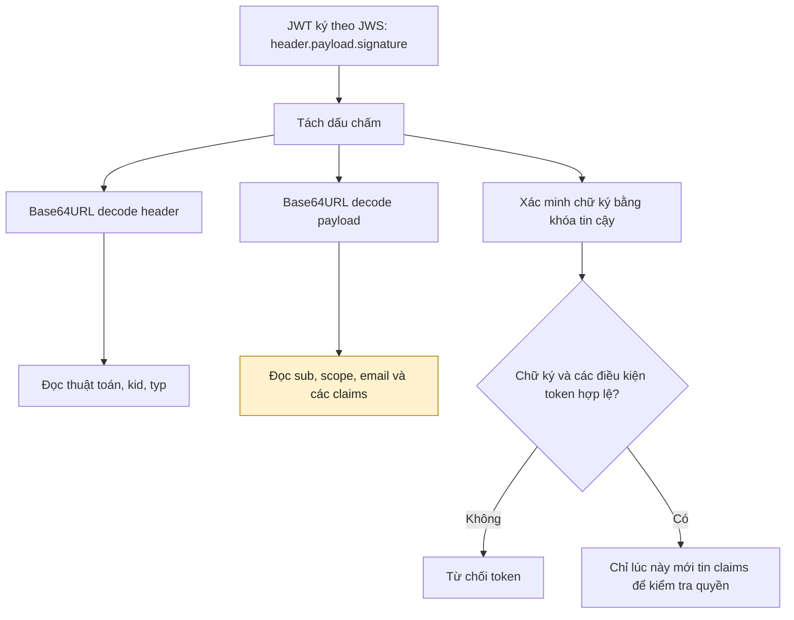

# Chữ ký bảo vệ toàn vẹn nhưng không che nội dung claims

Khi sử dụng **JWT** trong hệ thống **Spring Security OAuth 2.0 / OpenID Connect (OIDC) Resource Server**, một hiểu lầm phổ biến là: “JWT đã được ký số nên các thông tin bên trong được bảo mật, người ngoài không thể đọc được”. Điều này **không đúng với JWT được ký theo JWS**.

**Chữ ký bảo vệ tính toàn vẹn và cho phép kiểm tra nguồn phát hành theo khóa tin cậy. Chữ ký không mã hóa payload.** Bất kỳ ai có chuỗi JWT dạng JWS thông thường đều có thể giải mã phần payload bằng Base64URL để **đọc claims**, không cần khóa ký hay khóa xác minh. Người đó không thể tự ý sửa claims mà vẫn vượt qua kiểm tra chữ ký đúng cách, nhưng **đọc được** là hai việc khác nhau.

Bài học này tập trung vào sự khác nhau giữa **ký** và **mã hóa**, liên hệ với **JWT/JWS/JWE** trong họ tiêu chuẩn **JOSE**, và rút ra các quyết định thiết kế thực tế cho API dùng Spring Security Resource Server.

## 1. Ba thuộc tính an toàn cần phân biệt

| Thuộc tính | Câu hỏi cần trả lời | Cơ chế điển hình |
|---|---|---|
| **Confidentiality — tính bí mật** | Ai có thể **đọc nội dung**? | Mã hóa; hạn chế nơi token xuất hiện; kiểm soát quyền truy cập |
| **Integrity — tính toàn vẹn** | Nội dung có bị **thay đổi** ngoài ý muốn/không được phép không? | Chữ ký số, MAC, authenticated encryption |
| **Authenticity — xác thực nguồn gốc** | Dữ liệu có do **bên giữ khóa tin cậy** tạo ra không? | Xác minh chữ ký/MAC bằng khóa được cấu hình đúng; kiểm tra issuer và chính sách |

Ví dụ: token chứa claim `"role": "user"`.

- **Đọc trộm:** người nhận được chuỗi JWS có thể giải mã payload, thấy `role=user` và các claim khác. Chữ ký **không ngăn việc đọc**.
- **Sửa trộm:** kẻ tấn công thay `role=user` thành `role=admin`. Nội dung có thể được mã hóa lại thành Base64URL, nhưng **chữ ký cũ không còn hợp lệ**. Resource Server xác minh đúng sẽ từ chối.
- **Giả mạo:** kẻ tấn công tạo một JWT mới ghi `iss` và `role=admin`. Không sở hữu khóa ký được tin cậy thì không tạo được chữ ký hợp lệ tương ứng; API còn phải kiểm tra issuer, audience, thời hạn, quyền và những điều kiện cần thiết khác.

> **Điểm mấu chốt:** “Không sửa được một cách hợp lệ” hoàn toàn khác với “không nhìn thấy nội dung”.

## 2. JWT, JWS và JWE liên hệ với nhau thế nào?

**JOSE (JSON Object Signing and Encryption)** là họ tiêu chuẩn mô tả cách ký, xác minh, mã hóa và biểu diễn khóa cho dữ liệu JSON hoặc dữ liệu liên quan. Một số khái niệm thường gặp:

| Thuật ngữ | Vai trò |
|---|---|
| **JWT (JSON Web Token)** | Định dạng truyền một tập **claims** giữa các bên. JWT có thể được bảo vệ bằng JWS hoặc JWE; các claim không tự động bí mật. |
| **JWS (JSON Web Signature)** | Cơ chế bảo vệ tính toàn vẹn và xác minh bên nắm khóa ký đối với nội dung. Với Compact Serialization thường là **3 đoạn**. |
| **JWE (JSON Web Encryption)** | Cơ chế mã hóa nội dung để chỉ bên có khả năng giải mã được xem plaintext; Compact Serialization thường là **5 đoạn**. |
| **JWK / JWKS (JSON Web Key / Key Set)** | Cách biểu diễn khóa và tập khóa; Resource Server thường tải các **public keys** của issuer qua JWKS để xác minh JWS. |
| **JWA (JSON Web Algorithms)** | Tên/định nghĩa thuật toán như `RS256`, `ES256`, `PS256`, `HS256` hoặc các thuật toán mã hóa dùng trong JWE. |

Trong OAuth 2.0 và OIDC:

- **Access token** *có thể* được phát hành dưới dạng JWT được ký (JWS), JWT được mã hóa (JWE), hoặc token **opaque**. Resource Server phải biết mình đang nhận loại nào.
- **ID token** của OIDC là JWT. Nó thường được ký và trong một số cấu hình có thể được mã hóa.
- **Refresh token** và **authorization code** không mặc định là JWT; đừng áp dụng giả định “tách ba đoạn” cho mọi credential.

Một JWT được ký **không đồng nghĩa** một JWT được mã hóa. Chọn cơ chế dựa vào mục tiêu bảo vệ: kiểm tra tính hợp lệ, che nội dung, hoặc cần cả hai.

## 3. Vì sao JWT được ký vẫn đọc được?

### 3.1. Cấu trúc JWS Compact Serialization

Dạng JWS Compact thông thường có cấu trúc:

```text
BASE64URL(header).BASE64URL(payload).BASE64URL(signature)
          1                  2                  3
```

Ba đoạn được ngăn bằng dấu chấm (`.`). Với JWT được ký:

**Header** mô tả thuật toán và có thể chứa mã nhận diện khóa:

```json
{
  "alg": "RS256",
  "typ": "at+jwt",
  "kid": "signing-key-2026-01"
}
```

**Payload** chứa claim set, ví dụ với access token dành cho Orders API:

```json
{
  "iss": "https://login.example.com",
  "sub": "user-42",
  "aud": "orders-api",
  "exp": 2000000000,
  "iat": 1999996400,
  "scope": "orders.read",
  "email": "user@example.com",
  "department": "sales"
}
```

Những giá trị trên chỉ để minh họa. Claim nào xuất hiện phụ thuộc Authorization Server và loại token. `typ=at+jwt` chỉ là một ví dụ về kiểu access token JWT; không phải issuer nào cũng sử dụng nó.

**Signature** là kết quả thuật toán ký/MAC trên dữ liệu tương ứng với header và payload. Đối với JWS với payload Base64URL thông thường:

```text
encodedHeader  = BASE64URL(UTF8(headerJson))
encodedPayload = BASE64URL(UTF8(payloadJson))
signingInput   = ASCII(encodedHeader + "." + encodedPayload)
signature      = SIGN(signingInput, signingKey)
compactJws     = encodedHeader + "." + encodedPayload
                 + "." + BASE64URL(signature)
```

`BASE64URL` là **phép mã hóa biểu diễn dữ liệu (encoding)** để chuyển bytes thành ký tự an toàn khi đưa vào URL hoặc HTTP. Nó **không phải mã hóa bảo mật (encryption)**:

- Không dùng secret key.
- Ai có chuỗi cũng có thể đảo ngược Base64URL.
- Header và payload đọc được mà **không cần xác minh signature trước**.
- Signature bảo vệ sự ràng buộc giữa các bytes đã ký và khóa ký, **không làm nội dung của hai đoạn trước trở nên bí mật**.

### 3.2. Minh họa đường đi của dữ liệu



Hai đường xử lý khác nhau:

1. **Đọc nội dung**: chỉ cần chuỗi token, có thể thực hiện ngay ở trình duyệt hoặc máy tính bất kỳ.
2. **Tin nội dung**: cần xác minh signature, issuer, audience, thời hạn và điều kiện bảo mật liên quan **trước khi** dựa vào claims để cho phép truy cập.

Một công cụ “JWT decoder” hiển thị claims không có nghĩa nó đã xác minh token. Giao diện đọc được JSON không chứng minh token được phát hành bởi hệ thống đáng tin.

### 3.3. Ví dụ Java: đọc payload mà không có khóa

Đoạn Java chuẩn dưới đây chỉ **minh họa khả năng đọc**, không xác thực token và **tuyệt đối không dùng làm bộ kiểm tra bảo mật**:

```java
import java.nio.charset.StandardCharsets;
import java.util.Base64;

public class JwtPayloadInspector {
    public static void main(String[] args) {
        if (args.length != 1) {
            throw new IllegalArgumentException("Cung cap mot JWT JWS mau");
        }

        // split với limit âm giữ lại phần tử rỗng nếu có.
        String[] parts = args[0].split("\\.", -1);
        if (parts.length != 3) {
            throw new IllegalArgumentException(
                "Vi du nay chi minh hoa JWS compact 3 doan"
            );
        }

        String payloadJson = new String(
            Base64.getUrlDecoder().decode(parts[1]),
            StandardCharsets.UTF_8
        );

        // Không in JWT thật có dữ liệu nhạy cảm vào log/terminal chia sẻ.
        System.out.println(payloadJson);
    }
}
```

Chương trình không nhận `public key`, `private key` hoặc `secret`; vậy mà vẫn đọc được JSON bên trong JWS. Nó **không biết** chữ ký hợp lệ hay chưa, `iss` có đáng tin hay không, `aud` có đúng API hay không, hoặc token có hết hạn không. Đó là lý do **decode không phải verify**.

Chỉ sử dụng token mẫu trong môi trường kiểm soát khi minh họa. Không dán token sản xuất vào website giải mã JWT không được tổ chức phê duyệt: ngoài việc lộ claims, **bản thân bearer token** cũng có thể bị đánh cắp.

## 4. Kẻ tấn công có thể đọc, sửa, hoặc sử dụng token đến mức nào?

Giả sử người ngoài lấy được một access token **được ký**:

| Hành động | Có thể xảy ra? | Tại sao? |
|---|---|---|
| Giải mã header/payload để xem `email`, `sub`, `scope` | **Có** | Base64URL công khai, không có bước giải mã bằng khóa. |
| Thay `scope` thành `admin` và tự Base64URL-encode lại | **Có thể tạo chuỗi giả**, nhưng kiểm tra hợp lệ phải **thất bại** | Bytes được ký đã thay đổi; chữ ký cũ không khớp. |
| Tạo chữ ký mới bằng public key của issuer | **Không** với thuật toán chữ ký bất đối xứng được dùng đúng | Public key xác minh, không thể tạo chữ ký như private key. |
| Dùng token bị lấy cắp để gọi API khi token còn hiệu lực | **Có thể** với bearer token không ràng buộc người gửi | Kẻ nắm token có thể trình token như client hợp lệ, trong phạm vi quyền hiện có. |
| Đọc dữ liệu nhạy cảm bên trong token vì URL dùng HTTPS | **Có**, nếu đã có token ở một vị trí khác | HTTPS bảo vệ đường truyền, không mã hóa nội dung JWT khi token được lưu ở nơi khác. |

**Điều cần nhấn mạnh:** chữ ký giúp API phát hiện token bị sửa; nó **không ngăn bị lộ thông tin** và cũng **không tự chống phát lại bearer token bị đánh cắp**. Muốn giảm rủi ro bị lạm dụng token cần thêm HTTPS, giới hạn thời gian/scope/audience, bảo vệ nơi lưu và khi phù hợp có cơ chế ràng buộc người gửi (sender-constrained tokens, ví dụ DPoP hoặc mTLS).

### Chữ ký bảo vệ được điều gì cụ thể?

- Với `RS256`, `ES256`, `PS256`, issuer ký bằng **private key**, resource server xác minh bằng **public key** đã xác định là đáng tin.
- Với `HS256`, chữ ký trong JWS là **MAC** dựa trên **shared secret**; bên xác minh cũng biết secret và về mặt kỹ thuật có thể tạo MAC. Không coi MAC là bằng chứng riêng chỉ issuer sở hữu private key như chữ ký bất đối xứng.
- Cả hai mô hình đều cần **phân phối và bảo vệ khóa** đúng cách. Một JWT tự khai `alg` hoặc `kid` không có quyền tự quyết định thuật toán/khóa nào API sẽ tin.

Nếu khóa ký bị lộ, signature không còn bảo vệ được khỏi kẻ có khóa. Nếu API bỏ qua xác minh hoặc chấp nhận sai thuật toán, kẻ tấn công có thể tạo token giả. Vì vậy **độ mạnh chữ ký** phụ thuộc cả cơ chế xác minh và quản lý khóa, chứ không nằm ở việc chuỗi token có đoạn thứ ba.

## 5. Nội dung claims nào dễ bị lộ?

Trong JWT, **claim** là cặp tên–giá trị mô tả chủ thể, đối tượng nhận, thời gian hoặc dữ liệu ứng dụng. Các claim điển hình:

| Claim | Ý nghĩa | Cân nhắc về tính bí mật |
|---|---|---|
| `iss` | Issuer của token | Thường không phải bí mật, nhưng tiết lộ hệ thống định danh đang dùng. |
| `sub` | Định danh chủ thể | Có thể dùng liên kết hành vi qua dịch vụ; không tự động vô hại. |
| `aud` | Audience được phép nhận token | Thể hiện dịch vụ/ứng dụng đích, có thể lộ cấu trúc hệ thống. |
| `exp`, `iat`, `nbf` | Thời gian hết hạn, phát hành, bắt đầu hiệu lực | Không thường là bí mật, nhưng có thể tiết lộ vòng đời token. |
| `scope` hoặc `scp` | Quyền được cấp | Là metadata quyền; người có token xem được phạm vi mà client có thể làm. |
| `roles`, `groups` | Vai trò, nhóm | Có thể tiết lộ cấu trúc tổ chức và quyền nội bộ. |
| `email`, `name`, `phone_number`, `address` | Dữ liệu cá nhân | **Không nên nhúng nếu API không cần**; đọc được từ JWS. |
| `department`, `customer_id`, `tenant_id` | Dữ liệu nghiệp vụ/định danh | Cần đánh giá tác động riêng tư, rò rỉ dữ liệu hoặc liên kết thông tin. |
| Mật khẩu, OTP, khóa API, private key, refresh token | Bí mật có thể cấp quyền/khôi phục quyền | **Không đưa vào claims của access token/ID token** chỉ để “tiện dùng”. |

Ngay cả khi chỉ có `sub`, việc nhiều dịch vụ nhìn thấy cùng một định danh cố định vẫn có thể tạo khả năng đối chiếu người dùng. Nếu không cần liên kết chéo, cân nhắc cơ chế định danh theo audience/pairwise subject phù hợp với nhà cung cấp OIDC và mô hình ứng dụng.

Các nguyên tắc thực tế:

1. **Tối thiểu hóa claims**: token chỉ chứa thông tin thực sự cần cho kiểm tra quyền hoặc hoạt động giao thức.
2. **Ưu tiên tham chiếu nội bộ**: thay vì đưa hồ sơ cá nhân đầy đủ, có thể dùng định danh ít tiết lộ rồi lấy chi tiết qua API có phân quyền.
3. **Đánh giá audience và người sẽ thấy token**: frontend, API gateway, proxy, đối tác và công cụ chẩn đoán có thể cùng tiếp xúc với token.
4. **Không lấy việc “đã ký” làm lý do đưa dữ liệu nhạy cảm vào token**.
5. **Không hiển thị hoặc ghi log toàn bộ token/claims** ở ứng dụng, gateway, analytics, tracing, crash report hoặc ticket hỗ trợ.

Lưu ý: che claims không đồng nghĩa token an toàn để chia sẻ. Ngay cả access token **opaque** không có payload đọc được cũng là bearer credential nhạy cảm.

## 6. HTTPS có che claims hay không?

**HTTPS/TLS che lưu lượng trên đường truyền** giữa hai điểm kết nối TLS, giúp kẻ nghe lén mạng thông thường không đọc được token đang truyền. Tuy nhiên TLS và chữ ký JWT hoạt động ở **hai lớp khác nhau**:

- **TLS bảo vệ lúc truyền:** từ client đến server/gateway kết thúc TLS.
- **JWS bảo vệ nội dung trước việc bị sửa:** cơ chế xác minh có thể được thực hiện sau khi token được chuyển qua các hệ thống.
- **Không cái nào tự giải quyết tất cả vấn đề bảo mật lúc lưu trữ:** token trong browser storage, log, memory dump, crash report, database, message queue hoặc telemetry vẫn có thể bị đọc nếu những nơi đó bị truy cập không phù hợp.

Ví dụ ứng dụng gọi API bằng header:

```http
GET /api/orders HTTP/1.1
Host: api.example.com
Authorization: Bearer ACCESS_TOKEN_VALUE
```

Nếu kết nối dùng HTTPS, dữ liệu header được bảo vệ trên đường truyền. Nhưng:

- Browser/client giữ access token để gửi đi: ứng dụng, extension được cấp quyền, mã JavaScript bị XSS hoặc môi trường bị xâm nhập có thể khiến token lộ tùy mô hình lưu trữ và quyền truy cập.
- Reverse proxy có thể kết thúc TLS trước ứng dụng: token tồn tại dưới dạng plaintext ở điểm xử lý hợp lệ này.
- Logging middleware hoặc tracing có thể vô tình ghi nguyên header `Authorization`.
- Nếu token bị lộ khỏi nơi lưu, kẻ lấy được có thể **đọc claims** bất kể request trước đó có dùng HTTPS.

Chính vì vậy cần bảo vệ cả **quá trình phát hành**, **truyền**, **sử dụng**, **lưu**, **giám sát** và **thu hồi/giảm hạn mức token**.

## 7. Khi cần che nội dung: JWE và các lựa chọn khác

### 7.1. JWE dùng để làm gì?

**JWE** cung cấp tính bí mật bằng mã hóa nội dung cho đối tượng có khả năng giải mã. Dạng JWE Compact thường có **năm đoạn**:

```text
BASE64URL(protected-header).
BASE64URL(encrypted-key).
BASE64URL(iv).
BASE64URL(ciphertext).
BASE64URL(authentication-tag)
```

Đối với các cách mã hóa được thiết kế và triển khai đúng:

- Người không có khả năng giải mã **không thể đọc payload plaintext** chỉ bằng Base64URL decode.
- Phần **protected header của JWE vẫn nhìn thấy được**, vì header này không được mã hóa cùng ciphertext.
- **Authenticated encryption** trong JWE bảo vệ tính toàn vẹn của ciphertext và dữ liệu liên quan theo thuật toán. Tuy nhiên nó không tự mang ý nghĩa “được issuer ký” bằng private key giống JWS trong mọi cấu hình.
- Bên được phép giải mã vẫn nhìn thấy toàn bộ claims sau khi giải mã. Vậy nên **giảm claims nhạy cảm vẫn cần thiết**.

Khi cần cả **chữ ký của issuer** và **mã hóa để che claims**, một mô hình là **nested JWT**:

```text
JWT claims
   │
   ▼
JWS: ký claims bằng khóa của issuer
   │
   ▼
JWE: mã hóa JWS cho bên nhận
   │
   ▼
Bên nhận giải mã JWE → xác minh JWS → xác minh claims
```

Cơ chế **sign-then-encrypt** phải được các bên thống nhất trong hợp đồng giao thức: thuật toán hỗ trợ, khóa, đối tượng nhận, cách xử lý nested JWT và điều kiện xác minh. Không giả định thêm một lớp mã hóa là tự động đủ để xác minh issuer/audience/authorization.

### 7.2. JWE có phải lựa chọn mặc định?

Không nhất thiết. JWE tăng độ phức tạp quản lý khóa, giải mã, tích hợp và vận hành. Tùy rủi ro, có thể chọn:

| Nhu cầu | Hướng thiết kế |
|---|---|
| API cần xác minh quyền, không cần dữ liệu bí mật trong claims | **JWT/JWS có claims tối thiểu**; xác minh đầy đủ và bảo vệ bearer token. |
| Hạn chế người trung gian/client đọc metadata nhạy cảm được nhúng trong token | **JWE** cho bên nhận phù hợp, hoặc **không đưa metadata đó vào token**. |
| Không muốn chuyển claims đến nhiều thành phần | **Opaque access token + introspection**, với cơ chế cache, quyền và xác minh metadata phù hợp. |
| Cần hồ sơ cá nhân chi tiết sau khi đăng nhập | Lấy qua endpoint chuyên trách được phân quyền khi cần, thay vì nhúng mọi trường vào ID/access token. |
| Có cả yêu cầu xác nhận issuer và bí mật payload | Thiết kế kết hợp **ký + mã hóa** theo chuẩn và hỗ trợ thực tế của issuer/recipient. |

**Một lưu ý về opaque token:** chuỗi opaque không cho client đọc sẵn claims theo định dạng tiêu chuẩn, nhưng không đảm bảo dữ liệu metadata không bị lộ từ introspection response hoặc hệ thống sử dụng. Nó cũng không thay thế cơ chế bảo vệ bearer token.

## 8. Liên hệ trực tiếp với Spring Security Resource Server

Spring Security Resource Server **kiểm tra access token** trước khi cho phép request truy cập endpoint. Với JWT ký theo JWS, Resource Server thường xác minh chữ ký bằng public key được tìm từ JWKS của issuer, kiểm tra các claim quan trọng và chuyển scope thành authority.

### 8.1. Ví dụ cấu hình JWT Resource Server

Ứng dụng Spring Boot 3.x với Spring Security 6.x thường cần các starter:

```groovy
dependencies {
    implementation 'org.springframework.boot:spring-boot-starter-web'
    implementation 'org.springframework.boot:spring-boot-starter-security'
    implementation 'org.springframework.boot:spring-boot-starter-oauth2-resource-server'
}
```

Ví dụ `application.yml`:

```yaml
spring:
  security:
    oauth2:
      resourceserver:
        jwt:
          issuer-uri: https://login.example.com
          audiences:
            - orders-api
```

Mục tiêu của cấu hình:

- `issuer-uri` chỉ định issuer tin cậy; khi hỗ trợ discovery theo chuẩn, Spring tìm metadata và địa chỉ khóa JWK cần thiết.
- Khi các phiên bản Spring Boot/Spring Security đang dùng hỗ trợ `audiences`, thuộc tính này giúp kiểm tra JWT được phát hành cho `orders-api`. Nếu phiên bản không hỗ trợ, cần cấu hình `OAuth2TokenValidator<Jwt>` để kiểm tra `aud`.
- Chữ ký hợp lệ mới là **một điều kiện**. API vẫn phải kiểm tra thời hạn, audience, scope/authority và quyền nghiệp vụ.

Ví dụ cấu hình endpoint trong Spring Security 6:

```java
package com.example.orders;

import org.springframework.context.annotation.Bean;
import org.springframework.context.annotation.Configuration;
import org.springframework.http.HttpMethod;
import org.springframework.security.config.Customizer;
import org.springframework.security.config.annotation.web.builders.HttpSecurity;
import org.springframework.security.web.SecurityFilterChain;

@Configuration
public class ApiSecurityConfiguration {

    @Bean
    SecurityFilterChain apiSecurityFilterChain(HttpSecurity http)
            throws Exception {
        return http
            .authorizeHttpRequests(auth -> auth
                .requestMatchers(HttpMethod.GET, "/api/orders/**")
                    .hasAuthority("SCOPE_orders.read")
                .anyRequest().authenticated()
            )
            .oauth2ResourceServer(oauth2 ->
                oauth2.jwt(Customizer.withDefaults())
            )
            .build();
    }
}
```

Tùy issuer, claim `scope` hoặc `scp` có thể được chuyển thành authorities `SCOPE_*` theo quy ước mặc định. Ví dụ `orders.read` thường thành `SCOPE_orders.read`. Nếu nhà cung cấp có cách biểu diễn quyền riêng, cần chỉnh `JwtAuthenticationConverter`. Điều này là **mapping quyền**, không phải cơ chế che claims.

### 8.2. Claim đã xác minh có thể được ứng dụng đọc

Sau khi Resource Server xác minh token, Spring Security có thể cung cấp đối tượng `Jwt` cho controller:

```java
import org.springframework.security.core.annotation.AuthenticationPrincipal;
import org.springframework.security.oauth2.jwt.Jwt;
import org.springframework.web.bind.annotation.GetMapping;
import org.springframework.web.bind.annotation.RestController;
import java.util.Map;

@RestController
public class ProfileController {

    @GetMapping("/api/my-subject")
    public Map<String, Object> mySubject(
            @AuthenticationPrincipal Jwt jwt) {
        // Chỉ trả thông tin thực sự cần thiết, không trả toàn bộ claims.
        return Map.of("subject", jwt.getSubject());
    }
}
```

Đây là cách dùng claims **sau khi** Spring Security đã xác minh access token, với điều kiện endpoint được bảo vệ phù hợp và issuer có `sub` theo hợp đồng. Dù Spring kiểm tra chữ ký, các claim trong JWT vẫn **không tự được mã hóa**. Tránh kiểu logging dưới đây khi token thật có thể chứa dữ liệu riêng tư:

```java
// KHÔNG NÊN: có nguy cơ làm lộ thông tin cá nhân và metadata quyền
// log.info("JWT claims: {}", jwt.getClaims());
// log.debug("Authorization header: {}", authorizationHeader);
```

Thay vào đó, log các thông tin cần thiết cho vận hành (request ID, kết quả xác minh, loại lỗi, endpoint), không ghi raw bearer token. Nếu phải gắn danh tính để điều tra, xem xét định danh nội bộ đã được giảm độ nhạy/masking và chính sách lưu trữ.

### 8.3. Chữ ký hợp lệ có đủ để chấp nhận token không?

**Không.** Giả sử API nhận một token được ký đúng bởi `https://login.example.com` nhưng:

- `aud` là `billing-api`, không phải `orders-api`;
- `exp` đã hết hạn;
- `scope` không chứa `orders.read`;
- token là ID token với `aud` trỏ đến OIDC client;
- token thuộc tenant khác hoặc người dùng không có quyền xem đơn hàng được yêu cầu.

Resource Server vẫn phải từ chối hoặc chặn hành động theo điều kiện tương ứng. **Ký đúng** chỉ xác nhận tính toàn vẹn và bằng chứng liên quan đến khóa ký; nó **không cấp mọi quyền truy cập**.

Đặc biệt, một **ID token được ký** có thể có cùng định dạng JWS ba đoạn như access token. Điều đó không biến ID token thành access token cho API. API cần chấp nhận đúng **loại token**, **audience** và **quyền** do giao thức và hệ thống quy định.

### 8.4. Resource Server có giải mã JWE tự động không?

Cấu hình thông thường `oauth2ResourceServer().jwt()` của Spring Security hướng đến việc **xác minh JWT được ký** bằng `JwtDecoder`. Không nên mặc định rằng khai báo `issuer-uri` cũng khiến ứng dụng giải mã được **JWE**.

Nếu Authorization Server phát hành encrypted JWT/JWE, cần thiết kế rõ **khả năng giải mã ở resource server**, quản lý khóa giải mã và kết hợp xác minh token sau giải mã. Tùy thư viện, định dạng và cách triển khai, có thể cần integration/decoder tùy chỉnh hoặc đưa khả năng xử lý JWE về lớp phù hợp. API cũng phải đáp ứng các kiểm tra issuer, audience, lifetime và quyền như thường lệ.

Đừng sửa mã bằng cách “Base64URL decode đoạn giữa JWE” rồi đưa làm claims: với JWE, payload là ciphertext, còn quy trình xử lý khác JWS.

## 9. Cảnh báo khi xác minh chữ ký JWT/JOSE

Việc chống sửa claims sẽ mất hiệu lực nếu resource server xác minh sai. Các nguyên tắc vận hành quan trọng:

1. **Không tin `alg` từ token như một yêu cầu tự do chọn thuật toán.** Cấu hình bộ xác minh chỉ cho phép các thuật toán issuer hỗ trợ và hợp đồng API cho phép; loại bỏ token `alg=none` nếu yêu cầu token đã ký.
2. **Không tùy tiện tải khóa từ URL do token tự cung cấp.** Các header như `jku` hoặc `x5u` cần bị hạn chế hoặc kiểm soát nghiêm ngặt; không được biến chúng thành nguồn khóa tin cậy ngoài danh sách cho phép.
3. **Không coi `kid` là bằng chứng tin cậy.** `kid` chỉ là mã gợi ý chọn khóa trong tập khóa đã tin cậy, không phải quyền cho phép chọn file, URL hoặc key bất kỳ.
4. **Phân biệt thuật toán bất đối xứng và đối xứng.** Không để public key dùng xác minh `RS256` bị dùng như shared secret cho `HS256` trong thiết kế xác minh sai.
5. **Kiểm tra `iss`, `aud`, `exp`, `nbf` và các yêu cầu khác.** Có chữ ký đúng nhưng sai audience hoặc hết hạn vẫn phải bị từ chối.
6. **Kiểm soát vòng đời khóa.** Hỗ trợ rotation và thay đổi JWKS hợp lý; xử lý token bị thu hồi/khóa bị lộ theo chính sách hệ thống.
7. **Không dùng claims để cấp quyền trước khi xác minh.** Có thể decode để kiểm tra kỹ thuật, nhưng mọi quyết định an ninh phải dựa vào dữ liệu đã xác minh.
8. **Giới hạn lượng dữ liệu trong token.** Chữ ký không bảo vệ bí mật; token càng nhiều PII, việc lộ bất kỳ bản sao nào càng có tác động lớn.

Để xác minh JWT trong Java, ưu tiên bộ thư viện bảo mật được duy trì như thành phần Spring Security Resource Server và cấu hình đúng issuer/audience thay vì viết thuật toán xác minh JWS từ đầu.

## 10. Bốn tình huống thực tế

### Tình huống 1 — Đối tác đọc được địa chỉ email trong access token

Authorization Server cấp signed JWT có `email`, `phone_number` và `scope`. Ứng dụng đối tác nhận token để gọi API.

**Điều xảy ra:** đối tác có thể giải mã payload và xem các claim đó dù không giữ private key của issuer. Chữ ký vẫn đúng nhưng không che nội dung.

**Hướng xử lý:** chỉ đưa claims mà API thực sự cần; cân nhắc chuyển thông tin hồ sơ sang endpoint có phân quyền, dùng opaque token hoặc JWE nếu mô hình đòi hỏi bí mật nội dung giữa các bên.

### Tình huống 2 — Người dùng tự sửa token thành role admin

Người dùng lấy JWT hợp lệ, sửa JSON từ `"role":"user"` thành `"role":"admin"`, mã hóa Base64URL lại.

**Điều xảy ra:** signature không còn khớp với header/payload mới. Một Resource Server xác minh đúng sẽ trả lỗi xác thực, thường `401 Unauthorized`/`invalid_token`.

**Hướng xử lý:** xác minh chữ ký và claims bằng trusted decoder, tuyệt đối không dựa vào JSON do client tự decode và gửi lại để cấp quyền.

### Tình huống 3 — Log vô tình ghi nguyên bearer token

Gateway ghi lại toàn bộ HTTP headers khi debug; `Authorization: Bearer ...` lọt vào hệ thống log có nhiều người truy cập.

**Điều xảy ra:** người đọc log có thể giải mã các claim của JWT ký. Nếu token chưa hết hạn và không ràng buộc người gửi, token còn có thể được dùng để gọi API.

**Hướng xử lý:** redact header Authorization, cookie và token trong logs/trace; áp dụng quyền truy cập và retention hợp lý cho telemetry; quản lý vòng đời token ngắn và khả năng thu hồi khi cần.

### Tình huống 4 — Dùng JWE nhưng cho rằng mọi metadata đều kín

Hệ thống chuyển JWT sang JWE để che hồ sơ người dùng.

**Điều xảy ra:** ciphertext bảo vệ claims, nhưng JWE protected header vẫn có thể đọc và thông tin token có thể bị rò qua ứng dụng đích, log sau giải mã hoặc API response. Nếu bearer token bị lấy cắp, mã hóa claims cũng **không tự cản kẻ cầm token** trình token tới API.

**Hướng xử lý:** mã hóa khi cần, nhưng tiếp tục giảm claims, phân quyền, bảo vệ token, xác minh metadata và vận hành key management.

## 11. Bài tập tư duy và tự kiểm tra

Một hệ thống phát hành JWT được ký với payload:

```json
{
  "iss": "https://login.example.com",
  "sub": "employee-117",
  "aud": "inventory-api",
  "scope": "inventory.read",
  "salary": 35000000,
  "exp": 2000000000
}
```

Giả sử chữ ký của issuer hợp lệ. Hãy tự trả lời:

1. **Client có thể biết `salary` mà không có private key không?** — **Có.** Nếu nhận được JWS, client chỉ cần Base64URL-decode payload. `salary` là claim không phù hợp để phát tán rộng rãi.
2. **Client có thể sửa `salary` thành giá trị khác và tiếp tục dùng JWT đó không?** — Không thể tiếp tục vượt qua bước xác minh chữ ký đúng bằng chữ ký cũ; JWT đã thay đổi.
3. **API `orders-api` có nên nhận token này không?** — **Không**, vì `aud=inventory-api`, dù chữ ký có hợp lệ.
4. **Nếu token được mã hóa dạng JWE, người đứng ngoài có đọc được `salary` không?** — Nếu JWE được triển khai đúng và họ không có khả năng giải mã, họ không đọc được plaintext claim đó. Tuy nhiên `salary` vẫn có thể bị lộ tại bên nhận sau khi giải mã.
5. **Biện pháp tốt nhất cho claim `salary` là gì?** — Loại bỏ khỏi token nếu không cần cho quy trình xác minh quyền; nếu cần dùng, cung cấp qua API được phân quyền cụ thể thay vì sao chép dữ liệu nhạy cảm vào mọi access token.

## 12. Ghi nhớ khi thiết kế JWT cho Resource Server

- **JWS/signed JWT:** kiểm tra được **tính toàn vẹn và bên nắm khóa ký**, **không bảo mật nội dung claims**.
- **Base64URL:** chỉ là **encoding**; decode được không có nghĩa token đã được verify.
- **JWE/encrypted JWT:** dùng khi thật sự cần **che claims** với các bên không có khả năng giải mã; vẫn phải bảo vệ token và kiểm tra quyền.
- **HTTPS:** bảo vệ **đường truyền**, không tự bảo vệ claims khỏi người đã có token hoặc hệ thống lưu token không an toàn.
- **Spring Security Resource Server:** chỉ tin claims **sau khi** xác minh token, kiểm tra issuer/audience/thời hạn/quyền; không nhầm ID token với access token và không log bearer token.
- **Thiết kế dữ liệu:** càng ít thông tin riêng tư/bí mật được nhúng vào access token hoặc ID token, càng hạn chế tác hại khi token bị lộ.

Một quy tắc thực tế rất hữu ích khi review JWT là: **hãy giả định mọi người nhận được signed JWT đều có thể đọc toàn bộ claims.** Nếu một claim không được phép bị nhìn thấy trong tình huống đó, cần thay đổi thiết kế nội dung token, luồng chia sẻ hoặc cơ chế mã hóa.
