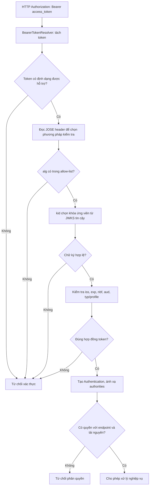

# `alg`, `kid`, `typ` và vai trò khác nhau của từng trường header trong JWT/JOSE

## 1. Bối cảnh: Resource Server cần hiểu đúng JOSE header

Trong hệ thống **OAuth 2.0 / OpenID Connect (OIDC)**, Spring Security Resource Server có thể bảo vệ API bằng **JWT access token**. Một JWT dạng đã ký thường sử dụng **JSON Web Signature (JWS)**. JWS mang một **JOSE header** mô tả cách xử lý phần chữ ký và có thể chứa thông tin nhận diện loại token.

Ba trường rất thường gặp là:

- **`alg` (algorithm):** thuật toán mật mã được dùng để tạo hoặc kiểm tra chữ ký JWS. Nó chi phối **cách kiểm tra tính toàn vẹn và tính xác thực mật mã** của thông điệp.
- **`kid` (key ID):** mã nhận diện khóa. Nó giúp bên xác thực **tìm đúng khóa ứng viên** trong tập khóa tin cậy; bản thân nó không chứng minh token đáng tin.
- **`typ` (type):** loại đối tượng JOSE được biểu diễn, chẳng hạn `JWT` hoặc `at+jwt`. Nó hỗ trợ **phân biệt ngữ cảnh/loại token**, không phải quyền truy cập hoặc danh tính của người dùng.

Dù cùng nằm trong JOSE header, ba trường trả lời ba câu hỏi khác nhau:

| Trường | Câu hỏi mà trường giải quyết | Đầu vào cho bước nào? | Không có nghĩa là gì? |
|---|---|---|---|
| `alg` | “Dùng thuật toán nào để kiểm tra chữ ký?” | Xác minh mật mã, trong giới hạn thuật toán cho phép | Không tự quyết định thuật toán nào được API tin |
| `kid` | “Khóa nào trong kho khóa được cấu hình có thể dùng?” | Tìm khóa/JWK, hỗ trợ key rotation | Không tự xác định issuer, chủ thể hay quyền |
| `typ` | “Đây được khai báo là loại đối tượng/token nào?” | Kiểm tra hợp đồng định dạng và chống nhầm loại token | Không thay thế `aud`, `iss`, chữ ký hay phân quyền |

**Nguyên tắc quan trọng:** JOSE header do bên gửi token cung cấp. Trước khi xác minh chữ ký bằng khóa tin cậy, mọi giá trị đọc từ token, kể cả header và payload, đều là **dữ liệu chưa được xác thực**. Resource Server được phép dùng `alg` và `kid` làm *gợi ý để tìm cách xác minh*, nhưng chính sách tin cậy luôn phải đến từ **cấu hình phía server**.

## 2. JOSE, JWS, JWE và JWT khác nhau ở đâu?

**JOSE** (*JSON Object Signing and Encryption*) là họ tiêu chuẩn dùng JSON để ký và mã hóa dữ liệu. Các thuật ngữ thường gặp:

| Khái niệm | Vai trò | Liên quan đến header |
|---|---|---|
| **JWT** (*JSON Web Token*) | Định dạng thể hiện tập claim dưới dạng đối tượng JSON; thường được dùng làm token | JWT có thể được bảo vệ bằng JWS hoặc JWE |
| **JWS** (*JSON Web Signature*) | Bảo vệ tính toàn vẹn và tính xác thực mật mã bằng chữ ký/MAC | `alg` xác định thuật toán chữ ký hoặc MAC |
| **JWE** (*JSON Web Encryption*) | Bảo vệ tính bí mật bằng mã hóa nội dung | `alg` liên quan quản lý/trao đổi khóa mã hóa; `enc` xác định thuật toán mã hóa nội dung |
| **JWK** (*JSON Web Key*) | Cấu trúc JSON mô tả khóa mật mã | `kid` có thể liên kết JOSE header với một JWK |
| **JWKS** (*JSON Web Key Set*) | Tập hợp các JWK thường được công bố tại một endpoint | Resource Server có thể dùng để lấy các khóa công khai tin cậy |

Một JWT access token thường là **signed JWT dạng JWS Compact Serialization**:

```text
BASE64URL(UTF8(JOSE protected header))
    .
BASE64URL(UTF8(claims payload))
    .
BASE64URL(signature)
```

Ví dụ phân tích *cấu trúc*, không phải token thật:

```text
eyJhbGciOiJSUzI1NiIsImtpZCI6InNpZ24tMjAyNi0wMSIsInR5cCI6ImF0K2p3dCJ9
.
eyJpc3MiOiJodHRwczovL2lkLmV4YW1wbGUuY29tIiwiYXVkIjoib3JkZXJzLWFwaSJ9
.
SIGNATURE_PLACEHOLDER
```

Sau khi giải mã Base64URL phần thứ nhất, JOSE header có thể là:

```json
{
  "alg": "RS256",
  "kid": "sign-2026-01",
  "typ": "at+jwt"
}
```

Payload là **JWT Claims Set**, ví dụ:

```json
{
  "iss": "https://id.example.com",
  "sub": "user-123",
  "aud": "orders-api",
  "scope": "orders.read",
  "iat": 1909996400,
  "exp": 1910000000
}
```

**Header và payload là hai vùng dữ liệu khác nhau.** `alg`, `kid`, `typ` nằm trong JOSE header; `iss`, `aud`, `sub`, `scope`, `exp` là JWT claims. Một JWT được ký thông thường có thể được *decode* để đọc header và payload, nhưng việc đọc được không đồng nghĩa chữ ký đã được xác minh. Base64URL là **mã hóa biểu diễn dữ liệu**, không phải mã hóa giữ bí mật.

JWT cũng có thể được mã hóa bằng JWE. JWE Compact Serialization thường có **năm thành phần**, vì thế không được suy đoán mọi bearer token có ba phần và là JWS; opaque access token còn có thể không phải JWT.

### 2.1. Header được bảo vệ bởi chữ ký có đáng tin ngay từ đầu không?

Với JWS Compact Serialization, JOSE header là **protected header**: các byte Base64URL của header cùng payload nằm trong dữ liệu mà chữ ký bảo vệ. Tuy nhiên, chữ ký chỉ chứng minh header không bị sửa đổi **sau khi được xác minh thành công** bằng khóa tin cậy và thuật toán cho phép.

Trình xử lý phải đọc trước một số trường để chọn khóa hoặc thuật toán kiểm chứng. Điều này không mâu thuẫn với nguyên tắc “không tin dữ liệu chưa xác thực”, miễn là:

1. Chỉ dùng giá trị đó để lựa chọn trong các lựa chọn **đã được cấu hình cho phép**.
2. Không coi giá trị trong token là lệnh tự động thêm thuật toán, khóa hoặc nguồn khóa mới.
3. Sau khi xác minh thành công, kiểm tra tiếp issuer, audience, thời hạn, loại token và quyền theo chính sách API.

Trong một số dạng JWS JSON Serialization có cả *unprotected header*; bài này tập trung vào **compact JWT** thường gặp trong OAuth 2.0 Resource Server, nơi header được dùng là protected header.

## 3. `alg`: thuật toán ký/xác minh, không phải chính sách tin cậy

### 3.1. `alg` có ý nghĩa gì trong JWS?

Trong JWS, `alg` chỉ thuật toán đã dùng để tạo giá trị chữ ký hoặc MAC. Ví dụ:

```json
{
  "alg": "RS256",
  "kid": "issuer-rsa-2026",
  "typ": "at+jwt"
}
```

`RS256` là RSA PKCS#1 v1.5 Signature với SHA-256. Nếu Resource Server được cấu hình tin issuer và khóa công khai RSA tương ứng, JWT decoder có thể dùng thông tin này để kiểm tra chữ ký. Nhưng **không được vì token tự ghi `alg=RS256` mà mặc nhiên cho phép RS256**; các thuật toán tin cậy phải được đặt trước trong cấu hình của API.

Một số thuật toán JOSE thường xuất hiện:

| `alg` | Nhóm | Bên ký dùng gì? | Bên xác minh dùng gì? | Điểm cần chú ý |
|---|---|---|---|---|
| `RS256` | RSA + SHA-256 | RSA private key | RSA public key | Phổ biến với JWKS công khai |
| `PS256` | RSA-PSS + SHA-256 | RSA private key | RSA public key | Biến thể chữ ký RSA-PSS |
| `ES256` | ECDSA P-256 + SHA-256 | EC private key | EC public key | Cần xử lý đúng kiểu khóa và định dạng chữ ký JOSE |
| `EdDSA` | EdDSA | Private key phù hợp | Public key phù hợp | Cần thư viện/issuer hỗ trợ thuật toán và key type tương ứng |
| `HS256` | HMAC + SHA-256 | Shared secret | Cùng shared secret | Không có cặp khóa công khai/riêng; đòi quản lý secret ở bên xác minh |
| `none` | Unsecured JWS | Không ký | Không có chữ ký để xác minh | **Không chấp nhận** cho bearer access token dùng để bảo vệ API |

Một vài lưu ý:

- **`RS256` không phải “RSA encryption”.** Trong JWS, RSA dùng cho **chữ ký số**.
- Với thuật toán bất đối xứng, Authorization Server giữ private key; Resource Server thường chỉ cần public key.
- Với `HS256`, bên xác minh cũng có secret có thể ký token. Vì vậy chỉ dùng khi mô hình tin cậy thực sự phù hợp, không áp dụng tùy tiện cho hệ thống nhiều Resource Server.
- `none` là một giá trị thuật toán được mô tả trong tiêu chuẩn JWT/JOSE cho các trường hợp không bảo vệ chữ ký. Đối với **Resource Server yêu cầu JWT access token đã ký**, phải từ chối token không có chữ ký hợp lệ.

### 3.2. Chống tấn công algorithm confusion

Ví dụ hệ thống mong access token được issuer ký bằng `RS256`, nhưng kẻ tấn công tạo header:

```json
{
  "alg": "HS256",
  "kid": "issuer-rsa-2026",
  "typ": "at+jwt"
}
```

Nếu một bộ xác minh tự động tin `alg` do token khai báo và sử dụng sai khóa RSA public key làm HMAC secret, nó có thể mắc lỗi **algorithm confusion/key confusion**. Thư viện bảo mật hiện đại có các ràng buộc loại khóa và thuật toán để ngăn lớp lỗi này, nhưng người triển khai vẫn cần cấu hình rõ những thuật toán được phép.

Các nguyên tắc thiết kế:

- Duy trì **allow-list thuật toán** theo hợp đồng với issuer; chẳng hạn chỉ `RS256` nếu issuer của API chỉ phát hành RS256.
- Phân biệt khóa đối xứng (`oct`) và bất đối xứng (`RSA`, `EC`, `OKP`) theo tiêu chuẩn; không gán lại kiểu sử dụng khóa dựa trên input chưa xác thực.
- Không dùng giá trị `alg` để quyết định lấy secret hoặc tải khóa từ nguồn bên ngoài không được tin cậy.
- Không làm “fallback” qua thuật toán yếu hơn hoặc qua `none` chỉ vì xác thực RS256 thất bại.
- Khi hỗ trợ nhiều thuật toán, cấu hình cụ thể **cặp issuer / algorithm / khóa** nào được phép, thay vì cho phép rộng mọi thuật toán có trong thư viện.

### 3.3. `alg` trong JWE có nghĩa khác

Không được áp nghĩa “thuật toán chữ ký” cho mọi JOSE header.

Một JWE có thể có protected header:

```json
{
  "alg": "RSA-OAEP-256",
  "enc": "A256GCM",
  "cty": "JWT"
}
```

Ở đây:

- `alg` mô tả thuật toán **quản lý khóa** dùng trong JWE (ví dụ cách bảo vệ hoặc thiết lập content encryption key).
- `enc` mô tả thuật toán **mã hóa nội dung**.
- `cty=JWT` có thể nói nội dung bên trong là một JWT khác, thường gặp trong trường hợp nested JWT.

Do đó, khi thấy `alg`, phải hỏi **đang xử lý JWS hay JWE?** Spring Security Resource Server dùng JWT decoder thông dụng tập trung vào xác thực **JWS access token đã ký**. Nếu issuer phát hành encrypted JWT/JWE, cần thiết kế bổ sung cho giải mã JWE và, nếu nested JWT, xác minh chữ ký JWT bên trong theo hợp đồng; không coi một JWE là JWS ba phần để xác minh trực tiếp.

## 4. `kid`: tìm đúng khóa, không xác lập độ tin cậy

### 4.1. Vai trò của `kid`

`kid` là viết tắt của **key identifier**. Nó thường là chuỗi để Resource Server tìm khóa thích hợp từ tập khóa mà Authorization Server đã công bố:

```json
{
  "alg": "RS256",
  "kid": "rsa-key-2026-11",
  "typ": "at+jwt"
}
```

Một JWKS minh họa:

```json
{
  "keys": [
    {
      "kty": "RSA",
      "kid": "rsa-key-2026-07",
      "use": "sig",
      "alg": "RS256",
      "n": "PUBLIC_MODULUS_OLD_BASE64URL",
      "e": "AQAB"
    },
    {
      "kty": "RSA",
      "kid": "rsa-key-2026-11",
      "use": "sig",
      "alg": "RS256",
      "n": "PUBLIC_MODULUS_NEW_BASE64URL",
      "e": "AQAB"
    }
  ]
}
```

Các chuỗi `n` phía trên là **placeholder để diễn giải dữ liệu JWK**, không phải modulus Base64URL sử dụng được. Với RSA JWK, `n` và `e` là thông tin **khóa công khai**; private key không nên được công bố trên JWKS public endpoint.

Luồng thường gặp:

```text
JWT header: kid = rsa-key-2026-11, alg = RS256
                    |
                    v
Issuer đã được cấu hình tin cậy
                    |
                    v
JWKS của issuer (TLS, endpoint đã cấu hình/khám phá tin cậy)
                    |
                    v
Tìm JWK có kid phù hợp + kiểu khóa/thuật toán/usage phù hợp
                    |
                    v
Xác minh chữ ký của JWS
                    |
                    v
Kiểm tra iss, aud, exp, nbf, scope, loại token...
```

`kid` là **gợi ý chọn khóa**, không phải chữ ký hoặc chứng thư xác minh nguồn gốc. Hai issuer khác nhau có thể cùng dùng `kid="key-1"`; key ID không có tính duy nhất toàn Internet. Vì thế khóa phải được tra cứu trong **tập khóa của đúng issuer tin cậy**, không phải trong kho khóa chung của mọi issuer một cách không phân biệt.

### 4.2. `kid` có bắt buộc không?

Không phải mọi JWS đều bắt buộc có `kid`. Với một khóa duy nhất hoặc định dạng khác, bên xác thực có thể lựa chọn khóa theo chính sách đã định. Tuy nhiên, nhiều hệ thống có nhiều khóa cùng lúc nên `kid` rất hữu ích, nhất là trong quá trình xoay vòng khóa.

**Thiếu `kid` không tự động có nghĩa token giả.** Hành vi chấp nhận hay từ chối phụ thuộc token profile, bộ JWT decoder và số lượng khóa phù hợp trong kho khóa. Nếu hợp đồng của issuer **bắt buộc có `kid`**, Resource Server có thể thực thi yêu cầu đó. Không tự xây một logic chọn khóa “bừa một khóa” để giúp token thiếu thông tin qua kiểm tra.

### 4.3. Key rotation: lý do thường gặp nhất của `kid`

Giả sử ban đầu issuer ký token với `rsa-key-2026-07`. Đến kỳ xoay khóa:

1. Issuer tạo cặp khóa mới với `kid=rsa-key-2026-11`.
2. JWKS được cập nhật để công bố khóa mới, đồng thời có thể duy trì khóa công khai cũ trong thời gian chuyển tiếp.
3. Token phát hành mới mang `kid=rsa-key-2026-11` và được ký bằng private key mới.
4. Resource Server tra `kid`, tải hoặc làm mới cache JWKS trong phạm vi endpoint tin cậy.
5. Chỉ sau khi các token cũ hết hiệu lực (theo chính sách của issuer), khóa cũ mới nên được gỡ khỏi tập khóa dùng để xác minh.

Trong thời gian chuyển tiếp, JWKS có thể chứa nhiều khóa hợp lệ. Việc “kiểm tra chữ ký thất bại ngay sau rotation” thường liên quan đến cache hoặc cấu hình JWKS chưa đồng bộ; không nên khắc phục bằng cách vô hiệu hóa kiểm tra chữ ký.

### 4.4. Không để `kid` điều khiển nguồn khóa

`kid` là dữ liệu đầu vào chưa tin cậy. Một số lỗi triển khai thủ công cần tránh:

- Dùng trực tiếp `kid` làm tên file để đọc secret, tạo nguy cơ path traversal như `../private-key`.
- Ghép `kid` vào URL rồi tải khóa từ tên host do người gọi kiểm soát, tạo nguy cơ SSRF hoặc key injection.
- Chọn khóa từ issuer khác vì trùng key ID.
- Cố “thử từng khóa khắp nơi” khi không tìm thấy `kid`, làm mờ ranh giới issuer và chính sách thuật toán.
- Không giới hạn kích thước hoặc tần suất của giá trị `kid`, dẫn tới các lần tra cứu khóa tốn tài nguyên.

Các header liên quan như `jku` (JWK Set URL), `jwk` (khóa JSON được nhúng), `x5u` (URL chứng thư) cũng phải được xử lý theo **chính sách tin cậy nghiêm ngặt**. Không tự động làm theo URL/khóa do một JWT bất kỳ yêu cầu. Với Spring Security Resource Server, cách phổ biến là cấu hình **issuer hoặc JWKS URI đã tin cậy** để decoder tự quản lý tập khóa.

## 5. `typ`: nhận diện loại đối tượng, không thay thế kiểm tra quyền

### 5.1. `typ` dùng để làm gì?

`typ` là **type header parameter**, giúp phân biệt loại đối tượng mà JOSE mang. Hai ví dụ thường gặp:

```json
{
  "alg": "RS256",
  "kid": "sign-1",
  "typ": "JWT"
}
```

```json
{
  "alg": "RS256",
  "kid": "sign-1",
  "typ": "at+jwt"
}
```

- `JWT` nói đối tượng được biểu diễn là một JSON Web Token. Đây là giá trị thường gặp trong nhiều ID token hoặc JWT nói chung.
- `at+jwt` được **RFC 9068 — JWT Profile for OAuth 2.0 Access Tokens** sử dụng để nhận diện JWT access token theo profile đó. Giá trị đầy đủ `application/at+jwt` cũng được profile cho phép.
- Một token thiếu `typ` không tự chứng minh nó không phải JWT. Việc có bắt buộc `typ` và bắt buộc giá trị nào phụ thuộc **profile giao thức** mà hệ thống đã thỏa thuận.

Với `typ`, ý nghĩa là **phân loại token/đối tượng**. Nó không mang role, scope, danh tính hoặc quyền đối với API.

### 5.2. Tại sao `typ` có ích trong OAuth 2.0/OIDC?

Một Authorization Server hoặc OpenID Provider có thể phát hành nhiều JWT cho các mục đích khác nhau:

| Token | Đối tượng sử dụng | Ví dụ `typ` trong thực tế | Điều phải kiểm tra ngoài `typ` |
|---|---|---|---|
| OAuth 2.0 JWT access token theo RFC 9068 | Resource Server / API | `at+jwt` hoặc `application/at+jwt` | Chữ ký, issuer, audience của API, hiệu lực và quyền |
| OIDC ID token | OIDC Client / Relying Party | Thường `JWT` hoặc theo hợp đồng provider | Chữ ký, issuer, `aud=client_id`, `nonce` khi yêu cầu, quy tắc OIDC |
| JWT dùng cho sự kiện hoặc giao thức khác | Thành phần chuyên biệt của giao thức đó | Có thể có type riêng | Đúng loại đối tượng, đúng audience và kiểm tra của profile tương ứng |
| JWT access token không theo RFC 9068 | Resource Server / API | Có thể là `JWT` hoặc không có `typ` theo provider | Hợp đồng token của issuer và kiểm tra quyền API |

**Không được mặc định mọi OAuth 2.0 access token đều có `typ=at+jwt`.** RFC 9068 mô tả một profile cụ thể. Nếu hệ thống sử dụng profile đó, Resource Server nên thực thi đầy đủ yêu cầu của profile, bao gồm type và các claim liên quan. Nếu issuer không sử dụng profile đó, cần dựa vào hợp đồng thực tế của issuer, không áp quy tắc của profile một cách tùy tiện.

### 5.3. Token substitution / cross-JWT confusion

Giả sử cùng một OP phát hành:

**JWT access token** cho `orders-api`:

```json
{
  "alg": "RS256",
  "kid": "sign-1",
  "typ": "at+jwt"
}
```

```json
{
  "iss": "https://id.example.com",
  "sub": "user-123",
  "aud": "orders-api",
  "scope": "orders.read",
  "exp": 1910000000
}
```

**OIDC ID token** cho ứng dụng `web-client`:

```json
{
  "alg": "RS256",
  "kid": "sign-1",
  "typ": "JWT"
}
```

```json
{
  "iss": "https://id.example.com",
  "sub": "user-123",
  "aud": "web-client",
  "exp": 1910000000,
  "nonce": "nonce-from-login-request"
}
```

Hai token có thể do **cùng issuer**, ký bằng **cùng private key** (`kid` giống nhau) và cùng `alg`. Nhưng chúng có **đối tượng sử dụng khác nhau**. API `orders-api` phải từ chối ID token dành cho `web-client`, ngay cả khi chữ ký và thời hạn đều hợp lệ.

`typ=at+jwt` giúp ngăn nhận nhầm token khi API thực thi RFC 9068. Tuy nhiên, **chỉ xem `typ` là chưa đủ**: một token có type `at+jwt` nhưng `aud` sai hoặc chữ ký không hợp lệ vẫn phải bị từ chối.

### 5.4. `typ` khác `cty` như thế nào?

Cả hai là header parameter nhưng mô tả hai khía cạnh:

- **`typ` (type):** loại của đối tượng JOSE *đang xét*.
- **`cty` (content type):** loại nội dung bên trong payload của đối tượng JOSE, hữu ích trong **nested JWT**.

Ví dụ JWE bọc một JWT khác có thể dùng `cty: "JWT"` để chỉ ra plaintext sau giải mã là JWT. `cty=JWT` **không đồng nghĩa** đối tượng JWE bên ngoài có thể dùng làm access token đã ký; bên nhận vẫn phải xử lý giải mã và xác minh theo thứ tự của profile.

## 6. Phân biệt JOSE header và JWT claims

Một nguyên nhân phổ biến của nhầm lẫn là sử dụng `alg`, `kid`, `typ` như thể chúng là thông tin cấp quyền.

| Nơi chứa | Trường | Ý nghĩa | Kiểm tra tại Resource Server |
|---|---|---|---|
| **JOSE header** | `alg` | Thuật toán JWS | Nằm trong danh sách được phép; phù hợp với loại khóa |
| **JOSE header** | `kid` | Mã chọn khóa trong kho khóa | Chọn từ JWKS của issuer tin cậy; xác minh chữ ký |
| **JOSE header** | `typ` | Khai báo loại token/đối tượng | Khớp profile mong đợi, nếu profile yêu cầu |
| **JWT claims** | `iss` | Bên phát hành | Chính xác issuer được cấu hình tin cậy |
| **JWT claims** | `aud` | Bên nhận dự kiến của token | Chứa audience của API đang được gọi |
| **JWT claims** | `sub` | Chủ thể mà token mô tả | Dùng theo hợp đồng issuer; không suy ra quyền chỉ từ `sub` |
| **JWT claims** | `exp`, `nbf`, `iat` | Mốc thời gian | Token còn hiệu lực, với clock skew hợp lý |
| **JWT claims** | `scope` / `scp` | Phạm vi quyền đã được cấp | Kiểm tra quyền cần thiết đối với endpoint |
| **JWT claims** | `azp` hoặc `client_id` | Client được liên kết theo profile | Kiểm tra khi hợp đồng token yêu cầu |

**`kid` không phải `sub`**: key ID nhận diện khóa, subject nhận diện chủ thể.

**`typ` không phải `aud`**: type mô tả loại token, audience xác định token dành cho ai.

**`alg` không phải `scope`**: thuật toán bảo vệ chữ ký, scope mô tả quyền truy cập.

Ngay cả khi chữ ký đã được kiểm tra, API vẫn phải xác minh quyền đối với **đối tượng tài nguyên cụ thể**, chẳng hạn user có được đọc đơn hàng của tenant đó hay không. `scope=orders.read` thường không đủ để cho phép đọc mọi đơn hàng.

## 7. Thứ tự Resource Server xử lý một JWT access token

Với một API HTTP được bảo vệ, luồng xử lý có thể mô tả:



Sơ đồ thể hiện **trách nhiệm logic**, không quy định cứng thứ tự mọi thao tác nội bộ của mọi JWT library. Bộ giải mã có thể kết hợp một số bước, nhưng điều quan trọng là **không cấp quyền nghiệp vụ dựa trên header/payload chưa được xác minh**.

Trong Spring Security, các thành phần thường liên quan:

- **`BearerTokenAuthenticationFilter`** đọc Bearer access token từ request.
- **`JwtDecoder` / `NimbusJwtDecoder`** giải mã, xác minh chữ ký và áp dụng validator.
- **`JwtAuthenticationProvider`** sử dụng JWT đã xác thực để tạo Authentication.
- **`JwtAuthenticationConverter`** chuyển claim thích hợp thành principal và authorities; các scope thông thường có thể thành `SCOPE_...`.
- **Security authorization rules** quyết định endpoint và tài nguyên có cho phép hành động không.

Không phải mọi token mang ba dấu chấm đều là JWT hoặc đều phải được decoder xử lý; nếu AS phát hành **opaque token**, Resource Server nên dùng opaque-token introspection theo hợp đồng, không tìm `alg`, `kid`, `typ` trong chuỗi opaque.

## 8. Cấu hình Spring Security Resource Server

### 8.1. Cấu hình đơn giản theo issuer

Giả sử API chấp nhận JWT access token của issuer đáng tin cậy:

```yaml
spring:
  security:
    oauth2:
      resourceserver:
        jwt:
          issuer-uri: https://id.example.com/realms/demo
```

Với dependency Spring Boot `spring-boot-starter-oauth2-resource-server` và cấu hình security chain phù hợp, Spring Security có thể khám phá metadata/JWKS của issuer để xác minh token.

Điều cần hiểu:

- JWKS được lựa chọn theo **issuer đã cấu hình**, không theo URL tự khai báo bên trong một JWT bất kỳ.
- JWT decoder dùng JOSE header `alg`/`kid` làm dữ liệu đầu vào cho quá trình xác minh bằng khóa tin cậy.
- Cấu hình issuer giúp kiểm tra nguồn phát hành và các điều kiện JWT mặc định phù hợp với decoder.
- **Audience của từng API** phải được xác nhận rõ ràng theo hợp đồng triển khai; không suy ra từ `kid`, `typ` hoặc chỉ từ việc JWT có chữ ký đúng.
- Nếu API bắt buộc **RFC 9068 `at+jwt`**, phải áp dụng validator token type/profile phù hợp với phiên bản Spring Security đang dùng, bên cạnh audience và issuer.

Không nên đặt một khóa công khai bất kỳ vào decoder để “cho token chạy được” khi chưa xác định đúng issuer và hợp đồng token.

### 8.2. Ví dụ giới hạn `alg` và kiểm tra audience

Trong trường hợp cần cấu hình rõ JWKS URI và thuật toán ký mà API chấp nhận, có thể đăng ký một `JwtDecoder` riêng. Ví dụ dưới đây chỉ tin **RS256** và yêu cầu audience `orders-api`.

```java
import org.springframework.context.annotation.Bean;
import org.springframework.context.annotation.Configuration;
import org.springframework.http.HttpMethod;
import org.springframework.security.config.Customizer;
import org.springframework.security.config.annotation.web.builders.HttpSecurity;
import org.springframework.security.oauth2.core.OAuth2Error;
import org.springframework.security.oauth2.core.OAuth2TokenValidator;
import org.springframework.security.oauth2.core.OAuth2TokenValidatorResult;
import org.springframework.security.oauth2.core.DelegatingOAuth2TokenValidator;
import org.springframework.security.oauth2.jose.jws.SignatureAlgorithm;
import org.springframework.security.oauth2.jwt.Jwt;
import org.springframework.security.oauth2.jwt.JwtDecoder;
import org.springframework.security.oauth2.jwt.JwtValidators;
import org.springframework.security.oauth2.jwt.NimbusJwtDecoder;
import org.springframework.security.web.SecurityFilterChain;

@Configuration
public class ResourceServerSecurity {

    private static final String ISSUER =
            "https://id.example.com/realms/demo";

    private static final String JWKS_URI =
            "https://id.example.com/realms/demo/protocol/openid-connect/certs";

    @Bean
    SecurityFilterChain apiFilterChain(HttpSecurity http) throws Exception {
        return http
                .authorizeHttpRequests(auth -> auth
                        .requestMatchers(HttpMethod.GET, "/api/orders/**")
                        .hasAuthority("SCOPE_orders.read")
                        .anyRequest().authenticated())
                .oauth2ResourceServer(oauth2 ->
                        oauth2.jwt(Customizer.withDefaults()))
                .build();
    }

    @Bean
    JwtDecoder jwtDecoder() {
        NimbusJwtDecoder decoder =
                NimbusJwtDecoder.withJwkSetUri(JWKS_URI)
                        .jwsAlgorithm(SignatureAlgorithm.RS256)
                        .build();

        OAuth2TokenValidator<Jwt> issuerAndTime =
                JwtValidators.createDefaultWithIssuer(ISSUER);

        OAuth2TokenValidator<Jwt> audience = jwt ->
                jwt.getAudience().contains("orders-api")
                        ? OAuth2TokenValidatorResult.success()
                        : OAuth2TokenValidatorResult.failure(
                                new OAuth2Error(
                                        "invalid_token",
                                        "The token is not intended for orders-api",
                                        null));

        decoder.setJwtValidator(
                new DelegatingOAuth2TokenValidator<>(
                        issuerAndTime, audience));

        return decoder;
    }
}
```

Đọc ví dụ theo trách nhiệm của từng trường:

1. `jwsAlgorithm(SignatureAlgorithm.RS256)` xác định thuật toán JWS API **chủ động tin cậy**. Header `alg=HS256` hoặc `alg=none` không được phép tự thay đổi chính sách này.
2. `JWKS_URI` là địa chỉ được **cấu hình trước**, decoder dùng tập khóa từ đó để kiểm tra JWS. `kid` giúp chọn khóa trong tập khóa đúng.
3. `JwtValidators.createDefaultWithIssuer(...)` kiểm tra issuer và các điều kiện JWT mặc định liên quan đến thời hạn.
4. Audience validator yêu cầu `aud` chứa `orders-api`; việc có đúng `alg` và `kid` không thể thay bước kiểm tra này.
5. `hasAuthority("SCOPE_orders.read")` kiểm tra scope được ánh xạ thành authority theo cấu hình mặc định. Kiểm tra phân quyền đối với **đơn hàng cụ thể** vẫn thuộc logic ứng dụng.

**Đây là cấu hình minh họa cho JWT JWS access token ký bằng RS256.** URI JWKS và issuer phải được thay bằng giá trị thực có quan hệ đúng với nhau. Nếu issuer sử dụng ES256, PS256 hoặc thuật toán khác, allow-list phải phù hợp với hợp đồng và khả năng hỗ trợ của decoder; không tự cho phép tất cả. Nếu cần dùng nhiều `SecurityFilterChain`, phải bố trí matcher theo đường dẫn ứng dụng thực tế.

### 8.3. Kiểm tra `typ=at+jwt` khi áp dụng RFC 9068

Giả sử Authorization Server đã cam kết **JWT Profile for OAuth 2.0 Access Tokens (RFC 9068)**. Khi đó `typ` là thành phần của hợp đồng token: API cần phân biệt access token profile này với JWT khác, đồng thời kiểm tra các yêu cầu về issuer, audience, chữ ký, thời hạn và claims theo profile.

Tùy phiên bản Spring Security, có thể sử dụng hỗ trợ validator dành cho *at+jwt* của framework hoặc cấu hình validator riêng. Điểm cần phân biệt:

- Cơ chế kiểm tra **JOSE header type** có thể nằm ở bước giải mã JWT của thư viện.
- Một số phiên bản decoder có cơ chế kiểm tra `typ` mặc định; khi triển khai chính sách type riêng cần hiểu rõ tương tác với mặc định để không vô tình từ chối token `at+jwt` hợp lệ hoặc bỏ qua mọi kiểm tra type.
- Một custom validator chỉ kiểm tra chuỗi `typ` **không đủ** để triển khai toàn bộ RFC 9068; profile còn liên quan đến audience, issuer, claim bắt buộc và quy tắc xử lý access token.
- API không theo RFC 9068 **không được giả định** chỉ token có `typ=at+jwt` mới là access token. Phải dựa trên profile thực tế của nhà cung cấp token.

Trong quy trình đăng nhập OIDC, một ID token có thể vẫn ký bằng cùng RS256 và cùng `kid`. Vì vậy việc xác thực đúng loại token và audience là ranh giới bảo mật thực sự.

## 9. Các tình huống lỗi và cách hiểu đúng

### 9.1. `alg` bị thay từ RS256 sang HS256

Ví dụ attacker chỉ sửa header thành:

```json
{"alg":"HS256","kid":"rsa-key-1","typ":"at+jwt"}
```

Nếu payload/chữ ký không tương ứng, token phải bị từ chối. Quan trọng hơn, Resource Server không được chấp nhận HS256 nếu API chỉ tin RS256. **Không suy luận rằng “alg trong token khai báo gì thì decoder phải làm theo”.**

### 9.2. `alg=none`

```json
{"alg":"none","typ":"at+jwt"}
```

Một token không có chữ ký không đáp ứng yêu cầu bảo vệ của API ký số. `typ=at+jwt` không thể biến một token chưa ký thành access token hợp lệ. Resource Server yêu cầu signed JWT phải từ chối.

### 9.3. `kid` không tồn tại trong JWKS

Header:

```json
{"alg":"RS256","kid":"key-does-not-exist","typ":"at+jwt"}
```

Các khả năng thường gặp là token giả, cache JWKS chưa cập nhật sau key rotation, hoặc cấu hình nhầm issuer/JWKS. Decoder có thể làm mới JWKS từ nguồn **được cấu hình tin cậy** khi chính sách thư viện cho phép; nếu vẫn không tìm được khóa phù hợp hoặc không xác minh được chữ ký, phải từ chối token. Không gửi `kid` đi tìm khóa tùy ý trên Internet.

### 9.4. `kid` đúng nhưng chữ ký sai

Một token có thể sao chép `kid` từ token thật nhưng đã bị sửa payload:

```json
{"alg":"RS256","kid":"trusted-key-1","typ":"at+jwt"}
```

Việc trùng `kid` chỉ khiến decoder chọn đúng **khóa ứng viên**; chữ ký vẫn sẽ thất bại nếu người tạo token không có private key tương ứng. Do đó, **kid match ≠ verified signature**.

### 9.5. `typ=JWT` nhưng token là JWT access token của nhà cung cấp

Nếu Authorization Server **không** sử dụng RFC 9068 và phát hành access token dạng JWT với `typ=JWT` (hoặc không có `typ`), Resource Server không thể kết luận token sai chỉ dựa trên type. Cần kiểm tra chính sách token của issuer, đặc biệt `aud`, issuer, signature, lifetime và scope. Nếu API áp dụng profile RFC 9068, đó lại là trường hợp **không khớp profile đã yêu cầu**.

### 9.6. ID token được gửi nhầm vào Resource Server

```text
ID token:
  alg = RS256
  kid = common-key-2026
  typ = JWT
  aud = web-client

Access token:
  alg = RS256
  kid = common-key-2026
  typ = at+jwt
  aud = orders-api
```

Hai token cùng `alg`/`kid` không có nghĩa có thể hoán đổi. Resource Server yêu cầu access token dành cho `orders-api`; OIDC Client mới là bên xác minh ID token dành cho `web-client`.

### 9.7. Header có `jku` trỏ đến máy chủ của attacker

```json
{
  "alg": "RS256",
  "kid": "attacker-key",
  "jku": "https://attacker.example/keys.json",
  "typ": "at+jwt"
}
```

Nếu API tự tải `jku` bất kỳ và tin khóa tại URL đó, attacker có thể ký token bằng khóa của mình rồi đề nghị Resource Server “xác minh” bằng chính khóa ấy. Cách xử lý an toàn là chỉ tin các nguồn khóa được gắn với issuer theo cấu hình tin cậy, không để JOSE header mở rộng trust store một cách tùy tiện.

### 9.8. JWT của issuer khác có cùng `kid`

Hai Authorization Server đều có thể đặt `kid=key-1`. Nếu ứng dụng gộp JWKS của nhiều issuer thành một tập không phân biệt issuer, một key ID trùng nhau có thể gây chọn nhầm khóa. Thiết kế đa issuer phải ràng buộc **issuer → JWKS → thuật toán → audience/chính sách**. Claims `iss` trong token chưa xác thực chỉ có thể được dùng để *gợi ý* lựa chọn giữa các issuer **đã được allow-list**; sau khi xác minh vẫn phải đối chiếu đúng issuer.

## 10. Khi nào `alg`, `kid` và `typ` có thể thiếu?

| Trường | Có luôn bắt buộc trong mọi ngữ cảnh JOSE/JWT không? | Hành vi nên có |
|---|---|---|
| `alg` | Đối với JWS protected header, `alg` là thông số cốt lõi theo JWS, không thể tùy ý bỏ qua khi kiểm tra chữ ký | Từ chối cấu trúc thiếu/không được hỗ trợ theo trình xác minh |
| `kid` | Không bắt buộc trong mọi JWS | Chọn khóa theo hợp đồng và policy; không đoán khóa ngoài nguồn tin cậy |
| `typ` | Tùy profile; RFC 9068 yêu cầu type của JWT access token profile này | Thực thi giá trị type theo profile đang áp dụng, không giả định mọi JWT đều có type |

**Sai lầm thường gặp:** mặc định `kid` là trường bắt buộc bởi JWT chuẩn, hoặc mặc định `typ` luôn là `JWT`. Thực tế, JWT là một họ định dạng và **profile cụ thể** mới xác định những điều kiện bổ sung cho từng mục đích sử dụng.

Ngoài ba trường chính, có thể thấy `crit` (critical header parameters): nếu đối tượng JOSE chứa những phần mở rộng được đánh dấu critical mà bên xác minh **không hiểu/không hỗ trợ**, phải từ chối theo quy tắc JOSE. Không bỏ qua `crit` tùy tiện vì nó có thể thay đổi cách xử lý chữ ký hoặc payload.

## 11. Gỡ lỗi JOSE header mà không làm suy yếu an toàn

Khi một JWT access token bị từ chối bởi Spring Security Resource Server, nên xác định **bước nào thất bại**:

| Triệu chứng | Nơi cần xem xét | Vấn đề có thể gặp |
|---|---|---|
| Decoder báo algorithm không được hỗ trợ | JWT/JWS decoder | Issuer đang dùng `ES256` nhưng Resource Server chỉ cho `RS256`; hoặc token có `alg=none` |
| Không tìm thấy key matching `kid` | JWKS / cache / key rotation | JWKS mới chưa được cập nhật, issuer sai, token không đúng nguồn |
| Có key nhưng signature verification failed | JWT verifier | Token bị sửa, sai private key, nhầm issuer hoặc cấu hình |
| Type header không khớp | Token profile / `typ` validator | API cần `at+jwt` nhưng nhận JWT loại khác; có thể sai hợp đồng profile |
| Signature hợp lệ nhưng issuer sai | Claims validator | JWKS/issuer được cấu hình sai hoặc token từ trust domain khác |
| Signature và issuer đúng nhưng audience sai | Claims validator | Token phát hành cho ứng dụng/API khác, ví dụ ID token |
| Token hợp lệ nhưng bị 403 | Authorization | Thiếu scope, authority, role hoặc quyền với tài nguyên |

Trong môi trường chẩn đoán, chỉ nên log **lý do lỗi và metadata không nhạy cảm**, hạn chế tối đa nội dung định danh. Không log nguyên Bearer token hoặc cả header `Authorization`; nếu cần quan sát `kid`/`alg` thì giới hạn kích thước, chuẩn hóa output và không coi metadata chưa xác thực là sự thật. Không đưa private key, shared secret hoặc token thật vào hệ thống log.

Có thể tự *decode* phần header JWT để quan sát `alg`/`kid`/`typ`, nhưng thao tác decode không kiểm tra chữ ký:

```javascript
// Chỉ minh họa kiểm tra cấu trúc cho mục đích debug.
// Không dùng kết quả như bằng chứng token hợp lệ.
const firstPart = token.split(".")[0];
const base64 = firstPart.replace(/-/g, "+").replace(/_/g, "/");
const header = JSON.parse(
  atob(base64.padEnd(Math.ceil(base64.length / 4) * 4, "="))
);
console.log({
  alg: header.alg,
  kid: header.kid,
  typ: header.typ
});
```

Đoạn code trên giả định môi trường hỗ trợ `atob` và header có thể decode thành JSON; nó không nhằm thay JWT library, không xử lý JWE hoặc các biến thể định dạng, và **không nên chạy với token thật trên công cụ/website không tin cậy**. Việc xác thực phải do Resource Server thực hiện bằng thư viện và cấu hình mật mã phù hợp.

## 12. Các nguyên tắc thiết kế tổng hợp

Khi xây dựng hoặc tích hợp Spring Security OAuth 2.0/OIDC Resource Server, cần ghi nhớ:

1. **`alg` lựa chọn cách xác minh chữ ký trong giới hạn server cho phép**; không được biến giá trị do token tự khai báo thành chính sách cấp quyền hoặc tự mở rộng thuật toán tin cậy.
2. **`kid` tìm khóa ứng viên trong JWKS đã tin cậy**; nó hỗ trợ key rotation nhưng không chứng minh token được ký đúng. Chữ ký vẫn phải được kiểm tra.
3. **`typ` phân biệt loại token/đối tượng JOSE**; với JWT access token theo RFC 9068, type phù hợp là `at+jwt` hoặc `application/at+jwt`. Type không thay thế kiểm tra `aud` và quyền truy cập.
4. **JWS và JWE dùng `alg` trong ngữ cảnh khác nhau**: JWS nói về ký/MAC; JWE nói về quản lý khóa để mã hóa, đi cùng `enc`. Cần xác định đúng dạng token trước khi xử lý.
5. **Header chỉ trở thành đáng tin khi chữ ký được xác minh** bằng khóa và thuật toán đáng tin; ngay cả sau đó, claims vẫn phải được kiểm tra theo đúng issuer, audience, thời hạn và profile.
6. **Không chấp nhận ID token như access token** chỉ vì chúng cùng issuer, cùng `alg`, hoặc thậm chí cùng `kid`. Token phải được phát hành cho đúng bên nhận và mục đích.
7. **Không dùng JOSE header làm nguồn điều khiển mạng hoặc file system tùy ý**. `kid`, `jku`, `x5u`, `jwk` phải bị giới hạn theo trust policy.
8. **Tách xác thực token và phân quyền nghiệp vụ**: chữ ký đúng và type đúng chưa cho phép truy cập mọi dữ liệu. Kiểm tra scope, role, tenant và quyền trên đối tượng.

Có thể ghi nhớ ngắn gọn:

```text
             JOSE HEADER                  JWT CLAIMS
       +---------------------+     +-------------------------+
       | alg: cách xác minh  |     | iss: ai phát hành       |
       | kid: chọn khóa      |     | aud: cấp cho ai         |
       | typ: loại token     |     | sub: chủ thể            |
       +---------------------+     | exp: khi nào hết hạn    |
                  |                | scope: quyền đã cấp     |
                  v                +-------------------------+
       Chữ ký / khóa tin cậy                    |
                  |                             |
                  +--------------+--------------+
                                 v
                     Resource Server xác thực
                                 |
                                 v
                     Authorization theo API
```

**Kết luận kỹ thuật:** `alg` bảo vệ việc **kiểm tra chữ ký**, `kid` giúp **chọn khóa**, còn `typ` giúp **phân loại token**. Không trường nào tự mình xác nhận đầy đủ rằng request được phép đi vào API. Resource Server chỉ cấp quyền sau khi token được xác minh và đáp ứng đúng hợp đồng issuer, audience, token profile và chính sách authorization.

## 13. Tài liệu tiêu chuẩn và framework

- **RFC 7515 — JSON Web Signature (JWS)**: `alg`, `kid`, JOSE protected header và cách xác minh JWS. https://www.rfc-editor.org/rfc/rfc7515
- **RFC 7516 — JSON Web Encryption (JWE)**: phân biệt `alg` và `enc` trong JWE. https://www.rfc-editor.org/rfc/rfc7516
- **RFC 7517 — JSON Web Key (JWK)**: cấu trúc khóa/JWKS và key identifier. https://www.rfc-editor.org/rfc/rfc7517
- **RFC 7518 — JSON Web Algorithms (JWA)**: các thuật toán `RS256`, `HS256`, `ES256`, `none` và thuật toán JOSE khác. https://www.rfc-editor.org/rfc/rfc7518
- **RFC 7519 — JSON Web Token (JWT)**: JWT Claims Set, `typ`, nested JWT và những lưu ý bảo mật. https://www.rfc-editor.org/rfc/rfc7519
- **RFC 8725 — JSON Web Token Best Current Practices**: tránh algorithm confusion, cross-JWT confusion, kiểm tra audience/issuer và loại token. https://www.rfc-editor.org/rfc/rfc8725
- **RFC 9068 — JWT Profile for OAuth 2.0 Access Tokens**: type `at+jwt`, các claim và yêu cầu xác thực JWT access token theo profile. https://www.rfc-editor.org/rfc/rfc9068
- **Spring Security Reference — OAuth 2.0 Resource Server JWT**: cấu hình issuer, JWKS, thuật toán và validators. https://docs.spring.io/spring-security/reference/servlet/oauth2/resource-server/jwt.html
