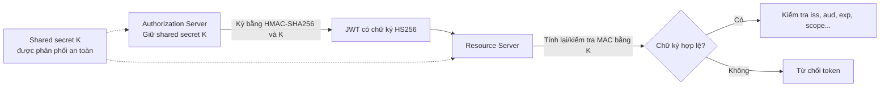
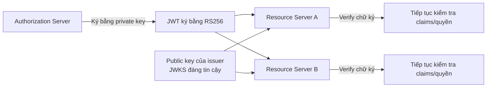

# Khóa đối xứng, khóa bất đối xứng và phân biệt khóa ký với khóa xác minh

## 1. Vấn đề đặt ra trong JWT và JOSE

Trong hệ thống **Spring Security OAuth 2.0/OIDC Resource Server**, API thường nhận access token ở dạng JWT. JWT chứa các thông tin như bên phát hành (`iss`), chủ thể (`sub`), đối tượng nhận (`aud`), thời hạn (`exp`) và quyền (`scope`). Tuy nhiên, **đọc được các claim không đồng nghĩa chúng đáng tin**. Resource Server phải xác minh token thực sự được tạo bởi bên phát hành mà nó tin cậy và nội dung token không bị thay đổi.

JOSE (JSON Object Signing and Encryption) cung cấp những cơ chế mã hóa nền tảng cho JWT. Với JWT được ký bằng **JWS (JSON Web Signature)**, có hai kiểu quản lý khóa thường gặp:

- **Khóa đối xứng:** bên ký và bên xác minh cùng giữ một **khóa bí mật chung**; ví dụ JWS dùng `HS256`.
- **Khóa bất đối xứng:** bên ký giữ **khóa riêng tư (private key)**; các bên xác minh dùng **khóa công khai (public key)** tương ứng; ví dụ JWS dùng `RS256`, `PS256`, `ES256`.

Sự khác biệt này quyết định ai có khả năng phát hành token, ai chỉ có khả năng kiểm tra token, và cách Authorization Server chia sẻ khóa với Resource Server.

> **Nguyên tắc:** “Khóa ký” và “khóa xác minh” được đặt tên theo **vai trò trong thao tác ký và kiểm tra chữ ký**. Với HMAC, đó là cùng một secret. Với chữ ký bất đối xứng, chúng là hai khóa khác nhau trong cùng một key pair.

## 2. JWT được ký bằng JWS hoạt động thế nào?

JWT trong **JWS Compact Serialization** có ba phần, ngăn cách bằng dấu chấm:

```text
BASE64URL(protected-header).BASE64URL(payload).BASE64URL(signature)
```

Ví dụ cấu trúc minh họa:

```text
eyJhbGciOiJSUzI1NiIsImtpZCI6ImtleS0yMDI2LTAxIn0
.
eyJpc3MiOiJodHRwczovL2xvZ2luLmV4YW1wbGUudGVzdCJ9
.
<signature-bytes-encoded-with-base64url>
```

Trong thực tế ba phần liền nhau trên một dòng. Nội dung **JWS protected header** có thể là:

```json
{
  "alg": "RS256",
  "typ": "JWT",
  "kid": "key-2026-01"
}
```

Payload minh họa:

```json
{
  "iss": "https://login.example.test",
  "sub": "user-123",
  "aud": "orders-api",
  "scope": "orders:read",
  "iat": 1893452400,
  "exp": 1893456000
}
```

Các giá trị thời gian ở đây chỉ là dữ liệu giả định; ví dụ chưa phải một access token dùng được.

Quá trình ký thường áp dụng thuật toán được chọn lên chuỗi **signing input**:

```text
signingInput = BASE64URL(header) + "." + BASE64URL(payload)
signature    = SIGN(signingKey, signingInput)
```

Khi nhận JWT, bên xác minh tính/kiểm tra chữ ký tương ứng với chính signing input và khóa được tin cậy:

```text
VERIFY(verificationKey, signingInput, signature)
```

Nếu attacker sửa payload, ví dụ đổi `scope` từ `orders:read` sang `orders:write`, signing input thay đổi. Nếu không sở hữu khóa có quyền ký, attacker không thể tạo chữ ký hợp lệ cho nội dung đã sửa.

**Quan trọng:** JWS nhằm bảo vệ **tính toàn vẹn** và chứng minh token được ký bởi chủ thể có khóa thích hợp; nó **không mã hóa** header hay payload để giữ bí mật. Bất kỳ ai cầm token JWS thường có thể Base64URL-decode payload. Vì vậy không được đưa mật khẩu, khóa bí mật hay dữ liệu quá nhạy cảm vào JWT chỉ vì token có chữ ký.

### 2.1. JWT, JWS và JWE không phải từ đồng nghĩa

| Khái niệm | Vai trò |
| --- | --- |
| **JWT** (JSON Web Token) | Định dạng biểu diễn các claim; thường được bảo vệ bằng JWS hoặc JWE. |
| **JWS** (JSON Web Signature) | Cơ chế ký/MAC để thẩm định tính toàn vẹn và nguồn ký của nội dung. |
| **JWE** (JSON Web Encryption) | Cơ chế mã hóa nhằm giữ bí mật nội dung; có mô hình khóa và thuật toán riêng. |
| **JWK** (JSON Web Key) | Biểu diễn một khóa mật mã bằng JSON, có thể là public, private hoặc symmetric tùy trường hợp. |
| **JWKS** (JSON Web Key Set) | Tập hợp JWK, thường được OP/Authorization Server công bố để Resource Server tìm public key xác minh chữ ký. |

Bài học này tập trung vào **ký và xác minh JWS**, không đồng nhất thao tác đó với mã hóa/giải mã của JWE.

## 3. Khóa đối xứng: cùng một secret để ký và xác minh

Với JWS dùng **HMAC**, ví dụ thuật toán `HS256`, cả bên phát hành và bên xác minh phải biết **cùng một khóa bí mật**.



Để kiểm tra chữ ký HMAC, Resource Server cần giữ secret `K`. Điều này có hệ quả bảo mật quan trọng:

**Bất kỳ bên nào có khả năng xác minh bằng shared secret cũng có đủ vật liệu mật mã để tự tạo một chữ ký HMAC hợp lệ.** Không có ranh giới mật mã “chỉ xác minh, không ký” giữa các dịch vụ cùng biết secret.

Nếu secret bị lộ từ một Resource Server, kẻ tấn công có thể tính MAC hợp lệ cho payload giả mạo. Các kiểm tra `iss`, `aud` hoặc `scope` vẫn cần thiết nhưng không tự khôi phục tính tin cậy khi khóa xác thực nguồn gốc token đã bị lộ.

### 3.1. `HS256` ký ra sao?

`HS256` nghĩa là **HMAC sử dụng SHA-256**, không phải “RSA 256 bit” và cũng không phải chỉ lấy SHA-256 của JWT:

```text
signature = HMAC-SHA256(secretK, signingInput)
```

Ví dụ luồng:

1. Authorization Server có secret `K` đủ mạnh, được tạo bằng bộ sinh số ngẫu nhiên an toàn.
2. Server tạo protected header `{"alg":"HS256","typ":"JWT"}` và các claim.
3. Server tính HMAC-SHA256 trên signing input và thêm signature vào JWS.
4. Resource Server có **chính secret `K`** để tính lại MAC và so sánh an toàn.
5. Sau khi chữ ký hợp lệ, API tiếp tục kiểm tra issuer, audience, expiration, scope và chính sách dữ liệu.

Với `HS256`, secret nên là giá trị ngẫu nhiên **tối thiểu 256 bit (32 byte)** theo yêu cầu khóa của thuật toán. Một mật khẩu có thể đoán như `my-secret` không đạt yêu cầu chỉ vì nó được đặt tên là “secret”. Đối với các thuật toán HMAC SHA-384/SHA-512, yêu cầu độ dài khóa tương ứng cũng tăng theo.

### 3.2. Khi nào khóa đối xứng phù hợp?

HMAC có thể hữu ích trong một phạm vi triển khai nhỏ, ít bên cần kiểm tra token và nơi việc chia sẻ secret được kiểm soát chặt. Tuy nhiên, trong kiến trúc nhiều Resource Server độc lập, chia sẻ cùng secret tạo ra các vấn đề:

- Mỗi API giữ một bản sao secret nhạy cảm.
- Khi một API bị xâm nhập, secret có thể ảnh hưởng đến nhiều API khác.
- Cần cơ chế phân phối secret, phân quyền đọc, xoay khóa và đồng bộ thay đổi cho mọi bên xác minh.
- Khó tách tuyệt đối **quyền phát hành token** khỏi **quyền xác minh token**.

Vì vậy, trong hệ thống OAuth 2.0/OIDC có Authorization Server và nhiều Resource Server độc lập, chữ ký bất đối xứng thường giúp thiết kế ranh giới tin cậy rõ hơn.

## 4. Khóa bất đối xứng: private key ký, public key xác minh

Chữ ký bất đối xứng dựa trên **một cặp khóa liên hệ toán học**:

- **Private key (khóa riêng tư):** được giữ bí mật tại bên phát hành token, thực hiện thao tác **ký**.
- **Public key (khóa công khai):** có thể phân phối cho các Resource Server để **xác minh chữ ký**.



Resource Server chỉ cần public key; **không cần và không nên giữ private key của issuer**. Public key đúng không cho phép tạo chữ ký mới mà bên xác minh chấp nhận. Nhờ đó, một API bị lộ cấu hình xác minh không lập tức làm lộ khả năng phát hành token mới.

### 4.1. Những thuật toán JWS bất đối xứng phổ biến

| `alg` | Họ thuật toán | Khóa ký | Khóa xác minh |
| --- | --- | --- | --- |
| `RS256` | RSASSA-PKCS1-v1_5 với SHA-256 | RSA private key | RSA public key |
| `PS256` | RSASSA-PSS với SHA-256 | RSA private key | RSA public key |
| `ES256` | ECDSA với đường cong P-256 và SHA-256 | EC private key | EC public key |
| `EdDSA` | Edwards-curve Digital Signature Algorithm; ví dụ Ed25519 theo profile/provider | EdDSA private key | EdDSA public key |

Các thuật toán không thể tùy tiện thay thế. Một cặp khóa RSA không dùng để xác minh token `ES256`; `RS256` và `PS256` cũng là hai cơ chế ký khác nhau dù cùng sử dụng khóa RSA. Bên phát hành và bên xác minh phải thống nhất các thuật toán được cho phép, loại khóa phù hợp và các quy tắc token profile.

### 4.2. Ví dụ vòng đời khóa RSA

Ví dụ tạo một cặp khóa RSA để **thử nghiệm cục bộ**:

```bash
openssl genpkey -algorithm RSA -pkeyopt rsa_keygen_bits:3072 -out private.pem
openssl pkey -in private.pem -pubout -out public.pem
```

`private.pem` chứa private key và phải được bảo vệ như một secret. `public.pem` chứa public key tương ứng, có thể được cung cấp cho bên xác minh sau khi đã gắn với nguồn phát hành đáng tin cậy.

Trong môi trường production, private key nên được quản lý qua KMS/HSM, secret manager hoặc kho khóa an toàn, có chính sách truy cập, lưu vết và xoay khóa phù hợp. Không commit `private.pem` vào Git, không đưa private key vào JWKS công khai và không ghi private key vào log.

Chữ ký **không phải** hành động “dùng private key mã hóa payload rồi public key giải mã”. Với `RS256`, thuật toán tạo chữ ký theo RSASSA-PKCS1-v1_5 và hàm băm SHA-256; public key kiểm tra chữ ký theo thuật toán tương ứng. Cách mô tả “mã hóa bằng private key” làm nhầm lẫn chữ ký số với mã hóa bảo mật.

## 5. Phân biệt khóa ký và khóa xác minh trong từng mô hình

| Tiêu chí | Khóa đối xứng (ví dụ `HS256`) | Khóa bất đối xứng (ví dụ `RS256`) |
| --- | --- | --- |
| Bên phát hành dùng gì để ký? | Secret `K` chung | **Private key** |
| Resource Server dùng gì để xác minh? | **Chính secret `K`** | **Public key** tương ứng |
| Khóa ký và khóa xác minh có trùng nhau không? | **Có, cùng một secret** | **Không, là hai khóa của key pair** |
| Có thể công khai khóa xác minh không? | **Không**; public hóa secret là phá vỡ mô hình. | **Có**, sau khi xác định đúng issuer/nguồn khóa. |
| Bên xác minh có thể tự tạo chữ ký mới hợp lệ không? | **Có**, nếu biết secret. | **Không**, nếu chỉ có public key. |
| Mở rộng nhiều API | Cần phân phối secret an toàn đến nhiều nơi. | Nhiều API có thể dùng public key/JWKS. |
| Khi khóa xác minh bị lộ | Secret bị lộ, tạo nguy cơ giả mạo chữ ký. | Public key được thiết kế để chia sẻ; không tự làm lộ private key. |
| Xoay khóa | Cần phối hợp thay secret ở các bên ký và xác minh. | Có thể công bố nhiều public key theo `kid` trong giai đoạn chuyển đổi. |

**Từ “khóa xác minh” không mặc định có nghĩa là “public key”.** Nó chỉ là public key khi thuật toán ký thuộc họ bất đối xứng. Với HMAC, khóa xác minh vẫn là secret và phải được giữ kín.

## 6. JWKS, JWK và `kid` giúp Resource Server tìm đúng public key

Trong OIDC và OAuth 2.0 JWT Resource Server, Authorization Server thường cung cấp một **JWKS endpoint** đáng tin cậy, chẳng hạn:

```text
https://login.example.test/oauth2/jwks
```

JWKS có thể chứa **nhiều public key**:

```json
{
  "keys": [
    {
      "kty": "RSA",
      "use": "sig",
      "kid": "rsa-2026-01",
      "alg": "RS256",
      "n": "<base64url-encoded-modulus>",
      "e": "AQAB"
    },
    {
      "kty": "RSA",
      "use": "sig",
      "kid": "rsa-2026-02",
      "alg": "RS256",
      "n": "<base64url-encoded-modulus>",
      "e": "AQAB"
    }
  ]
}
```

Các giá trị `n` trên là placeholder nhằm giải thích cấu trúc; không phải modulus RSA hợp lệ. Trong RSA public JWK:

- `kty: RSA` chỉ loại khóa RSA.
- `n` và `e` là thành phần khóa **công khai**.
- `use: sig` biểu thị mục đích sử dụng cho chữ ký.
- `alg` gợi ý thuật toán gắn với khóa; các thuật toán thực sự được phép phải do verifier cấu hình và chính sách tin cậy quyết định.
- `kid` là mã định danh khóa, giúp chọn đúng khóa trong giai đoạn có nhiều key.

**JWKS công khai không được chứa thành phần bí mật của RSA private JWK**, ví dụ `d`, `p`, `q` hoặc các tham số CRT bí mật. Với HMAC, JWK kiểu `oct` chứa secret trong `k`; **không được đưa JWK `oct` chứa secret vào endpoint công khai**.

### 6.1. Resource Server sử dụng `kid` như thế nào?

Giả sử JWS protected header là:

```json
{
  "alg": "RS256",
  "kid": "rsa-2026-02",
  "typ": "at+jwt"
}
```

Đây là ví dụ theo hướng JWT access token profile có dùng `typ: at+jwt`; không phải mọi JWT access token của mọi provider đều có chính xác giá trị này.

Khi đó Resource Server:

1. Nhận Bearer token.
2. Đọc protected header để biết thuật toán và gợi ý `kid`.
3. Tra cứu **tập khóa công khai từ issuer đã được cấu hình tin cậy**, chọn khóa phù hợp `kid`, loại khóa và thuật toán.
4. Kiểm tra chữ ký.
5. Kiểm tra `iss`, `aud`, `exp`, `nbf` (nếu có), token type/profile và quyền truy cập.

`kid` **không tự chứng minh một khóa đáng tin cậy**. Token do attacker tạo có thể tự đặt `kid`. Không được để một header `kid` tùy ý chọn khóa ngoài tập khóa của issuer đã tin cậy; cũng không nên tin trực tiếp URL `jku`/`x5u` do token đưa vào để tự tải khóa, vì dễ mở ra rủi ro thay thế khóa hoặc SSRF nếu thiếu chính sách xác thực nguồn.

### 6.2. Tại sao JWKS có nhiều khóa?

Lý do điển hình là **rotation (xoay khóa)**:

1. Authorization Server đang ký bằng private key **A**; JWKS công bố public key A.
2. Server tạo key pair **B** mới và công bố public key B bên cạnh A.
3. Server chuyển sang ký token mới bằng private key B và đặt `kid=B`.
4. Resource Server có thể xác minh cả token cũ (ký A) và token mới (ký B).
5. Khi những token ký bằng A đã hết hạn theo chính sách, có thể loại A khỏi JWKS.

Resource Server và thư viện JWT thường cache JWKS. Cần tính đến thời gian cache, khả năng làm mới key khi gặp `kid` mới, thời hạn token, độ lệch đồng hồ và các trường hợp khẩn cấp khi key bị lộ. Xóa public key cũ quá sớm có thể làm token chưa hết hạn bị từ chối.

## 7. JWT Resource Server trong Spring Security: xác minh bằng public key

Trong mô hình phổ biến, **Authorization Server ký access token bằng private key**, còn **Resource Server chỉ xác minh bằng public key**. Resource Server có thể dùng OIDC/OAuth Authorization Server metadata để tìm JWKS.

Ví dụ cấu hình Spring Boot:

```yaml
spring:
  security:
    oauth2:
      resourceserver:
        jwt:
          issuer-uri: https://login.example.test/realms/demo
```

Với một issuer hỗ trợ discovery phù hợp, Spring Security có thể lấy thông tin public key/JWKS từ metadata và xác minh chữ ký JWT. Việc khai báo `issuer-uri` cũng giúp kiểm tra claim `iss` theo cơ chế cấu hình tương ứng.

Resource Server **không cần** private key phát hành JWT, **không cần** secret của Authorization Server để xác minh token `RS256`, và không có quyền ký JWT chỉ vì nó đọc được JWKS.

Ví dụ định nghĩa chính sách bảo vệ endpoint:

```java
@Configuration
class ApiSecurityConfig {

    @Bean
    SecurityFilterChain apiSecurity(HttpSecurity http) throws Exception {
        return http
                .authorizeHttpRequests(auth -> auth
                        .requestMatchers(HttpMethod.GET, "/api/orders/**")
                            .hasAuthority("SCOPE_orders:read")
                        .anyRequest().authenticated())
                .oauth2ResourceServer(oauth2 ->
                        oauth2.jwt(Customizer.withDefaults()))
                .build();
    }
}
```

Trong cấu hình thông dụng, Spring Security ánh xạ claim `scope`/`scp` thành authorities có tiền tố `SCOPE_`, nhưng mapping thực tế phụ thuộc dạng claim của issuer và cấu hình converter.

### 7.1. Cần kiểm tra cả audience

Xác minh chữ ký bằng public key của issuer chỉ cho biết token được ký bằng private key tương ứng. Điều đó **không chứng minh JWT được phát hành cho API hiện tại**: issuer có thể ký nhiều token cho nhiều ứng dụng, trong đó có **OIDC ID token** dành cho client khác.

Ví dụ khi API yêu cầu audience `orders-api`, có thể cấu hình decoder và validator chuyên biệt:

```java
@Configuration
class JwtValidationConfig {

    private static final String ISSUER =
            "https://login.example.test/realms/demo";

    private static final String EXPECTED_AUDIENCE = "orders-api";

    @Bean
    JwtDecoder jwtDecoder() {
        NimbusJwtDecoder decoder = NimbusJwtDecoder
                .withIssuerLocation(ISSUER)
                .build();

        OAuth2TokenValidator<Jwt> standard =
                JwtValidators.createDefaultWithIssuer(ISSUER);

        OAuth2TokenValidator<Jwt> audience = jwt ->
                jwt.getAudience().contains(EXPECTED_AUDIENCE)
                        ? OAuth2TokenValidatorResult.success()
                        : OAuth2TokenValidatorResult.failure(
                                new OAuth2Error(
                                        "invalid_token",
                                        "Unexpected JWT audience",
                                        null));

        decoder.setJwtValidator(
                new DelegatingOAuth2TokenValidator<>(standard, audience));

        return decoder;
    }
}
```

Ví dụ này dùng các kiểu Spring Security `JwtDecoder`, `NimbusJwtDecoder`, `JwtValidators`, `Jwt`, `OAuth2TokenValidator`, `OAuth2TokenValidatorResult`, `OAuth2Error` và `DelegatingOAuth2TokenValidator`. Tùy phiên bản Spring Security đang dùng, builder và cấu hình thuật toán/JWKS cần được đối chiếu với API tương ứng. Mẫu trên minh họa **issuer + audience**, còn các quy tắc access-token profile, claim bắt buộc và mapping scope phải được quyết định theo Authorization Server thực tế.

Nếu issuer không có discovery metadata phù hợp, ứng dụng có thể cấu hình `jwk-set-uri` đã được xác minh đáng tin cậy; khi đó vẫn cần kiểm tra issuer và các claim bắt buộc theo chính sách thay vì chỉ tin chữ ký.

## 8. Resource Server xác minh HMAC bằng secret như thế nào?

Khi Authorization Server phát hành JWT ký bằng `HS256`, Resource Server phải có cùng shared secret. Không thể dùng RSA public key của JWKS để xác minh HMAC, cũng không thể coi `HS256` là tên thay thế cho `RS256`.

Ví dụ cấu hình decoder HMAC trong một ứng dụng Spring Security:

```java
@Configuration
class HmacJwtConfig {

    private static final String ISSUER = "https://issuer.example.test";
    private static final String AUDIENCE = "internal-api";

    @Bean
    JwtDecoder jwtDecoder(
            @Value("${security.jwt.hmac-base64}") String encodedSecret) {

        byte[] rawSecret = Base64.getDecoder().decode(encodedSecret);
        if (rawSecret.length < 32) {
            throw new IllegalArgumentException(
                    "HS256 requires a strong key of at least 32 bytes");
        }

        SecretKey secretKey =
                new SecretKeySpec(rawSecret, "HmacSHA256");

        NimbusJwtDecoder decoder = NimbusJwtDecoder
                .withSecretKey(secretKey)
                .macAlgorithm(MacAlgorithm.HS256)
                .build();

        OAuth2TokenValidator<Jwt> audience = jwt ->
                jwt.getAudience().contains(AUDIENCE)
                        ? OAuth2TokenValidatorResult.success()
                        : OAuth2TokenValidatorResult.failure(
                                new OAuth2Error(
                                        "invalid_token",
                                        "Unexpected audience",
                                        null));

        decoder.setJwtValidator(
                new DelegatingOAuth2TokenValidator<>(
                        JwtValidators.createDefaultWithIssuer(ISSUER),
                        audience));

        return decoder;
    }
}
```

Ứng dụng có thể lấy thuộc tính `security.jwt.hmac-base64` từ environment, secret manager hoặc cơ chế cấu hình bí mật. Giá trị phải là Base64 biểu diễn **secret ngẫu nhiên thực**, không phải mật khẩu viết tay đơn giản. Không đặt giá trị production trong Git hay hình ảnh cấu hình công khai.

**Hai mô hình đối xứng và bất đối xứng ở mục 7–8 là hai ví dụ cấu hình thay thế nhau**, không nên đăng ký đồng thời hai bean `JwtDecoder` cùng mục đích mà không có thiết kế điều phối rõ ràng. Resource Server phải biết rõ thuật toán nào được chấp thuận cho nguồn token nào.

### 8.1. Vì sao không dùng chung một secret cho mọi API?

Nếu tất cả service nhận token `HS256` đều có secret để xác minh, bất kỳ service nào giữ secret cũng có khả năng tạo một JWT mang chữ ký hợp lệ. Khi đó việc một service bị lộ secret có thể ảnh hưởng đến trust boundary của toàn bộ hệ thống.

Nếu buộc phải dùng HMAC trong môi trường nhiều API, cần cân nhắc phân vùng khóa theo tài nguyên, không dùng chung cho nhiều mục đích, quản lý quyền truy cập secret, rotation và kiểm tra `iss`/`aud` nhất quán. Thiết kế bằng chữ ký bất đối xứng thường dễ tách biệt hơn giữa bên **phát hành** và bên **xác minh**.

## 9. Phía phát hành token cần khóa ký nào?

Một OIDC Provider hoặc OAuth 2.0 Authorization Server được cấu hình ký JWT theo thuật toán đã chọn:

| Thuật toán phát hành | Vật liệu bên phát hành phải giữ | Vật liệu bên xác minh cần |
| --- | --- | --- |
| `HS256` | Shared HMAC secret | Cùng HMAC secret |
| `RS256` | RSA private key | RSA public key |
| `PS256` | RSA private key | RSA public key |
| `ES256` | EC P-256 private key | EC P-256 public key |
| `EdDSA` | Private key EdDSA phù hợp | Public key EdDSA tương ứng |

Để thấy rõ khác biệt ở cấp Spring Security JOSE, ví dụ một thành phần phía **bên ký** có thể tạo `JwtEncoder` RSA từ một JWK chứa private key:

```java
@Configuration
class SigningKeyConfig {

    @Bean
    JwtEncoder jwtEncoder(
            RSAPublicKey publicKey,
            RSAPrivateKey privateKey) {

        RSAKey signingJwk = new RSAKey.Builder(publicKey)
                .privateKey(privateKey)
                .keyID("rsa-signing-2026-01")
                .build();

        JWKSet jwkSet = new JWKSet(signingJwk);
        JWKSource<SecurityContext> jwkSource =
                new ImmutableJWKSet<>(jwkSet);

        return new NimbusJwtEncoder(jwkSource);
    }
}
```

Đoạn trên minh họa những API liên quan tới `NimbusJwtEncoder` và Nimbus JOSE (`RSAKey`, `JWKSet`, `JWKSource`, `ImmutableJWKSet`, `SecurityContext`). Nó giả định hai bean `RSAPublicKey` và `RSAPrivateKey` đã được tạo/nạp từ hệ thống quản lý khóa an toàn; nó **không** triển khai đầy đủ chức năng của Authorization Server, token endpoint, validation client, grant, scope hay rotation.

Để phát hành OAuth 2.0/OIDC token trong ứng dụng thật, nên dùng Authorization Server/OP tuân chuẩn và cấu hình key management chính thức. Việc tự ký một JWT bất kỳ **không tự biến JWT đó thành OAuth 2.0 access token được API tin cậy**.

Ở Resource Server, code ký kiểu `JwtEncoder` cùng private key nói trên là **không cần thiết**. API nên dùng `JwtDecoder` và public key/JWKS để làm đúng vai trò xác minh.

## 10. Bảo vệ thuật toán: không để JWT tự quyết định mọi thứ

Protected header có trường `alg`, nhưng trường này do người gửi token cung cấp. Resource Server phải cấu hình **danh sách thuật toán được chấp nhận** cho từng issuer và loại key. Không được quyết định vô điều kiện “token khai `alg` nào thì dùng thuật toán đó” bằng logic tùy ý.

Một ví dụ nguy hiểm về **algorithm confusion**: ứng dụng dự kiến xác minh chữ ký RSA bằng public key, nhưng lại chấp nhận `HS256` và dùng chính dữ liệu public key đó làm HMAC secret. Vì public key công khai, attacker có thể tạo MAC trên token giả. Thư viện JOSE hiện đại thường giúp ngăn những cách dùng khóa sai, nhưng cấu hình và code tự triển khai vẫn phải tuân thủ nguyên tắc:

1. Tin cậy issuer và nguồn khóa **từ cấu hình server**, không từ một URL tùy ý trong JWT.
2. Chỉ cho phép thuật toán phù hợp với **loại khóa** và chính sách của issuer/token profile.
3. Không chấp nhận `alg: none` cho token mà API yêu cầu chữ ký.
4. Không đổi public key thành secret HMAC hoặc tự đoán loại thuật toán bằng dữ liệu chưa được xác thực.
5. Thẩm định `iss`, `aud`, `exp`, thời gian, token type/profile, scope và các điều kiện riêng của API sau khi chữ ký hợp lệ.

Tham số `typ` cũng có thể giúp phân biệt JWT profile, ví dụ `at+jwt` trong OAuth 2.0 JWT Access Token Profile. Nhưng Resource Server chỉ nên dùng nó theo hợp đồng với issuer và cùng các kiểm tra khác; riêng `typ` không thay được audience validation hoặc phân quyền.

## 11. Chữ ký và mã hóa là hai thao tác khác nhau

Trong tài liệu học, cách nói “RSA dùng private key để mã hóa rồi public key để giải mã” dễ gây hiểu sai. Hãy tách thành hai mục đích:

| Mục đích | Chữ ký số (JWS) | Mã hóa (JWE hoặc giao thức mã hóa khác) |
| --- | --- | --- |
| Câu hỏi chính | Dữ liệu có bị sửa? Có được ký bởi holder của khóa đúng không? | Ai có thể đọc nội dung? |
| Mô hình bất đối xứng điển hình | **Private key ký**, **public key xác minh** | Người gửi dùng public key của người nhận để bảo vệ khóa/nội dung; người nhận dùng private key tương ứng để giải mã hoặc mở khóa. |
| Mô hình đối xứng điển hình | Cùng secret dùng cho HMAC ký/xác minh. | Khóa bí mật dùng cho thuật toán mã hóa và giải mã thích hợp. |
| Token ký JWS có che payload? | **Không**. | JWE được thiết kế để giữ bí mật payload. |

Ngay cả khi JWS payload đọc được, điều đó không có nghĩa nó có thể bị sửa mà không bị phát hiện. Ngược lại, một payload được mã hóa không tự bảo đảm rằng nó là access token hợp lệ cho API nếu không áp dụng đúng cấu hình JOSE và các kiểm tra xác thực/ủy quyền.

## 12. Những lỗi thực tế thường gặp và cách chẩn đoán

| Hiện tượng | Khả năng nguyên nhân | Cách kiểm tra có định hướng |
| --- | --- | --- |
| JWT `RS256` bị từ chối vì chữ ký | Sai public key, JWKS chưa cập nhật `kid`, token bị sửa hoặc thuật toán chưa được chấp nhận. | Kiểm tra issuer, cấu hình JWKS, `kid` và algorithm allowlist; kiểm tra thời điểm rotation. |
| JWT `HS256` bị từ chối trên API | API dùng sai shared secret, giải mã Base64 sai, hoặc đang cấu hình decoder chỉ chấp nhận RSA. | Kiểm tra secret từ secret manager và thuật toán được phép; không đưa secret vào log. |
| API được đưa `public.pem` nhưng code cố ký token | Lẫn lộn vai trò ký/xác minh. | Chỉ bên phát hành giữ private key; API dùng `JwtDecoder` với public key. |
| JWT có chữ ký hợp lệ vẫn trả 401 | Sai issuer, audience, hết hạn hoặc vi phạm validator/token type. | Phân biệt **signature validation** với **claim validation**. |
| JWT có chữ ký và claim hợp lệ nhưng trả 403 | Access token không có quyền mà endpoint yêu cầu. | Kiểm tra `scope`/`scp`, authority mapping, policy tenant/ownership. |
| Token mới có `kid` mới nhưng API chưa xác minh được | JWKS cache hoặc phân phối key rotation chưa đồng bộ. | Kiểm tra public key mới đã được công bố trước khi ký và chính sách làm mới cache. |
| Token `HS256` có thể được ký lại từ một service nhận token | Shared secret đã được chia sẻ cho bên xác minh. | Đánh giá lại boundary và cân nhắc chuyển sang chữ ký bất đối xứng. |
| API bất ngờ chấp nhận ID token thay access token | Thiếu phân biệt token audience/type/profile hoặc kiểm tra scope. | Áp dụng đúng access-token validation, không dựa riêng vào chữ ký của issuer. |

Khi kiểm tra lỗi, không in nguyên token, private key, shared secret hay thông tin nhạy cảm vào log. Để điều tra, ưu tiên request ID, key ID, issuer đã kiểm chứng, mã lỗi và thời điểm; không tự động tải khóa từ các URL do token chưa được xác minh cung cấp.

## 13. Tình huống thực hành

### Tình huống A: Một Authorization Server và ba Resource Server

Authorization Server phát hành JWT `RS256`. Ba API độc lập nhận token từ người dùng và cần xác minh chữ ký. Phân bổ phù hợp:

- Authorization Server giữ **RSA private key** để ký.
- Authorization Server công bố **RSA public key** qua JWKS được gắn với issuer đáng tin cậy.
- Ba Resource Server chỉ dùng **public key** để xác minh; mỗi API tự kiểm tra audience và scope của mình.

Nếu một API bị lộ public key, attacker không có private key để phát hành JWT mới có chữ ký tương ứng.

### Tình huống B: Hai API chia sẻ HMAC secret

Authorization Server phát hành `HS256`; cả hai API giữ cùng HMAC secret để xác minh. Một API bị lộ secret. Hệ quả là attacker có thể ký JWS bằng secret đó; việc chỉ đặt tên một API là “verifier” không làm khóa của API trở thành khóa chỉ đọc. Cần coi secret bị lộ là sự cố ảnh hưởng đến toàn bộ miền tin cậy dùng khóa đó và thực hiện ứng phó, rotation theo chính sách.

### Tình huống C: Ký thành công nhưng API vẫn từ chối

JWT `RS256` có chữ ký hợp lệ và không hết hạn, nhưng `aud` là `account-ui`; API yêu cầu `orders-api`. Token **phải bị từ chối** đối với API đơn hàng vì audience sai. Chữ ký xác nhận token có nguồn gốc đáng tin cậy, **không có nghĩa token thích hợp cho mọi Resource Server**.

### Tình huống D: Resource Server thấy hai public key trong JWKS

JWKS chứa key A và B vì issuer đang rotation. Token có `kid=B`. Resource Server chọn đúng public key B từ JWKS đáng tin cậy và kiểm tra chữ ký. Nó **không** chọn tùy ý một URL mới hay tin rằng `kid=B` tự chứng minh tính hợp lệ của chữ ký.

## 14. Câu hỏi tự kiểm tra

**1. Với `HS256`, khóa xác minh có thể công khai không?** Không. Nó chính là shared secret dùng để ký; ai có secret có thể tạo chữ ký HMAC hợp lệ.

**2. Với `RS256`, Resource Server có cần private key không?** Không. Resource Server chỉ cần RSA public key đáng tin cậy để xác minh chữ ký và các validator để kiểm tra claim.

**3. Tại sao không kết luận JWT đúng chỉ vì chữ ký hợp lệ?** Vì JWT có thể dành cho audience khác, hết hạn, sai loại token hoặc không đủ scope để truy cập API.

**4. `kid` có phải secret không?** Không. Nó là thông tin gợi ý chọn khóa; verifier vẫn phải dùng nguồn khóa và thuật toán đã được cấu hình tin cậy.

**5. JWKS có nên công bố RSA private exponent `d` không?** Không. Public JWKS chỉ chứa vật liệu public; private key phải được bảo vệ tại bên phát hành.

**6. Token JWS có che nội dung payload không?** Không. Muốn bảo mật nội dung cần xem xét JWE hoặc phương án lưu/truyền dữ liệu thích hợp.

**7. Chữ ký hợp lệ có thay bước phân quyền không?** Không. Sau verification vẫn cần issuer/audience/time/token-type checks, quyền API và chính sách dữ liệu.

## 15. Tài liệu chuẩn nên biết

- **RFC 7515 – JSON Web Signature (JWS):** định dạng chữ ký/MAC và protected header.
- **RFC 7517 – JSON Web Key (JWK):** biểu diễn key và tập JWKS.
- **RFC 7518 – JSON Web Algorithms (JWA):** tên và cơ chế thuật toán như `HS256`, `RS256`, `PS256`, `ES256`.
- **RFC 7519 – JSON Web Token (JWT):** cấu trúc claim/token.
- **RFC 8725 – JWT Best Current Practices:** xác minh thuật toán, phân biệt token type, audience, và giảm rủi ro algorithm confusion.
- **RFC 9068 – JWT Profile for OAuth 2.0 Access Tokens:** yêu cầu đặc thù khi access token tuân theo JWT access-token profile.

Một thiết kế có ranh giới bảo mật rõ ràng sẽ đặt **quyền ký** ở bên phát hành và **quyền xác minh** ở Resource Server. Với HMAC, hai quyền này gắn với **cùng secret**; với chữ ký bất đối xứng, chúng được tách bằng **private key** và **public key**. Đây là khác biệt nền tảng khi thiết kế OAuth 2.0/OIDC dùng JWT trong Spring Security.
